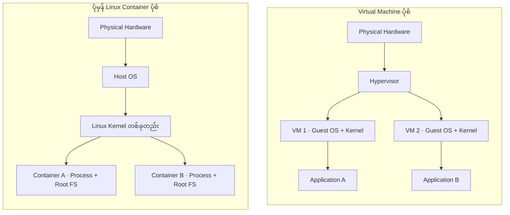
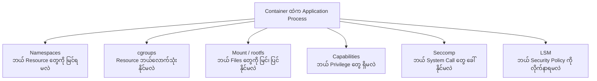
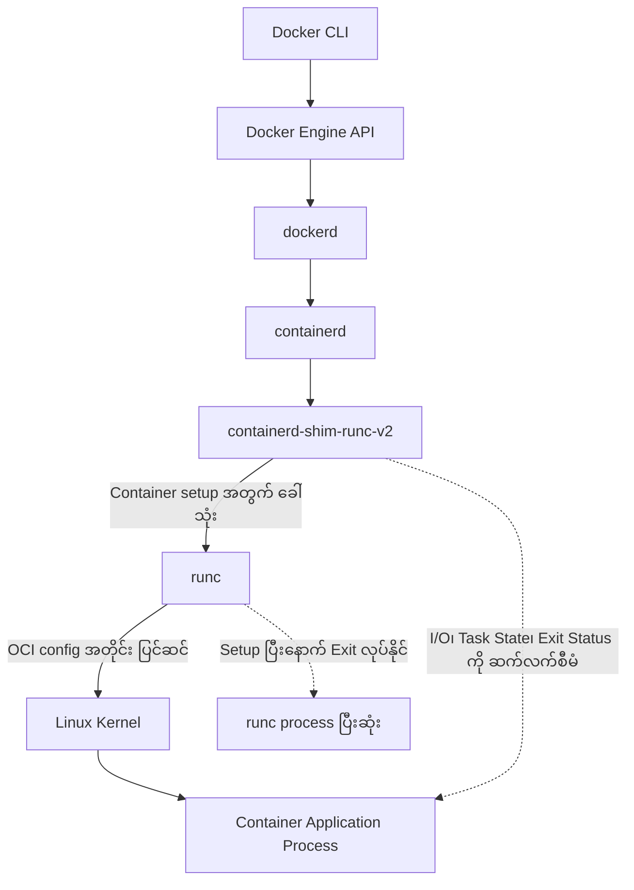
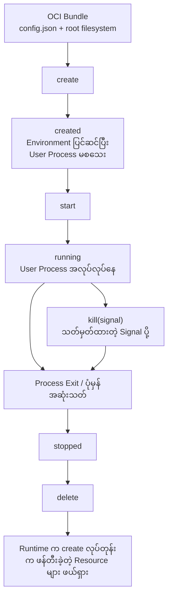
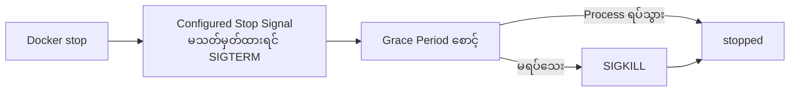

# Chapter 01 — Understanding Containers

> **Chapter status:** Revised manuscript — 9 November 2026  
> **Research snapshot:** 9 November 2026  
> **Lab status:** Designed, not tested


**Linux Containers Under the Hood**  
*Part I — Container Fundamentals*


## 1. Container ကို ဘာကြောင့် အသုံးပြုလာကြသလဲ။

Application တစ်ခုကို ကိုယ့်ကွန်ပျူတာမှာ အဆင်ပြေပြေ အသုံးပြုနိုင်ပေမဲ့ တခြားကွန်ပျူတာတစ်လုံးပေါ်ကို ရွှေ့လိုက်တဲ့အခါ အလုပ်မလုပ်တော့တာမျိုး ကြုံဖူးပါသလား။

ဒီလိုပြဿနာမျိုးဟာ Software Development နဲ့ Server Administration လုပ်ငန်းတွေမှာ မကြာခဏ ကြုံတွေ့ရတတ်ပါတယ်။ တစ်ခါတလေ Application အတွက် လိုအပ်တဲ့ Library မရှိတာကြောင့် ဖြစ်နိုင်သလို၊ တစ်ခါတလေ Software Version မတူတာကြောင့်လည်း ဖြစ်နိုင်ပါတယ်။

ဥပမာ Payment Service တစ်ခုဟာ Python Version 3.12 ကို အသုံးပြုဖို့ လိုအပ်နေပြီး Reporting Service တစ်ခုကတော့ Python Version 3.10 ကိုပဲ အသုံးပြုနိုင်တယ်ဆိုပါစို့။ ဒီ Application နှစ်ခုကို Server တစ်လုံးတည်းမှာ တိုက်ရိုက်ထည့်သွင်းအသုံးပြုတဲ့အခါ Software Version တွေ မတူညီတာကြောင့် ပြဿနာဖြစ်လာနိုင်ပါတယ်။

အထူးသဖြင့် Application တစ်ခုအတွက် Library တစ်ခုကို Update လုပ်လိုက်တဲ့အခါ အခြား Application တစ်ခုကလည်း အဲဒီ Library ကို အသုံးပြုနေရင် အလုပ်မလုပ်တော့တာမျိုး ဖြစ်နိုင်ပါတယ်။

ဒီလိုပြဿနာတွေကို ဖြေရှင်းဖို့ Python Virtual Environment လို နည်းလမ်းတွေကို အသုံးပြုနိုင်ပါတယ်။ Python Virtual Environment က Python Package တွေကို Project တစ်ခုစီအလိုက် သီးခြားခွဲထားပေးနိုင်ပါတယ်။ ဒါပေမဲ့ Process တွေမြင်ရပုံ၊ Filesystem နဲ့ Network ပတ်ဝန်းကျင်တွေကိုတော့ အပြည့်အဝ ခွဲခြားပေးတာ မဟုတ်ပါဘူး။

နောက်ထပ်နည်းလမ်းတစ်ခုက Application တစ်ခုစီအတွက် Virtual Machine (VM) သီးခြားတည်ဆောက်ပေးခြင်းဖြစ်ပါတယ်။ VM တစ်ခုစီမှာ Operating System သီးခြားတစ်ခုစီ အသုံးပြုနိုင်တဲ့အတွက် Application တွေကြားက ပြဿနာတွေကို လျှော့ချနိုင်ပါတယ်။

သို့သော် VM အများအပြား အသုံးပြုလာတဲ့အခါ Operating System တစ်ခုစီကို Update လုပ်ရတယ်၊ Monitoring လုပ်ရတယ်၊ Maintenance လုပ်ရတယ်။ ဒီလုပ်ငန်းတွေဟာ Server အရေအတွက်နဲ့ Application အရေအတွက်များလာတာနဲ့အမျှ ပိုမိုရှုပ်ထွေးလာနိုင်ပါတယ်။

ဒီနေရာမှာ Container နည်းပညာက အခြားရွေးချယ်စရာတစ်ခုအဖြစ် ပေါ်လာပါတယ်။

Container ကို အသုံးပြုတဲ့အခါ Application တစ်ခုအတွက် လိုအပ်တဲ့ Software၊ Library နဲ့ သတ်မှတ်ထားတဲ့ Configuration တွေကို တစ်စုတစ်စည်းတည်း ထည့်သွင်းထားနိုင်ပါတယ်။ အဲဒီအထုပ်ကို Container Image လို့ ခေါ်ပါတယ်။

ဒီ Image ကို အသုံးပြုပြီး Server တစ်လုံးတည်းမှာ Application အမျိုးမျိုးကို သီးခြားပတ်ဝန်းကျင်တွေနဲ့ အလုပ်လုပ်စေနိုင်ပါတယ်။

ဒါပေမဲ့ Container အသုံးပြုလိုက်တာနဲ့ Deployment ပြဿနာအားလုံး ပြေလည်သွားတာတော့ မဟုတ်ပါဘူး။ Host ရဲ့ Linux Kernel၊ CPU Architecture၊ အသုံးပြုမယ့် Data၊ Password နဲ့ Secret များ၊ Network Policy နဲ့ အခြားပြင်ပ Service တွေကိုလည်း သီးခြားစီ စီမံဖို့ လိုအပ်ပါတယ်။

ဥပမာ Application တစ်ခုကို Container Image ထဲမှာ ထည့်ထားပေမဲ့ Database Password ကို Image ထဲမှာ အမြဲတမ်းထည့်ထားဖို့ မသင့်တော်ပါဘူး။ လုံခြုံရေးအရ သီးခြားစီမံထားဖို့ လိုပါတယ်။

ဒါကြောင့် Container ကို Deployment ပြဿနာအားလုံးကို ဖြေရှင်းပေးတဲ့ နည်းပညာလို့ မယူဆသင့်ဘဲ Application တွေရဲ့ ပတ်ဝန်းကျင်မတူညီမှုကို လျှော့ချပေးပြီး စီမံခန့်ခွဲရလွယ်ကူစေတဲ့ နည်းပညာတစ်ခုလို့ နားလည်ထားသင့်ပါတယ်။

ဒီအခန်းမှာ Container ဆိုတာ ဘာလဲ၊ Virtual Machine နဲ့ ဘယ်လိုကွာသလဲ၊ Linux Kernel က Container တွေကို ဘယ်လိုခွဲခြားထိန်းချုပ်ပေးသလဲဆိုတာကို တစ်ဆင့်ချင်း လေ့လာသွားပါမယ်။

## 2. ဒီအခန်းကို လေ့လာပြီးရင် ဘာတွေသိလာမလဲ။

ဒီအခန်းကို ဖတ်ပြီးတဲ့အခါ Container ကို Docker Command တွေ အသုံးပြုပြီး Run လုပ်နိုင်ရုံတင်မဟုတ်ဘဲ အဲဒီနောက်ကွယ်မှာ ဘယ်လိုအလုပ်လုပ်နေသလဲဆိုတာကိုပါ နားလည်လာဖို့ ရည်ရွယ်ထားပါတယ်။

ပထမဆုံးအနေနဲ့ Container နဲ့ Virtual Machine တို့ရဲ့ အလုပ်လုပ်ပုံနဲ့ ကွာခြားချက်ကို ရှင်းပြနိုင်လာပါလိမ့်မယ်။ Container တစ်ခုမှာ ကိုယ်ပိုင် Kernel ရှိသလား၊ Host ရဲ့ Kernel ကိုပဲ အသုံးပြုသလားဆိုတာကိုလည်း ခွဲခြားသိရှိလာပါမယ်။

ထို့အပြင် `chroot`၊ FreeBSD Jails၊ Solaris Zones၊ LXC နဲ့ Docker တို့ရဲ့ သမိုင်းကြောင်းကို လေ့လာပြီး Container နည်းပညာ ဘယ်လိုတိုးတက်လာခဲ့သလဲဆိုတာ သိလာပါမယ်။

နောက်ပိုင်းမှာ Namespace၊ cgroups၊ Capabilities နဲ့ Filesystem Isolation တို့ဟာ Container တစ်ခုကို ဘယ်လိုသီးခြားပတ်ဝန်းကျင်တစ်ခုအဖြစ် ဖန်တီးပေးသလဲဆိုတာကို နားလည်လာပါမယ်။

နောက်ဆုံးမှာ Container Image၊ Container၊ Runtime နဲ့ Engine တို့ရဲ့ အဓိပ္ပာယ်ကို ခွဲခြားသိရှိလာပြီး Docker Command တစ်ခု Run လုပ်တဲ့အခါ နောက်ကွယ်မှာ ဘယ်လိုအစိတ်အပိုင်းတွေ ပူးပေါင်းအလုပ်လုပ်နေသလဲဆိုတာကို လေ့လာသွားပါမယ်။

ဒီအခန်းရဲ့ ရည်ရွယ်ချက်ဟာ အကြောင်းအရာအားလုံးကို အသေးစိတ်နားလည်ပြီးသား ဖြစ်သွားဖို့ မဟုတ်ပါဘူး။ နောက်ပိုင်း Chapter တွေမှာ ပိုမိုနက်ရှိုင်းစွာ လေ့လာရမယ့် အကြောင်းအရာတွေအတွက် အခြေခံအယူအဆတွေကို ရရှိစေဖို့ ဖြစ်ပါတယ်။

## 3. မဖတ်ခင် ကြိုတင်သိထားဖို့ လိုအပ်တာ

ဒီအခန်းကို စတင်လေ့လာဖို့ Docker၊ Kubernetes ဒါမှမဟုတ် Container နည်းပညာတွေကို ကြိုတင်ကျွမ်းကျင်ထားဖို့ မလိုအပ်ပါဘူး။

Linux Terminal ကို အနည်းငယ်အသုံးပြုဖူးပြီး File နဲ့ Folder တွေကို ဘယ်လိုကြည့်ရသလဲဆိုတာ သိထားရင် စတင်နိုင်ပါတယ်။ ဒါ့အပြင် Program တစ်ခု အလုပ်လုပ်နေတဲ့ အခြေအနေကို Process လို့ ခေါ်တယ်ဆိုတာလောက် နားလည်ထားရင် လုံလောက်ပါတယ်။

ဒီအခန်းမှာ Namespace နဲ့ cgroups တို့ရဲ့ အခြေခံအကြောင်းကို မိတ်ဆက်ပေးမှာဖြစ်ပေမဲ့ အဲဒီနည်းပညာတွေရဲ့ အတွင်းပိုင်းလုပ်ဆောင်ပုံကို အသေးစိတ် မလေ့လာသေးပါဘူး။

ဥပမာ `clone()`၊ `unshare()` နဲ့ `setns()` လို Linux System Call တွေ၊ CPU နဲ့ Memory ထိန်းချုပ်ပုံ၊ Capabilities တစ်ခုချင်းစီရဲ့ အဓိပ္ပာယ်နဲ့ Filesystem Mount လုပ်ပုံတွေကို နောက်ပိုင်း Chapter တွေမှာ သီးခြားလေ့လာပါမယ်။

အလားတူ Container Image တွေကို Disk ထဲမှာ ဘယ်လိုသိမ်းထားသလဲဆိုတဲ့ OverlayFS အကြောင်းကို Chapter 07 မှာ ဆက်လက်လေ့လာမှာဖြစ်ပြီး Container Network ဘယ်လိုချိတ်ဆက်သလဲဆိုတာကို Chapter 08 မှာ လေ့လာသွားပါမယ်။

ဒါကြောင့် လက်ရှိအခန်းမှာ အကြောင်းအရာအားလုံးကို အသေးစိတ် နားလည်ဖို့ထက် အခြေခံသဘောတရားတွေကို အရင်နားလည်ထားဖို့ အရေးကြီးပါတယ်။

## 4. Container ဆိုတာ ဘာလဲ။

Container ဆိုတာကို အလွယ်တကူ နားလည်ဖို့ အရင်ဆုံး Application တစ်ခု အလုပ်လုပ်နေတဲ့ ပတ်ဝန်းကျင်ကို စဉ်းစားကြည့်ရအောင်။

Linux Server တစ်လုံးမှာ Web Server နှစ်ခု Run နေတယ်ဆိုပါစို့။ Web Server တစ်ခုစီဟာ Process တစ်ခု သို့မဟုတ် ဆက်စပ်နေတဲ့ Process အများအပြားနဲ့ အလုပ်လုပ်နိုင်ပါတယ်။

ပုံမှန်အခြေအနေမှာ Linux က အဲဒီ Process တွေကို စီမံပေးပါတယ်။ ဒါပေမဲ့ Application တစ်ခုစီကို တခြား Application တွေနဲ့ မရောထွေးစေချင်ဘူးဆိုရင် Process တွေအတွက် သီးခြားအလုပ်လုပ်နိုင်မယ့် ပတ်ဝန်းကျင်တစ်ခု ပြင်ဆင်ပေးဖို့ လိုလာပါတယ်။

ဒီလိုပတ်ဝန်းကျင်တစ်ခု ဖန်တီးရာမှာ Linux Kernel ရဲ့ ခွဲခြားထိန်းချုပ်နိုင်တဲ့ စွမ်းရည်တွေကို အသုံးပြုပါတယ်။

Linux Kernel အမြင်ကနေကြည့်မယ်ဆိုရင် Container ထဲမှာ အလုပ်လုပ်နေတဲ့ Application ဟာ အခြား Linux Application တွေလိုပဲ Process ဖြစ်ပါတယ်။ Web Server ဖြစ်နိုင်သလို Background Worker သို့မဟုတ် အခြား Program တစ်ခုလည်း ဖြစ်နိုင်ပါတယ်။

ဒါကြောင့် Container ဟာ Linux Kernel ထဲမှာ `container` ဆိုတဲ့ Object တစ်ခုကို Command တစ်ခုတည်းနဲ့ ဖန်တီးလိုက်တာမျိုး မဟုတ်ပါဘူး။

Container တစ်ခု ဖြစ်လာဖို့ Linux Kernel ရဲ့ နည်းပညာအမျိုးမျိုးကို ပေါင်းစပ်အသုံးပြုရပါတယ်။ အဲဒီအလုပ်တွေကို Container Runtime က စီစဉ်ပေးပါတယ်။ Application အတွက် ဘယ် Process တွေကို မြင်ရမလဲ၊ ဘယ် File တွေကို အသုံးပြုနိုင်မလဲ၊ CPU နဲ့ Memory ကို ဘယ်လောက်အထိ အသုံးပြုနိုင်မလဲ၊ ဘယ်လို Permission တွေ ရရှိမလဲဆိုတာကို သတ်မှတ်ပေးထားပါတယ်။

ပုံမှန် Linux Container တစ်ခုရဲ့ အရေးကြီးဆုံးအချက်ကတော့ Host ရဲ့ Linux Kernel ကို အတူမျှဝေသုံးခြင်း ဖြစ်ပါတယ်။

Container တစ်ခုစီမှာ Guest Kernel အသစ်တစ်ခုစီ Boot လုပ်ထားတာ မဟုတ်ပါဘူး။ Host Process တွေနဲ့ Container Process တွေကို Linux Kernel တစ်ခုတည်းကပဲ စီမံခန့်ခွဲပေးပါတယ်။

ဒါပေမဲ့ Container ဖြစ်နေရုံနဲ့ လုံခြုံရေးအပြည့်အဝ ရရှိသွားတာ မဟုတ်ပါဘူး။ Runtime က Permission၊ Filesystem၊ Network နဲ့ Security Setting တွေကို ဘယ်လိုပြင်ဆင်ထားသလဲဆိုတာပေါ်မှာလည်း မူတည်ပါတယ်။

ဥပမာ Container တစ်ခုကို အလွန်ကျယ်ပြန့်တဲ့ Administrator Permission ပေးထားမယ်ဆိုရင် Host System အတွက်တောင် အန္တရာယ်ရှိလာနိုင်ပါတယ်။

ဒါကြောင့် Container ဆိုတာ Application တွေကို သီးခြားခွဲပြီး Run လုပ်နိုင်စေတဲ့ နည်းပညာဖြစ်ပေမဲ့ လုံခြုံရေးကိုလည်း မှန်ကန်စွာ စီမံခန့်ခွဲဖို့ လိုအပ်ပါတယ်။

### 4.1 Container က ဘာတွေကို သီးခြားခွဲပေးနိုင်သလဲ။

Container နှစ်ခုကို Linux Server တစ်လုံးတည်းပေါ်မှာ Run လုပ်ထားတယ်လို့ စိတ်ကူးကြည့်ပါ။

ဒီ Container နှစ်ခုဟာ Host System တစ်ခုတည်းကို အသုံးပြုနေကြပေမဲ့ Application တစ်ခုစီအတွက် မြင်ရတဲ့ပတ်ဝန်းကျင်ကို သီးခြားစီ ပြင်ဆင်ပေးနိုင်ပါတယ်။

ဥပမာ Container A ထဲမှာ အလုပ်လုပ်နေတဲ့ Application က ကိုယ့် Container အတွင်းရှိ Process တွေကိုသာ မြင်ရပြီး Host ရဲ့ Process အားလုံးကို မမြင်ရအောင် ပြုလုပ်နိုင်ပါတယ်။ Container B မှာလည်း အလားတူ သီးခြား Process ပတ်ဝန်းကျင် ရှိနိုင်ပါတယ်။

ဒီလို Process တွေ မြင်ရပုံကို ခွဲခြားပေးတာ PID Namespace ဖြစ်ပါတယ်။

တစ်ဖက်မှာ Hostname ကိုလည်း Container တစ်ခုစီအတွက် သီးခြားသတ်မှတ်နိုင်ပါတယ်။ ဥပမာ Container A ရဲ့ Hostname ကို `web-server` လို့ထားပြီး Container B ရဲ့ Hostname ကို `database-server` လို့ သတ်မှတ်ထားနိုင်ပါတယ်။

Network ပိုင်းမှာလည်း Container တစ်ခုစီအတွက် Network Interface၊ IP Address နဲ့ Routing Table တွေကို သီးခြားမြင်တွေ့စေနိုင်ပါတယ်။

Filesystem ပိုင်းမှာတော့ Container တစ်ခုစီကို ကိုယ်ပိုင် Root Filesystem ရှိသလို မြင်တွေ့စေနိုင်ပါတယ်။ ပုံမှန်အားဖြင့် Container တစ်ခုရဲ့ Root Filesystem ကို အခြား Container က တိုက်ရိုက်မမြင်ရပါဘူး။ ဒါပေမဲ့ Host Directory တစ်ခုကို Bind Mount လုပ်ပြီး မျှဝေထားရင် အဲဒီ Directory နဲ့ သက်ဆိုင်တဲ့ File တွေကို Container အတွင်းကနေ မြင်နိုင်၊ အသုံးပြုနိုင်ပါတယ်။

ဒီလိုမြင်ကွင်းကို ခွဲခြားပေးတဲ့အလုပ်မှာ Mount Namespace နဲ့ Filesystem Mount Setting တွေက အရေးပါပါတယ်။ [9]

Resource အသုံးပြုမှုကိုလည်း ထိန်းချုပ်နိုင်ပါတယ်။ ဥပမာ Container A ကို CPU နဲ့ Memory အသုံးပြုမှုအတွက် သတ်မှတ်ချက်တစ်ခု ပေးထားပြီး Container B ကိုတော့ အခြားသတ်မှတ်ချက်တစ်ခု ပေးထားနိုင်ပါတယ်။ ဒီအလုပ်အတွက် cgroups ကို အသုံးပြုပါတယ်။

ထို့အပြင် Container တစ်ခုကို လိုအပ်တဲ့ ခွင့်ပြုချက်တွေပဲ ပေးထားနိုင်ပါတယ်။ မလိုအပ်တဲ့ Administrator Permission တွေကို ဖယ်ထားနိုင်ပါတယ်။

ဒါပေမဲ့ Container တိုင်းမှာ ဒီအရာအားလုံးကို မဖြစ်မနေ သီးခြားခွဲထားရမယ်လို့ မဆိုလိုပါဘူး။

ဥပမာ Container တစ်ခုဟာ Host ရဲ့ Network ကိုပဲ တိုက်ရိုက်အသုံးပြုထားနိုင်ပါတယ်။ နောက်ထပ် Container တစ်ခုကလည်း အခြား Container နဲ့ PID ပတ်ဝန်းကျင်ကို မျှဝေထားနိုင်ပါတယ်။ Resource Limit မသတ်မှတ်ထားတဲ့ Container လည်း ရှိနိုင်ပါတယ်။

ဒီအချက်ကြောင့် Container တစ်ခုကို စစ်ဆေးတဲ့အခါ Container ဖြစ်တယ်ဆိုတဲ့ အမည်ကိုသာ ကြည့်ပြီး ဆုံးဖြတ်လို့ မရပါဘူး။ အဲဒီ Container မှာ တကယ်အသုံးပြုထားတဲ့ Configuration ကိုပါ စစ်ဆေးဖို့ လိုအပ်ပါတယ်။

### 4.2 Container ကို အသုံးပြုရတဲ့ အကြောင်းရင်း

Container ကို အသုံးပြုရတဲ့ အကြောင်းရင်းကို ပိုမြန်တယ်၊ ပိုပေါ့တယ်ဆိုတဲ့ အချက်နှစ်ခုနဲ့ပဲ ရှင်းပြလို့ မရပါဘူး။

အမှန်တကယ် အရေးကြီးတာက Application တစ်ခုကို တည်ဆောက်တဲ့အချိန်၊ Server ပေါ်တင်တဲ့အချိန်နဲ့ နေရာအမျိုးမျိုးမှာ ပြန်လည်အသုံးပြုတဲ့အချိန်တွေမှာ ကြုံတွေ့ရတဲ့ ပြဿနာတွေကို ဘယ်လိုလျှော့ချပေးနိုင်သလဲဆိုတာ ဖြစ်ပါတယ်။

ပထမဆုံး အကျိုးကျေးဇူးက Application အတွက် လိုအပ်တဲ့ Software နဲ့ Library Version တွေကို တစ်စုတစ်စည်းတည်း သိမ်းဆည်းနိုင်ခြင်း ဖြစ်ပါတယ်။

ဥပမာ Developer တစ်ယောက်က ကိုယ့်ကွန်ပျူတာမှာ Application တစ်ခုကို ရေးသားထားတယ်ဆိုပါစို့။ အဲဒီ Application အတွက် Python Version၊ Package နဲ့ Library တွေကို Image ထဲမှာ ထည့်သွင်းထားနိုင်ပါတယ်။ အဲဒီ Image ကို အသုံးပြုပြီး အခြား Server တစ်လုံးပေါ်မှာလည်း Application ကို အလားတူပတ်ဝန်းကျင်နဲ့ Run လုပ်နိုင်ပါတယ်။

ဒါကြောင့် Developer ရဲ့ ကွန်ပျူတာမှာ အလုပ်လုပ်ပေမဲ့ Production Server မှာ မလုပ်တော့တဲ့ ပြဿနာတွေကို လျှော့ချနိုင်ပါတယ်။

နောက်ထပ်အကျိုးကျေးဇူးတစ်ခုက Application တွေကို သီးခြားခွဲပြီး Run လုပ်နိုင်ခြင်းဖြစ်ပါတယ်။ Application တစ်ခုစီအတွက် Process၊ Filesystem၊ Network နဲ့ Permission တွေကို သင့်တော်သလို စီမံနိုင်ပါတယ်။ ဒီလိုပြုလုပ်ခြင်းကြောင့် Application တစ်ခုရဲ့ ပြဿနာက အခြား Application တွေကို မတော်တဆ ထိခိုက်စေနိုင်မှုကို လျှော့ချနိုင်ပါတယ်။

ဒါပေမဲ့ ဒီသီးခြားခွဲထားမှုဟာ Virtual Machine ရဲ့ Kernel Boundary နဲ့ တူညီတယ်လို့ မယူဆသင့်ပါဘူး။

Container ရဲ့ နောက်ထပ်အားသာချက်တစ်ခုက Deployment ကို ထပ်မံပြုလုပ်ရတာ ပိုမိုလွယ်ကူခြင်းဖြစ်ပါတယ်။ Image တစ်ခုကို Tag သို့မဟုတ် Digest နဲ့ သတ်မှတ်ထားပြီး တူညီတဲ့ Image ကို Development၊ Testing နဲ့ Production Environment တွေမှာ ပြန်လည်အသုံးပြုနိုင်ပါတယ်။

သို့သော် Application Configuration၊ Password၊ Persistent Data နဲ့ ပြင်ပ Service တွေကို သီးခြားစီ စီမံဖို့ လိုအပ်နေဆဲဖြစ်ပါတယ်။

နောက်ဆုံးအနေနဲ့ Host ရဲ့ Resource တွေကို ပိုမိုထိရောက်စွာ အသုံးပြုနိုင်ခြင်းဖြစ်ပါတယ်။ Container တစ်ခုစီအတွက် Operating System Kernel အသစ်တစ်ခုစီ Boot လုပ်စရာ မလိုတဲ့အတွက် VM အများအပြား Run လုပ်ခြင်းထက် စတင်အလုပ်လုပ်ဖို့ လိုအပ်တဲ့ အပိုကုန်ကျစရိတ် နည်းနိုင်ပါတယ်။

ဒါပေမဲ့ Container ဟာ အခြေအနေတိုင်းမှာ VM ထက် ပိုမြန်တယ်လို့ မဆိုနိုင်ပါဘူး။ Performance ဟာ Application ရဲ့ အလုပ်လုပ်ပုံ၊ CPU၊ Memory၊ Disk အသုံးပြုမှုနဲ့ Runtime Configuration တွေပေါ်မှာ မူတည်ပါတယ်။

## 5. Container နဲ့ Virtual Machine ဘာကွာသလဲ။

Container နဲ့ Virtual Machine တို့ကို နှိုင်းယှဉ်တဲ့အခါ အမြဲတမ်း တွေ့ရတဲ့ စကားလုံးတွေက ပေါ့ပါးတယ်၊ လေးလံတယ်၊ မြန်တယ်၊ နှေးတယ် စတာတွေဖြစ်ပါတယ်။

ဒါပေမဲ့ တကယ်တမ်း အရေးကြီးတဲ့ ကွာခြားချက်က Application တွေဟာ ဘယ် Linux Kernel ကို အသုံးပြုနေကြသလဲဆိုတာ ဖြစ်ပါတယ်။

ဒီအချက်ကို နားလည်ဖို့ Virtual Machine ရဲ့ အလုပ်လုပ်ပုံကို အရင်လေ့လာကြည့်ရအောင်။

### 5.1 Virtual Machine ဆိုတာဘာလဲ။

Virtual Machine ဆိုတာ Physical Computer တစ်လုံးရဲ့ Hardware အရင်းအမြစ်တွေကို အသုံးပြုပြီး Computer အတုတစ်လုံး ဖန်တီးပေးတဲ့ နည်းပညာဖြစ်ပါတယ်။

VM တစ်ခုမှာ ကိုယ်ပိုင် CPU၊ Memory၊ Storage နဲ့ Network Device တွေ ရှိသလို အသုံးပြုနိုင်ပါတယ်။ အဲဒီ Hardware တွေဟာ Physical Hardware အစစ်တွေ မဟုတ်ဘဲ Software ကနေ ဖန်တီးပေးထားတဲ့ Virtual Hardware တွေ ဖြစ်ပါတယ်။

VM တွေကို ဖန်တီးပြီး စီမံပေးတဲ့ Software ကို Hypervisor လို့ ခေါ်ပါတယ်။

ဥပမာ Physical Server တစ်လုံးမှာ RAM 64 GB ရှိတယ်ဆိုပါစို့။ Hypervisor ကို အသုံးပြုပြီး VM သုံးခု ဖန်တီးနိုင်ပါတယ်။ VM တစ်ခုစီအတွက် CPU နဲ့ Memory ကို သီးခြားစီ သတ်မှတ်ပေးနိုင်ပါတယ်။

VM တစ်ခုစီမှာ Windows သို့မဟုတ် Linux လို Operating System တစ်ခုစီ Install လုပ်နိုင်ပါတယ်။ ဒီ Operating System ကို Guest OS လို့ ခေါ်ပါတယ်။

Guest OS တစ်ခုစီမှာ ကိုယ်ပိုင် Kernel နဲ့ Application တွေ ရှိပါတယ်။ ဒါကြောင့် VM တစ်ခုထဲက Application တွေကို အဲဒီ VM ရဲ့ Guest Kernel က စီမံပေးပြီး အခြား VM တွေရဲ့ Application တွေကိုတော့ သက်ဆိုင်ရာ Guest Kernel တွေက သီးခြားစီ စီမံပေးပါတယ်။

Hypervisor တွေကို ပုံမှန်အားဖြင့် Type 1 နဲ့ Type 2 ဆိုပြီး နှစ်မျိုးခွဲခြားလေ့ရှိပါတယ်။

Type 1 Hypervisor က Physical Hardware ပေါ်မှာ တိုက်ရိုက် အလုပ်လုပ်ပါတယ်။ Type 2 Hypervisor ကတော့ မူလ Operating System တစ်ခုအပေါ်မှာ Software တစ်ခုအဖြစ် အလုပ်လုပ်ပါတယ်။

ဥပမာ Type 2 Hypervisor ကို အသုံးပြုပြီး Windows Computer တစ်လုံးအတွင်း Linux VM တစ်ခု Run လုပ်နိုင်ပါတယ်။

နှစ်မျိုးလုံးမှာ Guest OS တစ်ခုစီအတွက် ကိုယ်ပိုင် Kernel ရှိနေတယ်ဆိုတာက အရေးကြီးဆုံးအချက်ဖြစ်ပါတယ်။

VM ရှိနေတာတစ်ခုတည်းနဲ့ Security ပြဿနာအားလုံး ပြေလည်သွားတာတော့ မဟုတ်ပါဘူး။ Hypervisor၊ Host OS၊ Guest OS နဲ့ Virtual Device တွေကိုလည်း မှန်ကန်စွာ စီမံဖို့ လိုအပ်ပါတယ်။

### 5.2 Linux OS-level Container

ပုံမှန် Linux Container တွေရဲ့ အလုပ်လုပ်ပုံက VM နဲ့ မတူပါဘူး။

VM တစ်ခုစီမှာ Guest Kernel သီးခြားရှိပေမဲ့ Linux Container တွေကတော့ Host ရဲ့ Linux Kernel ကိုပဲ အတူမျှဝေသုံးကြပါတယ်။

ဒီ Container တွေဟာ ကိုယ်ပိုင် Root Filesystem ရှိသလို အလုပ်လုပ်နိုင်ပါတယ်။ ဒါပေမဲ့ Container နှစ်ခုစလုံးရဲ့ Process တွေကို Linux Kernel တစ်ခုတည်းကပဲ စီမံပေးနေပါတယ်။

အောက်ကပုံမှာ VM နဲ့ ပုံမှန် Linux Container တို့ရဲ့ Kernel Boundary ကွာခြားချက်ကို ကြည့်နိုင်ပါတယ်။ VM တစ်ခုစီမှာ Guest Kernel ရှိပေမဲ့ Container တွေကတော့ Host ရဲ့ Linux Kernel ကို မျှဝေသုံးကြတာကို သတိပြုပါ။



Container တစ်ခုစီမှာ Guest Kernel အသစ်တစ်ခု Boot လုပ်စရာမလိုတာကြောင့် VM လို Operating System အပြည့်အစုံတစ်ခုစီ လည်ပတ်နေစရာ မလိုပါဘူး။

ဒါဟာ Container တွေ ပေါ့ပါးပြီး စတင်အသုံးပြုရတာ ပိုမြန်နိုင်တဲ့ အကြောင်းရင်းတွေထဲက တစ်ခုဖြစ်ပါတယ်။

### 5.3 Container နဲ့ VM ရဲ့ အဓိကကွာခြားချက်များ

| အကြောင်းအရာ | Container | Virtual Machine |
|---|---|---|
| Kernel | Host Kernel ကို မျှဝေသုံးတယ် | Guest Kernel သီးခြားရှိတယ် |
| Filesystem | Container အလိုက် Root FS ခွဲနိုင်တယ် | VM အလိုက် Virtual Disk ရှိတယ် |
| စတင်အသုံးပြုမှု | Guest Kernel Boot မလို | Guest OS Boot လုပ်ရတယ် |
| Resource | ပုံမှန်အားဖြင့် အပိုကုန်ကျစရိတ် နည်းတယ် | Guest OS အတွက် Resource လိုတယ် |
| Isolation | Kernel ရဲ့ ခွဲခြားထိန်းချုပ်မှုများ | Hypervisor နဲ့ Guest OS Boundary |
| OS ရွေးချယ်မှု | Host Kernel နဲ့ ကိုက်ညီမှု လိုတယ် | Hypervisor ပံ့ပိုးတဲ့ Guest OS မျိုးစုံ သုံးနိုင်တယ် |

ဒီနေရာမှာ Container က VM ထက် အမြဲတမ်း ပိုကောင်းတယ်လို့ မယူဆသင့်ပါဘူး။

ဥပမာ Server တစ်လုံးမှာ မတူညီတဲ့ Operating System တွေကို သီးခြား Kernel နဲ့ Run လုပ်ဖို့ လိုအပ်တယ်ဆိုရင် VM က ပိုသင့်တော်နိုင်ပါတယ်။

Application အများအပြားကို တူညီတဲ့ Linux Kernel ပေါ်မှာ ပေါ့ပါးစွာ Run လုပ်ချင်တယ်ဆိုရင်တော့ Container က ပိုသင့်တော်နိုင်ပါတယ်။

လက်တွေ့လုပ်ငန်းတွေမှာ VM နဲ့ Container ကို အတူတကွ အသုံးပြုတာလည်း ရှိပါတယ်။ ဥပမာ VM တစ်ခုအတွင်း Linux Operating System တင်ထားပြီး အဲဒီ VM ရဲ့ Kernel ပေါ်မှာ Container အများအပြား Run လုပ်နိုင်ပါတယ်။

ဒီလိုအခြေအနေမှာ Container တွေဟာ Physical Host ရဲ့ Kernel ကို တိုက်ရိုက်မျှဝေသုံးတာ မဟုတ်ဘဲ VM အတွင်းရှိ Guest Linux Kernel ကို မျှဝေသုံးနေကြတာ ဖြစ်ပါတယ်။

### 5.4 Container လို့ခေါ်တိုင်း Host Kernel ကို မျှဝေသုံးတာလား။

ယခုအထိ ရှင်းပြခဲ့တဲ့ Container တွေဟာ ပုံမှန် Linux OS-level Container တွေကို အခြေခံထားပါတယ်။

ဒါပေမဲ့ Container လို့ခေါ်တိုင်း အောက်ခံနည်းပညာ အားလုံး တူညီနေကြတာတော့ မဟုတ်ပါဘူး။

ဥပမာ Kata Containers ဆိုတဲ့ နည်းပညာတစ်ခု ရှိပါတယ်။ ဒီနည်းပညာက Container တွေရဲ့ အသုံးပြုပုံနဲ့ Workflow ကို ထိန်းသိမ်းထားနိုင်ပေမဲ့ အောက်ခံမှာ Lightweight Virtual Machine ကို အသုံးပြုပြီး Guest Kernel သီးခြား Run လုပ်စေပါတယ်။ [20]

ဒါကြောင့် Kata Containers ကို အသုံးပြုထားတဲ့အခါ Container Workload က Physical Host ရဲ့ Kernel ကို တိုက်ရိုက်မျှဝေသုံးနေတာ မဟုတ်ပါဘူး။

ဒီအချက်ကို သိထားဖို့ အရေးကြီးပါတယ်။ Container ဆိုတဲ့စကားလုံးဟာ Application တွေကို စီမံတဲ့ နည်းလမ်းနဲ့ Image Format ကို ရည်ညွှန်းနိုင်သလို အောက်ခံ Isolation နည်းပညာကတော့ မတူညီနိုင်ပါဘူး။

ဒီစာအုပ်မှာ Linux Container လို့ ပြောတဲ့အခါ ပုံမှန် Linux OS-level Container ပုံစံကို အဓိက ရည်ညွှန်းသွားပါမယ်။

## 6. Container များဆီသို့ ရောက်လာတဲ့ သမိုင်းလမ်းကြောင်း

Container အကြောင်း စလေ့လာတဲ့အခါ Docker ကို ပထမဆုံး သတိရမိကြပါတယ်။ Docker ဟာ Container နည်းပညာကို လူသိများလာအောင် အရေးပါတဲ့ အခန်းကဏ္ဍကနေ ကူညီပေးခဲ့တာ မှန်ပါတယ်။ ဒါပေမဲ့ Container နည်းပညာရဲ့ အခြေခံစိတ်ကူးတွေဟာ Docker မပေါ်ခင်ကတည်းက ရှိနေခဲ့ပါတယ်။

Operating System တစ်ခုတည်းအတွင်းမှာ Application တွေကို သီးခြားခွဲပြီး Run လုပ်နိုင်ဖို့ Unix နဲ့ အခြား Operating System တွေမှာ နည်းလမ်းအမျိုးမျိုး တီထွင်ခဲ့ကြပါတယ်။ အောက်က Timeline က အဲဒီသမိုင်းလမ်းကြောင်းထဲက အရေးပါတဲ့ မှတ်တိုင်အချို့ကို စုစည်းပြထားတာပါ။

| အချိန် | နည်းပညာ | အဓိကအချက် |
|---|---|---|
| 1979 ဝန်းကျင် | Unix `chroot` | Process တစ်ခုအတွက် မြင်ရတဲ့ Root Directory ကို ပြောင်းပေးတယ်။ [1][2] |
| 2000 | FreeBSD Jails | `chroot` အယူအဆကို Filesystem၊ User နဲ့ Network ပိုင်းအထိ ချဲ့ထွင်တယ်။ [3] |
| 2005 | Solaris Zones | Solaris 10 မှာ OS Service တွေကို သီးခြား Environment အဖြစ် စီမံနိုင်စေတယ်။ [4] |
| 2008 မှစ၍ | LXC | Linux Kernel ရဲ့ Namespace၊ cgroups စတဲ့ Feature တွေကို အသုံးပြုပြီး System Container တွေ ဖန်တီးတယ်။ [5] |
| 15–23 မတ် 2013 | Docker | Public Demo ပြသပြီး မကြာခင် ပထမဆုံး Public Release ထုတ်ဝေတယ်။ [6][7] |
| 22 ဇွန် 2015 | OCI | Container Image၊ Runtime နဲ့ Distribution အတွက် Open Standard တွေ ဖန်တီးဖို့ စတင်ဖွဲ့စည်းတယ်။ [8] |

ဒီနည်းပညာတွေဟာ အားလုံး တစ်ခုကနေတစ်ခု တိုက်ရိုက် ဆင်းသက်လာတယ်လို့ မဆိုလိုပါဘူး။ Operating System မတူတဲ့ နေရာတွေမှာ သီးခြားတိုးတက်လာခဲ့ကြပေမဲ့ Application တွေကို ခွဲခြား Run လုပ်ဖို့ဆိုတဲ့ ပြဿနာတူကို ဖြေရှင်းဖို့ ကြိုးစားခဲ့ကြတာပါ။

### 6.1 `chroot`

`chroot` ဟာ Container သမိုင်းကြောင်းမှာ အစောပိုင်းကတည်းက ရှိခဲ့တဲ့ Filesystem နည်းလမ်းတစ်ခုဖြစ်ပါတယ်။ Unix Version 7 ခေတ်၊ 1979 ဝန်းကျင်ကတည်းက အသုံးပြုလာခဲ့ပါတယ်။ [1]

`chroot()` ရဲ့ အဓိကအလုပ်က Process တစ်ခုနဲ့ သူ့ရဲ့ Child Process တွေအတွက် File Path တွေကို ဖြေရှင်းရာမှာ အသုံးပြုမယ့် Root Directory ကို ပြောင်းပေးတာပါ။ ဥပမာ Process ရဲ့ Root ကို `/srv/jail` လို့ သတ်မှတ်ထားရင် `/etc/app.conf` ကို ဖွင့်တဲ့အခါ Host ရဲ့ `/etc/app.conf` မဟုတ်ဘဲ `/srv/jail/etc/app.conf` ကို အခြေခံပြီး ရှာပါလိမ့်မယ်။ [2]

ဒါပေမဲ့ `chroot()` တစ်ခုတည်းနဲ့ လုံခြုံတဲ့ Sandbox တစ်ခု ပြည့်စုံသွားတာ မဟုတ်ပါဘူး။ Root Directory ပြောင်းတာဟာ Process ရဲ့ PID၊ Network၊ CPU၊ Memory နဲ့ Permission တွေကို သီးခြားခွဲပေးတာ မဟုတ်သလို၊ လက်ရှိဖွင့်ထားတဲ့ File Descriptor တွေကိုလည်း အလိုအလျောက် ပိတ်ပေးတာ မဟုတ်ပါဘူး။ ဒီကွာခြားချက်ကို `chroot` ကို လုံခြုံရေးအပြည့်ရှိတဲ့ Container လို့ မယူဆဖို့ သတိထားပါ။ [2]

### 6.2 FreeBSD Jails

FreeBSD Jails ကို FreeBSD 4.0 မှာ ထည့်သွင်းခဲ့ပြီး FreeBSD Project ရဲ့ Release မှတ်တမ်းအရ 4.0 ကို 2000 ခုနှစ် မတ်လမှာ ထုတ်ဝေခဲ့ပါတယ်။ [3]

`chroot` က Filesystem Path တွေကို အဓိကထားပြီး ပြောင်းပေးတာဖြစ်ပေမဲ့ Jails က Filesystem အပြင် User နဲ့ Network Subsystem တို့ကိုပါ သီးခြားပတ်ဝန်းကျင်အဖြစ် စီမံနိုင်စေပါတယ်။ ဒါကြောင့် FreeBSD Server တစ်လုံးပေါ်မှာ Service အမျိုးမျိုးကို Jail တစ်ခုစီအတွင်း သီးခြား Run လုပ်နိုင်ပါတယ်။ [3]

FreeBSD Jails နဲ့ Linux Namespaces တို့ဟာ ရည်ရွယ်ချက်ချင်း ဆင်တူပေမဲ့ အတွင်းပိုင်းလုပ်ဆောင်ပုံနဲ့ Kernel API တွေ မတူကြပါဘူး။ Jails ကို Linux Namespaces ရဲ့ ပုံစံတစ်မျိုးလို့ မယူဆသင့်ပါဘူး။

### 6.3 Solaris Zones

Solaris Zones ဟာ Solaris Operating System တစ်ခုတည်းအတွင်း Application နဲ့ Service တွေအတွက် သီးခြား Environment တွေ ဖန်တီးပေးတဲ့ နည်းပညာဖြစ်ပါတယ်။ Solaris 10 3/05 Release မှာ Zones ကို Operating System Service တွေကို Virtualize လုပ်ပြီး Isolated Environment ပေးနိုင်တဲ့ နည်းပညာအဖြစ် မိတ်ဆက်ခဲ့ပါတယ်။ [4]

Zone တစ်ခုစီဟာ ကိုယ်ပိုင်စနစ်တစ်ခုလို အလုပ်လုပ်နိုင်ပေမဲ့ အောက်ခံ Solaris OS Instance တစ်ခုတည်းရဲ့ စီမံခန့်ခွဲမှုအောက်မှာ ရှိနေပါတယ်။ ဒီအချက်ကြောင့် VM တစ်ခုစီမှာ Guest OS သီးခြား Boot လုပ်တဲ့ပုံစံနဲ့ မတူပါဘူး။ [4]

### 6.4 LXC — Linux Containers

LXC ရဲ့ အရှည်ကောက်က Linux Containers ဖြစ်ပါတယ်။ LXC Project ဟာ 2008 ခုနှစ်ကစပြီး ဖွံ့ဖြိုးတိုးတက်လာခဲ့တဲ့ Low-level Linux Container Runtime တစ်ခုဖြစ်ပါတယ်။ [5]

LXC က Linux Kernel ရဲ့ Namespaces၊ Control Groups နဲ့ Security Feature တွေကို ပေါင်းစပ်အသုံးပြုပြီး VM နဲ့ ဆင်တူတဲ့ System Container Environment တွေ ဖန်တီးနိုင်ပါတယ်။ [5]

ဒါကြောင့် LXC ကို `chroot` ထက် Command ပိုများတဲ့ Tool တစ်ခုလို့ပဲ နားလည်ထားလို့ မရပါဘူး။ Linux Kernel ရဲ့ Isolation နဲ့ Resource Control စွမ်းရည်တွေကို ပေါင်းစပ်အသုံးပြုတဲ့ Project တစ်ခုဖြစ်ပါတယ်။

### 6.5 Docker

Docker ဟာ Container နည်းပညာကို ပထမဆုံး တီထွင်ခဲ့တာ မဟုတ်ပါဘူး။ ဒါပေမဲ့ Application တစ်ခုကို Build လုပ်ခြင်း၊ Image အဖြစ် Package ပြုလုပ်ခြင်း၊ Registry မှာ မျှဝေခြင်းနဲ့ အခြားနေရာမှာ ပြန် Run လုပ်ခြင်းတို့ကို တစ်ဆက်တည်း လုပ်ဆောင်နိုင်တဲ့ Workflow ကို ပိုမိုလွယ်ကူစေခဲ့ပါတယ်။

Docker ကို 2013 ခုနှစ် မတ်လ 15 ရက်နေ့ PyCon မှာ ပထမဆုံး Public Demo ပြသခဲ့ပါတယ်။ ပထမဆုံး Public Release ဖြစ်တဲ့ Docker 0.1.0 ကို မတ်လ 23 ရက်နေ့မှာ ထုတ်ဝေခဲ့ပါတယ်။ [6][7]

ဥပမာ အောက်ပါ Command တစ်ခုနဲ့ Nginx Web Server ကို စတင် Run လုပ်နိုင်ပါတယ်။

```bash
docker run nginx
```

ဒီ Command ကို ရိုးရှင်းစွာ ရိုက်နိုင်ပေမဲ့ နောက်ကွယ်မှာ Image ရယူခြင်း၊ Container Configuration ပြင်ဆင်ခြင်း၊ Runtime ကို ခေါ်သုံးခြင်းနဲ့ Linux Kernel ကို အသုံးပြုခြင်းတို့ ပါဝင်နေပါတယ်။ အဲဒီ Component တွေကို Section 8 မှာ ပြန်လည်ကြည့်ပါမယ်။

### 6.6 Open Container Initiative (OCI)

Container Tool တွေ များပြားလာတဲ့အခါ Image Format နဲ့ Runtime အလုပ်လုပ်ပုံတွေ တစ်ခုနဲ့တစ်ခု မကိုက်ညီရင် Tool တစ်ခုက ဖန်တီးထားတဲ့ Image ကို အခြား Tool တစ်ခုမှာ အသုံးပြုဖို့ အခက်အခဲ ရှိလာနိုင်ပါတယ်။

ဒီလိုအခြေအနေကို လျှော့ချဖို့ Docker၊ CoreOS နဲ့ Container လုပ်ငန်းက အခြားအဖွဲ့အစည်းတွေ ပူးပေါင်းပြီး Linux Foundation အောက်မှာ Open Container Initiative (OCI) ကို 2015 ခုနှစ် ဇွန်လ 22 ရက်နေ့မှာ စတင်ဖွဲ့စည်းခဲ့ပါတယ်။ [8]

OCI မှာ အဓိက Specification သုံးမျိုး ရှိပါတယ်။

| Specification | ဘာကို သတ်မှတ်ပေးသလဲ။ |
|---|---|
| **Image Specification** | Image Manifest၊ Layer၊ Configuration နဲ့ Image Format ကို သတ်မှတ်ပေးတယ်။ [15] |
| **Runtime Specification** | Disk ပေါ်မှာ ပြင်ဆင်ထားတဲ့ OCI Bundle ကို Runtime က ဘယ်လိုဖန်တီး၊ စတင်၊ Signal ပို့ပြီး ဖယ်ရှားရမယ်ဆိုတာ သတ်မှတ်ပေးတယ်။ [14] |
| **Distribution Specification** | Registry နဲ့ Tool တွေကြား OCI Content တွေကို ဘယ်လို Push၊ Pull နဲ့ မျှဝေမယ်ဆိုတဲ့ API လုပ်ထုံးလုပ်နည်းကို သတ်မှတ်ပေးတယ်။ [16] |

OCI ဟာ Docker Engine တစ်ခုလုံးကို Standard သတ်မှတ်ထားတာ မဟုတ်သလို Kubernetes ရဲ့ လုပ်ဆောင်ပုံအားလုံးကိုလည်း သတ်မှတ်ပေးတာ မဟုတ်ပါဘူး။ အဓိကက Image Format၊ Runtime Interface နဲ့ Content Distribution တို့အတွက် အပြန်အလှန် ကိုက်ညီနိုင်တဲ့ Standard တွေ ပံ့ပိုးပေးဖို့ ဖြစ်ပါတယ်။ [8]

## 7. Container Isolation မှာ Linux Kernel ရဲ့ အခန်းကဏ္ဍ

Container တစ်ခုကို ဖန်တီးတဲ့အခါ Namespace တစ်ခုတည်းနဲ့ အလုပ်ပြီးသွားတာ မဟုတ်ပါဘူး။ Application တွေ မြင်ရတဲ့ပတ်ဝန်းကျင်၊ Resource အသုံးပြုမှု၊ Permission၊ Filesystem နဲ့ System Call တွေကို သီးခြားစီ စီမံဖို့ လိုပါတယ်။ ဒီအလုပ်တွေကို Linux Kernel Feature အမျိုးမျိုး ပူးပေါင်းလုပ်ဆောင်ပေးပါတယ်။

အရင်ဆုံး အဲဒီ Feature တွေရဲ့ တာဝန်ကို တစ်နေရာတည်းမှာ ကြည့်ရအောင်။

| Mechanism | အဓိကတာဝန် | ဥပမာ |
|---|---|---|
| Namespaces | Process တွေ မြင်ရတဲ့ System Resource ပတ်ဝန်းကျင်ကို ခွဲပေးတယ်။ | ကိုယ်ပိုင် PID၊ Hostname၊ Network View |
| cgroups | Process အုပ်စုရဲ့ Resource အသုံးပြုမှုကို စောင့်ကြည့်၊ ထိန်းချုပ်တယ်။ | CPU၊ Memory၊ I/O Limit |
| Capabilities | Root နဲ့ ဆက်စပ်တဲ့ Privilege တွေကို သီးခြားခွဲပေးတယ်။ | လိုအပ်မှ `CAP_NET_ADMIN` ပေးခြင်း |
| Mount နဲ့ Root Filesystem | Container အတွက် မြင်ရမယ့် Filesystem Tree ကို ပြင်ဆင်တယ်။ | ကိုယ်ပိုင် `rootfs`၊ Read-only Mount |
| Seccomp | Process က ခေါ်နိုင်တဲ့ System Call တွေကို Filter လုပ်တယ်။ | မလိုအပ်တဲ့ System Call ပိတ်ခြင်း |
| LSM | အပို Security Policy တွေကို Kernel ထဲမှာ အကောင်အထည်ဖော်တယ်။ | SELinux၊ AppArmor |

ဒီပုံက Mechanism တစ်ခုချင်းစီရဲ့ တာဝန်ကွဲပြားပုံကို အကျဉ်းချုပ်ပြထားတာပါ။ Container တစ်ခုရဲ့ Isolation နဲ့ Security ဟာ ဒီအရာတွေကို ဘယ်လိုပေါင်းစပ် Configuration လုပ်ထားသလဲဆိုတာပေါ် မူတည်ပါတယ်။



### 7.1 Namespaces — Application တွေ မြင်ရတဲ့ပတ်ဝန်းကျင်ကို ခွဲခြားခြင်း

Namespace ဆိုတာ Linux Process တွေကို System Resource အချို့အတွက် ကိုယ်ပိုင်ပတ်ဝန်းကျင် ရှိသလို မြင်တွေ့စေတဲ့ နည်းပညာဖြစ်ပါတယ်။ Namespace တစ်ခုအတွင်းက Process တွေ မြင်ရတဲ့ Resource ပြောင်းလဲမှုဟာ အခြား Namespace ထဲက Process တွေကို ပုံမှန်အားဖြင့် တိုက်ရိုက်မမြင်စေပါဘူး။ [9]

Linux မှာ အဓိက Namespace အမျိုးအစား ရှစ်မျိုး ရှိပါတယ်။ [9]

| Namespace | ဘာကို ခွဲခြားပေးသလဲ |
|---|---|
| PID | Process ID နဲ့ Process တွေ မြင်ရပုံ |
| Mount | Mount Point တွေ မြင်ရပုံ |
| Network | Network Device၊ Protocol Stack၊ Port စသည် |
| UTS | Hostname နဲ့ NIS Domain Name |
| IPC | System V IPC နဲ့ POSIX Message Queue |
| User | User ID နဲ့ Group ID Mapping |
| Cgroup | Cgroup Root Directory ကို မြင်ရပုံ |
| Time | Boot နဲ့ Monotonic Clock အချို့ရဲ့ Offset |

ဥပမာ PID Namespace အသစ်တစ်ခုထဲက Process တွေဟာ အဲဒီ Namespace အတွင်းက Process ID တွေကိုပဲ ပုံမှန်မြင်ရပါတယ်။ Network Namespace ကတော့ Network Device၊ Routing Table နဲ့ Port တို့အတွက် သီးခြား Network View တစ်ခု ဖန်တီးပေးနိုင်ပါတယ်။ [9]

Namespace က Resource ပမာဏကို ကန့်သတ်ပေးတာ မဟုတ်ပါဘူး။ PID Namespace ရှိတာနဲ့ CPU အသုံးပြုမှုကို အလိုအလျောက် Limit လုပ်ထားတယ်လို့ မဆိုနိုင်ပါဘူး။ အဲဒီအလုပ်အတွက် cgroups ကို သုံးပါတယ်။

Namespace ရှစ်မျိုးရှိတာကြောင့် Container တစ်ခုစီမှာ ရှစ်မျိုးလုံးကို မဖြစ်မနေ သီးခြားဖန်တီးထားရမယ်လို့လည်း မဆိုလိုပါဘူး။ Runtime Configuration အလိုက် Namespace တချို့ကို မျှဝေထားနိုင်ပါတယ်။

### 7.2 cgroups — CPU နဲ့ Memory အသုံးပြုမှုကို စီမံခြင်း

Namespace က Process တွေ မြင်ရတဲ့ပတ်ဝန်းကျင်ကို ခွဲပေးတယ်ဆိုတာ သိခဲ့ပါပြီ။ ဒါပေမဲ့ Container တစ်ခုက CPU၊ Memory ဒါမှမဟုတ် I/O ကို အလွန်အကျွံ အသုံးပြုလာရင် ဘယ်လိုထိန်းချုပ်မလဲဆိုတာလည်း စဉ်းစားဖို့ လိုပါတယ်။

ဒီအတွက် Linux မှာ Control Groups (cgroups) ကို အသုံးပြုပါတယ်။ cgroups က Process တွေကို အုပ်စုဖွဲ့ပြီး Resource အသုံးပြုမှုကို စောင့်ကြည့်၊ စာရင်းသွင်းနဲ့ သတ်မှတ်ချက်အတိုင်း ကန့်သတ်နိုင်တဲ့ Kernel Feature ဖြစ်ပါတယ်။ [10]

ဥပမာ Service သုံးခုအတွက် Memory Limit မတူညီစွာ သတ်မှတ်ထားနိုင်ပါတယ်။ ဒါပေမဲ့ cgroups ဟာ Application တစ်ခုရဲ့ Memory Leak ကို ပြုပြင်ပေးတာ မဟုတ်ပါဘူး။ အသုံးပြုမှုကို ထိန်းချုပ်ပေးတာသာ ဖြစ်ပါတယ်။

မှတ်ထားရမယ့် ကွာခြားချက်က ရိုးရှင်းပါတယ် — **Namespace က ဘာကို မြင်ရမလဲဆိုတာ ခွဲပေးပြီး cgroups က Resource ဘယ်လောက်သုံးနိုင်မလဲဆိုတာ စီမံပေးပါတယ်။**

### 7.3 Capabilities — Root ခွင့်ပြုချက်ကို အပိုင်းလိုက် ခွဲခြားခြင်း

Linux မှာ Root User နဲ့ ဆက်စပ်တဲ့ Privilege တွေကို အရင်တုန်းက အုပ်စုကြီးတစ်ခုလို စဉ်းစားခဲ့ကြပါတယ်။ Linux Capabilities ကတော့ အဲဒီ Privilege တွေကို ပိုမိုအသေးစိတ်တဲ့ အခွင့်အာဏာတွေအဖြစ် ခွဲပေးနိုင်ပါတယ်။ [11]

ဥပမာ Network Interface၊ Routing နဲ့ အခြား Network Administration လုပ်ဆောင်ချက်တွေ လိုအပ်တဲ့ Process တစ်ခုကို `CAP_NET_ADMIN` ပေးနိုင်ပါတယ်။ ဒီအတွက် Root ရဲ့ အခြား Privilege အားလုံးကိုပါ ပေးဖို့ မလိုအပ်ပါဘူး။ [11]

Container အတွင်းက User ကို `root` လို့ မြင်ရတာနဲ့ Host System ပေါ်မှာ Root Permission အပြည့်ရနေတယ်လို့ မယူဆသင့်ပါဘူး။ User Namespace Mapping နဲ့ Capability Set တွေပေါ်မူတည်ပြီး အခွင့်အာဏာ ကွာခြားနိုင်ပါတယ်။ ဒါပေမဲ့ Privileged Container သို့မဟုတ် Capability အလွန်များစွာ ပေးထားတဲ့ Container ဟာ Host အတွက် အန္တရာယ်ရှိနိုင်တာကိုလည်း သတိထားပါ။

### 7.4 Filesystem Isolation — Container ရဲ့ File System ကို သီးခြားခွဲခြားခြင်း

Container တစ်ခုစီကို ကိုယ်ပိုင် Filesystem ရှိသလို အသုံးပြုနိုင်အောင် ပြင်ဆင်ပေးနိုင်ပါတယ်။ ဒီအတွက် Image ထဲက File တွေကို အခြေခံပြီး Root Filesystem (`rootfs`) တစ်ခုစီ ဖန်တီးနိုင်ပါတယ်။

Mount Namespace က Process တွေ မြင်ရတဲ့ Mount Point List ကို ခွဲပေးပါတယ်။ Runtime က Root Filesystem ကို ပြင်ဆင်ပြီးနောက် ဘယ် Mount တွေကို Read-only ထားမလဲ၊ ဘယ် Directory တွေကို Bind Mount အဖြစ် မျှဝေမလဲ၊ ဘယ် Permission တွေ ပေးမလဲဆိုတာ သတ်မှတ်နိုင်ပါတယ်။ [9]

ဒါကြောင့် Container တစ်ခုစီမှာ သီးခြား Root Filesystem View ရှိနိုင်ပေမဲ့ **Host သို့မဟုတ် အခြား Container နဲ့ File လုံးဝ မမျှဝေဘူး** လို့ မဆိုလိုပါဘူး။ Bind Mount၊ Shared Volume နဲ့ အခြား Mount Configuration တွေကြောင့် Directory အချို့ကို ရည်ရွယ်ချက်ရှိရှိ မျှဝေနိုင်ပါတယ်။

ဒီအလုပ်ကို `chroot()` တစ်ခုတည်းနဲ့ ပြီးမြောက်အောင် လုပ်လို့မရပါဘူး။ Mount၊ Namespace နဲ့ Permission Setting တွေကိုပါ ပေါင်းစပ်စဉ်းစားဖို့ လိုပါတယ်။

### 7.5 Seccomp နဲ့ Linux Security Modules

Namespace၊ cgroups၊ Capabilities နဲ့ Filesystem Isolation တို့အပြင် System Call နဲ့ Security Policy ပိုင်းကိုလည်း ထိန်းချုပ်နိုင်ပါတယ်။

**Seccomp** က Process တစ်ခု Linux Kernel ဆီ ခေါ်ယူတဲ့ System Call တွေကို Filter လုပ်နိုင်စေပါတယ်။ မလိုအပ်တဲ့ System Call အချို့ကို ပိတ်ထားခြင်းအားဖြင့် Application က ထိတွေ့နိုင်တဲ့ Kernel Interface အရေအတွက်ကို လျှော့ချနိုင်ပါတယ်။ [12]

**Linux Security Modules (LSM)** ကတော့ Kernel Security Check တွေမှာ အပို Policy တွေ ထည့်သွင်းအသုံးပြုနိုင်စေတဲ့ Framework ဖြစ်ပါတယ်။ SELinux နဲ့ AppArmor တို့ဟာ LSM Interface ကို အသုံးပြုတဲ့ Security System ဥပမာတွေ ဖြစ်ပါတယ်။ [13]

Seccomp တစ်ခုတည်း၊ LSM တစ်ခုတည်း ဒါမှမဟုတ် Namespace တစ်ခုတည်းက Security အပြည့်အဝ ပေးနိုင်တာ မဟုတ်ပါဘူး။ Container တစ်ခုရဲ့ လုံခြုံရေးဟာ Permission၊ Filesystem၊ Kernel Interface နဲ့ Runtime Configuration တွေကို သင့်တော်သလို ပေါင်းစပ်ထားခြင်းအပေါ် မူတည်ပါတယ်။

## 8. Image၊ Container၊ Runtime နဲ့ Engine ကို ခွဲခြားနားလည်ခြင်း

Container နည်းပညာကို စတင်လေ့လာတဲ့အခါ မကြာခဏ တွေ့ရတဲ့ စကားလုံးလေးခုက Image၊ Container၊ Runtime နဲ့ Engine တို့ဖြစ်ပါတယ်။

ဒီစကားလုံးတွေဟာ တစ်ခုနဲ့တစ်ခု ဆက်စပ်နေပေမဲ့ တာဝန်နဲ့ အဓိပ္ပာယ် မတူကြပါဘူး။

ဒီကွာခြားချက်ကို နားလည်ထားရင် Docker နဲ့ အခြား Container Tool တွေရဲ့ အတွင်းပိုင်းအလုပ်လုပ်ပုံကို လေ့လာတဲ့အခါ ပိုမိုလွယ်ကူလာပါလိမ့်မယ်။

### 8.1 Container Image ဆိုတာဘာလဲ။

Container Image ဆိုတာ Application တစ်ခုကို Run လုပ်ဖို့ လိုအပ်တဲ့ File တွေ၊ Library တွေနဲ့ အခြေခံ Configuration တွေကို စုစည်းထားတဲ့ Package တစ်ခု ဖြစ်ပါတယ်။

ဒါပေမဲ့ Image ဟာ File တွေကို အစုလိုက်အပြုံလိုက် သိမ်းထားတာမျိုးသာ မဟုတ်ပါဘူး။ အတွင်းမှာ Filesystem Layer တွေ ရှိပြီး Application အတွက် Default Setting တွေကိုလည်း Metadata အနေနဲ့ သိမ်းဆည်းထားပါတယ်။

ဥပမာ Image တစ်ခုမှာ Python Runtime၊ Application Code၊ လိုအပ်တဲ့ Library နဲ့ Configuration တွေ ပါဝင်နိုင်ပါတယ်။

ဒါ့အပြင် Container စတင်တဲ့အခါ ဘယ် Command ကို အသုံးပြုမလဲ၊ ဘယ် User နဲ့ Run လုပ်မလဲ၊ ဘယ် Directory မှာ စတင်အလုပ်လုပ်မလဲဆိုတဲ့ Default Setting တွေကိုလည်း ထည့်သွင်းသတ်မှတ်ထားနိုင်ပါတယ်။

ဥပမာ `Entrypoint`၊ `Cmd`၊ `User`၊ `WorkingDir` နဲ့ `Env` စတဲ့ Configuration တွေဟာ Image ထဲမှာ ပါဝင်နိုင်ပါတယ်။

Image တစ်ခုကို အသုံးပြုပြီး Container အများအပြား ဖန်တီးနိုင်ပါတယ်။ Container တစ်ခုစီရဲ့ လုပ်ဆောင်မှုအလိုက် Configuration တချို့ကိုလည်း ထပ်မံပြောင်းလဲသတ်မှတ်နိုင်ပါတယ်။

သို့သော် Image ထဲမှာ Container တစ်ခုချင်းစီအတွက် လိုအပ်တဲ့ Network၊ Mount နဲ့ cgroups Setting အားလုံး ပါဝင်နေတယ်လို့ မယူဆသင့်ပါဘူး။ အဲဒီအရာတွေကို Container စတင်ဖန်တီးတဲ့အချိန်မှာ သီးခြားပြင်ဆင်ရပါတယ်။

ဒီနေရာမှာ Image Configuration နဲ့ OCI Runtime Configuration ကိုလည်း မရောထွေးသင့်ပါဘူး။

Image Configuration က Image ရဲ့ Default Setting တွေကို ဖော်ပြပေးတာဖြစ်ပြီး Runtime Bundle ထဲက `config.json` ကတော့ Container တစ်ခုချင်းစီအတွက် လိုအပ်တဲ့ Runtime Setting တွေကို ဖော်ပြပေးတာဖြစ်ပါတယ်။

### 8.2 Container ဆိုတာဘာလဲ။

Image နဲ့ Container ဟာ အဓိပ္ပာယ်တူတာ မဟုတ်ပါဘူး။

Image ဆိုတာ Container တစ်ခု ဖန်တီးဖို့ အသုံးပြုတဲ့ Package ဖြစ်ပြီး Container ဆိုတာ အဲဒီ Image ကို အခြေခံပြီး အမှန်တကယ် ပြင်ဆင်ဖန်တီးထားတဲ့ Instance ဖြစ်ပါတယ်။

ဥပမာ Nginx Image တစ်ခု ရှိတယ်ဆိုပါစို့။ အဲဒီ Image ကို အသုံးပြုပြီး Container A နဲ့ Container B ဆိုပြီး နှစ်ခု ဖန်တီးနိုင်ပါတယ်။

Container A နဲ့ Container B ဟာ Image တစ်ခုတည်းကို အသုံးပြုထားပေမဲ့ ကိုယ်ပိုင် Configuration နဲ့ လုပ်ဆောင်မှုအခြေအနေတွေ ရှိနိုင်ပါတယ်။

Container တစ်ခု ဖန်တီးပြီးသော်လည်း အတွင်းက Application ကို မစရသေးတဲ့ အခြေအနေ ရှိနိုင်ပါတယ်။ ဒီလိုအခြေအနေကို `created` State လို့ ခေါ်ပါတယ်။

Application ကို စတင် Run လုပ်လိုက်တဲ့အခါတော့ `running` State ဖြစ်လာပါတယ်။

ဒါကြောင့် Container ဆိုတာ Image File ကိုသာ ခေါ်တာမဟုတ်ဘဲ အဲဒီ Image ကို အသုံးပြုပြီး ဖန်တီးထားတဲ့ Application ပတ်ဝန်းကျင်နဲ့ လက်ရှိအလုပ်လုပ်နေတဲ့ အခြေအနေတို့ကိုပါ ရည်ညွှန်းပါတယ်။

### 8.3 Container Runtime ဆိုတာဘာလဲ။

Container နယ်ပယ်မှာ `Runtime` ဆိုတဲ့ စကားလုံးကို အဆင့်မတူတဲ့ Software နှစ်မျိုးအတွက် အသုံးပြုတတ်ကြပါတယ်။ ဒါကြောင့် ဘယ် Runtime အမျိုးအစားကို ပြောနေတာလဲဆိုတာ ခွဲကြည့်ဖို့ လိုပါတယ်။

**Low-level OCI Runtime** ကတော့ OCI Runtime Bundle ထဲက `config.json` ကို အခြေခံပြီး Container Environment ကို ဖန်တီး၊ စတင်၊ Signal ပို့၊ ဖယ်ရှားပေးတဲ့ အလုပ်ကို လုပ်ပါတယ်။ `runc` နဲ့ `crun` တို့ဟာ ဒီအမျိုးအစားရဲ့ ဥပမာတွေ ဖြစ်ပါတယ်။ [14]

ဒီ Runtime တွေက Namespace၊ Mount၊ cgroups၊ Capability နဲ့ Process Setting တွေကို ပြင်ဆင်ပြီး Container ရဲ့ User Process ကို စတင်ပေးပါတယ်။ ဒါပေမဲ့ Image Registry ကနေ Image ရယူခြင်း၊ Image Layer တွေကို Storage ပေါ်မှာ ပြင်ဆင်ခြင်းနဲ့ Container အများအပြားကို အဆင့်မြင့်စီမံခန့်ခွဲခြင်းတို့အားလုံးကို Low-level Runtime တစ်ခုတည်းက လုပ်ပေးတာ မဟုတ်ပါဘူး။

**Higher-level Container Manager / Runtime** ကတော့ Image Content၊ Snapshot၊ Container Task နဲ့ Shim တို့ကို စီမံပြီး လိုအပ်တဲ့အချိန်မှာ Low-level Runtime ကို ခေါ်သုံးပေးပါတယ်။ `containerd` ဟာ ဒီလို Higher-level Management အခန်းကဏ္ဍကို ယူထားတဲ့ ဥပမာတစ်ခု ဖြစ်ပါတယ်။ [18]

ဒါကြောင့် `runc` ကို Container Process စတင်ပေးတဲ့ Low-level Runtime လို့၊ `containerd` ကို Container Lifecycle နဲ့ အောက်ခံ Component တွေကို ပေါင်းစပ်စီမံပေးတဲ့ Higher-level Manager လို့ ခွဲမှတ်ထားရင် ပိုရှင်းပါတယ်။

### 8.4 Container Engine သို့မဟုတ် Manager ဆိုတာဘာလဲ။

Container Engine ဆိုတာ Container တွေကို အသုံးပြုသူအနေနဲ့ လွယ်ကူစွာ ဖန်တီး၊ စတင်၊ ရပ်တန့်ပြီး စီမံနိုင်အောင် ကူညီပေးတဲ့ အဆင့်မြင့် Software ဖြစ်ပါတယ်။ Image၊ Network၊ Volume နဲ့ Container Lifecycle တို့ကို စီမံပေးနိုင်ပြီး လိုအပ်တဲ့အခါ အောက်ခံ Runtime သို့မဟုတ် Manager တွေကို ခေါ်သုံးပါတယ်။

ဒါပေမဲ့ Container Engine ဆိုတဲ့ စကားလုံးဟာ OCI က သတ်မှတ်ထားတဲ့ Standard Component အမည်တစ်ခု မဟုတ်ပါဘူး။ Software တစ်ခုနဲ့တစ်ခုအလိုက် Architecture နဲ့ တာဝန်ယူပုံ ကွာခြားနိုင်ပါတယ်။

ဥပမာ Docker Engine မှာ Docker CLI၊ API နဲ့ `dockerd` ဆိုတဲ့ Daemon တို့ကို အသုံးပြုပြီး Image၊ Container၊ Network နဲ့ Volume တွေကို စီမံနိုင်ပါတယ်။

အခြားတစ်ဖက်မှာ Podman ကတော့ Docker နဲ့ မတူညီတဲ့ Architecture ကို အသုံးပြုပါတယ်။ Podman ဟာ ပုံမှန်အားဖြင့် Daemon တစ်ခုကို အမြဲတမ်း Run ထားစရာမလိုဘဲ CLI ကနေ Container တွေကို စီမံနိုင်ပါတယ်။

ဒီအကြောင်းကို စာအုပ်ရဲ့ နောက်ပိုင်း Chapter တွေမှာ ဆက်လက်လေ့လာသွားပါမယ်။

အခုအဆင့်မှာ Image က Application အတွက် လိုအပ်တဲ့ Package ဖြစ်တယ်၊ Container က အဲဒီ Package ကို အသုံးပြုပြီး ဖန်တီးထားတဲ့ Instance ဖြစ်တယ်၊ Runtime က အမှန်တကယ် Run လုပ်စေတယ်၊ Engine ကတော့ အဲဒီအရာတွေကို အသုံးပြုသူအနေနဲ့ လွယ်ကူစွာ စီမံနိုင်အောင် ချိတ်ဆက်ပေးတယ်ဆိုတာကို မှတ်ထားရင် လုံလောက်ပါတယ်။

### 8.5 Docker Engine ရဲ့ အလုပ်လုပ်ပုံ

Docker ကို အသုံးပြုဖူးသူတစ်ယောက်အနေနဲ့ `docker run` ဆိုတဲ့ Command ကို သိပြီးဖြစ်နိုင်ပါတယ်။ ဒီ Command တစ်ခု ရိုက်လိုက်တဲ့အခါ နောက်ကွယ်မှာ အလုပ်လုပ်နေတဲ့ Component တွေရဲ့ ဆက်နွယ်ပုံကို အောက်က Diagram မှာ ကြည့်နိုင်ပါတယ်။



ပထမဆုံး Docker CLI က အသုံးပြုသူ ရိုက်ထည့်တဲ့ Command ကို Docker Engine API ဆီ ပို့ပေးပါတယ်။ Docker Engine က Client–Server Architecture ကို အသုံးပြုပြီး `dockerd` Daemon၊ API နဲ့ CLI တို့ ပါဝင်ပါတယ်။ `dockerd` က Image၊ Container၊ Network နဲ့ Volume လို Docker Object တွေကို စီမံပါတယ်။ [17]

လိုအပ်တဲ့ Container အလုပ်တွေကို `dockerd` က `containerd` ဆီ လွှဲပေးပါတယ်။ `containerd` က Image Content နဲ့ Snapshotter ကို အသုံးပြုပြီး Root Filesystem ပြင်ဆင်ခြင်း၊ Container Task နဲ့ Lifecycle တို့ကို စီမံပါတယ်။ [18]

`containerd` နဲ့ Low-level Runtime ကြားမှာ `containerd-shim-runc-v2` ပါဝင်ပါတယ်။ Shim က Container Task ရဲ့ I/O နဲ့ အလုပ်ပြီးဆုံးမှုဆိုင်ရာ အခြေအနေတွေကို ဆက်စပ်ထိန်းသိမ်းပေးနိုင်ပါတယ်။ Runtime v2 Architecture မှာ `containerd` က Shim ကို အသုံးပြုပြီး Container Task ကို စီမံပါတယ်။ [18]

Shim က `runc` ကို ခေါ်ပြီး OCI Bundle အတိုင်း Container Environment ကို ပြင်ဆင်စေပါတယ်။ `runc` က Namespace၊ Mount၊ cgroups နဲ့ Process စတဲ့ Setting တွေကို အသုံးပြုပြီး Application Process ကို စတင်ပေးပါတယ်။ ပုံမှန် Shim-based လုပ်ဆောင်ပုံမှာ `runc` Command က Setup ပြီးနောက် Exit လုပ်သွားနိုင်ပေမဲ့ Shim က Task ရဲ့ I/O နဲ့ Exit Status ကို ဆက်လက်စောင့်ကြည့်နိုင်ပါတယ်။ [14][18]

ဒီနေရာမှာ `runc`၊ Shim နဲ့ Container Application Process တို့ဟာ Process တစ်ခုတည်း မဟုတ်ကြောင်း သတိထားပါ။ `runc` က Container ကို စတင်ဖို့ အောက်ခံပြင်ဆင်မှုကို လုပ်ဆောင်ပေးတဲ့ Tool ဖြစ်ပြီး Shim က Task နဲ့ Runtime ကြားမှာ ဆက်လက်စီမံပေးပါတယ်။ Application ကတော့ Linux Kernel က စီမံထားတဲ့ Container Process အဖြစ် အလုပ်လုပ်နေပါတယ်။

ဒီ Diagram ဟာ Linux ပေါ်က ပုံမှန် Docker Engine နဲ့ `containerd` Runtime v2 အသုံးပြုမှုကို အခြေခံထားတဲ့ ရိုးရှင်းသောပုံစံဖြစ်ပါတယ်။ Runtime ရွေးချယ်မှု၊ Version နဲ့ Configuration အလိုက် အသေးစိတ်ကွာခြားနိုင်ပြီး Container Engine အားလုံး ဒီပုံစံအတိုင်း အလုပ်လုပ်တာ မဟုတ်ပါဘူး။

## 9. Container တစ်ခုကို ဘယ်လိုဖန်တီးပြီး Run လုပ်သလဲ။

Image ရရှိပြီးနောက် Container Engine က အဲဒီ Image ကို အခြေခံပြီး Container တစ်ခုအတွက် လိုအပ်တဲ့ Filesystem နဲ့ Runtime Configuration ကို ပြင်ဆင်ပါတယ်။ OCI Runtime ကို အသုံးပြုတဲ့အခါ ဒီ Configuration တွေကို OCI Bundle ထဲက `config.json` မှာ ဖော်ပြထားနိုင်ပါတယ်။

OCI Runtime Specification မှာ Container Lifecycle ကို `create`၊ `start`၊ Process အဆုံးသတ်ခြင်းနဲ့ `delete` ဆိုတဲ့ အဆင့်တွေအဖြစ် ခွဲထားပါတယ်။ `kill` Operation ကတော့ Container Process ဆီ သတ်မှတ်ထားတဲ့ Signal တစ်ခု ပို့ပေးဖို့ ဖြစ်ပါတယ်။ [14]



Diagram မှာ ပြထားတဲ့ `kill <signal>` ဟာ `SIGKILL` တစ်မျိုးတည်းကို ဆိုလိုတာ မဟုတ်ပါဘူး။ OCI Runtime ရဲ့ `kill` Operation က Caller ပေးလိုက်တဲ့ Signal ကို Container Process ဆီ ပို့ပေးတာဖြစ်ပြီး Signal အမျိုးအစားကိုလည်း သတ်မှတ်ပေးရပါတယ်။ ဥပမာ `SIGTERM`၊ `SIGKILL` သို့မဟုတ် အခြား Signal ဖြစ်နိုင်ပါတယ်။ Signal တချို့က Process ကို အဆုံးမသတ်စေဘဲ ဆက်လက်အလုပ်လုပ်စေနိုင်တာကြောင့် `kill` Operation ပြီးတိုင်း Container ဟာ `stopped` ဖြစ်သွားမယ်လို့ မဆိုလိုပါဘူး။ [14]

### Create အဆင့်

`create` ဆိုတာ Container အတွက် လိုအပ်တဲ့ Runtime Environment ကို ပြင်ဆင်ပေးတဲ့ အဆင့်ဖြစ်ပါတယ်။ ဒီအချိန်မှာ Root Filesystem၊ Namespace၊ Mount နဲ့ အခြား Configuration တွေကို ပြင်ဆင်ထားပေမဲ့ OCI Spec အရ `process` မှာ သတ်မှတ်ထားတဲ့ User Program ကို မစတင်ရသေးပါဘူး။ ဒီအခြေအနေကို `created` State လို့ ခေါ်ပါတယ်။ [14]

### Start အဆင့်

`start` ဆိုတာ `created` အခြေအနေမှာ ပြင်ဆင်ထားတဲ့ Environment အတွင်း User Process ကို အမှန်တကယ် စတင် Run လုပ်စေတဲ့ Operation ဖြစ်ပါတယ်။ Process စတင်သွားတဲ့အခါ Container ဟာ `running` State ဖြစ်လာပါတယ်။ [14]

ဒါကြောင့် `create` လုပ်ပြီးသွားတာနဲ့ Application က အလုပ်လုပ်နေပြီလို့ မဆိုနိုင်ပါဘူး။ `start` အဆင့်ကိုလည်း လုပ်ဆောင်ဖို့ လိုပါတယ်။

### Container ကို ရပ်တန့်ခြင်း — OCI `kill` နဲ့ Docker `stop` ကို ခွဲကြည့်ပါ

OCI Runtime ရဲ့ `kill` Operation က Signal တစ်ခုကို Container Process ဆီ ပို့ပေးတာပါ။ Signal ကို Caller က ရွေးပေးရပြီး `kill` ဆိုတဲ့ နာမည်ကြောင့် `SIGKILL` ပဲ ပို့တယ်လို့ မယူဆသင့်ပါဘူး။ [14]

Docker လို Higher-level Engine ရဲ့ `stop` Command ကတော့ ပုံမှန်အားဖြင့် Application ကို ပုံမှန်အတိုင်း အလုပ်သိမ်းဖို့ အခွင့်အရေးပေးပါတယ်။ Docker မှာ Image ထဲက `STOPSIGNAL` သို့မဟုတ် Container အတွက် သတ်မှတ်ထားတဲ့ Stop Signal ကို အရင်ပို့ပြီး Grace Period တစ်ခု စောင့်ပါတယ်။ အဲဒီအချိန်အတွင်း Process မရပ်သေးရင် `SIGKILL` ပို့ပြီး အဆုံးသတ်စေပါတယ်။ Timeout ကိုလည်း Configuration နဲ့ ပြောင်းနိုင်ပါတယ်။ [19]



ဒါကြောင့် Docker ရဲ့ `stop` လုပ်ဆောင်ပုံကို OCI ရဲ့ `kill` Operation နဲ့ တူညီတဲ့အရာလို့ မယူဆသင့်ပါဘူး။ Docker `stop` က Graceful Shutdown Policy ကိုပါ ထည့်သွင်းထားတဲ့ Higher-level Operation ဖြစ်ပြီး OCI `kill` က သတ်မှတ်ထားတဲ့ Signal ကို ပို့ပေးတဲ့ Runtime Operation ဖြစ်ပါတယ်။

### Delete အဆင့်

Container Process အလုပ်ပြီးဆုံးသွားတဲ့အခါ Container ဟာ `stopped` State ဖြစ်လာပါတယ်။ ဒါပေမဲ့ Process ရပ်သွားတာနဲ့ Runtime က ဖန်တီးထားတဲ့ Resource အားလုံး အလိုအလျောက် ဖယ်ရှားပြီးပြီလို့ မဆိုလိုပါဘူး။

OCI Runtime ရဲ့ `delete` Operation က `create` အဆင့်မှာ ဖန်တီးခဲ့တဲ့ Resource တွေကို ပြန်လည်ဖယ်ရှားပေးပါတယ်။ ဒီ Operation ကို ပုံမှန်အားဖြင့် Container `stopped` ဖြစ်ပြီးမှ လုပ်ဆောင်ရပါတယ်။ Runtime က မဖန်တီးခဲ့တဲ့ ပြင်ပ Resource တွေကိုတော့ `delete` လုပ်ရုံနဲ့ အလိုအလျောက် ဖျက်မပစ်ပါဘူး။ ဥပမာ Image၊ Persistent Volume နဲ့ အပြင်မှာ စီမံထားတဲ့ Data တွေကို သီးခြားစီ စီမံရပါတယ်။ [14]

ဒီအဆင့်တွေကို ခွဲခြားနားလည်ထားရင် Container Process ရပ်သွားခြင်း၊ Container Runtime Resource ဖယ်ရှားခြင်းနဲ့ Image သို့မဟုတ် Persistent Data ဖျက်ခြင်းတို့ဟာ မတူညီတဲ့ လုပ်ဆောင်ချက်တွေဖြစ်ကြောင်း ပိုရှင်းလာပါလိမ့်မယ်။

## 10. လက်တွေ့ဖြစ်ရပ်တစ်ခုနဲ့ ချိတ်ဆက်ကြည့်ခြင်း

အခုလေ့လာခဲ့တဲ့ အကြောင်းအရာတွေကို နားလည်ဖို့ Python နဲ့ ရေးထားတဲ့ Web Application တစ်ခုကို ဥပမာအဖြစ် စဉ်းစားကြည့်ရအောင်။

Web Application တစ်ခုကို Run လုပ်ဖို့ Python Runtime လိုအပ်ပါတယ်။ ဒါ့အပြင် Application ရဲ့ အလုပ်လုပ်ပုံအပေါ် မူတည်ပြီး Python Package အချို့နဲ့ Configuration File တွေလည်း လိုအပ်နိုင်ပါတယ်။

Application က Database ကို အသုံးပြုဖို့ လိုအပ်ရင် Database Server တစ်ခုနဲ့လည်း ချိတ်ဆက်ရပါမယ်။

ဒီ Application အတွက် လိုအပ်တဲ့ Python Runtime၊ Package နဲ့ Application File တွေကို Container Image ထဲမှာ စုစည်းထားနိုင်ပါတယ်။

Image ထဲမှာ Application ကို စတင်ဖို့ လိုအပ်တဲ့ Default Command နဲ့ Working Directory တွေကိုလည်း သတ်မှတ်ထားနိုင်ပါတယ်။

အဲဒီ Image ကို အသုံးပြုပြီး Container တစ်ခု ဖန်တီးတဲ့အခါ Runtime က Container အတွက် Root Filesystem၊ Process နဲ့ လိုအပ်တဲ့ Environment Setting တွေကို ပြင်ဆင်ပေးပါတယ်။

ဥပမာ Application က ဘယ် Database ကို ချိတ်ဆက်မလဲ၊ ဘယ် User နဲ့ အလုပ်လုပ်မလဲ၊ ဘယ် Network ကို အသုံးပြုမလဲဆိုတာတွေကို Container ဖန်တီးတဲ့အချိန်မှာ သီးခြားသတ်မှတ်နိုင်ပါတယ်။

ဒီနေရာမှာ အရေးကြီးတဲ့အချက်တစ်ခု ရှိပါတယ်။

Database Address၊ Password နဲ့ အရေးကြီးတဲ့ Secret တွေဟာ Image ထဲမှာ အလိုအလျောက် ပါလာတာ မဟုတ်ပါဘူး။ Deployment Environment ကနေ သီးခြားပေးပြီး စီမံရပါတယ်။

ထို့အပြင် Application က အသုံးပြုမယ့် Data တွေကိုလည်း Container ဖျက်လိုက်တဲ့အခါ အလွယ်တကူ မပျောက်ဆုံးစေဖို့ Persistent Storage အဖြစ် သီးခြားစီမံထားဖို့ လိုအပ်ပါတယ်။

ဒီဥပမာကို ကြည့်ခြင်းအားဖြင့် Image ဟာ Application အတွက် လိုအပ်တဲ့ File နဲ့ Default Setting တွေကို သယ်ဆောင်ထားတာဖြစ်ပြီး Runtime Configuration ကတော့ Container တစ်ခုချင်းစီအတွက် လိုအပ်တဲ့ Setting တွေကို ဖြည့်ဆည်းပေးတာဖြစ်ကြောင်း နားလည်နိုင်ပါတယ်။

Container ဆိုတာ အဲဒီနှစ်ခုကို အခြေခံပြီး ဖန်တီးထားတဲ့ အလုပ်လုပ်နိုင်တဲ့ ပတ်ဝန်းကျင်တစ်ခု ဖြစ်ပါတယ်။

## 11. လက်တွေ့စစ်ဆေးခြင်း — Linux Process နဲ့ Namespace ကို ကြည့်ရှုခြင်း

ဒီအခန်းမှာ လေ့လာခဲ့တဲ့ Container နဲ့ Linux Process အကြောင်းတွေကို လက်တွေ့နားလည်နိုင်ဖို့ Linux Terminal မှာ အချက်အလက်အချို့ကို စစ်ဆေးကြည့်ပါမယ်။

> **Lab အခြေအနေ — Designed, not tested**
>
> ဒီ Lab ကို ရေးဆွဲထားပေမဲ့ Linux Host သို့မဟုတ် Virtual Machine တစ်ခုခုမှာ အမှန်တကယ် Run လုပ်ပြီး စမ်းသပ်အတည်ပြုထားခြင်း မရှိသေးပါဘူး။ အောက်မှာ ဖော်ပြထားတဲ့ ရလဒ်ရှင်းလင်းချက်တွေဟာ မျှော်မှန်းထားတဲ့ လုပ်ဆောင်ပုံတွေကို နားလည်စေဖို့ ဖြစ်ပါတယ်။
>
> ဒီ Lab ရဲ့ ရည်ရွယ်ချက်က လက်ရှိ Linux Environment၊ Process နဲ့ Namespace တို့ရဲ့ အခြေအနေကို ကြည့်ရှုဖို့ ဖြစ်ပါတယ်။ Namespace၊ cgroups၊ Security Policy အားလုံးကို ပြင်ဆင်စမ်းသပ်တဲ့ Lab မဟုတ်ပါဘူး။

### 11.1 Lab မစခင် လိုအပ်တာ

ဒီ Lab ကို လုပ်ဖို့ Linux Terminal တစ်ခုနဲ့ `/proc` ကို ဖတ်ရှုနိုင်ဖို့ လိုအပ်ပါတယ်။ `uname`၊ `cat` နဲ့ `readlink` Command တွေ ရှိဖို့လည်း လိုအပ်ပါတယ်။

နောက်ပိုင်း Optional အဆင့်မှာ ကိုယ်ပိုင် Account အောက်မှာ အသုံးပြုထားတဲ့ Rootless Podman Container ရှိရင် နှိုင်းယှဉ်ကြည့်နိုင်ပါတယ်။ Container မရှိသေးရင်လည်း အဲဒီအဆင့်ကို ကျော်သွားနိုင်ပါတယ်။

ဒီ Lab မှာ System Configuration ပြောင်းလဲဖို့ မလိုအပ်ပါဘူး။ Container အသစ်တည်ဆောက်စရာလည်း မလိုပါဘူး။ `sudo` မသုံးပါနဲ့။ Docker Permission ပြောင်းလဲခြင်းနဲ့ Docker Group ထဲ ဝင်ခြင်းတို့လည်း မလုပ်ပါနဲ့။

အထူးသဖြင့် Root Permission နဲ့ အလုပ်လုပ်နေတဲ့ Docker Daemon ကို ထိန်းချုပ်ခွင့်ရှိခြင်းဟာ Host System ပေါ်မှာ Root-Level အခွင့်အာဏာ ရရှိနိုင်တဲ့အထိ အန္တရာယ်ရှိနိုင်ပါတယ်။ ဒါကြောင့် ဒီ Beginner Lab မှာ Docker Daemon ကို အသုံးမပြုပါဘူး။

### 11.2 လက်ရှိ Linux Environment ကို စစ်ဆေးခြင်း

ပထမဆုံး ကိုယ်အသုံးပြုနေတဲ့ Linux ရဲ့ Kernel Version ကို ကြည့်ကြရအောင်။

```bash
uname -r
```

ဒီ Command က လက်ရှိ Linux Environment မှာ အသုံးပြုနေတဲ့ Kernel Release Version ကို ဖော်ပြပေးပါတယ်။

ဥပမာ `6.x.x` လို Version တစ်ခု ထွက်လာနိုင်ပါတယ်။ ကိုယ့်စက်မှာ ထွက်လာမယ့် တန်ဖိုးကတော့ အသုံးပြုထားတဲ့ Distribution နဲ့ Kernel Version ပေါ် မူတည်ပါတယ်။

နောက်တစ်ဆင့်မှာ `/proc` ကနေ PID 1 ရဲ့ အချက်အလက်ကို ကြည့်ပါမယ်။

```bash
cat /proc/1/comm
```

ဒီ Command က လက်ရှိ `/proc` ထဲမှာ PID 1 လို့ မြင်ရတဲ့ Process ရဲ့ အမည်ကို ဖော်ပြပေးပါတယ်။

ဒီနေရာမှာ သတိထားရမှာက `/proc/1/comm` ဟာ အမြဲတမ်း Physical Host ရဲ့ ပထမဆုံး Process ကို ပြတာ မဟုတ်ပါဘူး။ ကိုယ်အသုံးပြုနေတဲ့ Environment က Container အတွင်းဖြစ်နေရင် Container ရဲ့ PID 1 ကို ပြနေနိုင်ပါတယ်။

နောက်ထပ် Process ရဲ့ PID Namespace ကို ကြည့်ဖို့ အောက်ပါ Command ကို အသုံးပြုပါမယ်။

```bash
readlink /proc/1/ns/pid
```

ဒီ Command က PID 1 Process အသုံးပြုနေတဲ့ PID Namespace ရဲ့ Identifier ကို ပြပေးပါတယ်။

ကိုယ့်လက်ရှိ Shell ရဲ့ Namespace ကို ကြည့်ချင်ရင်တော့ -

```bash
readlink /proc/self/ns/pid
```

ကို အသုံးပြုနိုင်ပါတယ်။

နောက်ဆုံးအနေနဲ့ PID 1 က ဘယ် cgroup အောက်မှာ ရှိနေသလဲဆိုတာ ကြည့်ဖို့ အောက်ပါ Command ကို အသုံးပြုပါမယ်။

```bash
cat /proc/1/cgroup
```

ဒီ Command က လက်ရှိ `/proc` မြင်ကွင်းထဲက PID 1 ရဲ့ cgroup ဆိုင်ရာ အချက်အလက်တွေကို ပြပေးပါတယ်။

သို့သော် ထွက်လာတဲ့ Path တစ်ခုတည်းကို ကြည့်ပြီး Container မှာ CPU နဲ့ Memory Limit သတ်မှတ်ထား၊ မထား ဆုံးဖြတ်လို့ မရပါဘူး။ Cgroup Namespace နဲ့ Mount Configuration တို့အပေါ်မူတည်ပြီး ပြသပုံ ကွာခြားနိုင်ပါတယ်။

### 11.3 ရှိပြီးသား Podman Container နဲ့ နှိုင်းယှဉ်ခြင်း

မိမိပိုင် Linux Environment ထဲမှာ Rootless Mode နဲ့ Run ထားပြီး စစ်ဆေးခွင့်ရှိတဲ့ Podman Container ရှိနေတယ်ဆိုရင် အဲဒီ Container အတွင်းက အချက်အလက်တွေနဲ့ Host ရဲ့ အချက်အလက်တွေကို နှိုင်းယှဉ်ကြည့်နိုင်ပါတယ်။

Rootless Podman ဆိုတာ ပုံမှန် User Permission အောက်မှာ Container တွေကို Run လုပ်နိုင်တဲ့ နည်းလမ်းဖြစ်ပါတယ်။

ဒီအဆင့်ဟာ Optional ဖြစ်တဲ့အတွက် Container မရှိသေးရင် ကျော်သွားနိုင်ပါတယ်။ အခြားသူပိုင် Container၊ Production Container သို့မဟုတ် Remote Service ကိုတော့ မစစ်ဆေးပါနဲ့။

ကိုယ်ပိုင် Container ရှိပြီး ခွင့်ပြုချက်ရှိတယ်ဆိုရင် အောက်ပါ Command ကို အသုံးပြုနိုင်ပါတယ်။

`<CONTAINER>` နေရာမှာ ကိုယ့် Container ရဲ့ Name သို့မဟုတ် ID ကို ထည့်သွင်းပါ။

```bash
podman exec <CONTAINER> sh -c '
  uname -r

  printf "PID 1 visible in the container: "
  cat /proc/1/comm

  printf "PID namespace of PID 1: "
  readlink /proc/1/ns/pid

  printf "PID namespace of this shell: "
  readlink /proc/self/ns/pid

  printf "Cgroup information of PID 1:\n"
  cat /proc/1/cgroup
'
```

ဒီ Command မှာ `podman exec` က Container အတွင်းမှာ Command အသစ်တစ်ခုကို ခဏတာ Run လုပ်ပေးပါတယ်။

Container ရဲ့ Main Application ကို ရပ်တန့်ခြင်း သို့မဟုတ် အစားထိုးခြင်း မဟုတ်ပါဘူး။ Command ပြီးသွားတဲ့အခါ အဲဒီ Command အတွက် ဖန်တီးထားတဲ့ Process ကလည်း ရပ်သွားပါတယ်။

သို့သော် Container ထဲမှာ `sh`၊ `cat`၊ `readlink` လို Command တွေ မပါဝင်နိုင်ပါဘူး။ အထူးသဖြင့် Minimal Container Image တွေမှာ Command တချို့ မရှိနိုင်တဲ့အတွက် အလုပ်မလုပ်ရင် Package ထည့်သွင်းခြင်း သို့မဟုတ် Configuration ပြောင်းလဲခြင်း မလုပ်ဘဲ အဲဒီအဆင့်ကို ကျော်နိုင်ပါတယ်။

### 11.4 ရလဒ်တွေကို ဘယ်လိုနားလည်ရမလဲ။

Host Linux နဲ့ ပုံမှန် Linux Container တို့မှာ `uname -r` ရဲ့ Kernel Version တူညီနေတာကို တွေ့ရနိုင်ပါတယ်။ ဒါဟာ Kernel ကို မျှဝေသုံးတဲ့ ပုံမှန် Container Model နဲ့ ကိုက်ညီတဲ့ ရလဒ်တစ်ခု ဖြစ်ပါတယ်။

ဒါပေမဲ့ Kernel Version String တူညီနေတာတစ်ခုတည်းနဲ့ Kernel Instance တစ်ခုတည်းဖြစ်ကြောင်း အပြည့်အဝ သက်သေပြနိုင်တာ မဟုတ်ပါဘူး။

PID Namespace သီးခြားထားတဲ့ Container တစ်ခုမှာ Container အတွင်းက PID 1 ဟာ Host ဘက်မှာ အခြား PID နံပါတ်တစ်ခု ဖြစ်နေနိုင်ပါတယ်။ ဒါဟာ Process တစ်ခုတည်းကို Namespace မတူညီတဲ့ မြင်ကွင်းကနေ ကြည့်နေရခြင်းကြောင့် ဖြစ်ပါတယ်။

Container တိုင်းမှာ PID Namespace သီးခြားဖန်တီးထားရမယ်လို့လည်း မဆိုလိုပါဘူး။ တချို့ Container တွေဟာ အခြား Workload တစ်ခုနဲ့ PID Namespace ကို မျှဝေထားနိုင်ပါတယ်။

အလားတူ `/proc/1/cgroup` မှာ ပြတဲ့ Path တွေဟာ Cgroup Namespace နဲ့ Mount Configuration ပေါ် မူတည်ပြီး ကွာခြားနိုင်ပါတယ်။ ဒါကြောင့် Path မတူတာတစ်ခုတည်းနဲ့ Resource Isolation ရှိကြောင်း သို့မဟုတ် မရှိကြောင်း ဆုံးဖြတ်လို့ မရပါဘူး။

နောက်ထပ် သတိပြုရမှာက Process စာရင်းနဲ့ Namespace Identifier တွေကို ကြည့်ရုံနဲ့ Container ရဲ့ Security အပြည့်အဝ ကောင်းမွန်ကြောင်း အတည်ပြုလို့ မရပါဘူး။ Security အတွက် Capabilities၊ Seccomp၊ Filesystem Permission နဲ့ LSM Policy တွေကိုပါ စစ်ဆေးဖို့ လိုအပ်ပါတယ်။

### 11.5 စစ်ဆေးတဲ့အခါ ပြဿနာဖြစ်ရင် ဘာလုပ်မလဲ။

`/proc/1/comm` ကို ဖတ်လို့မရရင် `/proc` Mount မရှိတာ ဒါမှမဟုတ် Permission ကန့်သတ်ထားတာ ဖြစ်နိုင်ပါတယ်။

`readlink` Command မရှိရင် အသုံးပြုနေတဲ့ Environment ဟာ Minimal User Space ဖြစ်နိုင်ပါတယ်။ ဒီအခြေအနေမှာ Package အသစ်ထည့်စရာ မလိုဘဲ Optional အဆင့်ကို ကျော်နိုင်ပါတယ်။

`podman exec` အလုပ်မလုပ်ရင် Container ရပ်နေခြင်း၊ Access မရှိခြင်း ဒါမှမဟုတ် Image ထဲမှာ `sh` မပါဝင်ခြင်းတို့ကြောင့် ဖြစ်နိုင်ပါတယ်။

Host နဲ့ Container ရဲ့ Kernel Version မတူရင် VM-based Runtime၊ Remote Environment ဒါမှမဟုတ် ကိုယ်စစ်ဆေးနေတဲ့ System Boundary ကို ပြန်လည်စစ်ဆေးဖို့ လိုအပ်ပါတယ်။

Namespace Identifier တူညီနေတယ်ဆိုရင်လည်း အဲဒီ Namespace ကို မျှဝေထားတဲ့ အခြေအနေ ဖြစ်နိုင်ပါတယ်။ အဲဒါတစ်ခုတည်းကြောင့် Lab မှားနေတယ်လို့ မဆိုနိုင်ပါဘူး။

### 11.6 Lab ပြီးဆုံးတဲ့အခါ

ဒီ Lab ရဲ့ ပထမအပိုင်းမှာ System Configuration ကို မပြောင်းလဲထားသလို File သို့မဟုတ် Persistent Process အသစ်လည်း ဖန်တီးထားတာ မရှိပါဘူး။

Podman အပိုင်းကို လုပ်ဆောင်ခဲ့တယ်ဆိုရင် `podman exec` ကနေ စတင်ထားတဲ့ Command ဟာ ပြီးဆုံးချိန်မှာ ရပ်တန့်သွားရပါမယ်။

မသိတဲ့ Process တွေကို အလွယ်တကူ Kill မလုပ်ပါနဲ့။ ဒီ Lab အတွက် သီးခြား Cleanup လုပ်ဖို့လည်း မလိုအပ်ပါဘူး။

စစ်ဆေးထားတဲ့ Output တွေကို တခြားသူတွေနဲ့ မျှဝေချင်တယ်ဆိုရင် Host Path၊ Username၊ Container ID၊ Private Network အချက်အလက်၊ Password နဲ့ Secret တွေကို ဖယ်ရှားပြီးမှ မျှဝေသင့်ပါတယ်။

## 12. Concept Check — နားလည်မှုကို ပြန်လည်စစ်ဆေးခြင်း

ဒီအခန်းမှာ လေ့လာခဲ့တဲ့ အကြောင်းအရာတွေကို တကယ်နားလည်လာပြီလားဆိုတာ ကိုယ့်ကိုယ်ကို ပြန်မေးကြည့်ဖို့ လိုအပ်ပါတယ်။

အောက်ပါမေးခွန်းတွေကို အလွတ်ကျက်ဖြေဖို့ မဟုတ်ဘဲ အကြောင်းအရာတွေကို ဆက်စပ်ပြီး ကိုယ့်စကားနဲ့ ပြန်ရှင်းပြနိုင်ဖို့ ရည်ရွယ်ထားပါတယ်။

1. Linux OS-level Container ကို သီးခြား Process Environment တစ်ခုလို့ ဘာကြောင့် ခေါ်ဆိုနိုင်သလဲ။ လက်တွေ့ဥပမာတစ်ခုနဲ့ ရှင်းပြပါ။
2. Container နဲ့ Virtual Machine တို့ရဲ့ Kernel အသုံးပြုပုံ ဘယ်လိုကွာခြားသလဲ။
3. Type 1 နဲ့ Type 2 Hypervisor တို့ရဲ့ အလုပ်လုပ်ပုံကို ပုံဆွဲပြီး နှိုင်းယှဉ်ရှင်းပြပါ။
4. Container Image ထဲမှာ Software Dependency တွေ ထည့်သွင်းထားခြင်းက Deployment ကို ဘယ်လိုအထောက်အကူပြုသလဲ။ ဘယ်အချက်တွေကိုတော့ သီးခြားစီမံဖို့ လိုအပ်သေးသလဲ။
5. `chroot()` က ဘာကို ပြောင်းလဲပေးသလဲ။ ဘာကြောင့် `chroot()` တစ်ခုတည်းနဲ့ လုံခြုံတဲ့ Container Environment တစ်ခု မတည်ဆောက်နိုင်သလဲ။
6. FreeBSD Jails နဲ့ Solaris Zones တို့ကို Linux Namespaces နဲ့ အတွင်းပိုင်းလုပ်ဆောင်ပုံ တူညီတယ်လို့ ဘာကြောင့် မပြောသင့်သလဲ။
7. LXC နဲ့ Docker တို့ရဲ့ ရည်ရွယ်ချက်နဲ့ အဓိကအခန်းကဏ္ဍ ဘယ်လိုကွာခြားသလဲ။
8. OCI ရဲ့ Specification သုံးမျိုးက ဘယ်လိုပြဿနာတွေကို ဖြေရှင်းပေးသလဲ။
9. Namespace နဲ့ cgroups တို့ရဲ့ တာဝန်ကို လက်တွေ့ဥပမာတစ်ခုနဲ့ ခွဲခြားရှင်းပြပါ။
10. Linux Capabilities က Root Permission တွေကို ဘယ်လိုခွဲခြားစီမံပေးသလဲ။
11. Container Image ရဲ့ Default Configuration နဲ့ Container တစ်ခုချင်းစီအတွက် Runtime Configuration တို့ ဘယ်လိုကွာခြားသလဲ။
12. OCI Runtime မှာ `create` နဲ့ `start` ကို ဘာကြောင့် သီးခြားအဆင့်တွေအဖြစ် ခွဲထားသလဲ။
13. Kata Containers ကို အသုံးပြုထားတဲ့အခါ Container တွေက Host Kernel ကို အတူမျှဝေသုံးတယ်ဆိုတဲ့ အယူအဆကို ဘယ်လိုနားလည်သင့်သလဲ။

## 13. Chapter 01 အနှစ်ချုပ်

ဒီအခန်းမှာ Linux Container နည်းပညာ ဘာကြောင့်ပေါ်လာခဲ့သလဲ၊ Application တွေကို ဘယ်လိုသီးခြားခွဲပြီး Run လုပ်နိုင်သလဲနဲ့ Linux Kernel က ဘယ်လိုကူညီပေးနေသလဲဆိုတာကို လေ့လာခဲ့ပါတယ်။

ပုံမှန် Linux OS-level Container တစ်ခုဟာ ကိုယ်ပိုင် Guest Kernel ရှိတဲ့ Virtual Machine တစ်ခု မဟုတ်ပါဘူး။ Host ရဲ့ Linux Kernel ကို မျှဝေသုံးပြီး Application တွေအတွက် သီးခြားပတ်ဝန်းကျင်တစ်ခု ပြင်ဆင်ပေးထားခြင်းဖြစ်ပါတယ်။

ဒီလိုပတ်ဝန်းကျင်တစ်ခု ဖန်တီးရာမှာ Namespace က Process တွေ မြင်ရတဲ့ Resource တွေကို ခွဲခြားပေးပြီး cgroups က CPU၊ Memory နဲ့ အခြား Resource တွေရဲ့ အသုံးပြုမှုကို ထိန်းချုပ်ပေးပါတယ်။

Capabilities က လိုအပ်တဲ့ Permission တွေကိုသာ ပေးနိုင်အောင် ကူညီပေးသလို Filesystem နဲ့ Mount Setting တွေက Container တစ်ခုစီမှာ ကိုယ်ပိုင် Filesystem ရှိသလို အသုံးပြုနိုင်အောင် ပြင်ဆင်ပေးပါတယ်။ Seccomp နဲ့ LSM တို့ကလည်း လိုအပ်တဲ့ Security Control တွေကို ထပ်မံပေးနိုင်ပါတယ်။

Container Image က Application အတွက် လိုအပ်တဲ့ File တွေနဲ့ Default Configuration တွေကို စုစည်းထားတဲ့ Package ဖြစ်ပါတယ်။ Container က အဲဒီ Image ကို အသုံးပြုပြီး ဖန်တီးထားတဲ့ Instance ဖြစ်ပြီး Runtime က Container ကို အမှန်တကယ် စတင်အလုပ်လုပ်စေပါတယ်။ Engine သို့မဟုတ် Manager ကတော့ ဒီ Component တွေကို ချိတ်ဆက်စီမံပေးပါတယ်။

Docker ကို အသုံးပြုတဲ့အခါ CLI၊ Docker Engine၊ `containerd`၊ Shim နဲ့ `runc` တို့က Linux Kernel နဲ့ ပူးပေါင်းပြီး Container ကို စတင်အလုပ်လုပ်စေပါတယ်။

နောက်ဆုံးမှာ OCI Runtime ရဲ့ `create`၊ `start`၊ `kill` နဲ့ `delete` လုပ်ဆောင်ချက်တွေဟာ Container Lifecycle အတွက် အရေးကြီးတဲ့ အဆင့်တွေဖြစ်ကြောင်းကိုလည်း လေ့လာခဲ့ပါတယ်။

Container ကို ကောင်းကောင်းနားလည်ချင်တယ်ဆိုရင် Container Tool တွေရဲ့ Command တွေကိုသာ သိထားရုံနဲ့ မလုံလောက်ပါဘူး။ အောက်ခံ Linux Kernel၊ Process နဲ့ System Call တွေ ဘယ်လိုအလုပ်လုပ်သလဲဆိုတာကိုပါ နားလည်ဖို့ လိုအပ်ပါတယ်။

ဒါကြောင့် နောက် Chapter မှာ Linux Process နဲ့ System Call တွေအကြောင်းကို ဆက်လက်လေ့လာသွားပါမယ်။

## 14. ကိုးကားရင်းမြစ်များ

ဒီအခန်းမှာ ရက်စွဲ၊ Linux Kernel Mechanism နဲ့ Container Architecture ဆိုင်ရာ အချက်တွေကို အောက်ပါရင်းမြစ်တွေနဲ့ ချိတ်ဆက်ဖော်ပြထားပါတယ်။ စာပိုဒ်အတွင်းက `[နံပါတ်]` ကို ကြည့်ပြီး သက်ဆိုင်ရာရင်းမြစ်ကို ရှာနိုင်ပါတယ်။

### Container သမိုင်းနှင့် Operating System များ

1. [The Linux Foundation — A Brief Look at the Roots of Linux Containers](https://www.linuxfoundation.org/blog/blog/a-brief-look-at-the-roots-of-linux-containers) — `chroot` သမိုင်းနဲ့ အစောပိုင်း Container နည်းပညာများ။
2. [Linux man-pages — chroot(2)](https://man7.org/linux/man-pages/man2/chroot.2.html) — `chroot()` ရဲ့ လုပ်ဆောင်ပုံနဲ့ ကန့်သတ်ချက်များ။
3. [FreeBSD Foundation — An Introduction to FreeBSD Jails](https://freebsdfoundation.org/resource/an-introduction-to-freebsd-jails/) — FreeBSD 4.0 မှာ Jails ပါဝင်လာခြင်းနဲ့ Jails ရဲ့ ခွဲခြားမှုများ။
4. [Oracle — What's New in the Solaris 10 3/05 Release](https://docs.oracle.com/cd/E19957-01/820-2714/chapter1-1a/index.html) — Solaris Zones ကို Solaris 10 3/05 မှာ မိတ်ဆက်ခဲ့ခြင်း။
5. [Linux Containers Project — LXC](https://github.com/lxc/lxc) — LXC Project ရဲ့ ဖွံ့ဖြိုးတိုးတက်မှုနဲ့ System Container ရည်ရွယ်ချက်။
6. [Docker — Docker: Nine Years YOUNG](https://www.docker.com/blog/docker-nine-years-young/) — 2013 မတ်လ 15 ရက် Public Demo။
7. [Docker Documentation — Engine Prior Releases](https://docs.docker.com/engine/release-notes/prior-releases/) — Docker 0.1.0 ပထမဆုံး Public Release ရက်စွဲ။
8. [Open Container Initiative — About OCI](https://opencontainers.org/about/overview/) — OCI ကို စတင်ဖွဲ့စည်းခဲ့သည့် ရက်စွဲနဲ့ Specification သုံးမျိုး။

### Linux Kernel နှင့် Security Mechanisms

9. [Linux man-pages — namespaces(7)](https://man7.org/linux/man-pages/man7/namespaces.7.html) — Linux Namespace အမျိုးအစားများနဲ့ Isolation ပုံစံ။
10. [Linux Kernel Documentation — Control Group v2](https://docs.kernel.org/admin-guide/cgroup-v2.html) — cgroups နဲ့ Resource Control။
11. [Linux man-pages — capabilities(7)](https://man7.org/linux/man-pages/man7/capabilities.7.html) — Linux Capabilities နဲ့ Privilege ခွဲခြားမှု။
12. [Linux Kernel Documentation — Seccomp BPF](https://docs.kernel.org/userspace-api/seccomp_filter.html) — System Call Filtering။
13. [Linux Kernel Documentation — Linux Security Module Usage](https://docs.kernel.org/admin-guide/LSM/index.html) — LSM Framework၊ SELinux နဲ့ AppArmor ဆိုင်ရာ အချက်များ။

### OCI နှင့် Container Runtime Architecture

14. [Open Container Initiative — Runtime Specification](https://github.com/opencontainers/runtime-spec) — OCI Bundle၊ `create`၊ `start`၊ `kill` နဲ့ `delete` လုပ်ဆောင်ချက်များ။
15. [Open Container Initiative — Image Specification](https://github.com/opencontainers/image-spec) — OCI Image Manifest၊ Layer နဲ့ Configuration။
16. [Open Container Initiative — Distribution Specification](https://github.com/opencontainers/distribution-spec) — Registry နဲ့ Content Distribution API။
17. [Docker Documentation — Docker Engine](https://docs.docker.com/engine/) — Docker CLI၊ API နဲ့ `dockerd` Client–Server Architecture။
18. [containerd — Runtime v2](https://containerd.org/docs/2.4/runtime-v2/) — `containerd`၊ Shim နဲ့ Low-level Runtime တို့ရဲ့ ဆက်နွယ်ပုံ။
19. [Docker Documentation — docker container stop](https://docs.docker.com/reference/cli/docker/container/stop/) — Docker Stop Signal၊ Grace Period နဲ့ `SIGKILL` အသုံးပြုပုံ။
20. [Kata Containers Documentation](https://katacontainers.io/) — Lightweight VM အခြေခံ Container Runtime။
