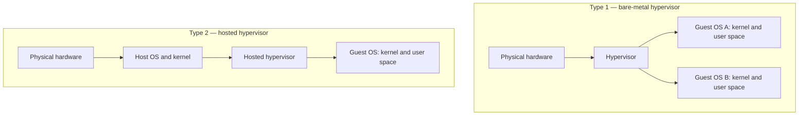
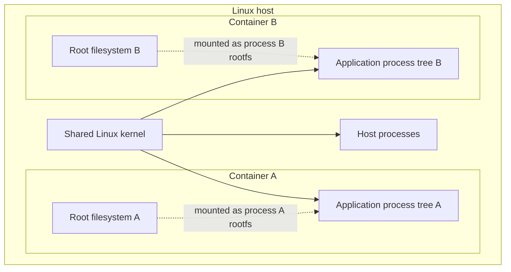
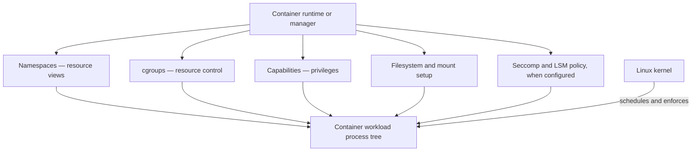
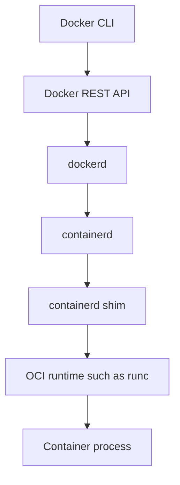
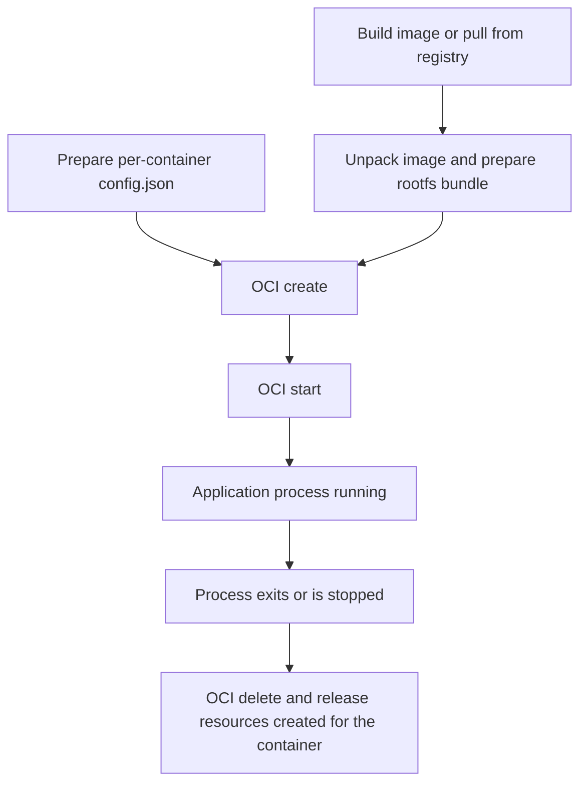
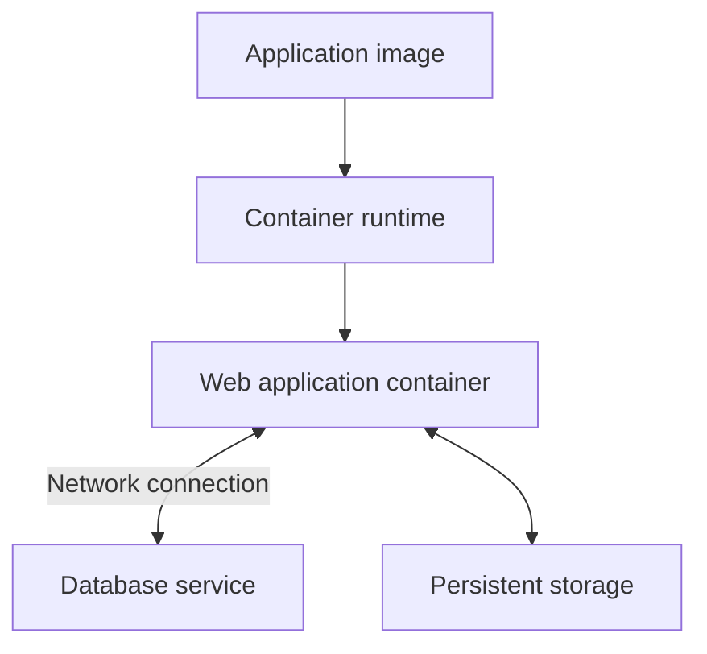

# Chapter 01 — Understanding Containers

> **မြန်မာခေါင်းစဉ်:** အခန်း (၁) — Container ကို နားလည်ခြင်း  
> **Project:** Linux Containers Under the Hood — Beginner to Advanced  
> **Part:** I — Container Fundamentals  
> **Chapter status:** Initial manuscript publication — 8 November 2026  
> **Research snapshot:** 8 November 2026  
> **Lab status:** Designed, not tested


## ၁။ Container ကို ဘာကြောင့် အသုံးပြုလာကြသလဲ

Application တစ်ခုကို ကိုယ့်ကွန်ပျူတာမှာ အဆင်ပြေပြေ run လို့ရပေမဲ့ တခြားစက်တစ်လုံးပေါ် ရွှေ့လိုက်တဲ့အခါ အလုပ်မလုပ်တော့တာမျိုး ကြုံဖူးပါသလား။ တစ်ခါတလေ လိုအပ်တဲ့ library မရှိတာ ဖြစ်နိုင်သလို၊ version မတူတာကြောင့်လည်း ဖြစ်နိုင်ပါတယ်။ Application တစ်ခုနဲ့တစ်ခု လိုအပ်တဲ့ software version မတူတဲ့အခါ ဒီပြဿနာက ပိုပြီး မကြာခဏ တွေ့ရတတ်ပါတယ်။

ဥပမာ payment service တစ်ခုက Python 3.12 နဲ့ library version အသစ်ကို လိုအပ်နေတယ်လို့ ယူဆပါစို့။ တစ်ချိန်တည်းမှာ reporting service ကတော့ Python 3.10 နဲ့ library အဟောင်းကိုပဲ သုံးချင်နေပါတယ်။ Application နှစ်ခုစလုံးကို server တစ်လုံးတည်းမှာ တိုက်ရိုက်တင်ထားရင် package တစ်ခုကို update လုပ်လိုက်တာနဲ့ အခြား application မှာ ပြဿနာပေါ်လာနိုင်ပါတယ်။

Python virtual environment လို နည်းလမ်းတွေက Python package တွေကို ခွဲထားပေးနိုင်ပါတယ်။ ဒါပေမဲ့ application တစ်ခုစီရဲ့ process မြင်ကွင်း၊ filesystem နဲ့ network configuration ကို သီးခြားခွဲပေးတာတော့ မဟုတ်ပါဘူး။ ဒီလိုအပ်ချက်တွေပါလာတဲ့အခါ ပိုကျယ်ပြန့်တဲ့ isolation နည်းလမ်းတစ်ခု လိုအပ်လာပါတယ်။

ဒီပြဿနာကို ဖြေရှင်းဖို့ application တစ်ခုစီအတွက် Virtual Machine (VM) တစ်လုံးစီ ဖန်တီးနိုင်ပါတယ်။ VM တစ်လုံးစီမှာ ကိုယ်ပိုင် operating system နဲ့ kernel ရှိတဲ့အတွက် application တွေကို ပိုမိုသီးခြားထားနိုင်ပါတယ်။ သို့သော် VM တစ်လုံးစီအတွက် operating system ကို တင်ရ၊ update လုပ်ရ၊ စောင့်ကြည့်ရနဲ့ ထိန်းသိမ်းရပါတယ်။ VM အရေအတွက် များလာတဲ့အခါ ဒီလုပ်ငန်းတွေကလည်း ပိုများလာပါတယ်။

Container က အခြားနည်းလမ်းတစ်ခုကို ပေးပါတယ်။ Application တစ်ခုအတွက် လိုအပ်တဲ့ program file တွေ၊ library တွေနဲ့ default configuration တွေကို image တစ်ခုအဖြစ် စုစည်းထားနိုင်ပါတယ်။ ထို့နောက် အဲဒီ image ကို အသုံးပြုပြီး application ကို container အဖြစ် run လုပ်နိုင်ပါတယ်။ Linux host မှာတော့ kernel ရဲ့ isolation နဲ့ resource-management feature တွေကို အသုံးပြုပြီး application process တွေ မြင်ရမယ့် resource နဲ့ အသုံးပြုခွင့်တွေကို ခွဲခြားသတ်မှတ်နိုင်ပါတယ်။

ဒါပေမဲ့ image ထဲမှာ application အတွက် လိုအပ်သမျှ အားလုံး ပါပြီးသားလို့ မယူဆသင့်ပါဘူး။ Host kernel၊ CPU architecture၊ persistent data၊ secret၊ network policy နဲ့ external service တွေကို သီးခြားစီ စီမံရပါသေးတယ်။ Container က deployment ပြဿနာအားလုံးကို ဖြေရှင်းပေးတဲ့ နည်းလမ်းမဟုတ်ပါဘူး။ Application တစ်ခုကို တည်ဆောက်ပြီး အခြားနေရာမှာ ပြန်လည်အသုံးပြုတဲ့အခါ environment ကွာခြားမှုနဲ့ resource မျှဝေမှုကြောင့် ဖြစ်လာနိုင်တဲ့ ပြဿနာတွေကို လျှော့ချပေးတဲ့ နည်းလမ်းတစ်ခု ဖြစ်ပါတယ်။

ဒီအခန်းမှာ Container ဆိုတာ ဘာလဲ၊ VM နဲ့ ဘာကွာသလဲ၊ Linux kernel ရဲ့ ဘယ် feature တွေက container environment တစ်ခု ဖြစ်လာအောင် ကူညီပေးသလဲဆိုတာကို လေ့လာပါမယ်။ Namespace၊ cgroup၊ mount နဲ့ network configuration တို့ရဲ့ အသေးစိတ်ကိုတော့ နောက်ပိုင်းအခန်းတွေမှာ ဆက်လက်လေ့လာသွားပါမယ်။

## ၂။ ဒီအခန်းပြီးရင် ဘာတွေ သိလာမလဲ

ဒီအခန်းကို ဖတ်ပြီးတဲ့အခါ အောက်ပါအချက်တွေကို ရှင်းပြနိုင်ရပါမယ်။

- Linux OS-level container ဆိုတာ process တစ်ခု သို့မဟုတ် process အုပ်စုတစ်ခုအတွက် ပြင်ဆင်ထားတဲ့ သီးခြား execution environment ဖြစ်ကြောင်း ရှင်းပြနိုင်ရမယ်။
- Container နဲ့ VM တို့ရဲ့ ကွာခြားချက်ကို kernel အသုံးပြုပုံနဲ့ ဆက်စပ်ပြီး ဖော်ပြနိုင်ရမယ်။
- Container က dependency နဲ့ deployment ပြဿနာတွေကို ဘယ်လို လျှော့ချပေးသလဲ၊ ဘယ်အချက်တွေကို သီးခြားစီမံရသေးသလဲဆိုတာ ဥပမာပေးနိုင်ရမယ်။
- `chroot()` က ဘာလုပ်ပေးသလဲ၊ ဘာကြောင့် security sandbox အပြည့်အစုံ မဖြစ်နိုင်သလဲဆိုတာ ရှင်းပြနိုင်ရမယ်။
- FreeBSD Jails၊ Solaris Zones၊ LXC၊ Docker နဲ့ OCI တို့ရဲ့ အခန်းကဏ္ဍကို ခွဲခြားသိနိုင်ရမယ်။
- Namespace၊ cgroup၊ capability နဲ့ filesystem isolation တို့ရဲ့ အခြေခံတာဝန်ကို နားလည်ရမယ်။
- Image၊ container၊ runtime နဲ့ engine တို့ရဲ့ အဓိပ္ပာယ်ကို မရောထွေးဘဲ ရှင်းပြနိုင်ရမယ်။
- OCI runtime ရဲ့ `create` နဲ့ `start` operation တို့ ဘာကြောင့် သီးခြားရှိသလဲဆိုတာ ရှင်းပြနိုင်ရမယ်။

## ၃။ ကြိုတင်သိထားသင့်သည့် အချက်များ

ဒီအခန်းကို ဖတ်ဖို့ Linux ကို အဆင့်မြင့်ကျွမ်းကျင်ထားဖို့ မလိုပါဘူး။ Terminal မှာ command အနည်းငယ် ရိုက်ဖူးတာ၊ file နဲ့ directory ဆိုတာကို သိတာ၊ process ဆိုတဲ့ အယူအဆကို ကြားဖူးတာလောက်နဲ့ စတင်လေ့လာနိုင်ပါတယ်။

အောက်ပါအချက်တွေကို သိထားရင် ပိုအဆင်ပြေပါလိမ့်မယ်။

- Linux filesystem ထဲမှာ `/etc`၊ `/var` နဲ့ `/proc` လို directory တွေ ရှိတယ်ဆိုတာ။
- Process တစ်ခုစီမှာ PID (Process ID) ရှိတယ်ဆိုတာ။
- User၊ group နဲ့ file permission တို့ရဲ့ အခြေခံသဘောတရား။
- `cat`၊ `ls`၊ `ps` နဲ့ `uname` လို command အချို့ကို အသုံးပြုဖူးခြင်း။

Docker၊ Podman၊ Kubernetes ဒါမှမဟုတ် OCI specification တွေကို ကြိုတင်လေ့လာထားဖို့ မလိုပါဘူး။ ဒီအခန်းမှာ အဲဒီနည်းပညာတွေကို မိတ်ဆက်ပေးသွားမှာ ဖြစ်ပါတယ်။

ဒီအခန်းရဲ့ ရည်ရွယ်ချက်က နောက်ပိုင်းအခန်းတွေမှာ ပါလာမယ့် kernel API တွေကို အခုကတည်းက အသေးစိတ် သင်ပေးဖို့ မဟုတ်ပါဘူး။ `clone()`၊ `unshare()` နဲ့ `setns()` တို့ရဲ့ အသုံးပြုပုံ၊ cgroup controller တွေ ပြင်ဆင်ပုံ၊ capability တစ်ခုချင်းစီရဲ့ အလုပ်လုပ်ပုံနဲ့ mount propagation တို့ကို သက်ဆိုင်ရာအခန်းတွေမှာ သီးခြားရှင်းပြပါမယ်။ OverlayFS နဲ့ image storage ကိုလည်း နောက်ပိုင်းမှာ ဆက်လက်လေ့လာပါမယ်။

## ၄။ Container ဆိုတာ ဘာလဲ

ဒီစာအုပ်မှာ **Linux OS-level container** လို့ ပြောတဲ့အခါ Linux kernel ရဲ့ isolation နဲ့ resource-management feature တွေကို ပေါင်းစပ်အသုံးပြုပြီး process တစ်ခု သို့မဟုတ် ဆက်စပ်နေတဲ့ process အုပ်စုတစ်ခုအတွက် သီးခြားလုပ်ဆောင်မှုပတ်ဝန်းကျင် (execution environment) ပြင်ဆင်ထားတဲ့ ပုံစံကို ဆိုလိုပါတယ်။

ဒီအဓိပ္ပာယ်ကို နားလည်ဖို့ container အတွင်းမှာ run နေတဲ့ application ကို အရင်စဉ်းစားကြည့်ပါ။ ဥပမာ web server တစ်ခုဟာ container ထဲမှာ run နေတယ်ဆိုပါစို့။ Kernel အမြင်ကနေကြည့်ရင် အဲဒီ web server ဟာ အခြား program တွေနဲ့ မတူတဲ့ အထူး object တစ်ခု မဟုတ်ပါဘူး။ ပုံမှန် process တစ်ခုပါပဲ။ Container ထဲမှာ worker process တွေ၊ child process တွေ ရှိနိုင်ပေမဲ့ အဲဒါတွေလည်း kernel က စီမံပေးနေတဲ့ process တွေပဲ ဖြစ်ပါတယ်။

ဒါဆို container ဆိုတာ ဘာကို ခေါ်တာလဲ။ Process တွေကို ဘယ် resource တွေ မြင်ခွင့်ပေးမလဲ၊ ဘယ် filesystem ကို အသုံးပြုစေမလဲ၊ ဘယ် privilege တွေ ပေးမလဲဆိုတာကို စီစဉ်ထားတဲ့ execution environment ကို container လို့ ခေါ်တာပါ။

Linux kernel ထဲမှာ `container` လို့ခေါ်တဲ့ object တစ်ခုကို system call တစ်ခုတည်းနဲ့ ဖန်တီးလိုက်တာ မဟုတ်ပါဘူး။ Runtime က namespace၊ cgroup၊ filesystem mount၊ capability နဲ့ လိုအပ်တဲ့ security policy တွေကို စီစဉ်ပေးပြီး အဲဒီ environment ထဲမှာ process ကို စတင်စေတာ ဖြစ်ပါတယ်။ [^1][^2]

ပုံမှန် Linux OS-level container တွေမှာ host process နဲ့ container process တွေဟာ Linux kernel တစ်ခုတည်းကို အသုံးပြုကြပါတယ်။ Container တစ်ခုစီအတွက် guest kernel သီးခြား boot လုပ်ထားတာ မဟုတ်ပါဘူး။ ဥပမာ host ပေါ်မှာ web server container သုံးခု run နေတယ်ဆိုရင် အဲဒီ process တွေကို host Linux kernel ကပဲ စီမံပေးနေပါတယ်။

ဒါကြောင့် container ဖြစ်နေတာတစ်ခုတည်းနဲ့ လုံခြုံရေးအာမခံချက် ရသွားတာ မဟုတ်ပါဘူး။ Runtime က isolation နဲ့ permission တွေကို ဘယ်လိုပြင်ဆင်ထားသလဲဆိုတာက အရေးကြီးပါတယ်။ Privilege များလွန်းတဲ့ container တစ်ခုဟာ host system ကိုပါ ထိခိုက်စေနိုင်ပါတယ်။

### ၄.၁ Container က ဘာတွေကို ခွဲခြားပေးနိုင်သလဲ

Web application နှစ်ခုကို Linux server တစ်လုံးတည်းမှာ run ထားတယ်လို့ စဉ်းစားကြည့်ပါ။ ပထမ application ကို Container A၊ ဒုတိယ application ကို Container B လို့ ခေါ်ပါမယ်။

Container A နဲ့ B တို့အတွက် PID namespace သီးခြားထားလိုက်ရင် Container A အတွင်းက process တွေဟာ ကိုယ့် namespace ထဲက PID တွေကိုသာ မြင်ရပါမယ်။ Container B ရဲ့ process တွေကိုလည်း အလားတူ သီးခြားမြင်ကွင်းနဲ့ တွေ့ရပါမယ်။ Hostname နဲ့ network interface တွေကိုလည်း namespace သုံးပြီး ခွဲခြားနိုင်ပါတယ်။ Filesystem ပိုင်းမှာတော့ application တစ်ခုစီအတွက် root filesystem မတူအောင် ပြင်ဆင်နိုင်ပါတယ်။

Resource အသုံးပြုမှုကို ထိန်းချုပ်ဖို့ cgroup ကို သုံးနိုင်ပါတယ်။ ဥပမာ Container A က memory အလွန်အကျွံ မသုံးနိုင်အောင် limit သတ်မှတ်ထားနိုင်ပါတယ်။ Privilege ပိုင်းမှာလည်း application အတွက် လိုအပ်တဲ့ capability တွေကိုသာ ပေးပြီး မလိုအပ်တဲ့ permission တွေကို ဖယ်ထားနိုင်ပါတယ်။

အခုဖော်ပြခဲ့တဲ့ control အားလုံးကို container တိုင်းမှာ မဖြစ်မနေ သီးခြားထားရမယ်လို့တော့ မဆိုလိုပါဘူး။ တချို့ container တွေက host network ကိုပဲ အသုံးပြုနိုင်ပါတယ်။ တချို့က PID namespace ကို အခြား workload နဲ့ မျှဝေထားနိုင်ပါတယ်။ Resource limit မသတ်မှတ်ထားတဲ့ container လည်း ရှိနိုင်ပါတယ်။ ဒါကြောင့် container တစ်ခုကို စစ်ဆေးတဲ့အခါ container ဖြစ်တယ်ဆိုတဲ့ အမည်ကိုသာ ကြည့်လို့ မရပါဘူး။ အမှန်တကယ် အသုံးပြုထားတဲ့ configuration ကိုပါ စစ်ဆေးရပါတယ်။

### ၄.၂ Container ကို အသုံးပြုရတဲ့ အကြောင်းရင်း

Container ကို အသုံးပြုရတဲ့ အကြောင်းရင်းကို “မြန်တယ်”၊ “ပေါ့တယ်” ဆိုတဲ့ စကားလုံးတွေနဲ့ပဲ ရှင်းပြလို့ မရပါဘူး။ Application တစ်ခုကို တည်ဆောက်တဲ့အချိန်ကနေ server ပေါ်တင်ပြီး run လုပ်တဲ့အချိန်အထိ ကြုံရတဲ့ ပြဿနာတွေကို ဘယ်လောက်လျှော့ချပေးနိုင်သလဲဆိုတာက ပိုအရေးကြီးပါတယ်။

**လိုအပ်တဲ့ software version တွေကို အတူတကွ ထိန်းထားနိုင်တယ်။** Application တစ်ခုအတွက် လိုအပ်တဲ့ runtime၊ library နဲ့ file တွေကို image ထဲမှာ ထည့်ထားနိုင်ပါတယ်။ ဒါကြောင့် development စက်နဲ့ deployment server ကြားမှာ package version မတူလို့ ဖြစ်လာတဲ့ ပြဿနာတွေကို လျှော့ချနိုင်ပါတယ်။ ဒါပေမဲ့ host kernel၊ CPU architecture၊ data နဲ့ external service တွေကိုတော့ သီးခြားစီ စီမံရပါသေးတယ်။

**Application တွေကို သီးခြားစီ run လုပ်နိုင်တယ်။** Process မြင်ကွင်း၊ filesystem၊ network နဲ့ privilege တွေကို workload အလိုက် ပြင်ဆင်နိုင်ပါတယ်။ ဒီလိုခွဲထားခြင်းက application တစ်ခုရဲ့ ပြဿနာက အခြား application တစ်ခုဆီ ကူးစက်သက်ရောက်မှုကို လျှော့ချပေးနိုင်ပါတယ်။ သို့သော် container isolation ကို VM isolation နဲ့ တန်းတူတယ်လို့ မယူဆသင့်ပါဘူး။

**Deployment ကို ပြန်လုပ်ရတာ ပိုလွယ်ကူတယ်။** တူညီတဲ့ image ကို development၊ testing နဲ့ production environment တွေမှာ အသုံးပြုနိုင်ပါတယ်။ Image ကို tag နဲ့လည်း သတ်မှတ်နိုင်သလို digest နဲ့လည်း သတ်မှတ်နိုင်ပါတယ်။ Tag ဆိုတာ `myapp:v1` လို လူဖတ်လို့ရတဲ့ အမည်တစ်ခုဖြစ်ပြီး နောက်ပိုင်းမှာ အခြား image ကို ညွှန်းအောင် ပြောင်းနိုင်ပါတယ်။ Digest ကတော့ OCI descriptor က ရည်ညွှန်းထားတဲ့ content ရဲ့ bytes ကို hash လုပ်ပြီး ရရှိလာတဲ့ content-addressable identifier ဖြစ်ပါတယ်။ Image တစ်ခုကို registry ကနေ ရယူတဲ့အခါ manifest ဒါမှမဟုတ် image index ရဲ့ digest ကို သတ်မှတ်ထားခြင်းအားဖြင့် တူညီတဲ့ artifact ကို အတိအကျ ပြန်အသုံးပြုနိုင်ပါတယ်။ [^3]

**Host resource ကို ထိရောက်စွာ အသုံးပြုနိုင်တယ်။** ပုံမှန် Linux container တစ်ခုစီအတွက် guest kernel အသစ် boot လုပ်စရာ မလိုပါဘူး။ ဒါကြောင့် VM အများအပြားကို run လုပ်တာထက် စတင်ချိန်နဲ့ resource overhead နည်းနိုင်ပါတယ်။ သို့သော် container က အခြေအနေတိုင်းမှာ ပိုမြန်မယ်လို့ မဆိုနိုင်ပါဘူး။ Application ရဲ့ CPU၊ memory၊ disk I/O အသုံးပြုမှုနဲ့ kernel/runtime configuration တွေပေါ် မူတည်ပါတယ်။

## ၅။ Container နဲ့ Virtual Machine ဘာကွာသလဲ

Container နဲ့ Virtual Machine (VM) ကို “ပေါ့တယ်”၊ “လေးတယ်” ဆိုပြီးပဲ နှိုင်းယှဉ်ရင် အရေးကြီးတဲ့အချက်တစ်ခု လွတ်သွားနိုင်ပါတယ်။ အဓိကကွာခြားချက်က application process တွေ ဘယ် kernel ကို အသုံးပြုနေသလဲဆိုတာပါ။

### ၅.၁ Virtual Machine

VM တစ်ခုမှာ guest operating system အတွက် virtual hardware ကို hypervisor က ပံ့ပိုးပေးပါတယ်။ Guest OS တစ်ခုစီမှာ ကိုယ်ပိုင် kernel နဲ့ user space ရှိပါတယ်။ Application တွေကို အဲဒီ guest kernel က စီမံပေးပါတယ်။ Hypervisor က physical hardware နဲ့ VM တွေအကြား CPU၊ memory၊ storage နဲ့ network device တွေကို ခွဲဝေစီမံပေးပါတယ်။

Hypervisor ကို အခြေခံအားဖြင့် Type 1 နဲ့ Type 2 ဆိုပြီး ခွဲပြောလေ့ရှိပါတယ်။ Type 1 hypervisor က physical hardware ပေါ်မှာ တိုက်ရိုက် အလုပ်လုပ်ပါတယ်။ Type 2 hypervisor ကတော့ host operating system အပေါ်မှာ software တစ်ခုအနေနဲ့ အလုပ်လုပ်ပါတယ်။ ဒီခွဲခြားပုံက hypervisor ရဲ့ တည်နေရာကို အခြေခံထားတာ ဖြစ်ပါတယ်။ လက်တွေ့ implementation တစ်ခုချင်းစီမှာ management component နဲ့ virtual device ပုံစံတွေ ကွာခြားနိုင်ပါတယ်။ အောက်ပါပုံက အခြေခံသဘောတရားကို ပြထားတဲ့ conceptual diagram ဖြစ်ပါတယ်။



ဒီပုံမှာ Type 1 နဲ့ Type 2 တို့ရဲ့ အခြေခံကွာခြားချက်ကို ပြထားပါတယ်။ Type 1 မှာ hypervisor က hardware ပေါ်မှာ တိုက်ရိုက် အလုပ်လုပ်ပြီး Type 2 မှာ host OS က အလယ်မှာ ရှိနေပါတယ်။ နှစ်မျိုးစလုံးမှာ VM အတွင်းရှိ guest OS တစ်ခုစီမှာ ကိုယ်ပိုင် kernel ရှိတယ်ဆိုတာကို မှတ်ထားပါ။

VM အသုံးပြုတာက container နဲ့ အပြန်အလှန် ရွေးချယ်ရမယ့် နည်းလမ်းနှစ်ခုလို့ မဆိုလိုပါဘူး။ လက်တွေ့မှာ VM တစ်ခုအတွင်း Linux ကို run လုပ်ပြီး အဲဒီ guest OS ရဲ့ kernel ပေါ်မှာ container အများအပြား ထပ်မံ run လုပ်နိုင်ပါတယ်။ အဲဒီအခြေအနေမှာ container တွေက physical host ရဲ့ kernel ကို မျှဝေတာ မဟုတ်ဘဲ VM အတွင်းရှိ guest kernel ကို မျှဝေသုံးကြတာ ဖြစ်ပါတယ်။

### ၅.၂ Linux OS-level container

ပုံမှန် Linux OS-level container မှာ host Linux kernel တစ်ခုတည်းက host process တွေနဲ့ container process တွေကို စီမံပေးပါတယ်။ Container တစ်ခုစီအတွက် root filesystem သီးခြားထားနိုင်ပါတယ်။ PID၊ mount နဲ့ network namespace တွေကိုလည်း လိုအပ်သလို ခွဲခြားနိုင်ပါတယ်။ ဒါပေမဲ့ container တစ်ခုစီမှာ guest kernel သီးခြား မရှိပါဘူး။



ပုံမှာ container တစ်ခုစီအတွက် root filesystem သီးခြားထားနိုင်ပုံကို ပြထားပါတယ်။ Application A နဲ့ B တို့ဟာ filesystem view မတူနိုင်ပေမဲ့ system call တွေကို လက်ခံပြီး process တွေကို စီမံပေးနေတဲ့ kernel က တစ်ခုတည်း ဖြစ်နေဆဲပါ။

### ၅.၃ အဓိကကွာခြားချက်များ

| အချက် | Linux OS-level container | Virtual Machine |
|---|---|---|
| Kernel | ပုံမှန် model မှာ host Linux kernel ကို မျှဝေသုံးတယ်။ | Guest OS တစ်ခုစီမှာ ကိုယ်ပိုင် kernel ရှိတယ်။ |
| Filesystem | Container တစ်ခုစီအတွက် root filesystem သီးခြားပြင်ဆင်နိုင်တယ်။ | Guest OS အတွက် virtual disk နဲ့ filesystem ရှိတယ်။ |
| Isolation | Namespace၊ cgroup၊ capability၊ mount နဲ့ security policy တွေကို ပေါင်းစပ်အသုံးပြုတယ်။ | Hypervisor နဲ့ guest OS တို့ရဲ့ isolation mechanism ကို အသုံးပြုတယ်။ |
| စတင်ပုံ | Guest kernel အသစ် boot မလုပ်ဘဲ process ကို စတင်နိုင်တယ်။ | Guest OS ကို boot လုပ်ရတယ်။ |
| Resource စီမံမှု | Host kernel က process နဲ့ cgroup အလိုက် စီမံတယ်။ | Hypervisor က VM အတွက် virtual CPU၊ memory နဲ့ device တွေ ပံ့ပိုးပေးတယ်။ |
| OS အသုံးပြုနိုင်မှု | Host kernel နဲ့ CPU architecture တို့နဲ့ ကိုက်ညီတဲ့ Linux userspace ကို အသုံးပြုရတယ်။ Distribution တူဖို့ မလိုပါဘူး။ | Hypervisor က ပံ့ပိုးတဲ့ guest OS မျိုးစုံကို အသုံးပြုနိုင်တယ်။ |

ဥပမာ Ubuntu host တစ်လုံးမှာ Debian သို့မဟုတ် Alpine Linux userspace ကို အသုံးပြုထားတဲ့ container တွေ run လုပ်နိုင်ပါတယ်။ Host နဲ့ container ရဲ့ Linux distribution တူဖို့ မလိုပါဘူး။ အရေးကြီးတာက application နဲ့ userspace က host ရဲ့ Linux kernel interface၊ CPU architecture တို့နဲ့ ကိုက်ညီဖို့ ဖြစ်ပါတယ်။ Windows kernel ကို အသုံးပြုတဲ့ workload ကို Linux kernel ပေါ်မှာ ပုံမှန် Linux container အဖြစ် တိုက်ရိုက် run လုပ်လို့ မရပါဘူး။ Windows ပေါ်မှာ Linux container အသုံးပြုတဲ့အခါ Linux kernel ပေးထားတဲ့ VM သို့မဟုတ် အလားတူ environment တစ်ခု ပါဝင်နေနိုင်ပါတယ်။ [^1]

ဒီဇယားဟာ ပုံမှန် Linux OS-level container နဲ့ VM ကို နှိုင်းယှဉ်ထားတာပါ။ Container က VM ထက် အမြဲပိုကောင်းတယ်လို့ မဆိုလိုပါဘူး။ Application ရဲ့ လိုအပ်ချက်၊ လုံခြုံရေးနယ်နိမိတ်နဲ့ လုပ်ငန်းလည်ပတ်ပုံတို့ကို ကြည့်ပြီး ရွေးချယ်ရပါတယ်။

### ၅.၄ Container လို့ခေါ်တိုင်း host kernel ကို မျှဝေသုံးတာလား

Container လို့ခေါ်တဲ့ workload အားလုံးဟာ အောက်ခံ isolation နည်းပညာ တစ်မျိုးတည်းကို အသုံးပြုကြတာ မဟုတ်ပါဘူး။ Kata Containers က ဥပမာတစ်ခု ဖြစ်ပါတယ်။ Kata Containers မှာ container workload ကို lightweight virtual machine အတွင်း run လုပ်ပြီး guest kernel သီးခြား အသုံးပြုစေနိုင်ပါတယ်။

Kubernetes မှာ အသုံးပြုတဲ့ ပုံမှန် Kata architecture တစ်ခုအရ Pod တစ်ခုအတွက် VM တစ်ခု ဖွင့်ပေးပြီး အဲဒီ VM အတွင်းမှာ Pod ရဲ့ container တွေကို run လုပ်နိုင်ပါတယ်။ ဒါကြောင့် container တစ်ခုစီအတွက် VM တစ်ခုစီ မဖြစ်မနေ ရှိတယ်လို့ မဆိုလိုပါဘူး။ Pod တစ်ခုအတွင်းရှိ container တွေဟာ အဲဒီ VM ရဲ့ guest kernel ကို မျှဝေသုံးနိုင်ပါတယ်။ [^4]

ဒီအချက်ကို သိထားရင် “Container တွေဟာ host kernel ကို မျှဝေသုံးတယ်” ဆိုတဲ့စကားဟာ ပုံမှန် Linux OS-level container model ကို ရည်ညွှန်းတာဖြစ်ကြောင်း နားလည်နိုင်ပါလိမ့်မယ်။ Container workflow၊ image format နဲ့ အောက်ခံ isolation နည်းပညာတို့ဟာ မတူညီတဲ့ အလွှာတွေ ဖြစ်ကြပါတယ်။

## ၆။ Container များဆီ ရောက်လာတဲ့ သမိုင်းလမ်းကြောင်း

Container ကို Docker က စတင်တီထွင်ခဲ့တယ်လို့ ထင်ရလွယ်ပါတယ်။ တကယ်တော့ application တစ်ခုကို အခြား application တွေနဲ့ ခွဲပြီး run လုပ်ဖို့ ကြိုးစားခဲ့တဲ့ နည်းလမ်းတွေဟာ Docker မတိုင်ခင်ကတည်းက ရှိခဲ့ပါတယ်။ Unix ရဲ့ `chroot`၊ FreeBSD ရဲ့ Jails၊ Solaris ရဲ့ Zones နဲ့ Linux kernel ရဲ့ containment feature တွေဟာ မတူညီတဲ့ operating system တွေမှာ သီးခြားဖွံ့ဖြိုးလာခဲ့ကြတာပါ။ ဒီနည်းပညာအားလုံးဟာ တစ်ခုကနေတစ်ခု တိုက်ရိုက်ဆက်ခံလာတဲ့ သမိုင်းကြောင်းတစ်ခုတည်းလို့ မယူဆသင့်ပါဘူး။

| အချိန် | နည်းပညာ | မှတ်သားရန် |
|---|---|---|
| 1979 ဝန်းကျင် | `chroot` | Process ရဲ့ pathname resolution အတွက် root directory ကို ပြောင်းပေးတဲ့ mechanism ဖြစ်တယ်။ တစ်ခုတည်းနဲ့ complete isolation မရပါဘူး။ [^5] |
| 2000 | FreeBSD Jails | FreeBSD 4.0 မှာ `jail()` system call ကို ထည့်သွင်းခဲ့တယ်။ Filesystem တစ်ခုတည်းထက် ပိုကျယ်တဲ့ isolation ကို ပေးဖို့ ရည်ရွယ်ထားတယ်။ [^6] |
| 2004–2005 | Solaris Zones | Solaris Express 2/04 မှာ စတင်မိတ်ဆက်ခဲ့ပြီး Solaris 10 3/05 မှာလည်း ပါဝင်လာတယ်။ [^7] |
| 2008 မှစ၍ | LXC | Linux kernel ရဲ့ containment feature တွေကို userspace library နဲ့ tool တွေကနေ အသုံးပြုနိုင်အောင် ဖွံ့ဖြိုးလာတဲ့ project ဖြစ်တယ်။ [^8] |
| 2013 | Docker | 15 March မှာ public demonstration ပြသခဲ့ပြီး 23 March မှာ Docker 0.1.0 ကို ထုတ်ဝေခဲ့တယ်။ [^9][^20] |
| 22 June 2015 | OCI | Container image နဲ့ runtime interoperability အတွက် open specification တွေ ဖော်ထုတ်ဖို့ စတင်ဖွဲ့စည်းခဲ့တယ်။ [^11] |

ဒီဇယားကို တစ်ဆင့်ပြီးတစ်ဆင့် ဆက်ခံလာတဲ့ တီထွင်မှုစာရင်းအဖြစ် မဖတ်သင့်ပါဘူး။ Operating system မတူတဲ့ နေရာတွေမှာ isolation ပြဿနာကို ဖြေရှင်းဖို့ ကြိုးစားခဲ့ကြတဲ့ အရေးပါတဲ့ မှတ်တိုင်တွေ အဖြစ်သာ ကြည့်သင့်ပါတယ်။

### ၆.၁ `chroot`

`chroot()` ဟာ process တစ်ခုရဲ့ pathname တွေကို ရှာဖွေတဲ့အခါ အခြေခံအသုံးပြုမယ့် root directory ကို ပြောင်းပေးတဲ့ system call ဖြစ်ပါတယ်။ ဥပမာ process တစ်ခုရဲ့ root ကို `/srv/jail` လို့ သတ်မှတ်ထားတယ်ဆိုပါစို့။ အဲဒီ process က `/etc/app.conf` ကို ဖွင့်တဲ့အခါ host ရဲ့ `/etc/app.conf` ကို မရှာဘဲ `/srv/jail/etc/app.conf` ကို အခြေခံပြီး ရှာပါလိမ့်မယ်။ [^5]

ဒါပေမဲ့ `chroot()` လုပ်လိုက်တာနဲ့ process ရဲ့ current working directory ကို အလိုအလျောက် ပြောင်းပေးတာ မဟုတ်ပါဘူး။ ဖွင့်ထားပြီးသား file descriptor တွေကိုလည်း ပိတ်မပေးပါဘူး။ ဒါကြောင့် `chroot()` တစ်ခုတည်းနဲ့ process ကို directory အပြင်ဘက်က resource တွေ မရောက်နိုင်အောင် လုံးဝတားထားနိုင်တယ်လို့ မဆိုနိုင်ပါဘူး။ Linux `chroot(2)` manual မှာလည်း `chroot()` ကို security sandbox အဖြစ် ရည်ရွယ်ထားတာ မဟုတ်ကြောင်း သတိပေးထားပါတယ်။

အတိုချုပ်ပြောရရင် `chroot()` က filesystem path တွေကို ဖြေရှင်းရာမှာ အသုံးပြုမယ့် root ကိုသာ ပြောင်းပေးတာပါ။ PID view၊ network stack၊ UID/GID mapping၊ CPU နဲ့ memory limit၊ kernel privilege တို့ကို အလိုအလျောက် ခွဲပေးတာ မဟုတ်ပါဘူး။ ဒါကြောင့် container isolation တစ်ခုလုံးကို `chroot()` တစ်ခုတည်းနဲ့ မတည်ဆောက်နိုင်ပါဘူး။

### ၆.၂ FreeBSD Jails

FreeBSD Jails က `chroot` နဲ့ ဆက်စပ်တဲ့ filesystem separation ကို ပိုကျယ်ပြန့်တဲ့ operating-system-level isolation အဖြစ် တိုးချဲ့ထားတဲ့ နည်းပညာတစ်ခု ဖြစ်ပါတယ်။ Jails ကို အသုံးပြုတဲ့အခါ filesystem၊ user နဲ့ network ဆိုင်ရာ environment တွေကို သီးခြားစီမံနိုင်ပါတယ်။ FreeBSD `jail(2)` manual ရဲ့ HISTORY အပိုင်းအရ `jail()` system call ကို FreeBSD 4.0 မှာ စတင်ထည့်သွင်းခဲ့ပါတယ်။ [^6]

Jails နဲ့ Linux namespaces တို့ဟာ workload တွေကို ခွဲခြားဖို့ ရည်ရွယ်ကြတာချင်း တူပါတယ်။ ဒါပေမဲ့ implementation၊ kernel API နဲ့ resource model တွေ မတူကြပါဘူး။ ဒါကြောင့် FreeBSD Jails ကို Linux namespace implementation တစ်ခုအဖြစ် မရှင်းပြသင့်ပါဘူး။

### ၆.၃ Solaris Zones

Solaris Zones က Solaris operating system တစ်ခုအတွင်း application နဲ့ service တွေအတွက် သီးခြားလုပ်ဆောင်မှုပတ်ဝန်းကျင်တွေ ဖန်တီးပေးပါတယ်။ Oracle documentation အရ Zones ကို Solaris Express 2/04 မှာ စတင်မိတ်ဆက်ခဲ့ပြီး Solaris 10 3/05 release မှာလည်း ပါဝင်လာခဲ့ပါတယ်။ [^7]

Zones ဟာ hypervisor က guest OS အများအပြားကို boot လုပ်ပေးတဲ့ပုံစံ မဟုတ်ပါဘူး။ Solaris OS instance တစ်ခုအတွင်း application environment တွေကို ခွဲခြားစီမံပေးတဲ့ နည်းပညာ ဖြစ်ပါတယ်။ Linux container mechanism တွေနဲ့ implementation တူညီတာ မဟုတ်ပေမဲ့ OS-level isolation ရဲ့ သမိုင်းကို လေ့လာရာမှာ အရေးပါတဲ့ ဥပမာတစ်ခုပါ။

### ၆.၄ LXC

LXC (Linux Containers) က Linux kernel ရဲ့ containment feature တွေကို userspace ကနေ အသုံးပြုနိုင်ဖို့ library နဲ့ tool တွေ ပေးထားတဲ့ project ဖြစ်ပါတယ်။ Namespace နဲ့ cgroup တို့အပါအဝင် Linux kernel ရဲ့ feature တွေကို ပေါင်းစပ်ပြီး သီးခြား system-container environment တစ်ခု ဖန်တီးနိုင်ပါတယ်။ LXC project ကို 2008 ခုနှစ်ကတည်းက ဖွံ့ဖြိုးလာခဲ့တာ ဖြစ်ပါတယ်။ [^8]

LXC ကို `chroot` ထက် option ပိုများတဲ့ command တစ်ခုလို့ပဲ နားလည်လို့ မရပါဘူး။ Linux kernel ရဲ့ isolation နဲ့ security feature တွေကို တွဲဖက်အသုံးပြုတဲ့ container-management project ဖြစ်ပါတယ်။

### ၆.၅ Docker

Docker က container နည်းပညာကို ပထမဆုံး တီထွင်ခဲ့တာ မဟုတ်ပါဘူး။ ဒါပေမဲ့ application ကို build လုပ်ခြင်း၊ package လုပ်ခြင်း၊ မျှဝေခြင်းနဲ့ run လုပ်ခြင်းတို့ကို အသုံးပြုရလွယ်တဲ့ workflow တစ်ခုအဖြစ် လူသိများလာစေခဲ့ပါတယ်။ Docker ရဲ့ public demonstration ကို 15 March 2013 မှာ ပြသခဲ့ပြီး Docker 0.1.0 ကို 23 March 2013 မှာ ထုတ်ဝေခဲ့ပါတယ်။ [^9][^20]

Docker Engine မှာ ပုံမှန်အားဖြင့် CLI client၊ REST API နဲ့ `dockerd` daemon တို့ ပါဝင်ပါတယ်။ Docker CLI က API ကနေတစ်ဆင့် daemon ကို ဆက်သွယ်ပြီး image၊ container၊ network နဲ့ volume တွေကို စီမံနိုင်ပါတယ်။ ဒီပုံစံဟာ Docker Engine ရဲ့ architecture ဖြစ်ပြီး container engine အားလုံးက ဒီပုံစံကိုပဲ မဖြစ်မနေ အသုံးပြုရတာ မဟုတ်ပါဘူး။ [^10]

### ၆.၆ Open Container Initiative (OCI)

Container tool တွေ များလာတဲ့အခါ image တစ်ခုကို runtime မတူတဲ့ tool တွေမှာ အပြန်အလှန် အသုံးပြုနိုင်ဖို့ common format နဲ့ behavior တွေ လိုအပ်လာပါတယ်။ ဒီလိုအပ်ချက်ကို ဖြေရှင်းဖို့ Open Container Initiative (OCI) ကို 22 June 2015 မှာ Linux Foundation အောက်က open governance project အဖြစ် စတင်ဖွဲ့စည်းခဲ့ပါတယ်။ OCI ရဲ့ ရည်ရွယ်ချက်က container နဲ့ပတ်သက်တဲ့ open industry standard တွေ ဖော်ထုတ်ဖို့ ဖြစ်ပါတယ်။ [^11]

OCI မှာ အဓိက specification သုံးမျိုး ရှိပါတယ်။

- **OCI Image Specification** က image ရဲ့ filesystem layer တွေ၊ manifest နဲ့ image configuration တို့ကို ဘယ်လို ဖွဲ့စည်းရမလဲဆိုတာ သတ်မှတ်ပါတယ်။
- **OCI Runtime Specification** က runtime bundle တစ်ခုကို runtime က ဘယ်လို configure လုပ်ရမလဲ၊ container ကို ဘယ်လို create၊ start နဲ့ delete လုပ်ရမလဲဆိုတာ သတ်မှတ်ပါတယ်။
- **OCI Distribution Specification** က registry လို distribution service တွေကနေ image နဲ့ artifact တွေကို ဘယ်လို ပို့ဆောင်၊ ရယူရမလဲဆိုတာ သတ်မှတ်ပါတယ်။

ဒီ specification သုံးခုဟာ OCI ကို စတင်ဖွဲ့စည်းတဲ့ 2015 ခုနှစ်မှာ တစ်ပြိုင်နက်တည်း အပြီးသတ်ပြီးသား မဟုတ်ပါဘူး။ Distribution Specification ကို 2018 ခုနှစ် ဧပြီလမှာ စတင်ဖွံ့ဖြိုးခဲ့ပြီး version 1.0 ကို 2021 ခုနှစ် မေလ 4 ရက်နေ့မှာ ကြေညာခဲ့ပါတယ်။ [^11][^12]

OCI ဟာ Docker Engine၊ Kubernetes ဒါမှမဟုတ် container orchestration စနစ်တစ်ခုလုံးကို standardize လုပ်တာ မဟုတ်ပါဘူး။ Image format၊ runtime behavior နဲ့ distribution protocol တို့အတွက် အပြန်အလှန် အသုံးပြုနိုင်တဲ့ စံနှုန်းတွေကို သတ်မှတ်ပေးတာ ဖြစ်ပါတယ်။

## ၇။ Container isolation မှာ Linux kernel ရဲ့ အခန်းကဏ္ဍ

အခုအထိ container ဆိုတာ ဘာလဲ၊ ဘာကြောင့် အသုံးပြုလာကြသလဲဆိုတာကို လေ့လာခဲ့ပါတယ်။ ဒီနေရာမှာ မေးစရာတစ်ခု ရှိလာပါတယ်။ Container တစ်ခုထဲက process တွေကို host ပေါ်က အခြား process တွေနဲ့ ဘယ်လို ခွဲထားသလဲ။

Linux kernel က ဒီအလုပ်ကို feature တစ်ခုတည်းနဲ့ လုပ်ပေးတာ မဟုတ်ပါဘူး။ Namespace၊ cgroup၊ capability၊ filesystem mount နဲ့ security policy တွေကို လိုအပ်သလို ပေါင်းစပ်အသုံးပြုရပါတယ်။ Runtime က အဲဒီ feature တွေကို စီစဉ်ပေးပြီး kernel က process တွေကို သတ်မှတ်ထားတဲ့ စည်းကမ်းအတိုင်း run လုပ်စေပါတယ်။ [^1][^2]



ဒီပုံမှာ runtime က kernel feature တွေကို ပြင်ဆင်ပေးပြီး kernel က process တွေကို စီမံနေတဲ့ ဆက်နွယ်မှုကို ပြထားပါတယ်။ Container တစ်ခုစီမှာ ဒီ control အားလုံးကို တူညီတဲ့ပုံစံနဲ့ အသုံးပြုထားတယ်လို့တော့ မဆိုလိုပါဘူး။

### ၇.၁ Namespace — Process တွေ မြင်ရတဲ့အရာကို ခွဲခြားပေးခြင်း

Namespace ဆိုတာ system resource တစ်မျိုးကို process အုပ်စုတစ်စုအတွက် သီးခြားရှိသလို မြင်စေတဲ့ Linux kernel feature ဖြစ်ပါတယ်။ Namespace တစ်ခုတည်းထဲက process တွေဟာ အဲဒီ resource ရဲ့ view ကို မျှဝေကြပါတယ်။ အခြား namespace ထဲက process တွေကတော့ အဲဒီ view ကို အလိုအလျောက် မမြင်ရပါဘူး။ [^1]

Linux မှာ အဓိက namespace အမျိုးအစား ရှစ်မျိုး ရှိပါတယ်။

| Namespace | ခွဲခြားပေးတဲ့အရာ |
|---|---|
| PID | Process ID နဲ့ process တွေကို မြင်နိုင်မှု |
| Mount | Process မြင်ရတဲ့ mount table နဲ့ mount point များ |
| Network | Network interface၊ routing table နဲ့ network resource များ |
| UTS | Hostname နဲ့ NIS domain name |
| IPC | System V IPC နဲ့ POSIX message queue ကဲ့သို့ IPC resource များ |
| User | UID/GID mapping နဲ့ namespace အတွင်းရှိ capability/privilege များ |
| Cgroup | Process မြင်ရတဲ့ cgroup hierarchy view |
| Time | `CLOCK_MONOTONIC` နဲ့ `CLOCK_BOOTTIME` အတွက် time offset များ |

User namespace ကို နည်းနည်း ထပ်ရှင်းပြဖို့ လိုပါတယ်။ Container အတွင်းမှာ UID 0 ဖြစ်နေတဲ့ process တစ်ခုဟာ host ပေါ်မှာလည်း UID 0 ဖြစ်ရမယ်လို့ မဆိုလိုပါဘူး။ User namespace က container အတွင်းက UID/GID တွေကို host ရဲ့ UID/GID တွေနဲ့ mapping လုပ်ပေးနိုင်ပါတယ်။ ဥပမာ container အတွင်းမှာ root ဖြစ်တဲ့ user တစ်ယောက်ကို host ပေါ်မှာ အခွင့်အာဏာနည်းတဲ့ user တစ်ယောက်အဖြစ် mapping လုပ်ထားနိုင်ပါတယ်။ Namespace အတွင်းရရှိတဲ့ capability တွေဟာလည်း သက်ဆိုင်ရာ namespace နဲ့ ဆက်စပ်နေတဲ့ resource တွေအပေါ်မှာသာ အကျုံးဝင်နိုင်ပါတယ်။ ဒါကြောင့် container အတွင်း root ဖြစ်တာနဲ့ host ပေါ်မှာ unrestricted root ဖြစ်သွားတာ မဟုတ်ပါဘူး။ [^13]

Time namespace ကတော့ `CLOCK_MONOTONIC` နဲ့ `CLOCK_BOOTTIME` တို့ရဲ့ တန်ဖိုးကို namespace အလိုက် offset ထည့်ပြီး မြင်စေနိုင်ပါတယ်။ `CLOCK_REALTIME` ကိုတော့ time namespace က virtualize မလုပ်ပါဘူး။ Time namespace ကို Linux kernel 5.6 မှာ စတင်ထည့်သွင်းခဲ့ပါတယ်။ [^14]

Namespace နဲ့ cgroup တို့ရဲ့ တာဝန်ကို မရောထွေးဖို့ အရေးကြီးပါတယ်။ Namespace က process တွေ မြင်ရတဲ့ resource view ကို ခွဲပေးတာပါ။ CPU နဲ့ memory အသုံးပြုမှုကို limit လုပ်ပေးတာ မဟုတ်ပါဘူး။ Resource usage ကို ထိန်းချုပ်ဖို့ cgroup ကို အသုံးပြုပါတယ်။

### ၇.၂ cgroups — Resource အသုံးပြုမှုကို စီမံခြင်း

Control groups ကို အတိုကောက် `cgroups` လို့ ခေါ်ပါတယ်။ Cgroups က process တွေကို အုပ်စုဖွဲ့ထားပြီး CPU၊ memory နဲ့ I/O လို resource တွေရဲ့ အသုံးပြုမှုကို စောင့်ကြည့်နိုင်၊ ကန့်သတ်နိုင်အောင် ကူညီပေးပါတယ်။ [^2]

ဥပမာ web application တစ်ခုက memory အလွန်အကျွံ သုံးပြီး host တစ်ခုလုံးကို ထိခိုက်စေနိုင်တယ်လို့ ယူဆပါစို့။ အဲဒီ application ရဲ့ process တွေကို cgroup တစ်ခုထဲ ထည့်ထားပြီး memory အသုံးပြုမှုကို limit သတ်မှတ်နိုင်ပါတယ်။ Application က သတ်မှတ်ထားတဲ့ limit ကို ကျော်သွားရင် kernel ရဲ့ memory controller က သက်ဆိုင်ရာ policy အတိုင်း ကိုင်တွယ်ပေးပါတယ်။

Cgroup က memory leak ကို ပြုပြင်ပေးတာ မဟုတ်ပါဘူး။ Application က memory ကို ဘာကြောင့် အလွန်အကျွံ သုံးနေရသလဲဆိုတာကိုလည်း အလိုအလျောက် မဖြေရှင်းပေးပါဘူး။ Resource အသုံးပြုမှုကို စောင့်ကြည့်ပြီး သတ်မှတ်ထားတဲ့ အတိုင်းအတာအတွင်း ထိန်းထားနိုင်ဖို့ ကူညီပေးတာ ဖြစ်ပါတယ်။

### ၇.၃ Capabilities — အခွင့်အာဏာကို အပိုင်းလိုက် စီမံခြင်း

Linux မှာ UID 0 ကို ပုံမှန်အားဖြင့် `root` လို့ ခေါ်ပါတယ်။ Root user ဟာ system administration လုပ်ငန်းတွေ အများအပြားကို လုပ်ဆောင်နိုင်ပါတယ်။ ဒါပေမဲ့ application တစ်ခုက root privilege အားလုံးကို အမှန်တကယ် လိုအပ်သလားဆိုတာ စဉ်းစားသင့်ပါတယ်။

Linux capabilities က root privilege နဲ့ ဆက်စပ်နေတဲ့ အခွင့်အာဏာတွေကို ပိုမိုသေးငယ်တဲ့ အပိုင်းတွေအဖြစ် ခွဲပေးပါတယ်။ ဥပမာ network configuration ပြောင်းဖို့ လိုအပ်တဲ့ process တစ်ခုကို အဲဒီအလုပ်အတွက် လိုအပ်တဲ့ capability ပေးနိုင်ပြီး မလိုအပ်တဲ့ administrative permission တွေကို ဖယ်ထားနိုင်ပါတယ်။ [^15]

နည်းပညာပိုင်းအရ Linux capabilities ဟာ process တစ်ခုလုံးရဲ့ attribute လို့ ပြောတာထက် thread တစ်ခုချင်းစီနဲ့ သက်ဆိုင်တဲ့ attribute လို့ နားလည်ထားတာ ပိုတိကျပါတယ်။ Container အတွင်း UID 0 ဖြစ်နေတာနဲ့ host ပေါ်မှာ unrestricted root ဖြစ်နေတယ်လို့ မဆိုနိုင်ပါဘူး။ User namespace mapping၊ capability set နဲ့ runtime configuration တို့က ဒီနေရာမှာ အရေးကြီးပါတယ်။

တစ်ဖက်မှာလည်း “container ထဲက root က host ကို မထိခိုက်နိုင်ဘူး” လို့ အာမခံလို့ မရပါဘူး။ Privileged container တစ်ခု ဒါမှမဟုတ် လိုအပ်တာထက် ပိုများတဲ့ capability တွေ ပေးထားတဲ့ container တစ်ခုဟာ host အတွက် အန္တရာယ်ရှိနိုင်ပါတယ်။

### ၇.၄ Filesystem isolation

Container process တစ်ခုကို host ရဲ့ `/` filesystem ကို တိုက်ရိုက်မသုံးစေဘဲ သီးခြား root filesystem (rootfs) တစ်ခု ပြင်ဆင်ပေးနိုင်ပါတယ်။ Runtime က image ထဲက filesystem content တွေကို အသုံးပြုပြီး mount point၊ read-only/read-write setting နဲ့ process မြင်ရမယ့် directory structure တွေကို သတ်မှတ်ပေးပါတယ်။

ဒီအလုပ်ကို `chroot()` တစ်ခုတည်းနဲ့ ပြီးအောင် လုပ်လို့ မရပါဘူး။ Mount namespace၊ rootfs၊ bind mount၊ device တွေကို မြင်ခွင့်နဲ့ permission တွေကို ဘယ်လိုပြင်ဆင်ထားသလဲဆိုတာလည်း အရေးကြီးပါတယ်။ Filesystem layer တွေကို ဘယ်လိုတည်ဆောက်ပြီး သိမ်းဆည်းသလဲဆိုတာကို OverlayFS နဲ့ image storage အခန်းမှာ ဆက်လက်လေ့လာပါမယ်။ [^23]

### ၇.၅ Seccomp နဲ့ Linux Security Modules

Namespace၊ cgroup နဲ့ capability တွေအပြင် seccomp နဲ့ Linux Security Modules (LSM) တွေကိုလည်း container security မှာ အသုံးပြုနိုင်ပါတယ်။

Seccomp က process သို့မဟုတ် thread တစ်ခုက ခေါ်ဆိုမယ့် system call တွေကို စစ်ဆေးပြီး ဘယ် call တွေကို ခွင့်ပြုမလဲ၊ ဘယ် call တွေကို ပယ်ချမလဲဆိုတာ သတ်မှတ်ပေးနိုင်တဲ့ mechanism ဖြစ်ပါတယ်။ ဥပမာ application တစ်ခုက မလိုအပ်တဲ့ system call အချို့ကို ပိတ်ထားနိုင်ပါတယ်။ ဒါပေမဲ့ seccomp တစ်ခုတည်းနဲ့ filesystem၊ network နဲ့ resource အားလုံးကို ခွဲခြားပေးတာ မဟုတ်ပါဘူး။ Seccomp ကို complete sandbox အဖြစ် မယူဆသင့်ကြောင်း Linux kernel documentation ကလည်း သတိပေးထားပါတယ်။ [^16]

LSM framework က kernel ရဲ့ access-control စစ်ဆေးမှုတွေအတွင်း security policy တွေ ထည့်သွင်းအသုံးပြုနိုင်အောင် လုပ်ပေးပါတယ်။ SELinux နဲ့ AppArmor တို့ဟာ LSM ကို အသုံးပြုတဲ့ ဥပမာတွေ ဖြစ်ပါတယ်။ သို့သော် Linux distribution တိုင်းမှာ တူညီတဲ့ LSM နဲ့ policy ကို အမြဲဖွင့်ထားတာ မဟုတ်ပါဘူး။ Kernel configuration၊ boot parameter နဲ့ system policy အလိုက် ကွာခြားနိုင်ပါတယ်။ [^22]

ဒီ mechanism တွေရဲ့ အသေးစိတ်ကို နောက်ပိုင်းအခန်းတွေမှာ လေ့လာပါမယ်။ အခုအဆင့်မှာ မှတ်ထားရမှာက container isolation ဟာ namespace တစ်ခုတည်းနဲ့ ပြီးဆုံးတာ မဟုတ်ဘူးဆိုတဲ့ အချက်ပါ။ လိုအပ်တဲ့ control အလွှာတွေကို ပေါင်းစပ်ပြီး အသုံးပြုရပါတယ်။

## ၈။ Image၊ Container၊ Runtime နဲ့ Engine ကို ခွဲခြားကြည့်ခြင်း

Container နဲ့ပတ်သက်တဲ့ စာတွေဖတ်တဲ့အခါ image၊ container၊ runtime နဲ့ engine ဆိုတဲ့ စကားလုံးတွေကို မကြာခဏ တွေ့ရပါလိမ့်မယ်။ ဒီစကားလုံးတွေဟာ တစ်ခုနဲ့တစ်ခု ဆက်စပ်နေပေမဲ့ အဓိပ္ပာယ်နဲ့ တာဝန် မတူကြပါဘူး။ တစ်ခုချင်းစီကို ခွဲပြီး ကြည့်ကြပါမယ်။

### ၈.၁ Container image

Container image ဆိုတာ application ကို run လုပ်ဖို့ လိုအပ်တဲ့ filesystem content တွေကို layer တွေအဖြစ် စုစည်းထားတဲ့ artifact ဖြစ်ပါတယ်။ Image မှာ filesystem layer တွေအပြင် application အတွက် default configuration တွေလည်း ပါဝင်နိုင်ပါတယ်။ ဥပမာ environment variable၊ default command၊ user နဲ့ working directory တို့ကို image configuration ထဲမှာ သတ်မှတ်ထားနိုင်ပါတယ်။ [^17]

Image configuration ထဲမှာ တွေ့ရနိုင်တဲ့ field အချို့ကတော့ အောက်ပါအတိုင်း ဖြစ်ပါတယ်။

- `Env` — Default environment variable များ။
- `Entrypoint` — Container စတင်တဲ့အခါ အဓိက run လုပ်မယ့် program။
- `Cmd` — Default command သို့မဟုတ် argument များ။
- `User` — Process ကို run လုပ်မယ့် user။
- `WorkingDir` — Process စတင်မယ့် working directory။

ဒီတန်ဖိုးတွေက container တစ်ခု ဖန်တီးတဲ့အခါ အသုံးပြုမယ့် default setting တွေ ဖြစ်ပါတယ်။ Container တစ်ခုချင်းစီအတွက် runtime configuration နဲ့ ပေါင်းစပ်သတ်မှတ်နိုင်သလို အချို့တန်ဖိုးတွေကို ပြောင်းနိုင်ပါတယ်။ Image ထဲမှာ namespace၊ cgroup နဲ့ mount setup အားလုံး ပါပြီးသားလို့ မယူဆရပါဘူး။

Image configuration နဲ့ OCI runtime bundle ထဲက `config.json` ကိုလည်း မရောထွေးသင့်ပါဘူး။ Image configuration က image ရဲ့ default metadata ဖြစ်ပါတယ်။ `config.json` ကတော့ particular container instance တစ်ခုအတွက် runtime setting တွေကို ဖော်ပြထားတဲ့ configuration ဖြစ်ပါတယ်။

### ၈.၂ Container

Container ဆိုတာ image ဖိုင်ကိုပဲ ခေါ်တာ မဟုတ်ပါဘူး။ Image content ကို အခြေခံပြီး သီးခြား instance တစ်ခုအတွက် runtime configuration နဲ့ တွဲဖက်ပြင်ဆင်ထားတဲ့ execution environment ကို ဆိုလိုပါတယ်။ Container တစ်ခုဟာ ဖန်တီးပြီးခါစ `created` state မှာ ရှိနေနိုင်သလို process စတင်ပြီးနောက် `running` state မှာလည်း ရှိနိုင်ပါတယ်။ Process ရပ်သွားတဲ့အခါ `stopped` state ဖြစ်နိုင်ပါတယ်။

### ၈.၃ Container runtime

Container runtime က container instance တစ်ခုအတွက် execution environment ကို ပြင်ဆင်ပြီး process lifecycle ကို ကိုင်တွယ်ပေးတဲ့ software ဖြစ်ပါတယ်။ OCI Runtime Specification က runtime တစ်ခုအနေနဲ့ container configuration ကို ဘယ်လိုအသုံးပြုရမလဲ၊ `create`၊ `start` နဲ့ `delete` လို lifecycle operation တွေကို ဘယ်လိုလုပ်ဆောင်ရမလဲဆိုတာ သတ်မှတ်ပေးပါတယ်။ [^18]

### ၈.၄ Container engine သို့မဟုတ် manager

Container engine ဆိုတဲ့စကားလုံးဟာ OCI specification က သတ်မှတ်ထားတဲ့ component အမည်တစ်ခု မဟုတ်ပါဘူး။ Product တစ်ခုနဲ့တစ်ခုအလိုက် image management၊ API၊ CLI၊ storage၊ networking နဲ့ runtime တို့ကို ချိတ်ဆက်စီမံပေးတဲ့ ပုံစံ ကွာခြားနိုင်ပါတယ်။

ဥပမာ Docker Engine မှာ `docker` CLI က API ကတစ်ဆင့် `dockerd` daemon ကို ဆက်သွယ်ပါတယ်။ `dockerd` က image နဲ့ container management လုပ်ငန်းတွေကို ဆောင်ရွက်ပြီး container lifecycle အတွက် `containerd` နဲ့ OCI runtime တို့ကို အသုံးပြုနိုင်ပါတယ်။ အောက်ပါပုံဟာ Docker ရဲ့ ပုံမှန် execution path ကို အကြမ်းဖျဉ်း ပြထားတာ ဖြစ်ပြီး version နဲ့ implementation အလိုက် အသေးစိတ်ကွာနိုင်ပါတယ်။ [^10]



အခြား project တွေမှာ daemon မပါဘဲ local CLI ကနေ တိုက်ရိုက်စီမံနိုင်တဲ့ model လည်း ရှိပါတယ်။ Podman ရဲ့ architecture ကို နောက်ပိုင်းအခန်းမှာ သီးခြားလေ့လာပါမယ်။

| အမည် | အဓိကတာဝန် |
|---|---|
| Image | Filesystem layer နဲ့ application အတွက် default configuration ကို သိမ်းထားတယ်။ |
| Container | Image နဲ့ runtime configuration ကို အခြေခံထားတဲ့ instance နဲ့ lifecycle state ဖြစ်တယ်။ |
| Runtime | Container environment ကို ပြင်ဆင်ပြီး process lifecycle ကို ကိုင်တွယ်တယ်။ |
| Engine/manager | Image၊ container နဲ့ အခြား service တွေကို user-facing tool/API ကနေ စီမံပေးတယ်။ |

ဒီဇယားက concept ကို နားလည်စေဖို့ အကျဉ်းချုပ်ထားတာပါ။ Product တစ်ခုချင်းစီရဲ့ component boundary ကတော့ မတူနိုင်ပါတယ်။

## ၉။ Container တစ်ခုကို ဖန်တီးပြီး run လုပ်ပုံ

Image ကို build လုပ်တာ ဒါမှမဟုတ် registry ကနေ pull လုပ်တာနဲ့ container process စတင်တာဟာ အလုပ်တစ်ခုတည်း မဟုတ်ပါဘူး။ Higher-level engine က image ကို ရယူပြီး unpack လုပ်ကာ runtime အသုံးပြုနိုင်မယ့် bundle နဲ့ `config.json` ကို ပြင်ဆင်ပေးပါတယ်။ အဲဒီနောက်မှ OCI runtime ရဲ့ lifecycle operation တွေကို ဆောင်ရွက်နိုင်ပါတယ်။



OCI Runtime Specification အရ `create` လုပ်တဲ့အခါ runtime က `config.json` ထဲမှာ သတ်မှတ်ထားတဲ့ configuration အတိုင်း container execution environment ကို ပြင်ဆင်ရပါတယ်။ ဒီအဆင့်မှာ user သတ်မှတ်ထားတဲ့ application process ကို မစတင်ရသေးပါဘူး။ ပိုတိကျအောင် ပြောရရင် `config.json` ထဲက `process.args` ကို `start` operation မရောက်ခင် အသုံးမပြုရပါဘူး။ ကျန်တဲ့ process configuration အချို့ကိုတော့ `create` အဆင့်မှာ အသုံးပြုနိုင်ပါတယ်။ [^18]

`start` operation ကို ခေါ်တဲ့အခါမှ runtime က `process.args` အတိုင်း application program ကို စတင်စေပါတယ်။ အဲဒီနောက် container ဟာ `running` state ကို ရောက်ရှိပါတယ်။ Application process ပြီးဆုံးသွားတဲ့အခါ container ကို `delete` လုပ်ပြီး `create` အဆင့်မှာ runtime က ဖန်တီးထားတဲ့ resource တွေကို ပြန်လည်ဖယ်ရှားနိုင်ပါတယ်။

ဒီနေရာမှာ `create` နဲ့ `start` ဆိုတာ OCI runtime ရဲ့ lifecycle operation တွေ ဖြစ်ကြောင်း သတိထားပါ။ Runtime တစ်ခုချင်းစီရဲ့ command-line syntax နဲ့ implementation အသေးစိတ်က ကွာခြားနိုင်ပါတယ်။ OCI specification က behavior ကို သတ်မှတ်ပေးတာဖြစ်ပြီး command တစ်မျိုးတည်းကိုသာ မဖြစ်မနေ သတ်မှတ်ထားတာ မဟုတ်ပါဘူး။

ဒီ sequence ဟာ OCI runtime lifecycle ကို အခြေခံထားတဲ့ ရိုးရှင်းတဲ့ပုံစံ ဖြစ်ပါတယ်။ လက်တွေ့မှာ image unpack လုပ်ပုံ၊ snapshotter၊ network setup၊ shim နဲ့ daemon တို့ရဲ့ အလုပ်လုပ်ပုံတွေက engine နဲ့ runtime implementation အလိုက် ကွာနိုင်ပါတယ်။ Container ကို delete လုပ်လိုက်တာနဲ့ persistent volume သို့မဟုတ် image ကိုပါ အလိုအလျောက် ဖျက်ပစ်တာ မဟုတ်ပါဘူး။

## ၁၀။ လက်တွေ့ဥပမာ — Python Web Application

Python နဲ့ ရေးထားတဲ့ web application တစ်ခုကို ဥပမာယူကြည့်ပါ။ ဒီ application အတွက် Python runtime၊ လိုအပ်တဲ့ package တွေနဲ့ application file တွေ ရှိရပါမယ်။ Application က database ကိုလည်း အသုံးပြုနိုင်ပါတယ်။

Application ကို run လုပ်ဖို့ လိုအပ်တဲ့ Python runtime၊ package နဲ့ file တွေကို image ထဲမှာ ထည့်ထားနိုင်ပါတယ်။ Image configuration မှာ default command နဲ့ working directory ကိုလည်း သတ်မှတ်ထားနိုင်ပါတယ်။

Container ဖန်တီးတဲ့အခါ runtime က image ကို အခြေခံပြီး root filesystem ကို ပြင်ဆင်ပါတယ်။ ထို့နောက် process၊ environment variable၊ mount နဲ့ လိုအပ်တဲ့ isolation setting တွေကို သတ်မှတ်ပေးပါတယ်။ ဒီအဆင့်မှာ image ထဲက default setting တွေကို အသုံးပြုနိုင်သလို container တစ်ခုချင်းစီအတွက် ထပ်ဖြည့်ထားတဲ့ configuration တွေကိုလည်း အသုံးပြုနိုင်ပါတယ်။

ဒါပေမဲ့ database ရဲ့ address၊ password၊ persistent data နဲ့ network access policy တို့ဟာ image ထဲမှာ အလိုအလျောက် ပါလာတာ မဟုတ်ပါဘူး။ Deployment environment က အဲဒီအချက်တွေကို သီးခြားပေးပြီး စီမံရပါတယ်။ Password နဲ့ API token လို secret တွေကို image ထဲမှာ တိုက်ရိုက်ထည့်မထားဘဲ runtime သို့မဟုတ် deployment platform ကတစ်ဆင့် ပေးသင့်ပါတယ်။



ဒီဥပမာမှာ image က application file နဲ့ default setting တွေကို သယ်ဆောင်ထားပါတယ်။ Runtime က container instance အတွက် environment ကို ပြင်ဆင်ပေးပါတယ်။ Database နဲ့ persistent storage ကတော့ application container နဲ့ သီးခြားစီမံနိုင်တဲ့ resource တွေ ဖြစ်ပါတယ်။ ဒီအချက်တွေကို ခွဲသိထားရင် image တစ်ခုတည်းရှိရုံနဲ့ deployment အားလုံး အဆင်ပြေသွားမယ်လို့ မှားယွင်းမယူဆတော့ပါဘူး။

## ၁၁။ လက်တွေ့စစ်ဆေးခြင်း — လက်ရှိ process နဲ့ namespace view

> **Lab အခြေအနေ — စီစဉ်ထားခြင်းသာ ဖြစ်သည်။** ဒီ Lab လုပ်ဆောင်ချက်တွေကို ဒီစာအုပ်အတွက် သီးခြား Linux host သို့မဟုတ် VM တစ်ခုမှာ run လုပ်ပြီး ရလဒ်အတည်ပြုထားခြင်း မရှိသေးပါ။ အောက်မှာ ဖော်ပြထားတဲ့အရာတွေဟာ မျှော်မှန်းထားတဲ့ observation နဲ့ ရလဒ်ဖတ်နည်းကို ရှင်းပြထားတာသာ ဖြစ်ပါတယ်။

### ၁၁.၁ ရည်ရွယ်ချက်

ဒီ Lab မှာ လက်ရှိ Linux environment ရဲ့ kernel release၊ `/proc` ကနေ မြင်ရတဲ့ PID 1 နဲ့ current shell တို့ရဲ့ PID namespace information ကို စစ်ဆေးပါမယ်။ မိမိအကောင့်အောက်မှာ local rootless Podman container တစ်ခု ရှိပြီး စစ်ဆေးခွင့်ရှိတယ်ဆိုရင် optional အနေနဲ့ container အတွင်းက ရလဒ်နဲ့ နှိုင်းယှဉ်နိုင်ပါတယ်။

ဒီ Lab ရဲ့ ရည်ရွယ်ချက်က namespace နဲ့ process တွေရဲ့ ဆက်နွယ်မှုကို မိတ်ဆက်ပေးဖို့ ဖြစ်ပါတယ်။ Container isolation mechanism အားလုံးကို အတည်ပြုစစ်ဆေးတဲ့ Lab မဟုတ်ပါဘူး။

### ၁၁.၂ လိုအပ်ချက်နဲ့ လုံခြုံရေး

- Linux terminal တစ်ခုနဲ့ `/proc` filesystem ကို ဖတ်ရှုနိုင်ရပါမယ်။
- `uname`၊ `cat` နဲ့ `readlink` command တွေ ရှိရပါမယ်။
- Optional အဆင့်အတွက် မိမိပိုင် local rootless Podman container တစ်ခု ရှိရပါမယ်။
- ဒီ Lab မှာ container အသစ် မဖန်တီးပါနဲ့။ Package မတင်ပါနဲ့။ `sudo` မသုံးပါနဲ့။ Docker socket permission ပြောင်းခြင်း၊ `docker` group ထဲ ဝင်ခြင်းတို့ မလုပ်ပါနဲ့။

Step A မှာ အသုံးပြုမယ့် command တွေဟာ ပုံမှန် user နဲ့ လုပ်နိုင်တဲ့ read operation တွေ ဖြစ်ပါတယ်။ Optional Step B မှာ `podman exec` ကို အသုံးပြုရင် container အတွင်း command process အသစ်တစ်ခုကို ခဏတာ စတင်စေမှာ ဖြစ်ပါတယ်။ ဒါကြောင့် `podman exec` ကို read-only operation လို့ မခေါ်သင့်ပါဘူး။ Persistent file သို့မဟုတ် configuration ကို ပြောင်းဖို့ မရည်ရွယ်ထားပေမဲ့ runtime က transient process တစ်ခုကို ဖန်တီးပေးရပါတယ်။

Rootful Docker daemon ကို ထိန်းချုပ်နိုင်ခြင်းဟာ host ပေါ်မှာ root-level privilege ရရှိနိုင်တဲ့ အန္တရာယ် ရှိပါတယ်။ Docker documentation ကလည်း `docker` group membership သည် root-level privilege ပေးနိုင်ကြောင်း သတိပေးထားပါတယ်။ ဒါကြောင့် ဒီ Beginner Lab မှာ Docker daemon ကို မချိတ်ဆက်ပါနဲ့။ [^10][^21]

### ၁၁.၃ Step A — လက်ရှိ environment ကို စစ်ဆေးခြင်း

အောက်ပါ command တွေကို Linux terminal မှာ တစ်ခုချင်းစီ လုပ်ဆောင်ပါ။

```bash
uname -r

printf 'PID 1 visible through this /proc mount: '
cat /proc/1/comm

printf 'PID namespace of PID 1 in this /proc view: '
readlink /proc/1/ns/pid

printf 'PID namespace visible for this shell: '
readlink /proc/self/ns/pid

printf 'Cgroup view for PID 1 in this /proc mount:\n'
cat /proc/1/cgroup
```

`uname -r` က လက်ရှိ command run လုပ်နေတဲ့ Linux environment ရဲ့ kernel release ကို ပြပါတယ်။ ဒီ command ကို physical host ပေါ်မှာ တိုက်ရိုက် run လုပ်နေတာလား၊ VM အတွင်းမှာ run လုပ်နေတာလားဆိုတာလည်း မှတ်ထားပါ။ VM အတွင်းမှာ run လုပ်နေရင် ဒီ output က guest kernel ရဲ့ release ဖြစ်ပါတယ်။

`/proc/1/comm` ကို physical host ရဲ့ PID 1 လို့ အမြဲမခေါ်သင့်ပါဘူး။ `/proc` ကို mount လုပ်ထားတဲ့ PID namespace ရဲ့ view အရ PID 1 လို့ မြင်ရတဲ့ process ကို ပြတာပါ။ Shell ကိုယ်တိုင် container အတွင်းမှာ ရှိနေတယ်ဆိုရင် အဲဒီ PID 1 ဟာ container ရဲ့ PID 1 ဖြစ်နိုင်ပါတယ်။

`/proc/1/ns/pid` က `/proc` view ထဲမှာ PID 1 ဖြစ်နေတဲ့ process ရဲ့ PID namespace ကို ပြပါတယ်။ `/proc/self/ns/pid` ကတော့ လက်ရှိ command ကို run လုပ်နေတဲ့ process ရဲ့ PID namespace ကို ပြပါတယ်။ `/proc` ထဲက process view ဟာ procfs ကို ဘယ် PID namespace မှာ mount လုပ်ထားသလဲဆိုတာနဲ့ ဆက်စပ်နေတာကို သတိထားပါ။ [^1]

`/proc/1/cgroup` ကလည်း အဲဒီ `/proc` view ထဲက PID 1 ရဲ့ cgroup membership ကို ပြပါတယ်။ Cgroup namespace နဲ့ mount configuration အလိုက် path ကွာနိုင်တာကြောင့် path တစ်ခုတည်းကိုကြည့်ပြီး resource limit ရှိ၊ မရှိ မဆုံးဖြတ်ပါနဲ့။

စစ်ဆေးထားတဲ့ output ကို အခြားသူနဲ့ မျှဝေမယ်ဆိုရင် host path၊ username၊ container ID၊ private network အချက်အလက်နဲ့ secret တွေကို ဖယ်ရှားပြီးမှ မျှဝေပါ။

### ၁၁.၄ Step B — ရှိပြီးသား rootless Podman container ကို နှိုင်းယှဉ်ခြင်း (Optional)

ဒီအဆင့်ကို မိမိအကောင့်အောက်မှာ local rootless mode နဲ့ run ထားပြီး စစ်ဆေးခွင့်ရှိတဲ့ Podman container ရှိမှသာ လုပ်ပါ။ မရှိရင် ကျော်နိုင်ပါတယ်။ Podman က remote service ကို ချိတ်ထားတာ၊ rootful service ကို အသုံးပြုနေတာ၊ အခြားသူပိုင် container ဖြစ်နေတာ ဒါမှမဟုတ် production workload ဖြစ်နေတာမျိုးဆိုရင် မစစ်ဆေးပါနဲ့။

အရင်ဆုံး `podman info` ကို run လုပ်ပြီး output ထဲက `host.security.rootless` တန်ဖိုးကို စစ်ပါ။ `true` ဖြစ်မှသာ ဆက်လုပ်ပါ။ ထို့နောက် `podman system connection list` ကို ကြည့်ပြီး Default connection က remote host (`ssh://` သို့မဟုတ် အခြား remote endpoint) ကို ညွှန်းနေသလား စစ်ဆေးပါ။ Remote connection ဖြစ်နေရင် ဒီအဆင့်ကို ကျော်ပါ။ Rootless ဖြစ်၊ မဖြစ် မသေချာရင်လည်း command ဆက်မလုပ်ပါနဲ့။ [^19]

`<CONTAINER>` ကို ကိုယ်ပိုင် container ရဲ့ name သို့မဟုတ် ID နဲ့ အစားထိုးပါ။

```bash
podman exec <CONTAINER> sh -c '
  uname -r
  printf "PID 1 visible in the container procfs view: "
  cat /proc/1/comm
  printf "PID namespace of visible PID 1: "
  readlink /proc/1/ns/pid
  printf "PID namespace visible for this exec process: "
  readlink /proc/self/ns/pid
  printf "Cgroup view for visible PID 1:\n"
  cat /proc/1/cgroup
'
```

`podman exec` က container ရဲ့ primary process ကို အစားထိုးတာ မဟုတ်ပါဘူး။ Container အတွင်း command အသစ်တစ်ခုကို ခဏတာ run စေပြီး command ပြီးသွားတဲ့အခါ အဲဒီ process ရပ်သွားပါတယ်။ Minimal image တချို့မှာ `sh`၊ `uname`၊ `cat` ဒါမှမဟုတ် `readlink` မပါနိုင်ပါဘူး။ Command မအောင်မြင်ရင် package မတင်ပါနဲ့။ Container configuration မပြောင်းပါနဲ့။ ဒီ Lab ရဲ့ ရည်ရွယ်ချက်က ရှိပြီးသား environment ကိုသာ စစ်ဆေးဖို့ ဖြစ်ပါတယ်။

### ၁၁.၅ ရလဒ်ကို ဘယ်လိုဖတ်မလဲ

ဒီ Lab မှာ PID number၊ namespace inode number ဒါမှမဟုတ် cgroup path တစ်ခုခုကို ကြိုတင်သတ်မှတ်ထားတဲ့ expected output အဖြစ် မပေးထားပါဘူး။ အဲဒီတန်ဖိုးတွေဟာ environment နဲ့ configuration အလိုက် ကွာခြားနိုင်ပါတယ်။ စစ်ဆေးပြီးတဲ့အခါ အောက်ပါအချက်တွေကို စဉ်းစားကြည့်ပါ။

- Host နဲ့ ပုံမှန် Linux OS-level container မှာ `uname -r` တူညီနေတာဟာ shared-kernel model နဲ့ ကိုက်ညီပါတယ်။ ဒါပေမဲ့ release string တူရုံနဲ့ kernel instance တစ်ခုတည်းဖြစ်ကြောင်း သက်သေမပြနိုင်ပါဘူး။
- PID namespace သီးခြားထားတဲ့ container တစ်ခုမှာ container အတွင်းမြင်ရတဲ့ PID 1 ဟာ host ရဲ့ PID 1 နဲ့ မတူနိုင်ပါဘူး။
- Container တိုင်းမှာ PID namespace အသစ်တစ်ခုစီ မဖြစ်မနေ ဖန်တီးထားရတာ မဟုတ်ပါဘူး။ အခြား workload နဲ့ namespace ကို မျှဝေထားနိုင်ပါတယ်။
- `/proc/1/cgroup` မှာ မြင်ရတဲ့ path ဟာ cgroup namespace နဲ့ procfs mount configuration အပေါ် မူတည်ပါတယ်။ Path ကွာတာတစ်ခုတည်းနဲ့ resource isolation ရှိ၊ မရှိ မဆုံးဖြတ်နိုင်ပါဘူး။
- Process listing နဲ့ namespace identifier တွေကို ကြည့်ရုံနဲ့ container security isolation အပြည့်အစုံကို အတည်ပြုလို့ မရပါဘူး။

### ၁၁.၆ တွေ့နိုင်တဲ့ ပြဿနာများ

| တွေ့ရတဲ့အခြေအနေ | စဉ်းစားရန် |
|---|---|
| `/proc/1/comm` မဖတ်နိုင်ခြင်း | `/proc` mount မရှိခြင်း၊ permission သို့မဟုတ် container ကန့်သတ်ချက်ကြောင့် ဖြစ်နိုင်တယ်။ Configuration မပြောင်းပါနဲ့။ |
| `readlink` မရှိခြင်း | Minimal userspace ဖြစ်နိုင်တယ်။ Optional အဆင့်ကို ကျော်ပြီး limitation အဖြစ် မှတ်သားပါ။ |
| `podman exec` မအောင်မြင်ခြင်း | Container ရပ်နေခြင်း၊ access မရှိခြင်း ဒါမှမဟုတ် image ထဲမှာ `sh` မပါခြင်း ဖြစ်နိုင်တယ်။ Container အသစ် မဖန်တီးပါနဲ့။ |
| Host နဲ့ container ရဲ့ `uname -r` မတူခြင်း | VM-based runtime၊ remote environment ဒါမှမဟုတ် စစ်ဆေးနေတဲ့ system boundary ကို ပြန်စစ်ပါ။ Shared-kernel assumption ကို အလိုအလျောက် မချမှတ်ပါနဲ့။ |
| Namespace link တန်ဖိုးတူနေခြင်း | အဲဒီ namespace type ကို share လုပ်ထားနိုင်တယ်။ ဒီအချက်တစ်ခုတည်းကြောင့် Lab မှားနေတယ်လို့ မဆိုလိုပါဘူး။ |

### ၁၁.၇ Cleanup

Step A မှာ configuration မပြောင်းထားသလို file သို့မဟုတ် process အသစ်လည်း မဖန်တီးပါဘူး။ Step B ကို လုပ်ခဲ့ရင် `podman exec` နဲ့ စတင်ထားတဲ့ command ဟာ ပြီးဆုံးချိန်မှာ ရပ်သွားရပါမယ်။ မသိတဲ့ process ကို terminate မလုပ်ပါနဲ့။ ဒီ Lab အတွက် persistent resource cleanup လုပ်စရာ မရှိပါဘူး။

## ၁၂။ အနှစ်ချုပ်

ပုံမှန် Linux OS-level container တစ်ခုဟာ guest kernel သီးခြား boot လုပ်ထားတဲ့ VM မဟုတ်ပါဘူး။ Host Linux kernel က host process တွေနဲ့ container process တွေကို စီမံပေးပါတယ်။ Namespace က process တွေ မြင်ရတဲ့ resource view ကို ခွဲပေးပြီး cgroup က resource အသုံးပြုမှုကို စောင့်ကြည့်၊ ကန့်သတ်ပေးပါတယ်။ Capability က thread တစ်ခုချင်းစီရဲ့ အခွင့်အာဏာကို အပိုင်းလိုက် စီမံနိုင်စေပါတယ်။ Root filesystem နဲ့ mount configuration က process အတွက် မြင်ရမယ့် filesystem ကို ပြင်ဆင်ပေးပါတယ်။ လိုအပ်တဲ့အခါ seccomp နဲ့ LSM policy တွေကိုလည်း ထပ်မံအသုံးပြုနိုင်ပါတယ်။

Image က application file နဲ့ default configuration တွေကို စုစည်းထားတဲ့ artifact ဖြစ်ပါတယ်။ Runtime က particular container instance အတွက် environment ကို ပြင်ဆင်ပြီး process ကို စတင်ပေးပါတယ်။ Engine သို့မဟုတ် manager ကတော့ image၊ runtime နဲ့ အခြား service တွေကို user-facing workflow ထဲမှာ ချိတ်ဆက်စီမံပေးနိုင်ပါတယ်။ ဒီ component တွေရဲ့ အခန်းကဏ္ဍနဲ့ boundary က product အလိုက် ကွာခြားနိုင်ပါတယ်။

Container ကို နားလည်ဖို့ Linux process model ကိုလည်း သိထားဖို့ လိုပါတယ်။ Process တစ်ခုကို ဘယ်လိုဖန်တီးသလဲ၊ kernel နဲ့ ဘယ်လိုဆက်သွယ်သလဲဆိုတာကို နောက်အခန်းမှာ ဆက်လက်လေ့လာပါမယ်။

## ၁၃။ ပြန်လည်လေ့လာရန် မေးခွန်းများ

1. Linux OS-level container ကို isolated process environment လို့ ခေါ်ရတဲ့ အကြောင်းရင်းကို ဥပမာတစ်ခုနဲ့ ရှင်းပြပါ။
2. Container နဲ့ VM တို့မှာ kernel ကို အသုံးပြုပုံ ဘယ်လိုကွာခြားသလဲ။
3. Type 1 နဲ့ Type 2 hypervisor တို့ရဲ့ အခြေခံ architecture ကို ပုံဆွဲပြီး နှိုင်းယှဉ်ပါ။
4. Image ထဲမှာ dependency တွေ ထည့်ထားခြင်းက deployment ကို ဘယ်လိုကူညီသလဲ။ ဘယ်အချက်တွေကို သီးခြားစီမံရသေးသလဲ။
5. Image tag နဲ့ digest တို့ ဘာကွာသလဲ။ ဘယ်အခြေအနေမှာ digest ကို အသုံးပြုသင့်သလဲ။
6. `chroot()` က ဘာကို ပြောင်းပေးသလဲ။ ဘာကြောင့် security sandbox အပြည့်အစုံ မဖြစ်နိုင်သလဲ။
7. FreeBSD Jails နဲ့ Solaris Zones တို့ကို Linux namespaces နဲ့ implementation တူတယ်လို့ မဆိုသင့်တဲ့ အကြောင်းရင်းက ဘာလဲ။
8. LXC နဲ့ Docker တို့ရဲ့ အဓိကအခန်းကဏ္ဍ ဘယ်လိုကွာသလဲ။
9. OCI specification သုံးမျိုးက ဘယ်ပြဿနာတွေကို ဖြေရှင်းပေးသလဲ။
10. Namespace နဲ့ cgroup တို့ရဲ့ တာဝန်ကို ဥပမာတစ်ခုနဲ့ ခွဲပြပါ။
11. Linux capabilities ဟာ per-thread attribute ဖြစ်တယ်ဆိုတာ ဘာကို ဆိုလိုသလဲ။
12. Image configuration နဲ့ per-container runtime configuration တို့ ဘယ်လိုကွာသလဲ။
13. OCI runtime ရဲ့ `create` နဲ့ `start` operation တို့ကို သီးခြားခွဲထားရတဲ့ အကြောင်းရင်းကို ရှင်းပြပါ။
14. Kata Containers ကို အသုံးပြုတဲ့အခါ “container တွေဟာ host kernel ကို မျှဝေသုံးတယ်” ဆိုတဲ့ စကားကို ဘယ်လိုနားလည်သင့်သလဲ။
15. ဒီအခန်းမှာ လုပ်ခဲ့တဲ့ Lab က container isolation အားလုံးကို အတည်ပြုမပေးနိုင်တဲ့ အကြောင်းရင်းကို ရှင်းပြပါ။

## ကိုးကားစာရင်း

**Research snapshot date:** 8 November 2026. Version-specific OCI references are pinned to the specification releases identified below. Rolling Linux, Docker, Podman, and project documentation should be rechecked when the chapter is frozen for publication and when later labs specify exact software versions.

[^1]: Linux man-pages Project, [`namespaces(7)` — overview of Linux namespaces](https://man7.org/linux/man-pages/man7/namespaces.7.html). Namespace abstraction and Linux namespace types.
[^2]: Linux man-pages Project, [`cgroups(7)` — Linux control groups](https://man7.org/linux/man-pages/man7/cgroups.7.html). Resource grouping, monitoring, and limit concepts.
[^3]: Open Container Initiative, [Image Specification v1.1.1 — Descriptors and Digests](https://github.com/opencontainers/image-spec/blob/v1.1.1/descriptor.md). Content descriptors and digest-based identification of image content.
[^4]: Kata Containers, [Virtualization in Kata Containers](https://github.com/kata-containers/kata-containers/blob/main/docs/design/virtualization.md). Example of container workflow implemented with lightweight virtual machines and guest kernels.
[^5]: Linux man-pages Project, [`chroot(2)` — change root directory](https://man7.org/linux/man-pages/man2/chroot.2.html); OpenBSD manual, [`chroot(2)` HISTORY](https://man.openbsd.org/chroot.2). The Linux manual describes pathname-resolution behavior and warns that `chroot()` is not a complete security sandbox; the OpenBSD manual records that the system call first appeared in Version 7 AT&T UNIX.
[^6]: FreeBSD Project, [`jail(2)` manual page](https://man.freebsd.org/cgi/man.cgi?query=jail&sektion=2) and [FreeBSD 4.0 Announcement](https://www.freebsd.org/releases/4.0R/announce/), 14 March 2000. The manual's HISTORY section identifies FreeBSD 4.0 as the first release with `jail()`.
[^7]: Oracle, [What's New in the Solaris 10 3/05 Release — Solaris Zones](https://docs.oracle.com/cd/E19957-01/820-2714/chapter1-1a/index.html). Solaris Zones were introduced in Solaris Express 2/04 and included in Solaris 10 3/05.
[^8]: Linux Containers Project, [LXC Introduction](https://linuxcontainers.org/lxc/) and [upstream `lxc` README](https://github.com/lxc/lxc/blob/main/README.md). LXC's userspace interface to Linux kernel containment features and project history dating from 2008.
[^9]: Docker, [Docker 0.1.0 Release](https://github.com/moby/moby/releases/tag/v0.1.0). Initial public release information.
[^10]: Docker Documentation, [Docker Engine](https://docs.docker.com/engine/), [Docker architecture](https://docs.docker.com/get-started/docker-overview/), and [`dockerd` reference](https://docs.docker.com/reference/cli/dockerd). Client/server architecture, daemon responsibilities, and the daemon's use of containerd and OCI-compatible runtimes.
[^11]: Open Container Initiative, [About the OCI](https://opencontainers.org/about/overview/). OCI's purpose and launch date, 22 June 2015.
[^12]: Open Container Initiative, [Distribution Specification v1.1.1](https://github.com/opencontainers/distribution-spec/tree/v1.1.1) and [Distribution Specification v1.0 announcement](https://opencontainers.org/posts/announcements/2021-05-04-oci-dist-spec-v1/). Distribution API scope and the v1.0 announcement date.
[^13]: Linux man-pages Project, [`user_namespaces(7)` — overview of user namespaces](https://man7.org/linux/man-pages/man7/user_namespaces.7.html). UID/GID mappings and user-namespace privilege context.
[^14]: Linux man-pages Project, [`time_namespaces(7)` — overview of time namespaces](https://man7.org/linux/man-pages/man7/time_namespaces.7.html). Per-namespace offsets for `CLOCK_MONOTONIC` and `CLOCK_BOOTTIME`; `CLOCK_REALTIME` is not virtualized. The manual also documents the Linux 5.6 availability history.
[^15]: Linux man-pages Project, [`capabilities(7)` — overview of Linux capabilities](https://man7.org/linux/man-pages/man7/capabilities.7.html). Fine-grained privilege model and per-thread capability sets.
[^16]: Linux Kernel Documentation, [Seccomp BPF (secure computing with filters)](https://docs.kernel.org/userspace-api/seccomp_filter.html). Kernel interface for filtering system calls.
[^17]: Open Container Initiative, [Image Specification v1.1.1 — Image Configuration](https://github.com/opencontainers/image-spec/blob/v1.1.1/config.md). Image-level execution defaults such as environment variables, command, user, and working directory.
[^18]: Open Container Initiative, [Runtime Specification v1.3.0 — Runtime and Lifecycle](https://github.com/opencontainers/runtime-spec/blob/v1.3.0/runtime.md). Bundle configuration and lifecycle operations; `create` prepares the configured environment without running the user-specified program, while `start` runs it.
[^19]: Podman Documentation, [`podman info`](https://docs.podman.io/en/stable/markdown/podman-info.1.html) and [`podman system connection`](https://docs.podman.io/en/latest/markdown/podman-system-connection.1.html). Rootless status and configured connection information.
[^20]: Docker, [Docker: Nine Years YOUNG](https://www.docker.com/blog/docker-nine-years-young/), published 15 March 2022. Historical account of Docker's first public demonstration on 15 March 2013.
[^21]: Docker Documentation, [Linux post-installation steps — Manage Docker as a non-root user](https://docs.docker.com/engine/install/linux-postinstall) and [Docker Engine security — daemon attack surface](https://docs.docker.com/engine/security/). Warns that membership in the `docker` group grants root-level privileges when using a rootful Docker daemon.
[^22]: Linux Kernel Documentation, [Linux Security Module Usage](https://docs.kernel.org/admin-guide/LSM/index.html). Describes the LSM framework and identifies SELinux, AppArmor, Smack, and TOMOYO as examples.
[^23]: Linux man-pages Project, [`mount_namespaces(7)` — overview of Linux mount namespaces](https://man7.org/linux/man-pages/man7/mount_namespaces.7.html). Mount namespace views and mount-list isolation.