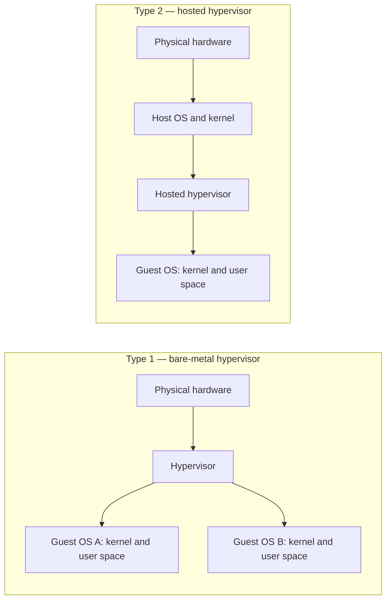
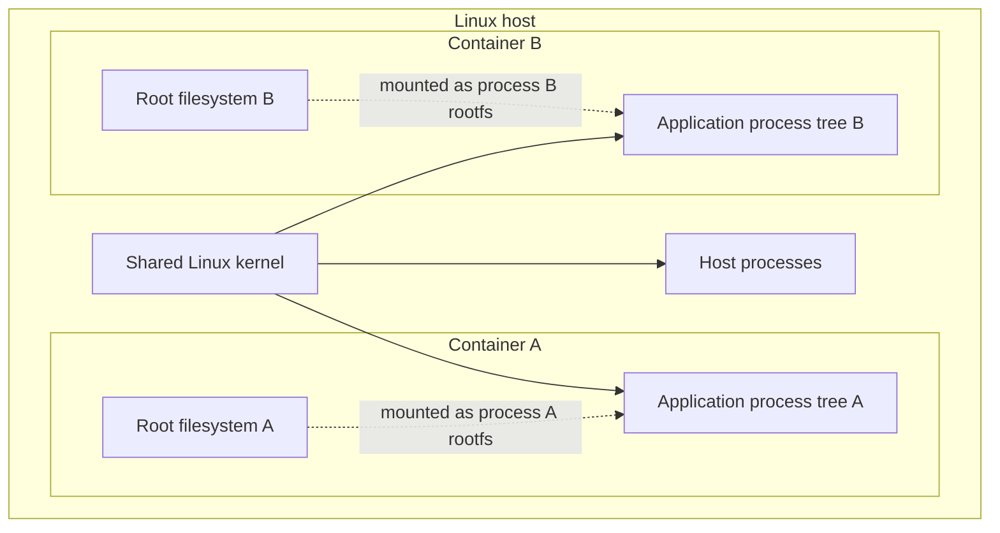
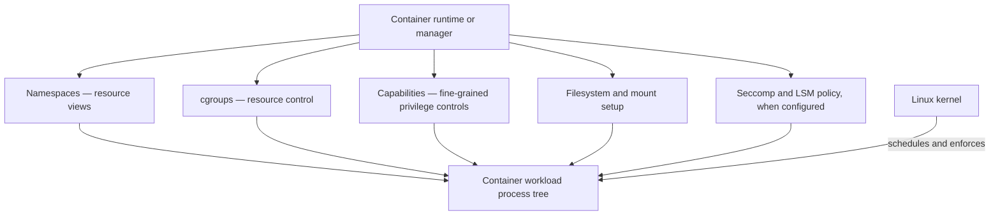
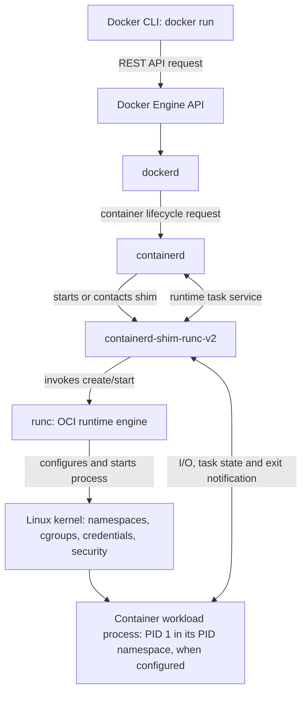
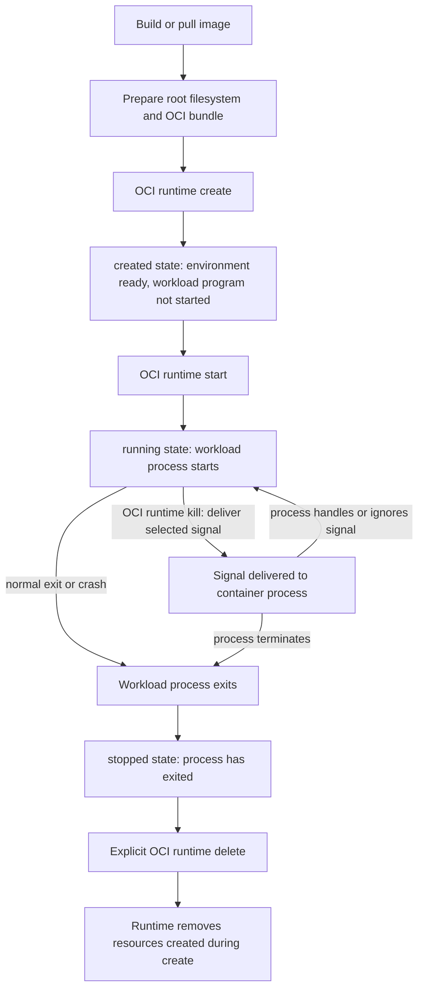

# Chapter 01 — Understanding Containers

> **Chapter status:** Revised manuscript — 8 November 2026  
> **Research snapshot:** 8 November 2026  
> **Lab status:** Designed, not tested

## 1. Container ကို ဘာကြောင့် သုံးလာကြသလဲ

Application တစ်ခုကို ကိုယ့်ကွန်ပျူတာမှာ အဆင်ပြေပြေ run လို့ရပေမဲ့ တခြားစက်တစ်လုံးပေါ် ရွှေ့လိုက်တဲ့အခါ အလုပ်မလုပ်တော့တာမျိုး ကြုံဖူးပါသလား။ တစ်ခါတလေ လိုအပ်တဲ့ library မရှိတာ ဖြစ်နိုင်သလို၊ version မတူတာကြောင့်လည်း ဖြစ်နိုင်ပါတယ်။ Application တစ်ခုနဲ့တစ်ခု လိုအပ်တဲ့ software version မတူတဲ့အခါ ဒီပြဿနာက ပိုပြီး မကြာခဏ တွေ့ရတတ်ပါတယ်။

ဥပမာ payment service တစ်ခုက Python 3.12 နဲ့ library version အသစ်တစ်ခုကို လိုအပ်နေပြီး reporting service တစ်ခုကတော့ Python 3.10 နဲ့ library version အဟောင်းကိုပဲ အသုံးပြုနေတယ်ဆိုပါစို့။ Application နှစ်ခုစလုံးကို host တစ်လုံးတည်းမှာ တိုက်ရိုက်တင်ထားရင် system package သို့မဟုတ် shared library တစ်ခုကို update လုပ်ခြင်းက အခြား application ကိုပါ ထိခိုက်စေနိုင်ပါတယ်။ Python virtual environment လိုနည်းလမ်းတွေက Python package တွေကို ခွဲထားပေးနိုင်ပေမဲ့ process visibility၊ filesystem view နဲ့ network stack တို့ကို သီးခြားခွဲပေးတာ မဟုတ်ပါဘူး။

Application တစ်ခုစီအတွက် VM သီးခြားဖန်တီးထားခြင်းက ဒီလို dependency နဲ့ environment conflict တွေကို လျှော့ချနိုင်ပါတယ်။ သို့သော် VM တစ်ခုစီမှာ guest operating system တစ်ခုစီ ရှိနေတဲ့အတွက် update၊ monitoring နဲ့ maintenance ကိုလည်း သီးခြားစီ စီမံရပါတယ်။ Workload များလာတဲ့အခါ ထိုနည်းလမ်းက resource အသုံးပြုမှုနဲ့ လုပ်ငန်းလည်ပတ်ရေးအလုပ်တွေကို တိုးစေနိုင်ပါတယ်။

Container က အခြားနည်းလမ်းတစ်ခုကို ပေးပါတယ်။ Application အတွက် လိုအပ်တဲ့ user-space files၊ libraries နဲ့ default configuration တွေကို image အဖြစ် စုစည်းထားနိုင်ပါတယ်။ ထို image ကို host တစ်လုံးတည်းပေါ်မှာ အခြား application တွေနဲ့အတူ run လုပ်နိုင်သလို process တစ်ခုစီ မြင်ရမယ့် resource၊ အသုံးပြုနိုင်မယ့် resource နဲ့ ရရှိမယ့် privilege တွေကိုလည်း kernel facilities တွေနဲ့ ခွဲခြားသတ်မှတ်နိုင်ပါတယ်။

Image တစ်ခုရှိရုံနဲ့ deployment ပြဿနာအားလုံး ပြေလည်သွားတာတော့ မဟုတ်ပါဘူး။ Host kernel၊ CPU architecture၊ mounted data၊ secrets၊ network policy နဲ့ external service တွေကို သီးခြားစီ စီမံရပါသေးပါတယ်။ Container က application environment တွေကြား ကွာခြားမှုကို လျှော့ချပေးတဲ့ နည်းလမ်းတစ်ခုဖြစ်ပြီး deployment အတွက် လိုအပ်တဲ့ အရာအားလုံးကို အစားထိုးပေးတာ မဟုတ်ပါဘူး။

ဒီအခန်းမှာ container ဆိုတာ ဘာလဲ၊ Virtual Machine (VM) နဲ့ ဘယ်လိုကွာသလဲ၊ Linux kernel ရဲ့ ဘယ် mechanism တွေက container environment တစ်ခုကို ဖြစ်လာစေသလဲဆိုတာကို လေ့လာပါမယ်။ Namespace API၊ cgroup controller၊ mount setup နဲ့ networking configuration တို့ရဲ့ အသေးစိတ်ကိုတော့ သက်ဆိုင်ရာနောက်ပိုင်း chapter တွေမှာ ဆက်ကြည့်ပါမယ်။

## 2. ဒီအခန်းပြီးရင် ဘာတွေ ခွဲခြားသိနိုင်မလဲ

ဒီအခန်းကို ဖတ်ပြီးရင် အောက်ပါအချက်တွေကို ကိုယ့်စကားနဲ့ ရှင်းပြနိုင်လာဖို့ ရည်ရွယ်ထားပါတယ်။

- Linux OS-level container ကို isolated process environment အဖြစ် ရှင်းပြနိုင်မယ်။
- Container နဲ့ VM တို့ ဘယ် kernel boundary ကို အသုံးပြုသလဲဆိုတာ နှိုင်းယှဉ်နိုင်မယ်။
- Container က dependency နဲ့ deployment ပြဿနာတွေကို ဘယ်လိုလျှော့ချပေးသလဲ၊ ဘယ်အချက်တွေကို သီးခြားစီမံရသေးသလဲဆိုတာ ဥပမာပေးနိုင်မယ်။
- `chroot()` က ဘာလုပ်ပေးသလဲ၊ တစ်ခုတည်းနဲ့ security sandbox ဘာကြောင့် မဖြစ်နိုင်သလဲဆိုတာ ရှင်းပြနိုင်မယ်။
- FreeBSD Jails၊ Solaris Zones၊ LXC၊ Docker နဲ့ OCI တို့ရဲ့ သမိုင်းဆိုင်ရာ အခန်းကဏ္ဍကို ခွဲခြားသိနိုင်မယ်။
- Namespace၊ cgroup၊ capability နဲ့ filesystem isolation တို့ရဲ့ အခြေခံတာဝန်ကို ခွဲပြနိုင်မယ်။
- Image၊ container၊ runtime နဲ့ engine တို့ရဲ့ အဓိပ္ပာယ်နဲ့ တာဝန်ကို မရောထွေးဘဲ ရှင်းပြနိုင်မယ်။
- OCI runtime ရဲ့ `create` နဲ့ `start` operation တို့ ဘာကြောင့် သီးခြားဖြစ်နေသလဲဆိုတာ နားလည်မယ်။

ဒီအခန်းရဲ့ Lab ကတော့ လက်ရှိ environment ထဲက process နဲ့ namespace view အချို့ကို စစ်ကြည့်ဖို့ပဲ ရည်ရွယ်ပါတယ်။ Namespace, cgroup, capability, seccomp နဲ့ LSM အားလုံးကို တစ်ခါတည်း စမ်းသပ်အတည်ပြုတဲ့ Lab မဟုတ်ပါဘူး။

## 3. ဖတ်ရှုရန် ကြိုတင်လိုအပ်ချက်

ဒီအခန်းကို ဖတ်ရှုဖို့ Linux terminal အသုံးပြုဖူးခြင်း၊ filesystem path နဲ့ process ဆိုတဲ့ အခြေခံအယူအဆတွေကို သိထားခြင်းလောက်နဲ့ လုံလောက်ပါတယ်။ Docker၊ Podman၊ Kubernetes သို့မဟုတ် OCI specification ကို ကြိုတင်လေ့လာထားဖို့ မလိုပါဘူး။

Chapter 1 ရဲ့ ရည်ရွယ်ချက်က နောက်ပိုင်း chapter တွေကို ကြိုတင်အသေးစိတ် သင်ပေးဖို့ မဟုတ်ပါဘူး။ Namespace နဲ့ cgroup တို့ရဲ့ အခြေခံအဓိပ္ပာယ်ကို မိတ်ဆက်ပေးမှာဖြစ်ပေမဲ့ `clone()`၊ `unshare()`၊ `setns()` တို့ရဲ့ API အသေးစိတ်၊ CPU/memory controller တွေ ပြင်ဆင်ပုံ၊ capability set တစ်ခုချင်းစီနဲ့ mount propagation တို့ကို ဒီအခန်းမှာ မချဲ့ထွင်ပါဘူး။ အဲဒီအကြောင်းအရာတွေကို Chapter 3 မှ Chapter 6 အထိ သီးခြားလေ့လာပါမယ်။

OverlayFS နဲ့ image storage ကို Chapter 7၊ container networking ကို Chapter 8 မှာ ဆက်လက်လေ့လာပါမယ်။ လက်ရှိအခန်းမှာတော့ အဲဒီ mechanism တွေရဲ့ အမည်နဲ့ အခြေခံတာဝန်ကို သိထားရုံနဲ့ လုံလောက်ပါတယ်။

## 4. Container ဆိုတာ ဘာလဲ

ဒီစာအုပ်မှာ **Linux OS-level container** လို့ ပြောတဲ့အခါ Linux kernel ရဲ့ isolation နဲ့ resource-management facilities တွေကို ပေါင်းစပ်အသုံးပြုပြီး process တစ်ခု သို့မဟုတ် ဆက်စပ်နေတဲ့ process tree တစ်ခုအတွက် သီးခြား execution context ပြင်ဆင်ပေးထားတဲ့ ပုံစံကို ဆိုလိုပါတယ်။

Kernel အမြင်အရ container အတွင်းက application ဟာ process ပဲ ဖြစ်ပါတယ်။ ၎င်းဟာ shell ကနေ စတင်ထားတဲ့ application ဖြစ်နိုင်သလို web server၊ worker process ဒါမှမဟုတ် parent process က ဖန်တီးထားတဲ့ child process အများအပြားလည်း ဖြစ်နိုင်ပါတယ်။ Container ဆိုတာ အဲဒီ process တွေအတွက် မြင်ရမယ့် resource တွေ၊ အသုံးပြုမယ့် filesystem tree နဲ့ ရရှိမယ့် privilege တွေကို စီစဉ်ပေးထားတဲ့ environment ဖြစ်ပါတယ်။

ဒီနေရာမှာ မှတ်ထားရမယ့်အချက်တစ်ခု ရှိပါတယ်။ Linux kernel ထဲမှာ `container` လို့ခေါ်တဲ့ object တစ်ခုကို system call တစ်ခုတည်းနဲ့ ဖန်တီးလိုက်တာ မဟုတ်ပါဘူး။ Container တစ်ခုဟာ namespace၊ cgroup၊ filesystem/mount setup၊ privilege နဲ့ security policy စတဲ့ mechanism များကို runtime က လိုအပ်သလို စီစဉ်ပေးထားတဲ့ process environment ဖြစ်ပါတယ်။

ပုံမှန် Linux OS-level container တစ်ခုမှာ container process တွေဟာ host Linux kernel ကိုပဲ အသုံးပြုကြပါတယ်။ Container တစ်ခုစီအတွက် guest kernel အသစ်တစ်ခု boot လုပ်ထားတာ မဟုတ်ပါဘူး။ Host process တွေနဲ့ container process တွေကို kernel တစ်ခုတည်းက စီမံပေးနေပြီး process တစ်ခုချင်းစီအတွက် မြင်ရမယ့် resource view နဲ့ access control ကို သတ်မှတ်ပေးထားပါတယ်။

Container ဖြစ်နေတာတစ်ခုတည်းနဲ့ လုံခြုံရေးအာမခံချက် ရရှိသွားတာ မဟုတ်ပါဘူး။ Runtime က namespaces၊ cgroups၊ filesystem mounts၊ capabilities နဲ့ လိုအပ်တဲ့ security policy တွေကို ဘယ်လိုပေါင်းစပ်ထားသလဲဆိုတာအပေါ် မူတည်ပါတယ်။ Configuration အားနည်းနေတဲ့ container တစ်ခုမှာ host ကို ထိခိုက်စေနိုင်တဲ့ privilege ဒါမှမဟုတ် access တွေ ရှိနေနိုင်ပါတယ်။ [^1][^2]

### 4.1 Container က ဘာတွေကို ခွဲခြားပေးနိုင်သလဲ

Web application နှစ်ခုကို Linux host တစ်လုံးတည်းပေါ်မှာ run ထားတယ်လို့ ယူဆကြည့်ပါ။ Application တစ်ခုစီကို PID namespace သီးခြားပေးထားရင် အဲဒီ application အတွင်းက process တွေဟာ ကိုယ့် namespace အတွင်းရှိ PID တွေကိုသာ မြင်ရနိုင်ပါတယ်။ Hostname နဲ့ network interface တွေကိုလည်း သီးခြားမြင်ကွင်းအဖြစ် စီစဉ်နိုင်ပါတယ်။ Filesystem ပိုင်းမှာတော့ application တစ်ခုစီအတွက် root filesystem မတူအောင် ပြင်ဆင်နိုင်ပါတယ်။

Resource ပိုင်းမှာ cgroup ကို အသုံးပြုပြီး application တစ်ခုရဲ့ CPU နဲ့ memory အသုံးပြုမှုကို စောင့်ကြည့်ခြင်း၊ ကန့်သတ်ခြင်းတို့ ပြုလုပ်နိုင်ပါတယ်။ Privilege ပိုင်းမှာလည်း application တစ်ခုအတွက် လိုအပ်တဲ့ capability တွေကိုသာ ပေးပြီး မလိုအပ်တဲ့ administrative permission တွေကို ဖယ်ထားနိုင်ပါတယ်။

ဒါပေမဲ့ container တိုင်းမှာ အဲဒီ control အားလုံးကို မဖြစ်မနေ သီးခြားထားရမယ်လို့ မဆိုလိုပါဘူး။ ဥပမာ container တစ်ခုက host networking ကို အသုံးပြုနိုင်သလို အခြား container တစ်ခုနဲ့ PID namespace ကို မျှဝေထားနိုင်ပါတယ်။ Resource limit လုံးဝမသတ်မှတ်ထားတဲ့ container လည်း ရှိနိုင်ပါတယ်။ ဒါကြောင့် container တစ်ခုကို စစ်ဆေးတဲ့အခါ “container ဖြစ်တယ်” ဆိုတဲ့ အမည်ကိုပဲ မကြည့်ဘဲ အမှန်တကယ်အသုံးပြုထားတဲ့ configuration ကို စစ်ဆေးရပါတယ်။

### 4.2 Container ကို အသုံးပြုရတဲ့ အကြောင်းရင်း

Container ရဲ့ အကျိုးကျေးဇူးကို “ပိုမြန်တယ်”၊ “ပိုပေါ့တယ်” ဆိုတဲ့ စကားလုံးတွေနဲ့သာ ရှင်းပြလို့ မရပါဘူး။ Application တစ်ခုကို ပြင်ဆင်၊ ပို့ဆောင်၊ run လုပ်တဲ့အခါ ကြုံရတဲ့ ပြဿနာတွေကို ဘယ်လောက်လျှော့ချပေးနိုင်သလဲဆိုတာက ပိုအရေးကြီးပါတယ်။

**Dependency ကို တစ်စုတစ်စည်းတည်း ထိန်းထားနိုင်ခြင်း။** Application အတွက် လိုအပ်တဲ့ runtime နဲ့ library version တွေကို image ထဲမှာ ထည့်ထားနိုင်လို့ development စက်နဲ့ deployment server ကြား ကွာခြားချက်ကို လျှော့ချနိုင်ပါတယ်။ သို့သော် host kernel၊ CPU architecture၊ mounted data နဲ့ external service တွေက image ထဲမှာ ပါလာတာ မဟုတ်ပါဘူး။

**Application တွေကို ခွဲပြီး run နိုင်ခြင်း။** Process visibility၊ filesystem view၊ network configuration နဲ့ privilege တွေကို workload အလိုက် စီစဉ်နိုင်ပါတယ်။ ဒီလိုခွဲထားခြင်းက application တစ်ခုက အခြားတစ်ခုကို မတော်တဆ ဝင်ရောက်သက်ရောက်မှု လျှော့ချပေးနိုင်ပေမဲ့ VM ရဲ့ isolation boundary နဲ့ တန်းတူတယ်လို့ မယူဆသင့်ပါဘူး။

**Deployment ကို ထပ်လုပ်နိုင်ခြင်း။** Image ကို tag သို့မဟုတ် digest နဲ့ သတ်မှတ်ထားပြီး တူညီတဲ့ artifact ကို environment မတူတဲ့နေရာတွေမှာ အသုံးပြုနိုင်ပါတယ်။ ဒါပေမဲ့ application configuration၊ secrets၊ persistent data နဲ့ external dependency တွေကို သီးခြားစီ စီမံရပါသေးပါတယ်။

**Host resource ကို ပိုမိုအသုံးချနိုင်ခြင်း။** ပုံမှန် OS-level container တစ်ခုစီအတွက် guest kernel တစ်ခုစီ boot လုပ်စရာ မလိုတဲ့အတွက် VM အများအပြားကို run လုပ်ခြင်းထက် startup overhead နည်းနိုင်ပါတယ်။ သို့သော် container က အမြဲပိုမြန်တယ်လို့ မဆိုနိုင်ပါဘူး။ Performance နဲ့ workload density ဟာ application ရဲ့ CPU၊ memory၊ I/O အသုံးပြုမှု၊ kernel၊ runtime နဲ့ security configuration တို့ပေါ် မူတည်ပါတယ်။

## 5. Container နဲ့ Virtual Machine ဘာကွာသလဲ

Container နဲ့ VM ကို “ပေါ့ပါးတယ်”၊ “လေးလံတယ်” ဆိုတဲ့ စကားလုံးတွေနဲ့ပဲ နှိုင်းယှဉ်ရင် အရေးကြီးတဲ့အချက်တစ်ခု လွတ်သွားနိုင်ပါတယ်။ အဓိကကွာခြားချက်က **application ရဲ့ process တွေက ဘယ် kernel instance ကို အသုံးပြုနေသလဲ** ဆိုတာပါ။

### 5.1 Virtual Machine

VM တစ်ခုမှာ guest operating system အတွက် virtual hardware ကို hypervisor က ပံ့ပိုးပေးပါတယ်။ Guest OS တစ်ခုစီမှာ ကိုယ်ပိုင် kernel နဲ့ user space ရှိပြီး application တွေကို အဲဒီ guest kernel က စီမံပါတယ်။ Hypervisor က physical hardware နဲ့ VM တွေအကြား CPU၊ memory၊ storage နဲ့ network device တွေကို ခွဲဝေစီမံပေးပါတယ်။

Hypervisor ကို ပုံမှန်အားဖြင့် Type 1 နဲ့ Type 2 ဟူ၍ ခွဲခြားလေ့ရှိပါတယ်။ Type 1 hypervisor ဟာ physical hardware ပေါ်မှာ တိုက်ရိုက် အလုပ်လုပ်ပြီး Type 2 hypervisor ကတော့ host operating system အပေါ်မှာ software layer တစ်ခုအဖြစ် အလုပ်လုပ်ပါတယ်။ ဒီခွဲခြားပုံက hypervisor နဲ့ host OS တို့ရဲ့ တည်နေရာကို အခြေခံထားတာဖြစ်ပြီး guest OS နှစ်မျိုးစလုံးမှာ ကိုယ်ပိုင် kernel ရှိပါတယ်။ [^23]



ပုံမှာ Type 1 နဲ့ Type 2 hypervisor တို့ရဲ့ အခြေခံ stack ကို နှိုင်းယှဉ်ပြထားပါတယ်။ Type 1 မှာ hypervisor က hardware ပေါ်မှာ တိုက်ရိုက် အလုပ်လုပ်ပြီး Type 2 မှာ host OS က အလယ်မှာ ရှိနေပါတယ်။ VM နှစ်မျိုးစလုံးမှာ guest kernel သီးခြားရှိတယ်ဆိုတာက ဒီအခန်းအတွက် အဓိကမှတ်သားရမယ့်အချက်ပါ။ VM ရှိခြင်းတစ်ခုတည်းနဲ့ လုံခြုံရေးပြဿနာအားလုံး ပြေလည်သွားတာတော့ မဟုတ်ပါဘူး။ Hypervisor၊ virtual device၊ host နဲ့ guest configuration တွေကိုလည်း သေချာစီမံရပါတယ်။

VM နဲ့ container ကို အပြန်အလှန်ရွေးချယ်ရမယ့် ပုံစံတစ်မျိုးတည်းလို့လည်း မယူဆသင့်ပါဘူး။ လက်တွေ့မှာ VM တစ်ခုအတွင်း Linux ကို run လုပ်ပြီး အဲဒီ guest OS ရဲ့ kernel ပေါ်မှာ container များစွာကို ထပ်မံ run လုပ်ထားနိုင်ပါတယ်။ အဲဒီ architecture မှာ container တွေက physical host ရဲ့ kernel ကို တိုက်ရိုက် share လုပ်တာ မဟုတ်ဘဲ VM အတွင်းရှိ guest kernel ကို share လုပ်ကြတာ ဖြစ်ပါတယ်။

### 5.2 Linux OS-level container

ပုံမှန် Linux OS-level container မှာ host kernel တစ်ခုတည်းက host process တွေနဲ့ container process တွေကို စီမံပေးပါတယ်။ Container တစ်ခုစီမှာ root filesystem သီးခြားထားနိုင်သလို PID၊ mount နဲ့ network namespace view တွေကိုလည်း ခွဲထားနိုင်ပါတယ်။ ဒါပေမဲ့ container တစ်ခုစီမှာ guest kernel တစ်ခုစီ မရှိပါဘူး။



ပုံမှာ container တစ်ခုစီအတွက် root filesystem သီးခြားထားနိုင်ပုံကို ပြထားပါတယ်။ သို့သော် system call တွေကို လက်ခံပြီး process တွေကို စီမံပေးနေတဲ့ kernel က တစ်ခုတည်း ဖြစ်နေဆဲပါ။ Container A နဲ့ Container B တို့ရဲ့ filesystem view မတူနိုင်ပေမဲ့ kernel ကို မျှဝေသုံးနေကြပါတယ်။

### 5.3 အဓိကကွာခြားချက်များ

| အချက် | Linux OS-level container | Virtual Machine |
|---|---|---|
| Kernel | ပုံမှန် model မှာ host Linux kernel ကို မျှဝေသုံးတယ် | Guest OS တစ်ခုစီမှာ ကိုယ်ပိုင် kernel ရှိတယ် |
| Filesystem | Container အလိုက် root filesystem သီးခြားပြင်ဆင်နိုင်တယ် | Guest OS ရဲ့ disk/filesystem ရှိတယ် |
| Isolation | Namespaces၊ cgroups၊ capabilities၊ mounts နဲ့ security controls | Hypervisor/virtualization boundary နဲ့ guest OS controls |
| စတင်ပုံ | Guest kernel boot မလိုဘဲ process ကို စတင်နိုင်တယ် | Guest OS ကို boot လုပ်ရတယ် |
| Resource management | Host kernel က process နဲ့ cgroup အလိုက် စီမံတယ် | Hypervisor က VM အတွက် virtual CPU၊ memory၊ device စတာတွေ ပေးတယ် |
| OS ရွေးချယ်နိုင်မှု | Shared-kernel model ကြောင့် host kernel နဲ့ ကိုက်ညီတဲ့ OS family/ABI ကို အသုံးပြုရတယ် | Hypervisor က ပံ့ပိုးနိုင်တဲ့ guest OS မျိုးစုံကို အသုံးပြုနိုင်တယ် |

ဒီဇယားက ပုံမှန် Linux OS-level container နဲ့ VM ကို နှိုင်းယှဉ်ထားတာပါ။ Container က VM ထက် ဘယ်အခြေအနေမှာမဆို ပိုကောင်းတယ်လို့ ဆိုလိုတာ မဟုတ်ပါဘူး။ Application ရဲ့ လိုအပ်ချက်၊ trust boundary၊ host management နဲ့ လုပ်ငန်းလည်ပတ်ပုံတို့ကို ကြည့်ပြီး ရွေးချယ်ရပါတယ်။

### 5.4 Container လို့ခေါ်တိုင်း host kernel ကို မျှဝေသုံးတာလား

Container ဟု ခေါ်ဆိုသည့် workload အားလုံးသည် အောက်ခံ isolation implementation တစ်မျိုးတည်းကို အသုံးပြုကြတာ မဟုတ်ပါဘူး။ **Kata Containers** က ဥပမာတစ်ခုပါ။ Kata Containers က container workload ကို lightweight VM တစ်ခုအတွင်း run လုပ်ပြီး guest kernel သီးခြား အသုံးပြုစေပါတယ်။ ထိုအခါ container workflow နဲ့ OCI runtime interface ကို အသုံးပြုနေပေမဲ့ workload က host kernel ကို တိုက်ရိုက် share လုပ်တာ မဟုတ်ပါဘူး။ [^16]

ဒါကြောင့် ဒီစာအုပ်မှာ “host kernel ကို မျှဝေသုံးတယ်” လို့ ရေးထားတဲ့အခါ **ပုံမှန် Linux OS-level container model** ကိုသာ ရည်ညွှန်းပါတယ်။ Container management interface၊ image format နဲ့ အောက်ခံ isolation နည်းပညာတို့ဟာ မတူညီတဲ့ အလွှာတွေ ဖြစ်ကြပါတယ်။

## 6. Container များဆီသို့ ရောက်လာတဲ့ သမိုင်းလမ်းကြောင်း

Container ကို Docker က 2013 ခုနှစ်မှာ စတင်တီထွင်ခဲ့တယ်လို့ ထင်လွယ်ပါတယ်။ တကယ်တော့ workload တစ်ခုကို အခြား workload တွေနဲ့ ခွဲပြီး run လုပ်ဖို့ ကြိုးစားခဲ့တဲ့ နည်းလမ်းတွေဟာ Docker မတိုင်ခင်ကတည်းက ရှိနေခဲ့ပါတယ်။ Unix ရဲ့ filesystem boundary၊ FreeBSD ရဲ့ Jails၊ Solaris ရဲ့ Zones နဲ့ Linux ရဲ့ kernel containment facilities တွေဟာ operating system မတူတဲ့နေရာတွေမှာ သီးခြားတိုးတက်လာခဲ့ကြတာပါ။ ဒီနည်းပညာတွေကို တစ်ခုကနေတစ်ခု တိုက်ရိုက်ဆက်ခံခဲ့တဲ့ တစ်ကြောင်းတည်းသော သမိုင်းကြောင်းလို့ မဖတ်သင့်ပါဘူး။

| အချိန် | နည်းပညာ | မှတ်သားရန် |
|---|---|---|
| Unix Version 7 ခေတ်၊ 1979 | `chroot` | Process ရဲ့ pathname resolution root ကို ပြောင်းလဲပေးတဲ့ filesystem mechanism။ တစ်ခုတည်းနဲ့ complete isolation မရပါ။ [^17] |
| FreeBSD 4.0၊ 2000 | Jails | `jail()` system call ကို FreeBSD 4.0 မှာ ထည့်သွင်းခဲ့ပြီး filesystem တစ်ခုတည်းထက် ပိုကျယ်တဲ့ isolation ကို ပေးဖို့ ရည်ရွယ်ခဲ့ပါတယ်။ [^11][^12] |
| Solaris Express 2/04၊ 2004 | Solaris Zones | Zones ကို Solaris Express 2/04 မှာ စတင်မိတ်ဆက်ခဲ့ပြီး Solaris 10 3/05 release မှာလည်း ပါဝင်လာပါတယ်။ [^13] |
| 2008 မှစ၍ | LXC | Linux kernel containment features တွေကို userspace library နဲ့ tool တွေကနေ အသုံးပြုနိုင်အောင် တိုးတက်လာတဲ့ project။ [^14] |
| 15 နှင့် 23 March 2013 | Docker | 15 March မှာ public demo ပြသခဲ့ပြီး 23 March မှာ Docker 0.1.0 ကို initial public release အဖြစ် ထုတ်ခဲ့ပါတယ်။ [^15] |
| 22 June 2015 | OCI | Container image format နဲ့ runtime interoperability အတွက် open specification တွေ ဖော်ထုတ်ဖို့ OCI ကို စတင်ဖွဲ့စည်းခဲ့ပါတယ်။ [^6] |

ဒီ timeline ကို တစ်ဆင့်ပြီးတစ်ဆင့် ဆက်ခံလာတဲ့ တီထွင်မှုစာရင်းအဖြစ် မဖတ်သင့်ပါဘူး။ Operating system မတူညီတဲ့ နေရာတွေမှာ isolation ပြဿနာကို ဖြေရှင်းဖို့ ကြိုးပမ်းခဲ့ကြတဲ့ milestone တွေအဖြစ်သာ ကြည့်သင့်ပါတယ်။

### 6.1 `chroot`

`chroot()` သည် process တစ်ခု၏ pathname resolution အတွက် အသုံးပြုမည့် root directory ကို ပြောင်းလဲပေးသော system call ဖြစ်ပါတယ်။ ဥပမာ process တစ်ခုရဲ့ root ကို `/srv/jail` သို့ ပြောင်းထားပါက `/etc/app.conf` ကို ဖွင့်တဲ့အခါ `/srv/jail/etc/app.conf` ကို အခြေခံပြီး ရှာဖွေသွားပါမယ်။

သို့သော် `chroot()` လုပ်လိုက်တာနဲ့ process ရဲ့ current working directory ကို အလိုအလျောက် ပြောင်းမပေးပါဘူး။ ဖွင့်ထားပြီးသား file descriptor တွေကိုလည်း ပိတ်မပေးပါဘူး။ ထို့ကြောင့် process တစ်ခုကို `chroot()` လုပ်ထားရုံနဲ့ root directory အပြင်ဘက်က file တွေကို လုံးဝမရောက်နိုင်တော့ဘူးလို့ မဆိုနိုင်ပါဘူး။ Linux `chroot(2)` manual ကလည်း `chroot()` ကို security sandbox အဖြစ် ရည်ရွယ်ထားတာ မဟုတ်ကြောင်း ရှင်းလင်းစွာ သတိပေးထားပါတယ်။ [^1]

`chroot()` ရဲ့ အဓိကတာဝန်က filesystem path တွေကို ဖြေရှင်းရာမှာ အသုံးပြုမယ့် root ကို ပြောင်းပေးခြင်းပါ။ PID view၊ network stack၊ UID/GID mapping၊ CPU/memory resource control နဲ့ kernel privilege တွေကို အလိုအလျောက် ခွဲပေးတာ မဟုတ်ပါဘူး။ ဒါကြောင့် container isolation တစ်ခုလုံးကို `chroot()` တစ်ခုတည်းနဲ့ မတည်ဆောက်နိုင်ပါဘူး။

### 6.2 FreeBSD Jails

FreeBSD Jails က `chroot` နဲ့ ဆက်စပ်တဲ့ filesystem separation ကို ပိုမိုကျယ်ပြန့်တဲ့ OS-level isolation အဖြစ် တိုးချဲ့ထားပါတယ်။ FreeBSD Handbook အရ Jails ဟာ FreeBSD 4.X ကတည်းက ရှိခဲ့ပြီး filesystem၊ user နဲ့ network subsystem တွေကို သီးခြားစီမံနိုင်တဲ့ environment တစ်ခု ဖန်တီးပေးပါတယ်။ `jail()` system call ကို FreeBSD 4.0 မှာ စတင်ထည့်သွင်းခဲ့ကြောင်း manual page ရဲ့ HISTORY အပိုင်းမှာ ဖော်ပြထားပါတယ်။ [^11][^12]

Jails နဲ့ Linux namespaces တို့ဟာ workload isolation ကို ရည်ရွယ်ကြပေမဲ့ implementation တူညီတာ မဟုတ်ပါဘူး။ Kernel၊ API နဲ့ resource model တွေ မတူကြတဲ့အတွက် Jails ကို Linux namespace implementation တစ်ခုအဖြစ် မရှင်းပြသင့်ပါဘူး။

### 6.3 Solaris Zones

Solaris Zones က Solaris operating system တစ်ခုအတွင်း application နဲ့ service တွေအတွက် ခွဲခြားထားတဲ့ execution environment တွေ ဖန်တီးပေးပါတယ်။ Oracle ရဲ့ documentation အရ Zones ကို Solaris Express 2/04 မှာ စတင်မိတ်ဆက်ခဲ့ပြီး Solaris 10 3/05 release မှာလည်း ပါဝင်ခဲ့ပါတယ်။ [^13]

Zones ဟာ hypervisor တစ်ခုက guest OS အများအပြားကို boot လုပ်ပေးတဲ့ပုံစံ မဟုတ်ပါဘူး။ Solaris OS instance တစ်ခုအတွင်း operating-system services တွေကို partition လုပ်ပေးတဲ့ technology ဖြစ်ပါတယ်။ Solaris Zones နဲ့ Linux container mechanism တွေကို တိုက်ရိုက်တူညီတယ်လို့ မဆိုရပေမဲ့ OS-level isolation ကို ဘယ်လိုတည်ဆောက်နိုင်သလဲဆိုတဲ့ သမိုင်းအတွက် အရေးပါတဲ့ ဥပမာတစ်ခုပါ။

### 6.4 LXC

LXC (Linux Containers) က Linux kernel ရဲ့ containment features တွေကို userspace ကနေ အသုံးပြုနိုင်ဖို့ library နဲ့ tools ပေးတဲ့ project ဖြစ်ပါတယ်။ LXC ရဲ့ upstream README အရ project ကို 2008 ခုနှစ်ကတည်းက ဆက်လက်ဖွံ့ဖြိုးနေခဲ့ပါတယ်။ Namespaces၊ mandatory access control နဲ့ control groups တို့ကို ပေါင်းစပ်အသုံးပြုပြီး သီးခြား system-container environment တစ်ခု ဖန်တီးနိုင်ပါတယ်။ [^14]

LXC ကို `chroot` ထက် option ပိုများတဲ့ command တစ်ခုလို့သာ နားလည်လို့ မရပါဘူး။ Linux kernel ရဲ့ isolation နဲ့ security feature တွေကို တွဲဖက်အသုံးပြုတဲ့ container-management project ဖြစ်ပါတယ်။

### 6.5 Docker

Docker က container နည်းပညာကို ပထမဆုံး တီထွင်ခဲ့တာ မဟုတ်ပါဘူး။ သို့သော် application ကို build လုပ်ခြင်း၊ package လုပ်ခြင်း၊ မျှဝေခြင်းနဲ့ run လုပ်ခြင်းတို့ကို တစ်ဆက်တည်း အသုံးပြုနိုင်တဲ့ workflow အဖြစ် လူသိများလာစေခဲ့ပါတယ်။ Docker ရဲ့ public demonstration ကို 15 March 2013 မှာ ပြသခဲ့ပြီး ပထမဆုံး public release ဖြစ်တဲ့ Docker 0.1.0 ကို 23 March 2013 မှာ ထုတ်ခဲ့ပါတယ်။ [^15]

Docker Engine မှာ CLI client၊ REST API နဲ့ `dockerd` daemon ပါဝင်တဲ့ client-server architecture ကို အသုံးပြုပါတယ်။ ဒီပုံစံက Docker Engine ရဲ့ architecture ဖြစ်ပြီး container engine အားလုံးက မဖြစ်မနေ လိုက်နာရတဲ့ပုံစံ မဟုတ်ပါဘူး။ [^10]

### 6.6 Open Container Initiative (OCI)

Container tool တွေ များလာတဲ့အခါ image တစ်ခုကို runtime မတူတဲ့ tool တွေမှာ အပြန်အလှန်အသုံးပြုနိုင်ဖို့ common format နဲ့ behavior လိုအပ်လာပါတယ်။ OCI ကို 22 June 2015 မှာ Linux Foundation အောက်က open governance project အဖြစ် စတင်ဖွဲ့စည်းခဲ့ပြီး container format နဲ့ runtime ဆိုင်ရာ open industry standards တွေ တည်ဆောက်ဖို့ ရည်ရွယ်ခဲ့ပါတယ်။ [^6]

OCI မှာ အဓိက specification သုံးမျိုး ရှိပါတယ်။

- **OCI Image Specification** က image ရဲ့ filesystem layers နဲ့ image configuration ကို ဘယ်လိုဖွဲ့စည်းထားသလဲဆိုတာ သတ်မှတ်ပါတယ်။
- **OCI Runtime Specification** က disk ပေါ်မှာ ပြင်ဆင်ထားတဲ့ runtime bundle တစ်ခုကို runtime က ဘယ်လို configure လုပ်ပြီး process ကို ဘယ်လိုစတင်၊ ရပ်တန့်၊ ဖယ်ရှားရမလဲဆိုတာ သတ်မှတ်ပါတယ်။
- **OCI Distribution Specification** က registry လို distribution service တွေကနေ image နဲ့ artifact တွေကို ဘယ်လို ပို့ဆောင်၊ ရယူမလဲဆိုတဲ့ protocol ကို သတ်မှတ်ပါတယ်။ [^7][^8][^9]

OCI သည် Docker Engine၊ Kubernetes သို့မဟုတ် container orchestration စနစ်တစ်ခုလုံးကို standardize လုပ်တာ မဟုတ်ပါဘူး။ Container ecosystem များအကြား image၊ runtime နဲ့ distribution ဆိုင်ရာ interoperability ရရှိစေဖို့ လိုအပ်တဲ့ အစိတ်အပိုင်းတွေကိုသာ သတ်မှတ်ပေးတာ ဖြစ်ပါတယ်။

## 7. Container isolation တွင် Linux Kernel ၏ အခန်းကဏ္ဍ

Linux container တစ်ခုကို kernel feature တစ်ခုတည်းနဲ့ တည်ဆောက်တာ မဟုတ်ပါဘူး။ Runtime က လိုအပ်တဲ့ kernel mechanism တွေကို စီစဉ်ပြီး application process ကို သတ်မှတ်ထားတဲ့ execution context အတွင်း စတင်စေပါတယ်။ အဓိက mechanism တွေက ဘယ်လို အခန်းကဏ္ဍယူထားသလဲဆိုတာကို အောက်မှာ ခွဲကြည့်ပါမယ်။



ပုံမှာ runtime က kernel mechanism များကို စီစဉ်ပေးပြီး kernel က workload process tree ကို စီမံနေတဲ့ ဆက်နွယ်မှုကို ပြထားပါတယ်။ Container တစ်ခုစီမှာ ဒီ control အားလုံးကို တူညီတဲ့ပုံစံနဲ့ အသုံးပြုထားတယ်လို့တော့ မဆိုလိုပါဘူး။

### 7.1 Namespaces — Process မြင်ရတဲ့ resource ကို ခွဲခြားခြင်း

Linux namespace တစ်ခုက system resource တစ်မျိုးကို namespace အတွင်းရှိ process များအတွက် သီးခြား instance ရှိသလို မြင်စေပါတယ်။ Namespace တူညီတဲ့ process များက အဲဒီ resource view ကို မျှဝေကြပေမဲ့ အခြား namespace ထဲက process များက တူညီတဲ့ view ကို အလိုအလျောက် မရကြပါဘူး။ Linux manual မှာ namespace အမျိုးအစားနဲ့ သက်ဆိုင်ရာ API တွေကို သီးခြားဖော်ပြထားပါတယ်။ [^2]

| Namespace | ခွဲခြားပေးတဲ့ resource view |
|---|---|
| PID | Process ID နဲ့ process visibility |
| Mount | Process မြင်ရတဲ့ mount table နဲ့ mount point များ |
| Network | Network interface၊ routing နဲ့ network-related resource များ |
| UTS | Hostname နဲ့ NIS domain name |
| IPC | System V IPC နဲ့ POSIX message queue ကဲ့သို့ IPC resource များ |
| User | UID/GID mapping နဲ့ user privilege context |
| Cgroup | Process မြင်ရတဲ့ cgroup hierarchy view |
| Time | Clock view အချို့ကို namespace အလိုက် ချိန်ညှိခြင်း |

Time namespace က clock အချို့ရဲ့ view ကို namespace အလိုက် ချိန်ညှိပေးနိုင်ပါတယ်။ ဘယ် clock တွေကို ဘယ်လိုပြောင်းလဲနိုင်သလဲဆိုတဲ့ အသေးစိတ်ကို Chapter 03 မှာ ဆက်လေ့လာပါမယ်။ [^5]

ဒီနေရာမှာ Namespace နဲ့ cgroup တို့ရဲ့ တာဝန်ကို မရောထွေးဖို့ အရေးကြီးပါတယ်။ Namespace က process တစ်ခု မြင်ရတဲ့ resource view ကို ခွဲခြားပေးတာဖြစ်ပြီး resource usage ကို limit လုပ်ပေးတာ မဟုတ်ပါဘူး။ Namespace အမျိုးအစား ရှစ်မျိုးရှိတယ်ဆိုတာနဲ့ container တစ်ခုစီမှာ ရှစ်မျိုးလုံးကို မဖြစ်မနေ သီးခြားဖန်တီးထားတယ်လို့လည်း မဆိုလိုပါဘူး။

### 7.2 cgroups — Resource အသုံးပြုမှုကို စီမံခြင်း

Control groups (`cgroups`) က process တွေကို hierarchical group အဖြစ် စုစည်းပြီး CPU၊ memory နဲ့ အခြား resource တွေရဲ့ အသုံးပြုမှုကို စောင့်ကြည့်ခြင်း၊ စာရင်းသွင်းခြင်းနဲ့ ကန့်သတ်ခြင်းတို့ကို လုပ်နိုင်စေပါတယ်။ Linux manual မှာ cgroup ကို process အုပ်စုတွေရဲ့ resource usage ကို limit လုပ်ပြီး monitor လုပ်နိုင်တဲ့ kernel feature အဖြစ် ရှင်းပြထားပါတယ်။ [^3]

ဥပမာ memory controller နဲ့ သတ်မှတ်ထားတဲ့ cgroup တစ်ခုအတွင်းရှိ process တွေရဲ့ memory usage ကို စောင့်ကြည့်ပြီး limit သတ်မှတ်နိုင်ပါတယ်။ ဒါဟာ application ရဲ့ memory leak ကို ပြုပြင်ပေးတာ မဟုတ်သလို host ပေါ်မှာ resource များနေတယ်ဆိုတာကိုလည်း အာမမခံပါဘူး။

### 7.3 Capabilities — Root privilege ကို ခွဲခြားစီမံခြင်း

Unix စနစ်တွေမှာ UID 0 (`root`) ဟာ ကျယ်ပြန့်တဲ့ administrative permission တွေနဲ့ ဆက်စပ်နေပါတယ်။ Linux capabilities က အဲဒီ privilege တွေကို ပိုမိုသေးငယ်တဲ့ permission unit တွေအဖြစ် ခွဲထားနိုင်စေပါတယ်။ ဥပမာ network configuration ပြောင်းဖို့ လိုအပ်တဲ့ process ကို အခြားမလိုအပ်တဲ့ administrative permission အားလုံး ပေးထားစရာ မလိုအောင် စီမံနိုင်ပါတယ်။

ဒီအခန်းမှာတော့ root privilege ကို permission အပိုင်းငယ်တွေ ခွဲပြီး စီမံနိုင်တယ်ဆိုတဲ့ အခြေခံအယူအဆကိုပဲ မှတ်ထားပါ။ Capability တွေကို thread အလိုက် ဘယ်လိုသတ်မှတ်သလဲ၊ effective/permitted/inheritable set တွေ ဘယ်လိုဆက်နွယ်သလဲဆိုတာကို Chapter 05 မှာ အသေးစိတ် ကြည့်ပါမယ်။ [^4]

Container အတွင်း UID 0 ဖြစ်နေတယ်ဆိုတာနဲ့ host ပေါ်မှာ unrestricted root ဖြစ်နေတယ်လို့ အလိုအလျောက် မဆိုနိုင်ပါဘူး။ User namespace mapping၊ capability set၊ runtime configuration နဲ့ security policy တို့က အဲဒီအခန်းကဏ္ဍမှာ ပါဝင်ပါတယ်။ တစ်ဖက်မှာလည်း “container ထဲက root က host ကို မထိခိုက်နိုင်ဘူး” လို့ အာမခံလို့ မရပါဘူး။ Privileged container သို့မဟုတ် ကျယ်ပြန့်တဲ့ capability တွေ ပေးထားရင် host အတွက် အန္တရာယ်ရှိနိုင်ပါတယ်။

### 7.4 Filesystem isolation

Container process တစ်ခုအတွက် host ရဲ့ `/` ကို တိုက်ရိုက်မသုံးဘဲ သီးခြား root filesystem (rootfs) တစ်ခု ပြင်ဆင်ပေးနိုင်ပါတယ်။ Runtime က image ကနေ ရလာတဲ့ filesystem content တွေကို ပြင်ဆင်ပြီး mount point တွေ၊ read-only/read-write setting တွေနဲ့ process မြင်ရမယ့် filesystem view ကို သတ်မှတ်ပေးပါတယ်။

ဒီအလုပ်ကို `chroot()` တစ်ခုတည်းနဲ့ မပြီးပါဘူး။ Mount namespace၊ rootfs၊ bind mount၊ device visibility နဲ့ permission တွေကို ဘယ်လိုပြင်ဆင်ထားသလဲဆိုတာလည်း အရေးကြီးပါတယ်။

### 7.5 Seccomp နဲ့ Linux Security Modules

Namespaces၊ cgroups နဲ့ capabilities တွေအပြင် seccomp နဲ့ Linux Security Modules (LSM) တွေကိုလည်း container security မှာ အသုံးပြုနိုင်ပါတယ်။ Seccomp filter က thread တစ်ခုက ခေါ်ဆိုမယ့် system call တွေကို စစ်ဆေးပြီး ခွင့်ပြုမယ့် call နဲ့ ပိတ်ပင်မယ့် call တို့ကို သတ်မှတ်နိုင်ပါတယ်။ ဒါပေမဲ့ seccomp တစ်ခုတည်းကို complete sandbox လို့ မယူဆသင့်ကြောင်း Linux kernel documentation က ရှင်းလင်းထားပါတယ်။ [^18]

LSM framework က kernel ရဲ့ access-control check တွေမှာ security policy ချိတ်ဆက်အသုံးပြုနိုင်စေပါတယ်။ SELinux နဲ့ AppArmor တို့ဟာ LSM ကို အသုံးပြုတဲ့ ဥပမာတွေ ဖြစ်ပါတယ်။ သို့သော် distribution တိုင်းမှာ တူညီတဲ့ LSM နဲ့ policy ကို အမြဲဖွင့်ထားတယ်လို့ မယူဆရပါဘူး။ Kernel configuration၊ boot parameter နဲ့ system policy အလိုက် ကွာခြားနိုင်ပါတယ်။ [^19]

ဒီ mechanism တွေရဲ့ configuration အသေးစိတ်ကို သက်ဆိုင်ရာနောက်ပိုင်း chapter တွေမှာ ဆက်လက်လေ့လာပါမယ်။ လက်ရှိအဆင့်မှာ မှတ်ထားရမှာက container isolation ဟာ namespace တစ်ခုတည်း၊ cgroup တစ်ခုတည်း ဒါမှမဟုတ် seccomp တစ်ခုတည်းနဲ့ ပြီးဆုံးတာ မဟုတ်ဘဲ လိုအပ်တဲ့ control အလွှာတွေကို ပေါင်းစပ်အသုံးပြုရခြင်း ဖြစ်ပါတယ်။

## 8. Image၊ Container၊ Runtime နဲ့ Engine ကို ခွဲကြည့်ခြင်း

ဒီစကားလုံးလေးခုဟာ container workflow တစ်ခုအတွင်း ဆက်စပ်နေကြပေမဲ့ အဓိပ္ပာယ်နဲ့ တာဝန် မတူကြပါဘူး။ တစ်ခုချင်းစီရဲ့ တာဝန်ကို ခွဲသိထားရင် နောက်ပိုင်း runtime နဲ့ engine architecture တွေကို ဖတ်တဲ့အခါ component တစ်ခုစီ ဘာလုပ်သလဲဆိုတာ ပိုလွယ်ကူစွာ လိုက်နိုင်ပါလိမ့်မယ်။

### 8.1 Container image

Container image ဆိုတာ application ရဲ့ filesystem content ကို layer တွေအဖြစ် ဖွဲ့စည်းထားပြီး ထို image အတွက် default execution setting တွေကို metadata အဖြစ် တွဲထားတဲ့ artifact ဖြစ်ပါတယ်။ OCI Image Specification မှာ layer တစ်ခုစီက filesystem changes ကို ကိုယ်စားပြုကြောင်း၊ image configuration ထဲမှာ `Env`၊ `Entrypoint`၊ `Cmd`၊ `User` နဲ့ `WorkingDir` စတဲ့ default value တွေ ပါဝင်နိုင်ကြောင်း သတ်မှတ်ထားပါတယ်။ [^7]

ဒီ default setting တွေဟာ container တစ်ခု ဖန်တီးတဲ့အခါ အသုံးပြုမယ့် အခြေခံတန်ဖိုးတွေ ဖြစ်ပါတယ်။ Container တစ်ခုချင်းစီရဲ့ configuration နဲ့ ပေါင်းစပ်သတ်မှတ်နိုင်သလို အချို့တန်ဖိုးတွေကို override လုပ်နိုင်ပါတယ်။ Image ထဲမှာ per-container mount၊ namespace နဲ့ cgroup setup အားလုံး ပါပြီးသားလို့ မယူဆရပါဘူး။ Image configuration (`config` object) ကို OCI runtime bundle ထဲက `config.json` နဲ့လည်း မရောထွေးသင့်ပါဘူး။ ပထမတစ်ခုက image ရဲ့ default metadata ဖြစ်ပြီး ဒုတိယတစ်ခုက particular container instance အတွက် runtime setting တွေကို ဖော်ပြတာ ဖြစ်ပါတယ်။

### 8.2 Container

Container ဆိုတာ image ဖိုင်ကိုပဲ ခေါ်တာ မဟုတ်ပါဘူး။ Image content ကို အသုံးပြုပြီး particular instance တစ်ခုအတွက် runtime configuration နဲ့ တွဲဖက်ပြင်ဆင်ထားတဲ့ execution environment နဲ့ ၎င်းရဲ့ lifecycle state ကို ရည်ညွှန်းပါတယ်။ Runtime က `create` လုပ်ပြီးချိန်မှာ application process မစရသေးတဲ့ `created` state ဖြစ်နေနိုင်သလို `start` ပြီးနောက် `running` ဖြစ်နေနိုင်ပါတယ်။

### 8.3 Container runtime

Container runtime က particular container instance တစ်ခုအတွက် filesystem bundle နဲ့ runtime configuration ကို အသုံးပြုပြီး environment ကို ဖန်တီး၊ process ကို စတင်၊ ရပ်တန့်နဲ့ ဖယ်ရှားပေးတဲ့ software ဖြစ်ပါတယ်။ OCI Runtime Specification က runtime လက်ခံရမယ့် configuration၊ execution environment နဲ့ lifecycle operation တွေရဲ့ behavior ကို သတ်မှတ်ထားပါတယ်။ [^9]

### 8.4 Container engine သို့မဟုတ် manager

“Container engine” ဆိုတဲ့စကားလုံးဟာ OCI specification က သတ်မှတ်ထားတဲ့ component အမည် မဟုတ်ပါဘူး။ Product တစ်ခုနဲ့တစ်ခုအလိုက် image management၊ API၊ CLI၊ storage၊ networking နဲ့ runtime ကို ချိတ်ဆက်စီမံပေးတဲ့ တာဝန်တွေ ကွာခြားနိုင်ပါတယ်။

ဥပမာ Docker Engine မှာ `docker` CLI က API ကတစ်ဆင့် `dockerd` daemon ကို ဆက်သွယ်ပြီး daemon က image၊ container၊ network နဲ့ volume တွေကို စီမံပါတယ်။ [^10] အခြား project တွေမှာတော့ daemon မပါဘဲ local CLI ကနေ တိုက်ရိုက်စီမံနိုင်တဲ့ model လည်း ရှိပါတယ်။ Podman ရဲ့ architecture ကို Chapter 17 မှာ သီးခြားလေ့လာပါမယ်။

| အမည် | အဓိကတာဝန် |
|---|---|
| Image | Filesystem layers နဲ့ application အတွက် default configuration ကို သယ်ဆောင်ထားတယ် |
| Container | Image နဲ့ runtime configuration ကို အခြေခံထားတဲ့ instance/state ဖြစ်တယ် |
| Runtime | Container environment ကို ဖန်တီးပြီး process lifecycle ကို ကိုင်တွယ်တယ် |
| Engine/manager | Image နဲ့ container တွေကို user-facing tool/API ကနေ စီမံပြီး အခြား component တွေကို ချိတ်ဆက်ပေးတယ် |

ဒီဇယားက concept ကို နားလည်စေဖို့ အကျဉ်းချုပ်ထားတာပါ။ Product တစ်ခုချင်းစီရဲ့ component boundary ကိုတော့ နောက်ပိုင်း chapter တွေမှာ သူတို့ရဲ့ official architecture အတိုင်း ရှင်းပြပါမယ်။

### 8.5 Docker Engine ရဲ့ execution architecture

Docker ကို ဥပမာအနေနဲ့ ကြည့်မယ်ဆိုရင် `docker run` ဆိုတဲ့ command တစ်ခုနောက်မှာ component အများအပြား အလုပ်လုပ်နေပါတယ်။ အောက်ကပုံက Linux ပေါ်က Docker Engine ရဲ့ ရိုးရှင်းထားတဲ့ architecture ဖြစ်ပြီး Docker က ပုံမှန်အသုံးပြုတဲ့ `containerd` နဲ့ `runc` path ကို အခြေခံထားပါတယ်။ Docker က alternative runtime တွေကိုလည်း ရွေးချယ်နိုင်တာကြောင့် ဒီပုံကို container engine အားလုံးရဲ့ universal architecture လို့ မယူဆပါနဲ့။ [^10][^24]



ဒီပုံထဲက component တစ်ခုချင်းစီရဲ့ အလုပ်က မတူပါဘူး။

- **Docker CLI** က user က `docker run` လို command တွေ ရိုက်ထည့်တဲ့ client ဖြစ်ပါတယ်။ CLI က Docker Engine API ကို request ပို့တာဖြစ်ပြီး `runc` ကို တိုက်ရိုက်ခေါ်တာ မဟုတ်ပါဘူး။
- **Docker API** က client နဲ့ daemon ဆက်သွယ်ဖို့ interface ဖြစ်ပါတယ်။ Local Unix socket ကနေ ဆက်သွယ်နိုင်သလို configuration အပေါ်မူတည်ပြီး network ကနေ remote daemon ကိုလည်း ဆက်သွယ်နိုင်ပါတယ်။
- **`dockerd`** က Docker daemon ဖြစ်ပြီး image၊ container၊ network နဲ့ volume လို Docker object တွေကို စီမံပါတယ်။ Container lifecycle request တွေကို အောက်ခံ component တွေဆီ လွှဲပေးပါတယ်။
- **`containerd`** က container lifecycle management အတွက် အောက်ခံ manager ဖြစ်ပါတယ်။ Image content နဲ့ snapshotter ဆိုင်ရာအလုပ်တွေကိုလည်း ကိုင်တွယ်နိုင်ပြီး runtime shim တွေနဲ့ ချိတ်ဆက်ပါတယ်။
- **`containerd-shim-runc-v2`** က containerd နဲ့ runtime engine ကြားက တည်တံ့နေတဲ့ shim process ဖြစ်ပါတယ်။ Container I/O၊ task state နဲ့ exit notification ကို ဆက်စပ်ပေးပြီး သက်ဆိုင်ရာ implementation မှာ orphan process cleanup/reaping ကိုလည်း ကူညီနိုင်ပါတယ်။
- **`runc`** က OCI Runtime Specification ကို အကောင်အထည်ဖော်ထားတဲ့ low-level runtime engine တစ်ခု ဖြစ်ပါတယ်။ Container environment ကို configure လုပ်ပြီး workload process ကို စတင်ပေးပါတယ်။ ပုံမှန် shim-based flow မှာ `runc create` / `runc start` operation တွေ ပြီးသွားရင် `runc` command process က ပြန်ပြီး exit လုပ်နိုင်ပါတယ်။ Workload ကို `runc` CLI process ကိုယ်တိုင်က ဆက်ပြီး supervise လုပ်နေတာ မဟုတ်ပါဘူး။ Shim ကတော့ task ကို monitor လုပ်ဖို့နဲ့ I/O/control channel ကို ထိန်းထားဖို့ ဆက်ရှိနေနိုင်ပါတယ်။ [^24]

ဒီ architecture မှာ Docker Engine ရဲ့ job က user-facing API နဲ့ object management ကို စီမံခြင်း၊ `containerd` ရဲ့ job က container lifecycle ကို coordinate လုပ်ခြင်း၊ OCI runtime ရဲ့ job က သတ်မှတ်ထားတဲ့ bundle/configuration အတိုင်း kernel နဲ့ ချိတ်ဆက်ပြီး process ကို စတင်ခြင်းတို့ ဖြစ်ပါတယ်။ `containerd` runtime v2 model မှာ shim တစ်ခုက container တစ်ခုတည်းကိုပဲ ကိုင်တွယ်ရမယ်လို့ မသတ်မှတ်ထားပါဘူး။ Shim တစ်ခုနဲ့ task အများအပြားကို စီမံနိုင်မနိုင်က shim implementation နဲ့ grouping model အပေါ် မူတည်ပါတယ်။ [^10][^24]

## 9. Container တစ်ခု ဖန်တီးပြီး run လုပ်ပုံ

Image ကို build လုပ်ခြင်း ဒါမှမဟုတ် registry ကနေ pull လုပ်ခြင်းဟာ OCI runtime ရဲ့ `create` နဲ့ `start` operation တွေနဲ့ မတူပါဘူး။ ပုံမှန်အားဖြင့် higher-level engine က image ကို ရယူပြီး root filesystem ပြင်ဆင်ကာ container တစ်ခုချင်းစီအတွက် OCI bundle (`config.json` အပါအဝင်) ကို ပြင်ဆင်ပေးပါတယ်။ အဲဒီနောက် OCI runtime ကို ခေါ်ပြီး lifecycle ကို ဆက်လုပ်ပါတယ်။ [^9]



ဒီ sequence မှာ အရေးကြီးတဲ့အချက်က `create` နဲ့ `start` ဟာ သီးခြား operation နှစ်ခု ဖြစ်နေခြင်းပါ။ `create` အဆင့်မှာ runtime က `config.json` အတိုင်း execution environment ကို ပြင်ဆင်ပေးပေမဲ့ `process.args` နဲ့ သတ်မှတ်ထားတဲ့ user workload ကို မစတင်ရသေးပါဘူး။ Runtime state က `created` ဖြစ်နေပါတယ်။ `start` ကို ခေါ်တဲ့အခါမှ workload program ကို စတင်ပြီး state က `running` ဖြစ်လာပါတယ်။ [^9]

Process က exit လုပ်သွားတာနဲ့ runtime resource အားလုံး အလိုအလျောက် ဖယ်ရှားပြီးသားလို့ မယူဆပါနဲ့။ OCI lifecycle မှာ process အဆုံးသတ်တာက `stopped` state ကို ဖြစ်စေပြီး၊ runtime ရဲ့ `delete` operation ကို သီးခြားခေါ်မှ `create` အဆင့်မှာ runtime က ဖန်တီးထားတဲ့ resource တွေကို ပြန်ဖယ်ရှားပါတယ်။ ဒါကြောင့် process termination နဲ့ runtime cleanup ဟာ မတူညီတဲ့ အဆင့်နှစ်ခုပါ။ [^9]

ဒီနေရာမှာ command အမည်ကိုလည်း ခွဲသိထားဖို့ လိုပါတယ်။ OCI Runtime Specification မှာ `create`, `start`, `kill` နဲ့ `delete` operation တွေကို သတ်မှတ်ထားပါတယ်။ `stop` ဆိုတဲ့စကားလုံးက Docker လို higher-level engine တွေမှာ ပိုတွေ့ရတဲ့ workflow ဖြစ်ပြီး ပုံမှန်အားဖြင့် `SIGTERM` ပို့ခြင်း၊ သတ်မှတ်ထားတဲ့ grace period စောင့်ခြင်း၊ မရပ်သေးရင် `SIGKILL` ပို့ခြင်းတို့ ပါဝင်နိုင်ပါတယ်။ အဲဒီ timeout တန်ဖိုးနဲ့ internal sequence ကို runtime/engine တိုင်းမှာ တူညီတယ်လို့ မယူဆရပါဘူး။ OCI မှာတော့ signal ပို့တဲ့ operation ကို `kill` လို့ ခေါ်ပြီး process ရပ်ပြီးတဲ့နောက် `delete` ကို သီးခြားလုပ်ရပါတယ်။

ဒီပုံက OCI runtime lifecycle ကို အခြေခံထားတဲ့ conceptual overview ဖြစ်ပါတယ်။ Image unpack လုပ်ပုံ၊ snapshotter၊ networking setup၊ shim နဲ့ daemon တို့ရဲ့ အလုပ်လုပ်ပုံတွေက engine နဲ့ runtime implementation အလိုက် ကွာနိုင်ပါတယ်။ `delete` လုပ်လိုက်တာနဲ့ persistent volume သို့မဟုတ် image ကိုပါ အလိုအလျောက် ဖျက်ပစ်တယ်လို့ မဆိုလိုပါဘူး။ OCI specification က container create အတွင်း မဖန်တီးခဲ့တဲ့ resource တွေကို delete လုပ်ရာမှာ မဖျက်ရကြောင်း သတ်မှတ်ထားပါတယ်။ [^9]

## 10. လက်တွေ့ဖြစ်ရပ်တစ်ခုနှင့် ချိတ်ဆက်ကြည့်ခြင်း

Python နဲ့ ရေးထားတဲ့ web application တစ်ခုကို ဥပမာယူကြည့်ပါ။ ၎င်းအတွက် Python runtime တစ်မျိုး၊ လိုအပ်တဲ့ package အချို့နဲ့ configuration file တွေ ရှိရပါမယ်။ Application က အသုံးပြုမယ့် database service ကိုတော့ သီးခြား host သို့မဟုတ် container တစ်ခုမှာ run ထားနိုင်ပါတယ်။

Web application အတွက် လိုအပ်တဲ့ Python runtime၊ package နဲ့ application files တွေကို image ထဲမှာ ထည့်ထားနိုင်ပါတယ်။ Image configuration မှာ default command နဲ့ working directory ကို သတ်မှတ်ထားနိုင်ပါတယ်။ Container တစ်ခု ဖန်တီးတဲ့အခါ runtime က ထို image ကို အခြေခံပြီး root filesystem၊ process၊ environment variable၊ mount နဲ့ လိုအပ်တဲ့ isolation setting တွေကို ပြင်ဆင်ပေးပါတယ်။

ဒါပေမဲ့ database ရဲ့ address၊ credentials၊ persistent data နဲ့ network access policy တို့ဟာ image တစ်ခုတည်းကနေ အလိုအလျောက် မရလာပါဘူး။ Deployment environment က အဲဒီအချက်တွေကို သီးခြားပေးပြီး စီမံရပါတယ်။ Image ထဲမှာ application package တွေ အတူတူပါဝင်နေခြင်းက deployment ကို ပြန်လုပ်ရတာ ပိုမိုတည်ငြိမ်စေပေမဲ့ runtime environment အားလုံးကို တူညီသွားစေတယ်လို့ မဆိုလိုပါဘူး။

ဒီဥပမာမှာ image က application files နဲ့ default setting တွေကို သယ်ဆောင်ထားပြီး runtime configuration က သီးခြား container instance အတွက် လိုအပ်တဲ့ setting တွေကို ဖြည့်စွက်ပေးပါတယ်။ Container ကတော့ အဲဒီနှစ်ခုကို အခြေခံပြီး ဖန်တီးထားတဲ့ instance ဖြစ်ပါတယ်။

## 11. လက်တွေ့စစ်ဆေးခြင်း — လက်ရှိ process နဲ့ namespace view

> **Lab status — Designed, not tested**  
> ဒီ lab procedure ကို ရေးဆွဲထားခြင်းသာ ဖြစ်ပြီး host သို့မဟုတ် VM တစ်ခုခုမှာ execute လုပ်ကာ အတည်ပြုထားခြင်း မရှိသေးပါ။ အောက်ပါအချက်တွေက မျှော်မှန်းထားတဲ့ observation ကို ရှင်းပြထားတာသာဖြစ်ပြီး actual test output မဟုတ်ပါ။

### 11.1 ရည်ရွယ်ချက်

လက်ရှိ Linux environment မှာ kernel release၊ `/proc` ကနေ မြင်ရတဲ့ PID 1 နဲ့ current shell တို့ရဲ့ PID namespace information ကို ကြည့်ပါမယ်။ မိမိအကောင့်အောက်တွင် rootless mode ဖြင့် ဖန်တီးထားပြီး စစ်ဆေးခွင့်ရှိသော local Podman container တစ်ခု ရှိနေပါက optional အနေနဲ့ နှိုင်းယှဉ်နိုင်ပါတယ်။

ဒီ Lab က process နဲ့ namespace view အချို့ကိုသာ observation လုပ်တာပါ။ cgroup limit၊ capability set၊ mount isolation၊ seccomp သို့မဟုတ် LSM policy တို့ကို ပြင်ဆင်စမ်းသပ်တာ မဟုတ်သလို ဒီ control တွေ အားလုံး အလုပ်လုပ်နေကြောင်း အတည်ပြုချက်လည်း မပေးနိုင်ပါဘူး။ Learning objectives ထဲက အခြားအကြောင်းအရာတွေကိုတော့ chapter explanation နဲ့ review questions ကနေ နားလည်မှု စစ်ဆေးဖို့ ရည်ရွယ်ထားပါတယ်။

### 11.2 လိုအပ်ချက်နှင့် လုံခြုံရေး

- Linux terminal တစ်ခုနဲ့ `/proc` filesystem ကို ဖတ်ရှုနိုင်ရပါမယ်။
- `uname`၊ `cat` နဲ့ `readlink` command တွေ ရှိရပါမယ်။
- Optional အဆင့်အတွက် မိမိပိုင် သို့မဟုတ် စစ်ဆေးခွင့်ရှိတဲ့ local rootless Podman container တစ်ခု ရှိရပါမယ်။
- Container အသစ် မဖန်တီးရ။ Package မတင်ရ။ `sudo` မသုံးရ။ `docker` group ထဲ ဝင်ဖို့၊ socket permission ပြောင်းဖို့ မကြိုးစားရ။

Step A မှာ လုပ်တဲ့ command တွေဟာ ပုံမှန် user နဲ့ လုပ်နိုင်တဲ့ read operation တွေ ဖြစ်ပါတယ်။ Optional `podman exec` အဆင့်ကတော့ container ထဲမှာ command process အသစ်တစ်ခုကို ခဏတာ စတင်စေပါတယ်။ ဒါကြောင့် အဲဒါကို read-only operation လို့ မခေါ်ပါဘူး။ Persistent file သို့မဟုတ် configuration ကို ပြောင်းဖို့ ရည်ရွယ်ထားတာ မဟုတ်ပေမဲ့ runtime က transient process တစ်ခုကို ဖန်တီးရပါတယ်။ Rootful Docker daemon ကို ထိန်းချုပ်နိုင်ခြင်းဟာ host ပေါ်မှာ root-level privilege ရရှိစေနိုင်တာကြောင့် ဒီ beginner lab မှာ Docker daemon ကို သွားမချိတ်ဆက်ပါနဲ့။ [^20]

### 11.3 Step A — လက်ရှိ environment ကို စစ်ဆေးခြင်း

အောက်ပါ command တွေကို Linux terminal မှာ တစ်ခုချင်းစီ လုပ်ဆောင်ပါ။

```bash
uname -r

printf 'PID 1 visible through this /proc mount: '
cat /proc/1/comm

printf 'PID namespace of PID 1 in this /proc view: '
readlink /proc/1/ns/pid

printf 'PID namespace visible for this shell: '
readlink /proc/self/ns/pid

printf 'Cgroup view for PID 1 in this /proc mount:\n'
cat /proc/1/cgroup
```

`uname -r` က လက်ရှိ command run လုပ်နေတဲ့ Linux environment ရဲ့ kernel release ကို ပြပါတယ်။ ဒီ command ကို physical host ပေါ်မှာ တိုက်ရိုက် run လုပ်နေတာလား၊ VM အတွင်းမှာလားဆိုတာကို ကိုယ်တိုင်သိထားဖို့ လိုပါတယ်။ VM ထဲမှာဆိုရင် ဒီ output က guest kernel release ဖြစ်ပါတယ်။

`/proc/1/comm` ကို “physical host ရဲ့ PID 1” လို့ အမြဲမခေါ်သင့်ပါဘူး။ `/proc` ကို mount လုပ်ထားတဲ့ PID namespace ရဲ့ view အရ PID 1 လို့ မြင်ရတဲ့ process ကို ပြတာပါ။ Shell ကိုယ်တိုင် container အတွင်းမှာ ရှိနေတယ်ဆိုရင် အဲဒီ PID 1 ဟာ container ရဲ့ PID 1 ဖြစ်နိုင်ပါတယ်။ `/proc/1/ns/pid` က အဲဒီ PID 1 process ရဲ့ PID namespace handle ကို ပြပြီး `/proc/self/ns/pid` က လက်ရှိ command က မြင်ရတဲ့ ကိုယ်ပိုင် namespace handle ကို ပြပါတယ်။ `/proc` ရဲ့ process view ဟာ procfs mount လုပ်ထားတဲ့ PID namespace နဲ့ ဆက်စပ်နေတယ်ဆိုတာကို သတိထားပါ။ [^21]

`/proc/1/cgroup` ကလည်း အဲဒီ `/proc` view ထဲက PID 1 ရဲ့ cgroup membership ကို ဖော်ပြတာ ဖြစ်ပါတယ်။ Cgroup namespace နဲ့ mount configuration အလိုက် path တွေ ပြောင်းနိုင်တာကြောင့် path တစ်ခုတည်းကိုကြည့်ပြီး resource limit ရှိ/မရှိကို မဆုံးဖြတ်ပါနဲ့။ စစ်ဆေးထားတဲ့ output ကို အခြားသူနဲ့ မျှဝေမယ်ဆိုရင် host path၊ username၊ container ID၊ private network အချက်အလက်၊ secret နဲ့ token တို့ကို ဖယ်ရှား သို့မဟုတ် ဖုံးကွယ်ပြီးမှ မျှဝေပါ။

### 11.4 Step B — ရှိပြီးသား rootless Podman container ကို နှိုင်းယှဉ်ခြင်း (Optional)

မိမိအကောင့်အောက်တွင် rootless mode ဖြင့် run ထားပြီး စစ်ဆေးခွင့်ရှိတဲ့ local Podman container ရှိမှသာ ဒီအဆင့်ကို လုပ်ပါ။ မရှိရင် ကျော်နိုင်ပါတယ်။ Podman client က remote service ကို ချိတ်ထားခြင်း၊ rootful service ကို အသုံးပြုနေခြင်း၊ အခြားသူပိုင် container ဖြစ်ခြင်း သို့မဟုတ် production workload ဖြစ်ခြင်းတို့ရှိပါက မစစ်ဆေးပါနဲ့။

`<CONTAINER>` ကို ကိုယ်ပိုင် container ရဲ့ name သို့မဟုတ် ID နဲ့ အစားထိုးပါ။

```bash
podman exec <CONTAINER> sh -c '
  uname -r
  printf "PID 1 visible in the container procfs view: "
  cat /proc/1/comm
  printf "PID namespace of visible PID 1: "
  readlink /proc/1/ns/pid
  printf "PID namespace visible for this exec process: "
  readlink /proc/self/ns/pid
  printf "Cgroup view for visible PID 1:\n"
  cat /proc/1/cgroup
'
```

`podman exec` က container ရဲ့ primary process ကို အစားထိုးတာ မဟုတ်ပါဘူး။ Container အတွင်း command အသစ်တစ်ခုကို ခဏတာ run စေပြီး command ပြီးသွားတဲ့အခါ အဲဒီ process ရပ်သွားပါတယ်။ Minimal image မှာ `sh`၊ `uname`၊ `cat` သို့မဟုတ် `readlink` မပါနိုင်တာကြောင့် command မအောင်မြင်ရင် package install လုပ်တာ၊ container configuration ပြောင်းတာ မလုပ်ပါနဲ့။ ဒီ lab ရဲ့ ရည်ရွယ်ချက်က ရှိပြီးသား environment ကိုသာ ကြည့်ဖို့ ဖြစ်ပါတယ်။ [^22]

**Docker ကို အစားထိုးအသုံးမပြုရန်။** Rootful Docker daemon ရဲ့ socket ကို အသုံးပြုခွင့်ရှိခြင်း၊ `docker` group ထဲ ပါဝင်ခြင်းတို့က host အတွက် အလွန်ကျယ်ပြန့်တဲ့ privilege ပေးနိုင်ပါတယ်။ Docker documentation ကလည်း `docker` group သည် root-level privileges ပေးကြောင်း သတိပေးထားပါတယ်။ ထို့ကြောင့် ဒီ lab အတွက် user အသစ်ကို group ထဲ ထည့်ခြင်း၊ `sudo` သုံးခြင်း၊ daemon socket ကို expose လုပ်ခြင်းတို့ကို မညွှန်ကြားပါ။ [^20]

### 11.5 ရလဒ်ကို ဘယ်လိုဖတ်မလဲ

ဒီ lab အတွက် PID number၊ namespace inode number ဒါမှမဟုတ် cgroup path တစ်ခုခုကို ကြိုတင်သတ်မှတ်ထားတဲ့ expected output အဖြစ် မပေးထားပါဘူး။ အဲဒီတန်ဖိုးတွေဟာ environment နဲ့ configuration အလိုက် ကွာခြားပါတယ်။ စစ်ဆေးပြီးနောက် အောက်ပါအချက်တွေကို ရှင်းပြနိုင်ရပါမယ်။

- Host Linux environment နဲ့ ပုံမှန် OS-level container မှာ `uname -r` တူညီတာဟာ shared-kernel model နဲ့ ကိုက်ညီတဲ့ observation ဖြစ်ပါတယ်။ ဒါပေမဲ့ release string တူရုံနဲ့ kernel instance တစ်ခုတည်းဖြစ်ကြောင်းကို သီးခြားသက်သေမပြနိုင်ပါဘူး။
- PID namespace သီးခြားထားတဲ့ container တစ်ခုမှာ container အတွင်းမြင်ရတဲ့ PID 1 ဟာ host ရဲ့ PID 1 နဲ့ မတူနိုင်ပါဘူး။
- Container တစ်ခုတိုင်းမှာ PID namespace သီးခြားဖန်တီးထားရမယ်လို့ မဆိုလိုပါဘူး။ PID namespace ကို အခြား workload နဲ့ မျှဝေထားနိုင်ပါတယ်။
- `/proc/1/cgroup` မှာ မြင်ရတဲ့ path ဟာ cgroup namespace နဲ့ procfs mount configuration အပေါ် မူတည်ပါတယ်။ Path ကွာခြားမှုတစ်ခုတည်းက resource isolation ရှိကြောင်း သို့မဟုတ် မရှိကြောင်း သက်သေမဟုတ်ပါဘူး။
- Process listing နဲ့ namespace identifier တွေကို ကြည့်ရုံနဲ့ security isolation အပြည့်အစုံကို အတည်မပြုနိုင်ပါဘူး။

### 11.6 ပြဿနာဖြစ်လာရင်

| တွေ့ရတဲ့အခြေအနေ | စဉ်းစားရန် |
|---|---|
| `/proc/1/comm` မဖတ်နိုင်ခြင်း | `/proc` mount မရှိခြင်း၊ permission သို့မဟုတ် container ကန့်သတ်ချက်ကြောင့် ဖြစ်နိုင်ပါတယ်။ Configuration မပြောင်းပါနဲ့။ |
| `readlink` မရှိခြင်း | Minimal user space ဖြစ်နိုင်ပါတယ်။ Optional အဆင့်ကို ကျော်ပြီး limitation အဖြစ် မှတ်သားပါ။ |
| `podman exec` အောင်မြင်မှုမရှိခြင်း | Container ရပ်နေခြင်း၊ access မရှိခြင်း သို့မဟုတ် image ထဲမှာ `sh` မပါခြင်း ဖြစ်နိုင်ပါတယ်။ Container အသစ် မဖန်တီးပါနဲ့။ |
| Host နဲ့ container ရဲ့ `uname -r` မတူခြင်း | VM-based runtime၊ remote environment သို့မဟုတ် စစ်ဆေးနေတဲ့ system boundary ကို ပြန်စစ်ပါ။ Shared-kernel assumption ကို အလိုအလျောက် မချမှတ်ပါနဲ့။ |
| Namespace link တန်ဖိုးတူနေခြင်း | ထို namespace type ကို share လုပ်ထားနိုင်ပါတယ်။ အဲဒါတစ်ခုတည်းကြောင့် lab မှားနေတယ်လို့ မဆိုလိုပါဘူး။ |

### 11.7 Cleanup

Step A မှာ configuration မပြောင်းထားသလို file သို့မဟုတ် process အသစ်လည်း မဖန်တီးပါဘူး။ Step B ကို လုပ်ခဲ့ရင် `podman exec` နဲ့ စတင်ထားတဲ့ command ဟာ ပြီးဆုံးချိန်မှာ ရပ်သွားရပါမယ်။ မသိတဲ့ process ကို terminate မလုပ်ပါနဲ့။ ဒီ lab အတွက် persistent resource cleanup လုပ်စရာ မရှိပါဘူး။

## 12. Concept Check

Lab မှာ command တွေ run လုပ်ကြည့်ပြီးရင် အောက်ပါမေးခွန်းတွေကို ကိုယ့်စကားနဲ့ ဖြေကြည့်ပါ။ ဒီအပိုင်းက command output တစ်ခုတည်းကို ပြန်ဆိုဖို့ မဟုတ်ဘဲ အခန်းအစမှာ လေ့လာခဲ့တဲ့ concept တွေကို ဆက်စပ်စဉ်းစားနိုင်မလားဆိုတာ စစ်ဖို့ပါ။

1. Namespace နဲ့ cgroup တို့ရဲ့ အဓိကကွာခြားချက်က ဘာလဲ။ Process တစ်ခုရဲ့ PID view ကို ခွဲထားခြင်းနဲ့ CPU/memory usage ကို ကန့်သတ်ခြင်းတို့ကို နှိုင်းယှဉ်ပါ။
2. Process တစ်ခုဟာ PID namespace အသစ် မဖန်တီးဘဲလည်း container ထဲမှာ run နေနိုင်သလား။ ဘယ်လို configuration မျိုးမှာ ဖြစ်နိုင်သလဲ။
3. Container image နဲ့ running container တို့ရဲ့ lifecycle က ဘယ်လိုကွာသလဲ။
4. Container ကို lightweight VM လို့ပဲ ခေါ်တာ ဘာကြောင့် မတိကျသလဲ။ Kernel boundary ကို အခြေခံပြီး ရှင်းပြပါ။
5. PID namespace သီးခြားထားတဲ့ process တစ်ခုက အတွင်းဘက်မှာ PID 1 လို့ မြင်ရပြီး host ဘက်မှာ အခြား PID နံပါတ်တစ်ခု ဖြစ်နေနိုင်တာ ဘာကြောင့်လဲ။
6. `runc` နဲ့ `containerd-shim` တို့ရဲ့ တာဝန်က ဘယ်လိုကွာသလဲ။
7. OCI `create` ပြီးတာနဲ့ workload process က run နေပြီလို့ ဘာကြောင့် မဆိုနိုင်သလဲ။
8. Process ရပ်သွားခြင်းနဲ့ OCI `delete` ပြီးဆုံးခြင်းတို့ ဘာကြောင့် မတူညီတဲ့အရာတွေ ဖြစ်သလဲ။

ဒီမေးခွန်းတွေထဲက namespace API၊ cgroup controller၊ capability set နဲ့ networking အကြောင်း အသေးစိတ်လိုအပ်တဲ့အပိုင်းတွေကို သက်ဆိုင်ရာ နောက်ပိုင်း chapter တွေမှာ ပြန်လေ့လာပါမယ်။

## 13. အနှစ်ချုပ်

ပုံမှန် Linux OS-level container တစ်ခုဟာ guest kernel သီးခြား boot လုပ်ထားတဲ့ VM မဟုတ်ပါဘူး။ Host Linux kernel က process တစ်ခု ဒါမှမဟုတ် process tree တစ်ခုကို စီမံနေပြီး namespaces က process တွေ မြင်ရတဲ့ resource view ကို ခွဲပေးပါတယ်။ Cgroups က resource အသုံးပြုမှုကို စီမံပါတယ်။ Capabilities က လိုအပ်တဲ့ permission အပိုင်းတွေကိုပဲ ပေးနိုင်စေပါတယ်။ Root filesystem နဲ့ mount configuration က process အတွက် မြင်ရမယ့် filesystem ကို ပြင်ဆင်ပေးပါတယ်။ လိုအပ်တဲ့အခါ seccomp နဲ့ LSM policy တွေက ထပ်ဆောင်း security control အဖြစ် ပါဝင်နိုင်ပါတယ်။

Image က application files နဲ့ default setting တွေကို စုစည်းထားတဲ့ artifact ဖြစ်ပါတယ်။ Runtime က particular container instance အတွက် environment ကို ဖန်တီးပြီး process ကို စတင်ပေးပါတယ်။ Engine သို့မဟုတ် manager ကတော့ image၊ runtime နဲ့ အခြား service တွေကို user-facing workflow ထဲမှာ ချိတ်ဆက်စီမံပေးနိုင်ပါတယ်။ ဒီ component တွေရဲ့ boundary က product အလိုက် ကွာခြားနိုင်ပါတယ်။

Container ကို ကောင်းကောင်းနားလည်ဖို့ Linux process model ကိုလည်း သိထားဖို့ လိုပါတယ်။ Process တစ်ခုကို ဘယ်လိုဖန်တီးသလဲ၊ kernel နဲ့ ဘယ်လိုဆက်သွယ်သလဲဆိုတာကို Chapter 02 မှာ ဆက်လေ့လာပါမယ်။

## 14. ပြန်လည်သုံးသပ်ရန် မေးခွန်းများ

1. Linux OS-level container ကို isolated process environment လို့ ခေါ်ရတဲ့ အကြောင်းရင်းကို ဥပမာတစ်ခုနဲ့ ရှင်းပြပါ။
2. Container နဲ့ VM တို့ရဲ့ kernel boundary ဘယ်လိုကွာသလဲ။
3. Type 1 နဲ့ Type 2 hypervisor တို့ရဲ့ stack ကို ပုံဆွဲပြီး နှိုင်းယှဉ်ပါ။
4. Image ထဲမှာ dependency တွေ ထည့်ထားခြင်းက deployment consistency ကို ဘယ်လိုကူညီသလဲ။ ဘယ်အချက်တွေကိုတော့ သီးခြားစီမံရသေးသလဲ။
5. `chroot()` က ဘာကိုပြောင်းပေးသလဲ။ ဘာကြောင့် security sandbox အပြည့်အစုံ မဖြစ်သလဲ။
6. FreeBSD Jails နဲ့ Solaris Zones တို့ကို Linux namespaces နဲ့ implementation တူတယ်လို့ မဆိုသင့်တဲ့ အကြောင်းရင်းက ဘာလဲ။
7. LXC နဲ့ Docker တို့ရဲ့ အဓိကကွာခြားတဲ့ အခန်းကဏ္ဍကို ရှင်းပြပါ။
8. OCI specification သုံးခုက ဘယ်ပြဿနာတွေကို ဖြေရှင်းပေးသလဲ။
9. Namespace နဲ့ cgroup တို့ရဲ့ တာဝန်ကို ဥပမာတစ်ခုနဲ့ ခွဲပြပါ။
10. Linux capabilities က root privilege ကို ဘယ်လို permission အပိုင်းငယ်တွေ ခွဲပေးသလဲ။
11. Image ရဲ့ default configuration နဲ့ per-container runtime configuration တို့ ဘယ်လိုကွာသလဲ။
12. OCI runtime မှာ `create` နဲ့ `start` ကို သီးခြားအဆင့်အဖြစ် ခွဲထားရတဲ့ အကြောင်းရင်းကို ရှင်းပြပါ။
13. Kata Containers ကို သုံးထားတဲ့အခါ “container များသည် host kernel ကို မျှဝေသုံးသည်” ဆိုတဲ့ စကားကို ဘယ်လိုပြင်ဆင်နားလည်ရမလဲ။

## 15. ကိုးကားရင်းမြစ်များ

**သုတေသနအချက်အလက် စစ်ဆေးသည့်နေ့:** 8 November 2026။ Rolling documentation များကို chapter freeze မလုပ်မီ ထပ်မံစစ်ဆေးရန် လိုအပ်သည်။ Versioned specification များအတွက် အောက်တွင် ဖော်ပြထားသည့် release baseline များကို အသုံးပြုထားသည်။

[^1]: Linux man-pages project, [`chroot(2)`](https://man7.org/linux/man-pages/man2/chroot.2.html). `chroot()` ရဲ့ pathname-resolution သက်ရောက်မှု၊ current working directory နဲ့ open file descriptor များအပေါ် သက်ရောက်မှု၊ security sandbox မဟုတ်ကြောင်း သတိပေးချက်။
[^2]: Linux man-pages project, [`namespaces(7)`](https://man7.org/linux/man-pages/man7/namespaces.7.html). Namespace abstraction နဲ့ Linux namespace type များ။
[^3]: Linux man-pages project, [`cgroups(7)`](https://man7.org/linux/man-pages/man7/cgroups.7.html) နှင့် Linux kernel documentation, [Control Group v2](https://docs.kernel.org/admin-guide/cgroup-v2.html). Resource grouping၊ accounting နဲ့ limits။
[^4]: Linux man-pages project, [`capabilities(7)`](https://man7.org/linux/man-pages/man7/capabilities.7.html). Linux capabilities နဲ့ per-thread attribute အကြောင်း။
[^5]: Linux man-pages project, [`time_namespaces(7)`](https://man7.org/linux/man-pages/man7/time_namespaces.7.html). `CLOCK_MONOTONIC` နဲ့ `CLOCK_BOOTTIME` offsets၊ `CLOCK_REALTIME` မပါဝင်ကြောင်း။
[^6]: Open Container Initiative, [About the OCI](https://opencontainers.org/about/overview/). OCI ကို 22 June 2015 မှာ စတင်ဖွဲ့စည်းခဲ့ခြင်းနဲ့ specification scope။
[^7]: Open Container Initiative, [Image Specification v1.1.1](https://github.com/opencontainers/image-spec/tree/v1.1.1), အထူးသဖြင့် [Image Configuration](https://github.com/opencontainers/image-spec/blob/v1.1.1/config.md). Image layers နဲ့ image configuration။ Release notice: [2 April 2025](https://opencontainers.org/release-notices/v1-1-1-image-spec/).
[^8]: Open Container Initiative, [Distribution Specification v1.1.1](https://github.com/opencontainers/distribution-spec/tree/v1.1.1). Release notice: [1 March 2025](https://opencontainers.org/release-notices/v1-1-1-distribution-spec/).
[^9]: Open Container Initiative, [Runtime Specification v1.3.0](https://github.com/opencontainers/runtime-spec/tree/v1.3.0), [Runtime and Lifecycle](https://github.com/opencontainers/runtime-spec/blob/v1.3.0/runtime.md). OCI runtime configuration နဲ့ `create`/`start`/`delete` lifecycle။ Release notice: [4 November 2025](https://opencontainers.org/release-notices/v1-3-0-runtime-spec/).
[^10]: Docker Docs, [Docker Engine](https://docs.docker.com/engine/) နှင့် [What is Docker?](https://docs.docker.com/get-started/docker-overview/). Docker Engine ရဲ့ client-server architecture၊ CLI၊ API နဲ့ daemon။
[^11]: FreeBSD Documentation Project, [FreeBSD Handbook — Jails and Containers](https://docs.freebsd.org/en/books/handbook/jails/). Jails ရဲ့ ရည်ရွယ်ချက်နဲ့ FreeBSD 4.X ကတည်းက ရှိနေခြင်း။
[^12]: FreeBSD Project, [`jail(2)` manual page](https://man.freebsd.org/cgi/man.cgi?query=jail&sektion=2). `jail()` system call ကို FreeBSD 4.0 မှာ ထည့်သွင်းခဲ့ကြောင်း HISTORY entry။
[^13]: Oracle, [Solaris Express 2/04 — What's New](https://docs.oracle.com/cd/E19253-01/819-0361/whatsnew-227/index.html) နှင့် [Solaris 10 — What's New](https://docs.oracle.com/cd/E19957-01/820-2714/chapter1-1a/index.html). Zones ကို Solaris Express 2/04 မှာ စတင်မိတ်ဆက်ပြီး Solaris 10 3/05 မှာ ပါဝင်လာခြင်း။
[^14]: Linux Containers Project, [LXC Introduction](https://linuxcontainers.org/lxc/) နှင့် [LXC upstream README](https://github.com/lxc/lxc/blob/main/README.md). LXC ရဲ့ userspace interface၊ kernel features နဲ့ 2008 မှစ၍ ဖွံ့ဖြိုးလာတဲ့ project history။
[^15]: Docker, [Docker: Nine Years YOUNG](https://www.docker.com/blog/docker-nine-years-young/), 15 March 2022; Docker Docs, [Docker Engine prior releases](https://docs.docker.com/engine/release-notes/prior-releases/). 15 March 2013 public demonstration နဲ့ 23 March 2013 0.1.0 initial public release။
[^16]: Kata Containers Documentation, [Quick Start — What is Kata Containers?](https://kata-containers.github.io/kata-containers/quick-start-guide/). Container workload ကို lightweight VM နဲ့ guest kernel အတွင်း run လုပ်ပုံ။
[^17]: The Linux Foundation, [A Brief Look at the Roots of Linux Containers](https://www.linuxfoundation.org/blog/blog/a-brief-look-at-the-roots-of-linux-containers). Unix Version 7 ခေတ်ရှိ `chroot` နဲ့ container history ရဲ့ အစောပိုင်းနောက်ခံ။
[^18]: Linux kernel documentation, [Seccomp BPF](https://docs.kernel.org/userspace-api/seccomp_filter.html). System call filter ရဲ့ ရည်ရွယ်ချက်နဲ့ ၎င်းတစ်ခုတည်းက sandbox မဖြစ်နိုင်ကြောင်း။
[^19]: Linux kernel documentation, [Linux Security Module Usage](https://docs.kernel.org/admin-guide/LSM/index.html). LSM framework နဲ့ security policy ချိတ်ဆက်အသုံးပြုပုံ။
[^20]: Docker Docs, [Linux post-installation steps — Docker group](https://docs.docker.com/engine/install/linux-postinstall/) နှင့် [Protect the Docker daemon socket](https://docs.docker.com/engine/security/protect-access/). Rootful daemon socket access နဲ့ `docker` group ရဲ့ privilege အန္တရာယ်။
[^21]: Linux man-pages project, [`proc(5)`](https://man7.org/linux/man-pages/man5/proc.5.html) နှင့် [`pid_namespaces(7)`](https://man7.org/linux/man-pages/man7/pid_namespaces.7.html). Procfs view နဲ့ PID namespace ဆက်နွယ်မှု။
[^22]: Podman Documentation, [`podman-exec(1)`](https://docs.podman.io/en/latest/markdown/podman-exec.1.html), [Podman rootless mode](https://docs.podman.io/en/latest/markdown/podman.1.html) နှင့် [Rootless containers](https://docs.podman.io/en/latest/markdown/podman-create.1.html). Running container အတွင်း command အသစ်တစ်ခု run လုပ်ပုံနဲ့ rootless operation။

[^23]: Red Hat, [What is a hypervisor?](https://www.redhat.com/en/topics/virtualization/what-is-a-hypervisor). Type 1 (bare-metal) နဲ့ Type 2 (hosted) hypervisor တို့ရဲ့ ကွာခြားချက်။

[^24]: containerd Project, [Runtime v2 — Architecture](https://containerd.org/docs/2.3/runtime-v2/). `containerd` နဲ့ shim ဆက်သွယ်ပုံ၊ shim က OCI runtime engine (ဥပမာ `runc`) ကို invoke လုပ်ပုံ၊ I/O နဲ့ task lifecycle ကို ဆက်စပ်ထိန်းသိမ်းပုံ။ containerd 2.3 documentation ကို အခြေခံထားပါတယ်။ အသုံးပြုမယ့် containerd နဲ့ shim version အလိုက် implementation detail ကွာနိုင်လို့ deployment version ကိုလည်း စစ်ဆေးပါ။
