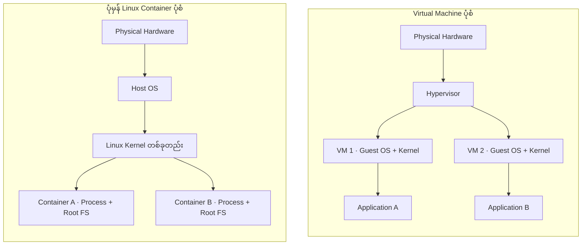
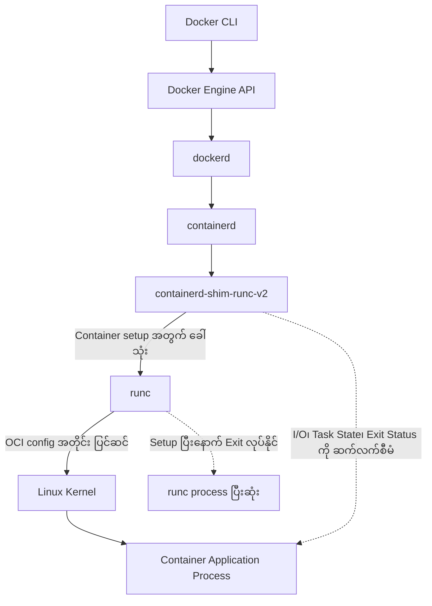
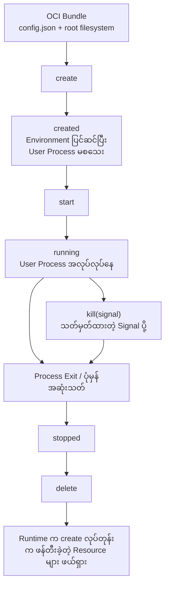

# Chapter 01 — Understanding Containers
 
> **Chapter status:** Revised manuscript (v2)  
> **Research snapshot:** 9 November 2026  
> **Lab status:** Designed, not tested
 

 ## Container နည်းပညာကို နားလည်ဖို့ အဓိကအချက် သုံးချက်ကို အရင်မှတ်ထားပါ။
 
1. **Container ဟာ VM မဟုတ်ပါဘူး။** ပုံမှန် Linux container ဟာ Host ရဲ့ Linux kernel ကို မျှဝေသုံးပြီး kernel feature တွေနဲ့ ကန့်သတ်ထားတဲ့ ပုံမှန် process (သို့) process အုပ်စုတစ်ခုပါ။
2. **Container isolation ကို mechanism တစ်ခုတည်းနဲ့ မလုပ်ဆောင်ပါဘူး။** Namespace က "ဘာကို မြင်ရမလဲ"၊ cgroups က "ဘယ်လောက် သုံးနိုင်မလဲ"၊ capabilities နဲ့ seccomp တို့က "ဘာလုပ်ခွင့်ရှိမလဲ" ကို ထိန်းချုပ်ပါတယ်။
3. **Container တစ်ခု run ဖို့ နောက်ကွယ်မှာ component အမျိုးမျိုး ပူးပေါင်းလုပ်ဆောင်ပါတယ်။** docker run တစ်ကြောင်းရဲ့ နောက်ကွယ်မှာ image၊ engine၊ manager၊ runtime တို့ရှိပြီး တစ်ခုချင်းစီမှာ မတူညီတဲ့ တာဝန်တွေ ရှိပါတယ်။

 ## ဒီအခန်းကို ဖတ်ပြီးရင်

 အောက်ပါအကြောင်းအရာတွေကို ကိုယ့်စကားနဲ့ ရှင်းပြနိုင်ရပါမယ်။
 
- Container နဲ့ VM ရဲ့ kernel ကွာခြားချက်
- `chroot` ကနေ Docker အထိ container နည်းပညာ ဘယ်လိုတိုးတက်လာသလဲ
- Namespace၊ cgroups၊ capabilities၊ filesystem isolation၊ seccomp တို့ရဲ့ တာဝန်
- Image၊ container၊ runtime၊ engine ရဲ့ ကွာခြားချက်
- OCI runtime ရဲ့ `create` → `start` → `kill` → `delete` အဆင့်များ
**ကြိုသိထားရန်:** Linux terminal ကို အနည်းငယ်သုံးဖူးပြီး file၊ directory၊ process ဆိုတာကို သိရင် လုံလောက်ပါတယ်။ Docker၊ Kubernetes ကို ကြိုမသိလည်း ရပါတယ်။ ဒီအခန်းမှာ namespace၊ cgroups တို့ကို မိတ်ဆက်ရုံပါပဲ။ အသေးစိတ်ကို နောက်ပိုင်း chapter တွေမှာ လေ့လာမှာဖြစ်လို့ (namespace — Chapter 03၊ cgroups — Chapter 04၊ OverlayFS — Chapter 07၊ networking — Chapter 08) အခုတစ်ခါတည်း အကုန် နားမလည်လည်း ပြဿနာမရှိပါဘူး။
 
## 1. Container ကို ဘာကြောင့် သုံးလာကြသလဲ
 
ကိုယ့်ကွန်ပျူတာမှာ အဆင်ပြေပြေ အလုပ်လုပ်တဲ့ application တစ်ခုကို တခြား server ပေါ် ရွှေ့လိုက်တော့ အလုပ်မလုပ်တော့တာ ကြုံဖူးပါသလား။ Library မရှိတာ၊ software version မတူတာတွေကြောင့် ဖြစ်လေ့ရှိပါတယ်။
 
ဥပမာ Payment service က Python 3.12 လိုပြီး Reporting service က Python 3.10 ပေါ်မှာပဲ အလုပ်လုပ်တယ်ဆိုပါစို့။ Server တစ်လုံးတည်းမှာ နှစ်ခုလုံးကို တိုက်ရိုက်တင်ရင် version conflict ဖြစ်နိုင်ပါတယ်။ Application တစ်ခုအတွက် library ကို update လုပ်လိုက်လို့ အဲဒီ library ကို သုံးတဲ့ တခြား application ပျက်သွားတာမျိုးလည်း ရှိပါတယ်။
 
ဖြေရှင်းတဲ့ နည်းလမ်းနှစ်ခုကို အရင်ကြည့်ရအောင်။
 
- **Python virtual environment:** Package တွေကို project အလိုက် ခွဲထားနိုင်ပါတယ်။ ဒါပေမဲ့ process မြင်ကွင်း၊ filesystem၊ network ပတ်ဝန်းကျင်ကိုတော့ အပြည့်အဝ မခွဲပေးပါဘူး။
- **Application တစ်ခုစီအတွက် VM:** VM တစ်ခုစီမှာ operating system သီးခြားရှိလို့ ပြဿနာတွေ လျော့ပါတယ်။ ဒါပေမဲ့ VM များလာရင် OS တစ်ခုချင်းကို update၊ monitor၊ maintain လုပ်ရလို့ ရှုပ်ထွေးလာပါတယ်။
Container က ဒီနေရာမှာ တတိယနည်းလမ်းအဖြစ် ပေါ်လာပါတယ်။ Application နဲ့ လိုအပ်တဲ့ software၊ library၊ configuration တွေကို **container image** တစ်ခုထဲမှာ စုထားပြီး server တစ်လုံးတည်းပေါ်မှာ application အမျိုးမျိုးကို သီးခြားပတ်ဝန်းကျင်တွေနဲ့ run နိုင်ပါတယ်။ အားသာချက် လေးခုကို ခွဲကြည့်ရအောင်။
 
- **Dependency ကို တစ်စုတစ်စည်းတည်း သယ်နိုင်တယ်။** Developer စက်မှာ အလုပ်လုပ်တဲ့ Python version၊ package တွေကို image ထဲ ထည့်ထားရင် production server မှာလည်း အလားတူ ပတ်ဝန်းကျင်နဲ့ run နိုင်ပါတယ်။
- **Application တွေကို ခွဲ run နိုင်တယ်။** Process၊ filesystem၊ network၊ permission တွေကို application တစ်ခုချင်း စီမံနိုင်လို့ တစ်ခုရဲ့ ပြဿနာက တခြားတစ်ခုကို မတော်တဆ ထိခိုက်ဖို့ လျော့ပါတယ်။
- **Deploy ပြန်လုပ်ရ လွယ်တယ်။** Image ကို tag (သို့) digest နဲ့ သတ်မှတ်ပြီး development၊ testing၊ production မှာ တူညီတဲ့ image ကို ပြန်သုံးနိုင်ပါတယ်။
- **Overhead နည်းနိုင်တယ်။** Container တစ်ခုချင်းအတွက် guest kernel boot စရာမလိုလို့ VM အများကြီး run တာထက် စတင်ကုန်ကျစရိတ် နည်းနိုင်ပါတယ်။
ဒါပေမဲ့ ဒီအားသာချက်တွေက အလိုလို ရတာ မဟုတ်ပါဘူး။ Host kernel၊ CPU architecture၊ secret၊ data၊ network policy တွေကို သီးခြားစီမံရတုန်းပါပဲ (§8 မှာ ဥပမာနဲ့ ပြမယ်)။ Performance ကလည်း workload နဲ့ configuration ပေါ် မူတည်လို့ container က VM ထက် အမြဲ မြန်တယ်လို့ မဆိုနိုင်ပါဘူး။ ဒါကြောင့် container ကို deployment ပြဿနာအားလုံး ဖြေပေးတဲ့ နည်းပညာလို့ မမြင်ဘဲ **"ပတ်ဝန်းကျင် မတူညီမှုကို လျှော့ပြီး စီမံရလွယ်စေတဲ့ နည်းပညာ"** လို့ မြင်ပါ။
 
## 2. Container ဆိုတာ ဘာလဲ
 
> **Linux container ဆိုတာ** Linux kernel feature တွေနဲ့ မြင်ကွင်း၊ resource၊ privilege ကို ကန့်သတ်ထားတဲ့ ပုံမှန် process (သို့) process အုပ်စုတစ်ခုပါ။
 
Linux kernel အမြင်မှာ container ထဲက application (web server၊ background worker၊ တခြား program) ဟာ တခြား Linux process တွေလိုပဲ process ပါ။ Kernel ထဲမှာ `container` ဆိုတဲ့ object တစ်ခု မရှိပါဘူး။ Kernel feature အမျိုးမျိုးကို ပေါင်းစပ်ပြီး container runtime က ပြင်ဆင်ပေးတာပါ။ Runtime က ဘယ် process တွေကို မြင်ရမလဲ၊ ဘယ် file တွေကို သုံးနိုင်မလဲ၊ CPU နဲ့ memory ဘယ်လောက်အထိ သုံးနိုင်မလဲ၊ ဘယ် permission တွေ ရမလဲဆိုတာတွေကို သတ်မှတ်ပေးပါတယ်။
 
Server တစ်လုံးတည်းပေါ်မှာ container နှစ်ခု run ထားတယ်ဆိုပါစို့။ Container A ထဲက application က ကိုယ့် container ထဲက process တွေကိုပဲ မြင်ရပြီး hostname ကို `web-server` လို့ မြင်ရမယ်။ Container B မှာတော့ hostname `database-server`၊ ကိုယ်ပိုင် network interface၊ IP address၊ root filesystem နဲ့ CPU/memory limit တွေ ရှိနိုင်ပါတယ်။ ဒီအလုပ်တစ်ခုချင်းကို ဘယ် kernel mechanism က လုပ်ပေးလဲဆိုတာ §5 မှာ ကြည့်ပါမယ်။
 
တစ်ခုတော့ အရင်သတိပြုပါ။ **ကန့်သတ်မှုအားလုံးကို container တိုင်းမှာ ထားရမယ်လို့ မရှိပါဘူး။** Container တချို့က host network ကို တိုက်ရိုက်သုံးနိုင်ပါတယ်။ တချို့က တခြား container နဲ့ PID namespace ကို မျှဝေနိုင်ပါတယ်။ Resource limit မသတ်မှတ်ထားတာလည်း ရှိနိုင်ပါတယ်။ ဒါကြောင့် "container" ဆိုတဲ့ နာမည်ကို ကြည့်ပြီး မဆုံးဖြတ်ဘဲ တကယ်သုံးထားတဲ့ configuration ကို စစ်ပါ။
 
## 3. Container နဲ့ Virtual Machine ဘာကွာသလဲ
 
> **အတိုချုပ်:** VM တစ်ခုစီမှာ guest kernel ရှိပါတယ်။ ပုံမှန် Linux container တွေကတော့ host kernel တစ်ခုတည်းကို မျှဝေသုံးပါတယ်။ "ပေါ့တယ်၊ လေးတယ်" ဆိုတာထက် ဒီအချက်က ပိုအရေးကြီးပါတယ်။
 
### 3.1 Virtual Machine
 
VM ဆိုတာ physical computer တစ်လုံးရဲ့ hardware အရင်းအမြစ်တွေကို သုံးပြီး virtual hardware (CPU၊ memory၊ storage၊ network device) နဲ့ computer အတုတစ်လုံး ဖန်တီးတဲ့ နည်းပညာပါ။ VM တွေကို ဖန်တီးစီမံတဲ့ software ကို **hypervisor** လို့ ခေါ်ပါတယ်။ VM တစ်ခုစီမှာ Windows၊ Linux လို operating system (guest OS) install လုပ်နိုင်ပြီး guest OS တစ်ခုစီမှာ ကိုယ်ပိုင် kernel ရှိပါတယ်။ ဥပမာ RAM 64 GB ရှိတဲ့ server မှာ hypervisor နဲ့ VM သုံးခု ဖန်တီးပြီး CPU နဲ့ memory ကို တစ်ခုချင်း သတ်မှတ်ပေးနိုင်ပါတယ်။
 
Hypervisor ကို အမျိုးအစား နှစ်မျိုး ခွဲလေ့ရှိပါတယ်။
 
| | Type 1 | Type 2 |
|---|---|---|
| အလုပ်လုပ်ပုံ | Physical hardware ပေါ်မှာ တိုက်ရိုက် run တယ် | Host OS ပေါ်မှာ software တစ်ခုအဖြစ် run တယ် |
| ဥပမာ | VMware ESXi၊ Xen၊ Microsoft Hyper-V | VirtualBox၊ VMware Workstation |
| သုံးလေ့ရှိတဲ့နေရာ | Server၊ data center | Laptop မှာ Linux VM စမ်းတာမျိုး |
 
အမျိုးအစား ခွဲရခက်တဲ့ ဥပမာတွေလည်း ရှိပါတယ် (ဥပမာ Linux kernel ထဲက KVM)။ ဒီစာအုပ်မှာ အဲဒီအထိ မခွဲပါဘူး။ နှစ်မျိုးလုံးမှာ guest OS တစ်ခုစီက ကိုယ်ပိုင် kernel ရှိတာကသာ အရေးကြီးပါတယ်။
 
### 3.2 Linux OS-level container
 
ပုံမှန် Linux container တွေက VM နဲ့ မတူပါဘူး။ Guest kernel သီးခြားမရှိဘဲ host ရဲ့ Linux kernel ကို မျှဝေသုံးပါတယ်။ Container တစ်ခုစီမှာ ကိုယ်ပိုင် root filesystem ရှိသလို အလုပ်လုပ်နိုင်ပေမဲ့ container အားလုံးရဲ့ process တွေကို kernel တစ်ခုတည်းက စီမံပေးနေပါတယ်။
 

 
Container တစ်ခုစီအတွက် guest kernel boot စရာမလိုလို့ OS အပြည့်အစုံ တစ်ခုစီ လည်ပတ်နေစရာ မလိုပါဘူး။ ဒါဟာ container တွေ ပေါ့ပါးပြီး စတင်ရတာ မြန်နိုင်တဲ့ အကြောင်းရင်းတစ်ခုပါ။
 
### 3.3 ကွာခြားချက်များ
 
| အကြောင်းအရာ | Container | Virtual Machine |
|---|---|---|
| Kernel | Host kernel ကို မျှဝေသုံးတယ် | Guest kernel သီးခြားရှိတယ် |
| Filesystem | Container အလိုက် root FS ခွဲနိုင်တယ် | VM အလိုက် virtual disk ရှိတယ် |
| စတင်ပုံ | Guest kernel boot မလို | Guest OS boot လုပ်ရတယ် |
| Resource | ပုံမှန်အားဖြင့် overhead နည်းတယ် | Guest OS အတွက် resource လိုတယ် |
| Isolation | Kernel ရဲ့ ခွဲခြားထိန်းချုပ်မှုများ | Hypervisor နဲ့ guest OS boundary |
| OS ရွေးချယ်မှု | Host kernel နဲ့ ကိုက်ညီဖို့ လိုတယ် | Hypervisor ပံ့ပိုးတဲ့ guest OS မျိုးစုံ သုံးနိုင်တယ် |
 
Container က VM ထက် အမြဲ ပိုကောင်းတာ မဟုတ်ပါဘူး။ မတူညီတဲ့ OS တွေကို သီးခြား kernel နဲ့ run ဖို့ လိုရင် VM က ပိုသင့်တော်နိုင်ပါတယ်။ တူညီတဲ့ Linux kernel ပေါ်မှာ application အများကြီးကို ပေါ့ပေါ့ပါးပါး run ချင်ရင်တော့ container က ပိုသင့်တော်နိုင်ပါတယ်။ လက်တွေ့မှာ နှစ်ခုကို တွဲသုံးတာလည်း ရှိပါတယ်။ VM တစ်ခုထဲမှာ Linux install လုပ်ပြီး အဲဒီ VM ရဲ့ kernel ပေါ်မှာ container အများကြီး run တာမျိုးပါ။
 
### 3.4 "Host kernel" ဆိုတာ ဘယ် kernel လဲ
 
ဒီစာအုပ်မှာ "host kernel" လို့ ပြောရင် **container ကို တကယ် run နေတဲ့ Linux kernel** ကို ဆိုလိုပါတယ်။ ဒီမှာ ပုံမှန်မဟုတ်တဲ့ အခြေအနေ နှစ်ခု ရှိပါတယ်။
 
> **Windows နဲ့ macOS မှာ:** Docker Desktop၊ WSL2၊ `podman machine` တို့ကို သုံးရင် Linux container တွေက ကိုယ့်စက်ရဲ့ Windows/macOS kernel ကို မသုံးပါဘူး။ နောက်ကွယ်မှာ Linux VM တစ်ခု run ထားပြီး အဲဒီ VM ရဲ့ Linux kernel ကို သုံးတာပါ။ ဒါကြောင့် ကိုယ့်စက်ရဲ့ OS version နဲ့ container ထဲက kernel version မတူတာကို တွေ့ရရင် ပုံမှန်ပါပဲ။ ဒီစာအုပ်ကို လက်တွေ့လိုက်လုပ်မယ်ဆိုရင် Linux host (သို့) Linux VM တစ်ခု သုံးတာ အကောင်းဆုံးပါ။
 
> **Kata Containers လို VM-based container:** Container လို workflow ကို ထိန်းထားပေမဲ့ အောက်ခံမှာ lightweight VM ကို သုံးပြီး guest kernel သီးခြား run စေပါတယ် [20]။ ဒါကြောင့် "container ဆိုတာ host kernel ကို မျှဝေသုံးတယ်" ဆိုတဲ့ စကားက ပုံမှန် Linux OS-level container ကို ဆိုလိုတာပါ။ "Container" ဆိုတဲ့ စကားလုံးက application ကို စီမံတဲ့ နည်းလမ်းနဲ့ image format ကို ရည်ညွှန်းနိုင်ပြီး အောက်ခံ isolation နည်းပညာကတော့ မတူနိုင်ပါဘူး။
 
ဒီစာအုပ်မှာ "Linux container" လို့ ပြောရင် ပုံမှန် Linux OS-level container ကို အဓိက ဆိုလိုပါတယ်။
 
## 4. Container ဆီ ရောက်လာတဲ့ သမိုင်းလမ်းကြောင်း
 
Docker မပေါ်ခင်ကတည်းက application တွေကို ခွဲပြီး run ဖို့ operating system အမျိုးမျိုးမှာ နည်းလမ်းတွေ ရှိခဲ့ပါတယ်။ အောက်က table မှာ အရေးပါတဲ့ မှတ်တိုင်တချို့ကို စုထားပါတယ်။ တစ်ခုကနေ တစ်ခု တိုက်ရိုက် ဆင်းသက်လာတာ မဟုတ်ဘဲ ပြဿနာတူကို သီးခြားစီ ဖြေရှင်းခဲ့ကြတာပါ။
 
| အချိန် | နည်းပညာ | ဘာကို ဖြည့်ဆည်းပေးခဲ့လဲ |
|---|---|---|
| 1979 ဝန်းကျင် | Unix `chroot` | Process တစ်ခုအတွက် မြင်ရတဲ့ root directory ကို ပြောင်းပေးတယ် [1][2] |
| 2000 | FreeBSD Jails | `chroot` အယူအဆကို filesystem၊ user၊ network ပိုင်းအထိ ချဲ့တယ် [3] |
| 2005 | Solaris Zones | Solaris 10 မှာ OS service တွေကို သီးခြား environment အဖြစ် စီမံနိုင်စေတယ် [4] |
| 2008 မှစ၍ | LXC | Namespace၊ cgroups စတဲ့ Linux kernel feature တွေနဲ့ system container ဖန်တီးတယ် [5] |
| 15–23 မတ် 2013 | Docker | Public demo (15 မတ်)၊ Docker 0.1.0 ပထမဆုံး public release (23 မတ်) [6][7] |
| 22 ဇွန် 2015 | OCI | Image၊ runtime၊ distribution အတွက် open standard ဖွဲ့စည်းတယ် [8] |
 
**`chroot`** က process နဲ့ သူ့ child process တွေရဲ့ file path ကို ဖြေရှင်းမယ့် root directory ကို ပြောင်းပေးပါတယ်။ ဥပမာ root ကို `/srv/jail` လို့ သတ်မှတ်ထားရင် `/etc/app.conf` ကို ဖွင့်တဲ့အခါ `/srv/jail/etc/app.conf` ကို ရှာပါလိမ့်မယ် [2]။ ဒါပေမဲ့ PID၊ network၊ CPU၊ memory၊ permission တွေကို မခွဲပေးသလို ဖွင့်ထားပြီးသား file descriptor တွေကိုလည်း အလိုအလျောက် မပိတ်ပေးပါဘူး။ ဒါကြောင့် `chroot` ကို sandbox (သို့) container လို့ မယူဆပါနဲ့ [2]။
 
**FreeBSD Jails နဲ့ Solaris Zones** တို့က Linux namespaces နဲ့ ရည်ရွယ်ချက် ဆင်တူပေမဲ့ kernel API နဲ့ အတွင်းပိုင်း လုပ်ဆောင်ပုံ မတူပါဘူး။ Namespace ရဲ့ ပုံစံတစ်မျိုးလို့ မယူဆပါနဲ့။ Zone တစ်ခုစီဟာ ကိုယ်ပိုင်စနစ်လို အလုပ်လုပ်နိုင်ပေမဲ့ Solaris OS instance တစ်ခုတည်းရဲ့ စီမံမှုအောက်မှာ ရှိတာမို့ VM လို guest OS သီးခြား boot တာ မဟုတ်ပါဘူး [3][4]။
 
**LXC** က Linux kernel ရဲ့ namespaces၊ control groups၊ security feature တွေကို ပေါင်းစပ်သုံးပြီး VM နဲ့ ဆင်တူတဲ့ system container ကို ဖန်တီးပါတယ်။ `chroot` ထက် command ပိုများတဲ့ tool မဟုတ်ဘဲ kernel ရဲ့ isolation နဲ့ resource control စွမ်းရည်တွေကို ပေါင်းစပ်တဲ့ project ပါ [5]။
 
**Docker** က container နည်းပညာကို ပထမဆုံး တီထွင်တာ မဟုတ်ပါဘူး။ Application ကို build လုပ်၊ image အဖြစ် package လုပ်၊ registry မှာ မျှဝေ၊ တခြားနေရာမှာ ပြန် run တဲ့ workflow တစ်ခုလုံးကို လွယ်ကူစေခဲ့တာပါ [6][7]။
 
**OCI** ကို Docker၊ CoreOS နဲ့ တခြားအဖွဲ့အစည်းတွေ ပူးပေါင်းပြီး Linux Foundation အောက်မှာ ဖွဲ့စည်းခဲ့ပါတယ်။ Tool တစ်ခုက ဖန်တီးတဲ့ image ကို တခြား tool မှာ သုံးလို့ရအောင် standard လိုအပ်လာလို့ပါ [8]။ OCI မှာ specification သုံးမျိုး ရှိပါတယ်။
 
| Specification | ဘာကို သတ်မှတ်ပေးသလဲ |
|---|---|
| **Image Specification** | Image manifest၊ layer၊ configuration နဲ့ image format [15] |
| **Runtime Specification** | Disk ပေါ်က OCI bundle ကို runtime က ဘယ်လို ဖန်တီး၊ စတင်၊ signal ပို့၊ ဖယ်ရှားရမလဲ [14] |
| **Distribution Specification** | Registry နဲ့ tool တွေကြား OCI content ကို push၊ pull လုပ်တဲ့ API [16] |
 
OCI က Docker Engine တစ်ခုလုံးကိုဖြစ်စေ၊ Kubernetes ရဲ့ လုပ်ဆောင်ပုံအားလုံးကိုဖြစ်စေ standard သတ်မှတ်ပေးတာ မဟုတ်ပါဘူး။ Image format၊ runtime interface၊ content distribution သုံးခုအတွက်သာ ပါပါတယ် [8]။
 
## 5. Container isolation မှာ Linux kernel ရဲ့ အခန်းကဏ္ဍ
 
> **အတိုချုပ်:** Container တစ်ခု ဖြစ်လာဖို့ namespace တစ်ခုတည်းနဲ့ မလုံလောက်ပါဘူး။ Kernel feature အမျိုးမျိုးက တာဝန်တစ်ခုချင်း ယူပြီး ပူးပေါင်းလုပ်ဆောင်ပါတယ်။
 
| Mechanism | အဓိကတာဝန် | ဥပမာ |
|---|---|---|
| Namespaces | Process တွေ မြင်ရတဲ့ system resource ပတ်ဝန်းကျင်ကို ခွဲပေးတယ် | ကိုယ်ပိုင် PID၊ hostname၊ network view |
| cgroups | Process အုပ်စုရဲ့ resource အသုံးပြုမှုကို စောင့်ကြည့်၊ ကန့်သတ်တယ် | CPU၊ memory၊ I/O limit |
| Capabilities | Root နဲ့ ဆက်စပ်တဲ့ privilege တွေကို အပိုင်းလိုက် ခွဲပေးတယ် | လိုအပ်မှ `CAP_NET_ADMIN` ပေးခြင်း |
| Mount နဲ့ root filesystem | Container မြင်ရမယ့် filesystem tree ကို ပြင်ဆင်တယ် | ကိုယ်ပိုင် `rootfs`၊ read-only mount |
| Seccomp | Process ခေါ်နိုင်တဲ့ system call တွေကို filter လုပ်တယ် | မလိုတဲ့ system call ပိတ်ခြင်း |
| LSM | Kernel ထဲမှာ security policy အပိုတွေ အကောင်အထည်ဖော်တယ် | SELinux၊ AppArmor |
 
### 5.1 Namespaces — မြင်ရတဲ့ ပတ်ဝန်းကျင်ကို ခွဲခြင်း
 
Namespace ဆိုတာ Linux process တွေကို system resource အချို့အတွက် ကိုယ်ပိုင်ပတ်ဝန်းကျင် ရှိသလို မြင်စေတဲ့ နည်းပညာပါ။ Namespace တစ်ခုထဲမှာ resource ပြောင်းလဲမှုတွေကို တခြား namespace ထဲက process တွေက ပုံမှန်အားဖြင့် မမြင်ရပါဘူး [9]။ Linux မှာ namespace အမျိုးအစား ရှစ်မျိုး ရှိပါတယ် [9]။
 
| Namespace | ဘာကို ခွဲခြားပေးသလဲ |
|---|---|
| PID | Process ID နဲ့ process တွေ မြင်ရပုံ |
| Mount | Mount point တွေ မြင်ရပုံ |
| Network | Network device၊ protocol stack၊ port စသည် |
| UTS | Hostname နဲ့ NIS domain name |
| IPC | System V IPC နဲ့ POSIX message queue |
| User | User ID နဲ့ group ID mapping |
| Cgroup | Cgroup root directory ကို မြင်ရပုံ |
| Time | Boot နဲ့ monotonic clock အချို့ရဲ့ offset |
 
ဥပမာ PID namespace အသစ်ထဲက process တွေက အဲဒီ namespace ထဲက process ID တွေကိုပဲ ပုံမှန်မြင်ရပါတယ်။ Network namespace ကတော့ network device၊ routing table၊ port တို့အတွက် သီးခြား view တစ်ခု ဖန်တီးပေးနိုင်ပါတယ် [9]။ Container တိုင်းမှာ namespace ရှစ်မျိုးလုံးကို သီးခြားဖန်တီးထားရမယ်လို့ မရှိပါဘူး။ Runtime configuration အလိုက် တချို့ကို မျှဝေထားနိုင်ပါတယ်။
 
### 5.2 cgroups — resource အသုံးပြုမှုကို စီမံခြင်း
 
Container တစ်ခုက CPU၊ memory၊ I/O ကို အလွန်အကျွံ သုံးလာရင် ဘယ်လို ထိန်းမလဲ။ ဒီအတွက် control groups (cgroups) ကို သုံးပါတယ်။ cgroups က process တွေကို အုပ်စုဖွဲ့ပြီး resource အသုံးပြုမှုကို စောင့်ကြည့်၊ စာရင်းသွင်း၊ သတ်မှတ်ချက်အတိုင်း ကန့်သတ်နိုင်တဲ့ kernel feature ပါ [10]။ ဥပမာ service သုံးခုအတွက် memory limit မတူအောင် သတ်မှတ်နိုင်ပါတယ်။ ဒါပေမဲ့ cgroups က memory leak ကို ပြုပြင်ပေးတာ မဟုတ်ပါဘူး။ အသုံးပြုမှုကို ထိန်းတာပဲ ဖြစ်ပါတယ်။
 
> **မှတ်ထားရမယ့် ကွာခြားချက်:** Namespace က ဘာကို **မြင်ရမလဲ** ကို ခွဲပေးပြီး cgroups က resource **ဘယ်လောက် သုံးနိုင်မလဲ** ကို စီမံပေးပါတယ်။ PID namespace ရှိတာနဲ့ CPU ကို အလိုအလျောက် limit လုပ်ထားတာ မဟုတ်ပါဘူး။
 
### 5.3 Capabilities — root privilege ကို အပိုင်းလိုက် ခွဲခြင်း
 
အရင်တုန်းက Linux မှာ root user ရဲ့ privilege တွေကို အုပ်စုကြီးတစ်ခုလို စဉ်းစားခဲ့ကြပါတယ်။ Capabilities က အဲဒီ privilege တွေကို ပိုသေးငယ်တဲ့ အခွင့်အာဏာတွေအဖြစ် ခွဲပေးနိုင်ပါတယ် [11]။ ဥပမာ network interface၊ routing နဲ့ တခြား network administration လုပ်ဖို့ လိုတဲ့ process ကို `CAP_NET_ADMIN` ပေးနိုင်ပြီး root ရဲ့ တခြား privilege တွေကို ပေးစရာ မလိုပါဘူး [11]။
 
Container ထဲမှာ user ကို `root` လို့ မြင်ရတာနဲ့ host ပေါ်မှာ root permission အပြည့် ရနေတာ မဟုတ်ပါဘူး။ User namespace mapping နဲ့ capability set တွေပေါ် မူတည်ပါတယ်။ ဒါပေမဲ့ privileged container (သို့) capability အလွန်များများ ပေးထားတဲ့ container ဟာ host အတွက် အန္တရာယ်ရှိနိုင်ပါတယ်။
 
### 5.4 Filesystem isolation
 
Image ထဲက file တွေကို အခြေခံပြီး container တစ်ခုစီအတွက် root filesystem (`rootfs`) တစ်ခု ပြင်ဆင်နိုင်ပါတယ်။ Mount namespace က process တွေ မြင်ရတဲ့ mount point စာရင်းကို ခွဲပေးပါတယ်။ Runtime က root filesystem ကို ပြင်ပြီးနောက် ဘယ် mount တွေကို read-only ထားမလဲ၊ ဘယ် directory တွေကို bind mount နဲ့ မျှဝေမလဲ၊ ဘယ် permission တွေ ပေးမလဲဆိုတာ သတ်မှတ်နိုင်ပါတယ် [9]။
 
ဒါကြောင့် container တစ်ခုစီမှာ သီးခြား root filesystem view ရှိနိုင်ပေမဲ့ host (သို့) တခြား container နဲ့ file လုံးဝ မမျှဝေဘူးလို့ မဆိုလိုပါဘူး။ Bind mount၊ shared volume တွေကြောင့် directory အချို့ကို ရည်ရွယ်ချက်ရှိရှိ မျှဝေနိုင်ပါတယ်။ ဒီအလုပ်ကို `chroot()` တစ်ခုတည်းနဲ့ မပြီးမြောက်နိုင်ပါဘူး။ Mount၊ namespace၊ permission setting တွေကိုပါ ပေါင်းစပ်ဖို့ လိုပါတယ်။
 
### 5.5 Seccomp နဲ့ Linux Security Modules
 
**Seccomp** က process တစ်ခု kernel ဆီ ခေါ်တဲ့ system call တွေကို filter လုပ်နိုင်စေပါတယ်။ မလိုအပ်တဲ့ system call တချို့ကို ပိတ်ထားရင် application က ထိတွေ့နိုင်တဲ့ kernel interface အရေအတွက် လျော့ပါတယ် [12]။ **Linux Security Modules (LSM)** ကတော့ kernel security check တွေမှာ policy အပို ထည့်သုံးနိုင်စေတဲ့ framework ပါ။ SELinux နဲ့ AppArmor တို့က ဥပမာတွေပါ [13]။
 
ဒီ mechanism တစ်ခုမှ တစ်ခုတည်းနဲ့ လုံခြုံရေး အပြည့်အဝ မပေးနိုင်ပါဘူး။ Container တစ်ခုရဲ့ isolation နဲ့ security ဟာ ဒီအရာတွေကို ဘယ်လို ပေါင်းစပ် configure လုပ်ထားသလဲပေါ် မူတည်ပါတယ်။
 
## 6. Image၊ container၊ runtime၊ engine ကို ခွဲခြားနားလည်ခြင်း
 
> **အတိုချုပ်:** ဒီစကားလုံးလေးခုက ဆက်စပ်နေပေမဲ့ တာဝန်မတူပါဘူး။ အထူးသဖြင့် "runtime" ဆိုတာ အဆင့်နှစ်မျိုး ရှိတာကို သတိပြုပါ။
 
| အမည် | ဘာလဲ | ဥပမာ |
|---|---|---|
| **Image** | Application နဲ့ လိုအပ်တဲ့ file၊ library၊ default configuration တွေကို စုထားတဲ့ package | `nginx` image |
| **Container** | Image ကို အခြေခံပြီး တကယ်ဖန်တီးထားတဲ့ instance နဲ့ ၎င်းရဲ့ လက်ရှိအခြေအနေ | `created`၊ `running` state |
| **Low-level OCI runtime** | OCI bundle ထဲက `config.json` ကိုဖတ်ပြီး container environment ကို ဖန်တီး၊ စတင်၊ signal ပို့၊ ဖယ်ရှားတယ် [14] | `runc`၊ `crun` |
| **Higher-level manager** | Image content၊ snapshot၊ task၊ shim ကို စီမံပြီး လိုတဲ့အခါ low-level runtime ကို ခေါ်တယ် [18] | `containerd` |
| **Engine** | အသုံးပြုသူက container ကို လွယ်လွယ်စီမံနိုင်အောင် image၊ network၊ volume၊ lifecycle ကို ချိတ်ဆက်ပေးတယ် | Docker Engine၊ Podman |
 
### 6.1 Image နဲ့ container
 
Image ထဲမှာ file တွေကို အစုလိုက်သိမ်းထားရုံ မဟုတ်ပါဘူး။ Filesystem layer တွေ ရှိပြီး application အတွက် default setting တွေကိုလည်း metadata အဖြစ် သိမ်းထားပါတယ်။ ဥပမာ `Entrypoint`၊ `Cmd`၊ `User`၊ `WorkingDir`၊ `Env` စတာတွေပါ။ Image တစ်ခုကနေ container အများကြီး ဖန်တီးနိုင်ပြီး container တစ်ခုချင်းအတွက် configuration တချို့ကို ထပ်ပြောင်းသတ်မှတ်နိုင်ပါတယ်။
 
Container ကို ဖန်တီးပြီးပေမဲ့ application ကို မစရသေးတဲ့ အခြေအနေကို `created` state လို့ ခေါ်ပါတယ်။ Application စတင်သွားရင် `running` state ဖြစ်ပါတယ်။
 
နောက်ထပ် မရောသင့်တာတစ်ခု ရှိပါတယ်။ **Image configuration** က image ရဲ့ default setting တွေကို ဖော်ပြတာဖြစ်ပြီး runtime bundle ထဲက **`config.json`** ကတော့ container တစ်ခုချင်းအတွက် လိုအပ်တဲ့ runtime setting တွေကို ဖော်ပြတာပါ။ Network၊ mount၊ cgroups setting တွေကိုလည်း image ထဲမှာ မထည့်ထားဘဲ container ဖန်တီးတဲ့အချိန်မှာ သီးခြားပြင်ဆင်ရပါတယ်။
 
### 6.2 Runtime နဲ့ engine
 
`runc` နဲ့ `crun` လို low-level runtime တွေက namespace၊ mount၊ cgroups၊ capability၊ process setting တွေကို ပြင်ဆင်ပြီး container ရဲ့ user process ကို စတင်ပေးပါတယ်။ ဒါပေမဲ့ registry ကနေ image ယူတာ၊ image layer တွေကို storage ပေါ်မှာ ပြင်တာ၊ container အများကြီးကို စီမံတာတွေကို low-level runtime တစ်ခုတည်းက မလုပ်ပါဘူး။ အဲဒီအလုပ်တွေကို `containerd` လို higher-level manager က ယူပါတယ်။
 
Container engine ဆိုတာကတော့ OCI က သတ်မှတ်ထားတဲ့ standard component အမည် မဟုတ်ပါဘူး။ Software တစ်ခုနဲ့တစ်ခု architecture ကွာနိုင်ပါတယ်။ ဥပမာ Docker Engine မှာ Docker CLI၊ API နဲ့ `dockerd` daemon ပါဝင်ပါတယ်။ Podman ကတော့ ပုံမှန်အားဖြင့် daemon တစ်ခုကို အမြဲ run ထားစရာမလိုဘဲ CLI ကနေ container တွေကို စီမံနိုင်ပါတယ် (Chapter 17 မှာ အသေးစိတ်ကြည့်မယ်)။
 
## 7. `docker run` ရဲ့ နောက်ကွယ် (preview)
 
> **အတိုချုပ်:** ဒီအပိုင်းက Chapter 09–13 မှာ အသေးစိတ်လေ့လာမယ့် အကြောင်းအရာတွေကို အကြမ်းဖျင်း ကြိုကြည့်တာပါ။ အခုအဆင့်မှာ "ဘယ်သူက ဘာလုပ်လဲ" ကိုပဲ မှတ်ထားရင် လုံလောက်ပါတယ်။
 
အောက်ပါ command တစ်ကြောင်းနဲ့ nginx web server ကို စတင် run နိုင်ပါတယ်။
 
```
docker run nginx
```
 
ရိုးရှင်းပေမဲ့ နောက်ကွယ်မှာ image ရယူခြင်း၊ container configuration ပြင်ဆင်ခြင်း၊ runtime ကို ခေါ်သုံးခြင်းနဲ့ Linux kernel ကို အသုံးပြုခြင်းတို့ ပါဝင်ပါတယ်။ Component တွေရဲ့ ဆက်နွယ်ပုံကို အောက်က diagram မှာ ကြည့်ပါ။
 

 
Docker CLI က command ကို Docker Engine API ဆီ ပို့ပါတယ်။ Docker Engine က client–server architecture ဖြစ်ပြီး `dockerd` daemon က image၊ container၊ network၊ volume လို object တွေကို စီမံပါတယ် [17]။ Container အလုပ်တွေကို `dockerd` က `containerd` ဆီ လွှဲပေးပြီး `containerd` က root filesystem ပြင်ဆင်တာ၊ container task နဲ့ lifecycle ကို စီမံတာတွေ လုပ်ပါတယ် [18]။ `containerd` နဲ့ low-level runtime ကြားမှာ `containerd-shim-runc-v2` ပါဝင်ပြီး task ရဲ့ I/O နဲ့ exit status ကို ဆက်လက်ထိန်းသိမ်းပေးနိုင်ပါတယ် [18]။ Shim က `runc` ကို ခေါ်ပြီး OCI bundle အတိုင်း environment ကို ပြင်ဆင်စေပါတယ်။ ပုံမှန် shim-based လုပ်ဆောင်ပုံမှာ `runc` command က setup ပြီးရင် exit လုပ်သွားနိုင်ပေမဲ့ shim က ဆက်ရှိနေပါတယ် [14][18]။
 
ဒါကြောင့် **`runc`၊ shim၊ container application process တို့ဟာ process တစ်ခုတည်း မဟုတ်ပါဘူး။** `runc` က စတင်ဖို့ ပြင်ဆင်တဲ့ tool၊ shim က task နဲ့ runtime ကြားမှာ ဆက်စီမံတဲ့ process၊ application ကတော့ Linux kernel က စီမံထားတဲ့ container process ပါ။
 
> **မှတ်ချက်:** ဒီ diagram က Linux ပေါ်က ပုံမှန် Docker Engine နဲ့ `containerd` runtime v2 အသုံးပြုမှုကို ရိုးရှင်းအောင် ပြထားတာပါ။ Image ကို ဘယ်လို သိမ်းပြီး ပြင်ဆင်သလဲဆိုတာ (Docker ကိုယ်ပိုင် storage driver သုံးသလား၊ containerd ရဲ့ image store နဲ့ snapshotter သုံးသလား) က Docker version နဲ့ configuration အလိုက် ကွာနိုင်ပါတယ်။ Runtime ရွေးချယ်မှုလည်း ကွာနိုင်ပြီး container engine အားလုံး ဒီပုံစံအတိုင်း အလုပ်လုပ်တာ မဟုတ်ပါဘူး။
 
### 7.1 Container lifecycle
 
Image ရပြီးနောက် engine က container အတွက် filesystem နဲ့ runtime configuration ကို ပြင်ဆင်ပါတယ်။ OCI runtime ကို သုံးရင် အဲဒီ configuration တွေကို OCI bundle ထဲက `config.json` မှာ ဖော်ပြနိုင်ပါတယ်။ OCI Runtime Specification က lifecycle ကို `create`၊ `start`၊ process အဆုံးသတ်ခြင်း၊ `delete` အဆင့်တွေအဖြစ် ခွဲထားပြီး `kill` operation က သတ်မှတ်ထားတဲ့ signal တစ်ခုကို container process ဆီ ပို့ပေးပါတယ် [14]။
 

 
- **`create`:** Root filesystem၊ namespace၊ mount နဲ့ တခြား configuration တွေကို ပြင်ဆင်ပေမဲ့ `process` မှာ သတ်မှတ်ထားတဲ့ user program ကို မစရသေးပါဘူး။ ဒီအခြေအနေက `created` state ပါ [14]။ `create` လုပ်ပြီးတာနဲ့ application အလုပ်လုပ်နေပြီလို့ မဆိုနိုင်ပါဘူး။
- **`start`:** `created` ထဲက user process ကို တကယ်စတင်ပါတယ်။ စတင်ပြီးရင် `running` state ဖြစ်ပါတယ် [14]။
- **`kill`:** Caller ပေးလိုက်တဲ့ signal ကို container process ဆီ ပို့ပေးတာပါ။ နာမည်ကြောင့် `SIGKILL` ပဲ ပို့တယ်လို့ မယူဆပါနဲ့။ `SIGTERM`၊ `SIGKILL` (သို့) တခြား signal ဖြစ်နိုင်ပြီး signal တချို့က process ကို အဆုံးမသတ်စေနိုင်လို့ `kill` ပြီးတိုင်း `stopped` မဖြစ်ပါဘူး [14]။
- **`delete`:** `create` မှာ ဖန်တီးခဲ့တဲ့ resource တွေကို ဖယ်ရှားပါတယ်။ ပုံမှန်အားဖြင့် container `stopped` ဖြစ်ပြီးမှ လုပ်ရပါတယ်။ Image၊ persistent volume၊ အပြင်မှာ စီမံထားတဲ့ data တွေကို အလိုအလျောက် မဖျက်ပါဘူး [14]။ Process ရပ်သွားတာ၊ runtime resource ဖယ်ရှားတာ၊ image/data ဖျက်တာတို့ဟာ မတူတဲ့ လုပ်ဆောင်ချက်သုံးခု ဖြစ်ပါတယ်။
**Docker `stop` နဲ့ OCI `kill` ကို မရောပါနဲ့။** Docker `stop` က higher-level operation ဖြစ်ပြီး application ကို graceful shutdown လုပ်ခွင့် ပေးတဲ့ policy ပါပါတယ်။ Image ထဲက `STOPSIGNAL` (သို့) container အတွက် သတ်မှတ်ထားတဲ့ stop signal (မသတ်မှတ်ရင် `SIGTERM`) ကို အရင်ပို့ပြီး grace period စောင့်ပါတယ်။ အဲဒီအချိန်အတွင်း မရပ်ရင် `SIGKILL` ပို့ပါတယ်။ Timeout ကို configuration နဲ့ ပြောင်းနိုင်ပါတယ် [19]။
 
## 8. ဥပမာတစ်ခုနဲ့ ပြန်ချိတ်ကြည့်ခြင်း
 
§1 က Python web application ကို ပြန်ယူကြည့်ရအောင်။ အဲဒီ application အတွက် Python runtime၊ package၊ application file တွေကို container image ထဲ စုထားနိုင်ပါတယ်။ Application ကို စတင်မယ့် default command နဲ့ working directory ကိုလည်း image မှာ သတ်မှတ်ထားနိုင်ပါတယ်။
 
အဲဒီ image ကနေ container တစ်ခု ဖန်တီးတဲ့အခါ runtime က root filesystem၊ process နဲ့ လိုအပ်တဲ့ environment setting တွေကို ပြင်ပေးပါတယ်။ Application က ဘယ် database ကို ချိတ်မလဲ၊ ဘယ် user နဲ့ run မလဲ၊ ဘယ် network သုံးမလဲဆိုတာတွေကို container ဖန်တီးတဲ့အချိန်မှာ သီးခြား သတ်မှတ်ပါတယ်။
 
ဒီနေရာမှာ အရေးကြီးတာ နှစ်ခု ရှိပါတယ်။
 
- **Database address၊ password၊ secret တွေက image ထဲမှာ အလိုအလျောက် မပါလာပါဘူး။** Deployment environment ကနေ သီးခြားပေးပြီး စီမံရပါတယ်။ Password ကို image ထဲ အမြဲထည့်ထားတာ လုံခြုံရေးအရ မသင့်ပါဘူး။
- **Data ကို persistent storage အဖြစ် သီးခြားစီမံပါ။** Container ကို ဖျက်လိုက်ရင် data မပျောက်စေချင်ရင် container ရဲ့ ပြင်ပမှာ သိမ်းဖို့ လိုပါတယ်။
ဒီဥပမာက image ဟာ application အတွက် လိုတဲ့ file နဲ့ default setting တွေကို သယ်ဆောင်ပြီး runtime configuration က container တစ်ခုချင်းအတွက် လိုတဲ့ setting တွေကို ဖြည့်ပေးတာကို ပြပါတယ်။ Container ဆိုတာ အဲဒီနှစ်ခုကို အခြေခံပြီး ဖန်တီးထားတဲ့ အလုပ်လုပ်နိုင်တဲ့ ပတ်ဝန်းကျင်ပါ။
  
## 9. လက်တွေ့စစ်ဆေးခြင်း — Linux Process နဲ့ Namespace ကို ကြည့်ရှုခြင်း

ဒီအခန်းမှာ လေ့လာခဲ့တဲ့ Container နဲ့ Linux Process အကြောင်းတွေကို လက်တွေ့နားလည်နိုင်ဖို့ Linux Terminal မှာ အချက်အလက်အချို့ကို စစ်ဆေးကြည့်ပါမယ်။

> **Lab အခြေအနေ — Designed, not tested**
>
> ဒီ Lab ကို ရေးဆွဲထားပေမဲ့ Linux Host သို့မဟုတ် Virtual Machine တစ်ခုခုမှာ အမှန်တကယ် Run လုပ်ပြီး စမ်းသပ်အတည်ပြုထားခြင်း မရှိသေးပါဘူး။ အောက်မှာ ဖော်ပြထားတဲ့ ရလဒ်ရှင်းလင်းချက်တွေဟာ မျှော်မှန်းထားတဲ့ လုပ်ဆောင်ပုံတွေကို နားလည်စေဖို့ ဖြစ်ပါတယ်။
>
> ဒီ Lab ရဲ့ ရည်ရွယ်ချက်က လက်ရှိ Linux Environment၊ Process နဲ့ Namespace တို့ရဲ့ အခြေအနေကို ကြည့်ရှုဖို့ ဖြစ်ပါတယ်။ Namespace၊ cgroups၊ Security Policy အားလုံးကို ပြင်ဆင်စမ်းသပ်တဲ့ Lab မဟုတ်ပါဘူး။

### 9.1 Lab မစခင် လိုအပ်တာ

ဒီ Lab ကို လုပ်ဖို့ Linux Terminal တစ်ခုနဲ့ `/proc` ကို ဖတ်ရှုနိုင်ဖို့ လိုအပ်ပါတယ်။ `uname`၊ `cat` နဲ့ `readlink` Command တွေ ရှိဖို့လည်း လိုအပ်ပါတယ်။

နောက်ပိုင်း Optional အဆင့်မှာ ကိုယ်ပိုင် Account အောက်မှာ အသုံးပြုထားတဲ့ Rootless Podman Container ရှိရင် နှိုင်းယှဉ်ကြည့်နိုင်ပါတယ်။ Container မရှိသေးရင်လည်း အဲဒီအဆင့်ကို ကျော်သွားနိုင်ပါတယ်။

ဒီ Lab မှာ System Configuration ပြောင်းလဲဖို့ မလိုအပ်ပါဘူး။ Container အသစ်တည်ဆောက်စရာလည်း မလိုပါဘူး။ `sudo` မသုံးပါနဲ့။ Docker Permission ပြောင်းလဲခြင်းနဲ့ Docker Group ထဲ ဝင်ခြင်းတို့လည်း မလုပ်ပါနဲ့။

အထူးသဖြင့် Root Permission နဲ့ အလုပ်လုပ်နေတဲ့ Docker Daemon ကို ထိန်းချုပ်ခွင့်ရှိခြင်းဟာ Host System ပေါ်မှာ Root-Level အခွင့်အာဏာ ရရှိနိုင်တဲ့အထိ အန္တရာယ်ရှိနိုင်ပါတယ်။ ဒါကြောင့် ဒီ Beginner Lab မှာ Docker Daemon ကို အသုံးမပြုပါဘူး။

### 9.2 လက်ရှိ Linux Environment ကို စစ်ဆေးခြင်း

ပထမဆုံး ကိုယ်အသုံးပြုနေတဲ့ Linux ရဲ့ Kernel Version ကို ကြည့်ကြရအောင်။

```bash
uname -r
```

ဒီ Command က လက်ရှိ Linux Environment မှာ အသုံးပြုနေတဲ့ Kernel Release Version ကို ဖော်ပြပေးပါတယ်။

ဥပမာ `6.x.x` လို Version တစ်ခု ထွက်လာနိုင်ပါတယ်။ ကိုယ့်စက်မှာ ထွက်လာမယ့် တန်ဖိုးကတော့ အသုံးပြုထားတဲ့ Distribution နဲ့ Kernel Version ပေါ် မူတည်ပါတယ်။

နောက်တစ်ဆင့်မှာ `/proc` ကနေ PID 1 ရဲ့ အချက်အလက်ကို ကြည့်ပါမယ်။

```bash
cat /proc/1/comm
```

ဒီ Command က လက်ရှိ `/proc` ထဲမှာ PID 1 လို့ မြင်ရတဲ့ Process ရဲ့ အမည်ကို ဖော်ပြပေးပါတယ်။

ဒီနေရာမှာ သတိထားရမှာက `/proc/1/comm` ဟာ အမြဲတမ်း Physical Host ရဲ့ ပထမဆုံး Process ကို ပြတာ မဟုတ်ပါဘူး။ ကိုယ်အသုံးပြုနေတဲ့ Environment က Container အတွင်းဖြစ်နေရင် Container ရဲ့ PID 1 ကို ပြနေနိုင်ပါတယ်။

နောက်ထပ် Process ရဲ့ PID Namespace ကို ကြည့်ဖို့ အောက်ပါ Command ကို အသုံးပြုပါမယ်။

```bash
readlink /proc/1/ns/pid
```

ဒီ Command က PID 1 Process အသုံးပြုနေတဲ့ PID Namespace ရဲ့ Identifier ကို ပြပေးပါတယ်။

ကိုယ့်လက်ရှိ Shell ရဲ့ Namespace ကို ကြည့်ချင်ရင်တော့ -

```bash
readlink /proc/self/ns/pid
```

ကို အသုံးပြုနိုင်ပါတယ်။

နောက်ဆုံးအနေနဲ့ PID 1 က ဘယ် cgroup အောက်မှာ ရှိနေသလဲဆိုတာ ကြည့်ဖို့ အောက်ပါ Command ကို အသုံးပြုပါမယ်။

```bash
cat /proc/1/cgroup
```

ဒီ Command က လက်ရှိ `/proc` မြင်ကွင်းထဲက PID 1 ရဲ့ cgroup ဆိုင်ရာ အချက်အလက်တွေကို ပြပေးပါတယ်။

သို့သော် ထွက်လာတဲ့ Path တစ်ခုတည်းကို ကြည့်ပြီး Container မှာ CPU နဲ့ Memory Limit သတ်မှတ်ထား၊ မထား ဆုံးဖြတ်လို့ မရပါဘူး။ Cgroup Namespace နဲ့ Mount Configuration တို့အပေါ်မူတည်ပြီး ပြသပုံ ကွာခြားနိုင်ပါတယ်။

### 9.3 ရှိပြီးသား Podman Container နဲ့ နှိုင်းယှဉ်ခြင်း

မိမိပိုင် Linux Environment ထဲမှာ Rootless Mode နဲ့ Run ထားပြီး စစ်ဆေးခွင့်ရှိတဲ့ Podman Container ရှိနေတယ်ဆိုရင် အဲဒီ Container အတွင်းက အချက်အလက်တွေနဲ့ Host ရဲ့ အချက်အလက်တွေကို နှိုင်းယှဉ်ကြည့်နိုင်ပါတယ်။

Rootless Podman ဆိုတာ ပုံမှန် User Permission အောက်မှာ Container တွေကို Run လုပ်နိုင်တဲ့ နည်းလမ်းဖြစ်ပါတယ်။

ဒီအဆင့်ဟာ Optional ဖြစ်တဲ့အတွက် Container မရှိသေးရင် ကျော်သွားနိုင်ပါတယ်။ အခြားသူပိုင် Container၊ Production Container သို့မဟုတ် Remote Service ကိုတော့ မစစ်ဆေးပါနဲ့။

ကိုယ်ပိုင် Container ရှိပြီး ခွင့်ပြုချက်ရှိတယ်ဆိုရင် အောက်ပါ Command ကို အသုံးပြုနိုင်ပါတယ်။

`<CONTAINER>` နေရာမှာ ကိုယ့် Container ရဲ့ Name သို့မဟုတ် ID ကို ထည့်သွင်းပါ။

```bash
podman exec <CONTAINER> sh -c '
  uname -r

  printf "PID 1 visible in the container: "
  cat /proc/1/comm

  printf "PID namespace of PID 1: "
  readlink /proc/1/ns/pid

  printf "PID namespace of this shell: "
  readlink /proc/self/ns/pid

  printf "Cgroup information of PID 1:\n"
  cat /proc/1/cgroup
'
```

ဒီ Command မှာ `podman exec` က Container အတွင်းမှာ Command အသစ်တစ်ခုကို ခဏတာ Run လုပ်ပေးပါတယ်။

Container ရဲ့ Main Application ကို ရပ်တန့်ခြင်း သို့မဟုတ် အစားထိုးခြင်း မဟုတ်ပါဘူး။ Command ပြီးသွားတဲ့အခါ အဲဒီ Command အတွက် ဖန်တီးထားတဲ့ Process ကလည်း ရပ်သွားပါတယ်။

သို့သော် Container ထဲမှာ `sh`၊ `cat`၊ `readlink` လို Command တွေ မပါဝင်နိုင်ပါဘူး။ အထူးသဖြင့် Minimal Container Image တွေမှာ Command တချို့ မရှိနိုင်တဲ့အတွက် အလုပ်မလုပ်ရင် Package ထည့်သွင်းခြင်း သို့မဟုတ် Configuration ပြောင်းလဲခြင်း မလုပ်ဘဲ အဲဒီအဆင့်ကို ကျော်နိုင်ပါတယ်။

### 9.4 ရလဒ်တွေကို ဘယ်လိုနားလည်ရမလဲ။

Host Linux နဲ့ ပုံမှန် Linux Container တို့မှာ `uname -r` ရဲ့ Kernel Version တူညီနေတာကို တွေ့ရနိုင်ပါတယ်။ ဒါဟာ Kernel ကို မျှဝေသုံးတဲ့ ပုံမှန် Container Model နဲ့ ကိုက်ညီတဲ့ ရလဒ်တစ်ခု ဖြစ်ပါတယ်။

ဒါပေမဲ့ Kernel Version String တူညီနေတာတစ်ခုတည်းနဲ့ Kernel Instance တစ်ခုတည်းဖြစ်ကြောင်း အပြည့်အဝ သက်သေပြနိုင်တာ မဟုတ်ပါဘူး။

PID Namespace သီးခြားထားတဲ့ Container တစ်ခုမှာ Container အတွင်းက PID 1 ဟာ Host ဘက်မှာ အခြား PID နံပါတ်တစ်ခု ဖြစ်နေနိုင်ပါတယ်။ ဒါဟာ Process တစ်ခုတည်းကို Namespace မတူညီတဲ့ မြင်ကွင်းကနေ ကြည့်နေရခြင်းကြောင့် ဖြစ်ပါတယ်။

Container တိုင်းမှာ PID Namespace သီးခြားဖန်တီးထားရမယ်လို့လည်း မဆိုလိုပါဘူး။ တချို့ Container တွေဟာ အခြား Workload တစ်ခုနဲ့ PID Namespace ကို မျှဝေထားနိုင်ပါတယ်။

အလားတူ `/proc/1/cgroup` မှာ ပြတဲ့ Path တွေဟာ Cgroup Namespace နဲ့ Mount Configuration ပေါ် မူတည်ပြီး ကွာခြားနိုင်ပါတယ်။ ဒါကြောင့် Path မတူတာတစ်ခုတည်းနဲ့ Resource Isolation ရှိကြောင်း သို့မဟုတ် မရှိကြောင်း ဆုံးဖြတ်လို့ မရပါဘူး။

နောက်ထပ် သတိပြုရမှာက Process စာရင်းနဲ့ Namespace Identifier တွေကို ကြည့်ရုံနဲ့ Container ရဲ့ Security အပြည့်အဝ ကောင်းမွန်ကြောင်း အတည်ပြုလို့ မရပါဘူး။ Security အတွက် Capabilities၊ Seccomp၊ Filesystem Permission နဲ့ LSM Policy တွေကိုပါ စစ်ဆေးဖို့ လိုအပ်ပါတယ်။

### 9.5 စစ်ဆေးတဲ့အခါ ပြဿနာဖြစ်ရင် ဘာလုပ်မလဲ။

`/proc/1/comm` ကို ဖတ်လို့မရရင် `/proc` Mount မရှိတာ ဒါမှမဟုတ် Permission ကန့်သတ်ထားတာ ဖြစ်နိုင်ပါတယ်။

`readlink` Command မရှိရင် အသုံးပြုနေတဲ့ Environment ဟာ Minimal User Space ဖြစ်နိုင်ပါတယ်။ ဒီအခြေအနေမှာ Package အသစ်ထည့်စရာ မလိုဘဲ Optional အဆင့်ကို ကျော်နိုင်ပါတယ်။

`podman exec` အလုပ်မလုပ်ရင် Container ရပ်နေခြင်း၊ Access မရှိခြင်း ဒါမှမဟုတ် Image ထဲမှာ `sh` မပါဝင်ခြင်းတို့ကြောင့် ဖြစ်နိုင်ပါတယ်။

Host နဲ့ Container ရဲ့ Kernel Version မတူရင် VM-based Runtime၊ Remote Environment ဒါမှမဟုတ် ကိုယ်စစ်ဆေးနေတဲ့ System Boundary ကို ပြန်လည်စစ်ဆေးဖို့ လိုအပ်ပါတယ်။

Namespace Identifier တူညီနေတယ်ဆိုရင်လည်း အဲဒီ Namespace ကို မျှဝေထားတဲ့ အခြေအနေ ဖြစ်နိုင်ပါတယ်။ အဲဒါတစ်ခုတည်းကြောင့် Lab မှားနေတယ်လို့ မဆိုနိုင်ပါဘူး။

### 9.6 Lab ပြီးဆုံးတဲ့အခါ

ဒီ Lab ရဲ့ ပထမအပိုင်းမှာ System Configuration ကို မပြောင်းလဲထားသလို File သို့မဟုတ် Persistent Process အသစ်လည်း ဖန်တီးထားတာ မရှိပါဘူး။

Podman အပိုင်းကို လုပ်ဆောင်ခဲ့တယ်ဆိုရင် `podman exec` ကနေ စတင်ထားတဲ့ Command ဟာ ပြီးဆုံးချိန်မှာ ရပ်တန့်သွားရပါမယ်။

မသိတဲ့ Process တွေကို အလွယ်တကူ Kill မလုပ်ပါနဲ့။ ဒီ Lab အတွက် သီးခြား Cleanup လုပ်ဖို့လည်း မလိုအပ်ပါဘူး။

စစ်ဆေးထားတဲ့ Output တွေကို တခြားသူတွေနဲ့ မျှဝေချင်တယ်ဆိုရင် Host Path၊ Username၊ Container ID၊ Private Network အချက်အလက်၊ Password နဲ့ Secret တွေကို ဖယ်ရှားပြီးမှ မျှဝေသင့်ပါတယ်။
 
## 10. အဖြစ်များတဲ့ အထင်လွဲမှုများ
 
ဒီအခန်းမှာ ပြောခဲ့တဲ့ သတိပေးချက်တွေကို တစ်နေရာတည်း စုထားပါတယ်။
 
| အထင်လွဲမှု | အမှန် | အပိုင်း |
|---|---|---|
| Container က mini VM၊ ကိုယ်ပိုင် kernel ရှိတယ် | ပုံမှန်အားဖြင့် host kernel ကို မျှဝေသုံးတယ် (Kata လို VM-based container ကလွဲလို့) | §3 |
| Windows/macOS မှာ container က ကိုယ့်စက်ရဲ့ OS kernel ကို သုံးတယ် | နောက်ကွယ်က Linux VM ရဲ့ kernel ကို သုံးတာ | §3.4 |
| Container ဖြစ်ရုံနဲ့ လုံခြုံတယ် | Isolation က capabilities၊ seccomp၊ LSM၊ mount စတဲ့ configuration ပေါ် မူတည်တယ်။ Privileged container က host အတွက် အန္တရာယ်ရှိနိုင်တယ် | §5 |
| Container သုံးရင် deployment ပြဿနာ အားလုံးပြေတယ် | Kernel၊ CPU architecture၊ secret၊ data၊ network policy ကို သီးခြားစီမံရတုန်း | §1၊ §8 |
| Container က VM ထက် အမြဲ မြန်တယ် | Workload နဲ့ configuration ပေါ် မူတည်တယ် | §1 |
| Container တိုင်းမှာ namespace ရှစ်မျိုးလုံး သီးခြားရှိတယ် | Host network၊ shared PID namespace လို မျှဝေထားတာမျိုး ရှိနိုင်တယ် | §2၊ §5.1 |
| Namespace ရှိရင် resource limit ရှိတယ် | Namespace က မြင်ကွင်းကို ခွဲတယ်၊ limit ကတော့ cgroups | §5.2 |
| Container ထဲက `root` က host root နဲ့ အတူတူပဲ | User namespace mapping နဲ့ capability set ပေါ် မူတည်တယ် | §5.3 |
| `chroot` က sandbox (သို့) container ပဲ | Root directory ကိုပဲ ပြောင်းတာ | §4 |
| Jails/Zones က Linux namespaces နဲ့ အတူတူပဲ | ရည်ရွယ်ချက်ဆင်တူပေမဲ့ implementation မတူဘူး | §4 |
| Image နဲ့ container က အတူတူပဲ | Image က package၊ container က instance | §6 |
| Image configuration နဲ့ `config.json` က အတူတူပဲ | Image default setting နဲ့ container တစ်ခုချင်းအတွက် runtime setting | §6.1 |
| OCI `kill` ဆိုတာ `SIGKILL`၊ Docker `stop` နဲ့ အတူတူပဲ | `kill` က သတ်မှတ်တဲ့ signal ပို့တာ၊ `stop` ကတော့ grace period ပါတဲ့ higher-level policy | §7.1 |
| `runc`၊ shim၊ application က process တစ်ခုတည်း | သီးခြား process တွေ | §7 |
| Container ကို delete လုပ်ရင် image နဲ့ data ပါ ပျက်မယ် | `delete` က `create` မှာ ဖန်တီးတဲ့ runtime resource တွေကိုပဲ ဖယ်ရှားတယ် | §7.1 |
 
## 11. Concept Check
 
အောက်ပါမေးခွန်းတွေကို အလွတ်ကျက်ဖြေဖို့ မဟုတ်ဘဲ ကိုယ့်စကားနဲ့ ပြန်ရှင်းပြနိုင်ဖို့ ရည်ရွယ်ထားပါတယ်။ အရင်ကိုယ်တိုင် ဖြေကြည့်ပြီးမှ အဖြေ hint ကို ဖွင့်ကြည့်ပါ။
 
**1. Linux OS-level container ကို ဘာကြောင့် "သီးခြား process environment" လို့ ခေါ်နိုင်သလဲ။ ဥပမာတစ်ခုနဲ့ ရှင်းပြပါ။**
 
<details><summary>Hint</summary>
Kernel အမြင်မှာ container ထဲက app က ပုံမှန် process ပါ။ Namespace၊ cgroups စတာတွေက မြင်ရတာနဲ့ သုံးနိုင်တာကို ကန့်သတ်ထားတယ်။ ဥပမာ Container A က ကိုယ့် process တွေကိုပဲ မြင်ပြီး hostname `web-server` လို့ မြင်တယ်။
</details>
**2. Container နဲ့ VM တို့ရဲ့ kernel သုံးပုံ ဘယ်လိုကွာသလဲ။**
 
<details><summary>Hint</summary>
ပုံမှန် container တွေက host kernel ကို မျှဝေသုံးတယ်။ VM တစ်ခုစီမှာ hypervisor ပေါ်မှာ guest kernel သီးခြားရှိတယ်။
</details>
**3. Type 1 နဲ့ Type 2 hypervisor ကို နှိုင်းယှဉ်ပါ။**
 
<details><summary>Hint</summary>
Type 1 က hardware ပေါ်တိုက်ရိုက် run၊ Type 2 က host OS ပေါ်က software တစ်ခုအဖြစ် run။ နှစ်မျိုးလုံးမှာ guest OS တစ်ခုစီက ကိုယ်ပိုင် kernel ရှိတယ်။ (§3.1)
</details>
**4. Image ထဲမှာ dependency တွေ ထည့်ထားတာက deployment ကို ဘယ်လိုအထောက်အကူပြုသလဲ။ ဘာတွေကို သီးခြားစီမံဖို့ လိုသေးလဲ။**
 
<details><summary>Hint</summary>
Developer စက်နဲ့ production မှာ တူညီတဲ့ ပတ်ဝန်းကျင်ကို ပြန်သုံးနိုင်တယ်။ သီးခြားစီမံရမှာတွေက secret၊ persistent data၊ configuration၊ ပြင်ပ service၊ network policy၊ host kernel/CPU architecture နဲ့ ကိုက်ညီမှု။
</details>
**5. `chroot()` က ဘာကို ပြောင်းလဲပေးသလဲ။ ဘာကြောင့် `chroot()` တစ်ခုတည်းနဲ့ လုံခြုံတဲ့ container မဖြစ်နိုင်သလဲ။**
 
<details><summary>Hint</summary>
Process ရဲ့ root directory (path resolve လုပ်ပုံ) ကိုပဲ ပြောင်းတယ်။ PID၊ network၊ CPU၊ memory၊ permission မခွဲဘူး၊ ဖွင့်ပြီးသား file descriptor ကို မပိတ်ဘူး။
</details>
**6. FreeBSD Jails နဲ့ Solaris Zones ကို Linux namespaces နဲ့ အတွင်းပိုင်းလုပ်ဆောင်ပုံ တူတယ်လို့ ဘာကြောင့် မပြောသင့်သလဲ။**
 
<details><summary>Hint</summary>
ရည်ရွယ်ချက် ဆင်တူပေမဲ့ kernel API နဲ့ implementation မတူဘူး။
</details>
**7. LXC နဲ့ Docker ရဲ့ အဓိကအခန်းကဏ္ဍ ဘယ်လိုကွာသလဲ။**
 
<details><summary>Hint</summary>
LXC က kernel feature တွေကို ပေါင်းပြီး VM နဲ့ဆင်တူတဲ့ system container ဖန်တီးတယ်။ Docker က build → image → registry → run workflow ကို လွယ်ကူစေခဲ့တယ်။
</details>
**8. OCI specification သုံးမျိုးက ဘာပြဿနာတွေကို ဖြေရှင်းပေးသလဲ။**
 
<details><summary>Hint</summary>
Tool တွေကြား image format၊ runtime interface၊ registry API ကိုက်ညီအောင် standard ပေးတယ်။
</details>
**9. Namespace နဲ့ cgroups တို့ရဲ့ တာဝန်ကို လက်တွေ့ဥပမာတစ်ခုနဲ့ ခွဲရှင်းပါ။**
 
<details><summary>Hint</summary>
PID namespace က container ထဲက process တွေကိုပဲ မြင်စေတယ်။ Memory limit ကို cgroups က သတ်မှတ်တယ်။ PID namespace ရှိတာနဲ့ memory limit မရဘူး။
</details>
**10. Linux capabilities က root permission တွေကို ဘယ်လို ခွဲစီမံပေးသလဲ။**
 
<details><summary>Hint</summary>
Root privilege ကို အသေးစိတ် အခွင့်အာဏာတွေအဖြစ် ခွဲတယ်။ ဥပမာ network administration အတွက် `CAP_NET_ADMIN` တစ်ခုတည်း ပေးနိုင်တယ်။
</details>
**11. Image ရဲ့ default configuration နဲ့ container တစ်ခုချင်းအတွက် runtime configuration ဘယ်လိုကွာသလဲ။**
 
<details><summary>Hint</summary>
Image configuration မှာ `Entrypoint`၊ `Cmd`၊ `User`၊ `WorkingDir`၊ `Env` လို default တွေ ရှိတယ်။ Runtime bundle ရဲ့ `config.json` က container တစ်ခုချင်းအတွက် runtime setting တွေ ဖော်ပြတယ်။
</details>
**12. OCI runtime မှာ `create` နဲ့ `start` ကို ဘာကြောင့် သီးခြားအဆင့်တွေအဖြစ် ခွဲထားသလဲ။**
 
<details><summary>Hint</summary>
`create` က environment ကို ပြင်ပြီး user process မစသေးဘူး (`created` state)။ `start` က process ကို တကယ်စတယ်။ ခွဲထားတာကြောင့် ပြင်ဆင်ပြီးနောက် စတင်ချိန်ကို caller က ထိန်းချုပ်နိုင်တယ်။
</details>
**13. Kata Containers သုံးတဲ့အခါ "container တွေက host kernel ကို မျှဝေသုံးတယ်" ဆိုတဲ့ အယူအဆကို ဘယ်လို နားလည်သင့်သလဲ။**
 
<details><summary>Hint</summary>
Kata က lightweight VM နဲ့ guest kernel သီးခြား run တယ်။ Kernel မျှဝေတယ်ဆိုတာ ပုံမှန် Linux OS-level container အတွက်ပဲ မှန်တယ်။
</details>
## 12. Chapter 01 အနှစ်ချုပ်
 
- ပုံမှန် Linux container ဟာ ကိုယ်ပိုင် guest kernel ရှိတဲ့ VM မဟုတ်ဘဲ host Linux kernel ကို မျှဝေသုံးတဲ့ ကန့်သတ်ထားတဲ့ process ပါ။ Kata လို VM-based container နဲ့ Windows/macOS ပေါ်က Linux VM သုံးတဲ့ setup တွေမှာတော့ kernel က မတူနိုင်ပါဘူး။
- Namespace က မြင်ရတာ၊ cgroups က သုံးနိုင်တာ၊ capabilities က privilege၊ mount/rootfs က filesystem view၊ seccomp နဲ့ LSM က system call နဲ့ policy ကို ထိန်းပါတယ်။ Container ရဲ့ isolation က ဒီအရာတွေကို ဘယ်လို configure လုပ်ထားသလဲပေါ် မူတည်ပါတယ်။
- Image က package၊ container က instance၊ low-level runtime (`runc`၊ `crun`) က container ကို တကယ်စတင်ပေးတယ်၊ manager (`containerd`) နဲ့ engine (Docker၊ Podman) က အဲဒီအရာတွေကို ချိတ်ဆက်စီမံပေးတယ်။
- OCI runtime lifecycle ဟာ `create` → `start` → (`kill`) → `stopped` → `delete` ဖြစ်ပြီး Docker `stop` နဲ့ OCI `kill` ဟာ မတူပါဘူး။
- Container က deployment ပြဿနာအားလုံးကို မဖြေပေးပါဘူး။ Secret၊ data၊ network policy၊ kernel ကိုက်ညီမှုတွေကို သီးခြားစီမံရပါမယ်။
နောက် chapter မှာ Linux process နဲ့ system call တွေကို ဆက်လေ့လာပါမယ်။ Container ကို နားလည်ဖို့ command တွေကိုသာ သိထားတာနဲ့ မလုံလောက်ဘဲ အောက်ခံ kernel၊ process၊ system call တွေ ဘယ်လိုအလုပ်လုပ်လဲဆိုတာကိုပါ သိဖို့ လိုလို့ပါ။
 
## 13. ကိုးကားရင်းမြစ်များ
 
စာပိုဒ်အတွင်းက `[နံပါတ်]` ကို ကြည့်ပြီး သက်ဆိုင်ရာရင်းမြစ်ကို ရှာနိုင်ပါတယ်။
 
### Container သမိုင်းနှင့် Operating System များ
 
1. [The Linux Foundation — A Brief Look at the Roots of Linux Containers](https://www.linuxfoundation.org/blog/blog/a-brief-look-at-the-roots-of-linux-containers) — `chroot` သမိုင်းနဲ့ အစောပိုင်း container နည်းပညာများ။
2. [Linux man-pages — chroot(2)](https://man7.org/linux/man-pages/man2/chroot.2.html) — `chroot()` ရဲ့ လုပ်ဆောင်ပုံနဲ့ ကန့်သတ်ချက်များ။
3. [FreeBSD Foundation — An Introduction to FreeBSD Jails](https://freebsdfoundation.org/resource/an-introduction-to-freebsd-jails/) — FreeBSD 4.0 မှာ Jails ပါဝင်လာခြင်းနဲ့ Jails ရဲ့ ခွဲခြားမှုများ။
4. [Oracle — What's New in the Solaris 10 3/05 Release](https://docs.oracle.com/cd/E19957-01/820-2714/chapter1-1a/index.html) — Solaris Zones ကို Solaris 10 3/05 မှာ မိတ်ဆက်ခဲ့ခြင်း။
5. [Linux Containers Project — LXC](https://github.com/lxc/lxc) — LXC project ရဲ့ ဖွံ့ဖြိုးတိုးတက်မှုနဲ့ system container ရည်ရွယ်ချက်။
6. [Docker — Docker: Nine Years YOUNG](https://www.docker.com/blog/docker-nine-years-young/) — 2013 မတ်လ 15 ရက် public demo။
7. [Docker Documentation — Engine Prior Releases](https://docs.docker.com/engine/release-notes/prior-releases/) — Docker 0.1.0 ပထမဆုံး public release ရက်စွဲ။
8. [Open Container Initiative — About OCI](https://opencontainers.org/about/overview/) — OCI ကို စတင်ဖွဲ့စည်းခဲ့သည့် ရက်စွဲနဲ့ specification သုံးမျိုး။
### Linux Kernel နှင့် Security Mechanisms
 
9. [Linux man-pages — namespaces(7)](https://man7.org/linux/man-pages/man7/namespaces.7.html) — Linux namespace အမျိုးအစားများနဲ့ isolation ပုံစံ။
10. [Linux Kernel Documentation — Control Group v2](https://docs.kernel.org/admin-guide/cgroup-v2.html) — cgroups နဲ့ resource control။
11. [Linux man-pages — capabilities(7)](https://man7.org/linux/man-pages/man7/capabilities.7.html) — Linux capabilities နဲ့ privilege ခွဲခြားမှု။
12. [Linux Kernel Documentation — Seccomp BPF](https://docs.kernel.org/userspace-api/seccomp_filter.html) — System call filtering။
13. [Linux Kernel Documentation — Linux Security Module Usage](https://docs.kernel.org/admin-guide/LSM/index.html) — LSM framework၊ SELinux နဲ့ AppArmor ဆိုင်ရာ အချက်များ။
### OCI နှင့် Container Runtime Architecture
 
14. [Open Container Initiative — Runtime Specification](https://github.com/opencontainers/runtime-spec) — OCI bundle၊ `create`၊ `start`၊ `kill` နဲ့ `delete` လုပ်ဆောင်ချက်များ။
15. [Open Container Initiative — Image Specification](https://github.com/opencontainers/image-spec) — OCI image manifest၊ layer နဲ့ configuration။
16. [Open Container Initiative — Distribution Specification](https://github.com/opencontainers/distribution-spec) — Registry နဲ့ content distribution API။
17. [Docker Documentation — Docker Engine](https://docs.docker.com/engine/) — Docker CLI၊ API နဲ့ `dockerd` client–server architecture။
18. [containerd — Runtime v2](https://containerd.org/docs/2.4/runtime-v2/) — `containerd`၊ shim နဲ့ low-level runtime တို့ရဲ့ ဆက်နွယ်ပုံ။
19. [Docker Documentation — docker container stop](https://docs.docker.com/reference/cli/docker/container/stop/) — Docker stop signal၊ grace period နဲ့ `SIGKILL` အသုံးပြုပုံ။
20. [Kata Containers Documentation](https://katacontainers.io/) — Lightweight VM အခြေခံ container runtime။
 
