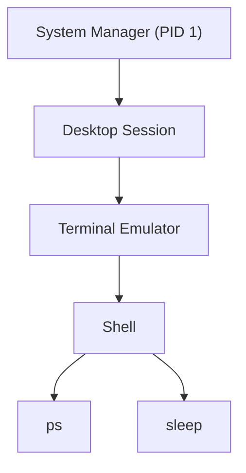
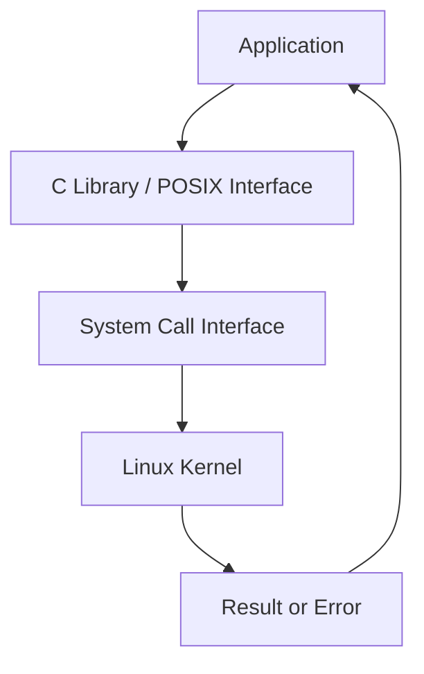
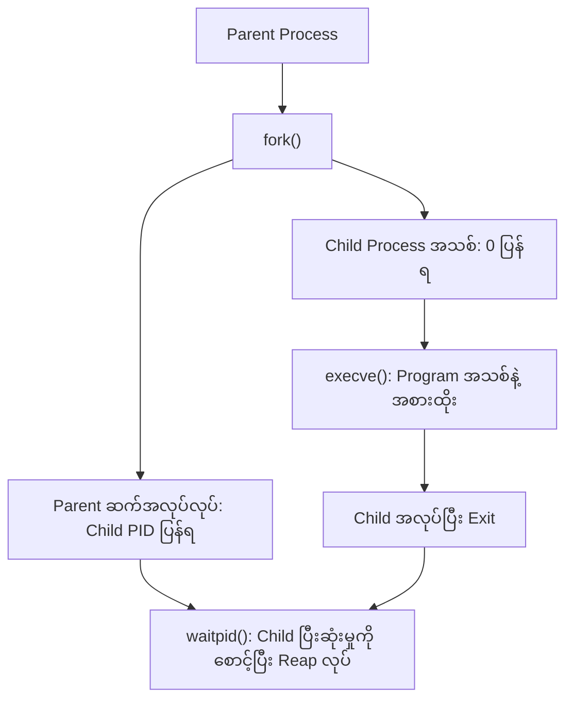
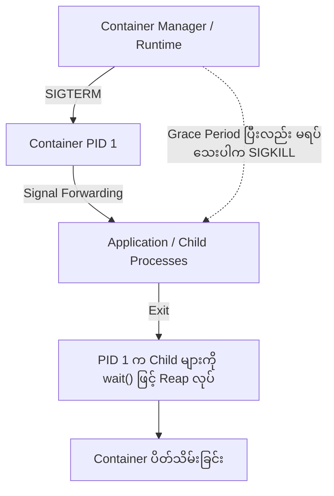
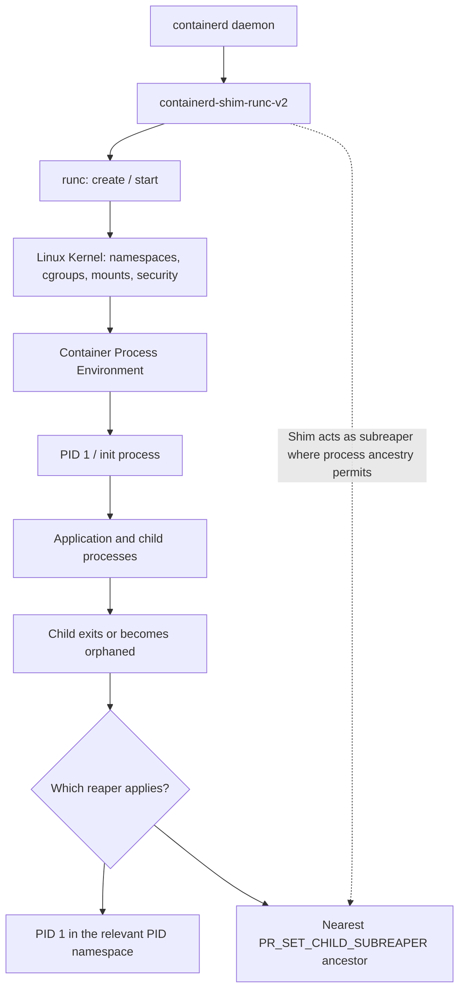

# Chapter 02 — Linux Processes and System Calls

> **Chapter status:** Revised manuscript — 9 November 2026  
> **Research snapshot:** 9 November 2026  
> **Lab status:** Designed, not tested

*Linux Containers Under the Hood · Part I — Container Fundamentals*

**Linux မှာ Program တွေ ဘယ်လိုအလုပ်လုပ်ကြသလဲ။**

---

## 1. Container နားလည်ဖို့ Process ကို ဘာကြောင့် သိထားရမလဲ။

Chapter 01 မှာ Container ဆိုတာ သီးခြား Kernel တစ်ခုကို ကိုယ်ပိုင် Boot လုပ်ထားတဲ့ Virtual Machine မဟုတ်ဘဲ Linux Kernel က စီမံပေးနေတဲ့ Process ပတ်ဝန်းကျင်တစ်ခုဖြစ်ကြောင်း လေ့လာခဲ့ပါတယ်။ ပုံမှန် Linux Container တွေဟာ Host ရဲ့ Kernel ကို အတူမျှဝေသုံးကြပြီး Linux ရဲ့ ခွဲခြားထိန်းချုပ်နိုင်တဲ့ နည်းပညာတွေကို အသုံးပြုကာ Application တွေကို သီးခြားပတ်ဝန်းကျင်တစ်ခုစီမှာ အလုပ်လုပ်စေပါတယ်။

ဒီနေရာမှာ နောက်ထပ်မေးခွန်းတစ်ခု ပေါ်လာပါတယ်။ Container ထဲမှာ Application တစ်ခုကို စတင်လိုက်တဲ့အခါ Linux Kernel က အဲဒီ Application ကို ဘယ်လိုစီမံပေးသလဲ။ Application တစ်ခု အလုပ်လုပ်လာဖို့ Process အသစ်တစ်ခုကို ဘယ်လိုဖန်တီးသလဲ။ Process တစ်ခုက Program တစ်ခုကို အစားထိုး Run လုပ်တဲ့အခါ မူလ Process နဲ့ ဘာတွေ ဆက်ရှိနေသလဲ။ အလုပ်ပြီးသွားတဲ့ Process တွေကို ဘယ်သူက ပြန်လည်ရှင်းလင်းပေးသလဲ။

ဒီမေးခွန်းတွေကို ဖြေဖို့ Linux ရဲ့ Process အလုပ်လုပ်ပုံကို အရင်နားလည်ထားဖို့ လိုပါတယ်။ Container Runtime တစ်ခုကလည်း နောက်ဆုံးမှာ Linux Kernel ရဲ့ Process ဖန်တီးခြင်း၊ Namespace သတ်မှတ်ခြင်း၊ Signal ပို့ခြင်းနဲ့ Resource စီမံခန့်ခွဲခြင်းဆိုင်ရာ လုပ်ဆောင်ချက်တွေကို အသုံးပြုပြီး Container အတွင်းက Application ကို စတင်ပေးရတာပါ။

ဥပမာ Docker နဲ့ Container တစ်ခုကို Run လုပ်လိုက်တဲ့အခါ Docker က Application ကို ကိုယ်တိုင် အလုပ်လုပ်ပေးနေတာ မဟုတ်ပါဘူး။ အောက်ခံ Runtime က Linux Kernel ကို လိုအပ်တဲ့ တောင်းဆိုချက်တွေ ပို့ပေးပြီး Kernel က Process တစ်ခုအဖြစ် Application ကို အမှန်တကယ် စတင်အလုပ်လုပ်စေပါတယ်။

ဒါကြောင့် Container ကို နက်နက်ရှိုင်းရှိုင်း နားလည်ချင်တယ်ဆိုရင် Process ဆိုတာဘာလဲ၊ Process တစ်ခုကို ဘယ်လိုဖန်တီးသလဲ၊ ဘယ်လိုအဆုံးသတ်သလဲဆိုတာကို နားလည်ဖို့ လိုအပ်ပါတယ်။ ဒီအခန်းမှာ အဲဒီအကြောင်းအရာတွေကို တစ်ဆင့်ချင်း လေ့လာသွားပါမယ်။

## 2. ဒီအခန်းကို လေ့လာပြီးရင် ဘာတွေ နားလည်လာမလဲ။

ဒီအခန်းပြီးသွားတဲ့အခါ Program နဲ့ Process တို့ရဲ့ ကွာခြားချက်ကို ရှင်းပြနိုင်လာပါမယ်။ Process တစ်ခုအတွင်းမှာ Thread တွေ ဘယ်လိုအလုပ်လုပ်ကြသလဲ၊ PID နဲ့ PPID ဆိုတာ ဘာကိုဆိုလိုသလဲ၊ Process တွေ ဘယ်လို Parent–Child ပုံစံနဲ့ ဆက်နွယ်နေကြသလဲဆိုတာကိုလည်း နားလည်လာပါမယ်။

ထို့အပြင် Application တစ်ခုက Linux Kernel ဆီ အလုပ်တစ်ခုတောင်းဆိုတဲ့အခါ ဘယ်လိုနည်းလမ်းနဲ့ ဆက်သွယ်သလဲဆိုတာကို လေ့လာပါမယ်။ `fork()` က Process အသစ်ကို ဘယ်လိုဖန်တီးသလဲ၊ Copy-on-Write က Memory အသုံးပြုမှုကို ဘယ်လိုလျှော့ပေးသလဲ၊ `clone()` နဲ့ `clone3()` က Parent နဲ့ Child ကြား အရင်းအမြစ်မျှဝေမှုကို ဘယ်လိုထိန်းချုပ်ပေးသလဲဆိုတာကိုလည်း ရှင်းပြပါမယ်။

နောက်ပိုင်းမှာ `execve()` နဲ့ Program အသစ်ကို အစားထိုး Run လုပ်ပုံ၊ `wait()` နဲ့ `waitpid()` တို့က Child Process ရဲ့ ပြီးဆုံးမှုကို ဘယ်လိုစီမံပေးသလဲ၊ Zombie နဲ့ Orphan Process တို့ ဘာကြောင့်ဖြစ်ပေါ်လာသလဲဆိုတာကို ဆက်လက်လေ့လာပါမယ်။

Container နည်းပညာအတွက် အရေးကြီးတဲ့ PID 1၊ Signal Handling၊ Child Process တွေကို ပြန်လည်ရှင်းလင်းပေးခြင်းနဲ့ Lightweight Init Helper တွေရဲ့ အခန်းကဏ္ဍကိုလည်း လေ့လာပါမယ်။ နောက်ဆုံးမှာ `/proc` နဲ့ `strace` ကို အသုံးပြုပြီး Process အချက်အလက်နဲ့ Kernel ဆီ ပို့နေတဲ့ တောင်းဆိုချက်တွေကို ကိုယ်တိုင်စစ်ဆေးနိုင်အောင် လက်တွေ့လုပ်ကြည့်ပါမယ်။

## 3. မဖတ်ခင် ကြိုတင်သိထားဖို့ လိုအပ်တာ

ဒီအခန်းကို ဖတ်ဖို့ Linux Terminal မှာ အခြေခံ Command တွေ အသုံးပြုဖူးရင် လုံလောက်ပါတယ်။ File နဲ့ Directory ဆိုတာဘာလဲ၊ `cd` နဲ့ `ls` ကို ဘယ်လိုသုံးသလဲ၊ Terminal မှာ Program တစ်ခုကို ဘယ်လို Run လုပ်သလဲဆိုတာ အကြမ်းဖျဉ်း သိထားရင် ပိုအဆင်ပြေပါလိမ့်မယ်။

C Programming ကို ကျွမ်းကျင်ဖို့ မလိုအပ်ပါဘူး။ ဒါပေမဲ့ ဒီအခန်းရဲ့ ဒုတိယ Lab မှာ C Program တစ်ခုကို Compile လုပ်ပြီး Run လုပ်ရမှာဖြစ်တဲ့အတွက် Code ကို တစ်ကြောင်းချင်း ရှင်းပြထားပါတယ်။ C ကို မသိသေးသူလည်း ဥပမာကို လိုက်ဖတ်နိုင်ပါတယ်။

ဒီအခန်းမှာ Process နဲ့ Thread၊ Process ဖန်တီးခြင်းနဲ့ အဆုံးသတ်ခြင်းကို အဓိကထားပါတယ်။ Linux Kernel ရဲ့ Scheduler အတွင်းပိုင်း၊ Kernel Source Code ထဲက Task Structure၊ Thread Synchronization နဲ့ Kernel Programming တို့ကိုတော့ ဒီနေရာမှာ အသေးစိတ် မချဲ့ထွင်သေးပါဘူး။ Namespace တစ်မျိုးချင်းစီရဲ့ အလုပ်လုပ်ပုံကို Chapter 03 မှာ သီးခြားလေ့လာသွားပါမယ်။

## 4. Program နဲ့ Process ဘာကွာသလဲ။

Computer မှာ Application တစ်ခုကို ဖွင့်လိုက်တဲ့အခါ Program နဲ့ Process ဆိုတဲ့ စကားလုံးနှစ်ခုကို မကြာခဏ တွေ့ရတတ်ပါတယ်။ ဒီနှစ်ခုဟာ ဆက်စပ်နေကြပေမဲ့ အဓိပ္ပာယ်တူတာ မဟုတ်ပါဘူး။

Program ဆိုတာ Disk ထဲမှာ သိမ်းထားတဲ့ Executable File ဒါမှမဟုတ် Script ဖြစ်ပါတယ်။ ဥပမာ Linux မှာ `/usr/bin/sleep` ဆိုတဲ့ Program တစ်ခု ရှိတယ်ဆိုပါစို့။ အဲဒီ File ဟာ `sleep` Program ကို အလုပ်လုပ်စေဖို့ သိမ်းထားတဲ့ Executable File ဖြစ်ပါတယ်။

Process ဆိုတာ အဲဒီ Program ကို စတင် Run လုပ်လိုက်တဲ့အခါ ဖြစ်ပေါ်လာတဲ့ အလုပ်လုပ်နေသော Instance ဖြစ်ပါတယ်။ Linux Kernel က Process တစ်ခုစီအတွက် Memory၊ ဖွင့်ထားတဲ့ File၊ ကိုယ်ပိုင် ID၊ လုပ်ဆောင်နေတဲ့ အခြေအနေနဲ့ အခြားလိုအပ်တဲ့ အချက်အလက်တွေကို စီမံပေးပါတယ်။

ဒီကွာခြားချက်ကို ဥပမာတစ်ခုနဲ့ စဉ်းစားကြည့်ပါ။ Terminal တစ်ခုမှာ `sleep 30` လို့ ရိုက်ပြီး နောက်ထပ် Terminal တစ်ခုမှာလည်း `sleep 60` လို့ ရိုက်လိုက်တယ်ဆိုပါစို့။ နှစ်ခုလုံးက `/usr/bin/sleep` ဆိုတဲ့ Program File တစ်ခုတည်းကို အသုံးပြုနေကြပေမဲ့ အမှန်တကယ် အလုပ်လုပ်နေတဲ့ Process ကတော့ နှစ်ခု ဖြစ်လာပါတယ်။ Process တစ်ခုစီမှာ ကိုယ်ပိုင် PID၊ Memory အခြေအနေ၊ ဖွင့်ထားတဲ့ File နဲ့ အလုပ်လုပ်နေတဲ့ အခြေအနေတွေ ရှိပါတယ်။

Process တစ်ခုအတွင်းမှာ ဘာတွေကို စီမံထားသလဲဆိုတာ ပိုနားလည်ဖို့ အောက်ပါအချက်တွေကို စဉ်းစားနိုင်ပါတယ်။ Process တစ်ခုမှာ CPU ပေါ်မှာ နောက်တစ်ကြိမ် အလုပ်ဆက်လုပ်နိုင်ဖို့ လိုအပ်တဲ့ လက်ရှိအခြေအနေ ရှိတယ်။ Program ရဲ့ Code၊ အလုပ်လုပ်နေစဉ် အသုံးပြုတဲ့ Memory နဲ့ Stack တွေ ရှိတယ်။ File၊ Pipe နဲ့ Network Socket တွေကို ဖွင့်ထားနိုင်တယ်။ ဘယ် User နဲ့ အလုပ်လုပ်နေသလဲ၊ ဘယ်လို Permission ရှိသလဲ၊ ဘယ် Signal တွေကို လက်ခံနိုင်သလဲဆိုတဲ့ အချက်အလက်တွေလည်း ပါဝင်ပါတယ်။

ဒီအချက်အလက်တွေကို Linux Kernel က ထိန်းသိမ်းထားပြီး Process တွေကို CPU အချိန်ခွဲဝေပေးခြင်း၊ Memory စီမံခြင်းနဲ့ တစ်ခုနဲ့တစ်ခု မလိုအပ်ဘဲ ဝင်ရောက်မထိခိုက်စေခြင်းတို့ကို လုပ်ဆောင်ပေးပါတယ်။

### 4.1 Program တစ်ခုက Process အများအပြား ဖြစ်လာနိုင်တယ်

Program File တစ်ခုတည်းကနေ Process အများအပြား ဖြစ်လာနိုင်တာကို မှတ်ထားဖို့ အရေးကြီးပါတယ်။ ဥပမာ `/usr/bin/sleep` ကို Terminal A နဲ့ Terminal B ကနေ သီးခြားစီ Run လုပ်လိုက်ရင် Linux က Process နှစ်ခုကို သီးခြားစီ ဖန်တီးပေးပါတယ်။

```text
Executable file on disk
/usr/bin/sleep
       |
       +----------------------+
       |                      |
       v                      v
Terminal A                Terminal B
sleep 30                  sleep 60
       |                      |
       v                      v
Process A                 Process B
ကိုယ်ပိုင် PID             ကိုယ်ပိုင် PID
ကိုယ်ပိုင်အခြေအနေ         ကိုယ်ပိုင်အခြေအနေ
```

ဒီနေရာမှာ Program တစ်ခုနဲ့ Process တစ်ခုကို တူညီတယ်လို့ မယူဆဖို့ လိုပါတယ်။ Program ဟာ Run လုပ်ဖို့ အသင့်ရှိနေတဲ့ File ဖြစ်ပြီး Process ကတော့ အဲဒီ Program ကို အမှန်တကယ် Run လုပ်ထားတဲ့ အခြေအနေ ဖြစ်ပါတယ်။

## 5. Linux မှာ Process နဲ့ Thread

Application တစ်ခုဟာ အလုပ်တစ်ခုတည်းကိုသာ လုပ်ဆောင်နေတာ မဟုတ်ပါဘူး။ အထူးသဖြင့် Browser၊ Web Server နဲ့ Database လို Program တွေမှာ အလုပ်တစ်ခုထက်ပိုပြီး တစ်ချိန်တည်း လုပ်ဆောင်ရတာတွေ ရှိပါတယ်။ ဒီလိုအလုပ်တွေကို စီမံဖို့ Thread တွေကို အသုံးပြုနိုင်ပါတယ်။

Process ကို Application တစ်ခုရဲ့ အလုပ်လုပ်နေတဲ့ ပတ်ဝန်းကျင်အဖြစ် စဉ်းစားနိုင်ပါတယ်။ Thread ကတော့ အဲဒီ Process အတွင်းမှာ အလုပ်လုပ်နေတဲ့ လမ်းကြောင်းတစ်ခု ဖြစ်ပါတယ်။ Process တစ်ခုမှာ Thread တစ်ခုတည်း ရှိနိုင်သလို Thread အများအပြားလည်း ရှိနိုင်ပါတယ်။

ဥပမာ Web Server တစ်ခုဟာ Client Request အများအပြားကို လက်ခံရရှိနေတယ်ဆိုပါစို့။ Request တစ်ခုစီကို အလှည့်ကျ တစ်ခုတည်းလုပ်နေမယ့်အစား Thread အများအပြားနဲ့ ခွဲပြီး ကိုင်တွယ်နိုင်ပါတယ်။ ဒါကြောင့် Request တစ်ခုကို စောင့်ဆိုင်းနေရချိန်မှာ အခြား Request တွေကိုလည်း ဆက်လက်လုပ်ဆောင်နိုင်ပါတယ်။

Linux Kernel အမြင်မှာ Thread တစ်ခုချင်းစီဟာ သီးခြားအလုပ်လုပ်တဲ့ Task တစ်ခု ဖြစ်ပါတယ်။ ဒါပေမဲ့ Process တစ်ခုတည်းအတွင်းက Thread တွေဟာ Memory Space၊ ဖွင့်ထားတဲ့ File စာရင်းနဲ့ အခြား Resource အချို့ကို အတူမျှဝေသုံးနိုင်ပါတယ်။ အဲဒီလို မျှဝေသုံးမယ့်ပုံစံကို Thread တွေ ဖန်တီးတဲ့အချိန်မှာ သတ်မှတ်ပေးတာ ဖြစ်ပါတယ်။

ဥပမာ Thread A က Memory ထဲမှာ Data တစ်ခုကို ပြောင်းလဲလိုက်ရင် အဲဒီ Memory ကို အတူမျှဝေသုံးနေတဲ့ Thread B ကလည်း ပြောင်းလဲထားတဲ့ Data ကို မြင်နိုင်ပါတယ်။ ဒီလိုမျှဝေသုံးနိုင်ခြင်းက Thread တွေကြား Data ဖလှယ်ရတာ လွယ်ကူစေပါတယ်။ ဒါပေမဲ့ Thread အများအပြားက တူညီတဲ့ Data ကို တစ်ပြိုင်နက် ပြောင်းလဲဖို့ ကြိုးစားတဲ့အခါ အစီအစဉ်မမှန်တာ၊ Data မကိုက်ညီတာနဲ့ Lock ဆိုင်ရာ ပြဿနာတွေ ဖြစ်နိုင်ပါတယ်။

Linux မှာ Thread တစ်ခုချင်းစီကို TID (Thread ID) နဲ့ ခွဲခြားသတ်မှတ်ပါတယ်။ Multithreaded Process တစ်ခုလုံးကို ကိုယ်စားပြုတဲ့ နံပါတ်ကို TGID (Thread Group ID) လို့ ခေါ်ပါတယ်။ ပုံမှန်အားဖြင့် `getpid()` က Process တစ်ခုလုံးရဲ့ PID/TGID ကို ပြန်ပေးပြီး `gettid()` က လက်ရှိ Thread ရဲ့ TID ကို ပြန်ပေးပါတယ်။ Thread တစ်ခုတည်းသာရှိတဲ့ Program မှာ PID နဲ့ TID တူညီနေနိုင်ပေမဲ့ Thread အများအပြားရှိလာတဲ့အခါ TID တစ်ခုစီ မတူတော့ပါဘူး။

ဒီကွာခြားချက်ကို သိထားဖို့ အရေးကြီးပါတယ်။ `ps` နဲ့ `/proc` ကို အသုံးပြုတဲ့အခါ Process တစ်ခုလို့ မြင်ရပေမဲ့ အတွင်းမှာ Thread အများအပြား အလုပ်လုပ်နေနိုင်ပါတယ်။ နောက်ပိုင်း Container Process တွေကို စစ်ဆေးတဲ့အခါ ဒီအချက်က အထောက်အကူဖြစ်လာပါလိမ့်မယ်။

## 6. PID၊ PPID နဲ့ Process Tree

Linux မှာ Process တစ်ခုစီကို ခွဲခြားသိနိုင်ဖို့ နံပါတ်တစ်ခု သတ်မှတ်ပေးထားပါတယ်။ အဲဒီနံပါတ်ကို PID (Process ID) လို့ ခေါ်ပါတယ်။ Process တစ်ခုကို ဖန်တီးပေးခဲ့တဲ့ မူလ Process ရဲ့ PID ကို PPID (Parent Process ID) လို့ ခေါ်ပါတယ်။

Process တစ်ခုက နောက်ထပ် Process တစ်ခုကို ဖန်တီးနိုင်တဲ့အတွက် Parent နဲ့ Child ဆက်နွယ်မှုတွေ ဖြစ်လာပါတယ်။ ဒီလို ဆက်နွယ်မှုတွေကို စုစည်းကြည့်လိုက်ရင် သစ်ပင်ပုံစံတစ်ခုလို မြင်ရပါတယ်။ အဲဒါကို Process Tree လို့ ခေါ်ပါတယ်။

ဥပမာ Desktop Environment က Terminal Emulator ကို စတင်ပေးနိုင်ပါတယ်။ Terminal Emulator က Shell ကို စတင်ပေးပြီး Shell ကနေ `ps` ဒါမှမဟုတ် `sleep` လို Command တစ်ခုကို Run လုပ်လိုက်တဲ့အခါ Shell က Child Process တစ်ခု ဖန်တီးနိုင်ပါတယ်။



ဒီပုံဟာ Process Tree ကို နားလည်ဖို့ ရိုးရှင်းအောင် ပြထားတဲ့ ဥပမာသာ ဖြစ်ပါတယ်။ Linux Desktop အမျိုးအစားနဲ့ Session စီမံပုံအလိုက် အစီအစဉ်ကွာနိုင်ပါတယ်။ ထို့အပြင် PID 1 ဟာ Host System ရဲ့ အမြစ် Process ဖြစ်နိုင်သလို သီးခြား PID Namespace တစ်ခုအတွင်းမှာလည်း PID 1 ရှိနိုင်ပါတယ်။ PID Namespace အတွင်းက PID 1 နဲ့ orphaned Child Process တွေ ဘယ်လိုဆက်စပ်သလဲဆိုတာကို Linux ရဲ့ [pid_namespaces(7)](https://man7.org/linux/man-pages/man7/pid_namespaces.7.html) မှာ ပိုမိုအသေးစိတ် ဖတ်ရှုနိုင်ပါတယ်။

ကိုယ့်လက်ရှိ Shell ရဲ့ PID နဲ့ PPID ကို အောက်ပါ Command နဲ့ ကြည့်နိုင်ပါတယ်။

```bash
ps -o pid,ppid,stat,comm,args -p "$$"
```

ဒီမှာ `$$` ဆိုတာ Shell က လက်ရှိ Shell Process ရဲ့ PID အဖြစ် အစားထိုးပေးတဲ့ အထူး Parameter ဖြစ်ပါတယ်။ `ps` ရဲ့ Output မှာ PID က လက်ရှိ Process ရဲ့ နံပါတ်၊ PPID က Parent ရဲ့ နံပါတ်၊ STAT က Process အခြေအနေ၊ COMMAND နဲ့ ARGS က လုပ်ဆောင်နေတဲ့ Program အမည်နဲ့ Argument တွေကို ဖော်ပြပေးပါတယ်။

Process Tree ကို ပိုမြင်သာစွာ ကြည့်ချင်ရင် အောက်ပါ Command ကို အသုံးပြုနိုင်ပါတယ်။

```bash
ps -eo pid,ppid,stat,comm --forest
```

Output ထဲမှာ အဆင့်ဆင့် ခွဲပြထားတဲ့ ပုံစံကို ကြည့်ပြီး ဘယ် Process က ဘယ် Process ကို ဖန်တီးထားသလဲဆိုတာ အကြမ်းဖျဉ်း နားလည်နိုင်ပါတယ်။

PID ကို Process တစ်ခုရဲ့ အမြဲတမ်း ID လို့ မယူဆသင့်ပါဘူး။ Process တစ်ခု အလုပ်ပြီးဆုံးသွားတဲ့အခါ သူ့ရဲ့ PID ကို နောက်ထပ် Process အသစ်တစ်ခုအတွက် ပြန်လည်အသုံးပြုနိုင်ပါတယ်။ ထို့အပြင် PID Namespace တွေ ရှိတဲ့အခါ တူညီတဲ့ Process တစ်ခုကို Namespace မတူတဲ့နေရာက ကြည့်ရင် PID နံပါတ် မတူနိုင်ပါတယ်။ ဒီအကြောင်းကို Chapter 03 မှာ ပိုမိုအသေးစိတ် လေ့လာသွားပါမယ်။

## 7. System Call ဆိုတာ ဘာလဲ။

Application တစ်ခုဟာ Linux ပေါ်မှာ အလုပ်လုပ်နေတဲ့အခါ File ဖတ်ခြင်း၊ Process အသစ်ဖန်တီးခြင်း၊ Memory တောင်းဆိုခြင်းနဲ့ Network Socket အသုံးပြုခြင်းလို အလုပ်တွေကို လုပ်ဆောင်ဖို့ လိုအပ်ပါတယ်။ ဒါပေမဲ့ Application က Kernel ရဲ့ အတွင်းပိုင်းကို ကိုယ့်သဘောနဲ့ ဝင်ရောက်ပြင်ဆင်လို့ မရပါဘူး။ ဒီလို ကန့်သတ်ထားတာဟာ System ရဲ့ လုံခြုံရေးနဲ့ တည်ငြိမ်မှုကို ထိန်းသိမ်းဖို့ ဖြစ်ပါတယ်။

Application က Kernel ရဲ့ ဝန်ဆောင်မှုတစ်ခုကို လိုအပ်လာတဲ့အခါ သတ်မှတ်ထားတဲ့ Interface ကနေ တောင်းဆိုရပါတယ်။ အဲဒီတောင်းဆိုမှုနည်းလမ်းကို System Call လို့ ခေါ်ပါတယ်။

ဥပမာ Text Editor တစ်ခုမှာ File သိမ်းလိုက်တဲ့အခါ Application က Storage ထဲကို ကိုယ်တိုင် တိုက်ရိုက်ရေးတာ မဟုတ်ပါဘူး။ Operating System ရဲ့ Kernel ဆီ Data ရေးသားပေးဖို့ တောင်းဆိုရပါတယ်။ File ဖတ်တာ၊ File ရေးတာ၊ Process ဖန်တီးတာနဲ့ Network ဆက်သွယ်တာတို့အတွက် သက်ဆိုင်ရာ System Call တွေ ရှိပါတယ်။

System Call တစ်ခု ခေါ်လိုက်တဲ့အခါ CPU ဟာ သတ်မှတ်ထားတဲ့ နည်းလမ်းအတိုင်း Application အလုပ်လုပ်နေတဲ့ User Mode ကနေ Kernel Mode ဆီ ကူးပြောင်းပါတယ်။ Kernel က တောင်းဆိုချက်နဲ့ ပေးပို့လာတဲ့ အချက်အလက်တွေကို စစ်ဆေးပြီး ခွင့်ပြုနိုင်ရင် အလုပ်လုပ်ပေးပါတယ်။ ပြီးသွားတဲ့အခါ ရလဒ် ဒါမှမဟုတ် Error အချက်အလက်ကို Application ဆီ ပြန်ပေးပါတယ်။

ဒီလုပ်ငန်းစဉ်ကို အလွယ်နားလည်ဖို့ အောက်ပါပုံကို ကြည့်နိုင်ပါတယ်။



ဒီပုံမှာ Application နဲ့ Kernel ကြားမှာ C Library လို အလယ်ခံ Interface ရှိနိုင်ကြောင်းကို သတိပြုပါ။ ပုံမှန် Application အများစုဟာ Kernel System Call ကို ကိုယ်တိုင် တိုက်ရိုက်မခေါ်ဘဲ C Library ဒါမှမဟုတ် POSIX Interface တွေကို အသုံးပြုကြပါတယ်။

ဥပမာ C Program ထဲမှာ `printf()` ကို အသုံးပြုပြီး စာသားတစ်ခု ထုတ်ပြလိုက်တယ်ဆိုပါစို့။ `printf()` ကိုယ်တိုင်က C Standard Library ရဲ့ စာသားပုံစံပြင်ဆင်ပေးတဲ့ Function ဖြစ်ပါတယ်။ Terminal ဆီ စာသားတကယ်ရေးတဲ့အချိန်မှာတော့ အောက်ခံအနေဖြင့် `write()` လို System Call ကို အသုံးပြုနိုင်ပါတယ်။

အလားတူ `malloc()` ဟာ Program အတွက် Memory တောင်းဆိုရာမှာ အသုံးပြုတဲ့ Library Function ဖြစ်ပါတယ်။ ဒါပေမဲ့ Memory အသစ်တကယ်လိုအပ်လာတဲ့အခါမှ `brk()` သို့မဟုတ် `mmap()` လို System Call တွေကို အသုံးပြုနိုင်ပါတယ်။ ဒါကြောင့် C Library Function တစ်ခု ခေါ်လိုက်တိုင်း System Call တစ်ခုတိတိ ဖြစ်တယ်လို့ မယူဆသင့်ပါဘူး။

ဒီကွာခြားချက်ကို နားလည်ထားရင် `strace` နဲ့ Program တစ်ခုကို Trace လုပ်တဲ့အခါ Source Code ထဲမှာ မြင်ရတဲ့ Function Name နဲ့ Kernel ဆီ တကယ်ဝင်သွားတဲ့ System Call Name မတူနိုင်တာကို နားလည်လာပါမယ်။ ဒီကွာခြားချက်ကို [fork(2)](https://man7.org/linux/man-pages/man2/fork.2.html) နဲ့ [clone(2)](https://man7.org/linux/man-pages/man2/clone.2.html) ရဲ့ Manual တွေမှာလည်း တွေ့နိုင်ပါတယ်။

### 7.1 Process နဲ့ သက်ဆိုင်တဲ့ Function များကို ခွဲခြားနားလည်ခြင်း

Linux မှာ Process တွေကို ဖန်တီးခြင်း၊ Program ပြောင်းလဲခြင်း၊ ပြီးဆုံးခြင်းနဲ့ အခြေအနေစောင့်ကြည့်ခြင်းတို့အတွက် Function နဲ့ System Call အမျိုးမျိုး ရှိပါတယ်။ အမည်တွေ ဆင်တူနေပေမဲ့ အားလုံးဟာ အမျိုးအစားတူတဲ့ Interface တွေ မဟုတ်ပါဘူး။

`fork()`၊ `wait()` နဲ့ `waitpid()` တို့ဟာ POSIX Interface တွေဖြစ်ပြီး C Library ကတစ်ဆင့် အသုံးပြုနိုင်ပါတယ်။ Linux မှာ `fork()` ကို ခေါ်လိုက်တဲ့အခါ glibc ရဲ့ NPTL Implementation က အောက်ခံ `clone()` System Call ကို အသုံးပြုပြီး `fork()` နဲ့ တူညီတဲ့ အပြုအမူကို ရရှိစေနိုင်ပါတယ်။ ဒါကြောင့် Source Code ထဲမှာ `fork()` လို့ ရေးထားပေမဲ့ `strace` Output မှာ `clone()` ကို တွေ့နိုင်ပါတယ်။

`clone()` က Linux-specific Interface ဖြစ်ပြီး Parent နဲ့ Child ကြား Memory၊ File Descriptor စတဲ့ Resource တွေကို ဘယ်လိုမျှဝေမလဲဆိုတာ Flag တွေနဲ့ သတ်မှတ်နိုင်ပါတယ်။ သို့သော် glibc ရဲ့ `clone()` Wrapper နဲ့ Kernel ရဲ့ Raw `clone` System Call တို့ဟာ အသုံးပြုပုံ မတူညီနိုင်တာကို သတိပြုပါ။

`clone3()` ကတော့ Linux 5.3 မှာ စတင်ပါဝင်လာတဲ့ ပိုမိုအသစ်ဖြစ်တဲ့ System Call ဖြစ်ပါတယ်။ `struct clone_args` ဆိုတဲ့ အချက်အလက်အစုကို အသုံးပြုပြီး Flag၊ Stack၊ PID Descriptor နဲ့ cgroup ဆိုင်ရာ Parameter အချို့ကို ပေးပို့နိုင်ပါတယ်။ glibc မှာ သီးခြား `clone3()` Wrapper မရှိတဲ့အတွက် `syscall()` ကနေ ခေါ်ယူရတဲ့ ပုံစံကို တွေ့ရနိုင်ပါတယ်။ အသုံးပြုမယ့် Kernel က `clone3()` ကို မပံ့ပိုးသေးရင် `ENOSYS` Error ပြန်ရနိုင်ပါတယ်။ အချက်အလက်အပြည့်အစုံကို Linux ရဲ့ [clone(2)](https://man7.org/linux/man-pages/man2/clone.2.html) Manual မှာ ကြည့်နိုင်ပါတယ်။

`execve()` က လက်ရှိ Process ထဲက Program ကို အစားထိုးပေးတဲ့ System Call ဖြစ်ပါတယ်။ `wait()` နဲ့ `waitpid()` ကတော့ Child Process ရဲ့ အခြေအနေကို စောင့်ကြည့်ပြီး ပြီးဆုံးမှုအချက်အလက်ကို ရယူပေးပါတယ်။

Process အဆုံးသတ်ခြင်းနဲ့ ပတ်သက်ပြီး `exit()` နဲ့ `_exit()` ဆိုတဲ့ Function နှစ်ခုကိုလည်း တွေ့ရနိုင်ပါတယ်။ `exit()` က C Library ရဲ့ Cleanup လုပ်ငန်းတွေဖြစ်တဲ့ `atexit()` Handler တွေ ခေါ်ခြင်းနဲ့ Standard I/O Buffer တွေကို Flush လုပ်ခြင်းတို့ ပြုလုပ်ပြီးမှ Process ကို အဆုံးသတ်စေပါတယ်။ `_exit()` ကတော့ အဲဒီ User-space Cleanup တွေ မလုပ်ဘဲ Process ကို ရပ်တန့်စေတဲ့ Interface ဖြစ်ပါတယ်။ Linux မှာ glibc ရဲ့ `_exit()` Wrapper က ပုံမှန်အားဖြင့် `exit_group()` ကို အသုံးပြုပြီး Thread Group တစ်ခုလုံးကို ရပ်တန့်စေပါတယ်။ Raw Linux `exit` System Call ကတော့ ခေါ်တဲ့ Thread တစ်ခုတည်းကို အဆုံးသတ်စေပြီး `exit_group` က Thread Group တစ်ခုလုံးကို အဆုံးသတ်စေပါတယ်။

`getpid()` က လက်ရှိ Process ရဲ့ PID ကို ပြန်ပေးပြီး `getppid()` က Parent ရဲ့ PID ကို ပြန်ပေးပါတယ်။ `gettid()` ကတော့ လက်ရှိ Thread ရဲ့ ID ကို ပြန်ပေးတဲ့ Linux-specific Interface ဖြစ်ပါတယ်။ `kill()` ဆိုတဲ့ Function က Process တစ်ခုဆီ Signal ပို့နိုင်ပေမဲ့ Signal ပို့လိုက်တာနဲ့ Process ဟာ ချက်ချင်း ရပ်သွားမယ်လို့ မဆိုလိုပါဘူး။ Signal အမျိုးအစားနဲ့ Process ရဲ့ Signal Handling ပုံစံပေါ် မူတည်ပါတယ်။

ဒီနေရာမှာ အဓိကမှတ်ထားရမှာက Source Code ထဲမှာ မြင်ရတဲ့ Function Name နဲ့ Kernel ကို တကယ်တောင်းဆိုတဲ့ System Call Name မတူနိုင်တာ ဖြစ်ပါတယ်။ `strace` ကို လေ့လာတဲ့အခါ ဒီအချက်က အထူးအသုံးဝင်လာပါလိမ့်မယ်။

## 8. `fork()` — Child Process ဖန်တီးခြင်း

Linux မှာ Process အသစ်တစ်ခု ဖန်တီးဖို့ အသုံးများတဲ့ Interface တစ်ခုက `fork()` ဖြစ်ပါတယ်။ `fork()` ကို ခေါ်လိုက်တဲ့အခါ လက်ရှိ Process ကနေ Child Process အသစ်တစ်ခု ဖန်တီးပေးပါတယ်။ အဲဒီနောက် Parent နဲ့ Child နှစ်ခုစလုံးဟာ `fork()` ခေါ်ခဲ့တဲ့နေရာကနေ ဆက်လက်အလုပ်လုပ်ကြပါတယ်။

ဥပမာ Program တစ်ခုက အလုပ်တစ်ခုကို ကိုယ်တိုင် ဆက်လုပ်နေစဉ် နောက်ထပ်အလုပ်တစ်ခုကို Child Process အသစ်တစ်ခုဆီ ခွဲပေးချင်တယ်ဆိုပါစို့။ `fork()` ကို အသုံးပြုပြီး အလုပ်လုပ်မယ့် Process နှစ်ခု ဖြစ်လာစေနိုင်ပါတယ်။

`fork()` ရဲ့ စိတ်ဝင်စားစရာကောင်းတဲ့ အချက်က Parent နဲ့ Child တို့မှာ Return Value မတူတာ ဖြစ်ပါတယ်။ Parent Process ထဲမှာ `fork()` က Child ရဲ့ PID ကို ပြန်ပေးပါတယ်။ Child Process ထဲမှာတော့ သုညကို ပြန်ပေးပါတယ်။ Process အသစ်ဖန်တီးမှု မအောင်မြင်ခဲ့ရင် Parent ဘက်မှာ `-1` ကို ပြန်ပေးပြီး Error အကြောင်းကို `errno` ထဲမှာ သတ်မှတ်ပေးပါတယ်။



Linux မှာ Source Code ထဲက `fork()` ကို `strace` မှာလည်း `fork()` လို့ပဲ အမြဲမြင်ရမယ်လို့ မထင်ပါနဲ့။ glibc ရဲ့ NPTL Implementation မှာ `fork()` Wrapper က အောက်ခံ `clone()` System Call ကို အသုံးပြုနိုင်တာကြောင့် Trace Output ထဲမှာ `clone()` ကို တွေ့နိုင်ပါတယ်။

### 8.1 Thread အများကြီးရှိတဲ့ Process က `fork()` ခေါ်တဲ့အခါ

Thread အများအပြားရှိတဲ့ Process တစ်ခုမှာ Thread A က `fork()` ခေါ်လိုက်ရင် Parent ဘက်မှာ Thread အားလုံး ဆက်ရှိနေပေမဲ့ Child ထဲမှာတော့ `fork()` ခေါ်ခဲ့တဲ့ Thread A တစ်ခုတည်းသာ ရှိပါတယ်။ အခြား Thread တွေကို Child ထဲမှာ ပြန်ဖန်တီးမပေးပါဘူး။

ဒီအခြေအနေမှာ Lock ဆိုင်ရာ ပြဿနာ ဖြစ်လာနိုင်ပါတယ်။ ဥပမာ Thread B က Mutex တစ်ခုကို Lock လုပ်ထားတဲ့အချိန် Thread A က `fork()` ခေါ်လိုက်တယ်ဆိုပါစို့။ Child ထဲမှာ Thread B မရှိတော့ပေမဲ့ Mutex ရဲ့ အခြေအနေက Locked အဖြစ် ကျန်နေနိုင်ပါတယ်။ Child ထဲက Thread A က အဲဒီ Mutex ကို ထပ်မံ Lock လုပ်ဖို့ ကြိုးစားရင် Unlock လုပ်ပေးမယ့် Thread B မရှိတော့တဲ့အတွက် Deadlock ဖြစ်နိုင်ပါတယ်။

ဒါကြောင့် POSIX စည်းမျဉ်းအရ Multithreaded Process မှာ `fork()` ပြီးတဲ့ Child ဟာ `execve()` မခေါ်မချင်း Async-Signal-Safe Function တွေကိုသာ အသုံးပြုသင့်ပါတယ်။ `printf()`၊ `malloc()` နဲ့ Lock ယူနိုင်တဲ့ Library Function တွေကို အဲဒီကြားကာလမှာ အသုံးပြုတာ မလုံခြုံနိုင်ပါဘူး။ Child ရဲ့ ရည်ရွယ်ချက်က Program အသစ် Run ဖို့ဆိုရင် လိုအပ်တဲ့ အနည်းဆုံး Safe Operation တွေ ပြီးတာနဲ့ `execve()` ကို ခေါ်တာက ပိုသင့်တော်ပါတယ်။

`pthread_atfork()` က `fork()` မတိုင်ခင်၊ Parent ဘက်မှာ `fork()` ပြီးနောက်နဲ့ Child ဘက်မှာ `fork()` ပြီးနောက် လုပ်ဆောင်ရမယ့် Handler တွေကို မှတ်ပုံတင်နိုင်တဲ့ POSIX Interface ဖြစ်ပါတယ်။ ဒီ Handler တွေက Lock အခြေအနေတွေကို ပြင်ဆင်ဖို့ ကူညီနိုင်ပေမဲ့ Library အားလုံးရဲ့ State ကို လုံခြုံစွာ ပြန်ညှိနိုင်မယ်လို့ အာမမခံနိုင်ပါဘူး။

### 8.2 Copy-on-Write (CoW)

`fork()` ခေါ်တဲ့အခါ Parent ရဲ့ Memory အားလုံးကို Child အတွက် ချက်ချင်းကူးပေးတယ်လို့ မယူဆပါနဲ့။ Linux က Copy-on-Write (CoW) နည်းလမ်းကို အသုံးပြုပြီး အစပိုင်းမှာ Parent နဲ့ Child တို့ရဲ့ Private Memory Page အချို့ကို အတူမျှဝေသုံးစေနိုင်ပါတယ်။ တစ်ဖက်ဖက်က အဲဒီ Page ကို ပြောင်းလဲရေးသားဖို့ ကြိုးစားတဲ့အခါမှ Kernel က သက်ဆိုင်ရာ Page ကို ကူးယူပြီး သီးခြားအသုံးပြုစေပါတယ်။

စာအုပ်တစ်အုပ်ကို လူနှစ်ယောက် အတူဖတ်နေတယ်လို့ စိတ်ကူးကြည့်ပါ။ တစ်ယောက်ယောက်က စာအုပ်ထဲမှာ စာရေးချင်လာတဲ့အခါ မူရင်းစာအုပ်ကို မပြောင်းလဲစေဘဲ ကိုယ်ပိုင်မိတ္တူတစ်ခု လုပ်ပြီး ရေးနိုင်ပါတယ်။ CoW ကလည်း ဒီသဘောတရားနဲ့ ဆင်တူပါတယ်။

```text
fork() ပြီးပြီးချင်း
Parent Memory  ----+
                   +---- Physical Memory Page များကို မျှဝေထား
Child Memory   ----+

Parent က Page တစ်ခုကို ပြင်ဆင်ရေးသားချိန်
Parent Memory  -------- သီးခြား Copy Page
Child Memory   -------- မူလ Page ကို ဆက်သုံး
```

ဒီနည်းလမ်းကြောင့် Memory အားလုံးကို ချက်ချင်း ထပ်ကူးစရာမလိုတော့ပါဘူး။ သို့သော် `fork()` ဟာ ကုန်ကျစရိတ် လုံးဝမရှိဘူးလို့ မဆိုလိုပါဘူး။ Page Table နဲ့ Process ဆိုင်ရာ အချက်အလက်တွေကို ပြင်ဆင်ရတာကြောင့် အခြားကုန်ကျစရိတ်တွေ ရှိနေဆဲပါ။

`fork()` ပြီးတဲ့ Child Process ဟာ Parent ရဲ့ File Descriptor စာရင်းကိုလည်း ဆက်ခံရရှိပါတယ်။ ဒါပေမဲ့ Parent နဲ့ Child ရဲ့ Descriptor တွေဟာ Kernel ထဲက Open File Description တစ်ခုတည်းကို ညွှန်းနေနိုင်တဲ့အတွက် File Offset နဲ့ အချို့သော File Status Flag တွေကို အတူမျှဝေသုံးနိုင်ပါတယ်။ File Descriptor နံပါတ်တူတာနဲ့ Kernel Object အသစ်နှစ်ခု လုံးဝသီးခြားဖြစ်သွားတယ်လို့ မယူဆသင့်ပါဘူး။

## 9. `clone()` နဲ့ `clone3()`

`fork()` က Parent Process ကို အခြေခံပြီး Child Process အသစ်တစ်ခု ဖန်တီးပေးပါတယ်။ ဒါပေမဲ့ Container တစ်ခု ဖန်တီးတဲ့အခါ Process အသစ်တစ်ခု ရရှိရုံနဲ့ မလုံလောက်သေးပါဘူး။ Parent နဲ့ Child ကြားမှာ Memory၊ File နဲ့ အခြားအရင်းအမြစ်တွေကို ဘယ်လိုမျှဝေမလဲ၊ ဘယ် Namespace အသစ်ထဲမှာ အလုပ်လုပ်စေမလဲဆိုတာကိုလည်း ထိန်းချုပ်ဖို့ လိုပါတယ်။

ဒီလို ပိုမိုအသေးစိတ် ထိန်းချုပ်နိုင်တဲ့ Linux Interface တစ်ခုက `clone()` ဖြစ်ပါတယ်။ `clone()` မှာ Flag တွေကို အသုံးပြုပြီး Parent နဲ့ Child ကြား ဘယ် Resource တွေကို Share လုပ်မလဲ၊ ဘယ်အရာတွေကို သီးခြားထားမလဲဆိုတာ သတ်မှတ်နိုင်ပါတယ်။ Linux Thread တွေ အလုပ်လုပ်ပုံနဲ့ Container Runtime အများအပြားမှာ ဒီ `clone()` Family ကို အသုံးပြုကြပါတယ်။

ဒီနေရာမှာ `clone()` လို့ ပြောတဲ့အခါ glibc Wrapper ကို ဆိုလိုတာလား၊ Kernel ရဲ့ Raw System Call ကို ဆိုလိုတာလားဆိုတာ ခွဲခြားဖို့ လိုပါတယ်။ glibc ရဲ့ `clone()` Wrapper ကို သုံးတဲ့အခါ Child Process ဟာ ပေးထားတဲ့ Callback Function ကနေ စတင်အလုပ်လုပ်ပါတယ်။ Raw System Call ကို တိုက်ရိုက်ခေါ်တဲ့အခါမှာတော့ `fork()` နဲ့ ဆင်တူတဲ့ ပုံစံမျိုးနဲ့ Parent နဲ့ Child နှစ်ဖက်စလုံးဟာ Call ပြီးတဲ့နေရာကနေ ဆက်လုပ်ကြပါတယ်။ ဒါကြောင့် Documentation ဒါမှမဟုတ် Source Code ထဲမှာ `clone()` လို့ တွေ့တဲ့အခါ ဘယ် Interface ကို ရည်ညွှန်းသလဲဆိုတာ ကြည့်ဖို့ လိုပါတယ်။

`clone()` မှာ အသုံးပြုနိုင်တဲ့ Flag အချို့ကို ကြည့်ရအောင်။

- `CLONE_VM` က Parent နဲ့ Child ကြား Virtual Memory Space ကို မျှဝေသုံးစေပါတယ်။
- `CLONE_FILES` က File Descriptor Table ကို မျှဝေသုံးစေပါတယ်။
- `CLONE_FS` က Current Working Directory နဲ့ Root Directory စတဲ့ Filesystem Context အချို့ကို မျှဝေသုံးစေပါတယ်။
- `CLONE_SIGHAND` က Signal Handler တွေ သတ်မှတ်ထားတဲ့ စာရင်းကို မျှဝေသုံးစေပါတယ်။
- `CLONE_THREAD` က Thread Group တစ်ခုတည်းအတွင်း Thread အသစ်တစ်ခု ထည့်သွင်းဖို့ အသုံးပြုပါတယ်။
- `CLONE_NEWPID` က Child ကို PID Namespace အသစ်ထဲမှာ စတင်စေပါတယ်။
- `CLONE_NEWNS` က Mount Namespace အသစ်တစ်ခု ဖန်တီးစေပါတယ်။
- `CLONE_NEWNET` က Network Namespace အသစ်တစ်ခု ဖန်တီးစေပါတယ်။

ဒီ Flag တွေကို လိုသလို အားလုံးပေါင်းသုံးလို့ရတယ်လို့ မယူဆပါနဲ့။ Kernel က သတ်မှတ်ထားတဲ့ Dependency တွေ ရှိပါတယ်။ ဥပမာ `CLONE_SIGHAND` ကို အသုံးပြုမယ်ဆိုရင် `CLONE_VM` လည်း လိုအပ်ပါတယ်။ `CLONE_THREAD` ကို အသုံးပြုမယ်ဆိုရင်လည်း `CLONE_SIGHAND` ကို သတ်မှတ်ထားဖို့ လိုပါတယ်။ မကိုက်ညီတဲ့ Flag ပေါင်းစပ်မှုကို ပေးလိုက်ရင် Kernel က Error ပြန်ပေးနိုင်ပါတယ်။

`clone3()` ကတော့ `clone()` ထက် Argument တွေကို ပိုမိုစနစ်တကျ ပေးပို့နိုင်တဲ့ Interface အသစ်တစ်ခု ဖြစ်ပါတယ်။ `struct clone_args` ဆိုတဲ့ Structure ကို အသုံးပြုပြီး Flag၊ Stack၊ PID Descriptor နဲ့ cgroup ဆိုင်ရာ Parameter အချို့ကို ပေးနိုင်ပါတယ်။ `clone3()` ကို Linux Kernel 5.3 မှာ စတင်ထည့်သွင်းခဲ့ပါတယ်။

Kernel က `clone3()` ကို ပံ့ပိုးထားတာနဲ့ အသုံးပြုနေတဲ့ C Library မှာ အဲဒီအတွက် သီးခြား Wrapper ရှိတာက မတူပါဘူး။ လက်ရှိ glibc မှာ `clone3()` အတွက် သီးခြား Wrapper မရှိတဲ့အတွက် `syscall()` Interface ကတစ်ဆင့် ခေါ်ယူရတဲ့ ပုံစံကို တွေ့ရနိုင်ပါတယ်။ အသုံးပြုမယ့် Kernel က `clone3()` ကို မပံ့ပိုးသေးရင် `ENOSYS` Error ပြန်ရနိုင်တာကြောင့် Runtime တွေဟာ Kernel Support ကို စစ်ဆေးပြီး လိုအပ်ရင် အခြားနည်းလမ်းကို ပြန်အသုံးပြုနိုင်ဖို့ ပြင်ဆင်ထားရပါတယ်။

Container တစ်ခု ဖန်တီးတဲ့အခါ Runtime က `CLONE_NEWPID`၊ `CLONE_NEWNET` စတဲ့ Flag တွေကို အသုံးပြုပြီး Child Process ကို သီးခြား Namespace တွေထဲမှာ စတင်စေနိုင်ပါတယ်။ ဒါပေမဲ့ `clone()` တစ်ခုတည်းကို ခေါ်လိုက်တာနဲ့ Container အပြည့်အစုံ ဖြစ်သွားတာ မဟုတ်ပါဘူး။ Root Filesystem ပြင်ဆင်ခြင်း၊ Mount လုပ်ခြင်း၊ cgroup ထဲ ထည့်သွင်းခြင်း၊ User နဲ့ Permission သတ်မှတ်ခြင်း၊ Security Policy အသုံးပြုခြင်းနဲ့ Network Configuration ပြင်ဆင်ခြင်းတို့ကိုပါ ဆက်လက်လုပ်ဆောင်ဖို့ လိုပါတယ်။ ဒီ Mechanism တွေကို နောက်လာမယ့် Chapter တွေမှာ သီးခြားလေ့လာသွားပါမယ်။

## 10. `execve()` — Program အသစ်နဲ့ အစားထိုး Run လုပ်ခြင်း

`fork()` ကို အသုံးပြုပြီး Child Process အသစ်ဖန်တီးပြီးတဲ့အခါ အဲဒီ Child ထဲမှာ Program တစ်ခုကို Run လုပ်စေချင်နိုင်ပါတယ်။ ဒီလိုအလုပ်အတွက် `execve()` ကို အသုံးပြုနိုင်ပါတယ်။

`execve()` ဟာ Process အသစ်တစ်ခု ဖန်တီးတာ မဟုတ်ပါဘူး။ လက်ရှိ Process ရဲ့ Program ကို အစားထိုးပေးတာဖြစ်ပါတယ်။ ဆိုလိုတာက Process တစ်ခုရဲ့ PID နဲ့ Parent ဆက်နွယ်မှုတွေဟာ ပုံမှန်အားဖြင့် ဆက်လက်တည်ရှိနေပြီး အတွင်းမှာ အလုပ်လုပ်နေတဲ့ Program Code၊ Memory နဲ့ Stack တို့ကိုတော့ Program အသစ်အတွက် ပြန်လည်တည်ဆောက်ပေးပါတယ်။

ဥပမာ Terminal မှာ `ls` လို့ ရိုက်လိုက်တဲ့အခါ Shell က Child Process တစ်ခု ဖန်တီးပြီး အဲဒီ Child ထဲမှာ `ls` Program ကို Run လုပ်စေနိုင်ပါတယ်။ အဲဒီလို Program အသစ်နဲ့ အစားထိုးတဲ့ လုပ်ဆောင်ချက်ကို `execve()` က ဆောင်ရွက်ပေးပါတယ်။

`execve()` မှာ အဓိက Argument သုံးခု ရှိပါတယ်။ ပထမတစ်ခုက Run လုပ်မယ့် Executable File ရဲ့ Path ဖြစ်ပါတယ်။ ဒုတိယတစ်ခုက Program အသစ်ဆီ ပေးပို့မယ့် Argument စာရင်းဖြစ်ပြီး တတိယတစ်ခုက Environment Variable တွေရဲ့ စာရင်းဖြစ်ပါတယ်။

C Program တွေမှာ `execlp()`၊ `execvp()` စတဲ့ Function တွေကိုလည်း မကြာခဏ တွေ့ရနိုင်ပါတယ်။ ဒီ Function တွေဟာ `exec` Family ထဲက Library Interface တွေဖြစ်ပြီး `PATH` ထဲမှာ Program ကို ရှာပေးခြင်းလို အဆင်ပြေစေမယ့် လုပ်ဆောင်ချက်တွေ ပါဝင်နိုင်ပါတယ်။ Kernel ရဲ့ အဓိက System Call ကတော့ `execve()` ဖြစ်ပါတယ်။

`execve()` အောင်မြင်သွားတဲ့အခါ မူလ Program ရဲ့ နောက်လာမယ့် Code တွေကို ဆက်မလုပ်တော့ပါဘူး။ Program Image အသစ်ထဲကို ရောက်သွားပါပြီ။ ဒါကြောင့် `execve()` နောက်မှာ ရေးထားတဲ့ Code ဟာ ပုံမှန်အားဖြင့် `execve()` မအောင်မြင်တဲ့အခါ Error ကို ကိုင်တွယ်ဖို့သာ ဖြစ်ပါတယ်။

### 10.1 `execve()` ပြီးနောက် ဘာတွေ ဆက်ရှိနေသလဲ။

`execve()` ကို ခေါ်လိုက်တဲ့အခါ Process ရဲ့ အရာအားလုံးဟာ အသစ်ပြောင်းသွားတာ မဟုတ်ပါဘူး။ အချို့အရာတွေ ဆက်လက်ရှိနေပြီး အချို့အရာတွေကိုတော့ Program အသစ်အတွက် ပြန်လည်သတ်မှတ်ပေးပါတယ်။

အရေးကြီးဆုံးက PID ဖြစ်ပါတယ်။ `execve()` အောင်မြင်သွားရင် Process ရဲ့ PID ဟာ ပုံမှန်အားဖြင့် မပြောင်းလဲပါဘူး။ Parent နဲ့ ဆက်နွယ်မှုလည်း ဆက်ရှိနေပါတယ်။ လက်ရှိ Working Directory၊ Root Directory၊ Umask၊ Resource Limit၊ Process Group နဲ့ Session ဆိုင်ရာ အချက်အလက်အချို့လည်း ဆက်လက်ကျန်ရှိနေတတ်ပါတယ်။ Namespace Membership နဲ့ cgroup Membership တို့လည်း ပုံမှန်အားဖြင့် ဆက်ရှိနေပါတယ်။

ဒါပေမဲ့ Program ရဲ့ Code၊ Data၊ Heap နဲ့ Stack တို့ကို Program အသစ်အတွက် ပြန်လည်တည်ဆောက်ပါတယ်။ Multithreaded Process တစ်ခုက `execve()` လုပ်တဲ့အခါ Calling Thread မဟုတ်တဲ့ အခြား Thread တွေ အဆုံးသတ်သွားပြီး Calling Thread က Program Image အသစ်နဲ့ ဆက်လက်အလုပ်လုပ်ပါတယ်။ Caught Signal Handler တွေကိုလည်း Default အခြေအနေ ပြန်သတ်မှတ်ပေးပါတယ်။ Ignored Signal အချို့ကတော့ ယေဘုယျအားဖြင့် ဆက်လက် Ignored ဖြစ်နေနိုင်ပါတယ်။

ဖွင့်ထားပြီးသား File Descriptor တွေအားလုံးကို အလိုအလျောက် ပိတ်လိုက်တာ မဟုတ်ပါဘူး။ `FD_CLOEXEC` (close-on-exec) သတ်မှတ်ထားတဲ့ File Descriptor တွေကိုသာ `execve()` အောင်မြင်တဲ့အခါ ပိတ်ပေးပါတယ်။ ဒီအချက်ဟာ Pipe၊ Socket နဲ့ Log File တချို့ကို Child Program ဆီ ဆက်လက်ပေးပို့ချင်တဲ့အခါ အရေးကြီးပါတယ်။

ဒါ့အပြင် `execve()` အတွင်းမှာ Alternate Signal Stack၊ POSIX Timer၊ Memory Lock နဲ့ Memory Mapping အဟောင်းတချို့ ပျောက်ဆုံးသွားနိုင်ပါတယ်။ `atexit()` နဲ့ `on_exit()` Handler တွေလည်း Program အသစ်ထဲကို ဆက်လက်မလိုက်ပါဘူး။ Set-user-ID၊ Set-group-ID သို့မဟုတ် File Capability ပါတဲ့ Executable ကို Run လုပ်တဲ့အခါ Effective Credential နဲ့ Capability အချို့ ပြောင်းလဲနိုင်ပါတယ်။ သို့သော် `no_new_privs`၊ `nosuid` Mount ဒါမှမဟုတ် `ptrace` လို အခြေအနေတွေက Privilege ပြောင်းလဲမှုကို တားဆီးနိုင်ပါတယ်။

Multithreaded Process မှာ Non-leader Thread တစ်ခုက `execve()` ခေါ်တဲ့အခါ Linux က ကျန်တဲ့ Thread တွေကို ရပ်တန့်ပြီး ခေါ်လိုက်တဲ့ Thread ကို Thread Group ရဲ့ Leader Identity နဲ့ ဆက်လုပ်စေနိုင်ပါတယ်။ ဒါကြောင့် Thread တစ်ခုချင်းစီရဲ့ TID တွေအားလုံး အရင်အတိုင်း ဆက်ကျန်နေမယ်လို့ မယူဆသင့်ပါဘူး။

ဒီအချက်တွေကြောင့် `execve()` ဟာ Program Code ကိုသာ ပြောင်းပေးတာဖြစ်ပြီး ကျန်တဲ့အရာအားလုံးကို မထိခိုက်ဘူးလို့ မယူဆသင့်ပါဘူး။ Process Identity နဲ့ Namespace ကဲ့သို့ အချို့အရာတွေ ဆက်ရှိနေချိန်မှာ Memory၊ Thread နဲ့ Signal Handling အချို့ကတော့ ပြောင်းလဲသွားပါတယ်။

## 11. Child Process ကို `wait()` နဲ့ `waitpid()` အသုံးပြုပြီး စောင့်ခြင်း

Parent Process တစ်ခုက Child Process အသစ်ဖန်တီးလိုက်ပြီဆိုရင် Child ရဲ့ အလုပ်ပြီးဆုံးတဲ့အချိန်ကိုလည်း သိရှိဖို့ လိုအပ်ပါတယ်။ Child က ဘယ်အချိန်မှာ ပြီးသွားသလဲ၊ ပုံမှန်အတိုင်း အောင်မြင်စွာ ပြီးဆုံးသလား၊ Error ကြောင့် ရပ်သွားသလားဆိုတာကို Parent က သိဖို့လိုပါတယ်။

Child Process တစ်ခု အဆုံးသတ်သွားတဲ့အခါ Kernel က Parent က နောက်မှ ပြန်ယူနိုင်ဖို့ ပြီးဆုံးမှုဆိုင်ရာ အချက်အလက်အချို့ကို ခဏထိန်းသိမ်းထားပါတယ်။ Parent က `wait()` ဒါမှမဟုတ် `waitpid()` ကို ခေါ်ပြီး အဲဒီအချက်အလက်ကို ရယူတဲ့ လုပ်ငန်းစဉ်ကို Reap လုပ်ခြင်းလို့ ခေါ်ပါတယ်။

`wait()` က Parent ရဲ့ Child Process တစ်ခုခု အဆုံးသတ်သွားတာကို စောင့်ပြီး အဲဒီ Process ရဲ့ ပြီးဆုံးမှုအခြေအနေကို ပြန်ပေးပါတယ်။ `waitpid()` ကတော့ ဘယ် Child ကို စောင့်မလဲဆိုတာကို ပိုမိုတိကျစွာ ရွေးချယ်နိုင်ပါတယ်။ ဒါ့အပြင် မပြီးသေးရင် စောင့်နေမလား၊ ချက်ချင်းပြန်လာမလားဆိုတာကိုလည်း Option တွေနဲ့ ထိန်းချုပ်နိုင်ပါတယ်။

ဥပမာ `waitpid(pid, &status, 0)` ဆိုရင် သတ်မှတ်ထားတဲ့ PID ရှိတဲ့ Child Process အဆုံးသတ်တဲ့အထိ စောင့်နေပါတယ်။ `WNOHANG` ကို ထည့်သုံးထားရင် Child က မပြီးသေးတဲ့အခါ Parent ကို အချိန်အကြာကြီး စောင့်မနေစေဘဲ ချက်ချင်းပြန်လာနိုင်ပါတယ်။

Child ပြီးဆုံးမှုအခြေအနေကို စစ်ဆေးတဲ့အခါ `WIFEXITED(status)` က ပုံမှန်အတိုင်း ပြီးဆုံးခဲ့သလားဆိုတာ သိစေပြီး `WEXITSTATUS(status)` က Program ပြန်ပေးခဲ့တဲ့ Exit Code ကို ရယူစေပါတယ်။ `WIFSIGNALED(status)` ကတော့ Signal ကြောင့် Process အဆုံးသတ်ခဲ့သလားဆိုတာ စစ်ဆေးနိုင်ပါတယ်။ ဒီလိုသတ်မှတ်ထားတဲ့ Macro တွေကို အသုံးပြုတာက Status နံပါတ်ကို ကိုယ့်ဘာသာ အပိုင်းခွဲပြီး အဓိပ္ပာယ်ဖော်တာထက် ပိုသင့်တော်ပါတယ်။

Parent က Child ရဲ့ ပြီးဆုံးမှုကို သေချာမရယူခဲ့ရင် Zombie Process ဖြစ်လာနိုင်ပါတယ်။ ဒါကြောင့် အလုပ်ကြာကြာလုပ်နေတဲ့ Parent Process တွေဟာ Child Process တွေရဲ့ ပြီးဆုံးမှုကို စနစ်တကျ စောင့်ကြည့်ပြီး Reap လုပ်ပေးဖို့ လိုပါတယ်။

### 11.1 Zombie Process

Child Process တစ်ခု အလုပ်ပြီးဆုံးသွားပေမဲ့ Parent Process က `wait()` ဒါမှမဟုတ် `waitpid()` မခေါ်ရသေးတဲ့အခါ Child ဟာ Zombie State အဖြစ် ကျန်နေနိုင်ပါတယ်။ Zombie ဖြစ်နေတဲ့ Process ဟာ အလုပ်ဆက်မလုပ်တော့ပါဘူး။ Program Code လည်း ဆက်လက် Run မနေတော့ပါဘူး။ Kernel က Parent က ပြန်ယူဖို့ လိုအပ်နေသေးတဲ့ PID၊ Exit Status နဲ့ Resource အသုံးပြုမှုဆိုင်ရာ အချက်အလက်အနည်းငယ်ကိုသာ ထိန်းသိမ်းထားတာ ဖြစ်ပါတယ်။

ရိုးရိုးဥပမာနဲ့ ပြောရရင် အလုပ်တစ်ခု ပြီးသွားတဲ့ ဝန်ထမ်းတစ်ယောက်ရဲ့ အလုပ်ပြီးဆုံးကြောင်း မှတ်တမ်းကို တာဝန်ရှိသူက မသိမ်းဆည်းရသေးတဲ့ အခြေအနေနဲ့ ဆင်တူပါတယ်။ အလုပ်ကတော့ ပြီးသွားပြီ၊ ဒါပေမဲ့ စာရင်းမှတ်တမ်းထဲမှာ အချက်အလက်တချို့ ကျန်နေသေးတာ ဖြစ်ပါတယ်။

Zombie Process တစ်ခုတည်း ရှိနေတာဟာ များသောအားဖြင့် ကြီးမားတဲ့ ပြဿနာ မဟုတ်ပါဘူး။ ဒါပေမဲ့ Parent Process က Child တွေကို Reap မလုပ်ဘဲ Zombie အများအပြား စုပုံလာစေမယ်ဆိုရင် Kernel ရဲ့ Process အချက်အလက်သိမ်းဆည်းရာ နေရာတွေကို ဆက်လက်အသုံးပြုနေပါလိမ့်မယ်။ အလွန်များလာတဲ့အခါ Process အသစ်ဖန်တီးဖို့ အခက်အခဲဖြစ်လာနိုင်ပါတယ်။

ဒါကြောင့် Long-running Application တွေမှာ Child Process ပြီးဆုံးမှုကို စနစ်တကျ စစ်ဆေးပြီး Reap လုပ်ဖို့ လိုအပ်ပါတယ်။

### 11.2 Orphan Process

Zombie Process နဲ့ မတူတဲ့ အခြေအနေတစ်ခုက Orphan Process ဖြစ်ပါတယ်။ Parent Process က Child Process မပြီးဆုံးခင် အရင်ဆုံး ရပ်တန့်သွားတဲ့အခါ Child ဟာ Orphan Process ဖြစ်လာပါတယ်။

ဥပမာ Parent Process တစ်ခုက Child Process ကို အလုပ်တစ်ခု လုပ်ခိုင်းထားတယ်ဆိုပါစို့။ Child က အလုပ်လုပ်နေဆဲအချိန်မှာ Parent က ရပ်တန့်သွားတယ်ဆိုရင် Child ဟာ မူလ Parent မရှိတော့တဲ့အခြေအနေ ဖြစ်လာပါတယ်။ ဒါပေမဲ့ Child Process က ဆက်လက်အလုပ်လုပ်နေနိုင်ပါတယ်။

Linux က ဒီလို Parent မရှိတော့တဲ့ Child ကို သင့်တော်တဲ့ အခြား Reaper Process တစ်ခုဆီ ပြန်လည်ချိတ်ဆက်ပေးပါတယ်။ ပုံမှန်အားဖြင့် Init Process က တာဝန်ယူနိုင်သလို `PR_SET_CHILD_SUBREAPER` ကို သတ်မှတ်ထားတဲ့ အနီးဆုံး Ancestor Process တစ်ခုကလည်း တာဝန်ယူနိုင်ပါတယ်။ Container အတွင်းမှာတော့ သက်ဆိုင်ရာ PID Namespace ရဲ့ PID 1 က ဒီတာဝန်ကို ယူနိုင်ပါတယ်။

Zombie နဲ့ Orphan ကို မရောထွေးဖို့ အရေးကြီးပါတယ်။ Zombie ဆိုတာ အလုပ်ပြီးသွားပြီး Parent က အဲဒီအကြောင်းကို မယူရသေးတဲ့ Process ဖြစ်ပါတယ်။ Orphan ဆိုတာ မူလ Parent က အရင်ဆုံး ရပ်သွားလို့ အခြား Reaper တစ်ခုဆီ ပြန်လည်ချိတ်ဆက်ပေးရတဲ့ အသက်ရှင်နေဆဲ Process ဖြစ်နိုင်ပါတယ်။ Orphan ဟာ နောက်ပိုင်းမှာ ကိုယ့်အလုပ်ကို ပုံမှန်ဆက်လုပ်နိုင်ပါတယ်။

## 12. Signal တွေနဲ့ Process Lifecycle

Linux မှာ Process တစ်ခုကို အခြေအနေအလိုက် အကြောင်းကြားဖို့နဲ့ ထိန်းချုပ်ဖို့ Signal ကို အသုံးပြုပါတယ်။ Signal ဆိုတာ Process ဒါမှမဟုတ် Thread တစ်ခုဆီ ပို့ပေးတဲ့ အကြောင်းကြားချက်တစ်မျိုး ဖြစ်ပါတယ်။ ပုံမှန် Data Message တစ်ခုနဲ့တော့ မတူပါဘူး။

ဥပမာ Terminal မှာ Program တစ်ခု Run နေစဉ် `Ctrl+C` နှိပ်လိုက်တဲ့အခါ ပုံမှန်အားဖြင့် `SIGINT` ဆိုတဲ့ Signal ကို ပို့ပေးပါတယ်။ ဒီ Signal ကို လက်ခံရရှိတဲ့ Program က ပုံမှန်အားဖြင့် အဆုံးသတ်နိုင်ပါတယ်။ ဒါပေမဲ့ Application က Signal ကို ကိုင်တွယ်ဖို့ Handler တပ်ထားရင် သီးခြားလုပ်ဆောင်ချက်တစ်ခု ပြုလုပ်နိုင်ပါတယ်။

အသုံးများတဲ့ Signal အချို့ကို နားလည်ထားဖို့ လိုပါတယ်။

- `SIGTERM` က Process ကို အဆုံးသတ်ဖို့ တောင်းဆိုတဲ့ Signal ဖြစ်ပါတယ်။ Application က Handler တပ်ထားပြီး အလုပ်သိမ်းခြင်း၊ Data သိမ်းခြင်းတို့ကို လုပ်ဆောင်နိုင်ပါတယ်။
- `SIGINT` က Terminal မှာ `Ctrl+C` နှိပ်တဲ့အခါ ပို့လေ့ရှိတဲ့ Signal ဖြစ်ပါတယ်။
- `SIGKILL` က Process ကို အဆုံးသတ်စေပါတယ်။ Application က ဒီ Signal ကို Catch လုပ်ခြင်း၊ Block လုပ်ခြင်း ဒါမှမဟုတ် Ignore လုပ်ခြင်း မပြုလုပ်နိုင်ပါဘူး။
- `SIGSTOP` က Process ကို ခဏရပ်စေပါတယ်။ ဒီ Signal ကိုလည်း Catch၊ Block ဒါမှမဟုတ် Ignore မလုပ်နိုင်ပါဘူး။
- `SIGCONT` က ရပ်ထားတဲ့ Process ကို ပြန်လည်အလုပ်လုပ်စေပါတယ်။
- `SIGCHLD` က Child Process ရဲ့ အခြေအနေ ပြောင်းလဲသွားတဲ့အခါ Parent ကို အသိပေးနိုင်တဲ့ Signal ဖြစ်ပါတယ်။

ဒီထဲမှာ `SIGTERM` နဲ့ `SIGKILL` ကို သေချာခွဲခြားနားလည်ဖို့ လိုပါတယ်။ `SIGTERM` က Application ကို အလုပ်သိမ်းပြီး ပုံမှန်အတိုင်း ရပ်တန့်ဖို့ အခွင့်အရေးပေးတဲ့ Signal ဖြစ်ပါတယ်။ Application က အဲဒီ Signal ကို လက်ခံပြီး Cleanup လုပ်နိုင်ပါတယ်။ `SIGKILL` ကတော့ ချက်ချင်း အဆုံးသတ်စေတဲ့ Signal ဖြစ်ပြီး Application က ကိုင်တွယ်ခွင့် မရှိပါဘူး။

ဥပမာ Database Server တစ်ခုကို ရပ်တန့်ချင်တယ်ဆိုပါစို့။ Database က လက်ရှိရေးသားနေတဲ့ Data တွေကို သိမ်းဆည်းပြီးမှ ပိတ်နိုင်ဖို့ `SIGTERM` ကို အရင်ပို့တာ ပိုသင့်တော်ပါတယ်။ Application က သတ်မှတ်ထားတဲ့ အချိန်အတွင်း မရပ်သေးမှသာ `SIGKILL` ကို နောက်ဆုံးနည်းလမ်းအဖြစ် စဉ်းစားသင့်ပါတယ်။

Signal ပို့ဖို့ `kill` Command ကို အသုံးပြုနိုင်ပါတယ်။ ဥပမာ PID 1234 ရှိတဲ့ Process ဆီ `SIGTERM` ပို့ချင်ရင် အောက်ပါ Command ကို အသုံးပြုနိုင်ပါတယ်။

```bash
kill -TERM 1234
```

ဒီ Command က PID 1234 ကို `SIGTERM` ပို့ပေးတာဖြစ်ပြီး Process ဟာ ချက်ချင်းပျောက်သွားမယ်လို့ အာမမခံပါဘူး။ Application က Signal ကို ကိုင်တွယ်ပြီး ဆက်လက်အလုပ်လုပ်နိုင်ပါတယ်။ PID မှားပြီး Signal မပို့မိဖို့ အထူးသတိထားပါ။ လက်တွေ့ Lab တွေမှာ ကိုယ်တိုင်ဖန်တီးထားတဲ့ Process တွေကိုသာ စမ်းသပ်ဖို့ လိုပါတယ်။

Signal တွေနဲ့ ပတ်သက်ပြီး နောက်ထပ်သိထားသင့်တဲ့အချက်တစ်ခုက Standard Signal တွေဟာ Block လုပ်ထားတဲ့အချိန်မှာ ထပ်ခါထပ်ခါ ပို့ခံရရင် ပို့ခဲ့တဲ့ အကြိမ်အားလုံးကို သီးခြား Queue လုပ်ထားမယ်လို့ မဆိုလိုပါဘူး။ Pending ဖြစ်နေတဲ့ Signal တစ်ခုအဖြစ်သာ ကိုယ်စားပြုနိုင်ပါတယ်။ Real-time Signal တွေမှာတော့ Queue လုပ်ပုံက မတူညီပါတယ်။ ဒါကြောင့် Signal ကို ပုံမှန် Data Message လို အကြိမ်ရေအတိုင်း အတိအကျ လက်ခံရမယ်လို့ မယူဆသင့်ပါဘူး။

## 13. PID 1 နဲ့ Container အတွင်းက Init Process

Linux System တစ်ခု စတင်အလုပ်လုပ်တဲ့အခါ အစောဆုံး စတင်လာတဲ့ အဓိက Process ကို PID 1 လို့ ခေါ်ပါတယ်။ ပုံမှန် Host Linux မှာ ဒီတာဝန်ကို `systemd` လို System Manager တစ်ခုက ယူထားလေ့ရှိပါတယ်။ PID 1 ဟာ System စတင်လုပ်ဆောင်မှုနဲ့ Service တွေကို စီမံရာမှာ အရေးကြီးတဲ့ အခန်းကဏ္ဍကနေ ပါဝင်ပါတယ်။

Container တစ်ခုမှာ သီးခြား PID Namespace အသစ်တစ်ခု ဖန်တီးထားတယ်ဆိုရင် အဲဒီ Namespace အတွင်း ပထမဆုံးစတင်တဲ့ Process ကို PID 1 အဖြစ် မြင်ရပါတယ်။ ဒါကြောင့် Host မှာ PID 2500 ဖြစ်နေတဲ့ Process တစ်ခုဟာ Container အတွင်းမှာ PID 1 ဖြစ်နေနိုင်ပါတယ်။ Host နဲ့ Container တို့မှာ မြင်ရတဲ့ PID နံပါတ် မတူနိုင်ပေမဲ့ Process တစ်ခုတည်း ဖြစ်နိုင်ပါတယ်။

PID Namespace အသစ်ဖန်တီးတဲ့အခါ `CLONE_NEWPID` ကို အသုံးပြုနိုင်ပါတယ်။ ဒီနေရာမှာ သတိထားရမှာက Namespace အသစ်ထဲ ဝင်သွားတာဟာ `clone()` ကို ခေါ်တဲ့ မူလ Process မဟုတ်ဘဲ ဖန်တီးလိုက်တဲ့ Child Process ဖြစ်ပါတယ်။ အဲဒီ Child နဲ့ သူ့ရဲ့ Descendant တွေက Namespace အသစ်အတွင်းက PID တွေကို မြင်ရမှာ ဖြစ်ပါတယ်။

PID Namespace ထဲက PID 1 ဟာ ပုံမှန် Process တွေနဲ့ မတူတဲ့ အထူးတာဝန်တွေ ရှိပါတယ်။ အဲဒီ Namespace ထဲမှာ မူလ Parent မရှိတော့တဲ့ Child Process တွေကို လက်ခံပေးရနိုင်ပါတယ်။ အဲဒီ Child တွေ အလုပ်ပြီးသွားတဲ့အခါ `wait()` Family ကို အသုံးပြုပြီး ပြီးဆုံးမှုအချက်အလက်တွေကို Reap လုပ်ပေးဖို့ လိုပါတယ်။ မလုပ်ပေးရင် Zombie Process တွေ ကျန်နေနိုင်ပါတယ်။

PID Namespace ထဲက Init Process ကိုယ်တိုင် အဆုံးသတ်သွားတဲ့အခါ Kernel က အဲဒီ Namespace အတွင်း ကျန်နေတဲ့ Process တွေကို `SIGKILL` ပို့ပြီး အဆုံးသတ်စေပါတယ်။ ထို့အပြင် အဲဒီ PID Namespace ထဲမှာ PID 1 မရှိတော့ရင် Process အသစ်ဖန်တီးဖို့ ကြိုးစားတဲ့အခါ အောင်မြင်နိုင်တော့မှာ မဟုတ်ပါဘူး။ ဒါကြောင့် Container ရဲ့ PID 1 ကို မှန်ကန်စွာ စီမံဖို့ အရေးကြီးပါတယ်။

### 13.1 PID 1 ဆီ Signal ပို့ရာမှာ ရှိတဲ့ အထူးစည်းမျဉ်း

Container အတွင်းက PID 1 ဟာ Signal တွေကို လက်ခံပုံမှာ အခြား Process တွေနဲ့ မတူတဲ့ အထူးစည်းမျဉ်းအချို့ ရှိပါတယ်။ PID Namespace အတွင်းက အခြား Process တစ်ခုက PID 1 ဆီ Signal ပို့ချင်တယ်ဆိုရင် PID 1 က အဲဒီ Signal အတွက် Handler ကို ကြိုတင်တပ်ဆင်ထားဖို့ လိုအပ်ပါတယ်။ ဒီကန့်သတ်ချက်ဟာ Privileged Process တွေအတွက်လည်း သက်ဆိုင်ပါတယ်။

Namespace အပြင်ဘက်က အထက်အဆင့် PID Namespace ထဲက Process တစ်ခုက PID 1 ဆီ Signal ပို့တဲ့အခါမှာလည်း ပုံမှန်အားဖြင့် PID 1 မှာ သက်ဆိုင်ရာ Handler ရှိဖို့ လိုပါတယ်။ ဒီစည်းမျဉ်းမှာ အထူးခြွင်းချက် နှစ်ခုရှိပါတယ်။ `SIGKILL` နဲ့ `SIGSTOP` ကို အထက်အဆင့် PID Namespace ကနေ ပို့လာရင် Kernel က PID 1 ရဲ့ Handler ရှိ၊ မရှိ မစောင့်ဘဲ သက်ဆိုင်ရာ လုပ်ဆောင်ချက်ကို အတင်းပြုလုပ်ပေးပါတယ်။

ဒီအချက်ကြောင့် Container ထဲမှာ Application တစ်ခုကို PID 1 အဖြစ် တိုက်ရိုက် Run လုပ်ထားတဲ့အခါ `SIGTERM` ကို မှန်ကန်စွာ Handle မလုပ်ထားရင် Container ကို ပုံမှန်အတိုင်း ရပ်တန့်ဖို့ အခက်အခဲရှိနိုင်ပါတယ်။ Container Manager က `SIGTERM` ပို့လိုက်တယ်ဆိုတာနဲ့ Application က အမြဲတမ်း အလိုအလျောက် ရပ်သွားမယ်လို့ မယူဆသင့်ပါဘူး။

### 13.2 Signal Forwarding နဲ့ Child Process တွေကို ရှင်းလင်းခြင်း

Container တစ်ခုကို ရပ်တန့်ချင်တဲ့အခါ Container Manager သို့မဟုတ် Runtime က အတွင်းက Process တွေကို ရပ်ဖို့ Signal ပို့ပေးနိုင်ပါတယ်။ အသုံးများတဲ့ လုပ်ဆောင်ပုံတစ်ခုက `SIGTERM` ကို အရင်ပို့ပြီး Application ကို အလုပ်သိမ်းဖို့ အချိန်ပေးခြင်း ဖြစ်ပါတယ်။

Container အတွင်း PID 1 အဖြစ် အလုပ်လုပ်နေတဲ့ Program က Signal ကို လက်ခံပြီး အတွင်းက Child Application ဆီ ဆက်ပို့ပေးဖို့ လိုအပ်နိုင်ပါတယ်။ ဒီလုပ်ဆောင်ချက်ကို Signal Forwarding လို့ ခေါ်ပါတယ်။ Application တွေ အဆုံးသတ်သွားတဲ့အခါ PID 1 က `wait()` Family ကို အသုံးပြုပြီး Child တွေရဲ့ ပြီးဆုံးမှုကို ပြန်လည်ရယူကာ Reap လုပ်ပေးရပါတယ်။ PID Namespace အတွင်း orphan ဖြစ်သွားတဲ့ Child တွေကို ဘယ်သူက လက်ခံရမလဲဆိုတဲ့ စည်းမျဉ်းကို [pid_namespaces(7)](https://man7.org/linux/man-pages/man7/pid_namespaces.7.html) မှာ ဖော်ပြထားပါတယ်။

တချို့ Container Engine တွေက Grace Period လို့ခေါ်တဲ့ စောင့်ဆိုင်းချိန်တစ်ခု သတ်မှတ်ပေးပါတယ်။ အဲဒီအချိန်အတွင်း Application က မရပ်သေးဘူးဆိုရင် `SIGKILL` ကို ပို့ပြီး အတင်းအဆုံးသတ်စေနိုင်ပါတယ်။ ဒါပေမဲ့ စောင့်ဆိုင်းချိန် ဘယ်လောက်ထားမလဲ၊ Signal ကို PID 1 ဆီပို့မလား၊ Process Group ဆီပို့မလား၊ ဘယ်အချိန်မှာ Force Stop လုပ်မလဲဆိုတာဟာ Engine၊ Runtime နဲ့ Configuration အလိုက် ကွာခြားနိုင်ပါတယ်။



အထက်ပါပုံက အသုံးများတဲ့ Container Shutdown ပုံစံကို နားလည်ဖို့ ရိုးရှင်းအောင် ပြထားတာဖြစ်ပြီး Runtime အားလုံးရဲ့ အတွင်းပိုင်းလုပ်ဆောင်မှုကို တိတိကျကျ ဖော်ပြထားတာ မဟုတ်ပါဘူး။

### 13.3 Lightweight Init Helper

Container ထဲမှာ PID 1 တာဝန်ကို Application ကိုယ်တိုင် ထမ်းဆောင်နိုင်သလို `tini` လို သေးငယ်တဲ့ Init Helper တစ်ခုကိုလည်း အသုံးပြုနိုင်ပါတယ်။ Init Helper ဆိုတာ Container အတွင်းက Application ကို စတင်ပေးပြီး Signal တွေကို ဆက်ပို့ပေးခြင်းနဲ့ အလုပ်ပြီးသွားတဲ့ Child Process တွေကို Reap လုပ်ပေးခြင်းတို့ကို ကူညီပေးတဲ့ Program ဖြစ်ပါတယ်။

ဥပမာ `tini` ကို PID 1 အဖြစ် Run လုပ်ထားရင် `tini` က Main Application ကို Child Process အဖြစ် စတင်ပေးပါတယ်။ Container ရပ်တန့်ဖို့ Signal ရောက်လာတဲ့အခါ သတ်မှတ်ထားတဲ့ နည်းလမ်းအတိုင်း Application ဆီ Signal ကို Forward လုပ်ပေးနိုင်ပါတယ်။ Application က အလုပ်ပြီးသွားတဲ့အခါ Child Process အဖြစ် ပြီးဆုံးမှုကိုလည်း စနစ်တကျ ရှင်းလင်းပေးပါတယ်။

ဒီလို Helper သုံးခြင်းကြောင့် Application တစ်ခုချင်းစီမှာ PID 1 အတွက် လိုအပ်တဲ့ Signal Handling နဲ့ Child Reaping Logic အားလုံးကို ကိုယ်တိုင် ရေးသားထားဖို့ မလိုတော့ပါဘူး။ သို့သော် Container အားလုံးမှာ Init Helper မဖြစ်မနေ အသုံးပြုရမယ်လို့ မဆိုလိုပါဘူး။ Application ကိုယ်တိုင်က Signal Handling နဲ့ Child Reaping ကို မှန်ကန်စွာ လုပ်ဆောင်နိုင်တယ်ဆိုရင် Helper မလိုအပ်နိုင်ပါဘူး။

## 14. `/proc` မှာ Process အချက်အလက်တွေ ကြည့်ခြင်း

Linux မှာ `/proc` ဆိုတဲ့ Directory တစ်ခု ရှိပါတယ်။ ဒီနေရာကို ပုံမှန် File တွေ သိမ်းဆည်းထားတဲ့ Directory တစ်ခုလို ထင်နိုင်ပေမဲ့ အမှန်မှာ Kernel က System နဲ့ Process တွေရဲ့ လက်ရှိအခြေအနေကို ဖတ်ရှုနိုင်အောင် ဖော်ပြပေးထားတဲ့ Pseudo-filesystem ဖြစ်ပါတယ်။

`/proc` အောက်မှာ Process တစ်ခုစီအတွက် PID နံပါတ်နဲ့ အမည်ပေးထားတဲ့ Directory တွေ ရှိနိုင်ပါတယ်။ ဥပမာ PID 1200 ရှိတဲ့ Process ရဲ့ အချက်အလက်တွေကို `/proc/1200/` အောက်မှာ ကြည့်နိုင်ပါတယ်။ အဲဒီထဲက File တွေဟာ Disk ပေါ်မှာ ပုံမှန်သိမ်းထားတဲ့ File တွေ မဟုတ်ဘဲ ဖတ်တဲ့အချိန်မှာ Kernel က လက်ရှိအချက်အလက်တွေကို ဖော်ပြပေးတာ ဖြစ်ပါတယ်။

အသုံးများတဲ့ Path တစ်ခုက `/proc/PID/status` ဖြစ်ပါတယ်။ ဒီနေရာမှာ Process အမည်၊ State၊ PID၊ PPID၊ Thread အရေအတွက်နဲ့ Namespace ဆိုင်ရာ အချက်အလက်တချို့ကို တွေ့နိုင်ပါတယ်။ `/proc/PID/stat` မှာတော့ Process State နဲ့ စာရင်းအင်းဆိုင်ရာ အချက်အလက်တွေ ပါဝင်ပါတယ်။ `/proc/PID/cmdline` မှာ Program ကို စတင်တဲ့အခါ ပေးခဲ့တဲ့ Command Argument တွေကို ဖတ်နိုင်ပြီး `/proc/PID/exe` က Executable File ကို ညွှန်ပြတဲ့ Symbolic Link ဖြစ်ပါတယ်။

`/proc/PID/cwd` က Process ရဲ့ လက်ရှိအလုပ်လုပ်နေတဲ့ Directory ကို ညွှန်ပြပါတယ်။ `/proc/PID/fd/` အောက်မှာတော့ အဲဒီ Process ဖွင့်ထားတဲ့ File Descriptor တွေကို တွေ့နိုင်ပါတယ်။ `/proc/PID/task/` အောက်မှာ Process အတွင်းက Thread တစ်ခုချင်းစီအတွက် Directory တွေ ရှိပါတယ်။

ကိုယ့်လက်ရှိ Shell ရဲ့ Process အချက်အလက်ကို ကြည့်ချင်ရင် အောက်ပါ Command ကို အသုံးပြုနိုင်ပါတယ်။

```bash
cat "/proc/$$/status"
```

PID၊ Parent PID၊ Thread အရေအတွက်နဲ့ Namespace ဆိုင်ရာ Field တချို့ကိုပဲ ရွေးကြည့်ချင်ရင် အောက်ပါ Command ကို အသုံးပြုနိုင်ပါတယ်။

```bash
grep -E '^(Name|State|Tgid|Pid|PPid|Threads|NStgid|NSpid):' \
  "/proc/$$/status"
```

ဒီ Output ထဲမှာ တွေ့ရနိုင်တဲ့ အရေးကြီးတဲ့ Field တွေကို နားလည်ထားဖို့ လိုပါတယ်။ `Tgid` က Thread Group ID ဖြစ်ပြီး Multithreaded Process တစ်ခုလုံးကို ကိုယ်စားပြုပါတယ်။ `Pid` က ဖတ်နေတဲ့ Task ရဲ့ ID ဖြစ်ပြီး Thread တစ်ခုချင်းစီအတွက် TID ကို ပြနိုင်ပါတယ်။ `PPid` က Parent Process ရဲ့ PID ဖြစ်ပြီး `Threads` က Thread Group ထဲမှာ Thread ဘယ်နှစ်ခု ရှိသလဲဆိုတာကို ဖော်ပြပါတယ်။

Container နဲ့ Namespace ကို နားလည်ဖို့ အရေးကြီးတဲ့ Field နှစ်ခုက `NStgid` နဲ့ `NSpid` ဖြစ်ပါတယ်။ `NStgid` က PID Namespace အဆင့်ဆင့်မှာ မြင်ရတဲ့ Process ID တွေကို အစဉ်လိုက် ပြပေးပါတယ်။ `NSpid` ကတော့ လက်ရှိ Task သို့မဟုတ် Thread ရဲ့ Thread ID ကို Namespace တစ်ခုချင်းစီအလိုက် ဖော်ပြပေးပါတယ်။

ဥပမာ Process တစ်ခုဟာ Host PID Namespace မှာ PID 2500 ဖြစ်ပြီး Container အတွင်းက PID Namespace မှာ PID 1 ဖြစ်နေတယ်ဆိုပါစို့။ `/proc/PID/status` ထဲမှာ Namespace အလိုက် နံပါတ်တွေကို တွေ့နိုင်ပါတယ်။ အဲဒီနံပါတ်တွေကို ကြည့်ပြီး Host နဲ့ Container အတွင်းမှာ Process ကို ဘယ်လိုမြင်ရသလဲဆိုတာ နားလည်နိုင်ပါတယ်။

`NStgid` နဲ့ `NSpid` ကို မရောထွေးဖို့ လိုပါတယ်။ ပထမတစ်ခုက Process/Thread Group ID တွေကို Namespace အလိုက် ဖော်ပြတာဖြစ်ပြီး ဒုတိယတစ်ခုက ဖတ်နေတဲ့ Task ရဲ့ Thread ID တွေကို ဖော်ပြတာ ဖြစ်ပါတယ်။ `/proc` ကို ဘယ် PID Namespace မြင်ကွင်းကနေ ဖတ်နေသလဲ၊ Nested Namespace ဘယ်လောက် ရှိသလဲဆိုတာပေါ်မူတည်ပြီး နံပါတ်တစ်ခုထက်ပိုပြီး တွေ့နိုင်ပါတယ်။ ဒီအကြောင်းကို Chapter 03 မှာ ပိုမိုအသေးစိတ် လေ့လာသွားပါမယ်။

`NStgid` ဒါမှမဟုတ် `NSpid` Field မတွေ့တာနဲ့ စနစ်မှာ PID Namespace မရှိဘူးလို့ ချက်ချင်း မဆုံးဖြတ်ပါနဲ့။ Kernel Version နဲ့ `/proc` ကို Mount လုပ်ထားပုံအလိုက် ဖော်ပြချက် ကွာနိုင်ပါတယ်။ အခြား User ရဲ့ Process အချက်အလက်တွေကို ဖတ်ရာမှာ Permission လိုအပ်နိုင်ပြီး `hidepid` လို Mount Option တွေကလည်း မြင်နိုင်မှုကို ကန့်သတ်နိုင်ပါတယ်။

Process ရဲ့ လက်ရှိအခြေအနေကို `ps` ရဲ့ `STAT` Column ဒါမှမဟုတ် `/proc/PID/stat` မှာ ကြည့်နိုင်ပါတယ်။ `R` ဆိုတာ Running သို့မဟုတ် CPU ရရှိရင် အလုပ်လုပ်နိုင်တဲ့အခြေအနေ ဖြစ်ပါတယ်။ `S` က အနှောင့်အယှက်ပေးပြီး နိုးထစေနိုင်တဲ့ အလုပ်တစ်ခုကို စောင့်နေခြင်းဖြစ်ပြီး `D` က များသောအားဖြင့် I/O လို အလုပ်တစ်ခုကို အနှောင့်အယှက်ပေးလို့ မရတဲ့အခြေအနေမှာ စောင့်နေခြင်း ဖြစ်ပါတယ်။ `T` က ရပ်ထားတဲ့ Process၊ `t` က Debugger နဲ့ Trace လုပ်နေစဉ် ရပ်ထားတဲ့အခြေအနေ၊ `Z` က Zombie ဖြစ်ပြီး `I` က အချို့ Kernel Thread တွေရဲ့ Idle State ကို ဖော်ပြနိုင်ပါတယ်။

ဒီ State အက္ခရာတွေဟာ Process ရဲ့ လက်ရှိအခြေအနေကို အတိုချုပ်ပြတာသာ ဖြစ်ပါတယ်။ Process တစ်ခု ဘာကြောင့် အဲဒီအခြေအနေကို ရောက်နေသလဲဆိုတာကို သိဖို့တော့ အခြားအချက်အလက်တွေနဲ့ တွဲဖက်စစ်ဆေးဖို့ လိုပါတယ်။

## 15. `strace` နဲ့ System Call တွေကို ကြည့်ခြင်း

`ps` နဲ့ `/proc` ကို အသုံးပြုရင် Process တစ်ခုရဲ့ လက်ရှိအခြေအနေကို စစ်ဆေးနိုင်ပါတယ်။ ဒါပေမဲ့ Process တစ်ခုဟာ အလုပ်လုပ်နေတဲ့အချိန်မှာ Linux Kernel ဆီ ဘယ်လိုတောင်းဆိုချက်တွေ ပို့နေသလဲ၊ ဘယ်အစီအစဉ်နဲ့ Process အသစ်ဖန်တီးသလဲ၊ Program အသစ်ကို ဘယ်အချိန်မှာ အစားထိုး Run လုပ်သလဲဆိုတာကို ကြည့်ချင်ရင် `strace` ကို အသုံးပြုနိုင်ပါတယ်။

`strace` ဟာ Linux Process တွေရဲ့ System Call၊ ပေးပို့တဲ့ Argument၊ ပြန်ရလာတဲ့ Result နဲ့ Signal အချို့ကို မှတ်တမ်းတင်ပေးနိုင်တဲ့ Diagnostic Tool ဖြစ်ပါတယ်။ ကိုယ်တိုင် Run လုပ်မယ့် Program ကို Trace လုပ်ဖို့ ပုံမှန်အားဖြင့် Root Permission မလိုအပ်ပါဘူး။ ဒါပေမဲ့ အခြား User ရဲ့ Process ကို Attach လုပ်တာ ဒါမှမဟုတ် System-wide Trace လုပ်တာတွေမှာ Permission နဲ့ Kernel Security Policy ကန့်သတ်ချက်တွေ ရှိနိုင်ပါတယ်။

ဥပမာ Shell ကနေ `sleep` Command တစ်ခု Run လုပ်တဲ့အခါ Process ဖန်တီးခြင်း၊ Program အစားထိုးခြင်းနဲ့ Child ပြီးဆုံးမှုကို စောင့်ခြင်းတို့ ဘယ်လိုဖြစ်ပေါ်သလဲဆိုတာ Trace လုပ်ကြည့်နိုင်ပါတယ်။

```bash
trace_file=$(mktemp "$HOME/process-trace.XXXXXX") || exit 1
printf 'Trace file: %s\n' "$trace_file"

strace -f -e trace=%process \
  -o "$trace_file" \
  /bin/sh -c 'sleep 1; printf "finished\n"'

# စိတ်ဝင်စားတဲ့ system call တွေကို ရှာကြည့်ပါ။
grep -E 'execve|clone|fork|vfork|wait|exit' "$trace_file"

# ကိုယ်တိုင်ဖန်တီးခဲ့တဲ့ trace file ကိုသာ ဖယ်ရှားပါ။
rm -- "$trace_file"
unset trace_file
```

ဒီ Command မှာ `mktemp` က ကိုယ်ပိုင် Temporary File တစ်ခု ဖန်တီးပေးပါတယ်။ `strace` ရဲ့ `-f` Option က Trace လုပ်နေတဲ့ Program က ဖန်တီးလိုက်တဲ့ Child Process တွေကိုပါ လိုက်လံစစ်ဆေးပေးပါတယ်။ `-e trace=%process` က Process ဖန်တီးခြင်း၊ Program အစားထိုးခြင်းနဲ့ Process အဆုံးသတ်ခြင်းဆိုင်ရာ System Call တွေကို ရွေးချယ်ဖော်ပြစေပါတယ်။ `-o` က Trace Output ကို သတ်မှတ်ထားတဲ့ File ထဲမှာ သိမ်းပေးပါတယ်။

Output ထဲမှာ `execve()`၊ `clone()`၊ `fork()`၊ `vfork()`၊ `wait4()` ဒါမှမဟုတ် အခြား Process ဆိုင်ရာ Call တွေကို တွေ့နိုင်ပါတယ်။ ဒါပေမဲ့ Shell အမျိုးအစား၊ C Library၊ Kernel Version နဲ့ CPU Architecture ပေါ်မူတည်ပြီး အတိအကျ Output နဲ့ အစီအစဉ်ကွာနိုင်ပါတယ်။

ဒီနေရာမှာ အရေးကြီးတဲ့ အချက်တစ်ခု ရှိပါတယ်။ `strace` က Program ထဲက Function Call အားလုံးကို ပြပေးတာ မဟုတ်ပါဘူး။ Kernel ဆီ တကယ်ဝင်သွားတဲ့ System Call တွေကိုသာ အဓိက မှတ်တမ်းတင်ပေးတာ ဖြစ်ပါတယ်။ ဥပမာ `printf()` ဟာ User-space Library Function ဖြစ်ပြီး Output ကို Terminal ဆီ တကယ်ရေးတဲ့အခါမှ `write()` System Call ကို ခေါ်နိုင်ပါတယ်။ အခု Lab မှာ `%process` ကိုပဲ ရွေးထားတဲ့အတွက် `write()` လို ပုံမှန် I/O Call အားလုံးကို မြင်ရမယ်လို့ မမျှော်လင့်ပါနဲ့။

`strace` ဟာ Program ရဲ့ အလုပ်လုပ်ပုံကို စောင့်ကြည့်ဖို့ အသုံးဝင်ပေမဲ့ Trace လုပ်နေခြင်းကြောင့် Program ရဲ့ အမြန်နှုန်းကို သက်ရောက်နိုင်ပါတယ်။ ဒါကြောင့် Performance Benchmark လုပ်ရာမှာ `strace` ကို အစားထိုးအသုံးမပြုသင့်ပါဘူး။

## 16. Container Runtime နဲ့ Process Lifecycle

အခုအထိ လေ့လာခဲ့တဲ့ Process နဲ့ System Call အကြောင်းတွေဟာ Container Runtime တစ်ခု ဘယ်လိုအလုပ်လုပ်သလဲဆိုတာ နားလည်ဖို့ အခြေခံဖြစ်ပါတယ်။ ပုံမှန် Linux Container တစ်ခုထဲမှာ အလုပ်လုပ်နေတဲ့ Application ဟာ Host ရဲ့ Kernel က စီမံပေးနေတဲ့ Process တစ်ခု ဒါမှမဟုတ် Process အစုတစ်ခု ဖြစ်ပါတယ်။ Runtime က အဲဒီ Process တွေကို သီးခြားပတ်ဝန်းကျင်ထဲမှာ စတင်နိုင်ဖို့ Kernel ရဲ့ လုပ်ဆောင်ချက်တွေကို စီစဉ်ပေးပါတယ်။

Container တစ်ခုကို စတင်ဖို့ Runtime က အရင်ဆုံး လိုအပ်တဲ့ Configuration တွေကို ပြင်ဆင်ပါတယ်။ ဘယ် Namespace တွေ အသုံးပြုမလဲ၊ ဘယ် cgroup ထဲမှာ ထည့်မလဲ၊ Root Filesystem ကို ဘယ်လိုပြင်ဆင်မလဲ၊ ဘယ် User နဲ့ အလုပ်လုပ်မလဲ၊ ဘယ် Security Policy တွေ အသုံးပြုမလဲဆိုတာတွေကို သတ်မှတ်ပါတယ်။

အဲဒီနောက် Process တစ်ခုကို ဖန်တီးပြီး သတ်မှတ်ထားတဲ့ Namespace တွေထဲမှာ အလုပ်လုပ်စေပါတယ်။ လိုအပ်တဲ့ cgroup ထဲ ထည့်သွင်းပြီး Resource Limit တွေ သတ်မှတ်ပါတယ်။ Root Filesystem နဲ့ Mount တွေကို ပြင်ဆင်ပြီး User နဲ့ Permission ဆိုင်ရာ အချက်အလက်တွေကို သတ်မှတ်ပါတယ်။ Security Policy တွေကိုလည်း လိုအပ်သလို အသုံးချပါတယ်။

ဒီအဆင့်တွေ ပြီးဆုံးတဲ့အခါ `execve()` ကို အသုံးပြုပြီး Container အတွင်း Run လုပ်မယ့် Application ရဲ့ Program Image ကို စတင်အလုပ်လုပ်စေပါတယ်။ အဲဒီနောက် Application က လိုအပ်သလို Child Process တွေ ထပ်မံဖန်တီးနိုင်ပါတယ်။



ဒီပုံက Container စတင်တဲ့အခါ ဖြစ်နိုင်တဲ့ လုပ်ငန်းစဉ်ကို အယူအဆအနေနဲ့ ပြထားတာပါ။ Runtime အားလုံးမှာ System Call တွေကို ဒီအစီအစဉ်အတိုင်း တိတိကျကျ ခေါ်ရမယ်လို့ မဆိုလိုပါဘူး။ Runtime တစ်ခုနဲ့တစ်ခုကြား Process ဖန်တီးခြင်း၊ Namespace ပြင်ဆင်ခြင်း၊ cgroup ထဲ ထည့်ခြင်းနဲ့ Filesystem ပြင်ဆင်ခြင်းတို့ရဲ့ အစီအစဉ် ကွာနိုင်ပါတယ်။

ဥပမာ containerd ရဲ့ Runtime v2 ပုံစံမှာ Daemon က Runtime Shim နဲ့ ဆက်သွယ်ပြီး Shim က `runc` လို Runtime ကို ခေါ်ယူနိုင်ပါတယ်။ containerd က Container ကို တိုက်ရိုက် Launch လုပ်တာထက် Higher-level Manager အဖြစ် အလုပ်လုပ်ပြီး Shim နဲ့ Runtime တို့က Container Lifecycle ကို ဆောင်ရွက်ပေးတာ ဖြစ်ပါတယ်။ ဒီပုံစံဟာ containerd ရဲ့ Implementation ဖြစ်ပြီး Runtime အားလုံးမှာ မဖြစ်မနေ ဒီအတိုင်း အလုပ်လုပ်ရမယ်လို့ မဆိုလိုပါဘူး။ အသေးစိတ်ကို [containerd Runtime v2 Documentation](https://containerd.io/docs/main/runtime-v2/) မှာ ဖတ်နိုင်ပါတယ်။

Child Process တွေကို ဘယ်သူက Reap လုပ်ပေးသလဲဆိုတာကို "PID 1၊ Subreaper၊ Shim" လို့ တစ်စုတည်း သတ်မှတ်လို့ မရပါဘူး။ ပုံမှန်အားဖြင့် Orphan ဖြစ်သွားတဲ့ Child ဟာ သူ့ Parent ရဲ့ PID Namespace အတွင်းက PID 1 ဆီ Reparent လုပ်ခံရနိုင်ပါတယ်။ သို့သော် အနီးဆုံး Ancestor တစ်ခုက `PR_SET_CHILD_SUBREAPER` သတ်မှတ်ထားရင် အဲဒီ Subreaper က Child ကို လက်ခံရနိုင်ပါတယ်။ containerd ရဲ့ `containerd-shim-runc-v2` ဟာ Subreaper အဖြစ် လုပ်ဆောင်နိုင်ပေမဲ့ Container က Shim နဲ့ သီးခြား PID Namespace အသုံးပြုထားတဲ့အခါ Container Init Process က သူ့ Namespace အတွင်း orphan ဖြစ်သွားတဲ့ Process တွေကို Reap လုပ်ပေးရပါမယ်။ ဒီကွာခြားချက်ကို [pid_namespaces(7)](https://man7.org/linux/man-pages/man7/pid_namespaces.7.html) နဲ့ [containerd Runtime v2](https://containerd.io/docs/main/runtime-v2/) မှာ ဖတ်ရှုနိုင်ပါတယ်။

အရေးကြီးဆုံးအချက်က Container ထဲမှာ Run နေတဲ့ Application ဟာ နောက်ဆုံးမှာ Linux Kernel က စီမံပေးနေတဲ့ Process သို့မဟုတ် Task ဖြစ်နေဆဲပါပဲ။

ဒီအခန်းမှာ `fork()` နဲ့ `execve()` ကို နားလည်ခဲ့တာကြောင့် Process ဖန်တီးခြင်းနဲ့ Program အစားထိုးခြင်းကို ရှင်းပြနိုင်လာပါပြီ။ `clone()` Family က Namespace နဲ့ Resource မျှဝေမှုကို နားလည်ဖို့ အခြေခံပေးပါတယ်။ `wait()` နဲ့ Signal Handling က Container Shutdown လုပ်တဲ့အခါ Child Process တွေကို စနစ်တကျ ရပ်တန့်ပြီး Zombie မကျန်စေဖို့ အရေးကြီးပါတယ်။ ဒီအကြောင်းအရာတွေကို Chapter 03 မှာ Namespaces၊ Chapter 04 မှာ cgroups နဲ့ နောက်ပိုင်း Runtime Chapter တွေမှာ ထပ်မံအသုံးချသွားပါမယ်။

---

## 17. လက်တွေ့လေ့ကျင့်ခန်းများ

ဒီအခန်းမှာ လေ့လာခဲ့တဲ့ Process နဲ့ System Call အကြောင်းတွေကို စာဖတ်ရုံနဲ့ နားလည်သွားဖို့ မလုံလောက်ပါဘူး။ Linux Terminal မှာ ကိုယ်တိုင် Command တွေ ရိုက်ကြည့်ပြီး Process တွေ ဘယ်လိုပေါ်လာသလဲ၊ ဘယ်လိုဆက်စပ်နေသလဲ၊ Program တစ်ခုက Kernel ဆီ ဘယ်လိုတောင်းဆိုသလဲဆိုတာကို လက်တွေ့ကြည့်ဖို့ လိုပါတယ်။

ဒီအခန်းမှာ Lab သုံးခု ပါဝင်ပါတယ်။ ပထမ Lab မှာ Linux ရဲ့ Process Tree နဲ့ `/proc` ကို အသုံးပြုပြီး လက်ရှိ Process တွေရဲ့ အခြေအနေကို စစ်ဆေးပါမယ်။ ဒုတိယ Lab မှာ C Program အသေးစားတစ်ခု ရေးပြီး `fork()`၊ `execve()` နဲ့ `waitpid()` တို့ကို လက်တွေ့လေ့လာပါမယ်။ တတိယ Lab မှာတော့ `strace` ကို အသုံးပြုပြီး Program တစ်ခု အလုပ်လုပ်နေချိန် နောက်ကွယ်မှာ ဖြစ်ပေါ်နေတဲ့ System Call တွေကို ကြည့်ပါမယ်။

မူရင်းစာအုပ်မှာ ဒီ Lab တွေကို Fedora Linux အတွက် ရေးဆွဲထားပြီး `Designed, not tested` လို့ ဖော်ပြထားပါတယ်။ ဒါကြောင့် အောက်ပါ Command နဲ့ Code တွေကို စမ်းသပ်ပြီးသားရလဒ်အဖြစ် မယူဆသင့်ပါဘူး။ ကိုယ်ပိုင် Fedora Virtual Machine သို့မဟုတ် စမ်းသပ်ဖို့ သီးသန့်ပြင်ဆင်ထားတဲ့ Linux Environment မှာ လုပ်ဆောင်ပါ။ Production Server၊ အခြားသူပိုင်စက်နဲ့ မိမိခွင့်ပြုချက်မရှိတဲ့ Container တွေမှာ မစမ်းသပ်ပါနဲ့။

ဒီ Lab တွေမှာ လက်ရှိ System Setting ကို မလိုအပ်ဘဲ ပြောင်းလဲခြင်း၊ မသိတဲ့ Process တွေကို အတင်းရပ်ခြင်း၊ System File တွေကို ဖျက်ခြင်းတို့ မလုပ်ပါနဲ့။ Lab အတွက် ကိုယ်တိုင်ဖန်တီးထားတဲ့ File တွေကိုသာ နောက်ဆုံးမှာ ဖယ်ရှားပါ။

### 17.1 Lab 2.1 — Process Tree နဲ့ `/proc` ကို လေ့လာခြင်း

ဒီ Lab ရဲ့ ရည်ရွယ်ချက်က Linux မှာ Process တွေဟာ သီးခြားစီ ပေါ်လာတာမဟုတ်ဘဲ Parent နဲ့ Child ဆက်စပ်မှုရှိနိုင်ကြောင်းကို ကိုယ်တိုင်မြင်တွေ့ဖို့ ဖြစ်ပါတယ်။ ထို့အပြင် `/proc` ထဲမှာ ကိုယ့်လက်ရှိ Process အကြောင်း ဘယ်လိုအချက်အလက်တွေ ရှိနေသလဲဆိုတာကိုလည်း စစ်ဆေးပါမယ်။

ပထမဆုံး Terminal တစ်ခု ဖွင့်ပြီး ကိုယ့်လက်ရှိ Shell ရဲ့ PID ကို ကြည့်ပါ။

```bash
printf 'Shell PID: %s\n' "$$"
```

ဒီမှာ `$$` ဟာ လက်ရှိ Shell ရဲ့ Process ID ကို ဖော်ပြပေးတဲ့ Shell Variable ဖြစ်ပါတယ်။ Terminal တစ်ခုစီမှာ Shell မတူတဲ့အတွက် PID လည်း မတူနိုင်ပါတယ်။

အခု Shell ရဲ့ PID နဲ့ Parent PID ကို တစ်ခါတည်း ကြည့်ရအောင်။

```bash
ps -o pid,ppid,stat,comm,args -p "$$"
```

ဒီ Command မှာ `ps` က Process အချက်အလက်ကို ပြပေးပြီး `-o` က ဘယ်အချက်အလက်တွေကို ပြချင်သလဲဆိုတာ သတ်မှတ်ပေးပါတယ်။ `pid` က ကိုယ့် Process ရဲ့ ID ဖြစ်ပြီး `ppid` က Parent Process ရဲ့ ID ဖြစ်ပါတယ်။ `stat` က Process ရဲ့ အခြေအနေကို ပြသပြီး `comm` နဲ့ `args` ကတော့ Program အမည်နဲ့ Command အပြည့်အစုံကို ပြပေးပါတယ်။

ကိုယ့် Shell ရဲ့ Parent Process ကိုလည်း ကြည့်နိုင်ပါတယ်။

```bash
parent_pid=$(ps -o ppid= -p "$$" | tr -d ' ')
ps -o pid,ppid,stat,comm,args -p "$parent_pid"
```

ဒီနေရာမှာ ပထမ Command က Shell ရဲ့ PPID ကို ရယူပြီး `parent_pid` ဆိုတဲ့ Variable ထဲ သိမ်းထားတာပါ။ ဒုတိယ Command က အဲဒီ PID နဲ့ သက်ဆိုင်တဲ့ Process အချက်အလက်ကို ဖော်ပြပေးပါတယ်။ ကိုယ့် Desktop Environment၊ Terminal Application နဲ့ Shell အမျိုးအစားပေါ်မူတည်ပြီး Parent Process အမည်က ကွာခြားနိုင်ပါတယ်။

အခု System ထဲမှာ အလုပ်လုပ်နေတဲ့ Process တွေအားလုံးကို Tree ပုံစံနဲ့ ကြည့်ကြရအောင်။

```bash
ps -eo pid,ppid,stat,comm --forest | less
```

ဒီ Command က Process တွေကို Parent နဲ့ Child ဆက်စပ်မှုအလိုက် အုပ်စုဖွဲ့ပြီး ပြပေးပါတယ်။ Output ကို ကြည့်တဲ့အခါ အပေါ်မှာရှိတဲ့ Process တစ်ခုအောက်မှာ အခြား Process တွေ အဆင့်ဆင့် ပေါ်နေတာကို တွေ့ရနိုင်ပါတယ်။ `less` ကို အသုံးပြုထားတဲ့အတွက် Arrow Key နဲ့ အပေါ်အောက် ရွှေ့ဖတ်နိုင်ပြီး `q` ကို နှိပ်ရင် ပြန်ထွက်နိုင်ပါတယ်။

နောက်တစ်ဆင့်မှာ `/proc` ထဲက ကိုယ့် Shell ရဲ့ အချက်အလက်ကို ကြည့်ပါမယ်။

```bash
cat "/proc/$$/status"
```

ဒီ File ထဲမှာ Process အမည်၊ State၊ PID၊ PPID၊ Thread အရေအတွက်နဲ့ အခြားအချက်အလက်တွေ ပါဝင်ပါတယ်။ အချက်အလက်အများကြီးကို တစ်ခါတည်း မဖတ်ချင်ရင် အောက်ပါအတိုင်း လိုအပ်တဲ့ စာကြောင်းတွေကိုသာ ရွေးဖတ်နိုင်ပါတယ်။

```bash
grep -E '^(Name|State|Tgid|Pid|PPid|Threads|NStgid|NSpid):' "/proc/$$/status"
```

ဒီမှာ `grep` က စာသားထဲက သတ်မှတ်ထားတဲ့ ပုံစံနဲ့ ကိုက်ညီတဲ့ စာကြောင်းတွေကို ရှာပေးပါတယ်။ `NSpid` နဲ့ `NStgid` တို့ဟာ PID Namespace တစ်ခုထက်ပိုတဲ့ အခြေအနေမှာ Process ရဲ့ ID ကို Namespace အဆင့်အလိုက် ဖော်ပြပေးနိုင်တဲ့ အချက်အလက်တွေ ဖြစ်ပါတယ်။ ကိုယ့် Shell ဟာ Nested Container အတွင်းမှာ ရှိနေသလား၊ PID Namespace ဘယ်နှဆင့်ရှိသလဲဆိုတာအပေါ် မူတည်ပြီး ပြသတဲ့ တန်ဖိုးအရေအတွက် ကွာခြားနိုင်ပါတယ်။

Process က ဘယ် Program File ကို အသုံးပြုနေသလဲဆိုတာကိုလည်း စစ်ကြည့်နိုင်ပါတယ်။

```bash
readlink "/proc/$$/exe"
```

`/proc/PID/exe` က Process ရဲ့ လက်ရှိ Executable ကို ရည်ညွှန်းထားတဲ့ လမ်းကြောင်းဖြစ်ပါတယ်။ Shell တစ်ခုကို အသုံးပြုနေတယ်ဆိုရင် `bash` သို့မဟုတ် `zsh` လို လမ်းကြောင်းတစ်ခုကို တွေ့နိုင်ပါတယ်။

Process ရဲ့ လက်ရှိအလုပ်လုပ်နေတဲ့ Directory ကို ကြည့်ချင်ရင်တော့ -

```bash
readlink "/proc/$$/cwd"
```

လို့ ရိုက်နိုင်ပါတယ်။ ဒီအချက်အလက်က Process ရဲ့ Current Working Directory ကို ပြပေးပါတယ်။

နောက်ဆုံးအနေနဲ့ Process က ဖွင့်ထားတဲ့ File Descriptor တွေကို ကြည့်ကြရအောင်။

```bash
ls -l "/proc/$$/fd"
```

ဒီ Directory ထဲမှာ Process က ဖွင့်ထားတဲ့ File၊ Terminal၊ Pipe နဲ့ Socket စတာတွေကို ရည်ညွှန်းထားတဲ့ Link တွေကို တွေ့နိုင်ပါတယ်။ `0`၊ `1` နဲ့ `2` ဆိုတဲ့ နံပါတ်တွေကတော့ ပုံမှန်အားဖြင့် Standard Input၊ Standard Output နဲ့ Standard Error တို့ကို ကိုယ်စားပြုပါတယ်။

ဒီ Lab ပြီးသွားတဲ့အခါ PID နဲ့ PPID တို့ရဲ့ ကွာခြားချက်၊ Process Tree ဘယ်လိုဖွဲ့စည်းထားသလဲ၊ `/proc` ကို အသုံးပြုပြီး Process ရဲ့ အတွင်းပိုင်းအချက်အလက်တွေ ဘယ်လိုကြည့်ရသလဲဆိုတာကို ပိုမိုနားလည်လာသင့်ပါတယ်။

### 17.2 Lab 2.2 — `fork()`၊ `execve()` နဲ့ `waitpid()` ကို C Program ဖြင့် လေ့လာခြင်း

ဒီ Lab မှာ C Program အသေးစားတစ်ခု ရေးပြီး Parent Process နဲ့ Child Process ဘယ်လိုအလုပ်လုပ်ကြသလဲဆိုတာကို လက်တွေ့စမ်းသပ်ပါမယ်။ ဒီ Lab အတွက် C Programming ကျွမ်းကျင်ဖို့ မလိုအပ်ပေမဲ့ Code ထဲက `main()`၊ Variable၊ `if`၊ Function နဲ့ Return Value တို့ရဲ့ အခြေခံအဓိပ္ပာယ်ကို သိထားရင် ပိုမိုလွယ်ကူပါလိမ့်မယ်။

ပထမဆုံး Fedora မှာ C Compiler ရှိ၊ မရှိ စစ်ဆေးပါ။

```bash
gcc --version
```

`gcc` မရှိသေးရင် Fedora ရဲ့ Development Tools ကို အသုံးပြုပြီး Install လုပ်နိုင်ပါတယ်။ ဒီအဆင့်မှာ System တစ်ခုလုံးအပေါ် သက်ရောက်မှုရှိနိုင်တဲ့ Package Install လုပ်ခြင်းကို ကိုယ်ပိုင် Lab VM မှာသာ လုပ်ပါ။

```bash
sudo dnf install gcc
```

အခု `process_demo.c` ဆိုတဲ့ C File တစ်ခု ဖန်တီးပါ။

```c
#include <errno.h>
#include <stdio.h>
#include <stdlib.h>
#include <sys/types.h>
#include <sys/wait.h>
#include <unistd.h>

int main(void)
{
    pid_t child_pid;
    int status;

    printf("Parent: PID = %ld\n", (long)getpid());
    fflush(stdout);

    child_pid = fork();

    if (child_pid < 0) {
        perror("fork");
        return EXIT_FAILURE;
    }

    if (child_pid == 0) {
        printf("Child: PID = %ld, PPID = %ld\n",
               (long)getpid(), (long)getppid());
        fflush(stdout);

        execlp("sleep", "sleep", "2", (char *)NULL);

        /* exec succeeds only if it replaces this process image.
           Reaching here means exec failed. */
        perror("execlp");
        _exit(127);
    }

    printf("Parent: created child PID = %ld\n", (long)child_pid);

    while (waitpid(child_pid, &status, 0) < 0) {
        if (errno == EINTR) {
            continue;
        }
        perror("waitpid");
        return EXIT_FAILURE;
    }

    if (WIFEXITED(status)) {
        printf("Parent: child exited with status %d\n",
               WEXITSTATUS(status));
    } else if (WIFSIGNALED(status)) {
        printf("Parent: child was terminated by signal %d\n",
               WTERMSIG(status));
    }

    return EXIT_SUCCESS;
}
```

ဒီ Program မှာ ပထမဆုံး Parent Process က ကိုယ့် PID ကို ပြသပါတယ်။ ပြီးတဲ့အခါ `fork()` ကို ခေါ်ပြီး Child Process အသစ်တစ်ခု ဖန်တီးပါတယ်။ `fork()` ရဲ့ Return Value ကို စစ်ဆေးပြီး Parent လား၊ Child လား ခွဲခြားထားပါတယ်။

Child Process ဖြစ်တဲ့အပိုင်းမှာ ကိုယ့် PID နဲ့ Parent ရဲ့ PID ကို ပြသပါတယ်။ အဲဒီနောက် `execlp()` ကို အသုံးပြုပြီး `sleep 2` ဆိုတဲ့ Program ကို အစားထိုး Run လုပ်ပါတယ်။ `execlp()` ဟာ `exec` Family ထဲက Function တစ်ခုဖြစ်ပြီး နောက်ကွယ်မှာ `execve()` ကို အသုံးပြုပါတယ်။ အစားထိုးမှု အောင်မြင်ရင် မူလ C Code ရဲ့ အောက်ပိုင်းကို ဆက်မလုပ်တော့ပါဘူး။ အသေးစိတ်ကို [execve(2)](https://man7.org/linux/man-pages/man2/execve.2.html) မှာ ဖတ်ရှုနိုင်ပါတယ်။ `execlp()` ပြန်ရောက်လာတယ်ဆိုရင် Error ဖြစ်တာကို ဆိုလိုတဲ့အတွက် `perror()` နဲ့ အကြောင်းရင်းကို ပြပြီး `_exit(127)` နဲ့ Child ကို အဆုံးသတ်ပါတယ်။

Parent Process ကတော့ Child ရဲ့ PID ကို မှတ်ထားပြီး `waitpid()` နဲ့ အလုပ်ပြီးဆုံးတာကို စောင့်ပါတယ်။ ဒီလိုစောင့်ဆိုင်းပြီး Exit Status ကို ရယူတဲ့ လုပ်ဆောင်ပုံကို [wait(2)](https://man7.org/linux/man-pages/man2/wait.2.html) မှာ အသေးစိတ် ရှင်းပြထားပါတယ်။ `waitpid()` က Signal တစ်ခုကြောင့် ယာယီပြတ်တောက်နိုင်တဲ့အတွက် `errno` ဟာ `EINTR` ဖြစ်နေသေးရင် ထပ်မံစောင့်ဖို့ Loop ထည့်ထားပါတယ်။ Child ပြီးဆုံးသွားတဲ့အခါ `WIFEXITED()` နဲ့ ပုံမှန်အတိုင်း ပြီးဆုံးသလား စစ်ပြီး `WEXITSTATUS()` နဲ့ Exit Status ကို ဖတ်ပါတယ်။ Signal ကြောင့် ရပ်တန့်သွားခဲ့ရင် `WIFSIGNALED()` နဲ့ `WTERMSIG()` ကို အသုံးပြုနိုင်ပါတယ်။

Program ကို Compile လုပ်ဖို့ အောက်ပါ Command ကို အသုံးပြုပါ။

```bash
gcc -Wall -Wextra -O2 -o process_demo process_demo.c
```

Compile အောင်မြင်သွားရင် Program ကို Run လုပ်ကြည့်ပါ။

```bash
./process_demo
```

PID နံပါတ်တွေဟာ စက်တစ်လုံးနဲ့တစ်လုံး မတူနိုင်ပါတယ်။ သို့သော် Output မှာ Parent ရဲ့ PID၊ Child ရဲ့ PID နဲ့ Child ပြီးဆုံးသွားကြောင်း ပြသတဲ့ စာကြောင်းတွေကို တွေ့ရသင့်ပါတယ်။ `sleep` Program ကို နှစ်စက္ကန့် Run လုပ်ထားတာကြောင့် Parent က `waitpid()` နေရာမှာ ခဏစောင့်နေပါလိမ့်မယ်။

ဒီ Lab ရဲ့ အဓိကအချက်က `fork()` က Child Process ဖန်တီးပေးတယ်၊ `exec` Family က Child ရဲ့ Program ကို အစားထိုးတယ်၊ `waitpid()` က Child ပြီးဆုံးမှုကို စောင့်ပြီး ရှင်းလင်းပေးတယ်ဆိုတာကို ကိုယ်တိုင်မြင်တွေ့ဖို့ ဖြစ်ပါတယ်။

#### Optional — Zombie Process ကို ခဏတာ ကြည့်ရှုခြင်း

Zombie Process ဘယ်လိုဖြစ်လာသလဲဆိုတာကို ပိုမိုနားလည်ချင်ရင် ကိုယ်ပိုင် Lab Environment မှာသာ အောက်ပါ စမ်းသပ်မှုကို ပြုလုပ်နိုင်ပါတယ်။ ဒီ Program က Child Process ကို ချက်ချင်း အဆုံးသတ်စေပြီး Parent က `waitpid()` မခေါ်ခင် ရှစ်စက္ကန့်ခန့် စောင့်နေပါမယ်။ အဲဒီကြားမှာ Child ဟာ Zombie အဖြစ် ခဏတာ ကျန်နေနိုင်ပါတယ်။

`zombie_demo.c` ဆိုတဲ့ File ထဲမှာ အောက်ပါ Code ကို ထည့်ပါ။

```c
#include <errno.h>
#include <stdio.h>
#include <stdlib.h>
#include <sys/types.h>
#include <sys/wait.h>
#include <unistd.h>

int main(void)
{
    pid_t child_pid = fork();
    int status;

    if (child_pid < 0) {
        perror("fork");
        return EXIT_FAILURE;
    }

    if (child_pid == 0) {
        printf("Child exiting: PID = %ld\n", (long)getpid());
        fflush(stdout);
        _exit(EXIT_SUCCESS);
    }

    printf("Parent: child PID = %ld\n", (long)child_pid);
    printf("Parent: waiting 8 seconds before waitpid()...\n");
    fflush(stdout);

    {
        unsigned int remaining = 8;
        while (remaining > 0) {
            remaining = sleep(remaining);
        }
    }

    while (waitpid(child_pid, &status, 0) < 0) {
        if (errno == EINTR) {
            continue;
        }
        perror("waitpid");
        return EXIT_FAILURE;
    }

    printf("Parent: child has been reaped.\n");
    return EXIT_SUCCESS;
}
```

Compile လုပ်ပြီး Run လုပ်ပါ။

```bash
gcc -Wall -Wextra -O2 -o zombie_demo zombie_demo.c
./zombie_demo
```

Parent က ရှစ်စက္ကန့်စောင့်နေချိန်အတွင်း အခြား Terminal တစ်ခုဖွင့်ပြီး Program က ပြထားတဲ့ Child PID ကို အသုံးပြုကာ Process State ကို စစ်နိုင်ပါတယ်။

```bash
ps -o pid,ppid,stat,comm -p CHILD_PID
```

`CHILD_PID` နေရာမှာ Program က ပြထားတဲ့ နံပါတ်ကို အစားထိုးပါ။ Output ရဲ့ `STAT` ကော်လံမှာ `Z` ပါလာရင် Child Process ဟာ Zombie အခြေအနေမှာ ရှိနေတယ်လို့ ဆိုလိုပါတယ်။ Parent က ရှစ်စက္ကန့်စောင့်ပြီး `waitpid()` ခေါ်လိုက်တဲ့အခါ Child ရဲ့ Exit Status ကို ရယူပြီး Zombie အခြေအနေကို ရှင်းလင်းပေးပါလိမ့်မယ်။

ဒီစမ်းသပ်မှုဟာ ကိုယ်တိုင်ဖန်တီးထားတဲ့ Process တစ်ခုကို ခဏတာ Zombie အဖြစ် မြင်ရအောင် ပြုလုပ်တာသာ ဖြစ်ပါတယ်။ `sleep(8)` ဟာ Signal Handler ကြောင့် အချိန်မပြည့်ခင် ပြန်ထွက်လာနိုင်တာကိုလည်း ထည့်စဉ်းစားထားပါ။ System ထဲက အခြား Zombie Process တွေကို မသိဘဲ Kill လုပ်ဖို့ မကြိုးစားပါနဲ့။ ပုံမှန်အားဖြင့် Zombie ကို ရှင်းလင်းဖို့ Parent Process က `wait()` သို့မဟုတ် `waitpid()` ကို မှန်ကန်စွာ ခေါ်ပေးရတာ ဖြစ်ပါတယ်။

Lab ပြီးသွားတဲ့အခါ ကိုယ်တိုင်ဖန်တီးထားတဲ့ Source နဲ့ Executable File တွေကိုသာ ဖယ်ရှားနိုင်ပါတယ်။

```bash
rm -f process_demo.c process_demo zombie_demo.c zombie_demo
```

### 17.3 Lab 2.3 — `strace` နဲ့ System Call တွေကို လေ့လာခြင်း

ဒီ Lab မှာ `strace` ကို အသုံးပြုပြီး Program တစ်ခု Run လုပ်တဲ့အခါ နောက်ကွယ်မှာ ဘယ် System Call တွေ ဖြစ်ပေါ်နေသလဲဆိုတာကို စစ်ဆေးပါမယ်။ `strace` ကို အသုံးပြုဖို့ Fedora မှာ မရှိသေးရင် အောက်ပါ Command နဲ့ Install လုပ်နိုင်ပါတယ်။

```bash
sudo dnf install strace
```

ဒီ Package ကို ကိုယ်ပိုင် Fedora Lab VM မှာသာ Install လုပ်ပါ။ Production Server ပေါ်မှာ အုပ်ချုပ်သူရဲ့ ခွင့်ပြုချက်မရှိဘဲ Package Install လုပ်ခြင်း၊ Process တွေကို Trace လုပ်ခြင်း မပြုလုပ်ပါနဲ့။

ပထမဆုံး `strace` ရဲ့ Version ကို စစ်ဆေးပါ။

```bash
strace --version
```

အခု Process နဲ့ သက်ဆိုင်တဲ့ System Call တွေကိုသာ ဖမ်းယူဖို့ Trace File တစ်ခု ဖန်တီးပါမယ်။ Trace File ကို မိမိ Home Directory အောက်မှာ ယာယီဖန်တီးဖို့ `mktemp` ကို အသုံးပြုပါမယ်။

```bash
trace_file=$(mktemp "$HOME/process-trace.XXXXXX") || {
    printf 'Could not create a temporary trace file.\n' >&2
    exit 1
}
printf 'Trace file: %s\n' "$trace_file"
```

`mktemp` က ခန့်မှန်းရခက်တဲ့ အမည်နဲ့ ယာယီ File တစ်ခု ဖန်တီးပေးပါတယ်။ ဒီနည်းလမ်းဟာ File အမည်ကို ကိုယ်တိုင် ခန့်မှန်းသတ်မှတ်တာထက် ပိုသင့်တော်ပါတယ်။

အခု `strace` နဲ့ Shell Command တစ်ခုကို Trace လုပ်ကြည့်ပါ။

```bash
strace -f -e trace=%process -o "$trace_file" \
    /bin/sh -c 'sleep 1; printf "finished\\n"'
```

ဒီ Command ထဲမှာ `-f` က Program က ဖန်တီးလိုက်တဲ့ Child Process တွေကိုပါ လိုက်လံစစ်ဆေးပေးပါတယ်။ `-e trace=%process` က Process ဖန်တီးခြင်း၊ Program အစားထိုးခြင်းနဲ့ Process ပြီးဆုံးခြင်းတို့နဲ့ သက်ဆိုင်တဲ့ System Call တွေကို အဓိကဖော်ပြစေပါတယ်။ `-o` က Trace ရလဒ်တွေကို Terminal မှာ တိုက်ရိုက်မပြဘဲ သတ်မှတ်ထားတဲ့ File ထဲ သိမ်းပေးပါတယ်။

Trace ပြီးသွားတဲ့အခါ လိုအပ်တဲ့ System Call တွေကို ရှာကြည့်ပါ။

```bash
grep -E 'clone|fork|vfork|execve|wait4|waitid|exit' "$trace_file"
```

Output ထဲမှာ `execve()`၊ `clone()`၊ `wait4()` နဲ့ `exit_group()` စတဲ့ System Call တွေကို တွေ့နိုင်ပါတယ်။ ဘယ် System Call တွေ ပေါ်လာမလဲဆိုတာ Shell နဲ့ System Configuration ပေါ်မူတည်ပြီး ကွာနိုင်ပါတယ်။ ဥပမာ glibc အသုံးပြုတဲ့ ပတ်ဝန်းကျင်တချို့မှာ `fork()` Function ကို ခေါ်လိုက်ပေမဲ့ `strace` Output ထဲမှာ `clone()` System Call အဖြစ် တွေ့နိုင်ပါတယ်။ ဒါဟာ Library က Process ဖန်တီးမှုကို အကောင်အထည်ဖော်ပုံနဲ့ သက်ဆိုင်ပါတယ်။

ဒီနေရာမှာ သတိထားရမှာက `strace` ဟာ Program ရဲ့ အလုပ်လုပ်ပုံကို စစ်ဆေးဖို့ အသုံးဝင်ပေမဲ့ Performance Benchmark Tool မဟုတ်ပါဘူး။ Trace လုပ်ထားတဲ့အခါ System Call တစ်ခုချင်းစီကို စောင့်ကြည့်ရတာကြောင့် Program ရဲ့ အလုပ်လုပ်ချိန်ကို ပုံမှန်ထက် ပြောင်းလဲစေနိုင်ပါတယ်။ ထို့ကြောင့် Performance ကို တိုင်းတာဖို့အတွက် `strace` ရလဒ်ကို တိုက်ရိုက်အသုံးမပြုသင့်ပါဘူး။

Lab ပြီးသွားတဲ့အခါ ကိုယ်တိုင်ဖန်တီးထားတဲ့ Trace File ကိုသာ ဖယ်ရှားပါ။

```bash
rm -- "$trace_file"
```

ဒီ Command ကို Trace File ဖန်တီးခဲ့တဲ့ Terminal Session တစ်ခုတည်းမှာပဲ အသုံးပြုပါ။ `trace_file` Variable ထဲမှာ သိမ်းထားတဲ့ လမ်းကြောင်းက ကိုယ်ဖန်တီးခဲ့တဲ့ ယာယီ File ကိုသာ ရည်ညွှန်းကြောင်း သေချာစစ်ဆေးပြီးမှ ဖယ်ရှားပါ။

ဒီ Lab ပြီးသွားတဲ့အခါ Program တစ်ခု အလုပ်လုပ်နေစဉ် Kernel ဆီ ဘယ်လိုတောင်းဆိုချက်တွေ ပို့နေသလဲဆိုတာကို `strace` နဲ့ စစ်ဆေးနိုင်လာပါလိမ့်မယ်။

---

## 18. Chapter 02 အနှစ်ချုပ်

ဒီအခန်းမှာ Linux မှာ Program တစ်ခုကို Run လုပ်လိုက်တဲ့အခါ Process ဘယ်လိုဖြစ်ပေါ်လာသလဲ၊ Process တွေကို ဘယ်လိုစီမံခန့်ခွဲသလဲနဲ့ Application တွေက Linux Kernel နဲ့ ဘယ်လိုဆက်သွယ်သလဲဆိုတာကို လေ့လာခဲ့ပါတယ်။

Program ဆိုတာ Disk ထဲမှာ သိမ်းထားတဲ့ Software ဖြစ်ပြီး Process ဆိုတာ အဲဒီ Software ကို အမှန်တကယ် အလုပ်လုပ်စေထားတဲ့ အခြေအနေဖြစ်ပါတယ်။ Process တစ်ခုအတွင်းမှာ Thread အများအပြား ပါဝင်နိုင်ပြီး Thread တွေဟာ Memory နဲ့ အခြား Resource တချို့ကို မျှဝေသုံးနိုင်ပါတယ်။ Linux က Process တွေကို PID နဲ့ ခွဲခြားသတ်မှတ်ထားပြီး Parent နဲ့ Child ဆက်စပ်မှုတွေကိုလည်း စီမံပေးပါတယ်။

Application တစ်ခုက File ဖွင့်ခြင်း၊ Data ဖတ်ခြင်း၊ Process အသစ်ဖန်တီးခြင်းနဲ့ Program ပြောင်းလဲ Run လုပ်ခြင်းတို့ကို လုပ်ဆောင်ချင်တဲ့အခါ Linux Kernel ဆီ System Call တွေကတစ်ဆင့် တောင်းဆိုရပါတယ်။ ဒီအခန်းမှာ `fork()`၊ `clone()`၊ `clone3()`၊ `execve()`၊ `wait()` နဲ့ `waitpid()` တို့ရဲ့ အဓိကကွာခြားချက်တွေကို လေ့လာခဲ့ပါတယ်။

`fork()` က Child Process အသစ်ဖန်တီးပေးပြီး Copy-on-Write နည်းလမ်းကြောင့် Memory အားလုံးကို ချက်ချင်းကူးစရာ မလိုအောင် ကူညီပေးပါတယ်။ `clone()` နဲ့ `clone3()` ကတော့ Process အသစ်နဲ့ Parent ကြား ဘယ် Resource တွေကို မျှဝေမလဲ၊ ဘယ် Namespace တွေကို အသစ်ဖန်တီးမလဲဆိုတာကို ပိုမိုအသေးစိတ် သတ်မှတ်နိုင်စေပါတယ်။ `execve()` က လက်ရှိ Process ကို အသစ်ဖန်တီးတာမဟုတ်ဘဲ အဲဒီ Process ထဲက Program ကို အစားထိုးပေးပါတယ်။

Parent Process က Child Process ရဲ့ အလုပ်ပြီးဆုံးမှုကို `wait()` သို့မဟုတ် `waitpid()` နဲ့ စောင့်ကြည့်ရပါတယ်။ ဒီအလုပ်ကို မလုပ်နိုင်တဲ့အခါ Zombie Process ဖြစ်နိုင်ပြီး Parent က အရင်ဆုံး ရပ်သွားတဲ့အခါ Child Process ဟာ Orphan ဖြစ်လာနိုင်ပါတယ်။ Signal တွေက Process တွေကို အလုပ်ရပ်ဖို့၊ ခဏရပ်ဖို့နဲ့ ပြန်စဖို့ အကြောင်းကြားပေးပါတယ်။

Container အတွင်းက PID 1 ဟာ Child Process တွေကို လက်ခံပြီး Reap လုပ်ပေးရနိုင်သလို Signal တွေကိုလည်း မှန်ကန်စွာ ကိုင်တွယ်ပေးဖို့ လိုပါတယ်။ `tini` လို Lightweight Init Helper တွေက ဒီလုပ်ဆောင်ချက်တွေကို ကူညီပေးနိုင်ပါတယ်။ `/proc` က Process ရဲ့ လက်ရှိအခြေအနေကို စစ်ဆေးနိုင်တဲ့နေရာဖြစ်ပြီး `strace` က Program တစ်ခုရဲ့ နောက်ကွယ်မှာ ဖြစ်ပေါ်နေတဲ့ System Call တွေကို ကြည့်ရှုနိုင်စေပါတယ်။

ဒီအကြောင်းအရာတွေဟာ Container Runtime ဘယ်လိုအလုပ်လုပ်သလဲဆိုတာ နားလည်ဖို့ အခြေခံဖြစ်ပါတယ်။ Container Runtime က Process တွေကို ဖန်တီးခြင်း၊ Namespace သတ်မှတ်ခြင်း၊ cgroup ထဲ ထည့်ခြင်း၊ Filesystem ပြင်ဆင်ခြင်းနဲ့ Application ကို စတင်ခြင်းတို့ကို စီစဉ်ပေးပါတယ်။ Container အတွင်းမှာ အလုပ်လုပ်နေတဲ့ Application ဟာ နောက်ဆုံးမှာ Linux Kernel က စီမံပေးနေတဲ့ Process တစ်ခု သို့မဟုတ် Process အစုတစ်ခုသာ ဖြစ်နေဆဲပါပဲ။

နောက်အခန်းမှာ Linux Namespaces ကို ပိုမိုအသေးစိတ် လေ့လာသွားပါမယ်။ ဒီအခန်းမှာ သိခဲ့တဲ့ PID၊ Process၊ `clone()` နဲ့ `execve()` တို့ရဲ့ အခြေခံအယူအဆတွေကို အသုံးပြုပြီး Container တစ်ခုစီကို ကိုယ်ပိုင် Process ပတ်ဝန်းကျင်ရှိသလို ဘယ်လိုဖန်တီးပေးသလဲဆိုတာကို ဆက်လက်နားလည်သွားပါမယ်။

## 19. ပြန်လည်သုံးသပ်ရန် မေးခွန်းများ

ဒီအခန်းကို ဖတ်ပြီးတဲ့အခါ အောက်ပါမေးခွန်းတွေကို ကိုယ့်စကားနဲ့ ပြန်လည်ရှင်းပြကြည့်ပါ။ အဖြေကို အလွတ်ကျက်ဖို့ထက် Linux မှာ ဘာကြောင့် ဒီလိုလုပ်ဆောင်ရသလဲဆိုတာကို နားလည်ဖို့ အရေးကြီးပါတယ်။

1. Program နဲ့ Process တို့ရဲ့ ကွာခြားချက်က ဘာလဲ။ Program တစ်ခုက Process အများအပြား ဘယ်လိုဖန်တီးနိုင်သလဲ။
2. Process နဲ့ Thread ဘာကွာသလဲ။ Linux မှာ Thread တစ်ခုစီကို ဘယ်လိုခွဲခြားသိနိုင်သလဲ။
3. PID၊ PPID၊ TGID နဲ့ TID တို့ရဲ့ အဓိပ္ပာယ်ကို ရှင်းပြပါ။
4. System Call ဆိုတာဘာလဲ။ Application က Linux Kernel ဆီ ဘာကြောင့် System Call အသုံးပြုပြီး ဆက်သွယ်ရသလဲ။
5. `fork()` က ဘယ်လိုအလုပ်လုပ်သလဲ။ Parent Process နဲ့ Child Process တို့မှာ ဘယ် Return Value တွေ ရရှိသလဲ။
6. Multithreaded Process တစ်ခုမှာ `fork()` ခေါ်တဲ့အခါ ဘာကြောင့် Deadlock ဖြစ်နိုင်သလဲ။
7. Copy-on-Write ဆိုတာဘာလဲ။ `fork()` နဲ့ ဘယ်လိုဆက်စပ်နေသလဲ။
8. `clone()` နဲ့ `clone3()` တို့က `fork()` နဲ့ ဘယ်လိုကွာခြားသလဲ။ `CLONE_NEWPID` နဲ့ `CLONE_NEWNET` တို့က ဘာလုပ်ပေးသလဲ။
9. `execve()` က Process အသစ်ဖန်တီးတာ မဟုတ်ဘူးဆိုတာ ဘယ်လိုနားလည်နိုင်သလဲ။ `execve()` ပြီးတဲ့အခါ ဘယ်အချက်တွေ ဆက်လက်ကျန်ရှိနိုင်သလဲ။
10. Parent Process က Child Process ရဲ့ အလုပ်ပြီးဆုံးမှုကို ဘာကြောင့် `wait()` သို့မဟုတ် `waitpid()` နဲ့ စောင့်ကြည့်ဖို့ လိုသလဲ။
11. Zombie Process နဲ့ Orphan Process တို့ရဲ့ ကွာခြားချက်ကို ရှင်းပြပါ။ Subreaper ဆိုတာဘာလဲ။
12. `SIGTERM` နဲ့ `SIGKILL` တို့ ဘယ်လိုကွာခြားသလဲ။ Application တစ်ခုကို ပုံမှန်ပိတ်ချင်တဲ့အခါ ဘယ် Signal ကို အရင်အသုံးပြုသင့်သလဲ။
13. Container အတွင်း PID 1 က ဘာကြောင့် အရေးကြီးသလဲ။ PID 1 ဆီ Signal ပို့ရာမှာ ဘယ်လိုအထူးစည်းမျဉ်းတွေ ရှိသလဲ။
14. `/proc` နဲ့ `strace` တို့ကို အသုံးပြုပြီး Linux Process နဲ့ System Call တွေကို ဘယ်လို စစ်ဆေးနိုင်သလဲ။

## 20. ကိုးကားရင်းမြစ်များ

ဒီအခန်းမှာ အသုံးပြုထားတဲ့ အကြောင်းအရာတွေကို ပိုမိုအသေးစိတ် လေ့လာချင်ရင် အောက်ပါ Official Documentation နဲ့ Technical Reference တွေကို ဆက်လက်ဖတ်ရှုနိုင်ပါတယ်။

### မူရင်းစာအုပ်

- [Linux Containers Under the Hood — Chapter 02: Linux Processes and System Calls](https://yul1ux.github.io/linux-containers-under-the-hood/part-01-fundamentals/chapter-02-linux-processes-and-system-calls/)

### Linux Process နဲ့ System Call များ

- [fork(2)](https://man7.org/linux/man-pages/man2/fork.2.html)
- [clone(2)](https://man7.org/linux/man-pages/man2/clone.2.html)
- [execve(2)](https://man7.org/linux/man-pages/man2/execve.2.html)
- [wait(2)](https://man7.org/linux/man-pages/man2/wait.2.html)
- [exit(3)](https://man7.org/linux/man-pages/man3/exit.3.html)
- [pthread_atfork(3)](https://man7.org/linux/man-pages/man3/pthread_atfork.3.html)
- [getpid(2)](https://man7.org/linux/man-pages/man2/getpid.2.html)
- [gettid(2)](https://man7.org/linux/man-pages/man2/gettid.2.html)

### Signal နဲ့ PID Namespace

- [signal(7)](https://man7.org/linux/man-pages/man7/signal.7.html)
- [pid_namespaces(7)](https://man7.org/linux/man-pages/man7/pid_namespaces.7.html)
- [prctl(2)](https://man7.org/linux/man-pages/man2/prctl.2.html)

### `/proc` နဲ့ Process Inspection

- [proc(5)](https://man7.org/linux/man-pages/man5/proc.5.html)
- [proc_pid_status(5)](https://man7.org/linux/man-pages/man5/proc_pid_status.5.html)
- [strace(1)](https://man7.org/linux/man-pages/man1/strace.1.html)

### Container Runtime

- [containerd Runtime v2](https://github.com/containerd/containerd/blob/main/docs/runtime-v2.md)
- [Open Container Initiative — Runtime Specification](https://github.com/opencontainers/runtime-spec)
- [Tini — A tiny but valid `init` for containers](https://github.com/krallin/tini)
