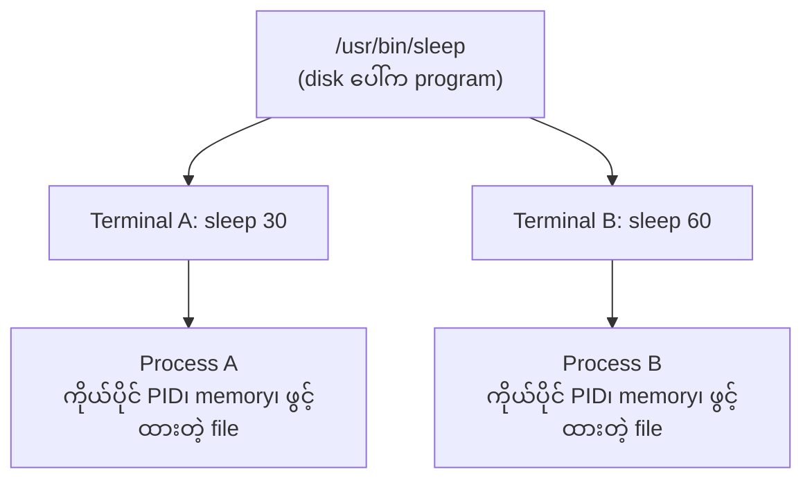
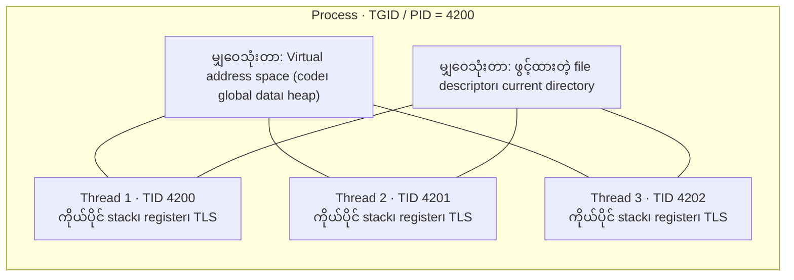
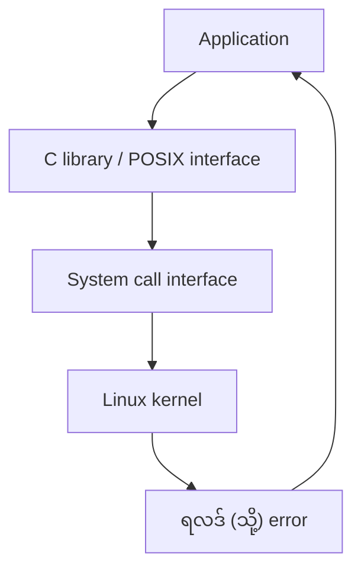
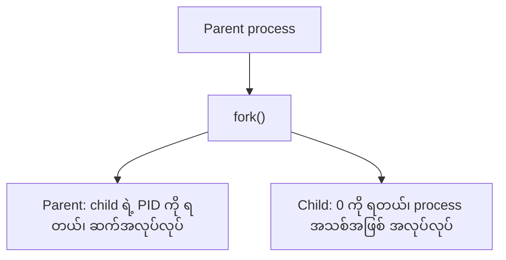
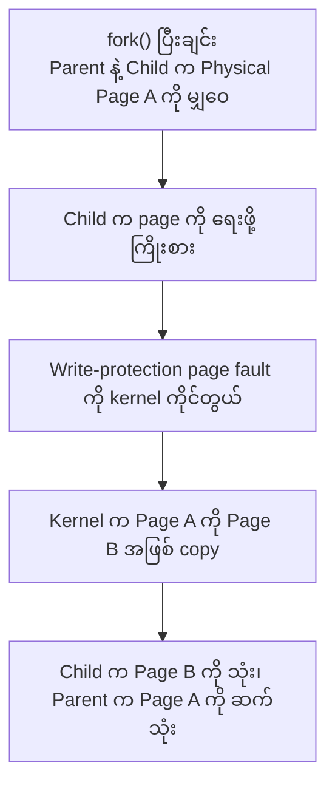
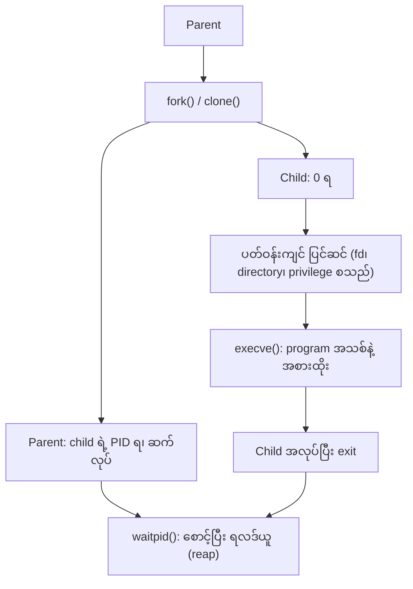
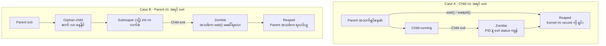
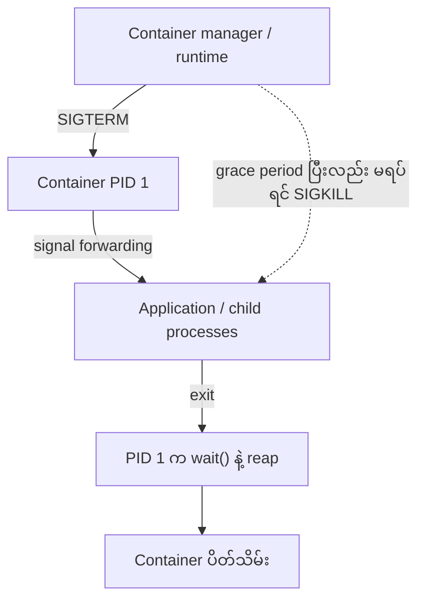
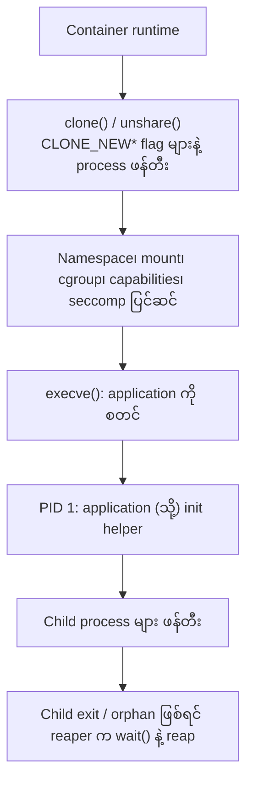

# Chapter 02 — Linux Processes and System Calls

> **Chapter status:** Revised manuscript — 11 November 2026  
> **Research snapshot:** 11 November 2026  
> **Lab status:** Designed, not tested

---

Chapter 01 မှာ ပုံမှန် Linux container ဟာ Linux kernel က စီမံပေးနေတဲ့ ပုံမှန် process ဖြစ်တယ်ဆိုတာ လေ့လာခဲ့ပါတယ်။ ဒီအခန်းမှာ အဲဒီ process ကို Linux က ဘယ်လို ဖန်တီးပြီး၊ စီမံပြီး၊ အဆုံးသတ်သလဲဆိုတာ ကြည့်ပါမယ်။ အဓိကအချက် သုံးချက်ကို အရင်မှတ်ထားပါ။
 
1. Container ထဲက application ကို စတင်တာဟာ process အသစ်တစ်ခု ဖန်တီးပြီး program ကို အစားထိုးတာ (`fork()`/`clone()` နဲ့ `execve()`) ပါပဲ။ Container runtime က အဲဒီအလုပ်ကို namespace၊ cgroups စတဲ့ kernel feature တွေနဲ့ ပေါင်းစပ်ပြီး လုပ်ပါတယ်။
2. Process တစ်ခုရဲ့ lifecycle (ဖန်တီး → program အစားထိုး → ပြီးဆုံး → parent က ရလဒ်ယူ) ကို နားလည်ရင် zombie နဲ့ orphan process တွေကို နားလည်သွားပါမယ်။
3. Container ထဲက PID 1 မှာ တခြား process တွေနဲ့ မတူတဲ့ တာဝန်နဲ့ signal စည်းမျဉ်း ရှိပါတယ်။ ဒါကြောင့် container ကို ရပ်တဲ့အခါ application တချို့ အချိန်စောင့်ပြီးမှ ရပ်တာမျိုး ဖြစ်ရတာပါ။
ဒီအခန်းကို ဖတ်ပြီးရင် အောက်ပါတို့ကို ကိုယ့်စကားနဲ့ ရှင်းပြနိုင်ရပါမယ်။
 
- Program၊ process၊ thread ရဲ့ ကွာခြားချက်
- PID၊ PPID၊ TGID၊ TID ဆိုတာ ဘာလဲ
- Library function နဲ့ system call ရဲ့ ကွာခြားချက်
- `fork()`၊ `clone()`၊ `execve()`၊ `waitpid()` တို့ ဘာလုပ်သလဲ၊ `fork` နဲ့ `exec` ကို ဘာကြောင့် ခွဲထားသလဲ
- Zombie process နဲ့ orphan process ရဲ့ ကွာခြားချက်
- Container ထဲက PID 1 ဘာကြောင့် အထူးလဲ
- `/proc` နဲ့ `strace` ကို သုံးပြီး process ကို ဘယ်လို စစ်ဆေးမလဲ
**ကြိုသိထားရန်:** Linux terminal ကို အနည်းငယ်သုံးဖူးပြီး file၊ directory၊ `cd`၊ `ls` ကို သိရင် လုံလောက်ပါတယ်။ C programming ကို ကျွမ်းကျင်ဖို့ မလိုပါဘူး။ ဒီအခန်းရဲ့ အဓိကလမ်းကြောင်းမှာ container နားလည်ဖို့ မဖြစ်မနေလိုတဲ့ အချက်တွေကိုပဲ ထည့်ထားပါတယ်။ ပိုနက်ရှိုင်းတဲ့ အသေးစိတ်တွေကို အခန်းအဆုံးက **§19 Going deeper** မှာ စုထားပါတယ်။ ဒီအခန်းမှာ Linux scheduler အတွင်းပိုင်း၊ kernel source code၊ thread synchronization ကို မချဲ့ပါဘူး။ Namespace တစ်ခုချင်းစီကို Chapter 03 မှာ လေ့လာပါမယ်။
 
## 1. Container နားလည်ဖို့ Process ကို ဘာကြောင့် သိထားရမလဲ
 
Container ထဲမှာ application တစ်ခုကို စတင်လိုက်တဲ့အခါ Linux kernel က အဲဒီ application ကို ဘယ်လို စီမံပေးသလဲ။ Process အသစ်တစ်ခုကို ဘယ်လို ဖန်တီးသလဲ။ Process တစ်ခုက program တစ်ခုကို အစားထိုး run တဲ့အခါ မူလ process ဆီက ဘာတွေ ဆက်ရှိနေသလဲ။ အလုပ်ပြီးသွားတဲ့ process တွေကို ဘယ်သူက ရှင်းပေးသလဲ။
 
Container runtime တစ်ခုက နောက်ဆုံးမှာ ဒီမေးခွန်းတွေရဲ့ အဖြေဖြစ်တဲ့ kernel လုပ်ဆောင်ချက်တွေ (process ဖန်တီးခြင်း၊ namespace သတ်မှတ်ခြင်း၊ signal ပို့ခြင်း၊ resource စီမံခြင်း) ကိုပဲ သုံးပြီး application ကို စတင်ပေးတာပါ။ ဒါကြောင့် container ကို နက်နက်ရှိုင်းရှိုင်း နားလည်ချင်ရင် process ဆိုတာ ဘာလဲ၊ ဘယ်လို ဖန်တီးသလဲ၊ ဘယ်လို အဆုံးသတ်သလဲဆိုတာကို အရင်သိထားဖို့ လိုပါတယ်။
 
## 2. Program နဲ့ Process ဘာကွာသလဲ
 
**Program** ဆိုတာ disk ထဲမှာ သိမ်းထားတဲ့ executable file (သို့) script ပါ။ ဥပမာ `/usr/bin/sleep` က `sleep` program ကို run ဖို့ သိမ်းထားတဲ့ file ပါ။
 
**Process** ဆိုတာ အဲဒီ program ကို စ run လိုက်တဲ့အခါ ဖြစ်လာတဲ့ အလုပ်လုပ်နေတဲ့ instance ပါ။ Kernel က process တစ်ခုစီအတွက် memory၊ ဖွင့်ထားတဲ့ file၊ ကိုယ်ပိုင် ID၊ CPU ပေါ်မှာ ဆက်လုပ်နိုင်ဖို့ လိုတဲ့ လက်ရှိအခြေအနေ၊ ဘယ် user နဲ့ run နေသလဲ၊ permission၊ signal setting စတာတွေကို စီမံထားပါတယ်။
 
Terminal တစ်ခုမှာ `sleep 30` နဲ့ နောက် terminal တစ်ခုမှာ `sleep 60` ကို run လိုက်တယ်ဆိုပါစို့။ နှစ်ခုစလုံးက `/usr/bin/sleep` ဆိုတဲ့ program file တစ်ခုတည်းကို သုံးပေမဲ့ တကယ်အလုပ်လုပ်နေတဲ့ process က နှစ်ခု ဖြစ်ပါတယ်။
 

 
Program တစ်ခုက process အများကြီး ဖြစ်လာနိုင်ပါတယ်။ Process တစ်ခုစီမှာ ကိုယ်ပိုင် PID နဲ့ ကိုယ်ပိုင်အခြေအနေ ရှိပါတယ်။ Kernel က process တွေကို CPU အချိန်ခွဲပေးတာ၊ memory စီမံတာ၊ တစ်ခုနဲ့တစ်ခု မလိုအပ်ဘဲ ဝင်မထိခိုက်အောင် ကာကွယ်တာတွေကို လုပ်ပေးပါတယ်။
 
## 3. PID၊ PPID နဲ့ Process Tree
 
Linux မှာ process တစ်ခုစီကို ခွဲခြားဖို့ နံပါတ်တစ်ခု သတ်မှတ်ထားပါတယ်။ အဲဒါကို **PID** (Process ID) လို့ ခေါ်ပါတယ်။ Process တစ်ခုကို ဖန်တီးခဲ့တဲ့ မူလ process ရဲ့ PID ကိုတော့ **PPID** (Parent Process ID) လို့ ခေါ်ပါတယ်။
 
Process တစ်ခုက နောက်ထပ် process တစ်ခုကို ဖန်တီးနိုင်လို့ parent နဲ့ child ဆက်နွယ်မှုတွေ ဖြစ်လာပါတယ်။ အဲဒီဆက်နွယ်မှုတွေကို စုကြည့်ရင် သစ်ပင်ပုံစံ ရတဲ့အတွက် **process tree** လို့ ခေါ်ပါတယ်။ ဥပမာ terminal emulator က shell ကို စတင်ပေးပြီး၊ shell ကနေ `ps` (သို့) `sleep` လို command ကို run လိုက်ရင် shell က child process တစ်ခု ဖန်တီးပါတယ်။
 
ကိုယ့်လက်ရှိ shell ရဲ့ PID နဲ့ PPID ကို ကြည့်ချင်ရင် -
 
```
ps -o pid,ppid,stat,comm,args -p "$$"
```
 
`$$` က shell က လက်ရှိ shell process ရဲ့ PID အဖြစ် အစားထိုးပေးတဲ့ အထူး parameter ပါ။ Process tree ကို ပုံစံနဲ့ ကြည့်ချင်ရင် `ps -eo pid,ppid,stat,comm --forest` ကို သုံးနိုင်ပါတယ်။
 
PID ကို process တစ်ခုရဲ့ အမြဲတမ်း ID လို့ မမှတ်ပါနဲ့။ Process အလုပ်ပြီးသွားရင် သူ့ PID ကို နောက် process အသစ်အတွက် ပြန်သုံးနိုင်ပါတယ်။ PID namespace တွေ ရှိရင် process တစ်ခုတည်းကို namespace မတူတဲ့နေရာကနေ ကြည့်ရင် PID နံပါတ် မတူနိုင်ပါဘူး။ ဒီအကြောင်းကို §11 နဲ့ Chapter 03 မှာ ပြန်ကြည့်ပါမယ်။
 
## 4. Process နဲ့ Thread
 
Browser၊ web server၊ database လို program တွေက အလုပ်တစ်ခုထက်ပိုပြီး တစ်ပြိုင်နက် လုပ်ရတတ်ပါတယ်။ ဒီအတွက် **thread** တွေကို သုံးပါတယ်။ Process ကို application တစ်ခုရဲ့ အလုပ်လုပ်နေတဲ့ ပတ်ဝန်းကျင်လို့ မြင်ရင် thread ဆိုတာ အဲဒီအတွင်းက အလုပ်လုပ်နေတဲ့ လမ်းကြောင်းတစ်ခုပါ။ Process တစ်ခုမှာ thread တစ်ခုတည်း (သို့) အများကြီး ရှိနိုင်ပါတယ်။
 
Linux kernel အမြင်မှာ thread တစ်ခုချင်းစီက သီးခြား task တစ်ခုပါ။ ဒါပေမဲ့ process တစ်ခုတည်းအတွင်းက thread တွေက memory space၊ ဖွင့်ထားတဲ့ file စာရင်းနဲ့ တခြား resource တချို့ကို မျှဝေသုံးနိုင်ပါတယ် [5]။ Thread A က memory ထဲက data ကို ပြောင်းလိုက်ရင် Thread B ကလည်း မြင်ရပါတယ်။ ဒါက data ဖလှယ်ဖို့ လွယ်စေပေမဲ့ thread အများကြီးက data တစ်ခုတည်းကို တစ်ပြိုင်နက် ပြောင်းရင် race condition ဖြစ်နိုင်လို့ mutex လို synchronization ကို သုံးရပါတယ်။
 
Linux မှာ thread တစ်ခုချင်းစီကို **TID** (Thread ID) နဲ့ ခွဲခြားပါတယ်။ Process တစ်ခုလုံး (thread group) ကို ကိုယ်စားပြုတဲ့ နံပါတ်က **TGID** ဖြစ်ပါတယ်။ ပုံမှန်အားဖြင့် `getpid()` က TGID (ကျွန်တော်တို့ ပြောနေကျ PID) ကို ပြန်ပေးပြီး `gettid()` က လက်ရှိ thread ရဲ့ TID ကို ပြန်ပေးပါတယ် [6][7]။ Thread တစ်ခုတည်းရှိတဲ့ process မှာ PID နဲ့ TID တူပြီး thread များလာရင် TID တွေ မတူတော့ပါဘူး။
 

 
| အချက် | Process | Thread (process တစ်ခုအတွင်း) |
|---|---|---|
| Memory | ပုံမှန်အားဖြင့် ကိုယ်ပိုင် virtual address space ရှိတယ် | Process ရဲ့ address space ကို မျှဝေသုံးတယ် |
| Identity | PID / TGID | Thread တစ်ခုစီမှာ ကိုယ်ပိုင် TID |
| Execution state | Thread တစ်ခု (သို့) အများကြီး ပါနိုင်တယ် | ကိုယ်ပိုင် stack၊ register state၊ TLS |
| Data ဖလှယ်ပုံ | IPC (သို့) shared memory သုံးရတယ် | Shared memory ကနေ တိုက်ရိုက်ဖလှယ်နိုင်ပေမဲ့ synchronization လိုတယ် |
 
`ps` မှာ process တစ်ခုလို့ မြင်ရပေမဲ့ အတွင်းမှာ thread အများကြီး ရှိနိုင်ပါတယ်။ Thread တွေကို ကြည့်ချင်ရင် `ps -T -p PID` (သို့) `/proc/PID/task/` ကို သုံးနိုင်ပါတယ်။
 
## 5. System Call ဆိုတာ ဘာလဲ
 
Application တစ်ခုက file ဖတ်တာ၊ process အသစ်ဖန်တီးတာ၊ memory တောင်းတာ၊ network socket သုံးတာလို အလုပ်တွေကို လုပ်ဖို့ လိုပါတယ်။ ဒါပေမဲ့ application က kernel ရဲ့ အတွင်းပိုင်းကို ကိုယ့်သဘောနဲ့ ဝင်မပြင်ရပါဘူး။ ဒါက system ရဲ့ လုံခြုံရေးနဲ့ တည်ငြိမ်မှုကို ထိန်းဖို့ပါ။ Application က kernel ရဲ့ ဝန်ဆောင်မှုတစ်ခု လိုလာရင် သတ်မှတ်ထားတဲ့ interface ကနေ တောင်းဆိုရပါတယ်။ အဲဒီ interface ကို **system call** လို့ ခေါ်ပါတယ်။
 
System call တစ်ခုကို ခေါ်လိုက်ရင် CPU က application အလုပ်လုပ်တဲ့ user mode ကနေ kernel mode ကို ကူးပါတယ်။ Kernel က တောင်းဆိုချက်ကို စစ်ဆေးပြီး ခွင့်ပြုရင် အလုပ်လုပ်ပေးကာ ရလဒ် (သို့) error ကို ပြန်ပေးပါတယ်။
 

 
Application အများစုက system call ကို တိုက်ရိုက်မခေါ်ဘဲ C library (သို့) POSIX interface ကနေ ခေါ်ကြပါတယ်။ ဥပမာ `printf()` က စာသားပုံစံပြင်ပေးတဲ့ C library function ပါ။ Terminal ဆီ စာသားကို တကယ်ရေးတဲ့အချိန်မှာ အောက်ခံက `write()` system call ကို ခေါ်နိုင်ပါတယ်။ `malloc()` ကလည်း library function ဖြစ်ပြီး memory အသစ် တကယ်လိုမှ `brk()` (သို့) `mmap()` ကို ခေါ်နိုင်ပါတယ်။ ဒါကြောင့် **library function တစ်ခု ခေါ်တိုင်း system call တစ်ခုတိတိ မဖြစ်ပါဘူး။** Source code ထဲက function name နဲ့ kernel ဆီ တကယ်ဝင်တဲ့ system call name မတူနိုင်တာကို `strace` သုံးတဲ့အခါ (§13) မြင်ရပါလိမ့်မယ်။
 
Process နဲ့ ဆိုင်တဲ့ အဓိက function တွေကို အောက်မှာ စုထားပါတယ်။
 
| Function | အမျိုးအစား | အဓိကအလုပ် | မှတ်ချက် |
|---|---|---|---|
| `fork()` | POSIX / C library | လက်ရှိ process ကနေ child ဖန်တီးတယ် | Linux/glibc မှာ အောက်ခံ `clone()` ကို သုံးနိုင်လို့ `strace` မှာ `clone` ပေါ်နိုင်တယ် |
| `clone()` | Linux-specific | Child ဖန်တီးတဲ့အခါ ဘာတွေ မျှဝေမလဲ flag နဲ့ ထိန်းတယ် | Thread နဲ့ container runtime တွေ သုံးတယ် (§7) |
| `clone3()` | Linux 5.3+ system call | `clone()` ရဲ့ argument ပေးပုံ ပိုစနစ်ကျတဲ့ ပုံစံအသစ် | glibc မှာ သီးခြား wrapper မရှိ (§19.2) |
| `execve()` | System call | လက်ရှိ process ထဲက program ကို အစားထိုးတယ် | `execlp()`၊ `execvp()` က library wrapper တွေ |
| `wait()`၊ `waitpid()` | POSIX | Child ပြီးဆုံးမှုကို စောင့်ပြီး ရလဒ်ယူတယ် | `strace` မှာ `wait4()` (သို့) `waitid()` အဖြစ် ပေါ်နိုင်တယ် |
| `exit()`၊ `_exit()` | C library / POSIX | Process ကို အဆုံးသတ်တယ် | `exit()` က C library cleanup လုပ်တယ်၊ `_exit()` မလုပ်ဘူး (§19.4) |
| `getpid()`၊ `getppid()`၊ `gettid()` | System call | PID၊ PPID၊ TID ပြန်ပေးတယ် | `gettid()` က Linux-specific |
| `kill()` | System call | Process ဆီ signal ပို့တယ် | Signal ပို့တာနဲ့ process ချက်ချင်း မရပ်ဘူး (§10) |
 
Kernel ထဲဝင်တဲ့ ဒီတံခါးပေါက်မှာပဲ Chapter 01 မှာ ပြောခဲ့တဲ့ seccomp က ဘယ် system call ကို ခွင့်ပြုမလဲဆိုတာ filter လုပ်ပါတယ်။ အဲဒီအကြောင်းကို container security chapter (Chapter 14) မှာ ပြန်ကြည့်ပါမယ်။
 
## 6. `fork()` — Child process ဖန်တီးခြင်း
 
Linux မှာ process အသစ်ဖန်တီးဖို့ အသုံးများတဲ့ interface တစ်ခုက `fork()` ပါ။ `fork()` ကို ခေါ်လိုက်ရင် လက်ရှိ process (parent) ကနေ child process အသစ်တစ်ခု ဖန်တီးပေးပြီး parent နဲ့ child နှစ်ခုစလုံးက `fork()` ခေါ်ခဲ့တဲ့နေရာကနေ ဆက်အလုပ်လုပ်ကြပါတယ် [1]။
 
`fork()` ရဲ့ စိတ်ဝင်စားစရာကောင်းတဲ့ အချက်က parent နဲ့ child မှာ return value မတူတာပါ။
 
- **Parent ထဲမှာ:** child ရဲ့ PID ကို ပြန်ပေးတယ်။
- **Child ထဲမှာ:** `0` ကို ပြန်ပေးတယ်။
- **မအောင်မြင်ရင်:** parent ဘက်မှာ `-1` ပြန်ပေးပြီး error အကြောင်းရင်းကို `errno` ထဲ သတ်မှတ်တယ်။

 
### 6.1 Copy-on-Write (CoW)
 
`fork()` ခေါ်တဲ့အခါ parent ရဲ့ memory အားလုံးကို child အတွက် ချက်ချင်းကူးပေးတာ မဟုတ်ပါဘူး။ Linux က **copy-on-write** နည်းလမ်းကို သုံးပြီး အစပိုင်းမှာ parent နဲ့ child ရဲ့ private memory page တွေကို အတူမျှဝေသုံးစေပါတယ်။ တစ်ဖက်ဖက်က အဲဒီ page ကို ရေးဖို့ ကြိုးစားတဲ့အခါမှ kernel က သက်ဆိုင်ရာ page ကို ကူးပေးပါတယ် [1]။
 
စာအုပ်တစ်အုပ်ကို လူနှစ်ယောက် အတူဖတ်နေတယ်လို့ စဉ်းစားကြည့်ပါ။ တစ်ယောက်က စာအုပ်ထဲမှာ ရေးချင်လာတဲ့အခါ မူရင်းကို မပြောင်းဘဲ ကိုယ်ပိုင်မိတ္တူတစ်ခု လုပ်ပြီး ရေးပါတယ်။ CoW ကလည်း အဲဒီသဘောပါပဲ။
 

 
ဒီ page fault က application အတွက် ပြဿနာ မဟုတ်ဘဲ kernel က နောက်ကွယ်မှာ ကိုင်တွယ်ပေးတဲ့ လုပ်ငန်းစဉ်ပါ။ Memory အားလုံးကို ချက်ချင်းကူးစရာ မလိုတော့ပေမဲ့ `fork()` ကုန်ကျစရိတ် လုံးဝမရှိဘူးလို့ မဆိုလိုပါဘူး။ Page table နဲ့ process အချက်အလက်တွေ ပြင်ဆင်ရတာ ရှိနေပါတယ်။
 
Child process က parent ရဲ့ file descriptor စာရင်းကိုလည်း ဆက်ခံပါတယ်။ ဒါပေမဲ့ parent နဲ့ child ရဲ့ descriptor တွေက kernel ထဲက open file description တစ်ခုတည်းကို ညွှန်းနေနိုင်လို့ file offset လို အချက်တချို့ကို အတူမျှဝေသုံးနိုင်ပါတယ် [1]။
 
Thread အများကြီးရှိတဲ့ process က `fork()` ခေါ်တဲ့အခါ child ထဲမှာ ဘာဖြစ်သလဲဆိုတာကို §19.1 မှာ ကြည့်နိုင်ပါတယ်။
 
## 7. `clone()` နဲ့ `clone3()`
 
`fork()` က parent ကို အခြေခံပြီး child အသစ်တစ်ခု ဖန်တီးပေးပါတယ်။ ဒါပေမဲ့ container တစ်ခု ဖန်တီးတဲ့အခါ process အသစ်တစ်ခု ရရုံနဲ့ မလုံလောက်ပါဘူး။ Parent နဲ့ child ကြား memory၊ file နဲ့ တခြား resource တွေကို ဘယ်လို မျှဝေမလဲ၊ child ကို ဘယ် namespace အသစ်ထဲမှာ စမလဲဆိုတာကိုပါ ထိန်းချုပ်ဖို့ လိုပါတယ်။
 
ဒီလို အသေးစိတ် ထိန်းချုပ်နိုင်တဲ့ Linux interface က `clone()` ပါ။ Flag တွေကို သုံးပြီး ဘာတွေကို မျှဝေမလဲ၊ ဘာတွေကို သီးခြားထားမလဲ သတ်မှတ်ပါတယ် [2]။ အသုံးများတဲ့ flag တချို့ကို ကြည့်ပါ။
 
| Flag | ဆိုလိုရင်း |
|---|---|
| `CLONE_VM` | Parent နဲ့ child ကြား virtual memory space ကို မျှဝေသုံးတယ် |
| `CLONE_FILES` | File descriptor table ကို မျှဝေသုံးတယ် |
| `CLONE_FS` | Current/root directory စတဲ့ filesystem context ကို မျှဝေသုံးတယ် |
| `CLONE_SIGHAND` | Signal handler table ကို မျှဝေသုံးတယ် |
| `CLONE_THREAD` | Child ကို caller ရဲ့ thread group ထဲ ထည့်တယ် (thread ဖန်တီးတာ) |
| `CLONE_NEWPID` | Child ကို PID namespace အသစ်ထဲမှာ စတင်စေတယ် |
| `CLONE_NEWNS` | Mount namespace အသစ် ဖန်တီးတယ် |
| `CLONE_NEWNET` | Network namespace အသစ် ဖန်တီးတယ် |
 
ဒီ flag တွေကို ကြည့်ရင် အယူအဆနှစ်ခု မြင်ရပါတယ်။ **Thread** ကို `clone()` နဲ့ `CLONE_VM`၊ `CLONE_FILES`၊ `CLONE_THREAD` စတဲ့ မျှဝေတဲ့ flag တွေပေါင်းပြီး ဖန်တီးပါတယ်။ **Container process** ကို `CLONE_NEWPID`၊ `CLONE_NEWNET` စတဲ့ `CLONE_NEW*` flag တွေနဲ့ ဖန်တီးနိုင်ပါတယ်။
 
ဒါပေမဲ့ `clone()` တစ်ကြောင်းခေါ်လိုက်တာနဲ့ container အပြည့်အစုံ ဖြစ်သွားတာ မဟုတ်ပါဘူး။ Root filesystem ပြင်ဆင်ခြင်း၊ mount လုပ်ခြင်း၊ cgroup ထဲထည့်ခြင်း၊ user နဲ့ permission သတ်မှတ်ခြင်း၊ security policy အသုံးချခြင်း၊ network ပြင်ဆင်ခြင်းတို့ကိုပါ ဆက်လုပ်ရပါတယ်။ ဒီ mechanism တွေကို နောက်လာမယ့် chapter တွေမှာ လေ့လာပါမယ်။
 
`clone3()` က `clone()` ထက် argument တွေကို `struct clone_args` နဲ့ ပိုစနစ်တကျ ပေးပို့နိုင်တဲ့ interface အသစ်ပါ။ Linux 5.3 မှာ စတင်ထည့်သွင်းခဲ့ပါတယ် [2]။ Flag တွေရဲ့ မျှဝေရာမှာ မကိုက်ညီတဲ့ ပေါင်းစပ်မှုတွေ (dependency) ကို kernel က ပယ်တာ၊ glibc wrapper နဲ့ raw system call ရဲ့ ကွာခြားချက်၊ `clone3()` ရဲ့ `ENOSYS` ကိစ္စတွေကို §19.2 မှာ ကြည့်ပါ။
 
## 8. `execve()` — Program အသစ်နဲ့ အစားထိုး Run ခြင်း
 
`fork()` နဲ့ child ဖန်တီးပြီးတဲ့အခါ အဲဒီ child ထဲမှာ program တစ်ခုကို run စေချင်ရင် `execve()` ကို သုံးပါတယ် [3]။ `execve()` ဟာ **process အသစ်ကို ဖန်တီးတာ မဟုတ်ပါဘူး။** လက်ရှိ process ထဲက program ကို အစားထိုးပေးတာပါ။ ဥပမာ terminal မှာ `ls` လို့ ရိုက်လိုက်ရင် shell က child process တစ်ခု ဖန်တီးပြီး အဲဒီ child ထဲမှာ `ls` program ကို `execve()` နဲ့ အစားထိုးပါတယ်။
 
`execve()` မှာ argument သုံးခု ရှိပါတယ်။ Run မယ့် executable file ရဲ့ path၊ program အသစ်ကို ပေးမယ့် argument စာရင်း၊ environment variable စာရင်းတို့ပါ။ C program တွေမှာ တွေ့ရတဲ့ `execlp()`၊ `execvp()` တို့က `exec` family ထဲက library interface တွေဖြစ်ပြီး `PATH` ထဲမှာ program ကို ရှာပေးတာလို အဆင်ပြေစေတဲ့ လုပ်ဆောင်ချက်တွေ ပါနိုင်ပါတယ်။
 
`execve()` အောင်မြင်ရင် မူလ program ရဲ့ နောက်က code တွေကို ဆက်မလုပ်တော့ပါဘူး။ Program image အသစ်ထဲ ရောက်သွားပါပြီ။ ဒါကြောင့် `execve()` နောက်မှာ ရေးထားတဲ့ code က ပုံမှန်အားဖြင့် `execve()` မအောင်မြင်တဲ့အခါ error ကို ကိုင်တွယ်ဖို့ သက်သက်ပါ။
 
`execve()` ပြီးတဲ့အခါ process ရဲ့ အရာအားလုံး အသစ်ပြောင်းသွားတာ မဟုတ်ပါဘူး။ အရေးကြီးတဲ့ အချက်တွေကို အောက်မှာ စုထားပါတယ် [3]။
 
| ဆက်ရှိနေတာ | Program အသစ်အတွက် ပြောင်းသွားတာ |
|---|---|
| PID နဲ့ parent ဆက်နွယ်မှု | Program ရဲ့ code၊ data၊ heap၊ stack ကို ပြန်တည်ဆောက်တယ် |
| Namespace နဲ့ cgroup membership | Caught signal handler တွေကို default အခြေအနေ ပြန်သတ်မှတ်တယ် (ignored ထားတာတွေက ဆက် ignored ဖြစ်နိုင်တယ်) |
| Current/root directory၊ umask၊ resource limit | Multithreaded process မှာ `execve()` ခေါ်တဲ့ thread မဟုတ်တဲ့ thread တွေ ပျက်သွားတယ် |
| Process group နဲ့ session အချက်အလက် | `FD_CLOEXEC` သတ်မှတ်ထားတဲ့ file descriptor တွေကို ပိတ်တယ် |
| ဖွင့်ထားတဲ့ file descriptor (`FD_CLOEXEC` မပါတာ) | `atexit()` handler တွေ Program အသစ်ထဲ မလိုက်ဘူး |
 
ဒီအချက်တွေကြောင့် `execve()` က program code ကိုသာ ပြောင်းပေးပြီး ကျန်တာအားလုံးကို မထိဘူးလို့ မယူဆပါနဲ့။ Set-user-ID program တွေနဲ့ capability ပြောင်းလဲမှုလို အသေးစိတ်တွေကို §19.3 မှာ ကြည့်ပါ။
 
> **ဘာကြောင့် `fork` နဲ့ `exec` ကို ခွဲထားသလဲ။** Process အသစ်ဖန်တီးတာနဲ့ program အသစ်ကို run တာကို အဆင့်နှစ်ခု ခွဲထားတဲ့အတွက် child က `fork()` နဲ့ `execve()` ကြားမှာ ကိုယ့်ပတ်ဝန်းကျင်ကို ပြင်ဆင်နိုင်ပါတယ်။ ဥပမာ file descriptor ပြောင်းတာ (shell ရဲ့ `>` redirect)၊ working directory ပြောင်းတာ၊ privilege လျှော့တာ၊ namespace ထဲဝင်တာတွေကို လုပ်ပြီးမှ program ကို စတင်နိုင်ပါတယ်။ Container runtime မှာလည်း application မစတင်ခင် namespace၊ mount၊ cgroup၊ permission တွေကို ပြင်ဆင်ပြီးမှ `execve()` နဲ့ application ကို စတင်ပါတယ်။ Chapter 01 မှာ OCI runtime က `create` (ပြင်ဆင်) နဲ့ `start` (စတင်) ကို ခွဲထားတာနဲ့လည်း အယူအဆ ဆင်ပါတယ် [17]။ အတိအကျ ဘယ်လို အကောင်အထည်ဖော်သလဲက runtime အလိုက် ကွာနိုင်ပါတယ်။
 
Parent–child lifecycle တစ်ခုလုံးကို အကျဉ်းချုပ်ကြည့်ရင် -
 

 
## 9. Child process ကို စောင့်ခြင်း၊ Zombie နဲ့ Orphan
 
### 9.1 `wait()` နဲ့ `waitpid()`
 
Parent process က child ကို ဖန်တီးပြီးရင် child ဘယ်အချိန် ပြီးသလဲ၊ ပုံမှန်ပြီးသလား၊ error (သို့) signal ကြောင့် ရပ်သွားသလားဆိုတာ သိဖို့ လိုပါတယ်။ Child ပြီးသွားတဲ့အခါ kernel က parent ပြန်ယူနိုင်ဖို့ ပြီးဆုံးမှုအချက်အလက်တချို့ကို ခဏထိန်းထားပါတယ်။ Parent က `wait()` (သို့) `waitpid()` ကို ခေါ်ပြီး အဲဒီအချက်အလက်ကို ရယူတာကို **reap** လုပ်တယ်လို့ ခေါ်ပါတယ် [4]။
 
`wait()` က child တစ်ခုခု ပြီးတာကို စောင့်ပါတယ်။ `waitpid()` ကတော့ ဘယ် child ကို စောင့်မလဲ ရွေးနိုင်ပြီး `WNOHANG` option နဲ့ မပြီးသေးရင် ချက်ချင်းပြန်လာအောင်လည်း လုပ်နိုင်ပါတယ်။ ပြီးဆုံးမှုအခြေအနေကို `WIFEXITED(status)`၊ `WEXITSTATUS(status)`၊ `WIFSIGNALED(status)` လို macro တွေနဲ့ စစ်ပါ။ Status နံပါတ်ကို ကိုယ့်ဘာသာ အပိုင်းခွဲဖော်တာထက် ဒီ macro တွေက ပိုသင့်တော်ပါတယ်။
 
### 9.2 Zombie process
 
Child process အလုပ်ပြီးသွားပေမဲ့ parent က `wait()`/`waitpid()` မခေါ်ရသေးရင် child ဟာ **zombie** state အဖြစ် ကျန်နေနိုင်ပါတယ်။ Zombie က အလုပ်ဆက်မလုပ်တော့ပါဘူး၊ code လည်း ဆက် run မနေတော့ပါဘူး။ Kernel က parent ပြန်ယူစရာ PID၊ exit status၊ resource အသုံးပြုမှု အချက်အလက်အနည်းငယ်ကိုပဲ ထိန်းထားတာပါ။ `ps` ရဲ့ `STAT` column မှာ `Z` လို့ ပေါ်ပါတယ်။
 
Zombie တစ်ခုနှစ်ခုက ကြီးမားတဲ့ ပြဿနာ မဟုတ်ပါဘူး။ ဒါပေမဲ့ parent က child တွေကို reap မလုပ်ဘဲ zombie တွေ စုပုံလာရင် PID တွေ ကုန်ပြီး process အသစ်ဖန်တီးဖို့ ခက်လာနိုင်ပါတယ်။ အလုပ်ကြာကြာ run တဲ့ application တွေက child ပြီးဆုံးမှုကို စနစ်တကျ reap လုပ်ဖို့ လိုပါတယ်။ Zombie ဟာ အလုပ်ပြီးပြီးသားမို့ `kill` နဲ့ ရှင်းလို့ မရပါဘူး။ Parent က `wait()` ခေါ်မှ (သို့) parent ရပ်သွားပြီး reaper ကနေ reap လုပ်မှ ပျောက်ပါတယ်။
 
### 9.3 Orphan process
 
Parent process က child မပြီးခင် အရင်ရပ်သွားတဲ့အခါ child က **orphan** ဖြစ်ပါတယ်။ Orphan က ဆက်အလုပ်လုပ်နေနိုင်ပါတယ်။ Linux က အဲဒီ child ကို အခြား reaper တစ်ခုဆီ ပြန်ချိတ်ပေးပါတယ်။ အနီးဆုံး ancestor တစ်ခုက `PR_SET_CHILD_SUBREAPER` ကို သတ်မှတ်ထားရင် အဲဒီ subreaper က လက်ခံပါတယ် [12]။ မရှိရင် parent ရှိခဲ့တဲ့ PID namespace ရဲ့ init process က လက်ခံပါတယ် [11]။ Container ထဲမှာ parent နဲ့ child က namespace တူတူမို့ ပုံမှန်အားဖြင့် အဲဒီ init က PID 1 ပါပဲ။ Namespace မတူတဲ့ ထူးခြားတဲ့ အခြေအနေကို Chapter 03 မှာ ပြန်ကြည့်ပါမယ်။
 

 
**Zombie** နဲ့ **orphan** ကို မရောပါနဲ့။ Zombie ဆိုတာ child ပြီးသွားပေမဲ့ parent က ရလဒ်မယူရသေးတဲ့ အခြေအနေပါ။ Orphan ဆိုတာ parent က အရင်ရပ်သွားလို့ ကျန်ခဲ့တဲ့ child ပါ။ Orphan ဟာ ဆက်အသက်ရှင်ပြီး အလုပ်လုပ်နေနိုင်ပါတယ်။ နောက်ပိုင်း ပြီးဆုံးတဲ့အခါ လက်ခံထားတဲ့ parent အသစ်က `wait()` မခေါ်မချင်း zombie အဖြစ် ခဏကျန်နိုင်ပါတယ်။
 
## 10. Signal တွေနဲ့ Process Lifecycle
 
**Signal** ဆိုတာ process (သို့) thread တစ်ခုဆီ ပို့တဲ့ အကြောင်းကြားချက်တစ်မျိုးပါ။ ပုံမှန် data message မဟုတ်ပါဘူး [10]။ ဥပမာ terminal မှာ program တစ်ခု run နေစဉ် `Ctrl+C` နှိပ်ရင် ပုံမှန်အားဖြင့် `SIGINT` ကို ပို့ပါတယ်။ Application က handler တပ်ထားရင် signal ကို ကိုင်တွယ်ပြီး ကိုယ်ပိုင်လုပ်ဆောင်ချက်တစ်ခု လုပ်နိုင်ပါတယ်။
 
| Signal | ဆိုလိုရင်း |
|---|---|
| `SIGTERM` | Process ကို အဆုံးသတ်ဖို့ တောင်းဆိုတယ်။ Application က handler တပ်ပြီး အလုပ်သိမ်း၊ data သိမ်းနိုင်တယ် |
| `SIGINT` | Terminal မှာ `Ctrl+C` နှိပ်ရင် ပို့လေ့ရှိတယ် |
| `SIGKILL` | Process ကို အဆုံးသတ်စေတယ်။ Catch၊ block၊ ignore မလုပ်နိုင်ဘူး |
| `SIGSTOP` | Process ကို ခဏရပ်စေတယ်။ Catch၊ block၊ ignore မလုပ်နိုင်ဘူး |
| `SIGCONT` | ရပ်ထားတဲ့ process ကို ပြန်အလုပ်လုပ်စေတယ် |
| `SIGCHLD` | Child ရဲ့ အခြေအနေ ပြောင်းသွားတဲ့အခါ parent ကို အသိပေးတယ် |
 
`SIGTERM` နဲ့ `SIGKILL` ကို သေချာခွဲပါ။ `SIGTERM` က application ကို အလုပ်သိမ်းပြီး ပုံမှန်ရပ်ခွင့်ပေးတဲ့ signal ပါ။ `SIGKILL` ကတော့ application ကို ကိုင်တွယ်ခွင့်မပေးဘဲ အဆုံးသတ်စေတဲ့ signal ပါ။ ဥပမာ database server ကို ရပ်ချင်ရင် ရေးနေတဲ့ data တွေကို သိမ်းနိုင်ဖို့ `SIGTERM` ကို အရင်ပို့ပြီး သတ်မှတ်ချိန်အတွင်း မရပ်မှသာ `SIGKILL` ကို နောက်ဆုံးနည်းလမ်းအဖြစ် စဉ်းစားသင့်ပါတယ်။
 
```
kill -TERM 1234
```
 
ဒီ command က PID 1234 ဆီ `SIGTERM` ပို့တာပါ။ Process ချက်ချင်း ပျောက်သွားမယ်လို့ အာမမခံပါဘူး၊ application က signal ကို ကိုင်တွယ်ပြီး ဆက်အလုပ်လုပ်နိုင်ပါတယ်။ PID မှားပြီး signal မပို့မိအောင် သတိထားပါ။ Signal ကို ပုံမှန် data message လို အကြိမ်ရေအတိုင်း လက်ခံရမယ်လို့လည်း မယူဆပါနဲ့ (§19.5)။
 
## 11. PID 1 နဲ့ Container အတွင်းက Init Process
 
### 11.1 Namespace ထဲက PID 1
 
Linux system စတင်တဲ့အခါ အစောဆုံး စတင်တဲ့ process က PID 1 ပါ။ ပုံမှန် host Linux မှာ `systemd` လို system manager က ဒီတာဝန်ကို ယူလေ့ရှိပါတယ်။ Container မှာ PID namespace အသစ် ဖန်တီးထားရင် အဲဒီ namespace ထဲက ပထမဆုံး process ကို PID 1 အဖြစ် မြင်ရပါတယ် [11]။ ဒါကြောင့် host မှာ PID 2500 ဖြစ်တဲ့ process တစ်ခုဟာ container ထဲမှာ PID 1 ဖြစ်နေနိုင်ပါတယ်။ နံပါတ်မတူပေမဲ့ process တစ်ခုတည်းပါ။
 
`CLONE_NEWPID` နဲ့ `clone()` ခေါ်ရင် namespace အသစ်ထဲ ဝင်သွားတာက `clone()` ကို ခေါ်တဲ့ မူလ process မဟုတ်ဘဲ ဖန်တီးလိုက်တဲ့ child ဖြစ်ပါတယ်။ အဲဒီ child နဲ့ သူ့ descendant တွေက namespace အသစ်ထဲက PID တွေကို မြင်ရပါတယ်။
 
### 11.2 PID 1 ရဲ့ တာဝန်နဲ့ အထူးစည်းမျဉ်း
 
PID namespace ထဲက PID 1 မှာ ပုံမှန် process တွေနဲ့ မတူတဲ့ အထူးအချက် သုံးချက် ရှိပါတယ်။
 
1. **Orphan တွေကို လက်ခံပြီး reap လုပ်ရတယ်။** Namespace ထဲက မူလ parent မရှိတော့တဲ့ child တွေက PID 1 ဆီ ရောက်လာပါတယ်။ PID 1 က `wait()` ခေါ်ပြီး reap မလုပ်ရင် zombie တွေ ကျန်နေပါလိမ့်မယ်။
2. **PID 1 ရပ်ရင် namespace တစ်ခုလုံး ပျက်တယ်။** PID 1 အဆုံးသတ်သွားရင် kernel က namespace ထဲက ကျန် process တွေကို `SIGKILL` နဲ့ အဆုံးသတ်ပါတယ်။ ပြီးရင် အဲဒီ namespace ထဲမှာ process အသစ်ဖန်တီးဖို့ ကြိုးစားရင် မအောင်မြင်တော့ပါဘူး [11]။
3. **Signal စည်းမျဉ်း မတူဘူး။** Namespace အတွင်းက တခြား process တစ်ခုက PID 1 ဆီ signal ပို့ရင် PID 1 က အဲဒီ signal အတွက် handler တပ်ထားမှသာ ရောက်ပါတယ်။ Privileged process တွေအတွက်လည်း ဒီစည်းမျဉ်း သက်ရောက်ပါတယ်။ ဒါကြောင့် **namespace အတွင်းကနေ PID 1 ဆီ `SIGKILL`/`SIGSTOP` ပို့လို့ မရပါဘူး** (ဥပမာ container ထဲမှာ `kill -9 1` လုပ်ရင် ဘာမှမဖြစ်ပါဘူး)။ အပြင်က ancestor PID namespace (ဥပမာ host) ကနေ ပို့ရင်တော့ `SIGKILL` နဲ့ `SIGSTOP` က handler မလိုဘဲ အလုပ်လုပ်ပါတယ်။ တခြား signal တွေအတွက်တော့ ဒီစည်းမျဉ်း ဆက်ရှိပါတယ် [11]။
ဒီအချက်ကြောင့် application ကို PID 1 အဖြစ် တိုက်ရိုက် run ထားပြီး `SIGTERM` handler မတပ်ထားရင် container manager က ပို့တဲ့ `SIGTERM` ကို ကျော်သွားနိုင်ပါတယ်။ Manager က grace period (Docker မှာ default 10 စက္ကန့်၊ ပြောင်းနိုင်ပါတယ်) စောင့်ပြီးမှ `SIGKILL` ပို့ပါတယ် [19]။
 
### 11.3 Signal forwarding နဲ့ Child တွေကို ရှင်းခြင်း
 
Container ကို ရပ်ချင်တဲ့အခါ manager (သို့) runtime က `SIGTERM` ကို အရင်ပို့ပြီး application ကို အလုပ်သိမ်းဖို့ အချိန်ပေးပါတယ်။ PID 1 က child application တွေရှိရင် signal ကို သူတို့ဆီ ဆက်ပို့ (**signal forwarding**) ပေးရပြီး child တွေပြီးသွားတဲ့အခါ `wait()` ခေါ်ပြီး reap လုပ်ရပါတယ်။
 

 
ဒီပုံက အသုံးများတဲ့ shutdown ပုံစံကို ရိုးရှင်းအောင် ပြထားတာပါ။ Grace period ဘယ်လောက်ထားမလဲ၊ signal ကို PID 1 ဆီပဲ ပို့မလား process group ဆီ ပို့မလား၊ ဘယ်အချိန် force stop လုပ်မလဲဆိုတာက engine၊ runtime နဲ့ configuration အလိုက် ကွာနိုင်ပါတယ်။
 
### 11.4 Init helper နဲ့ လက်တွေ့အကြံ
 
Application ကိုယ်တိုင် PID 1 တာဝန်ကို ထမ်းဆောင်နိုင်သလို `tini` လို သေးငယ်တဲ့ **init helper** ကို PID 1 အဖြစ် သုံးနိုင်ပါတယ်။ Init helper က main application ကို child အဖြစ် စတင်ပေးပြီး signal ကို forward လုပ်ပေးတာ၊ ပြီးသွားတဲ့ child တွေကို reap လုပ်ပေးတာကို ကူညီပါတယ် [18]။ Docker နဲ့ Podman တို့မှာ `--init` option ရှိပါတယ်။ ဒီနည်းနဲ့ application တစ်ခုချင်းစီမှာ PID 1 အတွက် signal handling နဲ့ reaping logic ကို ကိုယ်တိုင် ရေးစရာ မလိုတော့ပါဘူး။ ဒါပေမဲ့ container အားလုံးမှာ init helper မဖြစ်မနေ လိုတာ မဟုတ်ပါဘူး။ Application ကိုယ်တိုင်က signal နဲ့ reaping ကို မှန်ကန်စွာ လုပ်နိုင်ရင် မလိုပါဘူး။
 
**Dockerfile ရဲ့ shell form နဲ့ exec form** ကလည်း PID 1 ကို သက်ရောက်ပါတယ် [20]။
 
```
# shell form: /bin/sh -c "python app.py" ကို စတင်တယ်၊ shell က PID 1 ဖြစ်နိုင်တယ်
CMD python app.py
 
# exec form: python ကိုယ်တိုင် PID 1 ဖြစ်တယ်
CMD ["python", "app.py"]
```
 
Shell form မှာ shell က PID 1 ဖြစ်ပြီး signal ကို application ဆီ ဆက်မပို့တတ်တဲ့အတွက် `docker stop` က grace period ပြည့်တဲ့အထိ စောင့်ရတာမျိုး ဖြစ်နိုင်ပါတယ်။ Shell အမျိုးအစားနဲ့ script ရေးပုံအလိုက် ကွာနိုင်ပါတယ်။ ဒါကြောင့် exec form ကို သုံးတာ (သို့) shell script ထဲမှာ `exec` နဲ့ application ကို အစားထိုးတာက သင့်တော်ပါတယ်။ Image configuration ရဲ့ `Entrypoint`/`Cmd` ကို Chapter 01 မှာ မိတ်ဆက်ခဲ့ပြီး Chapter 09 မှာ ပိုအသေးစိတ် လေ့လာပါမယ်။
 
## 12. `/proc` မှာ Process အချက်အလက်တွေ ကြည့်ခြင်း
 
`/proc` ဟာ ပုံမှန် file တွေသိမ်းတဲ့ directory မဟုတ်ဘဲ kernel က system နဲ့ process တွေရဲ့ လက်ရှိအခြေအနေကို ဖတ်နိုင်အောင် ဖော်ပြပေးထားတဲ့ pseudo-filesystem ပါ [13]။ `/proc` အောက်မှာ process တစ်ခုစီအတွက် PID နံပါတ်နဲ့ directory တွေ ရှိပါတယ်။ အထဲက file တွေကို ဖတ်တဲ့အချိန်မှာ kernel က လက်ရှိအချက်အလက်ကို ပေးတာပါ။
 
| Path | ဘာကို ပြသလဲ |
|---|---|
| `/proc/PID/status` | Process အမည်၊ state၊ PID၊ PPID၊ thread အရေအတွက်၊ namespace ဆိုင်ရာ PID တွေ |
| `/proc/PID/stat` | State နဲ့ စာရင်းအင်း အချက်အလက် |
| `/proc/PID/cmdline` | Program စတင်တုန်းက ပေးခဲ့တဲ့ command argument တွေ |
| `/proc/PID/exe` | Executable file ကို ညွှန်တဲ့ symbolic link |
| `/proc/PID/cwd` | Process ရဲ့ လက်ရှိ working directory |
| `/proc/PID/fd/` | Process ဖွင့်ထားတဲ့ file descriptor တွေ |
| `/proc/PID/task/` | Process အတွင်းက thread တစ်ခုချင်းစီအတွက် directory |
 
ကိုယ့် shell ရဲ့ အချက်အလက်ထဲက အရေးကြီးတဲ့ field တချို့ကိုပဲ ရွေးကြည့်ချင်ရင် -
 
```
grep -E '^(Name|State|Tgid|Pid|PPid|Threads|NStgid|NSpid):' "/proc/$$/status"
```
 
ဒီ field တွေကို [14] မှာ ဖော်ပြထားပါတယ်။ `Tgid` က thread group ID (process တစ်ခုလုံးကို ကိုယ်စားပြု)၊ `Pid` က ဖတ်နေတဲ့ task ရဲ့ ID (thread တစ်ခုချင်းစီအတွက် TID ဖြစ်နိုင်)၊ `PPid` က parent ရဲ့ PID၊ `Threads` က thread group ထဲက thread အရေအတွက် ဖြစ်ပါတယ်။
 
Container နဲ့ namespace ကို နားလည်ဖို့ အရေးကြီးတာက `NStgid` နဲ့ `NSpid` ပါ။ `NStgid` က PID namespace အဆင့်ဆင့်မှာ အဲဒီ process ကို မြင်ရတဲ့ process ID တွေကို၊ `NSpid` က ဖတ်နေတဲ့ task ရဲ့ thread ID တွေကို namespace အလိုက် ဖော်ပြပါတယ်။ ဥပမာ host မှာ PID 2500 ဖြစ်ပြီး container ထဲမှာ PID 1 ဖြစ်တဲ့ process အတွက် နံပါတ်နှစ်ခုကို တွေ့နိုင်ပါတယ်။ `/proc` ကို ဘယ် PID namespace ကနေ ဖတ်နေသလဲ၊ namespace ဘယ်နှစ်ဆင့် ရှိသလဲပေါ် မူတည်ပြီး တွေ့ရတဲ့ နံပါတ်အရေအတွက် ကွာနိုင်ပါတယ်။ ဒီအကြောင်းကို Chapter 03 မှာ ပိုကြည့်ပါမယ်။
 
`NStgid`/`NSpid` မတွေ့တာနဲ့ PID namespace မရှိဘူးလို့ ချက်ချင်းမဆုံးဖြတ်ပါနဲ့။ Kernel version နဲ့ `/proc` ကို mount လုပ်ထားပုံပေါ် မူတည်နိုင်ပါတယ်။ တခြား user ရဲ့ process အချက်အလက်ကို ဖတ်ဖို့ permission လိုနိုင်ပြီး `hidepid` လို mount option တွေကလည်း မြင်နိုင်မှုကို ကန့်သတ်နိုင်ပါတယ်။
 
`ps` ရဲ့ `STAT` column (သို့) `/proc/PID/stat` ထဲက state အက္ခရာတွေ -
 
| State | ဆိုလိုရင်း |
|---|---|
| `R` | Running (သို့) CPU ရရင် run နိုင်တဲ့ အခြေအနေ |
| `S` | နှောင့်ယှက်ပြီး နိုးထစေနိုင်တဲ့ အလုပ်တစ်ခုကို စောင့်နေတယ် |
| `D` | များသောအားဖြင့် I/O လို အလုပ်တစ်ခုကို နှောင့်ယှက်လို့ မရတဲ့ အခြေအနေမှာ စောင့်နေတယ် |
| `T` | ရပ်ထားတဲ့ process (`t` က debugger နဲ့ trace လုပ်ရင်း ရပ်ထားတာ) |
| `Z` | Zombie |
| `I` | အချို့ kernel thread တွေရဲ့ idle state |
 
State အက္ခရာက process ရဲ့ လက်ရှိအခြေအနေကို အတိုချုပ်ပြတာသာ ဖြစ်ပါတယ်။ ဘာကြောင့် အဲဒီအခြေအနေ ရောက်နေသလဲဆိုတာ သိဖို့ တခြားအချက်အလက်တွေနဲ့ တွဲစစ်ရပါတယ်။
 
## 13. `strace` နဲ့ System Call တွေကို ကြည့်ခြင်း
 
`ps` နဲ့ `/proc` က process ရဲ့ လက်ရှိအခြေအနေကို ပြပါတယ်။ Process တစ်ခု အလုပ်လုပ်နေစဉ် kernel ဆီ ဘာတောင်းဆိုနေသလဲ၊ ဘယ်အစီအစဉ်နဲ့ process အသစ်ဖန်တီးသလဲ၊ program အသစ်ကို ဘယ်အချိန် အစားထိုးသလဲဆိုတာ ကြည့်ချင်ရင် `strace` ကို သုံးပါတယ် [15]။ `strace` က process တွေရဲ့ system call၊ argument၊ ပြန်ရတဲ့ result နဲ့ signal တချို့ကို မှတ်တမ်းတင်ပေးတဲ့ diagnostic tool ပါ။
 
```
strace -f -e trace=%process sh -c 'sleep 1; echo finished'
```
 
`-f` က child process တွေကိုပါ လိုက်စစ်ပါတယ်။ `-e trace=%process` က process ဖန်တီးခြင်း၊ program အစားထိုးခြင်း၊ process အဆုံးသတ်ခြင်း ဆိုင်ရာ system call တွေကိုပဲ ရွေးပြပါတယ်။ Output ထဲမှာ `execve()`၊ `clone()` (သို့) `fork()`/`vfork()`၊ `wait4()` (သို့) `waitid()`၊ `exit_group()` လို call တွေကို ရှာကြည့်ပါ။ Shell၊ C library၊ kernel version၊ CPU architecture ပေါ် မူတည်ပြီး တိတိကျကျ output နဲ့ အစီအစဉ် ကွာနိုင်ပါတယ်။ ဒီဥပမာမှာ command နှစ်ခု (`;` နဲ့ ခွဲထား) သုံးထားတာက shell အချို့မှာ command တစ်ခုတည်းဆိုရင် `fork` မလုပ်ဘဲ တိုက်ရိုက် `exec` လုပ်တတ်လို့ပါ။
 
မှတ်ထားစရာ သုံးချက် ရှိပါတယ်။
 
- `strace` က program ထဲက function call အားလုံးကို မပြပါဘူး။ Kernel ထဲ တကယ်ဝင်တဲ့ system call တွေကိုပဲ အဓိကပြပါတယ်။ ဥပမာ `printf()` ကို မမြင်ရဘဲ အောက်ခံ `write()` ကိုပဲ မြင်ရနိုင်ပါတယ်။ အပေါ်က command မှာ `%process` ကိုပဲ ရွေးထားလို့ ပုံမှန် I/O call တွေကို မမြင်ရပါဘူး။
- ကိုယ်တိုင် run မယ့် program ကို trace လုပ်ဖို့ ပုံမှန်အားဖြင့် root မလိုပါဘူး။ ဒါပေမဲ့ တခြား user ရဲ့ process ကို attach လုပ်တာ (သို့) system-wide trace လုပ်တာတွေမှာ permission နဲ့ kernel security policy ကန့်သတ်ချက်တွေ ရှိနိုင်ပါတယ်။
- Trace လုပ်နေခြင်းက program ရဲ့ အမြန်နှုန်းကို သက်ရောက်စေနိုင်လို့ performance benchmark အတွက် `strace` ကို မသုံးသင့်ပါဘူး။
## 14. Container Runtime နဲ့ Process Lifecycle
 
ဒီအခန်းမှာ လေ့လာခဲ့တဲ့ process နဲ့ system call တွေက container runtime ဘယ်လိုအလုပ်လုပ်သလဲဆိုတာ နားလည်ဖို့ အခြေခံပါ။ Container တစ်ခု စတင်ဖို့ runtime က အရင်ဆုံး ဘယ် namespace တွေ သုံးမလဲ၊ ဘယ် cgroup ထဲ ထည့်မလဲ၊ root filesystem ကို ဘယ်လိုပြင်မလဲ၊ ဘယ် user နဲ့ run မလဲ၊ ဘယ် security policy တွေ သုံးမလဲ ဆိုတာတွေကို ပြင်ဆင်ပါတယ်။ အဲဒီနောက် `CLONE_NEW*` flag တွေနဲ့ process ကို ဖန်တီးပြီး (`clone()` (သို့) `unshare()` ကို သုံးနိုင်ပါတယ်) လိုအပ်တာတွေ ပြင်ဆင်ပြီးမှ `execve()` နဲ့ application ကို စတင်ပါတယ်။ Application က လိုအပ်ရင် child process တွေ ထပ်ဖန်တီးနိုင်ပါတယ်။
 

 
ဒီပုံက အယူအဆအနေနဲ့ ပြထားတာပါ။ Runtime တစ်ခုနဲ့တစ်ခု process ဖန်တီးခြင်း၊ namespace ပြင်ဆင်ခြင်း၊ cgroup ထည့်ခြင်း၊ filesystem ပြင်ဆင်ခြင်းတို့ရဲ့ အစီအစဉ် ကွာနိုင်ပါတယ်။ ဥပမာ containerd ရဲ့ runtime v2 ပုံစံမှာ containerd က higher-level manager အဖြစ် အလုပ်လုပ်ပြီး shim ကို စတင်ကာ shim က `runc` လို runtime ကို ခေါ်နိုင်ပါတယ် [16]။ ဒါက containerd ရဲ့ implementation ဖြစ်ပြီး runtime အားလုံး ဒီအတိုင်း လုပ်ရမယ်လို့ မဆိုလိုပါဘူး။
 
ဘယ်သူက child တွေကို reap လုပ်သလဲဆိုတာကို "PID 1၊ subreaper၊ shim" လို့ တစ်စုတည်း မသတ်မှတ်ပါနဲ့။ Orphan ဖြစ်သွားတဲ့ child က အနီးဆုံး subreaper ဆီ (မရှိရင် PID namespace ရဲ့ init ဆီ) ရောက်ပါတယ် (§9.3)။ Shim ဟာ subreaper အဖြစ် လုပ်ဆောင်နိုင်ပေမဲ့ container က shim နဲ့ သီးခြား PID namespace သုံးထားရင် အဲဒီ namespace ထဲက orphan တွေကို container ရဲ့ PID 1 က reap လုပ်ရပါတယ် [11][16]။
 
အရေးကြီးဆုံးအချက်က container ထဲမှာ run နေတဲ့ application ဟာ နောက်ဆုံးမှာ Linux kernel က စီမံနေတဲ့ process (သို့) task တစ်ခုပဲ ဖြစ်တာပါ။
 
## 15. လက်တွေ့လေ့ကျင့်ခန်းများ

ဒီအခန်းမှာ လေ့လာခဲ့တဲ့ Process နဲ့ System Call အကြောင်းတွေကို စာဖတ်ရုံနဲ့ နားလည်သွားဖို့ မလုံလောက်ပါဘူး။ Linux Terminal မှာ ကိုယ်တိုင် Command တွေ ရိုက်ကြည့်ပြီး Process တွေ ဘယ်လိုပေါ်လာသလဲ၊ ဘယ်လိုဆက်စပ်နေသလဲ၊ Program တစ်ခုက Kernel ဆီ ဘယ်လိုတောင်းဆိုသလဲဆိုတာကို လက်တွေ့ကြည့်ဖို့ လိုပါတယ်။

ဒီအခန်းမှာ Lab သုံးခု ပါဝင်ပါတယ်။ ပထမ Lab မှာ Linux ရဲ့ Process Tree နဲ့ `/proc` ကို အသုံးပြုပြီး လက်ရှိ Process တွေရဲ့ အခြေအနေကို စစ်ဆေးပါမယ်။ ဒုတိယ Lab မှာ C Program အသေးစားတစ်ခု ရေးပြီး `fork()`၊ `execve()` နဲ့ `waitpid()` တို့ကို လက်တွေ့လေ့လာပါမယ်။ တတိယ Lab မှာတော့ `strace` ကို အသုံးပြုပြီး Program တစ်ခု အလုပ်လုပ်နေချိန် နောက်ကွယ်မှာ ဖြစ်ပေါ်နေတဲ့ System Call တွေကို ကြည့်ပါမယ်။

မူရင်းစာအုပ်မှာ ဒီ Lab တွေကို Fedora Linux အတွက် ရေးဆွဲထားပြီး `Designed, not tested` လို့ ဖော်ပြထားပါတယ်။ ဒါကြောင့် အောက်ပါ Command နဲ့ Code တွေကို စမ်းသပ်ပြီးသားရလဒ်အဖြစ် မယူဆသင့်ပါဘူး။ ကိုယ်ပိုင် Fedora Virtual Machine သို့မဟုတ် စမ်းသပ်ဖို့ သီးသန့်ပြင်ဆင်ထားတဲ့ Linux Environment မှာ လုပ်ဆောင်ပါ။ Production Server၊ အခြားသူပိုင်စက်နဲ့ မိမိခွင့်ပြုချက်မရှိတဲ့ Container တွေမှာ မစမ်းသပ်ပါနဲ့။

ဒီ Lab တွေမှာ လက်ရှိ System Setting ကို မလိုအပ်ဘဲ ပြောင်းလဲခြင်း၊ မသိတဲ့ Process တွေကို အတင်းရပ်ခြင်း၊ System File တွေကို ဖျက်ခြင်းတို့ မလုပ်ပါနဲ့။ Lab အတွက် ကိုယ်တိုင်ဖန်တီးထားတဲ့ File တွေကိုသာ နောက်ဆုံးမှာ ဖယ်ရှားပါ။

### 15.1 Lab 2.1 — Process Tree နဲ့ `/proc` ကို လေ့လာခြင်း

ဒီ Lab ရဲ့ ရည်ရွယ်ချက်က Linux မှာ Process တွေဟာ သီးခြားစီ ပေါ်လာတာမဟုတ်ဘဲ Parent နဲ့ Child ဆက်စပ်မှုရှိနိုင်ကြောင်းကို ကိုယ်တိုင်မြင်တွေ့ဖို့ ဖြစ်ပါတယ်။ ထို့အပြင် `/proc` ထဲမှာ ကိုယ့်လက်ရှိ Process အကြောင်း ဘယ်လိုအချက်အလက်တွေ ရှိနေသလဲဆိုတာကိုလည်း စစ်ဆေးပါမယ်။

ပထမဆုံး Terminal တစ်ခု ဖွင့်ပြီး ကိုယ့်လက်ရှိ Shell ရဲ့ PID ကို ကြည့်ပါ။

```bash
printf 'Shell PID: %s\n' "$$"
```

ဒီမှာ `$$` ဟာ လက်ရှိ Shell ရဲ့ Process ID ကို ဖော်ပြပေးတဲ့ Shell Variable ဖြစ်ပါတယ်။ Terminal တစ်ခုစီမှာ Shell မတူတဲ့အတွက် PID လည်း မတူနိုင်ပါတယ်။

အခု Shell ရဲ့ PID နဲ့ Parent PID ကို တစ်ခါတည်း ကြည့်ရအောင်။

```bash
ps -o pid,ppid,stat,comm,args -p "$$"
```

ဒီ Command မှာ `ps` က Process အချက်အလက်ကို ပြပေးပြီး `-o` က ဘယ်အချက်အလက်တွေကို ပြချင်သလဲဆိုတာ သတ်မှတ်ပေးပါတယ်။ `pid` က ကိုယ့် Process ရဲ့ ID ဖြစ်ပြီး `ppid` က Parent Process ရဲ့ ID ဖြစ်ပါတယ်။ `stat` က Process ရဲ့ အခြေအနေကို ပြသပြီး `comm` နဲ့ `args` ကတော့ Program အမည်နဲ့ Command အပြည့်အစုံကို ပြပေးပါတယ်။

ကိုယ့် Shell ရဲ့ Parent Process ကိုလည်း ကြည့်နိုင်ပါတယ်။

```bash
parent_pid=$(ps -o ppid= -p "$$" | tr -d ' ')
ps -o pid,ppid,stat,comm,args -p "$parent_pid"
```

ဒီနေရာမှာ ပထမ Command က Shell ရဲ့ PPID ကို ရယူပြီး `parent_pid` ဆိုတဲ့ Variable ထဲ သိမ်းထားတာပါ။ ဒုတိယ Command က အဲဒီ PID နဲ့ သက်ဆိုင်တဲ့ Process အချက်အလက်ကို ဖော်ပြပေးပါတယ်။ ကိုယ့် Desktop Environment၊ Terminal Application နဲ့ Shell အမျိုးအစားပေါ်မူတည်ပြီး Parent Process အမည်က ကွာခြားနိုင်ပါတယ်။

အခု System ထဲမှာ အလုပ်လုပ်နေတဲ့ Process တွေအားလုံးကို Tree ပုံစံနဲ့ ကြည့်ကြရအောင်။

```bash
ps -eo pid,ppid,stat,comm --forest | less
```

ဒီ Command က Process တွေကို Parent နဲ့ Child ဆက်စပ်မှုအလိုက် အုပ်စုဖွဲ့ပြီး ပြပေးပါတယ်။ Output ကို ကြည့်တဲ့အခါ အပေါ်မှာရှိတဲ့ Process တစ်ခုအောက်မှာ အခြား Process တွေ အဆင့်ဆင့် ပေါ်နေတာကို တွေ့ရနိုင်ပါတယ်။ `less` ကို အသုံးပြုထားတဲ့အတွက် Arrow Key နဲ့ အပေါ်အောက် ရွှေ့ဖတ်နိုင်ပြီး `q` ကို နှိပ်ရင် ပြန်ထွက်နိုင်ပါတယ်။

နောက်တစ်ဆင့်မှာ `/proc` ထဲက ကိုယ့် Shell ရဲ့ အချက်အလက်ကို ကြည့်ပါမယ်။

```bash
cat "/proc/$$/status"
```

ဒီ File ထဲမှာ Process အမည်၊ State၊ PID၊ PPID၊ Thread အရေအတွက်နဲ့ အခြားအချက်အလက်တွေ ပါဝင်ပါတယ်။ အချက်အလက်အများကြီးကို တစ်ခါတည်း မဖတ်ချင်ရင် အောက်ပါအတိုင်း လိုအပ်တဲ့ စာကြောင်းတွေကိုသာ ရွေးဖတ်နိုင်ပါတယ်။

```bash
grep -E '^(Name|State|Tgid|Pid|PPid|Threads|NStgid|NSpid):' "/proc/$$/status"
```

ဒီမှာ `grep` က စာသားထဲက သတ်မှတ်ထားတဲ့ ပုံစံနဲ့ ကိုက်ညီတဲ့ စာကြောင်းတွေကို ရှာပေးပါတယ်။ `NSpid` နဲ့ `NStgid` တို့ဟာ PID Namespace တစ်ခုထက်ပိုတဲ့ အခြေအနေမှာ Process ရဲ့ ID ကို Namespace အဆင့်အလိုက် ဖော်ပြပေးနိုင်တဲ့ အချက်အလက်တွေ ဖြစ်ပါတယ်။ ကိုယ့် Shell ဟာ Nested Container အတွင်းမှာ ရှိနေသလား၊ PID Namespace ဘယ်နှဆင့်ရှိသလဲဆိုတာအပေါ် မူတည်ပြီး ပြသတဲ့ တန်ဖိုးအရေအတွက် ကွာခြားနိုင်ပါတယ်။

Process က ဘယ် Program File ကို အသုံးပြုနေသလဲဆိုတာကိုလည်း စစ်ကြည့်နိုင်ပါတယ်။

```bash
readlink "/proc/$$/exe"
```

`/proc/PID/exe` က Process ရဲ့ လက်ရှိ Executable ကို ရည်ညွှန်းထားတဲ့ လမ်းကြောင်းဖြစ်ပါတယ်။ Shell တစ်ခုကို အသုံးပြုနေတယ်ဆိုရင် `bash` သို့မဟုတ် `zsh` လို လမ်းကြောင်းတစ်ခုကို တွေ့နိုင်ပါတယ်။

Process ရဲ့ လက်ရှိအလုပ်လုပ်နေတဲ့ Directory ကို ကြည့်ချင်ရင်တော့ -

```bash
readlink "/proc/$$/cwd"
```

လို့ ရိုက်နိုင်ပါတယ်။ ဒီအချက်အလက်က Process ရဲ့ Current Working Directory ကို ပြပေးပါတယ်။

နောက်ဆုံးအနေနဲ့ Process က ဖွင့်ထားတဲ့ File Descriptor တွေကို ကြည့်ကြရအောင်။

```bash
ls -l "/proc/$$/fd"
```

ဒီ Directory ထဲမှာ Process က ဖွင့်ထားတဲ့ File၊ Terminal၊ Pipe နဲ့ Socket စတာတွေကို ရည်ညွှန်းထားတဲ့ Link တွေကို တွေ့နိုင်ပါတယ်။ `0`၊ `1` နဲ့ `2` ဆိုတဲ့ နံပါတ်တွေကတော့ ပုံမှန်အားဖြင့် Standard Input၊ Standard Output နဲ့ Standard Error တို့ကို ကိုယ်စားပြုပါတယ်။

ဒီ Lab ပြီးသွားတဲ့အခါ PID နဲ့ PPID တို့ရဲ့ ကွာခြားချက်၊ Process Tree ဘယ်လိုဖွဲ့စည်းထားသလဲ၊ `/proc` ကို အသုံးပြုပြီး Process ရဲ့ အတွင်းပိုင်းအချက်အလက်တွေ ဘယ်လိုကြည့်ရသလဲဆိုတာကို ပိုမိုနားလည်လာသင့်ပါတယ်။

### 17.2 Lab 2.2 — `fork()`၊ `execve()` နဲ့ `waitpid()` ကို C Program ဖြင့် လေ့လာခြင်း

ဒီ Lab မှာ C Program အသေးစားတစ်ခု ရေးပြီး Parent Process နဲ့ Child Process ဘယ်လိုအလုပ်လုပ်ကြသလဲဆိုတာကို လက်တွေ့စမ်းသပ်ပါမယ်။ ဒီ Lab အတွက် C Programming ကျွမ်းကျင်ဖို့ မလိုအပ်ပေမဲ့ Code ထဲက `main()`၊ Variable၊ `if`၊ Function နဲ့ Return Value တို့ရဲ့ အခြေခံအဓိပ္ပာယ်ကို သိထားရင် ပိုမိုလွယ်ကူပါလိမ့်မယ်။

ပထမဆုံး Fedora မှာ C Compiler ရှိ၊ မရှိ စစ်ဆေးပါ။

```bash
gcc --version
```

`gcc` မရှိသေးရင် Fedora ရဲ့ Development Tools ကို အသုံးပြုပြီး Install လုပ်နိုင်ပါတယ်။ ဒီအဆင့်မှာ System တစ်ခုလုံးအပေါ် သက်ရောက်မှုရှိနိုင်တဲ့ Package Install လုပ်ခြင်းကို ကိုယ်ပိုင် Lab VM မှာသာ လုပ်ပါ။

```bash
sudo dnf install gcc
```

အခု `process_demo.c` ဆိုတဲ့ C File တစ်ခု ဖန်တီးပါ။

```c
#include <errno.h>
#include <stdio.h>
#include <stdlib.h>
#include <sys/types.h>
#include <sys/wait.h>
#include <unistd.h>

int main(void)
{
    pid_t child_pid;
    int status;

    printf("Parent: PID = %ld\n", (long)getpid());
    fflush(stdout);

    child_pid = fork();

    if (child_pid < 0) {
        perror("fork");
        return EXIT_FAILURE;
    }

    if (child_pid == 0) {
        printf("Child: PID = %ld, PPID = %ld\n",
               (long)getpid(), (long)getppid());
        fflush(stdout);

        execlp("sleep", "sleep", "2", (char *)NULL);

        /* exec succeeds only if it replaces this process image.
           Reaching here means exec failed. */
        perror("execlp");
        _exit(127);
    }

    printf("Parent: created child PID = %ld\n", (long)child_pid);

    while (waitpid(child_pid, &status, 0) < 0) {
        if (errno == EINTR) {
            continue;
        }
        perror("waitpid");
        return EXIT_FAILURE;
    }

    if (WIFEXITED(status)) {
        printf("Parent: child exited with status %d\n",
               WEXITSTATUS(status));
    } else if (WIFSIGNALED(status)) {
        printf("Parent: child was terminated by signal %d\n",
               WTERMSIG(status));
    }

    return EXIT_SUCCESS;
}
```

ဒီ Program မှာ ပထမဆုံး Parent Process က ကိုယ့် PID ကို ပြသပါတယ်။ ပြီးတဲ့အခါ `fork()` ကို ခေါ်ပြီး Child Process အသစ်တစ်ခု ဖန်တီးပါတယ်။ `fork()` ရဲ့ Return Value ကို စစ်ဆေးပြီး Parent လား၊ Child လား ခွဲခြားထားပါတယ်။

Child Process ဖြစ်တဲ့အပိုင်းမှာ ကိုယ့် PID နဲ့ Parent ရဲ့ PID ကို ပြသပါတယ်။ အဲဒီနောက် `execlp()` ကို အသုံးပြုပြီး `sleep 2` ဆိုတဲ့ Program ကို အစားထိုး Run လုပ်ပါတယ်။ `execlp()` ဟာ `exec` Family ထဲက Function တစ်ခုဖြစ်ပြီး နောက်ကွယ်မှာ `execve()` ကို အသုံးပြုပါတယ်။ အစားထိုးမှု အောင်မြင်ရင် မူလ C Code ရဲ့ အောက်ပိုင်းကို ဆက်မလုပ်တော့ပါဘူး။ `execlp()` ပြန်ရောက်လာတယ်ဆိုရင် Error ဖြစ်တာကို ဆိုလိုတဲ့အတွက် `perror()` နဲ့ အကြောင်းရင်းကို ပြပြီး `_exit(127)` နဲ့ Child ကို အဆုံးသတ်ပါတယ်။

Parent Process ကတော့ Child ရဲ့ PID ကို မှတ်ထားပြီး `waitpid()` နဲ့ အလုပ်ပြီးဆုံးတာကို စောင့်ပါတယ်။ `waitpid()` က Signal တစ်ခုကြောင့် ယာယီပြတ်တောက်နိုင်တဲ့အတွက် `errno` ဟာ `EINTR` ဖြစ်နေသေးရင် ထပ်မံစောင့်ဖို့ Loop ထည့်ထားပါတယ်။ Child ပြီးဆုံးသွားတဲ့အခါ `WIFEXITED()` နဲ့ ပုံမှန်အတိုင်း ပြီးဆုံးသလား စစ်ပြီး `WEXITSTATUS()` နဲ့ Exit Status ကို ဖတ်ပါတယ်။ Signal ကြောင့် ရပ်တန့်သွားခဲ့ရင် `WIFSIGNALED()` နဲ့ `WTERMSIG()` ကို အသုံးပြုနိုင်ပါတယ်။

Program ကို Compile လုပ်ဖို့ အောက်ပါ Command ကို အသုံးပြုပါ။

```bash
gcc -Wall -Wextra -O2 -o process_demo process_demo.c
```

Compile အောင်မြင်သွားရင် Program ကို Run လုပ်ကြည့်ပါ။

```bash
./process_demo
```

PID နံပါတ်တွေဟာ စက်တစ်လုံးနဲ့တစ်လုံး မတူနိုင်ပါတယ်။ သို့သော် Output မှာ Parent ရဲ့ PID၊ Child ရဲ့ PID နဲ့ Child ပြီးဆုံးသွားကြောင်း ပြသတဲ့ စာကြောင်းတွေကို တွေ့ရသင့်ပါတယ်။ `sleep` Program ကို နှစ်စက္ကန့် Run လုပ်ထားတာကြောင့် Parent က `waitpid()` နေရာမှာ ခဏစောင့်နေပါလိမ့်မယ်။

ဒီ Lab ရဲ့ အဓိကအချက်က `fork()` က Child Process ဖန်တီးပေးတယ်၊ `exec` Family က Child ရဲ့ Program ကို အစားထိုးတယ်၊ `waitpid()` က Child ပြီးဆုံးမှုကို စောင့်ပြီး ရှင်းလင်းပေးတယ်ဆိုတာကို ကိုယ်တိုင်မြင်တွေ့ဖို့ ဖြစ်ပါတယ်။

#### Optional — Zombie Process ကို ခဏတာ ကြည့်ရှုခြင်း

Zombie Process ဘယ်လိုဖြစ်လာသလဲဆိုတာကို ပိုမိုနားလည်ချင်ရင် ကိုယ်ပိုင် Lab Environment မှာသာ အောက်ပါ စမ်းသပ်မှုကို ပြုလုပ်နိုင်ပါတယ်။ ဒီ Program က Child Process ကို ချက်ချင်း အဆုံးသတ်စေပြီး Parent က `waitpid()` မခေါ်ခင် ရှစ်စက္ကန့်ခန့် စောင့်နေပါမယ်။ အဲဒီကြားမှာ Child ဟာ Zombie အဖြစ် ခဏတာ ကျန်နေနိုင်ပါတယ်။

`zombie_demo.c` ဆိုတဲ့ File ထဲမှာ အောက်ပါ Code ကို ထည့်ပါ။

```c
#include <errno.h>
#include <stdio.h>
#include <stdlib.h>
#include <sys/types.h>
#include <sys/wait.h>
#include <unistd.h>

int main(void)
{
    pid_t child_pid = fork();
    int status;

    if (child_pid < 0) {
        perror("fork");
        return EXIT_FAILURE;
    }

    if (child_pid == 0) {
        printf("Child exiting: PID = %ld\n", (long)getpid());
        fflush(stdout);
        _exit(EXIT_SUCCESS);
    }

    printf("Parent: child PID = %ld\n", (long)child_pid);
    printf("Parent: waiting 8 seconds before waitpid()...\n");
    fflush(stdout);

    sleep(8);

    while (waitpid(child_pid, &status, 0) < 0) {
        if (errno == EINTR) {
            continue;
        }
        perror("waitpid");
        return EXIT_FAILURE;
    }

    printf("Parent: child has been reaped.\n");
    return EXIT_SUCCESS;
}
```

Compile လုပ်ပြီး Run လုပ်ပါ။

```bash
gcc -Wall -Wextra -O2 -o zombie_demo zombie_demo.c
./zombie_demo
```

Parent က ရှစ်စက္ကန့်စောင့်နေချိန်အတွင်း အခြား Terminal တစ်ခုဖွင့်ပြီး Program က ပြထားတဲ့ Child PID ကို အသုံးပြုကာ Process State ကို စစ်နိုင်ပါတယ်။

```bash
ps -o pid,ppid,stat,comm -p CHILD_PID
```

`CHILD_PID` နေရာမှာ Program က ပြထားတဲ့ နံပါတ်ကို အစားထိုးပါ။ Output ရဲ့ `STAT` ကော်လံမှာ `Z` ပါလာရင် Child Process ဟာ Zombie အခြေအနေမှာ ရှိနေတယ်လို့ ဆိုလိုပါတယ်။ Parent က ရှစ်စက္ကန့်စောင့်ပြီး `waitpid()` ခေါ်လိုက်တဲ့အခါ Child ရဲ့ Exit Status ကို ရယူပြီး Zombie အခြေအနေကို ရှင်းလင်းပေးပါလိမ့်မယ်။

ဒီစမ်းသပ်မှုဟာ ကိုယ်တိုင်ဖန်တီးထားတဲ့ Process တစ်ခုကို ခဏတာ Zombie အဖြစ် မြင်ရအောင် ပြုလုပ်တာသာ ဖြစ်ပါတယ်။ System ထဲက အခြား Zombie Process တွေကို မသိဘဲ Kill လုပ်ဖို့ မကြိုးစားပါနဲ့။ ပုံမှန်အားဖြင့် Zombie ကို ရှင်းလင်းဖို့ Parent Process က `wait()` သို့မဟုတ် `waitpid()` ကို မှန်ကန်စွာ ခေါ်ပေးရတာ ဖြစ်ပါတယ်။

Lab ပြီးသွားတဲ့အခါ ကိုယ်တိုင်ဖန်တီးထားတဲ့ Source နဲ့ Executable File တွေကိုသာ ဖယ်ရှားနိုင်ပါတယ်။

```bash
rm -f process_demo.c process_demo zombie_demo.c zombie_demo
```

### 15.3 Lab 2.3 — `strace` နဲ့ System Call တွေကို လေ့လာခြင်း

ဒီ Lab မှာ `strace` ကို အသုံးပြုပြီး Program တစ်ခု Run လုပ်တဲ့အခါ နောက်ကွယ်မှာ ဘယ် System Call တွေ ဖြစ်ပေါ်နေသလဲဆိုတာကို စစ်ဆေးပါမယ်။ `strace` ကို အသုံးပြုဖို့ Fedora မှာ မရှိသေးရင် အောက်ပါ Command နဲ့ Install လုပ်နိုင်ပါတယ်။

```bash
sudo dnf install strace
```

ဒီ Package ကို ကိုယ်ပိုင် Fedora Lab VM မှာသာ Install လုပ်ပါ။ Production Server ပေါ်မှာ အုပ်ချုပ်သူရဲ့ ခွင့်ပြုချက်မရှိဘဲ Package Install လုပ်ခြင်း၊ Process တွေကို Trace လုပ်ခြင်း မပြုလုပ်ပါနဲ့။

ပထမဆုံး `strace` ရဲ့ Version ကို စစ်ဆေးပါ။

```bash
strace --version
```

အခု Process နဲ့ သက်ဆိုင်တဲ့ System Call တွေကိုသာ ဖမ်းယူဖို့ Trace File တစ်ခု ဖန်တီးပါမယ်။ Trace File ကို မိမိ Home Directory အောက်မှာ ယာယီဖန်တီးဖို့ `mktemp` ကို အသုံးပြုပါမယ်။

```bash
trace_file=$(mktemp "$HOME/process-trace.XXXXXX") || {
    printf 'Could not create a temporary trace file.\n' >&2
    exit 1
}
printf 'Trace file: %s\n' "$trace_file"
```

`mktemp` က ခန့်မှန်းရခက်တဲ့ အမည်နဲ့ ယာယီ File တစ်ခု ဖန်တီးပေးပါတယ်။ ဒီနည်းလမ်းဟာ File အမည်ကို ကိုယ်တိုင် ခန့်မှန်းသတ်မှတ်တာထက် ပိုသင့်တော်ပါတယ်။

အခု `strace` နဲ့ Shell Command တစ်ခုကို Trace လုပ်ကြည့်ပါ။

```bash
strace -f -e trace=%process -o "$trace_file" \
    /bin/sh -c 'sleep 1; printf "finished\\n"'
```

ဒီ Command ထဲမှာ `-f` က Program က ဖန်တီးလိုက်တဲ့ Child Process တွေကိုပါ လိုက်လံစစ်ဆေးပေးပါတယ်။ `-e trace=%process` က Process ဖန်တီးခြင်း၊ Program အစားထိုးခြင်းနဲ့ Process ပြီးဆုံးခြင်းတို့နဲ့ သက်ဆိုင်တဲ့ System Call တွေကို အဓိကဖော်ပြစေပါတယ်။ `-o` က Trace ရလဒ်တွေကို Terminal မှာ တိုက်ရိုက်မပြဘဲ သတ်မှတ်ထားတဲ့ File ထဲ သိမ်းပေးပါတယ်။

Trace ပြီးသွားတဲ့အခါ လိုအပ်တဲ့ System Call တွေကို ရှာကြည့်ပါ။

```bash
grep -E 'clone|fork|vfork|execve|wait4|waitid|exit' "$trace_file"
```

Output ထဲမှာ `execve()`၊ `clone()`၊ `wait4()` နဲ့ `exit_group()` စတဲ့ System Call တွေကို တွေ့နိုင်ပါတယ်။ ဘယ် System Call တွေ ပေါ်လာမလဲဆိုတာ Shell နဲ့ System Configuration ပေါ်မူတည်ပြီး ကွာနိုင်ပါတယ်။ ဥပမာ glibc အသုံးပြုတဲ့ ပတ်ဝန်းကျင်တချို့မှာ `fork()` Function ကို ခေါ်လိုက်ပေမဲ့ `strace` Output ထဲမှာ `clone()` System Call အဖြစ် တွေ့နိုင်ပါတယ်။ ဒါဟာ Library က Process ဖန်တီးမှုကို အကောင်အထည်ဖော်ပုံနဲ့ သက်ဆိုင်ပါတယ်။

ဒီနေရာမှာ သတိထားရမှာက `strace` ဟာ Program ရဲ့ အလုပ်လုပ်ပုံကို စစ်ဆေးဖို့ အသုံးဝင်ပေမဲ့ Performance Benchmark Tool မဟုတ်ပါဘူး။ Trace လုပ်ထားတဲ့အခါ System Call တစ်ခုချင်းစီကို စောင့်ကြည့်ရတာကြောင့် Program ရဲ့ အလုပ်လုပ်ချိန်ကို ပုံမှန်ထက် ပြောင်းလဲစေနိုင်ပါတယ်။ ထို့ကြောင့် Performance ကို တိုင်းတာဖို့အတွက် `strace` ရလဒ်ကို တိုက်ရိုက်အသုံးမပြုသင့်ပါဘူး။

Lab ပြီးသွားတဲ့အခါ ကိုယ်တိုင်ဖန်တီးထားတဲ့ Trace File ကိုသာ ဖယ်ရှားပါ။

```bash
rm -- "$trace_file"
```

ဒီ Command ကို Trace File ဖန်တီးခဲ့တဲ့ Terminal Session တစ်ခုတည်းမှာပဲ အသုံးပြုပါ။ `trace_file` Variable ထဲမှာ သိမ်းထားတဲ့ လမ်းကြောင်းက ကိုယ်ဖန်တီးခဲ့တဲ့ ယာယီ File ကိုသာ ရည်ညွှန်းကြောင်း သေချာစစ်ဆေးပြီးမှ ဖယ်ရှားပါ။

ဒီ Lab ပြီးသွားတဲ့အခါ Program တစ်ခု အလုပ်လုပ်နေစဉ် Kernel ဆီ ဘယ်လိုတောင်းဆိုချက်တွေ ပို့နေသလဲဆိုတာကို `strace` နဲ့ စစ်ဆေးနိုင်လာပါလိမ့်မယ်။
## 16. အဖြစ်များတဲ့ အထင်လွဲမှုများ
 
| အထင်လွဲမှု | အမှန် | အပိုင်း |
|---|---|---|
| Program နဲ့ process အတူတူပဲ | Program က disk ပေါ်က file၊ process က run နေတဲ့ instance။ Program တစ်ခုက process အများကြီး ဖြစ်နိုင်တယ် | §2 |
| `ps` မှာ process တစ်ခုလို့ မြင်ရရင် thread တစ်ခုတည်းပဲ | အတွင်းမှာ thread အများကြီး ရှိနိုင်တယ် | §4 |
| PID က process တစ်ခုရဲ့ အမြဲတမ်း၊ နေရာတိုင်းမှာ တူတဲ့ ID | PID ကို ပြန်သုံးနိုင်ပြီး PID namespace အလိုက် နံပါတ် မတူနိုင်ဘူး | §3 |
| Library function တစ်ခု ခေါ်ရင် system call တစ်ခုတိတိ ဖြစ်တယ် | `printf()` က `write()` ကို ခေါ်နိုင်တယ်၊ `fork()` က `clone()` အဖြစ် ပေါ်နိုင်တယ် | §5 |
| `fork()` က memory အားလုံးကို ချက်ချင်းကူးတယ် | Copy-on-write ကြောင့် ရေးမှ ကူးတယ် | §6.1 |
| `clone()` ခေါ်ရင် container ဖြစ်ပြီ | Process ရတာပဲ ရှိတယ်၊ rootfs၊ cgroup၊ permission စတာတွေ ပြင်ရသေးတယ် | §7 |
| `execve()` က process အသစ်ဖန်တီးတယ် | လက်ရှိ process ရဲ့ program ကို အစားထိုးတာ၊ PID မပြောင်းဘူး | §8 |
| `execve()` ပြီးရင် အရာအားလုံး အသစ်ဖြစ်သွားတယ် | Namespace၊ cgroup၊ ဖွင့်ထားတဲ့ fd (`FD_CLOEXEC` မပါရင်) စတာတွေ ကျန်တယ် | §8 |
| Zombie ကို `kill` နဲ့ ရှင်းလို့ရတယ် | အလုပ်ပြီးပြီးသားမို့ parent က `wait()` ခေါ်မှ ပျောက်တယ် | §9.2 |
| Orphan နဲ့ zombie အတူတူပဲ | Orphan က parent ရပ်သွားတဲ့ child၊ zombie က parent မ reap ရသေးတဲ့ ပြီးသွားတဲ့ child | §9.3 |
| `SIGTERM` နဲ့ `SIGKILL` အတူတူပဲ | `SIGTERM` ကို application ကိုင်တွယ်နိုင်၊ `SIGKILL` ကို မကိုင်တွယ်နိုင်ဘူး | §10 |
| Signal ပို့ရင် process ချက်ချင်း ရပ်သွားတယ် | Signal အမျိုးအစားနဲ့ handler ပေါ် မူတည်တယ် | §10 |
| Container ထဲက PID 1 က ပုံမှန် process နဲ့ အတူတူပဲ | Orphan reaping တာဝန်နဲ့ အထူး signal စည်းမျဉ်း ရှိတယ် | §11 |
| Container ထဲမှာ `kill -9 1` လုပ်ရင် container ရပ်သွားမယ် | Namespace အတွင်းကနေ PID 1 ဆီ `SIGKILL` ပို့လို့ မရဘူး | §11.2 |
| Container တိုင်းမှာ init helper မဖြစ်မနေ လိုတယ် | Application ကိုယ်တိုင် signal နဲ့ reaping ကို မှန်ကန်စွာ လုပ်နိုင်ရင် မလိုဘူး | §11.4 |
| `strace` က function call အားလုံးကို ပြတယ် | Kernel ထဲ တကယ်ဝင်တဲ့ system call တွေကိုပဲ အဓိကပြတယ် | §13 |
 
## 17. Concept Check
 
မေးခွန်းတွေကို အလွတ်ကျက်ဖြေဖို့ မဟုတ်ဘဲ ကိုယ့်စကားနဲ့ ပြန်ရှင်းပြနိုင်ဖို့ ရည်ရွယ်ထားပါတယ်။ အရင်ကိုယ်တိုင် ဖြေကြည့်ပြီးမှ hint ကို ဖွင့်ကြည့်ပါ။
 
**1. Program နဲ့ process ဘာကွာသလဲ။ Program တစ်ခုက process အများကြီး ဘယ်လို ဖြစ်လာနိုင်သလဲ။**
 
<details><summary>Hint</summary>
Program က disk ပေါ်က executable file၊ process က run နေတဲ့ instance။ `/usr/bin/sleep` ကို terminal နှစ်ခုကနေ run ရင် process နှစ်ခု၊ ကိုယ်ပိုင် PID တွေနဲ့ ဖြစ်တယ်။ (§2)
</details>
**2. Process နဲ့ thread ဘာကွာသလဲ။ PID၊ PPID၊ TGID၊ TID ကို ရှင်းပြပါ။**
 
<details><summary>Hint</summary>
Thread တွေက process တစ်ခုအတွင်း memory၊ file descriptor တချို့ကို မျှဝေတယ်။ PPID က parent ရဲ့ PID၊ TGID က process တစ်ခုလုံးကို ကိုယ်စားပြု၊ TID က thread တစ်ခုချင်းစီ။ (§3၊ §4)
</details>
**3. System call ဆိုတာ ဘာလဲ။ `fork()` ကို ခေါ်ပေမဲ့ `strace` မှာ `clone` ပေါ်နိုင်တာ ဘာကြောင့်လဲ။**
 
<details><summary>Hint</summary>
Application က kernel ဝန်ဆောင်မှုကို တောင်းတဲ့ interface။ `fork()` က C library function၊ glibc က အောက်ခံ `clone()` ကို သုံးနိုင်လို့ source code ထဲက name နဲ့ kernel ဆီဝင်တဲ့ name မတူနိုင်ဘူး။ (§5)
</details>
**4. `fork()` ရဲ့ return value က parent နဲ့ child မှာ ဘယ်လိုကွာသလဲ။ Copy-on-write က ဘာကို ကူညီသလဲ။**
 
<details><summary>Hint</summary>
Parent မှာ child PID၊ child မှာ 0၊ မအောင်မြင်ရင် -1။ Memory အားလုံးကို ချက်ချင်းမကူးဘဲ ရေးမှ page ကို ကူးတယ်။ (§6)
</details>
**5. ဘာကြောင့် `fork` နဲ့ `execve` ကို ခွဲထားသလဲ။ Container runtime နဲ့ ဘယ်လိုဆက်စပ်သလဲ။**
 
<details><summary>Hint</summary>
နှစ်ခုကြားမှာ child က ပတ်ဝန်းကျင်ကို ပြင်ဆင်နိုင်တယ် (fd၊ directory၊ privilege၊ namespace)။ Runtime ကလည်း application မစတင်ခင် namespace၊ mount၊ cgroup၊ permission ပြင်ပြီးမှ `execve()` နဲ့ စတယ်။ (§8)
</details>
**6. `execve()` ပြီးတဲ့အခါ ဘာတွေ ဆက်ရှိနေသလဲ၊ ဘာတွေ ပြောင်းသွားသလဲ။**
 
<details><summary>Hint</summary>
PID၊ parent ဆက်နွယ်မှု၊ namespace/cgroup membership၊ `FD_CLOEXEC` မပါတဲ့ fd တွေ ကျန်တယ်။ Code/data/heap/stack၊ caught signal handler၊ `FD_CLOEXEC` fd တွေ ပြောင်း (သို့) ပျောက်တယ်။ (§8)
</details>
**7. `clone()` ကို thread ဖန်တီးဖို့နဲ့ container process ဖန်တီးဖို့ ဘယ်လို flag တွေနဲ့ သုံးသလဲ။ `clone()` တစ်ခုတည်းနဲ့ container ပြည့်စုံသလား။**
 
<details><summary>Hint</summary>
Thread က `CLONE_VM`၊ `CLONE_FILES`၊ `CLONE_THREAD` စတဲ့ မျှဝေတဲ့ flag တွေ၊ container က `CLONE_NEWPID`၊ `CLONE_NEWNET` စတဲ့ `CLONE_NEW*` flag တွေ။ မပြည့်စုံဘူး၊ rootfs၊ cgroup၊ permission၊ security policy ကိုပါ ပြင်ရတယ်။ (§7)
</details>
**8. Zombie နဲ့ orphan ကို ခွဲရှင်းပါ။ Subreaper ဆိုတာ ဘာလဲ။**
 
<details><summary>Hint</summary>
Zombie က ပြီးပြီးတဲ့ child ကို parent က မ reap ရသေးတာ၊ orphan က parent ရပ်သွားတဲ့ child။ Subreaper က `PR_SET_CHILD_SUBREAPER` နဲ့ orphan descendant တွေကို လက်ခံဖို့ သတ်မှတ်ထားတဲ့ ancestor process။ (§9)
</details>
**9. `SIGTERM` နဲ့ `SIGKILL` ကွာခြားချက်ကို ရှင်းပြပါ။ Application ကို ပုံမှန်ပိတ်ချင်ရင် ဘာကို အရင်ပို့မလဲ။**
 
<details><summary>Hint</summary>
`SIGTERM` ကို handler နဲ့ ကိုင်တွယ်ပြီး cleanup လုပ်နိုင်တယ်၊ `SIGKILL` ကို မကိုင်တွယ်နိုင်ဘူး။ `SIGTERM` ကို အရင်ပို့တယ်။ (§10)
</details>
**10. Host မှာ PID 2500 ဖြစ်တဲ့ process က container ထဲမှာ PID 1 ဖြစ်နေတာ ဘယ်လိုဖြစ်နိုင်သလဲ။**
 
<details><summary>Hint</summary>
Container မှာ PID namespace အသစ်ရှိလို့ ပထမဆုံး process ကို PID 1 အဖြစ် မြင်ရတယ်။ နံပါတ်မတူပေမဲ့ process တစ်ခုတည်း။ `/proc/PID/status` ရဲ့ `NSpid` မှာ နံပါတ်နှစ်ခု မြင်နိုင်တယ်။ (§11.1၊ §12)
</details>
**11. Container ထဲမှာ `kill -9 1` လုပ်ရင် ဘာကြောင့် container မရပ်တာလဲ။ Application က PID 1 ဖြစ်ပြီး `SIGTERM` handler မတပ်ထားရင် `docker stop` မှာ ဘာဖြစ်နိုင်သလဲ။**
 
<details><summary>Hint</summary>
Namespace အတွင်းကနေ PID 1 ဆီ ပို့တဲ့ signal က PID 1 မှာ handler ရှိမှ ရောက်တယ် (`SIGKILL`/`SIGSTOP` မှာ handler မရှိနိုင်လို့ မရောက်ဘူး)။ Host ကပို့တဲ့ `SIGTERM` ကို handler မရှိရင် ကျော်သွားနိုင်လို့ grace period စောင့်ပြီးမှ `SIGKILL` နဲ့ ရပ်ရနိုင်တယ်။ (§11.2)
</details>
**12. Dockerfile ရဲ့ shell form နဲ့ exec form က PID 1 ကို ဘယ်လိုသက်ရောက်သလဲ။ `--init` ကို ဘယ်အခါ သုံးသင့်သလဲ။**
 
<details><summary>Hint</summary>
Shell form က shell ကို PID 1 လုပ်ပြီး signal ကို ဆက်မပို့တတ်နိုင်တယ်၊ exec form မှာ application ကိုယ်တိုင် PID 1။ Application က signal forwarding နဲ့ reaping ကို မလုပ်နိုင်ရင် `--init` နဲ့ init helper သုံးနိုင်တယ်။ (§11.4)
</details>
**13. `/proc/PID/status` ထဲက `NSpid` က ဘာကို ပြသလဲ။ `strace -e trace=%process` ကရော ဘာကိုပဲ ပြသလဲ။**
 
<details><summary>Hint</summary>
`NSpid` က PID namespace အဆင့်ဆင့်မှာ အဲဒီ task ရဲ့ thread ID တွေကို ပြတယ်။ `%process` က process ဖန်တီး၊ program အစားထိုး၊ process အဆုံးသတ်နဲ့ ဆိုင်တဲ့ system call တွေကို ပြတယ်။ (§12၊ §13)
</details>

## 18. Going Deeper (optional)
 
ဒီအပိုင်းက container ကို နားလည်ဖို့ မဖြစ်မနေ မလိုပေမဲ့ လက်တွေ့မှာ ကြုံတတ်တဲ့ အသေးစိတ်တွေပါ။ အခန်းအဓိကကို ဖတ်ပြီးမှ လိုသလို ပြန်ဖတ်ပါ။
 
### 18.1 Multithreaded process က `fork()` ခေါ်ရင် (§6)
 
Thread အများကြီးရှိတဲ့ process မှာ Thread A က `fork()` ခေါ်ရင် parent မှာ thread အားလုံး ဆက်ရှိပေမဲ့ child ထဲမှာ `fork()` ခေါ်ခဲ့တဲ့ Thread A တစ်ခုတည်းပဲ ရှိပါတယ်။ ကျန် thread တွေကို child ထဲမှာ ပြန်မဖန်တီးပေးပါဘူး [1]။
 
ဒီမှာ lock ပြဿနာ ဖြစ်နိုင်ပါတယ်။ Thread B က mutex တစ်ခုကို lock လုပ်ထားတုန်း Thread A က `fork()` ခေါ်ရင် child ထဲမှာ Thread B မရှိတော့ပေမဲ့ mutex က locked အဖြစ် ကျန်နိုင်ပါတယ်။ Child ထဲက Thread A က အဲဒီ mutex ကို lock လုပ်ဖို့ ကြိုးစားရင် unlock လုပ်မယ့် thread မရှိတော့လို့ deadlock ဖြစ်နိုင်ပါတယ်။
 
ဒါကြောင့် POSIX အရ multithreaded process မှာ `fork()` ပြီးတဲ့ child က `execve()` မခေါ်ခင် async-signal-safe function တွေကိုပဲ သုံးသင့်ပါတယ်။ `printf()`၊ `malloc()` လို lock ယူနိုင်တဲ့ function တွေကို အဲဒီကြားမှာ သုံးတာ မလုံခြုံနိုင်ပါဘူး။ `pthread_atfork()` နဲ့ `fork()` မတိုင်ခင်/ပြီးနောက် handler တွေ မှတ်ပုံတင်နိုင်ပေမဲ့ library အားလုံးရဲ့ state ကို လုံခြုံစွာ ပြန်ညှိနိုင်မယ်လို့ အာမမခံပါဘူး [9]။
 
### 18.2 `clone()` နဲ့ `clone3()` အသေးစိတ် (§7)
 
`clone()` လို့ ပြောတဲ့အခါ glibc wrapper လား၊ kernel ရဲ့ raw system call လားဆိုတာ ခွဲဖို့ လိုပါတယ်။ glibc wrapper မှာ child က ပေးထားတဲ့ callback function ကနေ စတင်ပါတယ်။ Raw system call ကို တိုက်ရိုက်ခေါ်ရင်တော့ `fork()` လို parent နဲ့ child နှစ်ဖက်စလုံး call ပြီးတဲ့နေရာကနေ ဆက်လုပ်ပါတယ် [2]။
 
Flag တွေကို လိုသလို ပေါင်းသုံးလို့ မရပါဘူး။ Kernel က သတ်မှတ်ထားတဲ့ dependency တွေ ရှိပါတယ်။ ဥပမာ `CLONE_SIGHAND` ကို သုံးရင် `CLONE_VM` လိုပြီး `CLONE_THREAD` ကို သုံးရင် `CLONE_SIGHAND` လိုပါတယ်။ မကိုက်ညီရင် kernel က error ပြန်ပေးနိုင်ပါတယ် [2]။
 
`clone3()` က `struct clone_args` ကို သုံးပြီး flag၊ stack၊ PID descriptor၊ cgroup ဆိုင်ရာ parameter အချို့ကို ပေးပို့ပါတယ်။ Kernel က `clone3()` ကို ပံ့ပိုးတာနဲ့ C library မှာ wrapper ရှိတာက မတူပါဘူး။ glibc မှာ `clone3()` အတွက် သီးခြား wrapper မရှိလို့ `syscall()` ကနေ ခေါ်ရတဲ့ ပုံစံကို တွေ့ရနိုင်ပါတယ်။ အသုံးပြုမယ့် kernel က `clone3()` ကို မပံ့ပိုးသေးရင် `ENOSYS` error ပြန်နိုင်လို့ runtime တွေက kernel support ကို စစ်ပြီး လိုအပ်ရင် အခြားနည်းလမ်းကို ပြန်သုံးဖို့ ပြင်ဆင်ထားရပါတယ် [2]။
 
### 18.3 `execve()` ပြီးနောက် အသေးစိတ် (§8)
 
- Set-user-ID၊ set-group-ID (သို့) file capability ပါတဲ့ executable ကို run ရင် effective credential နဲ့ capability အချို့ ပြောင်းနိုင်ပါတယ်။ ဒါပေမဲ့ `no_new_privs`၊ `nosuid` mount၊ `ptrace` လို အခြေအနေတွေက privilege ပြောင်းလဲမှုကို တားနိုင်ပါတယ် [3]။
- `execve()` အတွင်းမှာ alternate signal stack၊ POSIX timer၊ memory lock နဲ့ memory mapping အဟောင်းတချို့ ပျောက်သွားနိုင်ပါတယ်။
- Multithreaded process မှာ non-leader thread က `execve()` ခေါ်ရင် ကျန် thread တွေကို ရပ်ပြီး ခေါ်လိုက်တဲ့ thread က thread group leader ရဲ့ identity နဲ့ ဆက်လုပ်နိုင်ပါတယ်။ ဒါကြောင့် thread တစ်ခုချင်းစီရဲ့ TID တွေ အရင်အတိုင်း ဆက်ကျန်မယ်လို့ မယူဆပါနဲ့ [3]။
### 18.4 `exit()`၊ `_exit()` နဲ့ `exit_group()` (§5)
 
`exit()` က C library ရဲ့ cleanup လုပ်ငန်းတွေ (`atexit()` handler ခေါ်ခြင်း၊ standard I/O buffer flush လုပ်ခြင်း) ကို လုပ်ပြီးမှ process ကို အဆုံးသတ်ပါတယ် [8]။ `_exit()` ကတော့ အဲဒီ user-space cleanup တွေ မလုပ်ဘဲ ရပ်ပါတယ်။ Linux မှာ glibc ရဲ့ `_exit()` wrapper က ပုံမှန်အားဖြင့် `exit_group()` ကို သုံးပြီး thread group တစ်ခုလုံးကို ရပ်ပါတယ်။ Raw Linux `exit` system call ကတော့ ခေါ်တဲ့ thread တစ်ခုတည်းကိုပဲ အဆုံးသတ်ပါတယ်။
 
### 18.5 Standard signal နဲ့ real-time signal (§10)
 
Standard signal တွေကို block လုပ်ထားချိန်မှာ အကြိမ်ကြိမ် ပို့ခံရရင် ပို့ခဲ့တဲ့ အကြိမ်အားလုံးကို သီးခြား queue လုပ်ထားမယ်လို့ မဆိုလိုပါဘူး။ Pending ဖြစ်နေတဲ့ signal တစ်ခုအဖြစ်သာ ကိုယ်စားပြုနိုင်ပါတယ်။ Real-time signal တွေမှာတော့ queue လုပ်ပုံ မတူပါဘူး [10]။ ဒါကြောင့် signal ကို ပုံမှန် data message လို အကြိမ်ရေအတိုင်း အတိအကျ လက်ခံရမယ်လို့ မယူဆသင့်ပါဘူး။


## 19. Chapter 02 အနှစ်ချုပ်
 
- Program က disk ပေါ်က file၊ process က run နေတဲ့ instance ပါ။ Process တစ်ခုအတွင်း thread အများကြီး ရှိနိုင်ပြီး PID၊ PPID၊ TGID၊ TID တို့နဲ့ ခွဲခြားပါတယ်။
- Application တွေက kernel ဆီ system call နဲ့ တောင်းဆိုပါတယ်။ Library function နဲ့ system call ရဲ့ name မတူနိုင်ပါဘူး။
- `fork()` က child ဖန်တီးပြီး copy-on-write ကြောင့် memory ကို ချက်ချင်းမကူးပါဘူး။ `clone()`/`clone3()` က မျှဝေမှုနဲ့ namespace ကို flag နဲ့ ထိန်းပါတယ်။ `execve()` က process အသစ်မဖန်တီးဘဲ program ကို အစားထိုးပါတယ်။ `fork` နဲ့ `exec` ခွဲထားလို့ ကြားထဲမှာ ပတ်ဝန်းကျင်ပြင်ဆင်နိုင်ပြီး container runtime ကလည်း ဒီအယူအဆကို သုံးပါတယ်။
- Parent က child ကို `wait()`/`waitpid()` နဲ့ reap လုပ်ရပါတယ်။ မလုပ်ရင် zombie ဖြစ်နိုင်ပြီး parent အရင်ရပ်ရင် child က orphan ဖြစ်ပါတယ်။
- Signal က process ကို အကြောင်းကြားပါတယ်။ `SIGTERM` ကို ကိုင်တွယ်နိုင်ပြီး `SIGKILL` ကို မကိုင်တွယ်နိုင်ပါဘူး။
- Container ထဲက PID 1 မှာ orphan reaping တာဝန်နဲ့ အထူး signal စည်းမျဉ်း ရှိပါတယ်။ Exec form၊ `--init`၊ `tini` တို့က ကူညီပါတယ်။
- `/proc` က process ရဲ့ လက်ရှိအခြေအနေကို၊ `strace` က kernel ဆီ ပို့တဲ့ system call တွေကို ကြည့်စေပါတယ်။
နောက်အခန်းမှာ Linux namespaces ကို အသေးစိတ် လေ့လာပါမယ်။ ဒီအခန်းက `clone()`၊ PID နဲ့ `execve()` တို့ရဲ့ အယူအဆတွေကို အသုံးပြုပြီး container တစ်ခုစီကို ကိုယ်ပိုင် process ပတ်ဝန်းကျင် ရှိသလို ဘယ်လို ဖန်တီးပေးသလဲဆိုတာကို ဆက်နားလည်သွားပါမယ်။
 

 
## 20. ကိုးကားရင်းမြစ်များ
 
စာထဲက `[နံပါတ်]` ကို ကြည့်ပြီး သက်ဆိုင်ရာရင်းမြစ်ကို ရှာနိုင်ပါတယ်။
 
### Linux Process နဲ့ System Call များ
 
1. [fork(2)](https://man7.org/linux/man-pages/man2/fork.2.html) — `fork()`၊ return value၊ copy-on-write၊ multithreaded process မှာ အပြုအမူ။
2. [clone(2)](https://man7.org/linux/man-pages/man2/clone.2.html) — `clone()`/`clone3()`၊ flag နဲ့ dependency။
3. [execve(2)](https://man7.org/linux/man-pages/man2/execve.2.html) — `execve()` ပြီးနောက် ဆက်ရှိ/ပြောင်းတဲ့အရာများ။
4. [wait(2)](https://man7.org/linux/man-pages/man2/wait.2.html) — `wait()`/`waitpid()` နဲ့ status macro များ။
5. [pthreads(7)](https://man7.org/linux/man-pages/man7/pthreads.7.html) — POSIX thread အကျဉ်းချုပ်နဲ့ မျှဝေ/ကိုယ်ပိုင် attribute များ။
6. [getpid(2)](https://man7.org/linux/man-pages/man2/getpid.2.html) — `getpid()`/`getppid()`။
7. [gettid(2)](https://man7.org/linux/man-pages/man2/gettid.2.html) — `gettid()` နဲ့ TID။
8. [exit(3)](https://man7.org/linux/man-pages/man3/exit.3.html) — `exit()` cleanup၊ `_exit()` နှင့် ကွာခြားချက်။
9. [pthread_atfork(3)](https://man7.org/linux/man-pages/man3/pthread_atfork.3.html) — `fork()` handler များ။
### Signal နဲ့ PID Namespace
 
10. [signal(7)](https://man7.org/linux/man-pages/man7/signal.7.html) — Signal အမျိုးအစားများ၊ pending နဲ့ real-time signal။
11. [pid_namespaces(7)](https://man7.org/linux/man-pages/man7/pid_namespaces.7.html) — PID namespace၊ init process၊ orphan reparenting၊ PID 1 signal စည်းမျဉ်း။
12. [PR_SET_CHILD_SUBREAPER(2const)](https://man7.org/linux/man-pages/man2/PR_SET_CHILD_SUBREAPER.2const.html) — Subreaper။
### `/proc` နဲ့ Process Inspection
 
13. [proc(5)](https://man7.org/linux/man-pages/man5/proc.5.html) — `/proc` pseudo-filesystem။
14. [proc_pid_status(5)](https://man7.org/linux/man-pages/man5/proc_pid_status.5.html) — `/proc/PID/status` ရဲ့ field များ (`NStgid`၊ `NSpid` အပါအဝင်)။
15. [strace(1)](https://man7.org/linux/man-pages/man1/strace.1.html) — System call tracing။
### Container Runtime
 
16. [containerd Runtime v2](https://containerd.io/docs/main/runtime-v2/) — containerd၊ shim နဲ့ low-level runtime ဆက်နွယ်ပုံ။
17. [Open Container Initiative — Runtime Specification](https://github.com/opencontainers/runtime-spec) — OCI runtime lifecycle။
18. [Tini — A tiny but valid `init` for containers](https://github.com/krallin/tini) — Init helper၊ `--init`။
19. [Docker Documentation — docker container stop](https://docs.docker.com/reference/cli/docker/container/stop/) — Stop signal၊ grace period၊ `SIGKILL`။
20. [Docker Documentation — Dockerfile reference](https://docs.docker.com/reference/dockerfile/) — `CMD`/`ENTRYPOINT` ရဲ့ shell form နဲ့ exec form။

---
