# Chapter 02 — Linux Processes and System Calls

> **မြန်မာခေါင်းစဉ်:** အခန်း (၂) — Linux Process နဲ့ System Call များ
> **Project:** Linux Containers Under the Hood — Beginner to Advanced
> **Part:** I — Container Fundamentals
> **Chapter status:** Draft for editorial review
> **Research snapshot:** 8 November 2026
> **Lab status:** Designed, not tested

## 1. Container နားလည်ဖို့ Process ကို ဘာကြောင့် သိထားရမလဲ

Chapter 01 မှာ container ဆိုတာ သီးခြား kernel တစ်ခု boot လုပ်ထားတဲ့ VM မဟုတ်ဘဲ Linux kernel က စီမံပေးနေတဲ့ process environment ဖြစ်ကြောင်း လေ့လာခဲ့ပါတယ်။ ဒါဆို container ထဲမှာ application တစ်ခုကို run လုပ်လိုက်တဲ့အခါ kernel က အဲဒီ application ကို ဘယ်လိုစီမံပေးသလဲ။ Process အသစ်တစ်ခုကို ဘယ်လိုဖန်တီးသလဲ။ Process တစ်ခုက နောက် program တစ်ခုကို run လုပ်တဲ့အခါ အရင် process နဲ့ ဘာတွေ ဆက်ရှိနေသလဲ။

ဒီမေးခွန်းတွေကို ဖြေဖို့ Linux ရဲ့ process model ကို အရင်နားလည်ထားဖို့ လိုပါတယ်။ Container runtime ကလည်း နောက်ဆုံးမှာ Linux kernel ရဲ့ process creation၊ namespace၊ signal နဲ့ resource-management interface တွေကို အသုံးပြုပြီး workload ကို စတင်ပေးရတာပါ။

ဒီအခန်းမှာ process တစ်ခု ဘယ်လိုစတင်လာသလဲ၊ parent နဲ့ child ဘယ်လိုဆက်နွယ်သလဲ၊ program image ဘယ်လိုအစားထိုးသလဲ၊ ပြီးသွားတဲ့ child ကို ဘယ်လို reap လုပ်သလဲဆိုတာကို တစ်ဆင့်ချင်း ကြည့်သွားပါမယ်။ အဲဒီအခြေခံတွေ နားလည်သွားရင် နောက်အခန်းမှာ Linux namespaces ကို လေ့လာတဲ့အခါ container အတွင်း PID တွေ ဘာကြောင့် မတူညီတဲ့ပုံစံနဲ့ မြင်ရသလဲဆိုတာကို ပိုလွယ်လွယ် ချိတ်ဆက်နိုင်ပါလိမ့်မယ်။

## 2. ဒီအခန်းပြီးရင် ဘာတွေ နားလည်လာမလဲ

ဒီအခန်းပြီးတဲ့အခါ —

- Program နဲ့ process၊ process နဲ့ thread တို့ရဲ့ ကွာခြားချက်ကို ရှင်းပြနိုင်မယ်။
- PID၊ PPID နဲ့ parent-child process tree ကို ဖတ်နိုင်မယ်။
- `fork()` နဲ့ Copy-on-Write (CoW) ဘယ်လိုအလုပ်လုပ်သလဲ၊ multithreaded process မှာ `fork()` လုပ်ရင် ဘာသတိထားရမလဲဆိုတာ ရှင်းပြနိုင်မယ်။
- `clone()` နဲ့ `clone3()` က resource sharing နဲ့ namespace placement ကို ဘယ်လိုထိန်းချုပ်ပေးသလဲဆိုတာ ခွဲခြားနိုင်မယ်။
- `execve()` က program image ကို အစားထိုးတဲ့အခါ ဘယ် process attribute တွေ ဆက်ရှိပြီး ဘယ်အရာတွေ ပြောင်းလဲသလဲဆိုတာ ရှင်းပြနိုင်မယ်။
- `wait()` / `waitpid()`၊ zombie နဲ့ orphan process တို့ရဲ့ ဆက်နွယ်မှုကို နားလည်မယ်။
- PID namespace ထဲက PID 1 ရဲ့ signal-handling နဲ့ child-reaping တာဝန်ကို container shutdown နဲ့ ချိတ်ဆက်နိုင်မယ်။
- `/proc/PID/status` ထဲက `Tgid`, `Pid`, `NStgid` နဲ့ `NSpid` ကို ခွဲဖတ်နိုင်မယ်။
- Raw system call နဲ့ POSIX/glibc library interface တွေကို ခွဲခြားပြီး `/proc` နဲ့ `strace` ကို အသုံးပြုကာ process behavior ကို စစ်ဆေးနိုင်မယ်။

## 3. ဖတ်ရှုရန် ကြိုတင်လိုအပ်ချက်

ဒီအခန်းကို လိုက်ဖတ်ဖို့ Linux terminal မှာ command အခြေခံတွေ အသုံးပြုဖူးရင် လုံလောက်ပါတယ်။ File path၊ directory၊ process ဆိုတဲ့ အယူအဆတွေကို အကြမ်းဖျဉ်း သိထားရင် ပိုအဆင်ပြေပါလိမ့်မယ်။ C programming ကို နက်နက်ရှိုင်းရှိုင်း မသိသေးလည်း ရပါတယ်။ Lab ထဲက C code ကို တစ်ကြောင်းချင်း ရှင်းပြထားပါတယ်။

ဒီအခန်းမှာ process/thread model နဲ့ process lifecycle ကို အဓိကထားပါတယ်။ Linux scheduler ရဲ့ အတွင်းပိုင်း၊ kernel task structure တွေရဲ့ implementation၊ thread synchronization နဲ့ kernel programming ကိုတော့ ဒီနေရာမှာ မချဲ့ပါဘူး။ Namespace တစ်ခုချင်းစီရဲ့ အလုပ်လုပ်ပုံကို Chapter 3 မှာ ဆက်လေ့လာပါမယ်။ Container runtime က process ကို ဘယ်လိုစတင်ပေးသလဲဆိုတဲ့ အဆင့်ကိုသာ ဒီအခန်းအဆုံးမှာ ချိတ်ဆက်ပြထားပါတယ်။


---

## 4. Program နဲ့ Process ဘာကွာသလဲ

Program နဲ့ process ကို တစ်ခုတည်းလို့ မယူဆပါနဲ့။ Program ဆိုတာ disk ပေါ်မှာ သိမ်းထားတဲ့ executable file ဒါမှမဟုတ် script ပါ။ Process ဆိုတာ အဲဒီ program ကို စတင် run လုပ်လိုက်တဲ့အခါ ပေါ်လာတဲ့ running instance ဖြစ်ပြီး kernel က သူ့ရဲ့ memory, file descriptor, identity နဲ့ execution state တွေကို စီမံပေးပါတယ်။

ဥပမာ `/usr/bin/sleep` ဆိုတဲ့ executable file တစ်ခုတည်းကို terminal နှစ်ခုကနေ run လိုက်ရင် process နှစ်ခု ဖြစ်လာနိုင်ပါတယ်။ Program တစ်ခုတည်းဖြစ်ပေမယ့် process တစ်ခုစီမှာ PID, memory mapping, open file descriptors, credentials နဲ့ execution state ကိုယ်စီ ရှိပါတယ်။

Process တစ်ခုကို နားလည်ဖို့ အောက်ပါအချက်တွေကို တွဲပြီး ကြည့်လို့ရပါတယ်။

- **Execution context** — CPU ပေါ်မှာ ဆက်လက်လုပ်ဆောင်နိုင်ဖို့ လိုအပ်တဲ့ register state နဲ့ scheduling state။
- **Virtual memory space** — program code, heap, stack, mapped files နဲ့ shared memory mapping များ။
- **File descriptors** — ဖွင့်ထားတဲ့ file, pipe, socket နဲ့ အခြား kernel object များကို ကိုယ်စားပြုတဲ့ integer descriptor များ။
- **Credentials** — UID, GID, supplementary groups နဲ့ capabilities ကဲ့သို့သော identity/privilege ဆိုင်ရာအချက်များ။
- **Signal state** — blocked signals, pending signals နဲ့ signal disposition များ။
- **Relationship information** — parent process, process group, session စတာတွေနဲ့ ဆက်နွယ်မှု။

ဒီအချက်တွေဟာ process တစ်ခုရဲ့ နောက်ကွယ်က state တွေပါ။ Kernel က အဲဒီ state တွေကို ထိန်းသိမ်းပြီး process တွေကို CPU အချိန်ခွဲဝေပေးခြင်း၊ memory ကို စီမံခြင်းနဲ့ hardware resource တွေကို ကာကွယ်ခြင်းတို့ လုပ်ဆောင်ပါတယ်။

### Program တစ်ခုက Process အများအပြား ဖြစ်လာနိုင်တယ်

အောက်ပါအခြေအနေကို စဉ်းစားကြည့်ပါ။

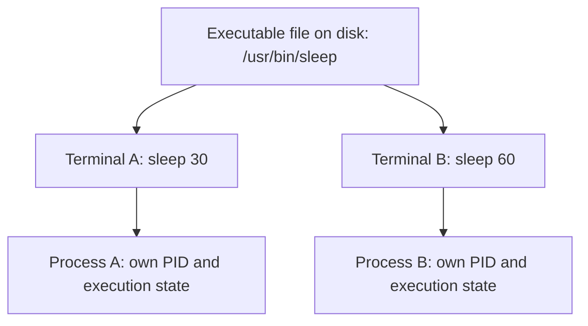

ဒီပုံမှာ executable file တစ်ခုတည်းကနေ process instance နှစ်ခု ဖြစ်လာတာကို ပြထားပါတယ်။ PID နံပါတ်တွေကတော့ စက်နဲ့ run ချိန်အလိုက် ပြောင်းလဲနိုင်ပါတယ်။ အဓိကမှတ်ရန်က program file တစ်ခုနဲ့ process instance တစ်ခုဟာ တူညီတဲ့အရာ မဟုတ်ပါဘူး။

## 5. Linux မှာ Process နဲ့ Thread

Linux kernel အတွင်းမှာ process တစ်ခုရဲ့ execution unit တစ်ခုချင်းစီကို task အဖြစ် စီမံပါတယ်။ Thread တွေဟာ kernel အမြင်မှာ task သီးခြားတွေဖြစ်ပေမယ့် address space, file descriptor table နဲ့ အခြား resource အချို့ကို အတူမျှဝေထားနိုင်ပါတယ်။ အဲဒီ sharing ပုံစံကို process/thread creation လုပ်တဲ့အခါ သတ်မှတ်နိုင်ပါတယ်။

အရင်ဆုံး အောက်ပါကွာခြားချက်ကို မှတ်ထားပါ။

| အယူအဆ | အဓိပ္ပာယ် |
|---|---|
| Process | ကိုယ်ပိုင် process identity နဲ့ resource context ရှိတဲ့ execution group |
| Thread | Process တစ်ခုအတွင်း လုပ်ဆောင်နေတဲ့ execution flow တစ်ခု |
| PID / TGID | Multithreaded process တစ်ခုလုံးကို ကိုယ်စားပြုတဲ့ thread-group ID |
| TID | Thread တစ်ခုချင်းစီကို သတ်မှတ်တဲ့ thread ID |

Single-threaded program မှာ PID နဲ့ TID က တူညီနေတတ်ပါတယ်။ Multithreaded program မှာတော့ thread အားလုံးက `getpid()` အရ တူညီတဲ့ PID (TGID) ကို ပြန်ရနိုင်ပေမယ့် `gettid()` အရ TID တစ်ခုချင်းစီ မတူကြပါဘူး။ [^9] Linux ရဲ့ `clone()` မှာ `CLONE_THREAD` ကို သုံးခြင်းက thread group တစ်ခုအတွင်း task အသစ်ထည့်ဖို့ အသုံးပြုတဲ့ mechanism ဖြစ်ပါတယ်။ POSIX thread library က ဒီ kernel interface တွေကို abstraction အဖြစ် ဖုံးကွယ်ပေးထားပါတယ်။

ဒီအခန်းမှာ application တစ်ခုလုံးကို ရည်ညွှန်းတဲ့အခါ process လို့ သုံးပါမယ်။ Kernel က စီမံနေတဲ့ execution unit တစ်ခုချင်းစီကို ပြောတဲ့နေရာမှာတော့ task သို့မဟုတ် thread လို့ ခွဲသုံးပါမယ်။

## 6. PID, PPID နဲ့ Process Tree

Process တစ်ခုကို process ID (PID) နဲ့ သတ်မှတ်ပါတယ်။ အဲဒီ process ကို ဖန်တီးခဲ့တဲ့ parent ရဲ့ PID ကို parent process ID (PPID) လို့ခေါ်ပါတယ်။ Process တွေမှာ parent နဲ့ child ဆက်နွယ်မှုတွေ ရှိလာတဲ့အခါ process tree တစ်ခု ဖြစ်လာပါတယ်။

ဥပမာ terminal ဖွင့်လိုက်တဲ့အခါ desktop environment က terminal emulator ကို စတင်ပေးနိုင်ပြီး၊ terminal emulator က shell ကို စတင်ပေးနိုင်ပါတယ်။ Shell ကနေ command တစ်ခု run တဲ့အခါ shell က child process ကို ဖန်တီးနိုင်ပါတယ်။ အဲဒီအတွက် process tree ဟာ အောက်ပါပုံစံမျိုး ဖြစ်နိုင်ပါတယ်။

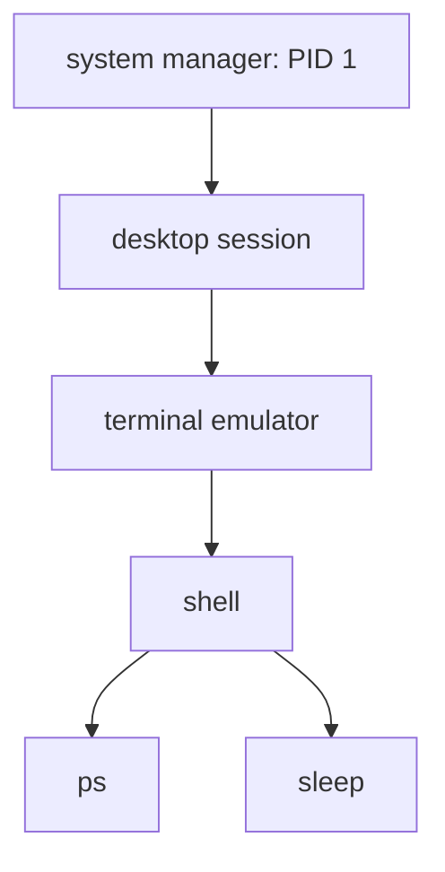

ဒီပုံက process tree ကို နားလည်ဖို့ ရိုးရှင်းအောင် ပြထားတဲ့ ဥပမာပါ။ Fedora GNOME အပါအဝင် modern Linux desktop တွေမှာ session management နဲ့ application startup ပုံစံ ကွာခြားနိုင်ပါတယ်။ PID 1 က ဒီ tree ထဲက အပေါ်ဆုံး parent ဖြစ်တယ်လို့ အမြဲမယူဆပါနဲ့။ Container သီးခြား PID namespace ထဲမှာလည်း PID 1 တစ်ခုစီ ရှိနိုင်ပါတယ်။

လက်ရှိ shell ရဲ့ PID နဲ့ PPID ကို ဒီ command နဲ့ ကြည့်နိုင်ပါတယ်။

```bash
ps -o pid,ppid,stat,comm,args -p "$$"
```

`$$` ဟာ shell က လက်ရှိ shell process ရဲ့ PID အဖြစ် အစားထိုးပေးတဲ့ parameter ဖြစ်ပါတယ်။ `ps` ရဲ့ column တွေက PID, PPID, process state, command name နဲ့ command arguments တို့ကို ပြပေးပါတယ်။

Process tree ကို ပိုမြင်သာစေဖို့ `--forest` ကို အသုံးပြုနိုင်ပါတယ်။

```bash
ps -eo pid,ppid,stat,comm --forest
```

Output ထဲမှာ indentation ကို ကြည့်ရင် parent-child relationship ကို အကြမ်းဖျဉ်း ခွဲသိနိုင်ပါတယ်။ PID ကို process အတွက် ကမ္ဘာလုံးဆိုင်ရာ အမြဲတမ်း identity လို့ မယူဆပါနဲ့။ Process အဆုံးသတ်ပြီးနောက် PID ကို နောက် process တစ်ခုအတွက် ပြန်အသုံးပြုနိုင်ပါတယ်။ ထို့အပြင် PID namespace ရှိတဲ့အခါ namespace တစ်ခုချင်းစီမှာ PID မြင်ရပုံ မတူနိုင်ပါတယ်။ ဒီအကြောင်းကို Chapter 3 မှာ အသေးစိတ် ဆက်လေ့လာပါမယ်။

## 7. System Call ဆိုတာ ဘာလဲ

User-space program တစ်ခုက hardware ဒါမှမဟုတ် kernel ရဲ့ internal data structure တွေကို ကိုယ့်သဘောနဲ့ တိုက်ရိုက်ပြင်လို့ မရပါဘူး။ File ဖတ်ခြင်း၊ process ဖန်တီးခြင်း၊ memory mapping တောင်းဆိုခြင်း၊ socket အသုံးပြုခြင်း စတဲ့ privileged operation တွေကို kernel ဆီ တရားဝင်တောင်းဆိုဖို့ **system call** interface ကို အသုံးပြုရပါတယ်။

Program က system call ခေါ်လိုက်တဲ့အခါ CPU ဟာ architecture အလိုက် သတ်မှတ်ထားတဲ့ entry mechanism ကို အသုံးပြုပြီး user mode ကနေ kernel mode ဆီ ကူးပြောင်းပါတယ်။ Kernel က argument တွေကို စစ်ဆေးပြီး operation ကို လုပ်ဆောင်ကာ return value သို့မဟုတ် error ကို ပြန်ပေးပါတယ်။ User-space program က နောက်တစ်ကြိမ် user mode မှာ ဆက်လက်လုပ်ဆောင်ပါတယ်။

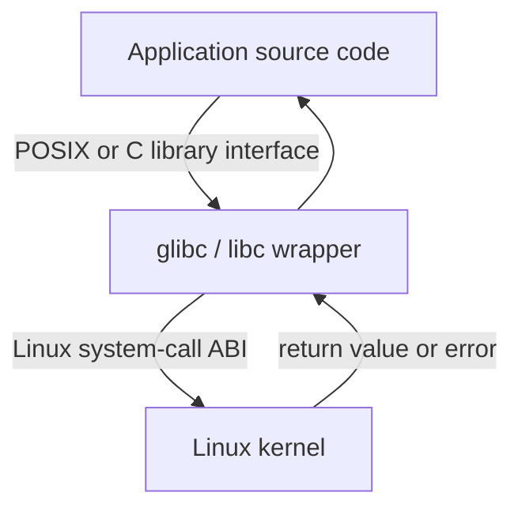

ဒီပုံက application က API ကိုခေါ်တာနဲ့ kernel ထဲက system call တကယ်ဝင်သွားတာကြားမှာ library layer ရှိနိုင်ကြောင်း ပြထားပါတယ်။ Raw system call ကို `syscall()` ကနေ တိုက်ရိုက်ခေါ်တာလည်း ရှိပေမယ့် ပုံမှန် application တွေမှာ documented libc/POSIX interface ကို သုံးတာ ပိုအဆင်ပြေပါတယ်။

C library function တစ်ခုခေါ်တိုင်း system call တစ်ခုတိတိ ဖြစ်တယ်လို့ မဆိုလိုပါဘူး။ ဥပမာ `printf()` ဟာ C standard library ရဲ့ formatting function ဖြစ်ပြီး terminal သို့ output ရေးတဲ့အခါ `write()` ကို ခေါ်နိုင်ပါတယ်။ `malloc()` က user-space allocator ဖြစ်ပြီး memory ထပ်လိုအပ်တဲ့အခါမှ `brk()` ဒါမှမဟုတ် `mmap()` ကို သုံးနိုင်ပါတယ်။ တစ်ဖက်မှာ `fork()`၊ `waitpid()` လို POSIX interface တွေကလည်း kernel system call နာမည်နဲ့ တစ်ထပ်တည်း မဖြစ်နိုင်ပါဘူး။

System call နံပါတ်နဲ့ calling convention တွေဟာ CPU architecture ပေါ်မူတည်နိုင်ပါတယ်။ Application ရေးတဲ့အခါ syscall number ကို ကိုယ်တိုင် hard-code လုပ်တာထက် သက်ဆိုင်ရာ library wrapper ဒါမှမဟုတ် documented API ကို သုံးတာ ပိုသင့်တော်ပါတယ်။

### Process-related System Calls and Library Interfaces

အောက်ကဇယားမှာ raw Linux system call၊ glibc wrapper၊ POSIX interface နဲ့ C library function တို့ကို ခွဲပြထားပါတယ်။ Source code ထဲမှာ မြင်ရတဲ့ function name နဲ့ `strace` ထဲမှာ မြင်ရတဲ့ kernel entry name တို့ မတူနိုင်တာကို သတိထားပါ။

| Interface | အမျိုးအစား | အဓိကတာဝန်နဲ့ Linux မှာ သတိထားရန် |
|---|---|---|
| `fork()` | POSIX interface; glibc wrapper | Child process ဖန်တီးတယ်။ glibc NPTL implementation မှာ အများအားဖြင့် `clone()` syscall ကို အသုံးပြုတာကြောင့် trace ထဲမှာ `clone()` ကို မြင်နိုင်တယ်။ [^1] |
| `clone()` | Linux syscall နှင့် glibc wrapper | Child နဲ့ parent ကြား resource sharing ကို flags နဲ့ သတ်မှတ်နိုင်တယ်။ glibc wrapper ရဲ့ callback/stack interface နဲ့ raw syscall ABI ကို မရောထွေးပါနဲ့။ [^2] |
| `clone3()` | Raw Linux system call | `struct clone_args` ကို အသုံးပြုတဲ့ extended interface ဖြစ်တယ်။ glibc က သီးသန့် `clone3()` wrapper မပေးထားတဲ့အတွက် `syscall()` ကနေ ခေါ်တာမျိုး တွေ့နိုင်တယ်။ Linux 5.3 မှာ ထည့်သွင်းခဲ့တယ်။ [^2] |
| `execve()` | Linux syscall; libc wrapper | လက်ရှိ process ရဲ့ program image ကို အစားထိုးတယ်။ Process အသစ်မဖန်တီးဘူး။ [^3] |
| `wait()` / `waitpid()` | POSIX interfaces; glibc wrappers | Child state ကို စောင့်ပြီး status ယူတယ်။ glibc ရဲ့ `wait()` က Linux မှာ `wait4()` ကို အသုံးပြုပြီး၊ `waitpid()` လည်း architecture အချို့မှာ `wait4()` wrapper ကနေ လုပ်ဆောင်တယ်။ `waitid()` ကတော့ wait-family ထဲက သီးခြား interface တစ်ခု ဖြစ်တယ်။ [^4] |
| `exit()` | C library function | `atexit()` handler တွေကို ခေါ်ပြီး stdio stream တွေ flush လုပ်ပြီးမှ termination လုပ်တယ်။ Kernel syscall name မဟုတ်ဘူး။ [^11] |
| `_exit()` | POSIX/C library interface; glibc wrapper | User-space cleanup မလုပ်ဘဲ terminate လုပ်တယ်။ glibc 2.3 ကစပြီး wrapper က Linux `exit_group()` syscall ကို သုံးပြီး thread group တစ်ခုလုံးကို ရပ်တယ်။ [^11] |
| `exit` / `exit_group` | Raw Linux system calls | Raw Linux `exit` syscall က calling thread ကိုသာ ရပ်တယ်။ `exit_group` က thread group တစ်ခုလုံးကို ရပ်တယ်။ glibc `_exit()` wrapper ကို raw `exit` syscall နဲ့ မရောထွေးပါနဲ့။ [^11] |
| `getpid()` / `getppid()` | POSIX/Linux interfaces; libc wrappers | Process ID နဲ့ parent process ID ကို ပြန်ပေးတယ်။ PID namespace ရှိရင် caller မြင်ရတဲ့ namespace အလိုက် တန်ဖိုးကွာနိုင်တယ်။ |
| `gettid()` | Linux-specific syscall; glibc wrapper | Calling thread ရဲ့ TID ကို ပြန်ပေးတယ်။ POSIX interface မဟုတ်ဘူး။ [^9] |
| `kill()` | POSIX interface; libc wrapper | သတ်မှတ်ထားတဲ့ PID/process group ဆီ signal ပို့တယ်။ Signal ပို့နိုင်ခြင်းက process ကို ချက်ချင်း terminate လုပ်တယ်လို့ မဆိုလိုဘူး။ [^5] |

ဒီကွာခြားချက်ကို `strace` နဲ့လည်း တွေ့နိုင်ပါတယ်။ ဥပမာ C source ထဲမှာ `fork()` ခေါ်ထားပေမယ့် glibc က `clone()` ကို သုံးထားရင် trace output မှာ `clone()` ဖြစ်နိုင်ပါတယ်။ `_exit()` ကိုခေါ်ထားပေမယ့် trace မှာ `exit_group()` ကို မြင်ရတာလည်း ဒီလိုပဲ ဖြစ်ပါတယ်။

အောက်ကအချက်ကို အထူးမှတ်ထားပါ။ `exit()` က C library cleanup လုပ်ပြီးမှ process ကို အဆုံးသတ်စေတဲ့ function ဖြစ်ပါတယ်။ `_exit()` wrapper ကတော့ `atexit()` handler နဲ့ stdio flush ကို မလုပ်ပါဘူး။ Linux raw `exit` syscall က calling thread တစ်ခုတည်းကို terminate လုပ်ပေမယ့် glibc `_exit()` က `exit_group()` ကိုခေါ်ပြီး thread group တစ်ခုလုံးကို terminate လုပ်ပါတယ်။ [^11]

Interface တစ်ခုချင်းစီရဲ့ behavior, error condition နဲ့ version history ကွာခြားနိုင်တာကြောင့် လက်တွေ့ရေးသားရာမှာ သက်ဆိုင်ရာ manual page ကို စစ်ဆေးပါ။

## 8. `fork()` — Child Process ဖန်တီးခြင်း

`fork()` ဟာ လက်ရှိ process ကနေ child process တစ်ခုဖန်တီးဖို့ အသုံးပြုတဲ့ အဓိက interface ဖြစ်ပါတယ်။ `fork()` အောင်မြင်တဲ့အခါ parent နဲ့ child ဟာ instruction execution ကို ဆက်လုပ်ကြပါတယ်။ ဒါပေမယ့် return value ကွာခြားပါတယ်။

Linux မှာ source code ထဲက `fork()` လို့ ခေါ်တာကို `strace` မှာလည်း `fork()` လို့ပဲ အမြဲမြင်ရမယ်လို့ မထင်ပါနဲ့။ glibc ရဲ့ NPTL implementation မှာ `fork()` wrapper က underlying `clone()` system call ကို သုံးပြီး `fork()` နဲ့ တူညီတဲ့ behavior ကို ရအောင် လုပ်ပေးပါတယ်။ ဒါကြောင့် trace output ထဲမှာ `clone()` ကို တွေ့နိုင်ပါတယ်။ [^1]

- Parent process ထဲမှာ `fork()` က child ရဲ့ PID ကို ပြန်ပေးပါတယ်။
- Child process ထဲမှာ `fork()` က `0` ကို ပြန်ပေးပါတယ်။
- Error ဖြစ်ရင် parent ထဲမှာ `-1` ကို ပြန်ပေးပြီး `errno` ကို သတ်မှတ်ပါတယ်။

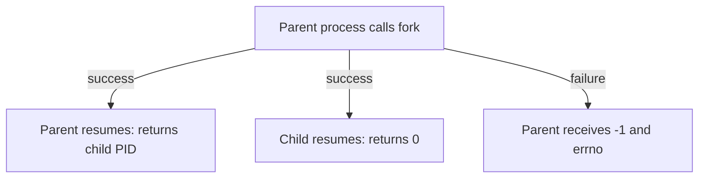

Return value ကို ကြည့်ရုံနဲ့ parent ဘက်လား၊ child ဘက်လား ခွဲနိုင်တာကြောင့် `fork()` ဟာ process creation ကို သင်ယူတဲ့အခါ အသုံးဝင်တဲ့ ဥပမာတစ်ခု ဖြစ်ပါတယ်။

### Multithreaded process က `fork()` ခေါ်တဲ့အခါ

Process တစ်ခုမှာ thread အများကြီး ရှိနေတယ်ဆိုပါစို့။ Thread A က `fork()` ခေါ်လိုက်ရင် parent ဘက်မှာ thread အားလုံး ဆက်ရှိနေပေမယ့် child process ထဲမှာတော့ `fork()` ခေါ်ခဲ့တဲ့ Thread A တစ်ခုတည်းသာ ရှိပါတယ်။ အခြား parent thread တွေကို child ထဲမှာ ဆက်မဖန်တီးပေးပါဘူး။ [^1]

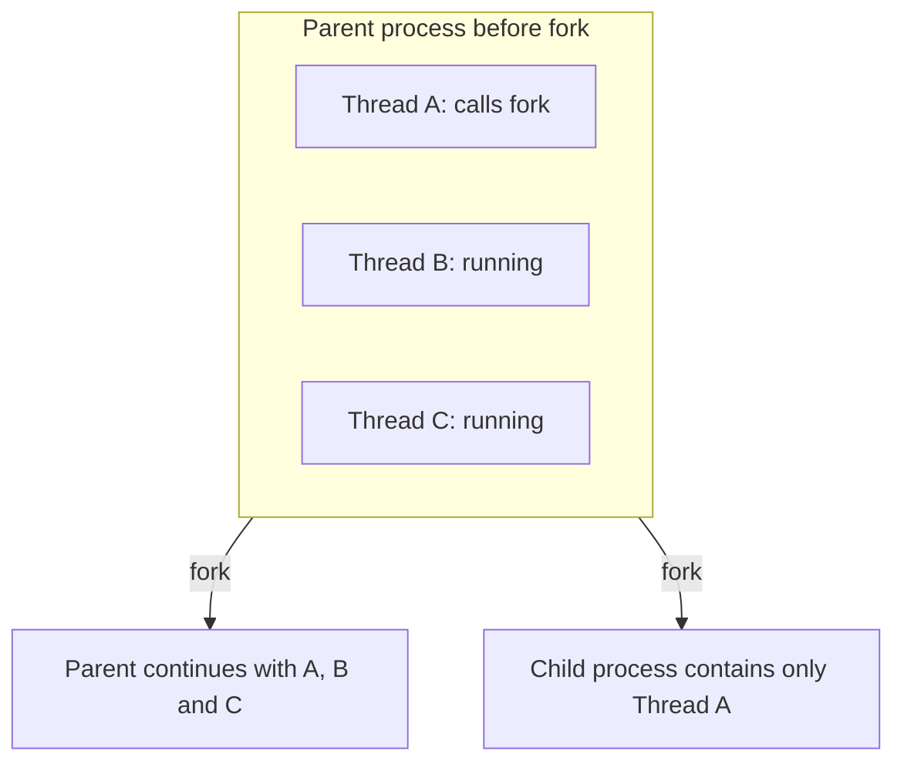

ပြဿနာက memory state ကိုလည်း child က copy-on-write ပုံစံနဲ့ ဆက်ခံရတာပါ။ ဥပမာ Thread B က mutex တစ်ခုကို lock လုပ်ထားတဲ့အချိန် Thread A က `fork()` ခေါ်လိုက်တယ်ဆိုပါစို့။ Child မှာ Thread B မရှိတော့ပေမယ့် mutex ရဲ့ memory state မှာ locked လို့ပဲ ကျန်နေနိုင်ပါတယ်။ Child ထဲက Thread A က အဲဒီ mutex ကို lock ထပ်လုပ်ဖို့ ကြိုးစားရင် unlock လုပ်ပေးမယ့် Thread B မရှိတော့တဲ့အတွက် deadlock ဖြစ်နိုင်ပါတယ်။ ဒါဟာ multithreaded `fork()` ရဲ့ အရေးကြီးတဲ့ အန္တရာယ်တစ်ခုပါ။ [^12]

POSIX စည်းမျဉ်းအရ multithreaded process တစ်ခုမှာ `fork()` ပြီးတဲ့ child ဟာ `execve()` မခေါ်မချင်း **async-signal-safe function** တွေကိုသာ ခေါ်သင့်ပါတယ်။ `printf()`၊ `malloc()` သို့မဟုတ် lock ယူနိုင်တဲ့ library routine တွေကို အဲဒီကြားကာလမှာ အသုံးပြုတာဟာ safe မဖြစ်နိုင်ပါဘူး။ Child ရဲ့ ရည်ရွယ်ချက်က program အသစ် run ဖို့ဆိုရင် အများအားဖြင့် လုပ်သင့်တာက လိုအပ်တဲ့ minimal async-signal-safe operation တွေပြီးတာနဲ့ `execve()` ကို ခေါ်ခြင်းပါ။ [^1][^13]

`pthread_atfork()` က fork မတိုင်ခင်၊ parent ဘက် fork ပြီးနောက်နဲ့ child ဘက် fork ပြီးနောက်မှာ handler တွေ run စေဖို့ register လုပ်နိုင်တဲ့ POSIX interface ဖြစ်ပါတယ်။ အဲဒီ handler တွေကို အသုံးပြုပြီး application/library ရဲ့ lock state ကို တစ်သမတ်တည်းဖြစ်အောင် ပြင်ဆင်ဖို့ ရည်ရွယ်ထားတာပါ။ သို့သော် lock အားလုံးနဲ့ library state အားလုံးကို လုံခြုံစွာ ပြန်ညှိဖို့ ခက်ခဲနိုင်တာကြောင့် `pthread_atfork()` ရှိနေတာတစ်ခုတည်းနဲ့ ပြဿနာအားလုံး ပြေလည်သွားတယ်လို့ မယူဆပါနဲ့။ [^12]

### 8.1 Copy-on-Write (CoW)

အရင်ဆုံး `fork()` ကို memory အားလုံးကို ချက်ချင်း byte-for-byte copy ကူးတယ်လို့ မယူဆပါနဲ့။ Linux မှာ ပုံမှန် `fork()` implementation က Copy-on-Write (CoW) ကို အသုံးပြုပါတယ်။ [^1] အစပိုင်းမှာ parent နဲ့ child တို့ရဲ့ private writable memory mapping တွေဟာ တူညီတဲ့ physical memory page တွေကို share လုပ်နိုင်ပြီး၊ kernel က write fault ဖြစ်လာမှ သက်ဆိုင်ရာ page ကို copy ကူးပေးပါတယ်။ အဲဒီလို copy ကူးတဲ့အခါ ရေးသားမယ့် process က သီးခြား page ပေါ်မှာ ဆက်ရေးနိုင်ပါတယ်။ `MAP_SHARED` လို shared mapping တွေကတော့ သူတို့ရဲ့ သတ်မှတ်ထားတဲ့ sharing behavior အတိုင်း ဆက်လက်မျှဝေထားနိုင်ပါတယ်။

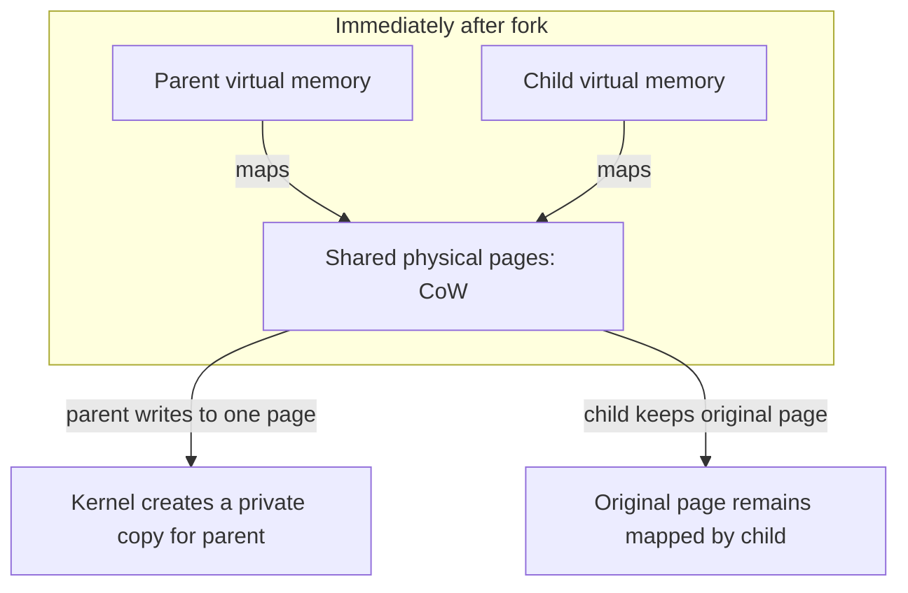

ပုံမှာ writable private page ကို အစပိုင်းမှာ share လုပ်ထားပြီး write ဖြစ်တဲ့အချိန်မှ page copy တစ်ခု ဖန်တီးရပုံကို အကြမ်းဖျဉ်း ပြထားပါတယ်။

ဒါကြောင့် `fork()` ခေါ်တိုင်း parent ရဲ့ memory အားလုံးကို ချက်ချင်း duplicate လုပ်ရတာ မဟုတ်ပါဘူး။ သို့သော် page table နဲ့ process metadata စတဲ့ overhead တွေ ရှိနေဆဲဖြစ်ပြီး process အများကြီးဖန်တီးခြင်းက resource cost မရှိဘူးလို့ မဆိုလိုပါဘူး။

`fork()` နဲ့ပတ်သက်ပြီး သိထားရမယ့် နောက်ထပ်အချက်တစ်ခုက file descriptor တွေပါ။ Child process ဟာ parent ရဲ့ file descriptor table ကို copy ရရှိပါတယ်။ သို့သော် inherited descriptor တွေက မူလ open file description တစ်ခုတည်းကို ရည်ညွှန်းနိုင်တဲ့အတွက် file offset နဲ့ file status flags အချို့ကို အတူမျှဝေနိုင်ပါတယ်။ File descriptor နံပါတ်တူတာနဲ့ kernel object အသစ်တစ်ခု လုံးဝသီးခြားဖန်တီးသွားတယ်လို့ မယူဆသင့်ပါဘူး။

## 9. `clone()` နဲ့ `clone3()`

`fork()` က parent ရဲ့ process context ကို အခြေခံပြီး child ကို ဖန်တီးပေးပါတယ်။ Linux ရဲ့ `clone()` interface ကတော့ child နဲ့ parent ကြား ဘယ် resource တွေကို share လုပ်မလဲဆိုတာ flag တွေနဲ့ သတ်မှတ်နိုင်ပါတယ်။ [^2] ဒီ flexibility ကြောင့် Linux thread implementation နဲ့ container runtime အများအပြားမှာ `clone()` family ကို အသုံးပြုကြပါတယ်။

ဒီနေရာမှာ `clone()` wrapper နဲ့ raw `clone` system call ကို ခွဲသိထားဖို့ လိုပါတယ်။ glibc ရဲ့ `clone()` wrapper ကို သုံးတဲ့အခါ child process က ပေးထားတဲ့ callback function ကနေ စတင် run ပါတယ်။ Kernel ရဲ့ raw system call ကို တိုက်ရိုက်ခေါ်တဲ့အခါတော့ `fork()` လို parent နဲ့ child နှစ်ဖက်စလုံးဟာ call ပြီးတဲ့နေရာကနေ ဆက်လုပ်ကြပါတယ်။ ဒါကြောင့် code သို့မဟုတ် documentation တစ်ခုမှာ `clone()` လို့ တွေ့တိုင်း ဘယ် interface ကို ရည်ညွှန်းသလဲဆိုတာ ကြည့်ဖို့ လိုပါတယ်။

ဥပမာ flag အချို့က အောက်ပါအတိုင်း ဖြစ်ပါတယ်။

| Flag | အကြမ်းဖျဉ်းရည်ရွယ်ချက် |
|---|---|
| `CLONE_VM` | Virtual memory space ကို share လုပ်ခြင်း |
| `CLONE_FILES` | File descriptor table ကို share လုပ်ခြင်း |
| `CLONE_FS` | Filesystem context အချို့ကို share လုပ်ခြင်း |
| `CLONE_SIGHAND` | Signal handler table ကို share လုပ်ခြင်း |
| `CLONE_THREAD` | Thread group တစ်ခုတည်းအတွင်း thread အသစ်ထည့်ခြင်း |
| `CLONE_NEWPID` | Child ကို PID namespace အသစ်ထဲမှာ စတင်စေခြင်း |
| `CLONE_NEWNS` | Mount namespace အသစ်ထဲမှာ စတင်စေခြင်း |
| `CLONE_NEWNET` | Network namespace အသစ်ထဲမှာ စတင်စေခြင်း |

Flag တစ်ခုချင်းစီကို ဘယ်လိုမဆို ပေါင်းသုံးလို့ရတယ်လို့ မယူဆပါနဲ့။ ဥပမာ `CLONE_SIGHAND` သုံးမယ်ဆိုရင် `CLONE_VM` လည်း လိုအပ်ပြီး၊ `CLONE_THREAD` သုံးမယ်ဆိုရင် `CLONE_SIGHAND` ကိုပါ သတ်မှတ်ထားဖို့ လိုပါတယ်။ Kernel က ခွင့်မပြုတဲ့ combination တွေကို error နဲ့ ငြင်းပယ်နိုင်ပါတယ်။

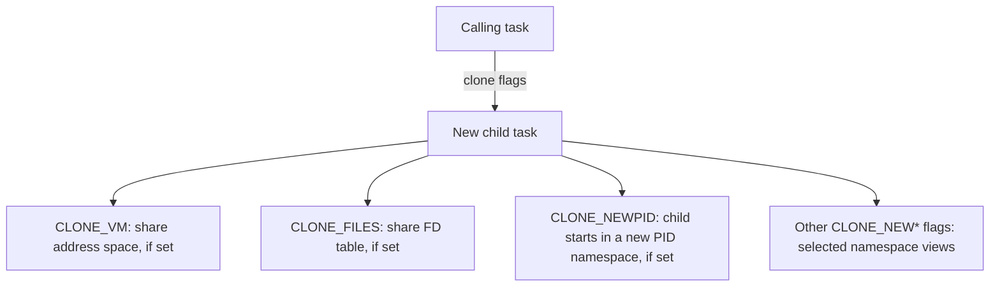

ဒီပုံက `clone()` flags တချို့ရဲ့ သဘောတရားကို ပြထားတာပါ။ Resource တစ်ခုချင်းစီကို share လုပ်မလား၊ namespace အသစ်ထဲမှာ စတင်မလားဆိုတာ flag နဲ့ ထိန်းချုပ်နိုင်ပေမယ့် flag တွေကို အလိုရှိသလို ပေါင်းလို့ မရပါဘူး။ အချို့ combination တွေမှာ kernel က dependency သတ်မှတ်ထားပါတယ်။

`clone3()` က `clone()` ထက် ပိုမိုကျယ်ပြန့်တဲ့ argument structure ကို အသုံးပြုပြီး flags, stack, PID descriptor နဲ့ cgroup ဆိုင်ရာ parameter အချို့ကို ပိုမိုစနစ်တကျ ပေးနိုင်ပါတယ်။ `clone3()` ကို Linux 5.3 မှာ စတင်ထည့်သွင်းခဲ့ပါတယ်။ [^2] glibc က `clone3()` အတွက် သီးသန့် wrapper မပေးထားတဲ့အတွက် ပုံမှန်အားဖြင့် `syscall()` interface ကနေ ခေါ်ယူရပါတယ်။ Kernel က `clone3()` ကို မပံ့ပိုးသေးရင် `ENOSYS` ပြန်ရနိုင်ပါတယ်။ ထို့အပြင် kernel က syscall ကို ပံ့ပိုးထားတာနဲ့ အသုံးပြုနေတဲ့ libc မှာ convenient wrapper ရှိတာက မတူပါဘူး။ ဒါကြောင့် runtime တစ်ခုက `clone3()` ကို သုံးမယ်ဆိုရင် kernel support နဲ့ fallback behavior ကို သီးခြားစစ်ဆေးရပါတယ်။

Container တစ်ခုဖန်တီးတဲ့အခါ runtime ဟာ namespace flag တွေကို အသုံးပြုပြီး child process ကို သီးခြား namespace view ထဲမှာ စတင်စေနိုင်ပါတယ်။ ဒါပေမဲ့ `clone()` ဟာ process/task ကို ဖန်တီးပြီး resource sharing နဲ့ namespace membership အချို့ကို သတ်မှတ်ပေးတဲ့ primitive တစ်ခုသာ ဖြစ်ပါတယ်။ `clone()` ကို တစ်ကြိမ်ခေါ်လိုက်တာနဲ့ complete container တစ်ခု အလိုအလျောက် ဖြစ်လာတာ မဟုတ်ပါဘူး။ Mount နဲ့ root filesystem setup၊ cgroup placement/limit၊ credentials၊ capabilities၊ seccomp/LSM policy နဲ့ network configuration စတာတွေကိုလည်း runtime က သီးခြားစီ စီမံရပါတယ်။ အဲဒီ mechanism တွေကို Chapter 03 မှ Chapter 08 အထိ သက်ဆိုင်ရာနေရာမှာ ဆက်လေ့လာပါမယ်။

## 10. `execve()` — Program Image အစားထိုးခြင်း

`fork()` နဲ့ child process ဖန်တီးပြီးတဲ့နောက် child က program တစ်ခုကို run လုပ်ဖို့ `execve()` ကို ခေါ်နိုင်ပါတယ်။ `execve()` ဟာ process အသစ်ဖန်တီးတာ မဟုတ်ပါဘူး။ [^3] Calling process ရဲ့ လက်ရှိ program image ကို executable အသစ်နဲ့ အစားထိုးပေးတာ ဖြစ်ပါတယ်။

အဲဒီအတွက် `execve()` အောင်မြင်သွားရင် process ရဲ့ PID က ပုံမှန်အားဖြင့် မပြောင်းပါဘူး။ Program code, stack, heap နဲ့ data segment တွေဟာ executable အသစ်အတွက် ပြန်တည်ဆောက်ခံရပေမယ့် process identity နဲ့ parent relationship တို့ ဆက်လက်တည်ရှိနေပါတယ်။

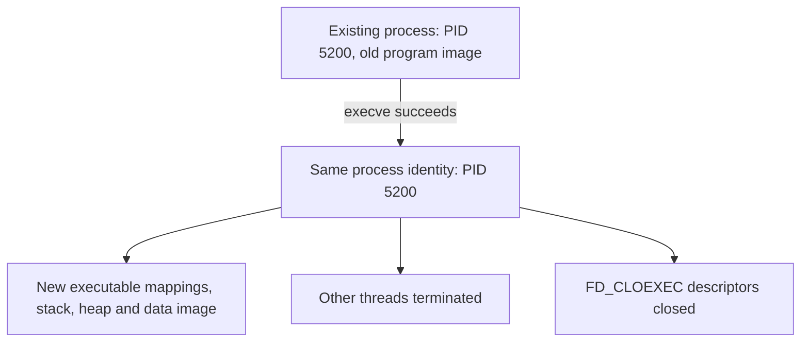

ဒီပုံက `execve()` အောင်မြင်တဲ့အခါ process အသစ်တစ်ခု ဖန်တီးတာ မဟုတ်ဘဲ ရှိပြီးသား process ရဲ့ program image ကို အစားထိုးတာဖြစ်ကြောင်း ပြထားပါတယ်။ PID က process အနေနဲ့ ဆက်တည်ရှိပေမယ့် memory image နဲ့ thread state အချို့ ပြောင်းလဲသွားပါတယ်။

`execve()` မှာ အရေးကြီးတဲ့ argument သုံးခု ရှိပါတယ်။

- `path` — run လုပ်မယ့် executable သို့မဟုတ် interpreter script ရဲ့ path။
- `argv` — program အသစ်ကို ပေးမယ့် argument array။ ပထမ element ကို ပုံမှန်အားဖြင့် program name အဖြစ် အသုံးပြုပါတယ်။
- `envp` — `NAME=value` ပုံစံ environment string တွေပါဝင်တဲ့ array။

C program တွေမှာ `execlp()`, `execvp()` စတဲ့ function တွေကို မကြာခဏ တွေ့ရပါတယ်။ အဲဒီ function တွေဟာ `exec` family ထဲက libc interface တွေဖြစ်ပြီး PATH search လုပ်ပေးခြင်းကဲ့သို့ အဆင်ပြေစေမယ့် behavior တွေ ပါနိုင်ပါတယ်။ Kernel-level interface ကို တိုက်ရိုက်ကြည့်တဲ့အခါ `execve()` က အဓိက system call ဖြစ်ပါတယ်။

`execve()` အောင်မြင်ရင် မူလ program ရဲ့ instruction ကို ပြန်မရောက်တော့ပါဘူး။ Error ဖြစ်ရင်တော့ မူလ program ထဲကို ပြန်ရောက်ပြီး error handling လုပ်နိုင်ပါတယ်။ ဒါကြောင့် `execve()` နောက်က code ကို error path အဖြစ်သာ စဉ်းစားရေးသားရပါမယ်။

`execve()` ဟာ calling process ရဲ့ attributes အားလုံးကို အတိအကျ အတိုင်း မထားပါဘူး။ အရေးကြီးတဲ့ အချက်တွေကို preserved နဲ့ replaced/reset ဟူပြီး ခွဲကြည့်ပါမယ်။ [^3]

| `execve()` ပြီးနောက် ဆက်ရှိလေ့ရှိသောအရာများ | `execve()` အတွင်း ပြောင်းလဲ/ပြန်သတ်မှတ်ခံရသောအရာများ |
|---|---|
| Process ID (thread-group PID/TGID) နဲ့ parent relationship | Program image: code, data, heap, stack နဲ့ memory mappings အသစ်ဖြင့် အစားထိုးတယ်။ |
| Current working directory၊ root directory နဲ့ umask | Calling process အပြင်က thread အားလုံး terminate လုပ်ခံရပြီး calling thread က process image အသစ်နဲ့ ဆက်လုပ်တယ်။ |
| Resource limits၊ process group/session နဲ့ signal mask | Caught signal handler disposition တွေကို default disposition (`SIG_DFL`) ပြန်ထားတယ်။ Ignored signal disposition တွေကိုတော့ ယေဘုယျအားဖြင့် မပြောင်းဘူး။ |
| Namespace membership နဲ့ cgroup membership | Alternate signal stack၊ POSIX timers၊ memory locks၊ POSIX/System V shared-memory attachment နဲ့ memory mappings အဟောင်းတွေ ဆက်မရှိတော့ဘူး။ `atexit()`/`on_exit()` handlers တွေလည်း ဆက်မရှိတော့ဘူး။ |
| `FD_CLOEXEC` မသတ်မှတ်ထားတဲ့ open file descriptor များ | `FD_CLOEXEC` သတ်မှတ်ထားတဲ့ file descriptor တွေ ပိတ်သွားတယ်။ Directory stream၊ POSIX message queue descriptor စတဲ့ အခြား resource အချို့လည်း သက်ဆိုင်ရာ စည်းမျဉ်းအတိုင်း ပိတ်/ဖယ်ရှားခံရတယ်။ |
| — | Linux-specific metadata အချို့လည်း ပြောင်းလဲတယ်။ Process name (`comm`) ကို executable name အသစ်နဲ့ ပြန်သတ်မှတ်ပြီး file descriptor table ကို unshare လုပ်တယ် (ဥပမာ `CLONE_FILES` sharing effect ကို ဖယ်ရှားတယ်)။ `PR_SET_KEEPCAPS` နဲ့ `SECBIT_KEEP_CAPS` ကို clear လုပ်တယ်။ Dumpable attribute ကို execution context အလိုက် ပြန်သတ်မှတ်တယ်။ Set-user-ID/set-group-ID program တစ်ခုကို execute လုပ်တဲ့အခါ `PR_SET_PDEATHSIG` ကို clear လုပ်တယ်။ Process termination signal ကို `SIGCHLD` ပြန်သတ်မှတ်တယ်။ |

PID နဲ့ပတ်သက်ပြီးလည်း အသေးစိတ်တစ်ခု ရှိပါတယ်။ Process ရဲ့ thread-group PID က ပုံမှန်အားဖြင့် ဆက်တူညီနေပါတယ်။ ဒါပေမဲ့ multithreaded process မှာ non-leader thread တစ်ခုက `execve()` လုပ်ရင် Linux က ကျန် thread တွေကို ရပ်ပြီး executing thread ကို thread-group leader identity နဲ့ ဆက်လုပ်စေနိုင်ပါတယ်။ ဒါကြောင့် per-thread TID အားလုံး မပြောင်းဘဲ ကျန်တယ်လို့ မယူဆသင့်ပါဘူး။ [^3]

Open file descriptor တွေကလည်း `execve()` အောင်မြင်တာနဲ့ အားလုံး အလိုအလျောက် ပိတ်သွားတာ မဟုတ်ပါဘူး။ `FD_CLOEXEC` (close-on-exec) သတ်မှတ်ထားတဲ့ descriptor တွေကိုသာ ပိတ်ပေးပါတယ်။ Pipe၊ socket နဲ့ log file တချို့ကို child program ဆီ ဆက်ပေးချင်တဲ့အခါ ဒီ behavior က အရေးကြီးပါတယ်။

Credential ပိုင်းမှာလည်း သတိထားစရာ ရှိပါတယ်။ Executable မှာ set-user-ID/set-group-ID bit သို့မဟုတ် file capabilities ပါရှိရင် effective credentials နဲ့ capability state တချို့ ပြောင်းနိုင်ပါတယ်။ သို့သော် `no_new_privs`၊ `nosuid` mount သို့မဟုတ် ptrace လို အခြေအနေတွေက privilege transition ကို တားဆီးနိုင်ပါတယ်။ ဒါကြောင့် `execve()` ဟာ “program code ပဲ ပြောင်းတယ်၊ ကျန်တာအားလုံး အတူတူပဲ” လို့ မယူဆသင့်ပါဘူး။ [^3]

## 11. Child Process ကို `wait()` / `waitpid()` နဲ့ စောင့်ခြင်း

Child process တစ်ခု ပြီးဆုံးသွားတဲ့အခါ kernel က termination status ကို parent က နောက်မှ ရယူနိုင်ဖို့ အချက်အလက်အချို့ကို ထိန်းသိမ်းထားပါတယ်။ Parent က `wait()` သို့မဟုတ် `waitpid()` ကို ခေါ်ပြီး child ရဲ့ status ကို ရယူနိုင်ပါတယ်။ ဒီလုပ်ငန်းစဉ်ဟာ child process ကို reap လုပ်တယ်လို့ ခေါ်ပါတယ်။ [^4]

`wait()` က parent ရဲ့ child တစ်ခုခု အဆုံးသတ်တာကို စောင့်ပြီး termination status ကို ပြန်ယူပေးပါတယ်။ `waitpid()` ကတော့ ဘယ် child ကို စောင့်မလဲ၊ non-blocking လုပ်မလား၊ stopped/continued state ကိုပါ စောင့်ကြည့်မလားဆိုတာကို ပိုထိန်းချုပ်နိုင်ပါတယ်။ ဥပမာ `waitpid(pid, &status, 0)` ဆိုရင် သတ်မှတ်ထားတဲ့ child PID အဆုံးသတ်တာကို စောင့်ပါတယ်။ `WNOHANG` လို option ထည့်ရင် child မပြီးသေးတဲ့အခါ ချက်ချင်းပြန်လာနိုင်ပါတယ်။

Parent က ပြန်ရလာတဲ့ status ကို စစ်တဲ့အခါ `WIFEXITED(status)`, `WEXITSTATUS(status)`, `WIFSIGNALED(status)` တို့ကို အသုံးပြုနိုင်ပါတယ်။ Raw status integer ကို ကိုယ်တိုင် bit-shift လုပ်ပြီး အဓိပ္ပာယ်ဖော်တာထက် ဒီ macro တွေကို သုံးခြင်းက ပိုသင့်တော်ပါတယ်။

### 11.1 Zombie Process

Child process တစ်ခု အဆုံးသတ်သွားပေမယ့် parent က `wait()` မခေါ်ရသေးတဲ့အခါ child ဟာ zombie state (`Z`) အဖြစ် ရှိနေနိုင်ပါတယ်။ Zombie ဖြစ်နေတဲ့ child က အလုပ်ဆက်မလုပ်တော့ပါဘူး။ User-space code လည်း run မနေတော့ပါဘူး။ Kernel က PID, termination status နဲ့ resource usage information ကဲ့သို့ parent အတွက် လိုအပ်နေသေးတဲ့ အချက်အလက်အနည်းငယ်ကိုသာ ထိန်းသိမ်းထားတာ ဖြစ်ပါတယ်။

Zombie တွေ များလာရင် kernel ထဲက process table slot တွေကို ဆက်သုံးထားနိုင်ပါတယ်။ [^4] အလွန်များလာတဲ့အခါ process အသစ်ဖန်တီးရာမှာ အခက်အခဲ ဖြစ်လာနိုင်ပါတယ်။ ဒါကြောင့် long-running parent process တွေဟာ child termination ကို စနစ်တကျ reap လုပ်ဖို့ လိုပါတယ်။

### 11.2 Orphan Process

Parent process က child မပြီးဆုံးခင် အရင်ဆုံး terminate ဖြစ်သွားရင် child ဟာ orphan ဖြစ်ပါတယ်။ Linux မှာ orphan child ကို သင့်တော်တဲ့ ancestor reaper process ဆီ reparent လုပ်ပါတယ်။ ပုံမှန်အားဖြင့် init process သို့မဟုတ် `PR_SET_CHILD_SUBREAPER` ကို သတ်မှတ်ထားတဲ့ subreaper process က တာဝန်ယူနိုင်ပါတယ်။

**Zombie နဲ့ orphan က မတူပါဘူး။** Zombie ဆိုတာ child က terminate ဖြစ်ပြီးသားဖြစ်သော်လည်း parent က status မယူရသေးတဲ့ အခြေအနေပါ။ Orphan ဆိုတာ parent က အရင်ဆုံး terminate ဖြစ်သွားလို့ child ရဲ့ parent relationship ကို အခြား reaper process တစ်ခုဆီ ပြောင်းပေးရတဲ့ အခြေအနေပါ။ Orphan process တစ်ခုဟာ ပုံမှန်အတိုင်း အလုပ်ဆက်လုပ်နေနိုင်ပါတယ်။ Linux မှာ အနီးဆုံး `PR_SET_CHILD_SUBREAPER` သတ်မှတ်ထားတဲ့ ancestor ရှိရင် အဲဒီ process က orphan ကို adopt လုပ်နိုင်ပြီး၊ မရှိရင် သက်ဆိုင်ရာ PID namespace ရဲ့ init process က တာဝန်ယူနိုင်ပါတယ်။

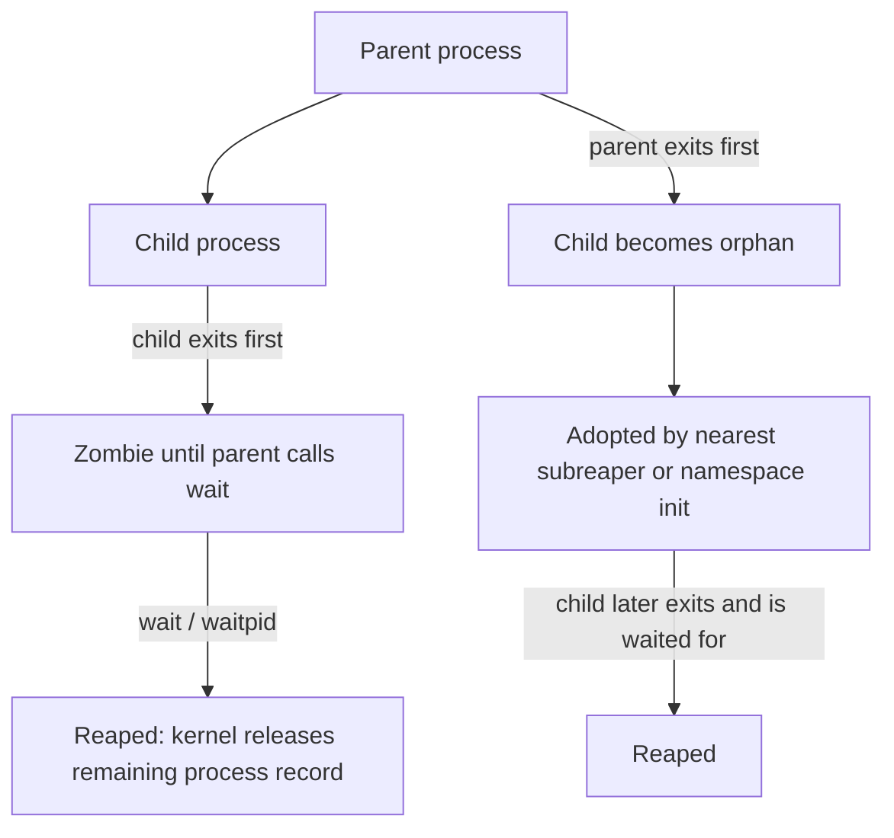

ဒီပုံမှာ Zombie နဲ့ orphan ဖြစ်ပုံကို သီးခြားပြထားပါတယ်။ Zombie က exit ပြီးတဲ့ child ရဲ့ မယူရသေးတဲ့ status ဖြစ်ပြီး orphan ကတော့ parent မရှိတော့တဲ့အတွက် reparent လုပ်ခံရတဲ့ အသက်ရှင်နေဆဲ child ဖြစ်နိုင်ပါတယ်။

## 12. Signal တွေနဲ့ Process Lifecycle

Signal ဆိုတာ process ဒါမှမဟုတ် thread တစ်ခုဆီ အကြောင်းကြားချက် ပို့ဖို့ kernel နဲ့ user space က အသုံးပြုတဲ့ mechanism တစ်ခုပါ။ Signal ဟာ ပုံမှန် data message တစ်ခုလိုတော့ မဟုတ်ပါဘူး။ [^5] Standard signal တချို့ဟာ blocked ဖြစ်နေချိန်မှာ ထပ်ခါထပ်ခါ ပို့ခံရရင် instance အားလုံးကို queue လုပ်မထားဘဲ pending အဖြစ် တစ်ခုတည်းသာ ကိုယ်စားပြုနိုင်ပါတယ်။ Real-time signal တွေမှာတော့ queueing behavior မတူပါဘူး။

အသုံးများတဲ့ signal အချို့က —

| Signal | ပုံမှန်ရည်ရွယ်ချက် |
|---|---|
| `SIGTERM` | Default action က process ကို terminate လုပ်တာပါ။ Application က handler တပ်ပြီး cleanup လုပ်နိုင်ပါတယ်။ |
| `SIGINT` | Terminal interrupt (ဥပမာ Ctrl+C) |
| `SIGKILL` | Process ကို terminate လုပ်စေတယ်။ Catch, block, ignore မလုပ်နိုင်။ |
| `SIGSTOP` | Process ကို ရပ်စေခြင်း။ Catch, block, ignore မလုပ်နိုင်။ |
| `SIGCONT` | ရပ်ထားတဲ့ process ကို ဆက်လုပ်စေခြင်း |
| `SIGCHLD` | Child process state change ဖြစ်တဲ့အခါ parent ကို အသိပေးခြင်း |

`SIGTERM` နဲ့ `SIGKILL` ကို အဓိကခွဲနားလည်ပါ။ `SIGTERM` က application ကို cleanup လုပ်ပြီး exit လုပ်ဖို့ အခွင့်အရေးပေးတဲ့ request ဖြစ်ပါတယ်။ Application က handler တပ်ထားနိုင်ပြီး signal ကို block လုပ်ထားနိုင်ပါတယ်။ `SIGKILL` ကတော့ application က ကိုင်တွယ်ခွင့်မရှိတဲ့ signal ဖြစ်ပါတယ်။ ဒါကြောင့် cleanup လုပ်ဖို့ အချိန်ပေးလိုတဲ့အခါ `SIGTERM` ကို အရင်အသုံးပြုခြင်းက ပိုသင့်တော်ပါတယ်။

Signal ပို့ချင်ရင် `kill` command ကို သုံးနိုင်ပါတယ်။ ဥပမာ `kill -TERM 1234` ဟာ PID 1234 ကို SIGTERM ပို့တာဖြစ်ပြီး process ကို သေချာပေါက် ချက်ချင်းပျောက်သွားစေတယ်လို့ မဆိုလိုပါဘူး။ Process က signal ကို handle လုပ်နိုင်ပါတယ်။ PID မှားမပို့မိဖို့ သတိထားပါ။ ဒီအခန်းရဲ့ lab တွေမှာ မိမိဖန်တီးထားတဲ့ process မဟုတ်တဲ့ process တွေကို signal ပို့စရာ မလိုပါဘူး။

## 13. PID 1 နဲ့ Container အတွင်းက Init Process

Host Linux စနစ်မှာ PID 1 ဟာ system initialization နဲ့ service supervision လုပ်တဲ့ init/system manager ဖြစ်လေ့ရှိပါတယ်။ Fedora desktop/server စနစ်တွေမှာ systemd က ဒီတာဝန်ကို ယူလေ့ရှိပါတယ်။ Container တစ်ခုမှာ PID namespace အသစ်ကို အသုံးပြုထားရင် အဲဒီ namespace အတွင်း ပထမဆုံးစတင်တဲ့ process ကို PID 1 အဖြစ် မြင်ရပါတယ်။ `CLONE_NEWPID` နဲ့ child ဖန်တီးတဲ့အခါ namespace အသစ်ထဲ ဝင်သွားတာက caller မဟုတ်ဘဲ ဖန်တီးလိုက်တဲ့ child process ဖြစ်ပါတယ်။

PID namespace ထဲက PID 1 ဟာ အခြား process တွေနဲ့ မတူတဲ့ အထူးတာဝန်ရှိပါတယ်။ Namespace ထဲမှာ parent မရှိတော့တဲ့ orphan child တွေကို adopt လုပ်ရနိုင်ပြီး၊ အဲဒီ child တွေ နောက်ဆုံး exit လုပ်တဲ့အခါ `wait()` family ကို အသုံးပြုပြီး reap လုပ်ပေးရပါတယ်။ PID 1 က child status တွေကို မယူဘူးဆိုရင် zombie တွေ ကျန်နေနိုင်ပါတယ်။ Namespace init process ကိုယ်တိုင် အဆုံးသတ်သွားရင် kernel က namespace အတွင်း ကျန်နေတဲ့ process တွေကို `SIGKILL` ပို့ပြီး terminate လုပ်ပါတယ်။ ထို PID namespace ထဲမှာ PID 1 မရှိတော့တဲ့အခါ နောက်ထပ် process ဖန်တီးမှုလည်း မအောင်မြင်နိုင်တော့ပါဘူး။ [^6]

### 13.1 PID 1 ဆီ Signal ပို့ရာမှာ ရှိတဲ့ အထူးစည်းမျဉ်း

PID namespace အတွင်းက အခြား process တစ်ခုက PID 1 ဆီ signal ပို့ချင်ရင် PID 1 က အဲဒီ signal အတွက် handler ကို ကြိုတင်တပ်ဆင်ထားရပါမယ်။ ဒီကန့်သတ်ချက်က privileged process တွေအတွက်လည်း သက်ဆိုင်ပါတယ်။ Namespace အပြင်ဘက်က ancestor PID namespace မှ process တစ်ခုက PID 1 ဆီ signal ပို့တဲ့အခါလည်း ပုံမှန်အားဖြင့် PID 1 မှာ သက်ဆိုင်ရာ handler ရှိဖို့ လိုပါတယ်။ [^6]

`SIGKILL` နဲ့ `SIGSTOP` ကတော့ အထူးခြွင်းချက်ပါ။ Ancestor PID namespace ကနေ ပို့လာရင် PID 1 က handler တပ်လို့မရတဲ့ ဒီ signal နှစ်ခုကို kernel က အတင်းပို့ပေးပါတယ်။ `SIGKILL` က terminate လုပ်ပြီး `SIGSTOP` က process ကို stop လုပ်ပါတယ်။ `SIGTERM` ကတော့ အလိုအလျောက် အမြဲရောက်မယ်လို့ မယူဆပါနဲ့။ Container ထဲက application ကို PID 1 အဖြစ် တိုက်ရိုက် run ထားရင် `SIGTERM` handler မတပ်ထားတာကြောင့် graceful shutdown မဖြစ်နိုင်တဲ့အခြေအနေကို ကြုံနိုင်ပါတယ်။ ဒီအချက်က container ထဲမှာ init helper ကို သုံးတဲ့အကြောင်းရင်းတစ်ခုပါ။ [^6][^15]

### 13.2 Signal Forwarding နဲ့ Child Reaping

Container manager သို့မဟုတ် runtime က container ကို ရပ်စေချင်တဲ့အခါ ပုံမှန်အားဖြင့် `SIGTERM` ကို အရင်ပို့ပြီး application ကို cleanup လုပ်ခွင့်ပေးနိုင်ပါတယ်။ PID 1 က signal ကို handle လုပ်ပြီး application child process ဆီ forward လုပ်ရမယ်ဆိုရင် အဲဒီ forwarding ကို ကိုယ်တိုင် စီမံပေးဖို့ လိုပါတယ်။ Application တွေ exit လုပ်လာတဲ့အခါ PID 1 က child status ကို `wait()` family နဲ့ ယူပြီး reap လုပ်ရပါတယ်။

တချို့ higher-level tools တွေက grace period တစ်ခု သတ်မှတ်ပြီး အချိန်ကုန်လို့ မရပ်သေးရင် `SIGKILL` escalation လုပ်နိုင်ပါတယ်။ ဒါပေမဲ့ timeout တန်ဖိုး၊ signal ကို PID 1 သို့မဟုတ် process group ဘယ်လိုပို့သလဲ၊ force-stop လုပ်ပုံတို့ဟာ engine/runtime/configuration အလိုက် ကွာနိုင်ပါတယ်။ ဒီပုံက အသုံးများတဲ့ orchestration pattern ကိုသာ ပြထားတာဖြစ်ပြီး OCI runtime အားလုံးရဲ့ တိတိကျကျ implementation မဟုတ်ပါဘူး။

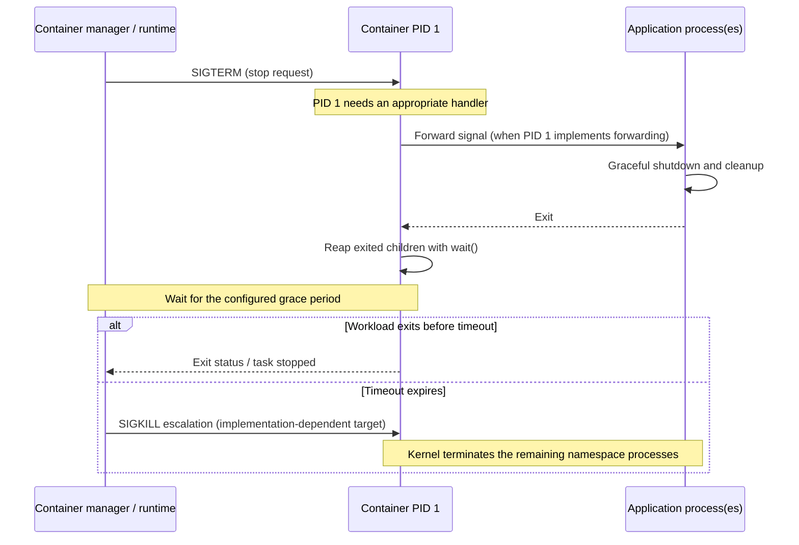

### 13.3 Lightweight init helper

Container runtime နဲ့ image အချို့မှာ `tini` လို lightweight init helper ကို PID 1 အဖြစ် run နိုင်ပါတယ်။ Tini က child application ကို စတင်ပေးပြီး signal forwarding နဲ့ zombie reaping ကို ကူညီပါတယ်။ [^15] ဒီနည်းလမ်းက application ကိုယ်တိုင် PID 1 အတွက် လိုအပ်တဲ့ signal handler၊ forwarding နဲ့ reaping logic အားလုံးရေးစရာ မလိုအောင် ကူညီနိုင်ပါတယ်။ သို့သော် helper တစ်ခုတည်းကို container အားလုံးမှာ မဖြစ်မနေ သုံးရမယ်ဆိုတဲ့ rule မရှိပါဘူး။ Application ကိုယ်တိုင်က လိုအပ်တဲ့ behavior တွေကို မှန်ကန်စွာ အကောင်အထည်ဖော်ထားနိုင်ပါတယ်။

## 14. `/proc` မှာ Process အချက်အလက်တွေ ကြည့်ခြင်း

`/proc` ဟာ disk ပေါ်မှာ ဖိုင်တွေ သိမ်းထားတဲ့ ပုံမှန် filesystem မဟုတ်ပါဘူး။ [^7] Kernel က လက်ရှိ system နဲ့ process အခြေအနေကို user space ကနေ ကြည့်နိုင်ဖို့ ပေးထားတဲ့ pseudo-filesystem ဖြစ်ပါတယ်။ `/proc/PID` အောက်မှာ PID တစ်ခုချင်းစီအတွက် directory ရှိနိုင်ပြီး process information ကို ဖတ်နိုင်ပါတယ်။

အသုံးများတဲ့ entry အချို့က —

| Path | ဖော်ပြချက် |
|---|---|
| `/proc/PID/status` | `Tgid`, `Pid`, `PPid`, `Threads`, `NStgid`, `NSpid` နဲ့ process state စတဲ့ အချက်အလက်များ |
| `/proc/PID/stat` | Process state နဲ့ accounting fields များ |
| `/proc/PID/cmdline` | Process စတင်စဉ် command-line arguments |
| `/proc/PID/exe` | Executable file ကို ညွှန်ပြတဲ့ symbolic link |
| `/proc/PID/cwd` | Current working directory ကို ညွှန်ပြတဲ့ symbolic link |
| `/proc/PID/fd/` | Process ရဲ့ file descriptor symbolic links များ |
| `/proc/PID/task/` | Process အတွင်း thread တစ်ခုချင်းစီရဲ့ directory များ |
| `/proc/self/` | `/proc` ကို လက်ရှိဖတ်နေတဲ့ process ကို ရည်ညွှန်းခြင်း |

ကိုယ့် shell process ရဲ့ status ကို ဖတ်ကြည့်မယ်ဆိုရင် —

```bash
cat "/proc/$$/status"
```

PID, PPID, thread count နဲ့ namespace-related field အချို့ကို အောက်ပါအတိုင်း စစ်ကြည့်နိုင်ပါတယ်။

```bash
grep -E '^(Name|State|Tgid|Pid|PPid|Threads|NStgid|NSpid):' \
    "/proc/$$/status"
```

`/proc/PID/status` ထဲက field တွေကို ခွဲဖတ်တဲ့အခါ အောက်ပါအဓိပ္ပာယ်တွေကို မှတ်ထားပါ။ [^7]

| Field | အဓိပ္ပာယ် |
|---|---|
| `Tgid` | Thread group ID — multithreaded process တစ်ခုလုံးကို ကိုယ်စားပြုတဲ့ process ID |
| `Pid` | ဖတ်နေတဲ့ task ရဲ့ ID — Linux မှာ thread တစ်ခုချင်းစီရဲ့ TID |
| `PPid` | Parent process ID |
| `Threads` | အဲဒီ thread group ထဲက thread အရေအတွက် |
| `NStgid` | PID namespace hierarchy တစ်လျှောက် thread group ID (process PID) တွေကို အစဉ်လိုက်ပြထားတဲ့စာရင်း |
| `NSpid` | PID namespace hierarchy တစ်လျှောက် task/thread ID တွေကို အစဉ်လိုက်ပြထားတဲ့စာရင်း |

Process leader အတွက် `Pid` နဲ့ `Tgid` ဟာ ပုံမှန်အားဖြင့် တူညီပါတယ်။ အဲဒီ process ရဲ့ non-leader thread တစ်ခုကို `/proc/PID/task/TID/status` ကနေ ဖတ်ရင် `Pid` ဟာ အဲဒီ thread ရဲ့ TID ဖြစ်ပြီး `Tgid` က မူလ process ရဲ့ thread group ID အဖြစ် ရှိနေပါမယ်။

`NStgid` နဲ့ `NSpid` ကို မရောထွေးပါနဲ့။ `NStgid` က namespace တစ်ခုချင်းစီမှာ မြင်ရတဲ့ process/thread-group ID ကို ပြပါတယ်။ `NSpid` ကတော့ ဖတ်နေတဲ့ task ရဲ့ thread ID ကို namespace တစ်ခုချင်းစီအလိုက် ပြပါတယ်။ ပထမဆုံးတန်ဖိုးက `/proc` ကို mount လုပ်ထားတဲ့ PID namespace (kernel က mount လုပ်ထားရင် root PID namespace) အတွက်ဖြစ်ပြီး၊ နောက်တန်ဖိုးတွေက အဲဒီ process ပါဝင်နေတဲ့ ပိုမိုအတွင်းကျတဲ့ nested namespace တွေအလိုက် အစဉ်လိုက် ဖော်ပြထားပါတယ်။ အပြင်ဘက် view နဲ့ အတွင်းဘက် view ကြား PID mapping ကို နားလည်ဖို့ ဒီ field နှစ်ခုက အရေးကြီးပါတယ်။ [^14] Chapter 03 — Linux Namespaces မှာ PID namespace hierarchy ကို ဆက်လေ့လာပါမယ်။

`NStgid` သို့မဟုတ် `NSpid` field မရှိတာနဲ့ စနစ်မှာ PID namespace မရှိဘူးလို့ တန်းမဆုံးဖြတ်သင့်ပါဘူး။ Kernel version နဲ့ procfs view အပေါ်မူတည်ပြီး ဖော်ပြပုံ ကွာနိုင်ပါတယ်။ `/proc` ရဲ့ content တချို့ကို အခြား user ရဲ့ process အတွက် ဖတ်ဖို့ permission လိုနိုင်ပြီး `hidepid` ကဲ့သို့သော mount option တွေကလည်း မြင်နိုင်မှုကို ကန့်သတ်နိုင်ပါတယ်။

Process state ကို `ps` ရဲ့ `STAT` column သို့မဟုတ် `/proc/PID/stat` မှာ ကြည့်နိုင်ပါတယ်။ အသုံးများတဲ့ state များမှာ —

- `R` — Running သို့မဟုတ် runnable ဖြစ်နေခြင်း။
- `S` — Interruptible sleep; event တစ်ခုကို စောင့်နေခြင်း။
- `D` — Uninterruptible sleep; မကြာခဏ I/O-related wait ဖြစ်ခြင်း။
- `T` — Stopped ဖြစ်နေခြင်း။
- `t` — Tracing stop ဖြစ်နေခြင်း။
- `Z` — Zombie ဖြစ်နေခြင်း။
- `I` — Idle kernel thread state အချို့တွင် တွေ့နိုင်ခြင်း။

State code တွေဟာ process တစ်ခုရဲ့ အခြေအနေကို အတိုချုပ်ပြတာဖြစ်ပြီး scheduler behavior တစ်ခုလုံးကို မဖော်ပြနိုင်ပါဘူး။ ထို့အပြင် `ps` မှာတွေ့ရတဲ့ state modifier တွေဟာ အခြေခံ state letter နဲ့ ပေါင်းစပ်ဖော်ပြနိုင်ပါတယ်။

## 15. `strace` နဲ့ System Call တွေကို ကြည့်ခြင်း

`ps` နဲ့ `/proc` က process ရဲ့ လက်ရှိအခြေအနေကို စစ်ဆေးဖို့ အသုံးဝင်ပါတယ်။ ဒါပေမယ့် process တစ်ခု ဘယ် system call တွေကို ဘယ်အစဉ်လိုက် ခေါ်နေသလဲဆိုတာကို မြင်ချင်ရင် `strace` ကို အသုံးပြုနိုင်ပါတယ်။

`strace` ဟာ Linux process တွေရဲ့ system call, argument, return value နဲ့ signal interaction အချို့ကို trace လုပ်ပေးတဲ့ diagnostic tool ဖြစ်ပါတယ်။ [^8] သာမန်အသုံးပြုသူအဖြစ် ကိုယ်ပိုင် process တစ်ခုကို run လုပ်ပြီး trace လုပ်နိုင်ပါတယ်။ အခြား user ရဲ့ process ကို attach လုပ်ဖို့တော့ permission သို့မဟုတ် kernel security policy က ခွင့်ပြုချက် လိုနိုင်ပါတယ်။

ဥပမာ —

```bash
trace_file=$(mktemp "$HOME/process-trace.XXXXXX") || exit 1
printf 'Trace file: %s\n' "$trace_file"

strace -f -e trace=%process \
  -o "$trace_file" \
  /bin/sh -c 'sleep 1; printf "finished\n"'

# Inspect the trace, then remove only the file created above.
grep -E 'execve|clone|fork|vfork|wait|exit' "$trace_file"
rm -- "$trace_file"
unset trace_file
```

ဒီ command မှာ —

- `-f` က child process တွေကို follow လုပ်ဖို့ အသုံးပြုပါတယ်။
- `-e trace=%process` က process creation, execution နဲ့ termination ဆိုင်ရာ syscall class ကို ရွေးချယ်ပါတယ်။
- `-o` က output ကို သတ်မှတ်ထားတဲ့ log file ထဲမှာ သိမ်းပါတယ်။ ဒီဥပမာမှာ `mktemp` နဲ့ unique filename ဖန်တီးထားတာကြောင့် ရှိပြီးသား user file ကို overwrite မလုပ်မိစေပါဘူး။
- `/bin/sh -c ...` က shell command string ကို run လုပ်ပါတယ်။

Shell implementation နဲ့ system configuration ပေါ်မူတည်ပြီး `clone()`, `fork()`, `vfork()`, `execve()`, `wait4()` သို့မဟုတ် အခြား process-related call တွေကို တွေ့နိုင်ပါတယ်။ Output တစ်ခုတည်းကို အားလုံးသော Linux system တွေမှာ တိတိကျကျ တူညီမယ်လို့ မယူဆပါနဲ့။ `strace` က program ရဲ့ behavior ကို ပြောင်းလဲစေနိုင်တဲ့ tracing overhead ရှိတာကြောင့် performance benchmark အတွက် အစားထိုးအသုံးမပြုသင့်ပါဘူး။

## 16. Container Runtime နဲ့ Process Lifecycle

အခုအထိ လေ့လာခဲ့တဲ့ mechanism တွေဟာ container runtime တစ်ခုအလုပ်လုပ်ပုံကို နားလည်ဖို့ အခြေခံဖြစ်ပါတယ်။ ပုံမှန် Linux OS-level container တစ်ခုမှာ workload ဟာ host kernel ကို အတူအသုံးပြုနေတဲ့ process တစ်ခု ဒါမှမဟုတ် process tree တစ်ခု ဖြစ်ပါတယ်။ Runtime က အဲဒီ workload ကို စတင်နိုင်ဖို့ process creation နဲ့ kernel facilities တွေကို စီစဉ်ပေးပါတယ်။

Conceptual startup flow ကို အောက်ပါအတိုင်း စဉ်းစားနိုင်ပါတယ်။

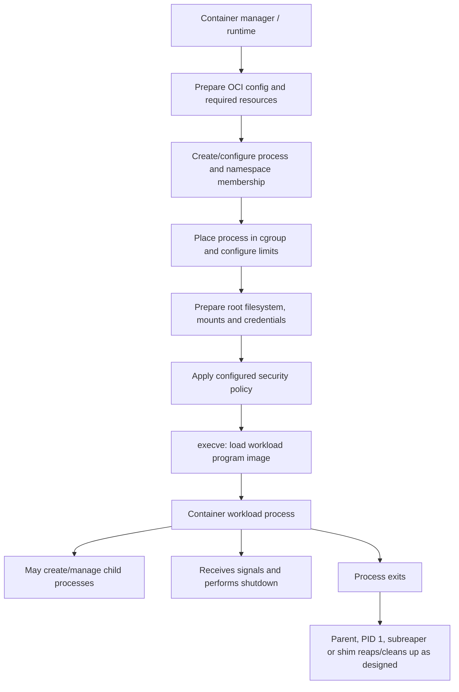

ဒီပုံက container startup ကို concept အရ နားလည်ဖို့ ဆွဲထားတဲ့ flow ပါ။ Runtime အားလုံးမှာ syscall အစီအစဉ် ဒီအတိုင်းပဲ ဖြစ်မယ်လို့ မဆိုလိုပါဘူး။ Runtime တစ်ခုနဲ့တစ်ခုကြား process creation, namespace setup, cgroup placement နဲ့ filesystem setup အစီအစဉ် ကွာနိုင်ပါတယ်။ containerd ရဲ့ Runtime v2 model မှာတော့ daemon က runtime shim နဲ့ coordinate လုပ်ပြီး shim က သီးခြား runtime engine (ဥပမာ `runc`) ကို invoke လုပ်နိုင်ပါတယ်။ ဒီ shim-plus-engine ပုံစံက containerd implementation တစ်ခုဖြစ်ပြီး runtime အားလုံးမှာ မဖြစ်မနေ ဒီလိုပဲ အလုပ်လုပ်ရမယ်လို့ မဆိုလိုပါဘူး။ [^16] Child process တွေကို ဘယ်သူက reap လုပ်သလဲဆိုတာလည်း PID 1၊ subreaper၊ shim နဲ့ runtime architecture အပေါ် မူတည်ပါတယ်။ မှတ်ထားရမှာက container ထဲက workload ဟာ နောက်ဆုံးမှာ Linux kernel က စီမံနေတဲ့ process/task အဖြစ်ပဲ run နေတာပါ။

`fork()` နဲ့ `execve()` ကို နားလည်ထားခြင်းက process creation ကို ရှင်းပြပေးပါတယ်။ `clone()` family က namespace နဲ့ sharing behavior ကို နားလည်ဖို့ အခြေခံပေးပါတယ်။ `wait()` နဲ့ signal handling က container shutdown မှာ zombie မကျန်စေဘဲ child တွေကို စနစ်တကျ ရပ်တန့်ဖို့ အရေးကြီးပါတယ်။ အဲဒီအချက်တွေကို Chapter 3 (Namespaces), Chapter 4 (cgroups) နဲ့ runtime chapters တွေမှာ ဆက်လက်အသုံးချပါမယ်။

---

## 17. လက်တွေ့ Lab များ

> **Validation status:** ဒီ Lab သုံးခုကို Fedora အတွက် ပြင်ဆင်ထားပေမယ့် target Fedora environment မှာ လက်တွေ့ run လုပ်ပြီး အတည်ပြုထားတာ မရှိသေးပါဘူး။ ဒါကြောင့် အားလုံးရဲ့ status ကို **Designed, not tested** လို့ သတ်မှတ်ထားပါတယ်။ Expected output တွေက ကြိုတင်ခန့်မှန်းထားတဲ့ ဥပမာတွေဖြစ်ပြီး စမ်းသပ်မှုရလဒ် မဟုတ်ပါဘူး။

### Lab 2.1 — Process Tree နဲ့ `/proc` ကို စစ်ဆေးခြင်း

#### ရည်ရွယ်ချက်

လက်ရှိ shell ရဲ့ PID/PPID, process state, command line နဲ့ thread count ကို စစ်ဆေးပြီး process tree နဲ့ `/proc` entry တွေ ဘယ်လိုဆက်စပ်နေသလဲ လေ့လာရန်။

#### ဒီ Lab မှာ ကြည့်မယ့်အချက်များ

PID, PPID, process tree, `/proc/PID/status`, process state, file descriptor directory။

#### လိုအပ်ချက်များ

- Fedora Linux desktop သို့မဟုတ် terminal access ရှိသော Fedora စနစ်။
- `ps`, `cat`, `grep`, `readlink`, `less` command များ (ပုံမှန် Fedora installation တွင် ရှိလေ့ရှိသည်)။
- Root permission မလိုအပ်ပါ။ အခြား user ပိုင် process information အချို့ကို ဖတ်ရာတွင် permission ကန့်သတ်ချက် ရှိနိုင်သည်။
- Resource usage အလွန်နည်းသည်။

#### အဆင့်များ

**၁။ Shell ရဲ့ PID ကို ကြည့်ပါ။**

```bash
echo "Shell PID: $$"
ps -o pid,ppid,stat,comm,args -p "$$"
```

ပထမ command က shell က အစားထိုးပေးတဲ့ PID ကို ပြပြီး ဒုတိယ command က process metadata ကို ဖော်ပြပါတယ်။

**၂။ Parent process ကို စစ်ပါ။**

```bash
parent_pid=$(ps -o ppid= -p "$$" | tr -d ' ')
ps -o pid,ppid,stat,comm,args -p "$parent_pid"
```

ဒီ command က လက်ရှိ shell ရဲ့ PPID ကို ရယူပြီး အဲဒီ PID ရဲ့ အချက်အလက်ကို ပြပါတယ်။

**၃။ Process tree ကို ကြည့်ပါ။**

```bash
ps -eo pid,ppid,stat,comm --forest | less
```

ကိုယ့် terminal နဲ့ shell ကို ရှာကြည့်ပါ။ `less` ထဲကနေ ထွက်ဖို့ `q` ကို နှိပ်ပါ။

**၄။ `/proc` ထဲက status ကို ဖတ်ပါ။**

```bash
cat "/proc/$$/status"
grep -E '^(Name|State|Tgid|Pid|PPid|Threads|NStgid|NSpid):' \
  "/proc/$$/status"
```

`Pid`, `PPid`, `State`, `Threads`, `NStgid` နဲ့ `NSpid` field တွေကို စောင့်ကြည့်ပါ။ ကိုယ့် shell ဟာ process leader ဖြစ်လေ့ရှိတာကြောင့် `Pid` နဲ့ `Tgid` တူညီနေတာကို တွေ့နိုင်ပါတယ်။ Nested PID namespace ရှိတဲ့ environment မှာ `NStgid` နဲ့ `NSpid` ထဲမှာ နံပါတ်တစ်ခုထက်ပိုပြီး ပါနိုင်ပါတယ်။

**၅။ Executable နဲ့ current working directory ကို စစ်ပါ။**

```bash
readlink "/proc/$$/exe"
readlink "/proc/$$/cwd"
```

**၆။ Open file descriptors ကို ကြည့်ပါ။**

```bash
ls -l "/proc/$$/fd"
```

Output ထဲက `0`, `1`, `2` descriptor တွေက ပုံမှန်အားဖြင့် standard input, standard output နဲ့ standard error ကို ကိုယ်စားပြုပါတယ်။ သို့သော် shell သို့မဟုတ် terminal configuration ပေါ်မူတည်ပြီး target ကွာနိုင်ပါတယ်။

#### မျှော်မှန်းရလဒ်

- `ps` output မှာ PID နဲ့ PPID တို့ကို တွေ့ရမယ်။
- `/proc/$$/status` ထဲမှာ `State`, `Tgid`, `Pid`, `PPid`, `Threads`, `NStgid`, `NSpid` စတဲ့ field တွေ တွေ့နိုင်တယ်။ PID namespace တစ်ခုတည်းနဲ့ run နေရင် `NStgid` နဲ့ `NSpid` မှာ နံပါတ်တစ်ခုတည်းသာ ပြနိုင်ပြီး nested namespace ရှိမှသာ အဆင့်လိုက် mapping များစွာ တွေ့နိုင်တယ်။
- `/proc/$$/exe` နဲ့ `/proc/$$/cwd` က symbolic link target တွေကို ပြမယ်။
- `/proc/$$/fd` ထဲမှာ process က ဖွင့်ထားတဲ့ descriptor များကို တွေ့နိုင်မယ်။

#### ရလဒ်ကို ဘယ်လိုဖတ်မလဲ

PID နဲ့ PPID တို့ဟာ process tree ထဲမှာ မိမိရဲ့နေရာကို ပြပါတယ်။ `Tgid` က thread group ကို ကိုယ်စားပြုပြီး `Pid` က ဖတ်နေတဲ့ task ရဲ့ TID ကို ပြပါတယ်။ Process leader ဖြစ်တဲ့ shell မှာ ဒီနှစ်ခု တူညီနေတာ ပုံမှန်ပါပဲ။ `NStgid` က PID namespace တစ်ခုချင်းစီရဲ့ process ID mapping ဖြစ်ပြီး `NSpid` က thread ID mapping ဖြစ်တာကို သီးခြားမှတ်ထားပါ။ `/proc` က process တစ်ခုရဲ့ live kernel-exposed information ကို ဖတ်လို့ရစေပါတယ်။ `/proc/PID` ထဲက file အားလုံးဟာ regular file မဟုတ်ကြောင်း သတိပြုပါ။ Kernel က ဖတ်တဲ့အချိန်မှာ data ကို ဖန်တီးပေးနိုင်ပါတယ်။

#### ပြဿနာဖြစ်လာရင်

- `/proc/$$` မတွေ့ပါက shell က `$$` ကို အစားမထိုးနိုင်တဲ့ shell/script context ဖြစ်မဖြစ် စစ်ပါ။
- `ps` မရှိပါက `procps-ng` package ကို စစ်ဆေးပါ။ Fedora မှာ `sudo dnf install procps-ng` ဖြင့် install လုပ်နိုင်သည်။ Package install လုပ်ချိန်မှာသာ root permission လိုသည်။
- Permission denied ဖြစ်ပါက အခြား user ရဲ့ process ကို စစ်နေခြင်းလား စစ်ပါ။ ဒီ lab အတွက် မိမိ shell PID ကိုပဲ အသုံးပြုပါ။

#### Cleanup

ဒီ lab က data file သို့မဟုတ် configuration ကို မပြောင်းလဲပါဘူး။ `less` ကို `q` နှိပ်ပြီး ပိတ်လိုက်ရုံပါပဲ။

#### ပြန်လည်သုံးသပ်ရန်

1. PID နဲ့ PPID ဘာကွာသလဲ။
2. `/proc/PID/status` နဲ့ `/proc/PID/stat` ဘာကြောင့် နှစ်မျိုးလုံး ရှိသလဲ။
3. `/proc/PID/fd/` ထဲမှာ တွေ့ရတဲ့ entry တွေဟာ file descriptor နံပါတ်တွေကို ဘယ်လိုဖော်ပြသလဲ။

### Lab 2.2 — `fork()`, `execve()` နဲ့ `waitpid()` ကို C Program နဲ့ လေ့လာခြင်း

#### ရည်ရွယ်ချက်

Parent က child process တစ်ခု ဖန်တီးပြီး child က `exec` family ကို သုံးကာ program အသစ် run လုပ်ပုံကို ကြည့်ပါမယ်။ ပြီးရင် parent က `waitpid()` နဲ့ child ကို ဘယ်လို reap လုပ်သလဲဆိုတာကိုလည်း လေ့လာပါမယ်။

#### ဒီ Lab မှာ ကြည့်မယ့်အချက်များ

`fork()`, `execve()` family, PID, parent-child relationship, exit status, `waitpid()`။

#### လိုအပ်ချက်များ

- Fedora Linux။
- C compiler (`gcc`) နှင့် standard C library development environment။
- Root permission မလိုအပ်ပါ။ `gcc` မရှိသေးပါက package install အတွက်သာ root permission လိုနိုင်သည်။
- Resource usage နည်းသည်။ Child process က ၂ စက္ကန့်ခန့် `sleep` လုပ်မည်။

#### အဆင့်များ

**၁။ Lab အတွက် သီးသန့် directory တစ်ခု ဖန်တီးပါ။**

```bash
lab_dir=$(mktemp -d -t chapter02.XXXXXX)
cd "$lab_dir"
printf 'Lab directory: %s\n' "$PWD"
```

`mktemp -d` က `/tmp` အောက်မှာ ကျပန်းအမည်ရှိတဲ့ directory တစ်ခု ဖန်တီးပေးပါတယ်။ ဒီလိုထားတာက Lab ဖိုင်တွေနဲ့ ကိုယ့် project ဖိုင်တွေ မရောစေဖို့ပါ။ Cleanup လုပ်တဲ့အချိန်အထိ ဒီ terminal session ကို ဆက်သုံးပါ။

**၂။ `gcc` ရှိမရှိ စစ်ပါ။**

```bash
gcc --version
```

မရှိသေးပါက Fedora package manager နဲ့ install လုပ်နိုင်ပါတယ်။

```bash
sudo dnf install gcc
```

**၃။ `process-demo.c` ဖိုင်တစ်ခု ဖန်တီးပါ။**

```c
#include <errno.h>
#include <stdio.h>
#include <stdlib.h>
#include <sys/types.h>
#include <sys/wait.h>
#include <unistd.h>

int main(void)
{
    pid_t child = fork();

    if (child == -1) {
        perror("fork");
        return EXIT_FAILURE;
    }

    if (child == 0) {
        printf("Child before exec: PID=%ld, PPID=%ld\n",
               (long)getpid(), (long)getppid());
        fflush(stdout);

        execlp("sleep", "sleep", "2", (char *)NULL);

        perror("execlp");
        _exit(127);
    }

    printf("Parent: PID=%ld, child PID=%ld\n",
           (long)getpid(), (long)child);

    int status;
    pid_t result;
    do {
        result = waitpid(child, &status, 0);
    } while (result == -1 && errno == EINTR);

    if (result == -1) {
        perror("waitpid");
        return EXIT_FAILURE;
    }

    if (WIFEXITED(status)) {
        int child_status = WEXITSTATUS(status);
        printf("Child exited normally: status=%d\n", child_status);
        return child_status == 0 ? EXIT_SUCCESS : EXIT_FAILURE;
    }

    if (WIFSIGNALED(status)) {
        printf("Child terminated by signal: %d\n", WTERMSIG(status));
        return EXIT_FAILURE;
    }

    fprintf(stderr, "Child changed state unexpectedly.\n");
    return EXIT_FAILURE;
}
```

ဒီ program မှာ `fork()` က child ကို ဖန်တီးပါတယ်။ Child က `execlp()` နဲ့ `sleep` executable ကို run လုပ်ပါတယ်။ `execlp()` ဟာ `execve()` ကို အခြေခံထားတဲ့ libc interface ဖြစ်ပါတယ်။ `execlp()` မအောင်မြင်မှသာ `perror()` နဲ့ error ပြပြီး `_exit(127)` ကို ခေါ်ပါတယ်။ ဒီနေရာမှာ `_exit()` သုံးတာက child ဘက်မှာ မလိုအပ်တဲ့ stdio cleanup ထပ်မလုပ်စေဖို့ပါ။ Parent က `waitpid()` နဲ့ child ပြီးဆုံးတာကို စောင့်ပါတယ်။ `EINTR` ဖြစ်တဲ့အခါ wait ကို ပြန်ကြိုးစားဖို့ loop ထည့်ထားပါတယ်။ အဓိက error တွေဖြစ်တဲ့ `fork()` နဲ့ `waitpid()` failure ကို စစ်ထားပြီး child ဘက်မှာ `execlp()` မအောင်မြင်ရင် `_exit(127)` နဲ့ ထွက်ပါတယ်။

**၄။ Compile လုပ်ပြီး run ပါ။**

```bash
gcc -Wall -Wextra -O2 -o process-demo process-demo.c
./process-demo
```

#### မျှော်မှန်းရလဒ်

Output အစီအစဉ်ဟာ parent နဲ့ child တို့ ဘယ်အချိန် run ဖြစ်သလဲဆိုတာပေါ် မူတည်ပြီး ပြောင်းလဲနိုင်ပါတယ်။ ဥပမာ —

```text
Parent: PID=6100, child PID=6101
Child before exec: PID=6101, PPID=6100
Child exited normally: status=0
```

အထက်ပါ PID တွေဟာ ကြိုတင်ပြထားတဲ့ ဥပမာ output သာဖြစ်ပြီး လက်တွေ့စမ်းသပ်ရလဒ် မဟုတ်ပါဘူး။ အမှန်တကယ် run ချိန်မှာ မတူညီတဲ့ နံပါတ်တွေ ရရှိမယ်။ Parent နဲ့ child ရဲ့ print order ကလည်း scheduling အပေါ်မူတည်ပြီး ပြောင်းနိုင်ပါတယ်။ သို့သော် child က `exec` လုပ်ပြီးနောက် process PID ဆက်တူညီနေမယ်၊ `sleep` ပြီးဆုံးတဲ့အခါ parent က wait လုပ်ပြီး reap လုပ်မယ်ဆိုတဲ့ behavior ကို စောင့်ကြည့်ပါ။

#### နောက်ကွယ်မှာ ဘာဖြစ်နေလဲ

`fork()` ဟာ child process တစ်ခု ဖန်တီးပြီး parent နဲ့ child ကို execution ဆက်လုပ်စေပါတယ်။ Child ရဲ့ `execlp()` အောင်မြင်တဲ့အခါ libc က executable ကို ရှာဖွေပြီး လိုအပ်တဲ့ `execve()` ကို ခေါ်ကာ child ရဲ့ program image ကို `sleep` နဲ့ အစားထိုးပါတယ်။ PID က မပြောင်းပါဘူး။ `sleep` ပြီးဆုံးသွားရင် kernel က child ရဲ့ termination status ကို parent က `waitpid()` နဲ့ ရယူနိုင်အောင် ထိန်းသိမ်းပေးပါတယ်။ Parent က status ကို ဖတ်ပြီးနောက် child ဟာ reap လုပ်ပြီးဖြစ်ပါတယ်။

#### ပြဿနာဖြစ်လာရင်

- `fork: Resource temporarily unavailable` ဖြစ်ပါက process limit သို့မဟုတ် system resource limit ကို စစ်ပါ။ ဒီ lab ကို ထပ်ခါထပ်ခါ process အများအပြားဖန်တီးပြီး မစမ်းပါနဲ့။
- `execlp: No such file or directory` ဖြစ်ပါက `sleep` command ရှိမရှိ `command -v sleep` နဲ့ စစ်ပါ။
- `gcc: command not found` ဖြစ်ပါက `gcc` package install လုပ်ပါ။
- Compile warning ရှိပါက warning ကို လျစ်လျူမရှုဘဲ code နဲ့ include file တွေကို ပြန်စစ်ပါ။

#### Optional — `strace` နဲ့ ဒီ program ရဲ့ syscall တွေကို ချိတ်ကြည့်ခြင်း

`strace` package ရှိပြီးသားဆိုရင် Lab 2.3 မလုပ်ခင် ဒီ binary ကို trace လုပ်ပြီး `fork()`/`execve()`/`waitpid()` တို့ရဲ့ Linux syscall အမည်တွေကို ကြည့်နိုင်ပါတယ်။ ဒီ command က Lab directory ထဲမှာပဲ run ပါ။

```bash
strace -f -e trace=%process ./process-demo
```

Source code ထဲက `fork()` ဟာ trace မှာ `clone()` အဖြစ် ပေါ်နိုင်ပြီး `waitpid()` ဟာ `wait4()` သို့မဟုတ် အခြား wait-family entry အဖြစ် ပေါ်နိုင်ပါတယ်။ ဒီကွာခြားချက်ကို Section 7 ရဲ့ interface ဇယားနဲ့ ပြန်ချိတ်ကြည့်ပါ။ Exact syscall sequence က glibc၊ architecture နဲ့ shell/runtime ပေါ်မူတည်ပြီး ကွာနိုင်ပါတယ်။

#### Optional — Zombie state ကို ခဏကြည့်ခြင်း

`waitpid()` ရဲ့ အခန်းကဏ္ဍကို ပိုမြင်သာစေဖို့ zombie state ကို ခဏလောက် ကြည့်နိုင်ပါတယ်။ ဒီဥပမာမှာ child က ချက်ချင်းပြီးဆုံးသွားပြီး parent က `waitpid()` မခေါ်ခင် ၈ စက္ကန့် စောင့်ပါမယ်။ အဲဒီအချိန်အတွင်း ဒုတိယ terminal ကနေ child ရဲ့ state ကို စစ်နိုင်ပါတယ်။ Parent က timer ပြီးတာနဲ့ child ကို reap လုပ်မှာဖြစ်လို့ zombie ကို ရည်ရွယ်ချက်ရှိရှိ ကြာကြာမထားပါဘူး။

`zombie-demo.c` ဖိုင်ထဲမှာ အောက်ပါ code ကို သိမ်းပါ။

```c
#include <errno.h>
#include <stdio.h>
#include <stdlib.h>
#include <sys/types.h>
#include <sys/wait.h>
#include <unistd.h>

int main(void)
{
    pid_t child = fork();
    if (child == -1) {
        perror("fork");
        return EXIT_FAILURE;
    }

    if (child == 0) {
        _exit(EXIT_SUCCESS);
    }

    printf("Child PID: %ld\n", (long)child);
    printf("Check this PID from another terminal within 8 seconds.\n");
    fflush(stdout);
    unsigned int remaining = 8;
    while (remaining > 0) {
        remaining = sleep(remaining);
    }

    int status;
    pid_t result;
    do {
        result = waitpid(child, &status, 0);
    } while (result == -1 && errno == EINTR);

    if (result == -1) {
        perror("waitpid");
        return EXIT_FAILURE;
    }

    puts("Child reaped.");
    return EXIT_SUCCESS;
}
```

Compile လုပ်ပြီး run ပါ။

```bash
gcc -Wall -Wextra -O2 -o zombie-demo zombie-demo.c
./zombie-demo
```

Program က `Child PID: ...` လို့ ပြတဲ့ PID ကို မှတ်ထားပါ။ ၈ စက္ကန့် မပြည့်ခင် ဒုတိယ terminal မှာ variable ထဲ အဲဒီနံပါတ်ကို ထည့်ပြီး စစ်ပါ။ အောက်က `12345` ကို ကိုယ့် terminal မှာ ပြထားတဲ့ PID နဲ့ အစားထိုးပါ။

```bash
child_pid=12345  # Replace 12345 with the PID printed by zombie-demo
ps -o pid,ppid,stat,comm -p "$child_pid"
```

`STAT` column မှာ `Z` ကို တွေ့နိုင်ပါတယ်။ ဒါက child က exit လုပ်ပြီးသားဖြစ်ပေမယ့် parent က `waitpid()` မခေါ်ရသေးတာကြောင့် kernel က termination information ကို ခဏထိန်းထားတဲ့ အခြေအနေပါ။ Parent ရဲ့ ၈ စက္ကန့် timer ပြည့်သွားတဲ့အခါ `waitpid()` က အဲဒီ information ကို ရယူပြီး zombie entry ကို ဖယ်ရှားပေးပါတယ်။

ဒီ demonstration မှာ program ကိုယ်တိုင် child ကို reap လုပ်ပါတယ်။ စမ်းသပ်မှုအတွင်း အခြား process တွေကို signal ပို့စရာမလိုပါဘူး။ Program ကို `Ctrl+C` နဲ့ ဖြတ်လိုက်ရင် parent က child မရှိတော့တဲ့အခါ orphans/zombies ကို system reaper က စီမံနိုင်ပေမယ့် ပုံမှန်အခြေအနေမှာ timer ပြီးဆုံးတဲ့အထိ ထားပြီး `Child reaped.` ဆိုတာကို မြင်အောင် စောင့်ပါ။

#### Cleanup

Lab မှာ ဖန်တီးခဲ့တဲ့ file လေးခုကိုပဲ ဖယ်ရှားပြီး temporary directory ကို ပိတ်သိမ်းပါ။ အရင်ဆုံး လက်ရှိနေရာနဲ့ ဖိုင်တွေကို စစ်ပါ။

```bash
pwd
ls -l process-demo process-demo.c zombie-demo zombie-demo.c 2>/dev/null
rm -f -- process-demo process-demo.c zombie-demo zombie-demo.c
cd ..
rmdir -- "$lab_dir"
```

`rm -f` က optional zombie demo မလုပ်ထားလို့ ဖိုင်မရှိရင် error မပြဘဲ ကျော်သွားပါတယ်။ `rmdir` က directory အလွတ်ဖြစ်မှ ဖယ်ရှားပေးမှာပါ။ မသိတဲ့ဖိုင် ကျန်နေရင် `rmdir` က မဖျက်နိုင်ဘဲ error ပြပါလိမ့်မယ်။ အဲဒီအခါ `rm -r` နဲ့ အတင်းမဖျက်ပါနဲ့။ ကျန်နေတဲ့ဖိုင်ကို အရင်စစ်ပါ။

#### ပြန်လည်သုံးသပ်ရန်

1. `fork()` က parent နဲ့ child ထဲမှာ ဘာ return value ကွာခြားသလဲ။
2. `execve()` အောင်မြင်သွားတဲ့အခါ child ရဲ့ PID ဘာကြောင့် မပြောင်းသလဲ။
3. Parent က `waitpid()` မခေါ်ခဲ့ရင် child termination နောက်မှာ ဘာအခြေအနေ ဖြစ်နိုင်သလဲ။

### Lab 2.3 — `strace` နဲ့ Process System Call တွေကို Trace လုပ်ခြင်း

#### ရည်ရွယ်ချက်

Shell က external command တစ်ခု run လုပ်တဲ့အခါ process creation နဲ့ `execve()` ဆိုင်ရာ system call တွေ ဘယ်လိုပေါ်လာသလဲဆိုတာကို ကြည့်ပါမယ်။

#### ဒီ Lab မှာ ကြည့်မယ့်အချက်များ

System call boundary, process creation, `execve()`, child tracking, `wait` family။

#### လိုအပ်ချက်များ

- Fedora Linux။
- `strace` package။ Fedora package information ကို [strace package page](https://packages.fedoraproject.org/pkgs/strace/strace/) မှာ ကြည့်နိုင်ပါတယ်။ [^10]
- ကိုယ်တိုင် run လုပ်မယ့် process ကို trace လုပ်ဖို့ root permission မလိုအပ်လေ့ရှိပါ။ System-wide attach သို့မဟုတ် အခြား user process ကို trace လုပ်ရာမှာ permission ကန့်သတ်ချက် ရှိနိုင်ပါတယ်။
- Resource usage နည်းသည်။ Tracing က သာမန် run ထက် ပိုမိုနှေးစေနိုင်သည်။

#### အဆင့်များ

**၁။ `strace` ရှိမရှိ စစ်ပါ။**

```bash
strace --version
```

မရှိသေးပါက install လုပ်ပါ။

```bash
sudo dnf install strace
```

**၂။ Process-related system call တွေကို trace လုပ်ပါ။**

```bash
trace_file=$(mktemp "$HOME/process-trace.XXXXXX") || {
  printf 'Could not create a temporary trace file.\n' >&2
  exit 1
}
printf 'Trace file: %s\n' "$trace_file"

if ! strace -f -e trace=%process \
    -o "$trace_file" \
    /bin/sh -c 'sleep 1; printf "finished\n"'; then
  printf 'strace did not complete successfully.\n' >&2
  rm -- "$trace_file"
  unset trace_file
  exit 1
fi
```

ဒီ command က `mktemp` နဲ့ ကိုယ်ပိုင် temporary trace filename တစ်ခု ဖန်တီးပါတယ်။ `XXXXXX` ကို ကျပန်းစာလုံးတွေနဲ့ အစားထိုးပေးလို့ အရင်က ရှိပြီးသား user file တစ်ခုကို overwrite လုပ်မိနိုင်ခြေကို လျှော့ချပေးပါတယ်။ `-e trace=%process` က process-management ဆိုင်ရာ syscall class ကို ရွေးချယ်တာဖြစ်ပြီး `execve()` လို process lifecycle call တွေလည်း ပါဝင်ပါတယ်။ `-f` က shell က ဖန်တီးတဲ့ child process တွေကိုပါ follow လုပ်ပါတယ်။

Trace output ထဲမှာ ဘယ် syscall တွေ ပေါ်မလဲဆိုတာ system နဲ့ shell implementation အလိုက် ကွာနိုင်ပါတယ်။ `trace_file` variable ထဲမှာ တိတိကျကျ ဖန်တီးထားတဲ့ file path ကို ထိန်းထားတာဖြစ်လို့ cleanup အဆင့်မှာ အဲဒီ path ကိုပဲ အသုံးပြုပါ။ Wildcard နဲ့ trace filename အုပ်စုလိုက် မဖျက်ပါနဲ့။

**၃။ စိတ်ဝင်စားတဲ့ syscall တွေကို ရှာပါ။**

```bash
grep -E 'clone|fork|vfork|execve|wait4|waitid|exit' \
  "$trace_file"
```

#### မျှော်မှန်းရလဒ်

- `/bin/sh` နဲ့ `sleep` အတွက် `execve()` နဲ့ process creation ဆိုင်ရာ entry တွေ တွေ့နိုင်ပါတယ်။ `%process` class က process-related calls ကို စစ်ထုတ်ထားတာဖြစ်လို့ `write()` လို ပုံမှန် I/O call အားလုံးကို မျှော်လင့်မထားပါနဲ့။
- Shell က child process ကို စောင့်တဲ့အခါ `wait4()` သို့မဟုတ် wait family ထဲက call တစ်ခုကို တွေ့နိုင်ပါတယ်။
- Exact syscall အစီအစဉ်က shell implementation, libc, kernel version နဲ့ architecture အပေါ် မူတည်ပြီး ကွာနိုင်ပါတယ်။

#### နောက်ကွယ်မှာ ဘာဖြစ်နေလဲ

Shell ဟာ external command ကို run လုပ်ရာမှာ child process ဖန်တီးပြီး executable image ကို အစားထိုးနိုင်ပါတယ်။ `strace` က system call boundary ကို မှတ်တမ်းတင်တဲ့အတွက် application ထဲက function call တစ်ခုချင်းစီကို အတိအကျ ပြတာ မဟုတ်ပါဘူး။ ဥပမာ `printf()` က user-space library ကနေ အလုပ်လုပ်ပြီး output ရေးတဲ့အခါမှ `write()` syscall ကို ခေါ်နိုင်ပါတယ်။ ဒီ lab မှာ `write()` ကို trace filter ထဲ မထည့်ထားတာကြောင့် output ရေးတဲ့ call အားလုံးကို မြင်ရမယ်လို့ မမျှော်လင့်ပါနဲ့။

#### ပြဿနာဖြစ်လာရင်

- `Operation not permitted` ဖြစ်ပါက ကိုယ်ပိုင် process ကို trace လုပ်နေသလား စစ်ပါ။ Security policy ကို ပိတ်ပြီး ဖြေရှင်းဖို့ မကြိုးစားပါနဲ့။
- Output များလွန်းပါက `-e trace=%process` filter ကို မဖယ်ပါနဲ့။ ဒီ filter က process-related syscall class ကိုသာ ရွေးချယ်ဖို့ ဖြစ်ပါတယ်။
- Trace file မတွေ့ပါက `printf` မှာ ပြထားတဲ့ `Trace file:` path ကို စစ်ပါ။ `trace_file` variable ကို သတ်မှတ်ထားတဲ့ terminal session တစ်ခုတည်းမှာ command တွေ ဆက်လုပ်ပါ။

#### Cleanup

Trace file ကို စစ်ဆေးပြီး မလိုအပ်တော့ပါက ဖျက်နိုင်ပါတယ်။

```bash
ls -l -- "$trace_file"
rm -- "$trace_file"
unset trace_file
```

`mktemp` က ပြန်ပေးထားတဲ့ exact path ကိုသာ ဖျက်ပါ။ ဒီ variable ကို မသတ်မှတ်ထားတော့ဘူးဆိုရင် cleanup command ကို မ run ပါနဲ့။ ကိုယ်မဖန်တီးထားတဲ့ သို့မဟုတ် အရင်က ရှိနေပြီးသား user file ကို ခန့်မှန်းပြီး မဖျက်ပါနဲ့။ Wildcard (`*`) သုံးပြီး trace file တွေကို အစုလိုက် ဖျက်တာကိုလည်း ရှောင်ပါ။

#### ပြန်လည်သုံးသပ်ရန်

1. `strace -f` က ဘာကြောင့် အရေးကြီးသလဲ။
2. `execve()` ကို တွေ့ရခြင်းက process အသစ်ဖန်တီးလိုက်ပြီလို့ ဆိုလိုသလား။
3. `strace` output က application ရဲ့ function call အားလုံးကို အတိအကျ ဖော်ပြနိုင်သလား။

---

## 18. အနှစ်ချုပ်

ဒီအခန်းမှာ Linux process တစ်ခုဟာ executable file ကို run လုပ်နေတဲ့အချိန် kernel က စီမံပေးတဲ့ execution context ဖြစ်ကြောင်း လေ့လာခဲ့ပါတယ်။ PID/PPID နဲ့ process tree က process တွေရဲ့ identity နဲ့ parent-child relationship ကို ဖော်ပြပါတယ်။ Thread တွေဟာ kernel task သီးခြားတွေဖြစ်ပေမယ့် memory နဲ့ resource အချို့ကို process အတွင်းမှာ မျှဝေနိုင်ပါတယ်။

`fork()` က child process ဖန်တီးပေးပြီး Linux မှာ Copy-on-Write ကို အသုံးပြုနိုင်ပါတယ်။ `clone()` နဲ့ `clone3()` က resource sharing နဲ့ namespace placement ကို ပိုမိုထိန်းချုပ်နိုင်ပါတယ်။ `execve()` က process အသစ်မဖန်တီးဘဲ လက်ရှိ process ရဲ့ program image ကို အစားထိုးပါတယ်။ Parent က `wait()` / `waitpid()` နဲ့ child ရဲ့ termination status ကို ရယူပြီး zombie မကျန်စေဖို့ reap လုပ်ရပါတယ်။ Signal တွေက process တွေရဲ့ lifecycle ကို ထိန်းချုပ်ရာမှာ အရေးကြီးပြီး PID namespace ထဲက PID 1 ဟာ orphan reaping နဲ့ namespace lifecycle အတွက် အထူးတာဝန်ရှိပါတယ်။

နောက်ဆုံးအနေနဲ့ `/proc` နဲ့ `strace` ကို အသုံးပြုပြီး process information နဲ့ system call behavior ကို စစ်ဆေးနိုင်ပါတယ်။ ဒီအခြေခံတွေ သိထားရင် နောက်အခန်းမှာ Linux namespaces ကို လေ့လာတဲ့အခါ container တစ်ခုရဲ့ PID, process tree နဲ့ execution boundary တွေ ဘယ်လိုကွဲပြားလာသလဲဆိုတာကို ပိုမိုလွယ်ကူစွာ နားလည်နိုင်ပါမယ်။

## 19. ပြန်လည်သုံးသပ်ရန် မေးခွန်းများ

1. Program နဲ့ process ဘာကွာသလဲ။
2. Multithreaded process တစ်ခုမှာ PID/TGID နဲ့ TID တို့ ဘယ်လိုဆက်နွယ်သလဲ။
3. `fork()` အောင်မြင်တဲ့အခါ parent နဲ့ child တို့ ဘယ် return value ကို ရသလဲ။
4. Multithreaded process က `fork()` ခေါ်တဲ့အခါ child ထဲမှာ ဘာကြောင့် lock-related deadlock ဖြစ်နိုင်သလဲ။
5. Child က `execve()` မခေါ်ခင် async-signal-safe function တွေကိုသာ သုံးသင့်တာ ဘာကြောင့်လဲ။
6. `pthread_atfork()` က ဘာအတွက် အသုံးဝင်သလဲ၊ ဘာကြောင့် complete solution မဟုတ်နိုင်သလဲ။
7. Copy-on-Write က `fork()` ရဲ့ memory duplication cost ကို ဘယ်လိုလျှော့ချပေးသလဲ။
8. `CLONE_VM` နဲ့ `CLONE_NEWPID` တို့ရဲ့ ရည်ရွယ်ချက် ဘာကွာသလဲ။
9. `execve()` အောင်မြင်ပြီးနောက် PID၊ thread၊ signal handler နဲ့ file descriptor တို့မှာ ဘာတွေ ဆက်ရှိပြီး ဘာတွေ ပြောင်းလဲသလဲ။
10. Zombie process နဲ့ orphan process ဘာကွာသလဲ။
11. PID namespace ထဲက PID 1 ဆီ `SIGTERM` ရောက်နိုင်ဖို့ ဘယ်လို signal handling behavior လိုအပ်သလဲ။
12. Container shutdown မှာ SIGTERM, grace period နဲ့ SIGKILL တို့ ဘယ်လိုဆက်နွယ်သလဲ။
13. `/proc/PID/status` ထဲက `Tgid`, `Pid`, `NStgid` နဲ့ `NSpid` ဘာကွာသလဲ။
14. `strace` မှာ source code ထဲက `fork()` အစား `clone()`၊ `_exit()` အစား `exit_group()` ကို တွေ့နိုင်တာ ဘာကြောင့်လဲ။

## 20. ကိုးကားရင်းမြစ်များ

အောက်ပါ Linux man-pages တွေက system call နဲ့ process behavior ကို အသေးစိတ်ဖတ်ဖို့ အဓိကရင်းမြစ်တွေပါ။ `clone3()` နဲ့ PID namespace behavior လို kernel-version အလိုက် ကွာနိုင်တဲ့အချက်တွေကို လက်တွေ့အသုံးပြုမယ့် kernel ပေါ်မှာ ထပ်စစ်ဖို့ လိုပါတယ်။

[^1]: Linux man-pages Project, [`fork(2)` — create a child process](https://man7.org/linux/man-pages/man2/fork.2.html). `fork()` ရဲ့ parent/child return values၊ Copy-on-Write၊ inherited file descriptor behavior နဲ့ glibc NPTL wrapper က `clone()` ကို အသုံးပြုတဲ့အကြောင်း.
[^2]: Linux man-pages Project, [`clone(2)` / `clone3()` — create a child process](https://man7.org/linux/man-pages/man2/clone.2.html). Resource sharing flags၊ namespace flags၊ glibc `clone()` wrapper နဲ့ `clone3()` syscall interface.
[^3]: Linux man-pages Project, [`execve(2)` — execute a program](https://man7.org/linux/man-pages/man2/execve.2.html). Program image replacement၊ argument/environment arrays နဲ့ close-on-exec behavior.
[^4]: Linux man-pages Project, [`wait(2)` / `waitpid(2)` — wait for process to change state](https://man7.org/linux/man-pages/man2/waitpid.2.html). Child status၊ wait options နဲ့ zombie process behavior.
[^5]: Linux man-pages Project, [`signal(7)` — overview of signals](https://man7.org/linux/man-pages/man7/signal.7.html). Signal disposition၊ standard signal နဲ့ real-time signal တို့ရဲ့ queueing/delivery behavior.
[^6]: Linux man-pages Project, [`pid_namespaces(7)` — overview of Linux PID namespaces](https://man7.org/linux/man-pages/man7/pid_namespaces.7.html). Namespace init process၊ orphan adoption နဲ့ PID 1 exit behavior.
[^7]: Linux man-pages Project, [`proc(5)` — process information pseudo-filesystem](https://man7.org/linux/man-pages/man5/proc.5.html) and [`proc_pid_status(5)`](https://man7.org/linux/man-pages/man5/proc_pid_status.5.html). `/proc` entries and process/thread status fields.
[^8]: Linux man-pages Project, [`strace(1)`](https://man7.org/linux/man-pages/man1/strace.1.html). System-call tracing and `-f` child-process following behavior.
[^9]: Linux man-pages Project, [`getpid(2)`](https://man7.org/linux/man-pages/man2/getpid.2.html) and [`gettid(2)`](https://man7.org/linux/man-pages/man2/gettid.2.html). Process ID and thread ID interfaces.
[^10]: Fedora Packages, [`strace`](https://packages.fedoraproject.org/pkgs/strace/strace/) and [`procps-ng`](https://packages.fedoraproject.org/pkgs/procps-ng/procps-ng/). Fedora package information for the practical labs.
[^11]: Linux man-pages Project, [`exit(3)`](https://man7.org/linux/man-pages/man3/exit.3.html), [`_exit(2)`](https://man7.org/linux/man-pages/man2/_exit.2.html), and [`exit_group(2)`](https://man7.org/linux/man-pages/man2/exit_group.2.html). Difference between normal C library termination, the glibc `_exit()` wrapper and Linux thread/thread-group termination.

[^12]: Linux man-pages Project, [`pthread_atfork(3)`](https://man7.org/linux/man-pages/man3/pthread_atfork.3.html). Prepare/parent/child handlers and the risks of calling `fork()` from a multithreaded process, including mutex state inherited by the child.
[^13]: Linux man-pages Project, [`signal-safety(7)`](https://man7.org/linux/man-pages/man7/signal-safety.7.html) and [`pthreads(7)`](https://man7.org/linux/man-pages/man7/pthreads.7.html). Async-signal-safe interfaces and POSIX thread behavior.
[^14]: Linux man-pages Project, [`proc_pid_status(5)`](https://man7.org/linux/man-pages/man5/proc_pid_status.5.html). Definitions and namespace ordering for `Tgid`, `Pid`, `NStgid` and `NSpid`.
[^15]: Tini project, [README — A tiny but valid init for containers](https://github.com/krallin/tini/blob/master/README.md). Signal forwarding and zombie reaping behavior of a lightweight container init helper. Implementation-specific documentation; do not treat Tini behavior as a universal runtime rule.
[^16]: containerd Project, [Runtime v2 — Architecture](https://containerd.org/docs/2.3/runtime-v2/). Shim and runtime-engine responsibilities, task service, process I/O and reaping details in containerd's runc v2 integration. This reference is the containerd 2.3 documentation; check the deployed containerd and shim versions because implementation details can differ.