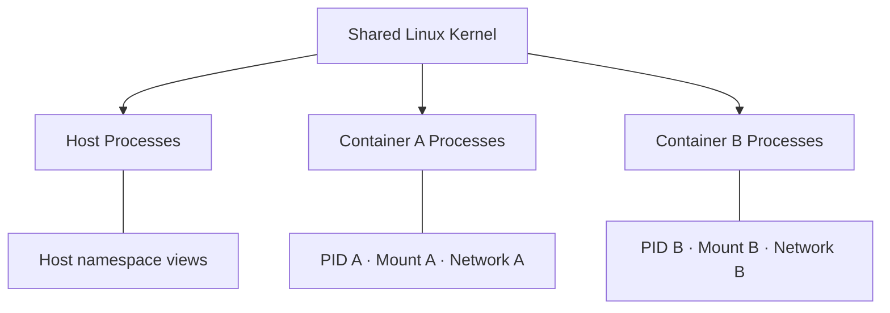
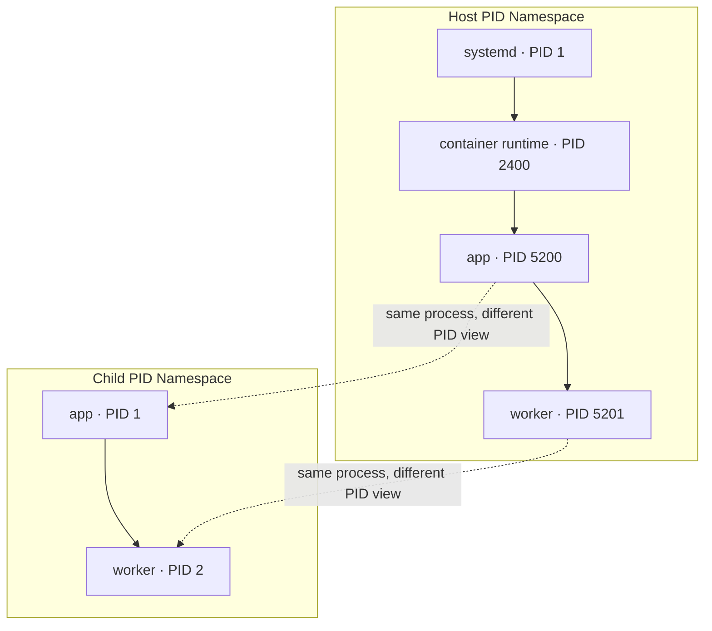
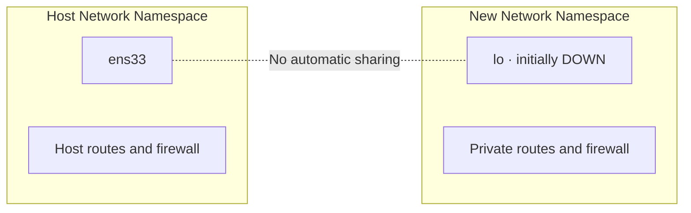
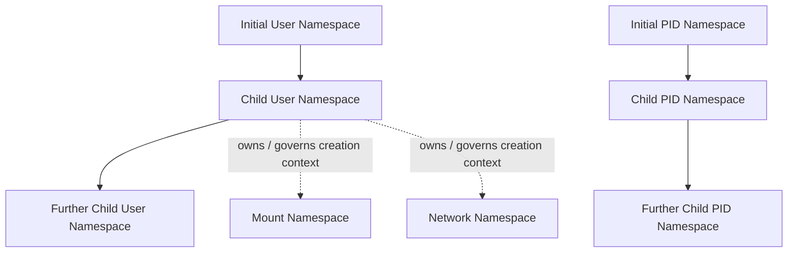

# Chapter 03 — Linux Namespaces

> **Chapter status:** Working manuscript — 10 November 2026  
> **Research snapshot:** 10 November 2026  
> **Lab status:** Designed, not tested

*Linux Containers Under the Hood · Part II — Linux Kernel and Isolation*

**Container တစ်ခုစီက ကိုယ့် Process၊ Network နဲ့ Hostname ကို သီးခြားစီ မြင်နေရတာ ဘယ်လိုဖြစ်နိုင်သလဲ။**

---

## 1. Container တစ်ခုချင်းစီက ဘာကို ခွဲခြားထားဖို့ လိုသလဲ။

Chapter 01 မှာ Container ဆိုတာ ကိုယ်ပိုင် Kernel တစ်ခုနဲ့ Boot လုပ်ထားတဲ့ Virtual Machine မဟုတ်ဘဲ Host ရဲ့ Linux Kernel ကို မျှဝေအသုံးပြုနေတဲ့ Process environment တစ်ခုဖြစ်ကြောင်း လေ့လာခဲ့ပါတယ်။ Chapter 02 မှာလည်း Process တစ်ခု ဘယ်လိုဖန်တီးတယ်၊ PID ဘယ်လိုသတ်မှတ်တယ်၊ System Call တွေကနေ Kernel နဲ့ ဘယ်လိုဆက်သွယ်တယ်ဆိုတာကို ကြည့်ခဲ့ပါတယ်။

ဒါဆို Application နှစ်ခုကို Container တစ်ခုစီထဲမှာ Run လုပ်ထားတဲ့အခါ အဲဒီ Application နှစ်ခုက ဘာကြောင့် Process ID တူတူကို မြင်နိုင်တာလဲ။ Container တစ်ခုက ကိုယ့် Hostname ကို ပြောင်းလိုက်တဲ့အခါ တခြား Container ရဲ့ Hostname က ဘာကြောင့် မပြောင်းသွားတာလဲ။ Network interface နဲ့ Port တွေကိုလည်း ဘယ်လို သီးခြားခွဲထားနိုင်တာလဲ။

Linux Kernel က ဒီလိုပြဿနာတွေကို ဖြေရှင်းဖို့ **Namespace** တွေကို အသုံးပြုပါတယ်။ Namespace တစ်ခုက Kernel Resource တစ်ခုရဲ့ မြင်တွေ့ပုံ (view) ကို Process အုပ်စုတစ်ခုအတွက် သီးခြားခွဲပေးပါတယ်။ Process တစ်ခုက ဘယ် Namespace ထဲမှာ အလုပ်လုပ်နေသလဲဆိုတာအပေါ် မူတည်ပြီး မြင်ရတဲ့ PID၊ Mount Table၊ Network Stack နဲ့ အခြား System Information တွေ ကွာခြားနိုင်ပါတယ်။

ဒီအခန်းမှာ Linux Namespace အမျိုးအစား ၈ မျိုးကို တစ်ခုချင်း လေ့လာမယ်။ နောက်ပြီး Namespace အသစ်ဖန်တီးခြင်း၊ ရှိပြီးသား Namespace ထဲ ဝင်ခြင်း၊ Namespace တွေရဲ့ Relationship နဲ့ `/proc` ကနေ စစ်ဆေးပုံတို့ကို ဆက်ကြည့်ပါမယ်။

## 2. ဒီအခန်းကို လေ့လာပြီးရင် ဘာတွေ လုပ်နိုင်လာမလဲ။

ဒီအခန်းပြီးသွားတဲ့အခါ—

- Namespace က ဘယ်လို Resource View ကို ခွဲခြားပေးသလဲဆိုတာ ရှင်းပြနိုင်မယ်။
- PID၊ Mount၊ Network၊ UTS၊ IPC၊ User၊ Cgroup နဲ့ Time Namespace တို့ရဲ့ အလုပ်လုပ်ပုံကို ခွဲခြားနိုင်မယ်။
- `clone()`၊ `unshare()` နဲ့ `setns()` တို့ရဲ့ ရည်ရွယ်ချက်နဲ့ ကွာခြားချက်ကို ရှင်းပြနိုင်မယ်။
- `/proc/<PID>/ns/` နဲ့ `lsns` ကို အသုံးပြုပြီး Process တစ်ခုရဲ့ Namespace တွေကို inspect လုပ်နိုင်မယ်။
- Namespace တွေ ဘယ်လို nested ဖြစ်နိုင်သလဲ၊ ဘယ်အချိန်မှာ Namespace တစ်ခု သက်တမ်းကုန်သလဲဆိုတာ နားလည်မယ်။
- Namespace တစ်ခုတည်းနဲ့ Complete Security Boundary မရနိုင်ကြောင်း ခွဲခြားသိရှိမယ်။

## 3. Namespace ဆိုတာ ဘာလဲ။

ပုံမှန် Linux System တစ်ခုမှာ Process အားလုံးက Kernel က စီမံထားတဲ့ System Resource တွေကို သတ်မှတ်ထားတဲ့ Global View တစ်ခုအောက်မှာ မြင်တွေ့ကြပါတယ်။ ဥပမာ Process တစ်ခုက `getpid()` ကို ခေါ်လိုက်တဲ့အခါ Kernel က အဲဒီ Process ရဲ့ PID ကို ပြန်ပေးတယ်။ `hostname` ကို စစ်ကြည့်တဲ့အခါ System ရဲ့ Hostname ကို မြင်ရတယ်။ Network Interface တွေကို စစ်တဲ့အခါလည်း လက်ရှိ Network Stack ထဲမှာ ရှိနေတဲ့ Interface တွေကို မြင်ရပါတယ်။

Application အများအပြားကို Host တစ်လုံးတည်းပေါ်မှာ Run လုပ်စေချင်တဲ့အခါ ဒီ Global View တစ်ခုတည်းကို မျှဝေသုံးနေရတာက အမြဲတမ်း မသင့်တော်ပါဘူး။ Application တစ်ခုက Process တွေကို သီးခြားမြင်ချင်နိုင်တယ်။ နောက်တစ်ခုက ကိုယ့် Network Interface နဲ့ Routing Table ကိုပဲ မြင်ချင်နိုင်တယ်။

Namespace က ဒီလို Resource တွေကို Process အလိုက် View ခွဲပေးပါတယ်။ Namespace တစ်ခုတည်းထဲက Process တွေဟာ သက်ဆိုင်ရာ Resource ကို အတူမျှဝေမြင်ကြပေမဲ့ မတူညီတဲ့ Namespace ထဲက Process တွေကတော့ သီးခြား View ကို ရရှိကြပါတယ်။ Linux Manual မှာ Namespace ကို Global Resource တစ်ခုကို သီးခြား Instance ရှိသလို မြင်စေတဲ့ Abstraction အဖြစ် ရှင်းပြထားပါတယ်။ [1]

ဥပမာ Host မှာ Process ID `5200` ရှိတဲ့ Application တစ်ခုကို Container တစ်ခုထဲမှာ PID `1` အဖြစ် မြင်နိုင်ပါတယ်။ ဒါဟာ Process အသစ်တစ်ခုကို Kernel ထဲမှာ ထပ်မံကူးယူဖန်တီးထားတယ်လို့ မဆိုလိုပါဘူး။ Process တစ်ခုတည်းကို PID Namespace အဆင့်အလိုက် မတူညီတဲ့ PID နဲ့ မြင်တွေ့နိုင်တာပါ။ ဒီအကြောင်းကို PID Namespace အပိုင်းမှာ ပိုရှင်းပြပါမယ်။

### 3.1 Namespace နဲ့ Container တို့ရဲ့ ဆက်စပ်ပုံ

Container ဆိုတာ Namespace တစ်ခုတည်းကို ဖန်တီးလိုက်တာနဲ့ ပြီးပြည့်စုံသွားတဲ့ Mechanism မဟုတ်ပါဘူး။ Container Runtime က Container တစ်ခုအတွက် လိုအပ်သလို Namespace အမျိုးမျိုးကို ဖန်တီးပြီး Process တွေကို သတ်မှတ်ထားတဲ့ Namespace တွေထဲမှာ စတင်ပေးပါတယ်။ Filesystem၊ Resource Control နဲ့ Security အတွက်လည်း အခြား Kernel Mechanism တွေကို ပေါင်းစပ်အသုံးပြုရပါတယ်။

အောက်ပါပုံကို ကြည့်ပါ။ Container နှစ်ခုဟာ Host ရဲ့ Kernel တစ်ခုတည်းကို မျှဝေသုံးပေမဲ့ PID၊ Mount နဲ့ Network Namespace မတူတဲ့အတွက် Resource View မတူနိုင်ပါတယ်။ Container တစ်ခုစီမှာ သက်ဆိုင်ရာ Namespace အားလုံးကို မဖြစ်မနေ သီးခြားဖန်တီးရမယ်လို့တော့ မဆိုလိုပါဘူး။ Runtime Configuration နဲ့ Security Requirement ပေါ်မူတည်ပြီး Namespace တချို့ကို Share လုပ်နိုင်ပါတယ်။



ဒီပုံက Conceptual View ဖြစ်ပါတယ်။ တကယ့် Container Runtime တစ်ခုမှာ Namespace တစ်မျိုးချင်းစီရဲ့ Sharing Policy ကို သီးခြားသတ်မှတ်နိုင်ပြီး Container အချင်းချင်း Network Namespace သို့မဟုတ် အခြား Namespace တွေကိုလည်း မျှဝေသုံးနိုင်ပါတယ်။

### 3.2 Linux Namespace အမျိုးအစား ၈ မျိုး

Linux Kernel က အောက်ပါ Namespace အမျိုးအစား ၈ မျိုးကို ပံ့ပိုးထားပါတယ်။ [1]

| Namespace | Clone flag | အဓိက ခွဲခြားပေးသော Resource |
|---|---|---|
| PID | `CLONE_NEWPID` | Process ID Number Space နဲ့ Process Visibility |
| Mount | `CLONE_NEWNS` | Mount Table / Mount Point View |
| Network | `CLONE_NEWNET` | Network Device၊ Protocol Stack၊ Route၊ Firewall နဲ့ Port |
| UTS | `CLONE_NEWUTS` | Hostname နဲ့ NIS Domain Name |
| IPC | `CLONE_NEWIPC` | System V IPC Object နဲ့ POSIX Message Queue |
| User | `CLONE_NEWUSER` | User ID၊ Group ID နဲ့ Namespace-scoped Capability Context |
| Cgroup | `CLONE_NEWCGROUP` | Process ရဲ့ Cgroup Path View |
| Time | `CLONE_NEWTIME` | `CLOCK_MONOTONIC` နဲ့ `CLOCK_BOOTTIME` တို့၏ Offset |

ဒီမှာ `CLONE_NEWNS` ဆိုတဲ့ Flag Name က သမိုင်းကြောင်းအရ `new mount namespace` ကို ကိုယ်စားပြုတာဖြစ်ပြီး `NS` ဆိုတာ Mount Namespace ကို ဆိုလိုပါတယ်။ Namespace အမျိုးအစား ၈ မျိုးလုံးကို တစ်ပြိုင်တည်း သုံးဖို့ မလိုပါဘူး။ Application တစ်ခုလိုအပ်တဲ့ Isolation နဲ့ Runtime ရဲ့ Design အလိုက် ရွေးချယ်အသုံးပြုနိုင်ပါတယ်။

## 4. PID Namespace — Process ID ကို သီးခြားမြင်စေခြင်း

PID Namespace က Process တွေရဲ့ PID Number Space ကို ခွဲခြားပေးပါတယ်။ Namespace မတူတဲ့ Process နှစ်ခုဟာ PID တူညီနေနိုင်ပါတယ်။ ဒါကြောင့် Container တစ်ခုအတွင်းက Application က PID `1` ဖြစ်နေပေမဲ့ Host ပေါ်မှာတော့ အခြား PID တစ်ခုနဲ့ ရှိနေနိုင်ပါတယ်။ [2]

ဥပမာ Host မှာ အောက်ပါ Process Tree ရှိတယ်ဆိုပါစို့။

```text
Host PID Namespace

systemd (PID 1)
└── container-runtime (PID 2400)
    └── app (PID 5200)
        └── worker (PID 5201)
```

`app` Process ကို PID Namespace အသစ်တစ်ခုထဲမှာ စတင်ပေးလိုက်ရင် အဲဒီ Namespace အတွင်းမှာ Process ရဲ့ PID ကို `1` အဖြစ် မြင်ရနိုင်ပါတယ်။ `worker` ကတော့ PID `2` ဖြစ်နိုင်ပါတယ်။ Host ဘက်ကနေကြည့်တဲ့အခါ မူလ PID `5200` နဲ့ `5201` တွေကို ဆက်မြင်ရပါတယ်။



ဒီလို PID View မတူခြင်းက Process အသစ်တစ်ခုကို Duplicate လုပ်ထားတာမဟုတ်ပါဘူး။ Kernel က PID Namespace Hierarchy အလိုက် Process တစ်ခုစီကို PID Number မတူတဲ့ View တွေနဲ့ ကိုယ်စားပြုပေးထားတာပါ။ Process တစ်ခုဟာ သူ့ရဲ့ကိုယ်ပိုင် PID Namespace နဲ့ အဲဒီ Namespace ရဲ့ Ancestor Namespace တွေမှာ PID တစ်ခုစီ ရှိနိုင်ပါတယ်။ Child Namespace ထဲက Process ကတော့ Parent Namespace ထဲမှာရှိတဲ့ Process တွေကို တိုက်ရိုက်မမြင်နိုင်ပါဘူး။ [2]

### 4.1 PID Namespace ရဲ့ PID 1

PID Namespace အသစ်တစ်ခုအတွင်း ပထမဆုံး စတင်လာတဲ့ Process ကို PID `1` သတ်မှတ်ပေးပါတယ်။ အဲဒီ Process ဟာ Namespace ရဲ့ Init Process ဖြစ်ပါတယ်။ Container တစ်ခုမှာ Application ကို တိုက်ရိုက် PID 1 အဖြစ် Run လုပ်တာမျိုးလည်း ရှိနိုင်သလို `tini` လို Init Process သို့မဟုတ် Supervisor တစ်ခုကို ရှေ့မှာထားပြီး Application ကို Child Process အဖြစ် Run လုပ်တာလည်း ရှိနိုင်ပါတယ်။

PID 1 ရဲ့ အရေးကြီးတဲ့ တာဝန်တစ်ခုက Orphan Process တွေကို Reap လုပ်ပေးဖို့ ဖြစ်ပါတယ်။ Process တစ်ခုမှာ Parent Process မရှိတော့တဲ့အခါ Kernel က ထို Process ကို သင့်လျော်တဲ့ Reaper ထံ Reparent လုပ်ပေးပါတယ်။ PID Namespace အတွင်းမှာတော့ Namespace ရဲ့ Init Process က ဒီတာဝန်ကို အဓိက ထမ်းဆောင်နိုင်ပါတယ်။ ဒါကြောင့် Container ထဲမှာ Application တစ်ခုတည်း Run လုပ်ထားတာတောင် Application က Child Process တွေဖန်တီးတတ်ရင် PID 1 ရဲ့ Behavior ကို ထည့်စဉ်းစားဖို့ လိုပါတယ်။ Chapter 02 မှာ လေ့လာခဲ့တဲ့ Zombie၊ Orphan နဲ့ Process Reaping တို့နဲ့ ဒီအချက်က ဆက်စပ်နေပါတယ်။

PID Namespace ရဲ့ Init Process ပိတ်သွားရင် Kernel က အဲဒီ PID Namespace ထဲမှာ ကျန်နေသေးတဲ့ Process တွေကို `SIGKILL` ပို့ပြီး အဆုံးသတ်ပေးပါတယ်။ Init Process မရှိတော့တဲ့ PID Namespace ထဲမှာ Process အသစ်တစ်ခုကို ဆက်လက်ဖန်တီးလို့ မရတော့ပါဘူး။ [2]

### 4.2 PID Namespace နဲ့ `/proc`

`/proc` Filesystem က လက်ရှိမြင်ရတဲ့ Process တွေအကြောင်း Information ပေးပါတယ်။ ဒါပေမဲ့ `/proc` ကို Mount လုပ်ထားတဲ့အချိန်က PID Namespace နဲ့ Process တွေရဲ့ PID View က ဆက်စပ်နေပါတယ်။ PID Namespace အသစ်တစ်ခုထဲကို ဝင်လိုက်ရုံနဲ့ မူလ Namespace အတွက် Mount လုပ်ထားတဲ့ `/proc` ကို အလိုအလျောက် မှန်ကန်တဲ့ Process View ဖြစ်သွားတယ်လို့ မယူဆရပါဘူး။

ဒါကြောင့် `unshare` ကို အသုံးပြုပြီး PID Namespace စမ်းသပ်တဲ့အခါ `--mount-proc` Option ကို တွဲသုံးလေ့ရှိပါတယ်။ ဒီ Option က Mount Namespace အသစ်တစ်ခုကိုပါ ဖန်တီးပြီး `/proc` ကို လက်ရှိ PID Namespace နဲ့ ကိုက်ညီစွာ ပြန် Mount လုပ်ပေးပါတယ်။ [3]

```bash
unshare --user --map-root-user --pid --fork --mount-proc sh
```

ဒီ Command ရဲ့ အစိတ်အပိုင်းတွေကို ခွဲကြည့်ရအောင်။

- `--user` က User Namespace အသစ်တစ်ခု ဖန်တီးပါတယ်။
- `--map-root-user` က လက်ရှိ Unprivileged User ရဲ့ UID/GID ကို Namespace အတွင်း ID `0` နဲ့ Map လုပ်ပေးပါတယ်။
- `--pid` က Child Process တွေအတွက် PID Namespace အသစ် ဖန်တီးပါတယ်။
- `--fork` က Program ကို Child Process အဖြစ် စတင်စေပြီး PID Namespace ထဲက ပထမဆုံး Process ဖြစ်စေပါတယ်။
- `--mount-proc` က Mount Namespace အသစ်တစ်ခုထဲမှာ `/proc` ကို ပြန် Mount လုပ်ပေးပါတယ်။

ဤ Command ကို Lab အတွက်သာ အသုံးပြုရန် ရည်ရွယ်ထားပါတယ်။ လက်တွေ့အသုံးပြုရာတွင် Unprivileged User Namespace ကို Kernel နဲ့ Distribution Policy က ခွင့်ပြုထားဖို့ လိုအပ်ပါတယ်။

## 5. Mount Namespace — Mount Table ကို သီးခြားမြင်စေခြင်း

Mount Namespace က Process တွေ မြင်တွေ့ရတဲ့ Mount Point စာရင်းနဲ့ Filesystem Tree View ကို ခွဲခြားပေးပါတယ်။ Host မှာ Filesystem တစ်ခုကို `/mnt/data` မှာ Mount လုပ်ထားတယ်ဆိုပါစို့။ Mount Namespace အသစ်တစ်ခုအတွင်းမှာ အခြား Mount Operation လုပ်လိုက်ရင် ပုံမှန်အားဖြင့် အဲဒီ Namespace ထဲက Process တွေကပဲ ပြောင်းလဲမှုကို မြင်ရပါတယ်။ [4]

Mount Namespace ဖန်တီးတဲ့အခါ Parent ရဲ့ Mount List ကို အခြေခံပြီး Copy တစ်ခုရလာပါတယ်။ ဒါကြောင့် Mount Namespace အသစ်တစ်ခုဖန်တီးလိုက်တာနဲ့ Filesystem အားလုံးကို အစကနေ သီးခြားကူးယူထားတာ မဟုတ်ပါဘူး။ Mount View ကိုသာ ခွဲထားတာဖြစ်ပါတယ်။

ဒီအချက်ကို သတိထားဖို့ လိုပါတယ်။ Mount Namespace တစ်ခုရှိတာနဲ့ Container ရဲ့ Root Filesystem က Host Filesystem နဲ့ အပြည့်အဝ ကွာသွားတာ မဟုတ်ပါဘူး။ Host Path တစ်ခုကို Bind Mount လုပ်ပေးထားရင် Container ထဲက Process က အဲဒီ Host Path ကို မြင်နိုင်ပြီး Permission ရှိသလို ဖတ်ရှု/ပြင်ဆင်နိုင်ပါတယ်။ Root Filesystem တစ်ခုကို သီးခြားပြင်ဆင်ခြင်းနဲ့ Mount Namespace တို့ရဲ့ အခန်းကဏ္ဍကို Chapter 06 မှာ အသေးစိတ် ဆက်လေ့လာပါမယ်။

### 5.1 Mount Propagation

Mount Namespace နှစ်ခုရှိနေပေမဲ့ Mount Event တွေ အပြန်အလှန် သက်ရောက်နိုင်သေးတဲ့ အခြေအနေရှိပါတယ်။ ဒီအရာကို **Mount Propagation** လို့ ခေါ်ပါတယ်။ Mount တစ်ခုစီမှာ Propagation Type သတ်မှတ်ထားနိုင်ပြီး အဓိက Type တွေက `shared`၊ `private`၊ `slave` နဲ့ `unbindable` တို့ဖြစ်ပါတယ်။ [4]

| Propagation Type | Behavior |
|---|---|
| `shared` | Peer Group အတွင်း Mount/Unmount Event တွေကို အပြန်အလှန် ပျံ့နှံ့စေတယ်။ |
| `private` | Mount/Unmount Event တွေကို အခြား Mount တွေဆီ မပို့ဘူး၊ အခြားနေရာက Event ကိုလည်း မလက်ခံဘူး။ |
| `slave` | Master Shared Mount ကလာတဲ့ Event ကို လက်ခံတယ်။ ကိုယ်တိုင်ဖန်တီးတဲ့ Event ကို Master ဆီ ပြန်မပို့ဘူး။ |
| `unbindable` | `private` လိုပဲ Event မပျံ့နှံ့ဘဲ Bind Mount လုပ်ဖို့လည်း မဖြစ်နိုင်ဘူး။ |

Container Runtime တစ်ခုအတွက် Mount Namespace အသစ်တည်ဆောက်တဲ့အခါ Mount Event တွေ Host ဆီ မမျှော်လင့်ဘဲ ပြန်လည်ပျံ့နှံ့မသွားအောင် Propagation Mode ကို မှန်ကန်စွာ သတ်မှတ်ဖို့ လိုပါတယ်။ `unshare(1)` က ပုံမှန်အားဖြင့် Mount Namespace အသစ်ထဲမှာ Mount Propagation ကို Private အဖြစ် ပြောင်းပေးလေ့ရှိပါတယ်။ သို့သော် Application က Kernel API ကို တိုက်ရိုက်ခေါ်တဲ့အခါ ဒီ Behavior ကို အလိုအလျောက် ရမယ်လို့ မယူဆသင့်ပါဘူး။ [4]

## 6. Network Namespace — Network Stack ကို သီးခြားမြင်စေခြင်း

Network Namespace က Network Resource တွေကို သီးခြားခွဲပေးပါတယ်။ အဓိကအားဖြင့်—

- Network Interface တွေ
- IPv4/IPv6 Protocol Stack
- IP Routing Table
- Firewall Rules
- Port Number နဲ့ Socket များ
- `/proc/net` နဲ့ `/sys/class/net` ကဲ့သို့သော Network Information View များ

ကို Namespace အလိုက် ခွဲခြားပေးနိုင်ပါတယ်။ [5]

ဥပမာ Host မှာ `ens33` ဆိုတဲ့ Interface ရှိပြီး IP Address တစ်ခု သတ်မှတ်ထားတယ်ဆိုပါစို့။ Network Namespace အသစ်တစ်ခု ဖန်တီးလိုက်တဲ့အခါ အဲဒီ Namespace ထဲက Process တွေဟာ Host ရဲ့ `ens33` ကို အလိုအလျောက် မြင်ရမှာ မဟုတ်ပါဘူး။ New Network Namespace တစ်ခုမှာ Loopback Interface (`lo`) ပဲ ကျန်နေနိုင်ပြီး အဲဒီ Interface ကလည်း အစပိုင်းမှာ Down ဖြစ်နေနိုင်ပါတယ်။



Network Namespace အသစ်တစ်ခုဖန်တီးလိုက်တာနဲ့ Internet Access အလိုအလျောက် မရလာပါဘူး။ အခြား Network Namespace သို့မဟုတ် Host နဲ့ ချိတ်ဆက်ဖို့ Interface နဲ့ Routing Path တွေကို ထပ်မံတည်ဆောက်ရပါတယ်။ အသုံးများတဲ့ နည်းလမ်းတစ်ခုက `veth` Pair ဖြစ်ပြီး Namespace နှစ်ခုကြား Virtual Link တစ်ခု ဖန်တီးပေးနိုင်ပါတယ်။ ဒါပေမဲ့ `veth`၊ Linux Bridge၊ Routing နဲ့ NAT တို့ရဲ့ အသေးစိတ်ကို Chapter 08 — Container Networking Internals မှာ လေ့လာပါမယ်။

Physical Network Device တစ်ခုဟာ တစ်ချိန်တည်းမှာ Network Namespace တစ်ခုတည်းထဲမှာသာ ရှိနိုင်ပါတယ်။ Network Namespace ကို ဖျက်သိမ်းချိန်မှာ အဲဒီ Namespace ထဲမှာ ကျန်နေတဲ့ Physical Device တွေကို Initial Network Namespace ဆီ ပြန်ရွှေ့ပေးပါတယ်။ Virtual `veth` Pair တွေကတော့ Namespace ပျက်သွားတဲ့အခါ ဖယ်ရှားခံရနိုင်ပါတယ်။ [5]

Network Namespace ကို နားလည်ထားရင် Container တစ်ခုချင်းစီမှာ Port တူတူကို အသုံးပြုနိုင်တာ ဘာကြောင့်လဲဆိုတာကိုလည်း ရှင်းပြနိုင်ပါပြီ။ TCP/UDP Port တွေက Network Stack နဲ့ ဆက်စပ်နေလို့ Namespace မတူတဲ့အခါ Port Number တူညီနေနိုင်ပါတယ်။ ဒါပေမဲ့ Host ကနေ Container Network ကို ဆက်သွယ်နိုင်ဖို့ Port Forwarding သို့မဟုတ် အခြား Network Connection တစ်ခုခုကို သတ်မှတ်ပေးဖို့ လိုနိုင်ပါတယ်။

## 7. UTS Namespace — Hostname ကို သီးခြားသတ်မှတ်ခြင်း

UTS Namespace က Hostname နဲ့ NIS Domain Name ကို ခွဲခြားပေးပါတယ်။ Linux မှာ `hostname`၊ `uname` နဲ့ `gethostname()` တို့က ပြသပေးတဲ့ System Identifier တွေဟာ Process ရဲ့ UTS Namespace ပေါ် မူတည်ပြီး ကွာခြားနိုင်ပါတယ်။ [6]

Namespace အသစ်တစ်ခုဖန်တီးတဲ့အခါ မူလ UTS Namespace ရဲ့ Hostname နဲ့ Domain Name ကို Copy ကူးယူထားပါတယ်။ နောက်ပိုင်းမှာ Namespace အသစ်အတွင်းက Hostname ကို ပြောင်းလဲလိုက်ရင် အဲဒီ Namespace ထဲက Process တွေက ပြောင်းလဲထားတဲ့တန်ဖိုးကို မြင်ရပေမဲ့ Host ရဲ့ Hostname ကိုတော့ မပြောင်းလဲစေပါဘူး။

ဥပမာ—

```bash
hostname

unshare --user --map-root-user --uts --fork sh -c '
    hostname app-sandbox
    hostname
'

hostname
```

ပထမ Command က လက်ရှိ Hostname ကို ပြပါတယ်။ ဒုတိယ Command က UTS Namespace အသစ်တစ်ခု ဖန်တီးပြီး Namespace အတွင်းမှာ Hostname ကို `app-sandbox` လို့ ပြောင်းပါတယ်။ နောက်ဆုံး Command က မူလ Hostname ကို ပြန်စစ်တာဖြစ်ပါတယ်။ User Namespace ကိုပါ အသုံးပြုထားတာကြောင့် Environment က Unprivileged User Namespace ဖန်တီးခွင့်ပြုရပါမယ်။ ဒီဥပမာမှာ Host System ရဲ့ Hostname ကို ပြောင်းလဲခြင်း မရှိပါဘူး။

UTS Namespace က Hostname ကိုပဲ ခွဲပေးတာဖြစ်ပြီး DNS Server၊ `/etc/hosts`၊ Network Routing သို့မဟုတ် Network Interface တွေကို သီးခြားခွဲပေးတာ မဟုတ်ပါဘူး။ အဲဒီအရာတွေက Network Configuration နဲ့ Filesystem View တို့နဲ့ သက်ဆိုင်ပါတယ်။

## 8. IPC Namespace — Inter-Process Communication Resource များကို ခွဲခြားခြင်း

Process တွေဟာ တစ်ခုနဲ့တစ်ခု Data မျှဝေဖို့ Inter-Process Communication (IPC) Mechanism အမျိုးမျိုးကို အသုံးပြုကြပါတယ်။ ဥပမာ System V Shared Memory၊ Semaphore၊ Message Queue နဲ့ POSIX Message Queue တို့ ပါဝင်ပါတယ်။

IPC Namespace က အဲဒီ IPC Resource အချို့ကို Namespace အလိုက် ခွဲခြားပေးပါတယ်။ Namespace တစ်ခုအတွင်းမှာ ဖန်တီးထားတဲ့ System V IPC Object တွေ၊ POSIX Message Queue တွေကို အဲဒီ Namespace ထဲက Process တွေကပဲ ပုံမှန်အားဖြင့် မြင်တွေ့နိုင်ပါတယ်။ IPC Namespace တစ်ခု ပျက်သွားတဲ့အခါ အဲဒီ Namespace နဲ့ သက်ဆိုင်တဲ့ IPC Object တွေကို Kernel က အလိုအလျောက် ဖယ်ရှားပေးပါတယ်။ [7]

IPC Namespace က File Path ကို အခြေခံတဲ့ File Sharing အားလုံးကို ခွဲပေးတာ မဟုတ်ပါဘူး။ ဥပမာ `/tmp/shared.txt` ဆိုတဲ့ File ကို Application နှစ်ခုက Filesystem Permission ရှိလို့ ဖတ်နိုင်နေတယ်ဆိုရင် IPC Namespace မတူတာတစ်ခုတည်းနဲ့ အဲဒီ File Access ကို တားဆီးပေးမှာ မဟုတ်ပါဘူး။ File Visibility နဲ့ Permission တွေက Mount Namespace၊ Filesystem Permission နဲ့ အခြား Security Mechanism တွေနဲ့ ဆက်စပ်နေပါတယ်။

## 9. User Namespace — User ID နဲ့ Privilege Context ကို ခွဲခြားခြင်း

User Namespace က UID၊ GID နဲ့ Capability ကဲ့သို့ Security-related Identifier/Attribute တွေကို Namespace အလိုက် ခွဲခြားပေးပါတယ်။ User Namespace ရဲ့ အရေးကြီးဆုံးအချက်က Container အတွင်းမှာ `root` ဖြစ်နေတဲ့ Process တစ်ခုဟာ Host ပေါ်မှာလည်း Root ဖြစ်နေတယ်လို့ မဆိုလိုခြင်းပါပဲ။ [8]

ဥပမာ Host ပေါ်မှာ UID `1000` နဲ့ အလုပ်လုပ်နေတဲ့ User တစ်ယောက်က User Namespace အသစ်တစ်ခု ဖန်တီးပြီး ကိုယ့် UID ကို Namespace အတွင်း UID `0` နဲ့ Map လုပ်နိုင်ပါတယ်။ အဲဒီအခါ Namespace အတွင်းမှာ—

```text
Host identity:       UID 1000
Inside user namespace: UID 0
```

လို့ မြင်နိုင်ပါတယ်။ ဒီ `0` ဟာ Namespace အတွင်းမှာသာ Root ID ဖြစ်ပါတယ်။ Host ရဲ့ Initial User Namespace အတွင်းမှာတော့ UID `1000` အဖြစ်ပဲ ရှိနေပါတယ်။ ဒါကြောင့် Namespace အတွင်းမှာ Root Privilege နဲ့ ဆောင်ရွက်နိုင်တဲ့ Operation တချို့ဟာ Host ရဲ့ Resource အားလုံးကို ထိန်းချုပ်နိုင်တဲ့ Authority မဟုတ်ပါဘူး။

### 9.1 UID/GID Mapping

User Namespace အသစ်တစ်ခု ဖန်တီးတဲ့အချိန်မှာ UID/GID Mapping ကို စတင်သတ်မှတ်ပေးဖို့ လိုပါတယ်။ Mapping ကို `/proc/<PID>/uid_map` နဲ့ `/proc/<PID>/gid_map` မှာ ဖတ်ရှုနိုင်ပါတယ်။ Mapping File တွေဟာ Namespace အတွင်း UID/GID နဲ့ Parent Namespace အတွင်း UID/GID တို့ရဲ့ ဆက်စပ်မှုကို ပြသပေးပါတယ်။ [8]

Unprivileged User အတွက် util-linux `unshare` command မှာ `--map-root-user` Option ပါဝင်ပါတယ်။ ဒီ Option က လက်ရှိ User ရဲ့ UID/GID ကို Namespace အတွင်း ID `0` နဲ့ Map လုပ်ပေးဖို့ အသုံးပြုပါတယ်။ Mapping အလုပ်လုပ်ပုံကို စစ်ဖို့—

```bash
id

unshare --user --map-root-user sh -c '
    id
    cat /proc/self/uid_map
    cat /proc/self/gid_map
'
```

ကို အသုံးပြုနိုင်ပါတယ်။ Output ထဲမှာ Namespace အတွင်း User က `root` အဖြစ် ပေါ်လာနိုင်ပေမဲ့ Host ပေါ်က မူလ User Identity ကတော့ မပြောင်းလဲပါဘူး။ Output ရဲ့ UID/GID Mapping Number တွေဟာ လက်ရှိ Environment ပေါ်မူတည်ပြီး ကွာနိုင်ပါတယ်။

User Namespace တွေကို Nested အဖြစ် ထပ်မံဖန်တီးနိုင်ပါတယ်။ Child User Namespace တစ်ခုက Parent User Namespace ထဲက Authority ကို အပြည့်အဝ ပိုင်ဆိုင်တာ မဟုတ်ပါဘူး။ Capability တစ်ခုဟာ သက်ဆိုင်ရာ User Namespace နဲ့ အဲဒီ Namespace က ပိုင်ဆိုင်တဲ့ Resource အတိုင်းအတာအတွင်းမှာပဲ သက်ရောက်ပါတယ်။ Capability Set တွေရဲ့ အသေးစိတ်ကို Chapter 05 မှာ ဆက်လက်လေ့လာပါမယ်။ [8]

### 9.2 User Namespace တိုင်းမှာ အမြဲဖွင့်ထားသလား။

Kernel က User Namespace Support ပေးထားတာနဲ့ Distribution တစ်ခုစီရဲ့ Policy က Unprivileged User Namespace ဖန်တီးမှုကို အမြဲခွင့်ပြုထားတယ်လို့ မဆိုလိုပါဘူး။ Kernel Configuration၊ Sysctl Limit၊ Distribution Security Policy နဲ့ လက်ရှိ Process ရဲ့ Execution Environment ပေါ်မူတည်ပြီး Creation ကို ကန့်သတ်ထားနိုင်ပါတယ်။ ထို့အပြင် UID/GID Mapping လုပ်ရာမှာလည်း သက်ဆိုင်ရာ Restriction တွေရှိပါတယ်။

ဒါကြောင့် `unshare --user` က `Operation not permitted` နဲ့ ပြန်လာတယ်ဆိုရင် SELinux ကို Disable လုပ်ခြင်း၊ Host Security Setting ကို လျှော့ချခြင်းတို့ကို အလွယ်တကူ မလုပ်သင့်ပါဘူး။ အဲဒီ Error က Kernel Policy၊ Namespace Limit သို့မဟုတ် Permission ပြဿနာတစ်ခုခုကို ပြသနေနိုင်ပါတယ်။ သီးခြား Lab Environment မှာပဲ Configuration နဲ့ Policy ကို စစ်ဆေးသင့်ပါတယ်။

## 10. Cgroup Namespace — Cgroup Path ကို သီးခြားမြင်စေခြင်း

Cgroup Namespace က Process တစ်ခုရဲ့ Control Group Path ကို `/proc/<PID>/cgroup` နဲ့ `/proc/<PID>/mountinfo` မှာ ဘယ်လိုမြင်ရမလဲဆိုတဲ့ View ကို ခွဲခြားပေးပါတယ်။ Cgroup Namespace အသစ်ဖန်တီးတဲ့အခါ လက်ရှိ Process ရဲ့ Cgroup Directory ကို Namespace အသစ်ရဲ့ Root Directory အဖြစ် သတ်မှတ်ပေးပါတယ်။ [9]

ဥပမာ Host ဘက်မှာ Container Process တစ်ခုက—

```text
/system.slice/container-a.scope
```

ဆိုတဲ့ Cgroup Path အောက်မှာ ရှိနေနိုင်ပါတယ်။ Container အတွင်းက Process ကတော့ Cgroup Namespace ရဲ့ Root View ကြောင့် အဲဒီ Path ကို `/` သို့မဟုတ် Namespace-relative Path အဖြစ် မြင်ရနိုင်ပါတယ်။ Exact Output က Cgroup Version၊ Mount Configuration နဲ့ Runtime Setup အလိုက် ကွာခြားနိုင်ပါတယ်။

Cgroup Namespace ဟာ **Resource Limit ကို သတ်မှတ်ပေးတဲ့ Mechanism မဟုတ်ပါဘူး**။ CPU၊ Memory၊ PID Count နဲ့ I/O Resource တွေကို Limit/Account လုပ်ပေးတာက Control Groups (`cgroups`) ရဲ့ အလုပ်ဖြစ်ပြီး Cgroup Namespace က Path View ကိုပဲ ပြောင်းလဲပေးတာပါ။ ဒီနှစ်ခုကို မရောထွေးဖို့ အရေးကြီးပါတယ်။ Chapter 04 မှာ cgroups v1/v2 နဲ့ Controller တွေရဲ့ အလုပ်လုပ်ပုံကို အသေးစိတ် လေ့လာပါမယ်။

## 11. Time Namespace — Monotonic Time ကို သီးခြား Offset ပေးခြင်း

Time Namespace က အခြား Namespace တွေနဲ့ အနည်းငယ် မတူပါဘူး။ System Clock အားလုံးကို Container တစ်ခုစီအလိုက် သီးခြားထားပေးတာ မဟုတ်ဘဲ `CLOCK_MONOTONIC` နဲ့ `CLOCK_BOOTTIME` တို့ရဲ့ Value ကို Namespace အလိုက် Offset သတ်မှတ်ပေးနိုင်တာဖြစ်ပါတယ်။ `CLOCK_MONOTONIC` ဟာ Clock ကို ကိုယ်တိုင် Set လုပ်လို့မရတဲ့ Monotonic Clock ဖြစ်ပြီး `CLOCK_BOOTTIME` ကတော့ System Suspend ဖြစ်နေတဲ့အချိန်ကိုပါ ထည့်တွက်ပေးပါတယ်။ [10]

ဒီ Offset တွေက `clock_gettime()`၊ `clock_nanosleep()`၊ Timer API တွေနဲ့ `/proc/uptime` ကဲ့သို့ Time ကို အသုံးပြုတဲ့ Interface တချို့အပေါ် သက်ရောက်နိုင်ပါတယ်။ ဒါပေမဲ့ `CLOCK_REALTIME` ကို Time Namespace က ပြောင်းလဲမပေးပါဘူး။ ဒါကြောင့် Container တစ်ခုအတွင်းမှာ `date` က ပြတဲ့ Wall Clock Time ကို သီးခြားနာရီတစ်လုံးလို ပြောင်းလဲပေးနိုင်တယ်လို့ မယူဆသင့်ပါဘူး။ [10]

Time Namespace မှာ ထူးခြားတဲ့ အချက်တစ်ခုလည်း ရှိပါတယ်။ `unshare()` နဲ့ Time Namespace အသစ်ဖန်တီးလိုက်တဲ့အခါ လက်ရှိ Process ကို အဲဒီ Time Namespace ထဲ ချက်ချင်း မရွှေ့ဘဲ နောက်ထပ် ဖန်တီးမယ့် Child Process တွေအတွက် အသုံးပြုစေပါတယ်။ ဒါကြောင့် `/proc/<PID>/ns/time` နဲ့ `/proc/<PID>/ns/time_for_children` တို့ရဲ့ Value မတူနိုင်ပါတယ်။ Offset သတ်မှတ်ခြင်းကိုလည်း Namespace ထဲမှာ ပထမဆုံး Child Process မဖန်တီးမီ ပြီးစီးအောင် လုပ်ဖို့ လိုပါတယ်။ [1][10]

Time Namespace က Application Testing၊ Checkpoint/Restore နဲ့ Elapsed Time အခြေပြု Behavior စမ်းသပ်ရာတွေမှာ အသုံးဝင်နိုင်ပါတယ်။ သို့သော် Time Namespace က System Clock ကို အပြည့်အဝ Virtualize လုပ်ပေးတာမဟုတ်ဘဲ သတ်မှတ်ထားတဲ့ Clock အချို့ကိုသာ Offset ပေးနိုင်တာဖြစ်ကြောင်း မှတ်ထားပါ။

## 12. Namespace တွေကို ဖန်တီးခြင်း၊ ခွဲထုတ်ခြင်းနဲ့ ဝင်ရောက်ခြင်း

Namespace တွေကို ဖန်တီးဖို့၊ လက်ရှိ Process ရဲ့ Namespace Membership ကို ခွဲထုတ်ဖို့နဲ့ ရှိပြီးသား Namespace တစ်ခုထဲ ဝင်ဖို့ Linux မှာ System Call သုံးခုကို အဓိက အသုံးပြုပါတယ်။

### 12.1 `clone()` — Process အသစ်နဲ့ Namespace အသစ်ကို တစ်ခါတည်း ဖန်တီးခြင်း

Chapter 02 မှာ `clone()` ကို Process Creation Mechanism တစ်ခုအဖြစ် လေ့လာခဲ့ပါတယ်။ `clone()` က Child Process ဖန်တီးတဲ့အခါ `CLONE_NEW...` Flag တွေကို ပေးလိုက်ရင် သတ်မှတ်ထားတဲ့ Namespace အသစ်တွေကို ဖန်တီးပြီး Child Process ကို အဲဒီ Namespace တွေထဲမှာ စတင်ပေးနိုင်ပါတယ်။ [11]

```c
/* Conceptual example only; not a complete program. */
clone(child_function, child_stack,
      CLONE_NEWPID | CLONE_NEWUTS | SIGCHLD,
      child_argument);
```

ဒီဥပမာမှာ `CLONE_NEWPID` နဲ့ `CLONE_NEWUTS` ကို အသုံးပြုထားတာကြောင့် Child Process ဟာ PID Namespace အသစ်နဲ့ UTS Namespace အသစ်ထဲမှာ စတင်ပါမယ်။ တကယ့် C Program တစ်ခုမှာ Child Stack၊ Error Handling၊ Process Synchronization နဲ့ Cleanup တို့ကိုလည်း မှန်ကန်စွာ စီမံဖို့ လိုပါတယ်။

`clone3()` ကတော့ Linux 5.3 မှ စတင်ရရှိတဲ့ `clone()` ရဲ့ နောက်ပိုင်း API ဖြစ်ပြီး Parameters တွေကို `struct clone_args` ထဲမှာ စုစည်းပေးထားပါတယ်။ ဒီအခန်းရဲ့ အဓိကအယူအဆကတော့ နှစ်မျိုးစလုံးမှာ Namespace Creation ကို `CLONE_NEW...` Flag တွေနဲ့ တောင်းဆိုနိုင်တယ်ဆိုတာပါပဲ။

### 12.2 `unshare()` — လက်ရှိ Process ကို Namespace အသစ်သို့ ခွဲထုတ်ခြင်း

`unshare()` က လက်ရှိ Process က Parent Process သို့မဟုတ် အခြား Process တွေနဲ့ မျှဝေထားတဲ့ Resource အချို့ကနေ ခွဲထွက်ဖို့ အသုံးပြုတဲ့ System Call ဖြစ်ပါတယ်။ `CLONE_NEW...` Flag တစ်ခု သို့မဟုတ် အများအပြား ပေးလိုက်ရင် Namespace အသစ်တွေ ဖန်တီးပြီး လက်ရှိ Process ကို အဲဒီ Namespace တွေနဲ့ ချိတ်ဆက်ပေးနိုင်ပါတယ်။ [12]

လက်တွေ့အသုံးပြုရာမှာ System Call ကို တိုက်ရိုက်ခေါ်တာထက် util-linux ရဲ့ `unshare` Command ကို ပိုတွေ့ရတတ်ပါတယ်။ ဒီ Command က Namespace အသစ်ဖန်တီးပြီး သတ်မှတ်ထားတဲ့ Program ကို အဲဒီ Environment ထဲမှာ စတင်ပေးပါတယ်။

```bash
unshare --uts --fork sh -c 'hostname isolated-host; hostname'
```

ဒီဥပမာက UTS Namespace အသစ်တစ်ခုဖန်တီးပြီး Shell ကို အဲဒီ Namespace ထဲမှာ Run လုပ်တာဖြစ်ပါတယ်။ `unshare` Command ရဲ့ Option တွေဟာ util-linux Version ပေါ်မူတည်ပြီး ကွာနိုင်တာကြောင့် လက်တွေ့အသုံးပြုရာမှာ `man unshare` ကို စစ်ဆေးသင့်ပါတယ်။

PID နဲ့ Time Namespace တို့မှာတော့ အထူးသတိထားဖို့ လိုပါတယ်။ `unshare()` က လက်ရှိ Process ရဲ့ PID ကို Namespace အသစ်အတွင်း PID အသစ်အဖြစ် ပြောင်းပေးတာ မဟုတ်ပါဘူး။ နောက်ထပ် ဖန်တီးမယ့် Child Process တွေအတွက် Namespace အသစ်ကို သတ်မှတ်ပေးတာဖြစ်ပါတယ်။ ဒါကြောင့် `unshare --pid --fork ...` လို ပုံစံနဲ့ Child Process ကို စတင်အသုံးပြုရပါတယ်။ [2][10][12]

### 12.3 `setns()` — ရှိပြီးသား Namespace ထဲ ဝင်ခြင်း

`setns()` က Namespace အသစ်ဖန်တီးဖို့ မဟုတ်ပါဘူး။ ရှိပြီးသား Namespace တစ်ခုကို ရည်ညွှန်းတဲ့ File Descriptor ကို အသုံးပြုပြီး Calling Process ကို အဲဒီ Namespace ထဲ ဝင်စေဖို့ အသုံးပြုပါတယ်။ File Descriptor ကို ပုံမှန်အားဖြင့် `/proc/<PID>/ns/<type>` ထဲက Namespace Handle ကို Open လုပ်ပြီး ရယူနိုင်ပါတယ်။ [13]

ဥပမာ PID `5200` ရဲ့ Network Namespace ကို Open လုပ်ပြီး ဝင်ရောက်ဖို့ အခြေခံပုံစံက—

```c
int fd = open("/proc/5200/ns/net", O_RDONLY);
setns(fd, CLONE_NEWNET);
```

ဖြစ်ပါတယ်။ ဒီ Code က Conceptual Example ဖြစ်ပြီး Production Program မဟုတ်ပါဘူး။ Error Handling၊ File Descriptor Cleanup နဲ့ Permission Check တွေ ထပ်ထည့်ဖို့ လိုပါတယ်။ `setns()` ကို ခေါ်တဲ့ Process မှာ သက်ဆိုင်ရာ Namespace အလိုက် လိုအပ်တဲ့ Permission နဲ့ Capability ရှိဖို့ လိုပါတယ်။ Namespace အမျိုးအစားတချို့မှာ Calling Process ရဲ့ Thread အရေအတွက်နဲ့ User Namespace Relationship အပေါ် မူတည်တဲ့ Additional Restriction တွေလည်း ရှိပါတယ်။ [8][13]

PID Namespace ကို `setns()` နဲ့ Join လုပ်တဲ့အခါ Calling Process ရဲ့ လက်ရှိ PID ကို ပြောင်းလဲတာမဟုတ်ပါဘူး။ နောက်ထပ် ဖန်တီးမယ့် Child Process တွေကသာ Joined PID Namespace ထဲမှာ စတင်ရမှာပါ။ ဒါဟာ PID Namespace ရဲ့ ထူးခြားတဲ့ Behavior ဖြစ်ပါတယ်။ Time Namespace ကို `setns()` နဲ့ Join လုပ်တဲ့အခါတော့ Calling Thread ကို Target Time Namespace နဲ့ ပြန်လည်ချိတ်ဆက်ပေးပါတယ်။ Multithreaded Process က Time Namespace ကို `setns()` နဲ့ မပြောင်းနိုင်တဲ့ ကန့်သတ်ချက်လည်း ရှိပါတယ်။ [13]

### 12.4 System Call နဲ့ Command Line Tool ကို ခွဲခြားခြင်း

| System Call | အဓိက အလုပ် | အသုံးများတဲ့ User-space Tool |
|---|---|---|
| `clone()` / `clone3()` | Child Process ဖန်တီးပြီး Namespace အသစ်ကို သတ်မှတ်ခြင်း | Runtime implementation / Program |
| `unshare()` | လက်ရှိ Process ကို Resource/Namespace အသစ်နှင့် ခွဲထုတ်ခြင်း | `unshare` |
| `setns()` | ရှိပြီးသား Namespace ထဲ ဝင်ခြင်း | `nsenter` |

`unshare` နဲ့ `nsenter` တို့ဟာ Linux Kernel System Call ကို အသုံးပြုဖို့ အဆင်ပြေအောင် ပြုလုပ်ထားတဲ့ User-space Tool တွေပါ။ Kernel Mechanism ကို အစားထိုးထားတာ မဟုတ်ပါဘူး။ Container Runtime တွေကလည်း ဒီ System Call တွေကို Library သို့မဟုတ် ကိုယ်ပိုင် Runtime Code ကနေ တိုက်ရိုက်အသုံးပြုနိုင်ပါတယ်။

## 13. `/proc/<PID>/ns/` ကနေ Namespace ကို Inspect လုပ်ခြင်း

Linux မှာ Process တစ်ခုစီအတွက် `/proc/<PID>/ns/` Directory ထဲမှာ Namespace တစ်မျိုးစီကို ရည်ညွှန်းတဲ့ Symbolic Link တွေ ရှိပါတယ်။ လက်ရှိ Shell ရဲ့ Namespace တွေကို စစ်ဖို့—

```bash
readlink /proc/self/ns/*
```

ကို အသုံးပြုနိုင်ပါတယ်။ `self` ဆိုတာ လက်ရှိ Process ကို ရည်ညွှန်းတဲ့ `/proc` Shortcut ဖြစ်ပါတယ်။

**Illustrative output:**

```text
cgroup:[4026531835]
ipc:[4026531839]
mnt:[4026531840]
net:[4026531969]
pid:[4026531836]
pid_for_children:[4026531836]
time:[4026531834]
time_for_children:[4026531834]
user:[4026531837]
uts:[4026531838]
```

ဒီနံပါတ်တွေက Namespace Handle ရဲ့ inode number ကို ပြသပေးတာဖြစ်ပါတယ်။ အခြား Process တစ်ခုရဲ့ `net:[4026531969]` နဲ့ တူနေတယ်ဆိုရင် သက်ဆိုင်ရာ Process နှစ်ခုဟာ တူညီတဲ့ Network Namespace ကို ရည်ညွှန်းနေတယ်လို့ ခွဲခြားနိုင်ပါတယ်။ ဤနံပါတ်ကို PID လို့ မယူဆရသလို System တစ်ခုလုံးမှာ အမြဲတမ်း Unique ဖြစ်နေမယ့် Identifier လို့လည်း မယူဆသင့်ပါဘူး။

Process ID တစ်ခု သတ်မှတ်ပြီး စစ်ဆေးချင်ရင်—

```bash
readlink /proc/5200/ns/*
```

ကို အသုံးပြုနိုင်ပါတယ်။ `<PID>` က ကိုယ်စစ်ဆေးချင်တဲ့ Process ရဲ့ PID ဖြစ်ပါတယ်။ Permission မရှိတဲ့အခါ `/proc/<PID>` အချက်အလက်ကို ဖတ်မရနိုင်ပါဘူး။

### 13.1 `lsns` ဖြင့် Namespace များကို စာရင်းပြုစုခြင်း

`lsns` က System ထဲမှာ ရှိနေတဲ့ Namespace တွေကို စာရင်းပြုစုပေးတဲ့ util-linux Tool ဖြစ်ပါတယ်။

```bash
lsns
```

Process တစ်ခုနဲ့ ဆက်စပ်တဲ့ Namespace တွေကို ကြည့်ဖို့—

```bash
lsns --task "$$"
```

ကို အသုံးပြုနိုင်ပါတယ်။ `$$` က လက်ရှိ Shell ရဲ့ PID ဖြစ်ပါတယ်။ Output မှာ Namespace ID၊ Type၊ Process အရေအတွက်၊ PID နဲ့ Command စတဲ့ Column တွေ ပါနိုင်ပါတယ်။ ရနိုင်တဲ့ Column နဲ့ Option တွေက util-linux Version အလိုက် ကွာနိုင်လို့ `lsns --help` နဲ့ `man lsns` ကို ကြည့်ပါ။

### 13.2 `nsenter` ဖြင့် Namespace ထဲ ဝင်ခြင်း

`nsenter` က Target Process ရဲ့ Namespace တွေထဲက သတ်မှတ်ထားတဲ့ Namespace တစ်ခု သို့မဟုတ် အများအပြားထဲကို ဝင်ပြီး Program တစ်ခု Run လုပ်ပေးနိုင်ပါတယ်။ ဥပမာ Process `5200` ရဲ့ Network Namespace ထဲမှာ `ip address` ကို စစ်ဖို့—

```bash
nsenter --target 5200 --net ip address
```

ကို အသုံးပြုနိုင်ပါတယ်။ PID Namespace ကို ဝင်ပြီး Process အသစ် Run လုပ်မယ်ဆိုရင် PID Namespace က နောက်ထပ် Child Process တွေအပေါ် သက်ရောက်တယ်ဆိုတဲ့ သဘောတရားကိုလည်း သတိထားရပါမယ်။ `nsenter` ကို အသုံးပြုနိုင်ဖို့ Target Process ကို ရည်ညွှန်းတဲ့ `/proc` Access နဲ့ Namespace-specific Permission တွေ လိုအပ်နိုင်ပါတယ်။ [14]

## 14. Namespace Relationship, Nesting နဲ့ Lifetime

Namespace တွေဟာ သီးခြား View တွေကို ပေးထားပေမဲ့ အချင်းချင်း လုံးဝမဆက်စပ်တဲ့ Island တွေ မဟုတ်ပါဘူး။ Process တစ်ခုမှာ PID Namespace တစ်ခု၊ Mount Namespace တစ်ခု၊ Network Namespace တစ်ခု စသဖြင့် Namespace Type တစ်ခုစီအတွက် Membership ရှိပါတယ်။ Process အသစ်တစ်ခု ဖန်တီးတဲ့အခါ Namespace Membership အချို့ကို Parent က အမွေဆက်ခံနိုင်သလို Flag သတ်မှတ်ပြီး Namespace အသစ်တွေကိုလည်း ဖန်တီးနိုင်ပါတယ်။

### 14.1 Parent နဲ့ Child Namespace

PID Namespace နဲ့ User Namespace တို့မှာ Parent/Child Hierarchy ရှိပါတယ်။ Child PID Namespace တစ်ခုက Parent PID Namespace အတွင်းမှာ ဖန်တီးထားတာဖြစ်ပြီး Child Process တွေဟာ ကိုယ့် PID Namespace ထဲက Process တွေကို မြင်နိုင်ပါတယ်။ Parent Namespace ကတော့ Child Namespace ထဲက Process တွေကို သက်ဆိုင်ရာ PID နဲ့ မြင်နိုင်ပါတယ်။ ဒါကြောင့် PID Namespace Isolation ဟာ Bidirectional Visibility ပုံစံ မဟုတ်ပါဘူး။ [2]

User Namespace တွေမှာလည်း Parent/Child Relationship ရှိပြီး Child User Namespace တွေဟာ Parent ရဲ့ ID Mapping နဲ့ Authority အောက်မှာ တည်ဆောက်ထားတာဖြစ်ပါတယ်။ User Namespace တစ်ခုက အခြား Namespace အမျိုးအစားတွေကို ပိုင်ဆိုင်နိုင်သလို Namespace-specific Capability စစ်ဆေးမှုတွေအတွက်လည်း အရေးပါတဲ့ အခန်းကဏ္ဍရှိပါတယ်။ [8]

Namespace အားလုံးမှာ တူညီတဲ့ Parent/Child Hierarchy ရှိတယ်လို့တော့ မယူဆသင့်ပါဘူး။ PID နဲ့ User Namespace တို့ရဲ့ Nesting Rule ကို အခြား Namespace အမျိုးအစားတွေထံ တိုက်ရိုက်မကူးယူရပါဘူး။



ဤပုံသည် Conceptual Relationship ကိုသာ ပြထားတာပါ။ Namespace တစ်ခုချင်းစီရဲ့ Ownership နဲ့ Permission Rule ကို Kernel က သတ်မှတ်ထားပြီး User Namespace ဟာ အခြား Namespace Type တွေရဲ့ Capability Check အတွက် အရေးပါတဲ့ Context ဖြစ်ပါတယ်။

### 14.2 Namespace Lifetime

Namespace တစ်ခုထဲမှာ Member Process မကျန်တော့ဘဲ အခြား Reference လည်း မရှိတော့တဲ့အခါ Kernel က Namespace ကို ဖျက်သိမ်းနိုင်ပါတယ်။ ဒါပေမဲ့ Process တစ်ခုတည်း ပိတ်သွားတာနဲ့ Namespace အမြဲတမ်း ပျက်သွားမယ်လို့ မဆိုလိုပါဘူး။ Open File Descriptor တစ်ခုက Namespace Handle ကို ဆက်ကိုင်ထားနိုင်သလို `/proc/<PID>/ns/<type>` ကို Bind Mount လုပ်ထားခြင်းကလည်း Namespace ကို ဆက်လက်အသက်ရှင်စေနိုင်ပါတယ်။ [1]

ဒီလို Namespace ကို Process Member မရှိတော့တဲ့နောက်မှာတောင် ပြန်ဝင်အသုံးပြုနိုင်အောင် ထိန်းသိမ်းထားခြင်းကို Namespace Persistence လို့ ခေါ်နိုင်ပါတယ်။ ဒါပေမဲ့ PID Namespace အတွက်တော့ သက်ဆိုင်ရာ Init Process ရဲ့ Lifecycle က အထူးအရေးကြီးပါတယ်။ PID Namespace ထဲက PID 1 ပိတ်သွားရင် ကျန် Process တွေကို Kernel က Terminate လုပ်ပေးတဲ့အတွက် Namespace Handle ကျန်နေသေးတယ်ဆိုတာနဲ့ ပုံမှန် Process Creation ကို ပြန်လုပ်နိုင်မှာ မဟုတ်ပါဘူး။ [2]

## 15. Namespace တွေက ဘာကို မကာကွယ်ပေးနိုင်သလဲ။

Namespace တွေဟာ Container Isolation အတွက် အခြေခံကျတဲ့ Mechanism ဖြစ်ပေမဲ့ Complete Security Boundary မဟုတ်ပါဘူး။ Namespace တစ်မျိုးစီက သတ်မှတ်ထားတဲ့ Resource View ကိုပဲ ခွဲပေးတာပါ။ မခွဲပေးထားတဲ့ Resource တွေကတော့ Host နဲ့ ဆက်စပ်နေနိုင်ပါတယ်။

ဥပမာ—

- PID Namespace က Process ID နဲ့ Process Visibility ကို ခွဲပေးပေမဲ့ CPU သုံးစွဲမှုကို Limit မလုပ်ပေးပါဘူး။
- Mount Namespace က Mount Table ကို ခွဲပေးပေမဲ့ Host Path တစ်ခုကို Bind Mount လုပ်ထားရင် အဲဒီ Path ကို Container က မြင်နိုင်သေးပါတယ်။
- Network Namespace က Network Stack ကို ခွဲပေးပေမဲ့ Host နဲ့ ချိတ်ဆက်ဖို့ veth၊ Bridge၊ Route သို့မဟုတ် NAT ကို ထပ်တည်ဆောက်နိုင်ပါတယ်။
- User Namespace က ID နဲ့ Namespace-scoped Capability Context ကို ခွဲပေးပေမဲ့ Kernel Vulnerability သို့မဟုတ် မမှန်ကန်တဲ့ Privileged Operation တွေရဲ့ Risk ကို အပြီးတိုင် ဖယ်ရှားမပေးပါဘူး။
- Cgroup Namespace က Cgroup Path View ကို ခွဲပေးပေမဲ့ CPU/Memory Limit ကို သတ်မှတ်ပေးတာ မဟုတ်ပါဘူး။

Container Security ကို ကောင်းကောင်းတည်ဆောက်ဖို့ Namespace အပြင် အခြား Mechanism တွေကိုလည်း ပေါင်းစပ်အသုံးပြုရပါတယ်။ ဥပမာ cgroups က Resource Control/Accounting၊ Linux Capabilities က Privilege Reduction၊ seccomp က System Call Filtering၊ SELinux က Mandatory Access Control တို့ကို ဖြည့်စွက်ပေးနိုင်ပါတယ်။ ဒီ Mechanism တွေကို နောက်အခန်းတွေမှာ သီးခြားလေ့လာပါမယ်။

အရေးကြီးတာက Namespace တစ်ခုကို ဖန်တီးလိုက်တာနဲ့ Host Security အားလုံး ပြည့်စုံသွားတယ်လို့ မယူဆဖို့ပါပဲ။ Container Runtime ရဲ့ Configuration၊ Kernel Version၊ User Namespace Policy၊ Mount Permission နဲ့ Host Security Policy တို့ကို ပေါင်းစပ်စဉ်းစားဖို့ လိုပါတယ်။

## 16. Hands-on Labs

အောက်ပါ Lab များဟာ Namespace Mechanism တွေကို လေ့လာဖို့ ရေးဆွဲထားတဲ့ Procedure တွေဖြစ်ပါတယ်။ လက်ရှိအခြေအနေမှာ **Designed, not tested** ဖြစ်ပြီး Fedora 45 Disposable VM ပေါ်မှာ အမှန်တကယ် စမ်းသပ်ပြီးသားလို့ မဆိုလိုပါဘူး။ DEC-009 နဲ့ DEC-010 ရဲ့ Host/VM Feasibility Gate မရှင်းသေးတာကြောင့် Host ပေါ်မှာ Privileged Experiment မလုပ်ပါနဲ့။

### Lab 1 — လက်ရှိ Process ရဲ့ Namespace များကို Inspect လုပ်ခြင်း

**Risk:** Low — Read-only inspection

**Objective:** `/proc/self/ns/` နဲ့ `lsns` ကို အသုံးပြုပြီး Process တစ်ခုစီရဲ့ Namespace Identity ကို စစ်ဆေးရန်။

**Concepts demonstrated:** Namespace Handle၊ Namespace ID နဲ့ Process Membership။

**Prerequisites:** Linux Shell၊ `readlink`၊ `lsns` (util-linux package)။ ပုံမှန် User ဖြင့် လုပ်ဆောင်နိုင်သည်။

**Environment and permissions:** Fedora Disposable VM ကို ဦးစားပေးပါ။ ဒီ Lab မှာ System Configuration ပြောင်းလဲခြင်း မရှိပါ။

**Steps:**

လက်ရှိ Shell ရဲ့ PID နဲ့ UID ကို ကြည့်ပါ။

```bash
printf 'PID: %s\n' "$$"
id
```

လက်ရှိ Shell ရဲ့ Namespace Handle တွေကို ဖတ်ပါ။

```bash
readlink /proc/self/ns/*
```

Namespace တွေကို စာရင်းပြုစုပါ။

```bash
lsns --task "$$"
```

အခြား Process တစ်ခုကို စစ်ချင်ရင် `<PID>` နေရာမှာ သက်ဆိုင်ရာ Process ID ကို အစားထိုးပြီး—

```bash
readlink /proc/<PID>/ns/*
lsns --task <PID>
```

ကို အသုံးပြုနိုင်ပါတယ်။

**Illustrative output:** Namespace Handle တစ်ခုဟာ `net:[4026531969]` လို ပုံစံဖြစ်နိုင်ပါတယ်။ Number တွေက Machine နဲ့ Boot Session ပေါ်မူတည်ပြီး ကွာခြားပါမယ်။

**Interpretation:** Process နှစ်ခုရဲ့ Namespace Type တူညီတဲ့ Handle နံပါတ် တူနေရင် Namespace တူညီတဲ့ View ကို Share လုပ်နေတယ်လို့ ယူဆနိုင်ပါတယ်။ နံပါတ်မတူရင် Namespace မတူနိုင်ပါတယ်။ `lsns` ရဲ့ Output က Permission နဲ့ Process Visibility အပေါ် မူတည်ပြီး မပြည့်စုံနိုင်ပါတယ်။

**Troubleshooting:**

- `lsns: command not found` ဖြစ်ရင် util-linux package မရှိနိုင်ပါတယ်။ Disposable VM ထဲမှာ Package ရှိ/မရှိကို စစ်ပါ။
- `/proc/<PID>/ns` ကို ဖတ်မရရင် Process ပြီးသွားခြင်း၊ Permission မရှိခြင်း သို့မဟုတ် `/proc` Visibility Restriction ဖြစ်နိုင်ပါတယ်။
- Namespace Handle Number ကို PID နဲ့ မရောထွေးပါနဲ့။

**Cleanup:** Read-only Inspection ဖြစ်တာကြောင့် Cleanup မလိုပါ။

### Lab 2 — UTS နဲ့ PID Namespace ကို စမ်းသပ်ခြင်း

**Risk:** Medium — Disposable VM only

**Objective:** Namespace အသစ်ထဲမှာ Hostname နဲ့ PID View ဘယ်လိုကွာခြားသလဲ စစ်ဆေးရန်။

**Concepts demonstrated:** User Namespace Mapping၊ UTS Namespace၊ PID Namespace၊ PID 1 နဲ့ `/proc` Mount။

**Prerequisites:** `unshare`၊ `id`၊ `hostname`၊ `ps` နှင့် `procps-ng` ရရှိရန်။ Unprivileged User Namespace ကို Kernel/Distribution က ခွင့်ပြုထားရန်။

**Environment and permissions:** Disposable Fedora VM ထဲမှာ ပုံမှန် User အဖြစ် Run လုပ်ရန်။ Host ရဲ့ Hostname ကို မပြောင်းပါ။ Host မှာ `sudo` ဖြင့် အတင်း Run မလုပ်ပါနဲ့။

**Steps:**

မူလ Hostname နဲ့ PID ကို မှတ်သားပါ။

```bash
hostname
printf 'Host shell PID: %s\n' "$$"
```

Namespace အသစ်ထဲမှာ Shell တစ်ခု စတင်ပါ။

```bash
unshare --user --map-root-user --uts --pid --fork --mount-proc sh
```

Shell အသစ် ပွင့်လာတဲ့အခါ အောက်ပါ Command တွေကို တစ်ခုချင်း Run လုပ်ပါ။

```bash
hostname isolated-lab
hostname
id
printf 'Namespace shell PID: %s\n' "$$"
ps -o pid,ppid,comm -e
```

ပြီးရင် `exit` နဲ့ Namespace Shell က ထွက်ပါ။ မူလ Shell ကို ပြန်ရောက်တဲ့အခါ—

```bash
hostname
printf 'Host shell PID: %s\n' "$$"
```

ကို ထပ်စစ်ပါ။

**Illustrative output and expected behavior:** Namespace Shell အတွင်း `hostname` က `isolated-lab` ကို ပြပြီး `id` က Namespace အတွင်း UID `0` အဖြစ် ပြနိုင်ပါတယ်။ PID Namespace အသစ်ရဲ့ ပထမဆုံး Process ဖြစ်တဲ့ Shell ကို PID `1` အဖြစ် မြင်ရနိုင်ပါတယ်။ မူလ Shell ပြန်ရောက်တဲ့အခါ Hostname က မပြောင်းဘဲ မူလတန်ဖိုးအတိုင်း ရှိနေသင့်ပါတယ်။ Exact PID နဲ့ Mapping Output သည် Environment အလိုက် ကွာခြားပါမယ်။

**Interpretation:** UTS Namespace က Hostname View ကို ခွဲပေးတယ်။ PID Namespace က Process ID View ကို ခွဲပေးတယ်။ User Namespace က Namespace အတွင်း UID `0` ကို Host Root Identity နဲ့ မတူအောင် Map လုပ်ပေးနိုင်တယ်။ `--mount-proc` က PID Namespace အသစ်နဲ့ ကိုက်ညီတဲ့ `/proc` View ရရှိစေတယ်။

**Troubleshooting:**

- `Operation not permitted` ဖြစ်ရင် Host/Kernel Policy က Unprivileged User Namespace ကို ပိတ်ထားတာ သို့မဟုတ် Restrict လုပ်ထားတာ ဖြစ်နိုင်ပါတယ်။ SELinux ကို Disable မလုပ်ပါနဲ့။ Lab ကို ရပ်ပြီး VM Policy/Kernel Configuration ကို သီးခြားစစ်ဆေးပါ။
- `ps` က PID View မှန်မှန် မပြရင် `--mount-proc` Option နဲ့ `/proc` Mount ကို စစ်ပါ။
- Namespace Shell မထွက်နိုင်ရင် `exit` သို့မဟုတ် `Ctrl-D` ကို အသုံးပြုပါ။

**Cleanup:** `exit` လုပ်လိုက်တာနဲ့ Lab Shell ပိတ်သွားပါမယ်။ အခြား Process တွေ မချန်ထားကြောင်း `ps` နဲ့ လိုအပ်သလို စစ်ပါ။ Namespace က အခြား Reference မရှိရင် အလိုအလျောက် ပျက်သွားနိုင်ပါတယ်။

### Lab 3 — Network Namespace ရဲ့ Network View ကို စမ်းသပ်ခြင်း

**Risk:** Medium — Disposable VM only

**Objective:** Network Namespace အသစ်တစ်ခုမှာ Host ရဲ့ Interface/Route တွေကို အလိုအလျောက် မမြင်ရကြောင်း စစ်ဆေးရန်။

**Concepts demonstrated:** Network Namespace၊ Loopback Interface၊ Routing Table နဲ့ Namespace Isolation။

**Prerequisites:** `unshare`၊ `ip` (iproute2)၊ `ping` (iputils)။ Unprivileged User Namespace ကို Kernel/Distribution က ခွင့်ပြုထားရန်။

**Environment and permissions:** Disposable Fedora VM ထဲမှာ ပုံမှန် User အဖြစ် လုပ်ဆောင်ပါ။ Host ရဲ့ Physical Interface၊ Route၊ Firewall ကို မပြောင်းလဲပါ။ Host Network ကို Disable/Disconnect မလုပ်ပါနဲ့။

**Steps:**

မူလ Network View ကို စစ်ဆေးပါ။

```bash
ip -brief link
ip route
```

Network Namespace အသစ်ထဲမှာ Command တွေ Run လုပ်ပါ။

```bash
unshare --user --map-root-user --net --fork sh
```

Namespace Shell အတွင်း—

```bash
ip -brief link
ip -brief address
ip route
```

ကို Run လုပ်ပါ။ `lo` Interface ရှိနေနိုင်ပေမဲ့ Down ဖြစ်နေနိုင်ပါတယ်။ Loopback ကို Up လုပ်ပြီး Local Test လုပ်ပါ။

```bash
ip link set lo up
ip -brief address show lo
ping -c 1 127.0.0.1
```

ပြီးရင် `exit` လုပ်ပါ။ မူလ Shell ထဲမှာ အောက်ပါ Command တွေကို ထပ်စစ်ပါ။

```bash
ip -brief link
ip route
```

**Illustrative output and expected behavior:** Namespace အသစ်ထဲမှာ Host ရဲ့ `ens33` သို့မဟုတ် အလားတူ Physical Interface ကို အလိုအလျောက် မမြင်ရဘဲ `lo` ပဲ ရှိနေနိုင်ပါတယ်။ `ip link set lo up` ပြီးနောက် `127.0.0.1` ကို Ping လုပ်နိုင်ပါတယ်။ Host ဘက်က Network Interface နဲ့ Route တွေကတော့ မူလအတိုင်း ရှိနေသင့်ပါတယ်။

**Interpretation:** Network Namespace က Network Device နဲ့ Protocol Stack ကို ခွဲပေးတယ်။ Loopback ကို Up လုပ်တာက Namespace အတွင်း Local Communication ကိုပဲ စမ်းသပ်တာဖြစ်ပြီး Internet Connectivity ရရှိတယ်လို့ မဆိုလိုပါဘူး။

**Troubleshooting:**

- `unshare` က `Operation not permitted` ပြန်လာရင် User Namespace သို့မဟုတ် Network Namespace Creation ကို Policy က တားထားနိုင်ပါတယ်။ Host ပေါ်မှာ Root နဲ့ အတင်းမလုပ်ပါနဲ့။
- `ip: command not found` ဆိုရင် iproute2 မရှိနိုင်ပါတယ်။ Disposable VM ထဲမှာသာ Package ရှိ/မရှိ စစ်ပါ။
- Loopback ကို Up လုပ်ပြီး Ping မရရင် `ip -brief link` နဲ့ Address Assignment ကို စစ်ပါ။

**Cleanup:** `exit` လုပ်ပြီး Namespace Shell ကို ပိတ်ပါ။ ဒီ Lab မှာ Host Interface၊ Routing Table၊ Firewall Rules ကို မပြောင်းရပါ။

### Lab 4 — Mount Namespace အတွင်း Temporary Mount တစ်ခု ပြုလုပ်ခြင်း

**Risk:** High — Disposable VM only

**Objective:** Mount Namespace အသစ်အတွင်းမှာ ဖန်တီးထားတဲ့ Temporary Mount ကို Host ရဲ့ Mount View နဲ့ ဘယ်လို သီးခြားမြင်ရသလဲ စမ်းသပ်ရန်။

**Concepts demonstrated:** Mount Namespace၊ Mount Propagation၊ Temporary tmpfs Mount နဲ့ Cleanup။

**Prerequisites:** `unshare`၊ `mount`၊ `umount`၊ `findmnt`၊ `mktemp`။ User Namespace အတွင်း Mount လုပ်ခွင့်ရှိတဲ့ Kernel/Distribution Policy လိုအပ်ပါတယ်။

**Environment and permissions:** Disposable Fedora VM ထဲမှာသာ Run လုပ်ရန်။ ဒီ Lab ဟာ Namespace အတွင်း Temporary Mount တစ်ခု ဖန်တီးတဲ့အတွက် High Risk အဖြစ် သတ်မှတ်ထားပါတယ်။ Host Mount Table ကို တိုက်ရိုက် မပြောင်းလဲစေရန် User Namespace နဲ့ Mount Namespace ကို တွဲသုံးထားပါတယ်။ Permission မရရင် Host ပေါ်မှာ `sudo` သို့မဟုတ် Root အဖြစ် ပြန်မကြိုးစားပါနဲ့။

**Steps:**

Disposable VM ရဲ့ မူလ Mount Table ထဲမှာ Lab အတွက် အသုံးပြုမယ့် Prefix နဲ့ Mount Point ရှိ/မရှိ စစ်ပါ။

```bash
findmnt -rn -o TARGET | grep -E '^/tmp/ns-mount\.' || true
```

ပြီးရင် Namespace အသစ်ထဲမှာ Temporary tmpfs Mount တစ်ခု ဖန်တီးပါ။

```bash
unshare --user --map-root-user --mount --propagation private --fork sh -c '
    set -eu
    target=$(mktemp -d /tmp/ns-mount.XXXXXX)
    cleanup() {
        umount "$target" 2>/dev/null || true
        rmdir "$target" 2>/dev/null || true
    }
    trap cleanup EXIT

    mount -t tmpfs -o size=8m tmpfs "$target"
    findmnt "$target"
    df -hT "$target"
'
```

Command ပြီးသွားတဲ့အခါ မူလ Shell ထဲမှာ အောက်ပါအတိုင်း ထပ်စစ်ပါ။

```bash
findmnt -rn -o TARGET | grep -E '^/tmp/ns-mount\.' || echo "No lab mount visible in the current mount namespace"
```

**Illustrative output and expected behavior:** Namespace Shell အတွင်းမှာပဲ `tmpfs` Mount အသစ်ကို မြင်ရနိုင်ပါတယ်။ Shell ပြီးဆုံးတဲ့အခါ `trap` က Mount ကို Unmount လုပ်ပြီး Temporary Directory ကို ဖယ်ရှားပေးပါတယ်။ မူလ Mount Namespace ထဲမှာ အဲဒီ Temporary Mount ကို မမြင်သင့်ပါဘူး။

**Interpretation:** Mount Namespace က Mount Table/View ကို ခွဲပေးတာဖြစ်ပြီး Mount Event တွေ အခြား Namespace ဆီ ပျံ့နှံ့နိုင်၊ မနိုင်ဆိုတာ Mount Propagation Type ပေါ်မှာလည်း မူတည်ပါတယ်။ ဒီ Lab မှာ `--propagation private` ကို သုံးထားတာက Lab အတွင်းက Mount Event တွေ ပြင်ပ Namespace ဆီ မပျံ့နှံ့စေရန် ဖြစ်ပါတယ်။

**Troubleshooting:**

- Mount လုပ်ရာမှာ `Operation not permitted` ဖြစ်ရင် Kernel/Distribution Policy က User Namespace အတွင်း `tmpfs` Mount ကို ခွင့်မပြုတာ ဖြစ်နိုင်ပါတယ်။ ဒီအခြေအနေကို Lab မရနိုင်တဲ့ Environment အဖြစ် မှတ်တမ်းတင်ပါ။ Host Mount Configuration ကို ပြောင်းဖို့ မကြိုးစားပါနဲ့။
- `findmnt` မရှိရင် `mount` Output ကို အစားထိုးအသုံးပြုနိုင်ပေမဲ့ Output ကို သေချာခွဲခြမ်းဖော်ပြပါ။
- Script ပုံမှန်မပြီးဆုံးပါက Disposable VM ရဲ့ သီးခြား Shell တစ်ခုကနေ Lab Process ရှိ/မရှိ စစ်ပြီး Temporary Mount Cleanup ကိုသာ ဆောင်ရွက်ပါ။

**Cleanup:** Script ထဲက `trap` က Mount နဲ့ Temporary Directory ကို ဖယ်ရှားပေးပါတယ်။ Lab ပြီးနောက် မူလ Namespace ထဲမှာ Temporary Mount ကျန်မနေကြောင်း `findmnt` နဲ့ စစ်ပါ။

## 17. Troubleshooting — Namespace ဆိုင်ရာ အမှားများ

Namespace အလုပ်မလုပ်တဲ့အခါ Error Message တစ်ခုတည်းကို ကြည့်ပြီး Root Cause ကို ခန့်မှန်းမထားသင့်ပါဘူး။ အောက်ပါအချက်တွေကို အစဉ်လိုက် စစ်ဆေးနိုင်ပါတယ်။

| Symptom | ဖြစ်နိုင်သော အကြောင်းရင်း | စစ်ဆေးရန် |
|---|---|---|
| `Operation not permitted` | Capability/Permission မလုံလောက်ခြင်း၊ User Namespace Policy ကန့်သတ်ထားခြင်း၊ Containerized Environment က Nested Namespace ကို တားထားခြင်း | `id`၊ `unshare --help`၊ Distribution Policy၊ သက်ဆိုင်ရာ `/proc/sys/user/` Limit များ၊ Lab Environment |
| `Invalid argument` | Kernel က Flag သို့မဟုတ် Namespace Type ကို မပံ့ပိုးခြင်း၊ မကိုက်ညီသော Flag ပေါင်းစပ်မှု | Kernel Version/Configuration၊ `man 2 clone`၊ `man 2 unshare` |
| `No such file or directory` for `/proc/<PID>/ns/...` | Process မရှိတော့ခြင်း၊ `/proc` Mount/Visibility မတူခြင်း၊ Namespace Type Handle မရခြင်း | PID ရှိ/မရှိ၊ `/proc` Mount၊ Target Process Lifetime |
| PID View မမှန်ခြင်း | PID Namespace နဲ့ မကိုက်ညီတဲ့ `/proc` ကို အသုံးပြုနေခြင်း | `--mount-proc`၊ `/proc/self/ns/pid`၊ `ps` |
| Namespace Shell အတွင်း Network မရခြင်း | Network Namespace အသစ်မှာ Interface/Route မရှိခြင်း၊ `lo` Down ဖြစ်ခြင်း | `ip -brief link`၊ `ip addr`၊ `ip route` |
| UID/GID Mapping မအောင်မြင်ခြင်း | `uid_map`/`gid_map` Mapping သတ်မှတ်မှု၊ `setgroups` Restriction သို့မဟုတ် Distribution Policy | `/proc/self/uid_map`၊ `/proc/self/gid_map`၊ `id`၊ User Namespace Documentation |

`Operation not permitted` ဖြစ်တာနဲ့ SELinux ကို Disable လုပ်ခြင်းဟာ ဖြေရှင်းနည်း မဟုတ်ပါဘူး။ Linux Security Policy ကို မလျှော့ချဘဲ Lab ကို ရပ်တန့်ပြီး Environment၊ Permission နဲ့ Kernel Support ကို စစ်ဆေးပါ။ ဒီစာအုပ်မှာ Lab တစ်ခုကို အောင်မြင်အောင်လုပ်ဖို့ Host Security ကို အားနည်းစေမယ့် နည်းလမ်းကို မညွှန်ကြားပါဘူး။

## 18. Chapter Summary

ဒီအခန်းမှာ Linux Namespace တွေက Process တွေမြင်တွေ့နိုင်တဲ့ Resource View ကို ခွဲခြားပေးတဲ့ Kernel Mechanism ဖြစ်ကြောင်း လေ့လာခဲ့ပါတယ်။ Container တစ်ခုစီမှာ Namespace မတူတဲ့အခါ PID၊ Mount၊ Network နဲ့ အခြား System Information တွေကို သီးခြားမြင်နိုင်ပါတယ်။

Linux Namespace အမျိုးအစား ၈ မျိုးကတော့ PID၊ Mount၊ Network၊ UTS၊ IPC၊ User၊ Cgroup နဲ့ Time Namespace တို့ဖြစ်ပါတယ်။ အမျိုးအစားတစ်ခုစီက Resource တစ်မျိုးစီကို ခွဲပေးတာဖြစ်ပြီး အားလုံးက တူညီတဲ့ Isolation ကို မပေးပါဘူး။

`clone()` က Child Process အသစ်ဖန်တီးတဲ့အခါ Namespace အသစ်တွေကို တစ်ခါတည်း သတ်မှတ်နိုင်တယ်။ `unshare()` က လက်ရှိ Process ကို Resource/Namespace အသစ်တွေနဲ့ ခွဲထုတ်နိုင်တယ်။ `setns()` ကတော့ ရှိပြီးသား Namespace ထဲ ဝင်ဖို့ အသုံးပြုတယ်။ `unshare` နဲ့ `nsenter` က ဒီ System Call တွေကို အသုံးပြုရာမှာ အထောက်အကူပေးတဲ့ User-space Tool တွေ ဖြစ်ပါတယ်။

နောက်ဆုံးအနေနဲ့ Namespace တွေဟာ Complete Security Boundary မဟုတ်တာကို မှတ်ထားဖို့ လိုပါတယ်။ Resource Control အတွက် cgroups၊ Privilege Reduction အတွက် Capabilities နဲ့ Filesystem Isolation အတွက် Mount/Rootfs Configuration တို့ကို ပေါင်းစပ်အသုံးပြုရပါတယ်။ နောက် Chapter မှာတော့ Container တစ်ခုက CPU၊ Memory နဲ့ Process Count ကို ဘယ်လို ကန့်သတ်ထိန်းချုပ်နိုင်သလဲဆိုတာကို cgroups နဲ့ ဆက်လက်လေ့လာပါမယ်။

## 19. Review Questions

1. Namespace ဆိုတာ ဘာလဲ။ Container Isolation မှာ ဘယ်လို အခန်းကဏ္ဍရှိသလဲ။
2. Linux Namespace အမျိုးအစား ၈ မျိုးကို ဖော်ပြပြီး တစ်မျိုးစီက ဘယ် Resource ကို ခွဲခြားပေးသလဲ ရှင်းပြပါ။
3. Host ပေါ်မှာ PID `5200` ဖြစ်တဲ့ Process တစ်ခုက Container အတွင်း PID `1` ဖြစ်နေနိုင်တာ ဘာကြောင့်လဲ။
4. PID Namespace ရဲ့ ပထမဆုံး Process ကို ဘာကြောင့် PID 1 လို့ သတ်မှတ်သလဲ။ အဲဒီ Process ပိတ်သွားရင် ဘာဖြစ်မလဲ။
5. PID Namespace အသစ်ထဲမှာ `/proc` ကို ပြန် Mount လုပ်ဖို့ ဘာကြောင့် လိုနိုင်သလဲ။
6. Mount Namespace နဲ့ Root Filesystem Isolation တို့ရဲ့ ကွာခြားချက်ကို ရှင်းပြပါ။
7. `shared` နဲ့ `private` Mount Propagation တို့က ဘယ်လို ကွာခြားသလဲ။
8. Network Namespace အသစ်တစ်ခုမှာ Internet Access အလိုအလျောက် မရတာ ဘာကြောင့်လဲ။
9. User Namespace အတွင်း UID `0` ဖြစ်နေခြင်းက Host ပေါ်မှာ Root ဖြစ်နေတယ်လို့ မဆိုလိုတာ ဘာကြောင့်လဲ။
10. Cgroup Namespace နဲ့ cgroups Resource Control တို့ကို ဘယ်လို ခွဲခြားမလဲ။
11. Time Namespace က ဘယ် Clock နှစ်မျိုးကို Offset ပေးနိုင်သလဲ။ `CLOCK_REALTIME` နဲ့ ဘာကွာသလဲ။
12. `clone()`၊ `unshare()` နဲ့ `setns()` တို့ရဲ့ အလုပ်လုပ်ပုံကို ဥပမာနဲ့ ရှင်းပြပါ။
13. `/proc/<PID>/ns/` ထဲက `net:[...]` လို Identifier တစ်ခုက ဘာကို ပြသသလဲ။
14. Namespace တစ်ခုမှာ Member Process မရှိတော့တဲ့အခါ ဘာကြောင့် Namespace က ဆက်လက်ရှိနေနိုင်သေးသလဲ။
15. Namespace တစ်ခုတည်းနဲ့ Container ကို Complete Security Boundary ပေးနိုင်ပါသလား။ အကြောင်းပြချက်နဲ့ ရှင်းပြပါ။

## 20. References

အောက်ပါ Official Documentation နဲ့ Primary References တွေကို Chapter 03 ရဲ့ Technical Explanation အတွက် အသုံးပြုထားပါတယ်။ Kernel/API Behavior ဟာ Kernel Version နဲ့ Distribution Configuration အလိုက် ကွာနိုင်တဲ့အတွက် Lab မစတင်မီ Target Environment မှာ ပြန်စစ်ပါ။

1. Linux Kernel Documentation, [Namespaces](https://docs.kernel.org/admin-guide/namespaces/index.html); Linux man-pages Project, [`namespaces(7)` — Overview of Linux namespaces](https://man7.org/linux/man-pages/man7/namespaces.7.html).
2. Linux man-pages Project, [`pid_namespaces(7)`](https://man7.org/linux/man-pages/man7/pid_namespaces.7.html).
3. util-linux, [`unshare(1)`](https://man7.org/linux/man-pages/man1/unshare.1.html).
4. Linux man-pages Project, [`mount_namespaces(7)`](https://man7.org/linux/man-pages/man7/mount_namespaces.7.html).
5. Linux man-pages Project, [`network_namespaces(7)`](https://man7.org/linux/man-pages/man7/network_namespaces.7.html).
6. Linux man-pages Project, [`uts_namespaces(7)`](https://man7.org/linux/man-pages/man7/uts_namespaces.7.html).
7. Linux man-pages Project, [`ipc_namespaces(7)`](https://man7.org/linux/man-pages/man7/ipc_namespaces.7.html).
8. Linux man-pages Project, [`user_namespaces(7)`](https://man7.org/linux/man-pages/man7/user_namespaces.7.html).
9. Linux man-pages Project, [`cgroup_namespaces(7)`](https://man7.org/linux/man-pages/man7/cgroup_namespaces.7.html).
10. Linux man-pages Project, [`time_namespaces(7)`](https://man7.org/linux/man-pages/man7/time_namespaces.7.html).
11. Linux man-pages Project, [`clone(2)` and `clone3(2)`](https://man7.org/linux/man-pages/man2/clone.2.html).
12. Linux man-pages Project, [`unshare(2)`](https://man7.org/linux/man-pages/man2/unshare.2.html).
13. Linux man-pages Project, [`setns(2)`](https://man7.org/linux/man-pages/man2/setns.2.html).
14. util-linux, [`nsenter(1)`](https://man7.org/linux/man-pages/man1/nsenter.1.html) and [`lsns(8)`](https://man7.org/linux/man-pages/man8/lsns.8.html).

---

**Lab and verification note:** ဤ Chapter အတွင်းပါဝင်သော Command/Procedure များသည် Draft အဆင့်ဖြစ်ပြီး Fedora Disposable VM ပေါ်တွင် မစမ်းသပ်ရသေးပါ။ Expected behavior ကို Illustrative အဖြစ်သာ ဖော်ပြထားပြီး Actual Test Result မဟုတ်ပါ။ DEC-009/DEC-010 နှင့် Phase 7 Lab Validation ကို သီးခြားအတည်ပြုချက်မရမချင်း Host-level privileged execution မပြုလုပ်ရပါ။