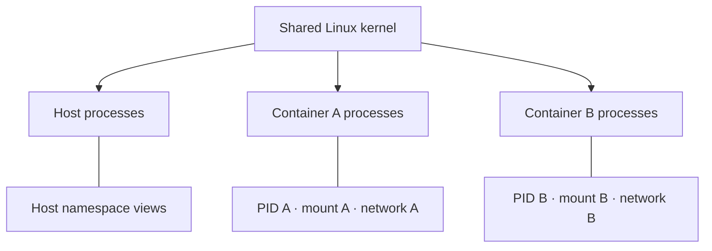
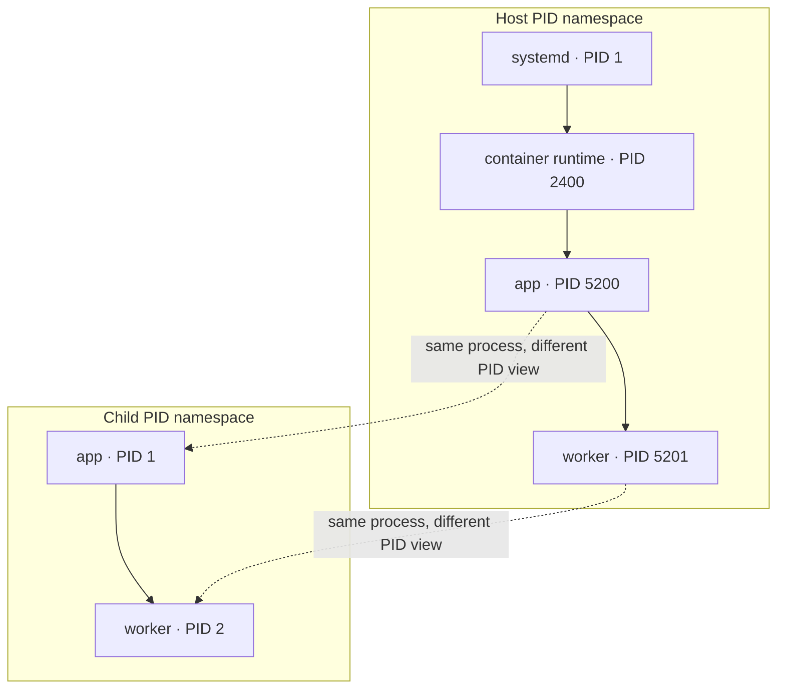
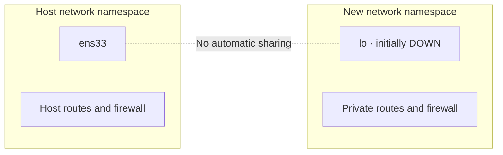
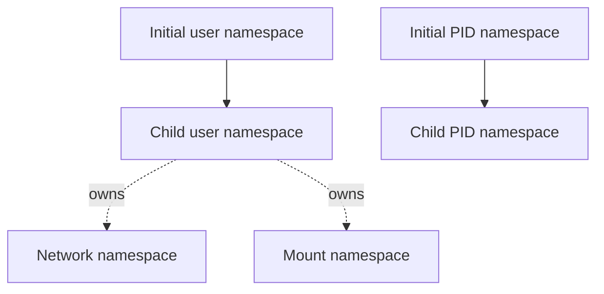

# Chapter 03 — Linux Namespaces

> **Chapter status:** Working manuscript (v2)  
> **Research snapshot:** 10 November 2026  
> **Lab status:** Designed, not tested


Chapter 01 မှာ ပုံမှန် Linux container ဟာ host ရဲ့ Linux kernel ကို မျှဝေသုံးတဲ့ ပုံမှန် process ဖြစ်တယ်ဆိုတာ လေ့လာခဲ့ပါတယ်။ Chapter 02 မှာတော့ process တစ်ခုကို ဘယ်လိုဖန်တီးသလဲ၊ PID ဆိုတာ ဘာလဲ၊ `clone()` နဲ့ `execve()` က ဘာလုပ်သလဲ ကြည့်ခဲ့ပါတယ်။ ဒီအခန်းမှာ အဲဒီ process တစ်ခုချင်းစီကို "ကိုယ့်ပတ်ဝန်းကျင်ပဲ မြင်ရတယ်" လို့ ထင်စေတဲ့ ပထမဆုံး kernel mechanism ဖြစ်တဲ့ **namespace** ကို လေ့လာပါမယ်။ အဓိကအချက် သုံးချက်ကို အရင်မှတ်ထားပါ။

1. Namespace က resource ကို ပိုင်ဆိုင်တာ၊ ကန့်သတ်တာ မဟုတ်ပါဘူး။ **process တွေ ဘာကို မြင်ရမလဲ (view)** ကိုပဲ ခွဲပေးတာပါ။
2. Linux မှာ namespace အမျိုးအစား ရှစ်မျိုး ရှိပါတယ်။ တစ်မျိုးချင်းစီက resource တစ်မျိုးကို ခွဲပေးပြီး container တိုင်းမှာ ရှစ်မျိုးလုံး သီးခြားရှိရမယ်လို့ မရှိပါဘူး။
3. Namespace ကို `clone()` (ဖန်တီး)၊ `unshare()` (လက်ရှိ process ကို ခွဲထုတ်)၊ `setns()` (ရှိပြီးသားထဲ ဝင်) နဲ့ ကိုင်တွယ်ပြီး `/proc/PID/ns/` မှာ ကြည့်နိုင်ပါတယ်။ Namespace တစ်ခုတည်းက security boundary အပြည့်အစုံ မဟုတ်ပါဘူး။

ဒီအခန်းကို ဖတ်ပြီးရင် အောက်ပါတို့ကို ကိုယ့်စကားနဲ့ ရှင်းပြနိုင်ရပါမယ်။

- Namespace က ဘာကို ခွဲပေးပြီး ဘာကို မခွဲပေးသလဲ
- PID၊ mount၊ network၊ UTS၊ IPC၊ user၊ cgroup၊ time namespace တို့ရဲ့ တာဝန်
- `clone()`၊ `unshare()`၊ `setns()` ရဲ့ ကွာခြားချက်၊ `unshare`/`nsenter` tool တွေနဲ့ ဘယ်လိုဆက်စပ်သလဲ
- `/proc/PID/ns/` နဲ့ `lsns` ကို သုံးပြီး process တစ်ခုရဲ့ namespace တွေကို ကြည့်ရှုပုံ
- Namespace တွေ ဘယ်လို nested ဖြစ်နိုင်သလဲ၊ ဘယ်အချိန်မှာ ပျက်သွားသလဲ
- Namespace တစ်ခုတည်းနဲ့ ဘာကြောင့် container လုံခြုံရေး မပြည့်စုံသလဲ

**ကြိုသိထားရန်:** Chapter 01–02 (container ဆိုတာ ဘာလဲ၊ PID၊ `clone()`၊ PID 1) ကို ဖတ်ထားရင် ပိုလွယ်ပါတယ်။ ဒီအခန်းမှာ `unshare` command တွေ ပါပါတယ်။ အဲဒီ command တွေကို သုံးတဲ့ Lab တွေကို မစခင် [Before You Begin](../before-you-begin.md) ကို ဖတ်ပါ။ cgroups ကို Chapter 04၊ capabilities ကို Chapter 05၊ container filesystem ကို Chapter 06၊ networking ကို Chapter 08၊ runtime တွေက namespace တွေကို ဘယ်လိုပေါင်းသုံးသလဲဆိုတာကို Part IV မှာ ဆက်လေ့လာပါမယ်။

## 1. Container တစ်ခုချင်းစီက ဘာကို ခွဲခြားထားဖို့ လိုသလဲ

Application နှစ်ခုကို container တစ်ခုစီထဲမှာ run ထားတယ်ဆိုပါစို့။ နှစ်ခုစလုံးက PID `1` ကို မြင်နိုင်တာ ဘာကြောင့်လဲ။ Container တစ်ခုက hostname ကို ပြောင်းလိုက်ရင် တခြား container ရဲ့ hostname က ဘာကြောင့် မပြောင်းတာလဲ။ Network interface နဲ့ port တွေကိုလည်း ဘယ်လို သီးခြားခွဲထားနိုင်တာလဲ။

ဒီမေးခွန်းတွေကို ဖြေဖို့ Linux kernel က **namespace** ကို သုံးပါတယ်။ Process တစ်ခုက ဘယ် namespace တွေထဲမှာ အလုပ်လုပ်နေသလဲဆိုတာပေါ် မူတည်ပြီး သူ့မြင်ရတဲ့ PID၊ mount table၊ network stack နဲ့ တခြား system အချက်အလက်တွေ ကွာခြားနိုင်ပါတယ်။

## 2. Namespace ဆိုတာ ဘာလဲ

> **Namespace ဆိုတာ** Linux kernel resource တစ်ခုရဲ့ မြင်ကွင်း (view) ကို process အုပ်စုတစ်ခုအတွက် သီးခြားခွဲပေးတဲ့ kernel mechanism ပါ။

ပုံမှန် Linux system မှာ process အားလုံးက system resource တွေကို global view တစ်ခုအောက်မှာ မြင်ကြပါတယ်။ `getpid()` က PID ကို ပြန်ပေးတယ်၊ `hostname` က system ရဲ့ hostname ကို ပြတယ်၊ network interface စာရင်းမှာလည်း အဲဒီ system ရဲ့ interface တွေကို မြင်ရတယ်။ Application အများအပြားကို host တစ်လုံးတည်းပေါ်မှာ run တဲ့အခါ ဒီ global view တစ်ခုတည်းကို အားလုံး မျှဝေသုံးရတာ အမြဲမသင့်တော်ပါဘူး။

Namespace က ဒီ resource တွေကို process အလိုက် view ခွဲပေးပါတယ်။ Namespace တစ်ခုထဲက process တွေက အဲဒီ resource ကို အတူမျှဝေပြီး မြင်ကြပေမဲ့ မတူတဲ့ namespace ထဲက process တွေကတော့ သီးခြား view ကို ရပါတယ်။ Linux manual မှာ namespace ကို global resource တစ်ခုကို သီးခြား instance ရှိသလို မြင်စေတဲ့ abstraction အဖြစ် ရှင်းပြထားပါတယ် [1]။

ဥပမာ host မှာ PID `5200` ဖြစ်တဲ့ application တစ်ခုကို container ထဲမှာ PID `1` အဖြစ် မြင်နိုင်ပါတယ်။ ဒါက process အသစ်တစ်ခုကို kernel ထဲ ထပ်ကူးထားတာ မဟုတ်ပါဘူး။ Process တစ်ခုတည်းကို PID namespace အဆင့်အလိုက် မတူတဲ့ PID နဲ့ မြင်ရတာပါ (§4)။

### 2.1 Namespace နဲ့ container ရဲ့ ဆက်စပ်ပုံ

Container ဆိုတာ namespace တစ်ခုတည်းကို ဖန်တီးလိုက်တာနဲ့ ပြီးစီးသွားတဲ့ mechanism မဟုတ်ပါဘူး။ Container runtime က container တစ်ခုအတွက် လိုအပ်သလို namespace အမျိုးမျိုးကို ဖန်တီးပြီး process တွေကို အဲဒီ namespace တွေထဲမှာ စတင်ပေးပါတယ်။ Filesystem၊ resource control နဲ့ security အတွက်လည်း တခြား kernel mechanism တွေကို ပေါင်းသုံးရပါတယ်။



Container နှစ်ခုက host ရဲ့ kernel တစ်ခုတည်းကို မျှဝေသုံးပေမဲ့ PID၊ mount၊ network namespace မတူတဲ့အတွက် resource view မတူနိုင်ပါတယ်။ ဒီပုံက အယူအဆကို ပြတာပါ။ တကယ့် runtime တစ်ခုမှာ namespace တစ်မျိုးချင်းစီရဲ့ sharing policy ကို သီးခြားသတ်မှတ်နိုင်ပြီး container အချင်းချင်း network namespace စတာတွေကို မျှဝေသုံးတာလည်း ရှိနိုင်ပါတယ်။

### 2.2 Namespace အမျိုးအစား ရှစ်မျိုး

| Namespace | `clone()` flag | ခွဲခြားပေးတဲ့ resource |
|---|---|---|
| PID | `CLONE_NEWPID` | Process ID နံပါတ်နဲ့ process မြင်ရပုံ |
| Mount | `CLONE_NEWNS` | Mount table / mount point မြင်ရပုံ |
| Network | `CLONE_NEWNET` | Network device၊ protocol stack၊ route၊ firewall၊ port |
| UTS | `CLONE_NEWUTS` | Hostname နဲ့ NIS domain name |
| IPC | `CLONE_NEWIPC` | System V IPC object နဲ့ POSIX message queue |
| User | `CLONE_NEWUSER` | User ID၊ group ID နဲ့ namespace နယ်ပယ်အတွင်း capability context |
| Cgroup | `CLONE_NEWCGROUP` | Process ရဲ့ cgroup path မြင်ရပုံ |
| Time | `CLONE_NEWTIME` | `CLOCK_MONOTONIC` နဲ့ `CLOCK_BOOTTIME` ရဲ့ offset |

`CLONE_NEWNS` ရဲ့ `NS` ဆိုတာ သမိုင်းကြောင်းအရ mount namespace ကို ဆိုလိုတာပါ [1]။ Namespace ရှစ်မျိုးလုံးကို တစ်ပြိုင်တည်း သုံးဖို့ မလိုပါဘူး။ Application လိုအပ်တဲ့ isolation နဲ့ runtime ရဲ့ design အလိုက် ရွေးသုံးပါတယ်။

### 2.3 ဒီအခန်းထဲက `unshare` command တွေကို ဘယ်လိုဖတ်မလဲ

ဒီအခန်းမှာ namespace တွေကို မျက်စိနဲ့ မြင်ရအောင် util-linux ရဲ့ `unshare` command ကို သုံးထားပါတယ်။ Namespace အသစ်ဖန်တီးဖို့ ပုံမှန်အားဖြင့် `CAP_SYS_ADMIN` လိုပါတယ်။ ဒါပေမဲ့ user namespace ကတော့ ခြွင်းချက်ဖြစ်ပြီး ပုံမှန် user တစ်ယောက်က ဖန်တီးနိုင်ပါတယ် [1]။ ဒါကြောင့် ပုံမှန် user နဲ့ စမ်းလို့ရအောင် `--user --map-root-user` ကို အရင်ထည့်ထားတာပါ (အသေးစိတ်ကို §8)။ ထပ်ခါထပ်ခါ တွေ့မယ့် option တွေ -

- `--user --map-root-user` က user namespace အသစ်ကို ဖန်တီးပြီး လက်ရှိ user ကို namespace အတွင်း ID `0` အဖြစ် map လုပ်ပေးတယ်။
- `--fork` က program ကို child process အဖြစ် စတင်စေတယ်။ PID namespace မှာ ဒါ လိုအပ်တယ် (§4၊ §11)။
- `--mount-proc` က `/proc` ကို လက်ရှိ PID namespace နဲ့ ကိုက်အောင် mount လုပ်ပေးတယ် [3]။

Option တွေက util-linux version အလိုက် ကွာနိုင်လို့ `man unshare` ကို စစ်ပါ။ ဒီ command တွေကို **Lab environment မှာပဲ** သုံးပါ။

## 3. UTS namespace — Hostname ကို ခွဲခြင်း

UTS namespace က hostname နဲ့ NIS domain name ကို ခွဲပေးပါတယ်။ `hostname`၊ `uname`၊ `gethostname()` တို့ ပြတဲ့ system identifier တွေဟာ process ရဲ့ UTS namespace ပေါ် မူတည်ပါတယ် [6]။ Namespace အသစ်ကို ဖန်တီးတဲ့အခါ မူလ namespace ရဲ့ hostname နဲ့ domain name ကို copy ကူးထားပြီး နောက်ပိုင်း namespace အတွင်း hostname ပြောင်းရင် အဲဒီ namespace ထဲက process တွေပဲ ပြောင်းတာကို မြင်ပါတယ်။ Host ရဲ့ hostname မပြောင်းပါဘူး။

အရိုးရှင်းဆုံး ဥပမာတစ်ခု -

```bash
unshare --user --map-root-user --uts sh -c 'hostname demo; hostname'
```

ဒီ command က UTS namespace အသစ်ထဲမှာ hostname ကို `demo` လို့ ပြောင်းပြီး ပြန်ပြတာပါ။ Command ပြီးရင် ကိုယ့် shell ရဲ့ hostname ကို ပြန်စစ်ကြည့်ပါ၊ မပြောင်းသင့်ပါဘူး။ Namespace ID နဲ့ တိုက်စစ်တာကို Lab 2 မှာ လုပ်ပါမယ်။

UTS namespace က hostname ကိုပဲ ခွဲပေးပါတယ်။ DNS server၊ `/etc/hosts`၊ routing၊ network interface တွေကို မခွဲပေးပါဘူး။ ဒါတွေက network configuration နဲ့ filesystem view နဲ့ သက်ဆိုင်ပါတယ်။

## 4. PID namespace — Process ID ကို ခွဲခြင်း

PID namespace က process ID နံပါတ်နယ်ပယ်ကို ခွဲပေးပါတယ်။ Namespace မတူတဲ့ process နှစ်ခုက PID တူညီနိုင်ပါတယ်။ ဒါကြောင့် container ထဲက application က PID `1` ဖြစ်နေပေမဲ့ host ပေါ်မှာတော့ တခြား PID နဲ့ ရှိနေနိုင်ပါတယ် [2]။

Host မှာ `app` (PID 5200) နဲ့ သူ့ child `worker` (PID 5201) ရှိတယ်ဆိုပါစို့။ `app` ကို PID namespace အသစ်ထဲမှာ စတင်ရင် အဲဒီ namespace အတွင်း `app` က PID `1`၊ `worker` က PID `2` အဖြစ် မြင်ရနိုင်ပါတယ်။ Host ဘက်ကကြည့်ရင်တော့ မူလ PID `5200`၊ `5201` ကို ဆက်မြင်ရပါတယ်။



Process တစ်ခုဟာ သူ့ကိုယ်ပိုင် PID namespace နဲ့ အဲဒီ namespace ရဲ့ ancestor namespace တွေမှာ PID တစ်ခုစီ ရှိနိုင်ပါတယ်။ Child namespace ထဲက process ကတော့ parent namespace ထဲက process တွေကို တိုက်ရိုက်မမြင်ရပါဘူး [2]။

### 4.1 PID namespace ထဲက PID 1

PID namespace အသစ်ထဲမှာ ပထမဆုံး စတင်တဲ့ process က PID `1` ဖြစ်ပြီး အဲဒီ namespace ရဲ့ init process လည်း ဖြစ်ပါတယ်။ Container မှာ application ကိုယ်တိုင်ကို PID 1 အဖြစ် run တာလည်း ရှိသလို `tini` လို init helper ကို PID 1 အဖြစ် ထားတာလည်း ရှိပါတယ်။

PID 1 မှာ ပုံမှန် process တွေနဲ့ မတူတဲ့ အထူးအချက်တွေ ရှိပါတယ်။ Orphan process တွေကို လက်ခံပြီး reap လုပ်ရတာ၊ signal စည်းမျဉ်း မတူတာတို့ကို Chapter 02 ရဲ့ PID 1 အပိုင်းမှာ ရှင်းပြခဲ့ပါပြီ။ ဒီအခန်းမှာ namespace နဲ့ တိုက်ရိုက်ဆိုင်တဲ့ အချက်နှစ်ချက်ကိုပဲ ထပ်ပြောပါမယ်။

- PID namespace ရဲ့ init process ပိတ်သွားရင် kernel က namespace ထဲမှာ ကျန်နေတဲ့ process တွေကို `SIGKILL` နဲ့ အဆုံးသတ်ပါတယ်။
- Init process မရှိတော့တဲ့ PID namespace ထဲမှာ process အသစ် ဖန်တီးလို့ မရတော့ပါဘူး [2]။

### 4.2 PID namespace နဲ့ `/proc`

`/proc` က လက်ရှိမြင်ရတဲ့ process တွေရဲ့ အချက်အလက်ကို ပြပါတယ်။ ဒါပေမဲ့ `/proc` ကို mount လုပ်ထားတဲ့အချိန်က PID namespace နဲ့ process တွေရဲ့ PID view က ဆက်စပ်နေပါတယ်။ PID namespace အသစ်ထဲ ဝင်လိုက်ရုံနဲ့ မူလ namespace အတွက် mount ထားတဲ့ `/proc` က အလိုအလျောက် မှန်ကန်တဲ့ view ဖြစ်သွားတာ မဟုတ်ပါဘူး။ ဒါကြောင့် PID namespace ကို စမ်းတဲ့အခါ `--mount-proc` ကို တွဲသုံးလေ့ရှိပါတယ်။ ဒီ option က mount namespace အသစ်ကိုပါ ဖန်တီးပြီး `/proc` ကို လက်ရှိ PID namespace နဲ့ ကိုက်အောင် ပြန် mount လုပ်ပေးပါတယ် [3]။ လက်တွေ့စမ်းတာကို Lab 3 မှာ လုပ်ပါမယ်။

## 5. Mount namespace — Mount table ကို ခွဲခြင်း

Mount namespace က process တွေ မြင်ရတဲ့ mount point စာရင်းနဲ့ filesystem tree view ကို ခွဲပေးပါတယ်။ Mount namespace အသစ်အတွင်းမှာ mount operation တစ်ခု လုပ်ရင် ပုံမှန်အားဖြင့် အဲဒီ namespace ထဲက process တွေပဲ ပြောင်းလဲမှုကို မြင်ရပါတယ် [4]။

Mount namespace ဖန်တီးတဲ့အခါ parent ရဲ့ mount list ကို အခြေခံပြီး copy တစ်ခု ရလာပါတယ်။ ဒါကြောင့် filesystem အားလုံးကို အစကနေ သီးခြားကူးထားတာ မဟုတ်ဘဲ mount view ကိုသာ ခွဲထားတာပါ။ Mount namespace ရှိတာနဲ့ container ရဲ့ root filesystem က host filesystem နဲ့ အပြည့်အဝ ကွာသွားတာ မဟုတ်ပါဘူး။ Host path တစ်ခုကို bind mount လုပ်ထားရင် container ထဲက process က အဲဒီ path ကို မြင်နိုင်ပြီး permission ရှိသလို ဖတ်ရေးနိုင်ပါတယ်။ Root filesystem ကို သီးခြားပြင်ဆင်တာနဲ့ mount namespace ရဲ့ တာဝန်ကို Chapter 06 မှာ အသေးစိတ်ကြည့်ပါမယ်။

Mount namespace နှစ်ခုရှိပေမဲ့ mount event တွေ အပြန်အလှန် သက်ရောက်နိုင်တဲ့ အခြေအနေရှိပါတယ်။ ဒါကို **mount propagation** လို့ ခေါ်ပြီး `shared`၊ `private`၊ `slave`၊ `unbindable` ဆိုတဲ့ type တွေ ရှိပါတယ်။ `unshare(1)` က mount namespace အသစ်မှာ propagation ကို `private` အဖြစ် ပုံမှန်ထားပေးပါတယ် [3]။ Application က kernel API ကို တိုက်ရိုက်ခေါ်ရင်တော့ ဒီ behavior ကို အလိုအလျောက် မရဘူးလို့ မှတ်ပါ။ Type တစ်ခုချင်းစီကို §20.1 မှာ ရှင်းပြထားပါတယ်။

## 6. Network namespace — Network stack ကို ခွဲခြင်း

Network namespace က network device၊ IPv4/IPv6 protocol stack၊ routing table၊ firewall rule၊ port နဲ့ socket၊ `/proc/net` နဲ့ `/sys/class/net` လို network information view တွေကို namespace အလိုက် ခွဲပေးပါတယ် [5]။

Network namespace အသစ်ထဲက process တွေက host ရဲ့ `ens33` လို interface ကို အလိုအလျောက် မမြင်ရပါဘူး။ ပုံမှန်အားဖြင့် loopback interface (`lo`) တစ်ခုပဲ ရှိပြီး အဲဒါလည်း အစပိုင်းမှာ down ဖြစ်နေနိုင်ပါတယ်။



Network namespace အသစ်ဖန်တီးလိုက်တာနဲ့ Internet access အလိုအလျောက် မရပါဘူး။ တခြား namespace (သို့) host နဲ့ ချိတ်ဖို့ interface နဲ့ routing path တွေကို ထပ်တည်ဆောက်ရပါတယ်။ အသုံးများတဲ့နည်းက `veth` pair ကို သုံးတာပါ။ `veth`၊ Linux bridge၊ routing၊ NAT တို့ကို Chapter 08 မှာ လေ့လာပါမယ်။

Physical network device တစ်ခုက တစ်ချိန်တည်းမှာ network namespace တစ်ခုထဲမှာပဲ ရှိနိုင်ပါတယ်။ Network namespace ကို ဖျက်တဲ့အခါ ကျန်နေတဲ့ physical device တွေကို initial network namespace ဆီ ပြန်ရွှေ့ပေးပြီး virtual `veth` pair တွေက namespace နဲ့အတူ ဖယ်ရှားခံရနိုင်ပါတယ် [5]။ TCP/UDP port တွေက network stack နဲ့ ဆက်စပ်လို့ namespace မတူရင် port နံပါတ်တူနိုင်ပါတယ်။ ဒါပေမဲ့ host ကနေ container network ကို ဆက်သွယ်ဖို့ port forwarding (သို့) တခြား connection တစ်ခု သတ်မှတ်ပေးဖို့ လိုနိုင်ပါတယ်။

## 7. IPC namespace — IPC resource တွေကို ခွဲခြင်း

Process တွေက data မျှဝေဖို့ System V shared memory၊ semaphore၊ message queue နဲ့ POSIX message queue လို inter-process communication (IPC) mechanism တွေကို သုံးကြပါတယ်။ IPC namespace က ဒီ resource တွေကို namespace အလိုက် ခွဲပေးပါတယ်။ Namespace တစ်ခုအတွင်း ဖန်တီးထားတဲ့ object တွေကို အဲဒီ namespace ထဲက process တွေပဲ ပုံမှန်မြင်ရပြီး namespace ပျက်ရင် kernel က အဲဒီ object တွေကို အလိုအလျောက် ဖယ်ရှားပါတယ် [7]။

IPC namespace က file path အခြေပြု file sharing အားလုံးကို မခွဲပေးပါဘူး။ ဥပမာ `/tmp/shared.txt` ကို application နှစ်ခုက filesystem permission နဲ့ ဖတ်လို့ရနေရင် IPC namespace မတူတာနဲ့ အဲဒီ access ကို တားမပေးပါဘူး။ File visibility နဲ့ permission က mount namespace၊ filesystem permission နဲ့ တခြား security mechanism တွေနဲ့ ဆက်စပ်ပါတယ်။

## 8. User namespace — User ID နဲ့ privilege context ကို ခွဲခြင်း

User namespace က UID၊ GID နဲ့ capability လို security နဲ့ ဆိုင်တဲ့ identifier/attribute တွေကို namespace အလိုက် ခွဲပေးပါတယ်။ အရေးကြီးဆုံးအချက်က **container အတွင်းမှာ `root` ဖြစ်နေတဲ့ process ဟာ host ပေါ်မှာလည်း root ဖြစ်နေတယ်လို့ မဆိုလိုတာ** ပါ [8]။

Host ပေါ်မှာ UID `1000` နဲ့ အလုပ်လုပ်နေတဲ့ user တစ်ယောက်က user namespace အသစ်ကို ဖန်တီးပြီး ကိုယ့် UID ကို namespace အတွင်း UID `0` အဖြစ် map လုပ်နိုင်ပါတယ်။ အဲဒီအခါ namespace အတွင်းမှာ `0` လို့ မြင်ပေမဲ့ host ရဲ့ initial user namespace မှာတော့ UID `1000` အဖြစ်ပဲ ရှိနေပါတယ်။ ဒါကြောင့် namespace အတွင်းက root privilege နဲ့ လုပ်နိုင်တဲ့ operation တချို့က host resource အားလုံးကို ထိန်းချုပ်နိုင်တဲ့ authority မဟုတ်ပါဘူး။

### 8.1 UID/GID mapping

User namespace အသစ်ဖန်တီးတဲ့အခါ UID/GID mapping ကို သတ်မှတ်ပေးရပါတယ်။ Mapping ကို `/proc/PID/uid_map` နဲ့ `/proc/PID/gid_map` မှာ ဖတ်နိုင်ပြီး namespace အတွင်း ID နဲ့ parent namespace အတွင်း ID တို့ရဲ့ ဆက်စပ်မှုကို ပြပါတယ် [8]။ `unshare --map-root-user` က လက်ရှိ user ရဲ့ UID/GID ကို namespace အတွင်း `0` နဲ့ map လုပ်ပေးပါတယ်။ Output ထဲက mapping နံပါတ်တွေက environment အလိုက် ကွာနိုင်ပါတယ်။ Mapping ကို Lab 2 မှာ ကိုယ်တိုင်ကြည့်ပါမယ်။

User namespace တွေကို nested အဖြစ် ထပ်ဖန်တီးနိုင်ပါတယ်။ Child user namespace က parent ရဲ့ authority ကို အပြည့်အဝ ပိုင်ဆိုင်တာ မဟုတ်ပါဘူး။ Capability တစ်ခုဟာ သက်ဆိုင်ရာ user namespace နဲ့ အဲဒီ namespace ပိုင်တဲ့ resource အတိုင်းအတာအတွင်းမှာပဲ သက်ရောက်ပါတယ်။ Capability set တွေကို Chapter 05 မှာ ဆက်လေ့လာပါမယ် [8]။

### 8.2 User namespace တိုင်းမှာ အမြဲ ဖွင့်ထားသလား

Kernel က user namespace ကို ပံ့ပိုးထားတာနဲ့ distribution တစ်ခုစီက unprivileged user namespace ဖန်တီးမှုကို အမြဲခွင့်ပြုတယ်လို့ မဆိုလိုပါဘူး။ Kernel configuration၊ sysctl limit၊ distribution security policy နဲ့ လက်ရှိ process ရဲ့ execution environment ပေါ်မူတည်ပြီး ကန့်သတ်ထားနိုင်ပါတယ်။ Distribution တချို့ (ဥပမာ Ubuntu အချို့ version) မှာ AppArmor လို policy နဲ့ ကန့်သတ်ထားတာမျိုးလည်း ရှိနိုင်ပါတယ်။ UID/GID mapping မှာလည်း သက်ဆိုင်ရာ restriction တွေ ရှိပါတယ်။

ဒါကြောင့် `unshare --user` က `Operation not permitted` နဲ့ ပြန်လာရင် **SELinux ကို disable လုပ်တာ၊ host security setting ကို လျှော့တာမျိုး မလုပ်ပါနဲ့။** အဲဒီ error က kernel policy၊ namespace limit (သို့) permission ပြဿနာတစ်ခုခုကို ပြနေတာပါ။ Lab ကို ရပ်ပြီး disposable VM မှာ configuration နဲ့ policy ကို သီးခြားစစ်ဆေးပါ။ ဒီစာအုပ်ထဲက Lab တွေအားလုံးမှာ ဒီစည်းမျဉ်း တူညီပါတယ်။

## 9. Cgroup namespace — Cgroup path ကို ခွဲခြင်း

Cgroup namespace က process တစ်ခုရဲ့ control group path ကို `/proc/PID/cgroup` နဲ့ `/proc/PID/mountinfo` မှာ ဘယ်လိုမြင်ရမလဲဆိုတဲ့ view ကို ခွဲပေးပါတယ်။ Cgroup namespace အသစ်ဖန်တီးတဲ့အခါ လက်ရှိ process ရဲ့ cgroup directory ကို namespace အသစ်ရဲ့ root အဖြစ် သတ်မှတ်ပေးပါတယ် [9]။

ဥပမာ host ဘက်မှာ container process က `/system.slice/container-a.scope` ဆိုတဲ့ cgroup path အောက်မှာ ရှိနေနိုင်ပါတယ်။ Container အတွင်းက process ကတော့ cgroup namespace root ကြောင့် အဲဒီ path ကို `/` (သို့) namespace နဲ့ဆိုင်တဲ့ relative path အဖြစ် မြင်ရနိုင်ပါတယ်။ Exact output က cgroup version၊ mount configuration နဲ့ runtime setup အလိုက် ကွာပါတယ်။

Cgroup namespace က **resource limit ကို သတ်မှတ်တဲ့ mechanism မဟုတ်ပါဘူး။** CPU၊ memory၊ PID count၊ I/O ကို limit/account လုပ်တာက cgroups ရဲ့ အလုပ်ဖြစ်ပြီး cgroup namespace က path view ကိုပဲ ပြောင်းပေးတာပါ။ Cgroups v1/v2 နဲ့ controller တွေကို Chapter 04 မှာ အသေးစိတ်လေ့လာပါမယ်။

## 10. Time namespace — Monotonic time ကို offset ပေးခြင်း

Time namespace က system clock အားလုံးကို container တစ်ခုစီအလိုက် ခွဲပေးတာ မဟုတ်ပါဘူး။ `CLOCK_MONOTONIC` နဲ့ `CLOCK_BOOTTIME` နှစ်ခုရဲ့ တန်ဖိုးကို namespace အလိုက် offset ပေးနိုင်တာပါ။ `CLOCK_BOOTTIME` ကတော့ system suspend ဖြစ်နေတဲ့ အချိန်ကိုပါ ထည့်တွက်ပါတယ် [10]။ ဒီ offset တွေက `clock_gettime()`၊ `clock_nanosleep()`၊ timer API နဲ့ `/proc/uptime` လို time ကို သုံးတဲ့ interface တချို့ကို သက်ရောက်ပါတယ်။

**`CLOCK_REALTIME` ကိုတော့ time namespace က မပြောင်းပေးပါဘူး။** ဒါကြောင့် container ထဲမှာ `date` က ပြတဲ့ wall clock time ကို သီးခြားနာရီတစ်လုံးလို ပြောင်းလို့ရမယ်လို့ မယူဆပါနဲ့ [10]။

Time namespace မှာ ထူးခြားတာတစ်ခု ရှိပါတယ်။ `unshare()` နဲ့ time namespace အသစ်ဖန်တီးရင် လက်ရှိ process ကို ချက်ချင်းမရွှေ့ဘဲ နောက်ထပ်ဖန်တီးမယ့် child တွေအတွက်ပဲ သုံးစေပါတယ်။ ဒါကြောင့် `/proc/PID/ns/time` နဲ့ `/proc/PID/ns/time_for_children` တန်ဖိုး မတူနိုင်ပါဘူး [1][10]။ Offset သတ်မှတ်ပုံနဲ့ တခြားအသေးစိတ်ကို §20.2 မှာ ကြည့်ပါ။ Time namespace က application testing၊ checkpoint/restore နဲ့ elapsed time အခြေပြု behavior ကို စမ်းတဲ့နေရာတွေမှာ အသုံးဝင်နိုင်ပါတယ်။ ဒါပေမဲ့ system clock ကို အပြည့်အဝ virtualize လုပ်ပေးတာ မဟုတ်ကြောင်း မှတ်ထားပါ။

## 11. Namespace ကို ဖန်တီးခြင်း၊ ခွဲထွက်ခြင်းနဲ့ ဝင်ရောက်ခြင်း

Namespace တစ်ခုကို ကိုင်တွယ်ဖို့ အဓိက system call သုံးခု ရှိပါတယ်။

| Interface | အဓိကအလုပ် | သက်ဆိုင်တဲ့ command |
|---|---|---|
| `clone()` / `clone3()` | Child process ဖန်တီးရင်း `CLONE_NEW*` flag တွေနဲ့ namespace အသစ်ထဲမှာ စတင်စေတယ် [11] | Container runtime တွေ process စတင်တဲ့အခါ သုံးတယ် |
| `unshare()` | လက်ရှိ process ကို (သို့) နောက်ဖန်တီးမယ့် child တွေကို namespace အသစ်ထဲ ခွဲထုတ်တယ် [12] | `unshare` |
| `setns()` | ရှိပြီးသား namespace တစ်ခုထဲ ဝင်တယ် [13] | `nsenter` |

`clone()` ကို Chapter 02 မှာ ရှင်းပြခဲ့ပါပြီ။ Namespace အသစ်ထဲမှာ child ကို စတင်ချင်ရင် flag တွေကို ပေါင်းပေးရပါတယ်။

```c
/* conceptual example only */
clone(child_function, child_stack,
      CLONE_NEWPID | CLONE_NEWUTS | SIGCHLD, arg);
```

ဒီ code က အယူအဆကို ပြတာပါ။ Namespace အသစ်ဖန်တီးဖို့ privilege လိုမလိုဆိုတာ §2.3 နဲ့ §8 မှာ ပြောခဲ့တဲ့အတိုင်းပါ။ Container တစ်ခု ပြည့်စုံဖို့ root filesystem၊ cgroup၊ permission စတာတွေကိုပါ ဆက်ပြင်ရပါတယ်။

### 11.1 PID နဲ့ Time မှာ "ဘယ်သူ ရွှေ့သွားသလဲ"

Namespace အမျိုးအစားအားလုံးက `unshare()`/`setns()` ကို ခေါ်တဲ့ process ကို တိုက်ရိုက်ရွှေ့တာ မဟုတ်ပါဘူး။ PID နဲ့ Time မှာ ကွာပါတယ်။

| Namespace | `unshare()` | `setns()` |
|---|---|---|
| PID | လက်ရှိ process မရွှေ့ဘူး၊ နောက်ဖန်တီးမယ့် child တွေသာ namespace အသစ်ထဲ ရောက်တယ် (`pid_for_children`) | လက်ရှိ process မရွှေ့ဘူး၊ child တွေသာ |
| Time | child တွေသာ (`time_for_children`) | လက်ရှိ process ကို ရွှေ့တယ် (single-threaded ဖြစ်ရ) |
| ကျန်တဲ့ အမျိုးအစားများ | လက်ရှိ process ကို ရွှေ့တယ် | လက်ရှိ process ကို ရွှေ့တယ် |

ဒါကြောင့် `unshare --pid` ကို `--fork` မပါဘဲ သုံးရင် program က မူလ PID namespace ထဲမှာပဲ ဆက်ရှိပြီး အဲဒီ program ရဲ့ child တွေကသာ namespace အသစ်ထဲ ရောက်ပါတယ်။ `--fork` ထည့်ရင် `unshare` က program ကို child အဖြစ် စတင်စေလို့ အဲဒီ child က PID namespace အသစ်ထဲက PID 1 ဖြစ်ပါတယ် [2][3]။ `setns()` ရဲ့ permission နဲ့ thread အရေအတွက် ကန့်သတ်ချက်တွေကို §20.3 မှာ ကြည့်ပါ။

## 12. Process တစ်ခုရဲ့ Namespace တွေကို ကြည့်ခြင်း

Process တစ်ခုက ဘယ် namespace တွေထဲမှာ ရှိနေသလဲဆိုတာ `/proc/PID/ns/` မှာ ကြည့်နိုင်ပါတယ်။ အဲဒီ directory ထဲမှာ namespace အမျိုးအစားတစ်ခုစီအတွက် symbolic link တစ်ခု ရှိပါတယ်။ Link ရဲ့ target က `net:[4026531992]` လို `type:[inode]` ပုံစံဖြစ်ပါတယ်။ **Process နှစ်ခုရဲ့ inode တူရင် အဲဒီ namespace type မှာ namespace တစ်ခုတည်းကို မျှဝေသုံးနေတာပါ** [1]။

```bash
ls -l /proc/self/ns
readlink /proc/self/ns/*
```

`/proc/self/ns` ထဲမှာ `cgroup`၊ `ipc`၊ `mnt`၊ `net`၊ `pid`၊ `pid_for_children`၊ `time`၊ `time_for_children`၊ `user`၊ `uts` ဆိုတဲ့ entry တွေ ပါပါတယ်။ `pid_for_children` နဲ့ `time_for_children` က နောက်ဖန်တီးမယ့် child တွေအတွက် namespace ကို ပြတာပါ (§11.1)။ ဥပမာ output (နံပါတ်တွေက စက်အလိုက် ကွာပါတယ်၊ illustration ပါ) -

```text
cgroup:[4026531835]
ipc:[4026531839]
mnt:[4026531841]
net:[4026531840]
pid:[4026531836]
pid:[4026531836]
time:[4026531834]
time:[4026531834]
user:[4026531837]
uts:[4026531838]
```

**တခြား user ပိုင် process ရဲ့ namespace ကို ဖတ်ဖို့ permission လိုပါတယ်။** ဥပမာ ပုံမှန် user နဲ့ host ပေါ်က root ပိုင် PID 1 ရဲ့ `/proc/1/ns/*` ကို ဖတ်ရင် `Permission denied` ဖြစ်နိုင်ပါတယ်။ ဒါက ပုံမှန်ပါ။ ကိုယ့် process (`/proc/self`၊ `/proc/$$`) နဲ့ ကိုယ်ပိုင် child process တွေကိုပဲ စစ်ပါ။ `sudo` နဲ့ ကျော်မစစ်ပါနဲ့။

`lsns` (util-linux) က system မှာ မြင်ရတဲ့ namespace တွေကို စာရင်းပြပေးပါတယ် [15]။ `lsns --task PID` က process တစ်ခုနဲ့ ဆိုင်တဲ့ namespace တွေကိုပဲ ပြပါတယ်။ ကိုယ့်မှာ ဖတ်ခွင့်မရှိတဲ့ process တွေက စာရင်းမှာ မပါနိုင်ပါဘူး။ `nsenter` (util-linux) က process တစ်ခုရဲ့ namespace တွေထဲ ဝင်ပြီး command တစ်ခုကို run ပေးတာပါ [14]။ ဥပမာ `nsenter --target PID --net ip address` ဟာ target process ရဲ့ network namespace ထဲမှာ `ip address` ကို run တာပါ။ Permission လိုနိုင်ပါတယ် (Lab 6 မှာ ကိုယ်ပိုင် namespace နဲ့ စမ်းပါမယ်)။

## 13. Namespace တွေရဲ့ ဆက်နွယ်မှုနဲ့ အသက်တာ

### 13.1 Hierarchy နဲ့ ownership

Namespace အားလုံးက parent-child hierarchy မရှိပါဘူး။ **PID namespace နဲ့ user namespace** ကသာ hierarchical ဖြစ်ပါတယ် [1]။ PID namespace မှာ parent namespace က child namespace ထဲက process တွေကို မြင်နိုင်ပြီး child ကတော့ parent ကို မမြင်ရပါဘူး (§4)။

တခြား namespace အမျိုးအစားတွေ (network၊ mount စသည်) ကို user namespace တစ်ခုက **ပိုင်ဆိုင် (own)** ပါတယ်။ Namespace တစ်ခုကို ဖန်တီးခဲ့တဲ့ user namespace က အဲဒီ namespace ကို စီမံခွင့်ရှိတဲ့ ပိုင်ရှင်ဖြစ်ပါတယ်။ ဒါက parent-child လမ်းကြောင်းနဲ့ မတူဘဲ ownership ဆက်နွယ်မှုပါ။



ဒီပုံက ဆက်နွယ်မှုပုံစံကို ပြတာပါ။ User namespace ရဲ့ authority က ownership အတိုင်းအတာအတွင်းမှာပဲ သက်ရောက်ပါတယ် (§8.1)။

### 13.2 Namespace က ဘယ်အချိန်ထိ ရှိနေသလဲ

ပုံမှန်အားဖြင့် namespace ထဲက နောက်ဆုံး process ပိတ်သွားတဲ့အခါ namespace ပျက်ပါတယ်။ ဒါပေမဲ့ `/proc/PID/ns/*` ကို file descriptor နဲ့ ဖွင့်ထားရင် (သို့) bind mount လုပ်ထားရင် process မရှိတော့ပေမဲ့ namespace ကို ဆက်ထိန်းထားနိုင်ပါတယ် [1]။ ဒီနည်းနဲ့ namespace တစ်ခုကို ပြန်ဝင်ဖို့ ထိန်းထားတာမျိုး လုပ်နိုင်ပါတယ်။ ဖန်တီးသူ process ပျောက်သွားတာနဲ့ container ရဲ့ namespace အားလုံး ချက်ချင်း မပျက်တာကလည်း ဒီအကြောင်းကြောင့်ပါ။ Namespace ကို ထိန်းထားတဲ့ အခြား အခြေအနေတွေကို §20.4 မှာ ကြည့်ပါ။ PID namespace ရဲ့ init process ပိတ်ရင် ဘာဖြစ်သလဲဆိုတာကို §4.1 မှာ ပြောခဲ့ပါပြီ။

## 14. Namespace တွေက ဘာကို မခွဲပေးဘူးလဲ

Namespace ကို "မြင်ကွင်းကို ခွဲတယ်" လို့ နားလည်ထားရင် ဘာကို မခွဲပေးဘူးဆိုတာကိုလည်း ခန့်မှန်နိုင်ပါတယ်။ ဒီ table မှာ တစ်နေရာတည်း စုထားပါတယ်။

| Namespace | ခွဲပေးတာ | မခွဲပေး / မကာကွယ်ပေးတာ |
|---|---|---|
| PID | Process ID နဲ့ process မြင်ရပုံ | CPU/memory limit၊ file access၊ network |
| Mount | Mount table / filesystem view | Bind mount နဲ့ host path မျှဝေနိုင်တယ်။ permission စစ်ဆေးမှုကို အစားမထိုးဘူး |
| Network | Network device၊ route၊ port၊ firewall view | Internet access ကို အလိုအလျောက် မပေးဘူး။ host နဲ့ ချိတ်ဖို့ ပြင်ဆင်ရတယ် |
| UTS | Hostname နဲ့ NIS domain name | DNS၊ `/etc/hosts`၊ network interface |
| IPC | System V IPC နဲ့ POSIX message queue | Filesystem path အခြေပြု file sharing |
| User | UID/GID mapping နဲ့ namespace အတွင်း capability နယ်ပယ် | Host root authority မရတာကို တစ်ခုတည်းနဲ့ အာမမခံဘူး။ privileged configuration ဆိုရင် အန္တရာယ်ရှိနိုင်တယ် |
| Cgroup | Cgroup path မြင်ရပုံ | Resource limit (cgroups ရဲ့ အလုပ်) |
| Time | Monotonic/boottime offset | Wall clock (`CLOCK_REALTIME`) |

**Namespace တစ်ခုတည်းက security boundary အပြည့်အစုံ မဟုတ်ပါဘူး။** Container တစ်ခုကို ကန့်သတ်ဖို့ cgroups၊ capabilities၊ seccomp၊ Linux Security Modules၊ filesystem isolation တို့နဲ့ ပေါင်းသုံးရပါတယ်။ Container ကို privileged mode နဲ့ run တာ၊ host path တွေကို မျှဝေတာ၊ runtime socket ကို ချိတ်ပေးတာမျိုးလုပ်ရင် namespace တွေရှိနေပေမဲ့ host ရဲ့ resource ကို ထိနိုင်ပါတယ်။ ဒီအကြောင်းတွေကို Part II ကျန်တဲ့ အခန်းတွေနဲ့ Chapter 14 မှာ ဆက်ကြည့်ပါမယ်။

## 15. လက်တွေ့စစ်ဆေးခြင်း (Labs)

> **Lab status — Designed, not tested.** ဒီ Lab တွေကို စာအုပ်အတွက် သီးခြား environment မှာ run ပြီး အတည်မပြုရသေးပါဘူး။ Expected output တွေက ဘယ်လိုဖတ်ရမလဲ ပြတဲ့ illustration သာ ဖြစ်ပြီး စမ်းသပ်ပြီးသား ရလဒ် မဟုတ်ပါဘူး။ Output ကွာနိုင်ပါတယ်။

### Lab တွေအားလုံးအတွက် တူညီတဲ့အချက်များ

**Risk level:** ဒီအခန်းမှာ အောက်ပါ စံနှုန်းကို သုံးထားပါတယ်။

| Risk | ဆိုလိုရင်း |
|---|---|
| Low | Read-only ကြည့်ရှုမှု၊ namespace အသစ် မဖန်တီးဘူး |
| Medium | Unprivileged namespace အသစ်ကို ဖန်တီးတယ်၊ host ရဲ့ persistent state ကို မပြောင်းဘူး |
| High | Root privilege လိုတယ် (သို့) host state ကို ပြောင်းနိုင်တယ် |

ဒီအခန်းထဲက Lab တွေမှာ **High Lab မရှိပါဘူး။**

**Environment:** Disposable Linux VM (သို့) ခွင့်ပြုချက်ရှိတဲ့ non-production Linux environment တစ်ခုကို သုံးပါ။ Host OS နဲ့ VM baseline ကို စာအုပ်က အတည်မပြုရသေးပါဘူး ([Before You Begin](../before-you-begin.md) ကို ကြည့်ပါ)။ Windows/macOS မှာ Linux VM (သို့) WSL2 လိုအပ်နိုင်ပါတယ်။

**လိုအပ်တာများ:** util-linux (`unshare`၊ `nsenter`၊ `lsns`၊ `findmnt`)၊ procps (`ps`)၊ iproute2 (`ip`)။ User namespace ဖန်တီးခွင့်ရှိရပါမယ်။

**စည်းမျဉ်း:** `sudo` နဲ့ အတင်း run မလုပ်ပါနဲ့။ `Operation not permitted` ပေါ်ရင် SELinux disable တာ၊ host security setting လျှော့တာ မလုပ်ပါနဲ့။ §8.2 ကို ကြည့်ပြီး Lab ကို ရပ်ပါ။ Command တစ်ခုချင်းစီကို run မယ့်အခါ ဘာလုပ်မလဲ အရင်ဖတ်ပါ။

### Lab 1 — ကိုယ့် process ရဲ့ namespace တွေကို ကြည့်ခြင်း

**Risk:** Low။ **ရည်ရွယ်ချက်:** `/proc/self/ns` နဲ့ `lsns` ကို သုံးပြီး namespace identity ကို ဖတ်တတ်ဖို့။

```bash
echo "shell PID=$$ parent PID=$PPID"
ls -l /proc/self/ns
readlink /proc/self/ns/*
lsns --task "$$"
echo "parent net:  $(readlink /proc/$PPID/ns/net)"
echo "current net: $(readlink /proc/self/ns/net)"
```

**ဘာကို မျှော်လင့်မလဲ:** `readlink` output မှာ `cgroup`၊ `ipc`၊ `mnt`၊ `net`၊ `pid`၊ `time`၊ `user`၊ `uts` entry တွေ ပါပါလိမ့်မယ်။ Shell ရဲ့ parent (terminal ကနေ စတင်တာဆိုရင်) နဲ့ ကိုယ့် shell ရဲ့ `net` inode တူသင့်ပါတယ်။

**အဓိပ္ပာယ်:** Inode တူရင် namespace တစ်ခုတည်းကို မျှဝေသုံးနေတာပါ (§12)။ Container ဆိုတာ ဒီ identity တွေ မတူတဲ့ process တစ်ခုပါပဲ။

**Troubleshooting:** `lsns` မတွေ့ရင် util-linux package ကို စစ်ပါ။ တခြား user ပိုင် process (ဥပမာ PID 1) ရဲ့ `/proc/PID/ns/*` ကို ဖတ်ရင် `Permission denied` ပေါ်တာ ပုံမှန်ပါ။ ကိုယ့် process ကိုပဲ စစ်ပါ။ **Cleanup:** မလိုပါဘူး။

### Lab 2 — UTS နဲ့ user namespace ကို ID နဲ့ စစ်ခြင်း

**Risk:** Medium။ **ရည်ရွယ်ချက်:** Hostname က namespace အတွင်းပဲ ပြောင်းတာ၊ namespace ID မတူတာ၊ UID mapping ကို မြင်ဖို့။

```bash
echo "outside: $(hostname) uts=$(readlink /proc/self/ns/uts) user=$(readlink /proc/self/ns/user)"

unshare --user --map-root-user --uts sh -c '
    hostname lab-uts
    echo "inside:  $(hostname) uts=$(readlink /proc/self/ns/uts) user=$(readlink /proc/self/ns/user)"
    id
    cat /proc/self/uid_map
    cat /proc/self/gid_map
'

echo "after:   $(hostname) uts=$(readlink /proc/self/ns/uts)"
```

**ဘာကို မျှော်လင့်မလဲ (illustration):** `inside` မှာ hostname က `lab-uts`၊ `uts` နဲ့ `user` ID တွေက `outside` နဲ့ မတူပါဘူး။ `id` က `uid=0(root)` ပြပါလိမ့်မယ် (ကျန်တဲ့ group တွေက `nobody` လို့ ပြနိုင်ပါတယ်)။ `uid_map` ထဲမှာ namespace အတွင်း `0` က host UID (ဥပမာ `1000`) ဆီ map ဖြစ်နေတာ တွေ့ရပါမယ်။ `after` မှာ hostname နဲ့ `uts` ID က `outside` နဲ့ တူပါတယ်။

**အဓိပ္ပာယ်:** Hostname ပြောင်းမှုက UTS namespace အတွင်းပဲ ကျန်ပါတယ်။ `root` လို့ မြင်ရပေမဲ့ host မှာ ကိုယ့်ရဲ့ ပုံမှန် UID အတိုင်းပါပဲ (§8)။

**Troubleshooting:** `Operation not permitted` ဆိုရင် §8.2။ **Cleanup:** မလိုပါဘူး။ `hostname` ကို ပြန်စစ်ပါ၊ မပြောင်းသင့်ပါဘူး။

### Lab 3 — PID namespace နဲ့ `/proc`

**Risk:** Medium။ **ရည်ရွယ်ချက်:** PID namespace ထဲမှာ shell က PID 1 ဖြစ်တာ၊ `/proc` ကို remount ရတာ၊ PID 1 ကို အထဲကနေ `SIGKILL` မပို့နိုင်တာကို မြင်ဖို့။

```bash
echo "outside: shell PID=$$ pid-ns=$(readlink /proc/self/ns/pid)"

unshare --user --map-root-user --pid --fork --mount-proc sh -c '
    echo "inside:  shell PID=$$ pid-ns=$(readlink /proc/self/ns/pid)"
    ps -o pid,ppid,comm -e
    kill -KILL 1
    echo "PID 1 (this shell) is still running after kill -KILL 1"
'
```

**ဘာကို မျှော်လင့်မလဲ (illustration):** `inside` မှာ shell PID က `1` ပါ၊ `pid-ns` ID က `outside` နဲ့ မတူပါဘူး။ `ps` က namespace အတွင်းက process အနည်းငယ်ပဲ ပြပါလိမ့်မယ် (PID 1 `sh` နဲ့ `ps`)။ `kill -KILL 1` ပြီးရင် shell က မရပ်ဘဲ နောက်ဆုံးစာကြောင်းကို ပြပါလိမ့်မယ်။

**အဓိပ္ပာယ်:** `--fork` ကြောင့် `sh` က namespace အသစ်ရဲ့ PID 1 ဖြစ်ပါတယ်။ `--mount-proc` ကြောင့် `ps` က namespace နဲ့ ကိုက်တဲ့ `/proc` ကို မြင်ပါတယ်။ Namespace အတွင်းက process က PID 1 ဆီ `SIGKILL` ပို့လို့ မရတာကို [2] မှာ ဖော်ပြထားပါတယ် (Chapter 02 ရဲ့ PID 1 အပိုင်းလည်း ကြည့်ပါ)။

**Troubleshooting:** `ps` က host process တွေကို ပြနေရင် `--mount-proc` မပါလို့ (သို့) `/proc` remount မအောင်မြင်လို့ ဖြစ်နိုင်ပါတယ်။ `fork: Cannot allocate memory` ပေါ်ရင် `--fork` မပါဘဲ run ထားတာ ဖြစ်နိုင်ပါတယ်။ **Cleanup:** `sh` ပြီးတာနဲ့ namespace ပျက်ပါတယ်၊ မလိုပါဘူး။

### Lab 4 — Network namespace ကို စမ်းခြင်း

**Risk:** Medium။ **ရည်ရွယ်ချက်:** Network namespace အသစ်မှာ `lo` တစ်ခုပဲ ရှိပြီး down ဖြစ်နေတာ၊ host ရဲ့ interface တွေ မမြင်ရတာကို မြင်ဖို့။

```bash
echo "outside: net=$(readlink /proc/self/ns/net)"
ip -brief link

unshare --user --map-root-user --net sh -c '
    echo "inside:  net=$(readlink /proc/self/ns/net)"
    ip -brief link
    ip link set lo up
    ip -brief address show lo
'

ip -brief link
```

**ဘာကို မျှော်လင့်မလဲ (illustration):** `inside` မှာ `net` ID မတူပါဘူး၊ `lo` တစ်ခုပဲ ပါပြီး အစပိုင်းမှာ `DOWN` ဖြစ်ပါတယ်။ `ip link set lo up` ပြီးရင် `127.0.0.1/8` နဲ့ `UP` (`UNKNOWN` လို့ ပြနိုင်ပါတယ်) ဖြစ်လာပါမယ်။ Namespace ပြင်ပက `ip -brief link` မှာ host ရဲ့ interface တွေ မပြောင်းသင့်ပါဘူး။

**အဓိပ္ပာယ်:** Network namespace အသစ်ဖြစ်လို့ host interface တွေ မမြင်ရပါဘူး။ Namespace အတွင်း interface ကို ပြင်တာက host ကို မထိပါဘူး (§6)။

**မှတ်ချက်:** `ping 127.0.0.1` ကိုပါ စမ်းချင်ရင် ping ရဲ့ permission policy ကြောင့် မအောင်မြင်နိုင်ပါတယ်။ အဲဒါက namespace ပြဿနာ မဟုတ်ပါဘူး။ **Cleanup:** မလိုပါဘူး။

### Lab 5 — Mount namespace နဲ့ temporary mount

**Risk:** Medium။ **ရည်ရွယ်ချက်:** Mount namespace အတွင်း လုပ်တဲ့ mount ကို host mount table က မမြင်ရတာကို မြင်ဖို့။

```bash
echo "outside: mnt=$(readlink /proc/self/ns/mnt)"
findmnt -rn -o TARGET | grep -F '/tmp/ns-mount.' || echo "no ns-mount entry in host mount table (expected)"

unshare --user --map-root-user --mount --propagation private sh -c '
    set -eu
    echo "inside:  mnt=$(readlink /proc/self/ns/mnt)"
    target=$(mktemp -d /tmp/ns-mount.XXXXXX)
    cleanup() { umount "$target" 2>/dev/null || true; rmdir "$target" 2>/dev/null || true; }
    trap cleanup EXIT
    mount -t tmpfs -o size=8m tmpfs "$target"
    findmnt "$target"
    echo lab > "$target/lab.txt"
    ls -l "$target"
'

findmnt -rn -o TARGET | grep -F '/tmp/ns-mount.' || echo "no ns-mount entry in host mount table (expected)"
```

**ဘာကို မျှော်လင့်မလဲ (illustration):** `inside` မှာ `mnt` ID မတူပါဘူး၊ `findmnt` က tmpfs mount တစ်ခုကို ပြပြီး `lab.txt` ကို မြင်ရပါမယ်။ Namespace ပြင်ပမှာ `/tmp/ns-mount.` entry မပြသင့်ပါဘူး။

**အဓိပ္ပာယ်:** User namespace နဲ့ mount namespace ကို တွဲသုံးထားလို့ root မလိုဘဲ mount လုပ်နိုင်ပြီး host mount table ကို မထိပါဘူး (§5)။ `--propagation private` က mount event တွေ ပြင်ပကို မပျံ့စေအောင် ပါ။

**Troubleshooting:** Permission error ဆိုရင် §8.2။ **Cleanup:** Namespace ပြီးတာနဲ့ mount ပျက်ပါတယ်။ `/tmp` ထဲမှာ `ns-mount.*` directory ကျန်နေရင်သာ `rmdir` နဲ့ ဖယ်ပါ (အထဲက file မရှိတာ အရင်စစ်ပါ)။

### Lab 6 (optional) — ရှိပြီးသား namespace ထဲ ဝင်ခြင်း

**Risk:** Medium။ **ရည်ရွယ်ချက်:** `nsenter` (`setns()`) နဲ့ ကိုယ်ပိုင် namespace ထဲ ဝင်ပြီး မြင်ရတာကို ကြည့်ဖို့။

```bash
unshare --user --map-root-user --uts sh -c 'hostname lab-target; exec sleep 120' &
target_pid=$!
sleep 1

echo "host hostname: $(hostname)"
nsenter --target "$target_pid" --user --uts hostname
readlink /proc/"$target_pid"/ns/uts
readlink /proc/self/ns/uts

kill "$target_pid"
wait "$target_pid" 2>/dev/null || true
```

**ဘာကို မျှော်လင့်မလဲ (illustration):** Host hostname နဲ့ `nsenter` ထဲက hostname (`lab-target`) မတူပါဘူး၊ `uts` ID နှစ်ခုလည်း မတူပါဘူး။

**အဓိပ္ပာယ်:** `nsenter` က target process ရဲ့ namespace တွေထဲ ဝင်ပြီး command ကို run တာပါ (§11၊ §12)။ ကိုယ်ပိုင် namespace ဖြစ်လို့ ပုံမှန် user နဲ့ ဝင်နိုင်ပါတယ်။ တခြား user ပိုင် process (ဥပမာ root) ရဲ့ namespace ထဲ ဝင်ဖို့ကတော့ permission လိုပါတယ်။

**Troubleshooting:** `nsenter` မအောင်မြင်ရင် `sleep 1` မလုံလောက်လို့ target က hostname မသတ်မှတ်ရသေးတာ (သို့) permission ပြဿနာ ဖြစ်နိုင်ပါတယ် (§8.2)။ **Cleanup:** နောက်ဆုံး `kill` နဲ့ `sleep` process ကို ရပ်ပါ။ `ps` နဲ့ `sleep 120` မကျန်ဘူးဆိုတာ စစ်ပါ။

## 16. အဖြစ်များတဲ့ ပြဿနာများ

| ပြဿနာ | ဖြစ်နိုင်တဲ့ အကြောင်းရင်း | စစ်ရန် |
|---|---|---|
| `unshare: unshare failed: Operation not permitted` | Kernel configuration၊ `/proc/sys/user/` အောက်က namespace limit၊ distribution security policy၊ UID/GID mapping restriction | §8.2။ Security setting ကို မလျှော့ပါနဲ့ |
| `fork: Cannot allocate memory` (PID namespace အတွင်း) | `--fork` မပါဘဲ run ထားတာ၊ (သို့) namespace ရဲ့ init process ပြီးသွားပြီ | §4.1၊ §11.1 |
| PID namespace အသစ်ထဲမှာ `ps` က host process တွေကို ပြနေတယ် | `/proc` ကို remount မလုပ်ထားဘူး | `--mount-proc` (§4.2) |
| `/proc/PID/ns/*` ကို ဖတ်ရင် `Permission denied` | တခြား user ပိုင် process ဖြစ်နေတယ် | ကိုယ့် process ကိုပဲ စစ်ပါ (§12) |
| `lsns` က namespace နည်းနည်းပဲ ပြတယ် | မြင်ခွင့်ရှိတဲ့ process တွေရဲ့ namespace ကိုပဲ ပြတယ် | §12 |
| Network namespace အသစ်ထဲမှာ `eth0` မရှိဘူး | Network namespace အသစ်မှာ `lo` တစ်ခုပဲ ရှိတာ ပုံမှန် | §6 |
| စာအုပ်က output နဲ့ ကိုယ့် output မတူဘူး | Kernel/distribution/tool version၊ namespace ID နံပါတ် ကွာတာ ပုံမှန် | ဘာကို ယှဉ်စစ်ရမလဲ (ID မတူတာ၊ hostname) ကိုပဲ ကြည့်ပါ |

## 17. အဖြစ်များတဲ့ အထင်လွဲမှုများ

| အထင်လွဲမှု | အမှန် | အပိုင်း |
|---|---|---|
| Namespace ဆိုတာ container ပဲ | Namespace က view ကိုပဲ ခွဲတယ်၊ container မှာ တခြား mechanism တွေလည်း ပါတယ် | §2.1 |
| Container တိုင်းမှာ namespace ရှစ်မျိုးလုံး သီးခြားရှိတယ် | Runtime configuration အလိုက် တချို့ကို မျှဝေနိုင်တယ် | §2.2 |
| PID namespace ထဲမှာ process အသစ်ကို ကူးထားတာ | Process တစ်ခုတည်းကို PID view မတူအောင် မြင်ရတာ | §4 |
| `unshare --pid` ခေါ်တာနဲ့ shell က PID 1 ဖြစ်သွားတယ် | PID namespace က child တွေအတွက်၊ `--fork` လိုတယ် | §4၊ §11.1 |
| PID namespace အသစ်ဝင်ရုံနဲ့ `/proc` က မှန်ကန်တယ် | `/proc` ကို remount လုပ်ရတယ် | §4.2 |
| Mount namespace ရှိရင် host file တွေ မမြင်ရဘူး | Bind mount နဲ့ host path မျှဝေနိုင်တယ် | §5 |
| Network namespace အသစ်မှာ Internet ရတယ် | `lo` တစ်ခုပဲ ရှိတယ်၊ ချိတ်ဆက်မှု ထပ်ဆောက်ရတယ် | §6 |
| UTS namespace က DNS၊ `/etc/hosts` ကို ခွဲတယ် | Hostname နဲ့ NIS domain name ပဲ ခွဲတယ် | §3 |
| IPC namespace က file sharing ကို တားတယ် | Filesystem path အခြေပြု sharing ကို မတားဘူး | §7 |
| User namespace ထဲက `root` က host `root` နဲ့ အတူတူ | UID mapping နဲ့ capability scope ပေါ် မူတည်တယ် | §8 |
| Cgroup namespace က resource limit ထည့်ပေးတယ် | Cgroup path view ကိုပဲ ပြောင်းတယ် | §9 |
| Time namespace က `date` ကို ပြောင်းပေးတယ် | `CLOCK_REALTIME` ကို မပြောင်းဘူး | §10 |
| `unshare()`/`setns()` က PID အတွက် လက်ရှိ process ကို ရွှေ့တယ် | PID မှာ child တွေကိုသာ ရွှေ့တယ် | §11.1 |
| Process ပျောက်ရင် namespace ချက်ချင်း ပျောက်တယ် | fd (သို့) bind mount နဲ့ ထိန်းထားနိုင်တယ် | §13.2 |
| Namespace ရှိရင် container လုံခြုံပြီ | Namespace တစ်ခုတည်းက security boundary မဟုတ်ဘူး | §14 |

## 18. Review Questions

အလွတ်ကျက်ဖြေဖို့ မဟုတ်ဘဲ ကိုယ့်စကားနဲ့ ပြန်ရှင်းနိုင်ဖို့ ရည်ရွယ်ထားပါတယ်။ အရင်ကိုယ်တိုင်ဖြေကြည့်ပြီးမှ hint ကို ဖွင့်ပါ။

**1. Namespace ဆိုတာ ဘာလဲ။ ဘာကို ခွဲပေးပြီး ဘာကို မခွဲပေးသလဲ။**

<details markdown="1"><summary>Hint</summary>
Kernel resource တစ်ခုရဲ့ view ကို process အုပ်စုအလိုက် ခွဲပေးတယ်။ Resource ကို ပိုင်ဆိုင်တာ၊ limit လုပ်တာ မဟုတ်ဘူး။ (§2၊ §14)
</details>

**2. Namespace ရှစ်မျိုးကို အမည်နဲ့ ခွဲခြားပေးတဲ့ resource အလိုက် ပြောပါ။**

<details markdown="1"><summary>Hint</summary>
PID၊ mount၊ network၊ UTS၊ IPC၊ user၊ cgroup၊ time။ (§2.2)
</details>

**3. Host မှာ PID 5200 ဖြစ်တဲ့ process က container ထဲမှာ PID 1 ဖြစ်နေတာ ဘယ်လိုဖြစ်နိုင်သလဲ။**

<details markdown="1"><summary>Hint</summary>
Process တစ်ခုတည်းကို PID namespace အဆင့်အလိုက် မတူတဲ့ PID နဲ့ မြင်ရတာ။ (§4)
</details>

**4. PID namespace ရဲ့ init process ပိတ်သွားရင် ဘာဖြစ်သလဲ။**

<details markdown="1"><summary>Hint</summary>
Namespace ထဲက ကျန် process တွေကို kernel က `SIGKILL` ပို့တယ်၊ process အသစ်ဖန်တီးလို့ မရတော့ဘူး။ (§4.1)
</details>

**5. `unshare --pid` မှာ `--fork` ဘာကြောင့် လိုသလဲ။**

<details markdown="1"><summary>Hint</summary>
PID namespace က child တွေအတွက်၊ လက်ရှိ process မရွှေ့ဘူး။ `--fork` ကြောင့် child က PID 1 ဖြစ်တယ်။ (§11.1)
</details>

**6. `--mount-proc` ကို ဘာကြောင့် တွဲသုံးသလဲ။**

<details markdown="1"><summary>Hint</summary>
`/proc` ကို လက်ရှိ PID namespace နဲ့ ကိုက်အောင် remount လုပ်ဖို့။ Mount namespace လည်း ဖန်တီးပေးတယ်။ (§4.2)
</details>

**7. Mount namespace ရှိတာနဲ့ host ရဲ့ file တွေ မမြင်ရဘူးလား။**

<details markdown="1"><summary>Hint</summary>
မဟုတ်ဘူး။ Bind mount နဲ့ host path မျှဝေနိုင်တယ်။ (§5)
</details>

**8. Network namespace အသစ်ထဲမှာ ဘာတွေ ရှိသလဲ။ Internet ရမလား။**

<details markdown="1"><summary>Hint</summary>
ပုံမှန်အားဖြင့် `lo` တစ်ခုပဲ (အစမှာ down)။ Internet မရဘူး၊ `veth` စတာတွေနဲ့ ချိတ်ရတယ်။ (§6)
</details>

**9. UTS namespace က ဘာကို ခွဲပေးသလဲ။ DNS ကို ခွဲပေးသလား။**

<details markdown="1"><summary>Hint</summary>
Hostname နဲ့ NIS domain name ပဲ။ DNS မခွဲဘူး။ (§3)
</details>

**10. IPC namespace က `/tmp` ထဲက shared file ကို ဝင်ဖတ်တာကို တားသလား။**

<details markdown="1"><summary>Hint</summary>
မတားဘူး။ IPC object တွေကိုပဲ ခွဲတယ်၊ file permission က တခြား mechanism။ (§7)
</details>

**11. User namespace ထဲက `root` က host root နဲ့ ဘာကွာသလဲ။**

<details markdown="1"><summary>Hint</summary>
UID mapping ကြောင့် namespace အတွင်း `0` က host မှာ ပုံမှန် UID (ဥပမာ 1000)။ Capability က namespace နယ်ပယ်အတွင်းပဲ။ (§8)
</details>

**12. Cgroup namespace နဲ့ cgroups ရဲ့ ကွာခြားချက်ကို ရှင်းပြပါ။**

<details markdown="1"><summary>Hint</summary>
Cgroup namespace က cgroup path မြင်ရပုံကို ခွဲတယ်၊ resource limit က cgroups။ (§9)
</details>

**13. Time namespace က ဘာကို offset ပေးသလဲ။ `CLOCK_REALTIME` ကို ပြောင်းသလား။**

<details markdown="1"><summary>Hint</summary>
`CLOCK_MONOTONIC` နဲ့ `CLOCK_BOOTTIME`။ `CLOCK_REALTIME` မပြောင်းဘူး။ (§10)
</details>

**14. `clone()`၊ `unshare()`၊ `setns()` ကို နှိုင်းယှဉ်ပါ။ PID နဲ့ Time မှာ ဘာထူးသလဲ။**

<details markdown="1"><summary>Hint</summary>
ဖန်တီးစတင်၊ ခွဲထုတ်၊ ဝင်ရောက်။ PID မှာ child တွေကိုသာ ရွှေ့တယ်၊ Time မှာ `unshare()` က child တွေအတွက်၊ `setns()` က လက်ရှိ process ကို ရွှေ့တယ်။ (§11)
</details>

**15. `/proc/PID/ns/` မှာ inode နှစ်ခု တူရင် ဘာကို ဆိုလိုသလဲ။ တခြား user ရဲ့ process ကို ဖတ်ရင် ဘာဖြစ်နိုင်သလဲ။**

<details markdown="1"><summary>Hint</summary>
Namespace တစ်ခုတည်းကို မျှဝေသုံးတယ်။ Permission မရှိရင် `Permission denied`။ (§12)
</details>

**16. Namespace တစ်ခုတည်းက container လုံခြုံရေး အပြည့်အစုံ မဖြစ်ဘာကြောင့်လဲ။**

<details markdown="1"><summary>Hint</summary>
View ကိုပဲ ခွဲတယ်။ Resource limit၊ capability၊ syscall filter၊ filesystem isolation စတာတွေ ထပ်ရတယ်။ Privileged mode၊ host path မျှဝေတာတွေက host ကို ထိနိုင်တယ်။ (§14)
</details>

## 19. Chapter 03 အနှစ်ချုပ်

- Namespace က kernel resource တစ်ခုရဲ့ view ကို process အုပ်စုအလိုက် ခွဲပေးပါတယ်။ ရှစ်မျိုး (PID၊ mount၊ network၊ UTS၊ IPC၊ user၊ cgroup၊ time) ရှိပြီး container တိုင်းမှာ ရှစ်မျိုးလုံး သီးခြားရှိရမယ်လို့ မရှိပါဘူး။
- PID namespace ထဲက process တစ်ခုကို host မှာ မတူတဲ့ PID နဲ့ မြင်ရပြီး namespace ရဲ့ PID 1 မှာ အထူးတာဝန်တွေ ရှိပါတယ်။ `/proc` ကို remount လုပ်မှ မှန်ကန်တဲ့ view ရပါတယ်။
- Mount namespace က mount table ကို၊ network namespace က network stack ကို၊ UTS က hostname ကို၊ IPC က IPC object တွေကို ခွဲပါတယ်။ User namespace က UID/GID mapping နဲ့ capability နယ်ပယ်ကို ခွဲပြီး namespace အတွင်း root က host root မဟုတ်ပါဘူး။ Cgroup namespace က cgroup path view ကို၊ time namespace က monotonic/boottime offset ကို ပြောင်းပါတယ်။
- `clone()` ဖန်တီး၊ `unshare()` ခွဲထုတ်၊ `setns()` ဝင်ရောက်ပါတယ်။ PID မှာ child တွေကိုသာ ရွှေ့ပါတယ်။ `/proc/PID/ns/` နဲ့ `lsns` ကို သုံးပြီး ကြည့်နိုင်ပါတယ်။
- PID နဲ့ user namespace ကသာ hierarchical ဖြစ်ပါတယ်။ Namespace ကို fd (သို့) bind mount နဲ့ ထိန်းထားနိုင်ပါတယ်။
- Namespace တစ်ခုတည်းက security boundary မဟုတ်ပါဘူး။ cgroups၊ capabilities၊ seccomp၊ LSM နဲ့ filesystem isolation တို့နဲ့ ပေါင်းသုံးရပါတယ်။

နောက်အခန်း (Chapter 04) မှာ cgroups ကို လေ့လာပြီး container ရဲ့ CPU၊ memory နဲ့ I/O အသုံးပြုမှုကို ဘယ်လို ထိန်းကန့်သတ်သလဲ ကြည့်ပါမယ်။ Namespace က "ဘာကို မြင်ရမလဲ" ကို ဖြေပြီး cgroups က "ဘယ်လောက် သုံးနိုင်မလဲ" ကို ဖြေပေးပါတယ်။

## 20. Going Deeper (optional)

ဒီအပိုင်းက container ကို နားလည်ဖို့ မဖြစ်မနေ မလိုပေမဲ့ လက်တွေ့မှာ ကြုံတတ်တဲ့ အသေးစိတ်တွေပါ။ အခန်းအဓိကကို ဖတ်ပြီးမှ လိုသလို ပြန်ဖတ်ပါ။

### 20.1 Mount propagation (§5)

Mount event (mount/unmount) တွေ mount namespace တွေကြား ပျံ့နိုင်မနိုင်ကို propagation type နဲ့ ထိန်းပါတယ် [4]။

| Type | အဓိပ္ပာယ် |
|---|---|
| `shared` | Peer group ထဲက mount တွေကြား mount/unmount event ကို ပို့ရော လက်ခံရော လုပ်တယ် |
| `private` | Event ကို မပို့၊ မလက်ခံဘူး |
| `slave` | Master ကလာတဲ့ event ကို လက်ခံတယ်၊ ကိုယ့် event ကို master ဆီ ပြန်မပို့ဘူး |
| `unbindable` | `private` လို event မပျံ့တဲ့အပြင် bind mount အဖြစ် copy လို့ မရဘူး |

Mount တစ်ခုကို shared peer group ထဲမှာ ထားရင် namespace အတွင်း mount/unmount event တွေ host ဘက်ကို ပျံ့နိုင်လို့ runtime တွေက propagation ကို ရည်ရွယ်ချက်ရှိရှိ သတ်မှတ်ဖို့ လိုပါတယ်။ `unshare(1)` က mount namespace အသစ်မှာ propagation ကို `private` အဖြစ် ပုံမှန်ထားပေးတယ် ဆိုတာ [3] မှာ ဖော်ပြထားပါတယ်။

### 20.2 Time namespace အသေးစိတ် (§10)

- `/proc/PID/ns/time` က process ကိုယ်တိုင်ရဲ့ time namespace၊ `/proc/PID/ns/time_for_children` က နောက်ဖန်တီးမယ့် child တွေအတွက် time namespace ပါ။
- `unshare()` နဲ့ time namespace အသစ်ဖန်တီးရင် `time_for_children` ပဲ ပြောင်းပါတယ်။ `setns()` နဲ့ ဝင်ရင်တော့ calling process ကို ပြောင်းပြီး single-threaded ဖြစ်ရပါတယ် [1][10][13]။
- Namespace ရဲ့ offset တွေကို `/proc/PID/timens_offsets` ကနေ ကြည့်/သတ်မှတ်နိုင်ပြီး၊ namespace ထဲ process စတင်လာပြီးနောက် ပြင်လို့မရတာမျိုး ကန့်သတ်ချက်တွေ ရှိပါတယ်။ အတိအကျကို [10] မှာ စစ်ပါ။ util-linux ရဲ့ `unshare` မှာ time namespace နဲ့ ဆိုင်တဲ့ option တွေ ပါနိုင်ပေမဲ့ version အလိုက် ကွာနိုင်ပါတယ် [3]။
- `CLOCK_REALTIME` ကို မပြောင်းပါဘူး။

### 20.3 `setns()` ရဲ့ ကန့်သတ်ချက်များ (§11)

`setns()` ကို သုံးဖို့ namespace အမျိုးအစားအလိုက် permission စည်းမျဉ်းတွေ ရှိပါတယ်။ ပုံမှန်အားဖြင့် target namespace ကို ပိုင်တဲ့ user namespace မှာ လိုအပ်တဲ့ capability (အများအားဖြင့် `CAP_SYS_ADMIN`) လိုပါတယ်။ User namespace နဲ့ time namespace ကို `setns()` နဲ့ ဝင်တဲ့အခါ calling process က single-threaded ဖြစ်ရတာမျိုးလည်း ရှိပါတယ် [13]။ Version နဲ့ namespace type အလိုက် ကွာနိုင်လို့ `setns(2)` ကို ကိုးကားပါ။ `nsenter` မှာ namespace ကို ဝင်တဲ့ အစီအစဉ်ကိုလည်း tool က ကိုင်တွယ်ပေးပါတယ် [14]။

### 20.4 Namespace ကို ထိန်းထားတဲ့ အခြေအနေများ (§13.2)

Namespace တစ်ခုကို ဆက်ရှိစေတဲ့ အခြေအနေတွေက process member ရှိတာတင် မဟုတ်ပါဘူး။ [1] ကို အခြေခံပြီး အကျဉ်းချုပ်ရရင် -

- `/proc/PID/ns/*` ကို file descriptor နဲ့ ဖွင့်ထားတာ (သို့) bind mount လုပ်ထားတာ။
- Hierarchical namespace (PID/user) မှာ child namespace ရှိနေတာ။
- User namespace တစ်ခုက တခြား non-user namespace တစ်ခုကို ပိုင်ထားတာ။
- PID/time namespace မှာ process တစ်ခုက `pid_for_children`/`time_for_children` link နဲ့ ရည်ညွှန်းနေတာ။

အတိအကျ စည်းမျဉ်းကို [1] မှာ ကြည့်ပါ။

## 21. ကိုးကားရင်းမြစ်များ

စာထဲက `[နံပါတ်]` ကို ကြည့်ပြီး သက်ဆိုင်ရာရင်းမြစ်ကို ရှာနိုင်ပါတယ်။

### Namespace အခြေခံနဲ့ အမျိုးအစားများ

1. [namespaces(7)](https://man7.org/linux/man-pages/man7/namespaces.7.html) — Namespace အကျဉ်းချုပ်၊ အမျိုးအစား၊ `/proc/PID/ns`၊ lifetime၊ hierarchy။
2. [pid_namespaces(7)](https://man7.org/linux/man-pages/man7/pid_namespaces.7.html) — PID namespace၊ init process၊ PID 1 စည်းမျဉ်း။
3. [unshare(1)](https://man7.org/linux/man-pages/man1/unshare.1.html) — `unshare` command၊ `--fork`၊ `--mount-proc`၊ propagation။
4. [mount_namespaces(7)](https://man7.org/linux/man-pages/man7/mount_namespaces.7.html) — Mount namespace နဲ့ mount propagation။
5. [network_namespaces(7)](https://man7.org/linux/man-pages/man7/network_namespaces.7.html) — Network namespace။
6. [uts_namespaces(7)](https://man7.org/linux/man-pages/man7/uts_namespaces.7.html) — UTS namespace။
7. [ipc_namespaces(7)](https://man7.org/linux/man-pages/man7/ipc_namespaces.7.html) — IPC namespace။
8. [user_namespaces(7)](https://man7.org/linux/man-pages/man7/user_namespaces.7.html) — User namespace၊ UID/GID mapping၊ capability။
9. [cgroup_namespaces(7)](https://man7.org/linux/man-pages/man7/cgroup_namespaces.7.html) — Cgroup namespace။
10. [time_namespaces(7)](https://man7.org/linux/man-pages/man7/time_namespaces.7.html) — Time namespace၊ clock offset၊ `time_for_children`။

### System call နဲ့ Command

11. [clone(2)](https://man7.org/linux/man-pages/man2/clone.2.html) — `clone()`/`clone3()` နဲ့ `CLONE_NEW*` flag။
12. [unshare(2)](https://man7.org/linux/man-pages/man2/unshare.2.html) — `unshare()` system call။
13. [setns(2)](https://man7.org/linux/man-pages/man2/setns.2.html) — `setns()` system call နဲ့ ကန့်သတ်ချက်။
14. [nsenter(1)](https://man7.org/linux/man-pages/man1/nsenter.1.html) — `nsenter` command။
15. [lsns(8)](https://man7.org/linux/man-pages/man8/lsns.8.html) — `lsns` command။
