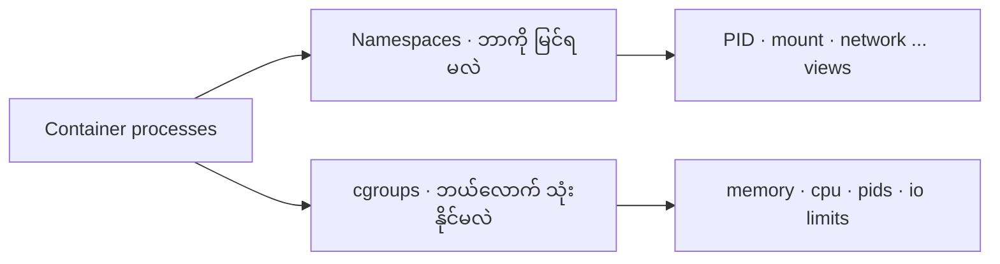
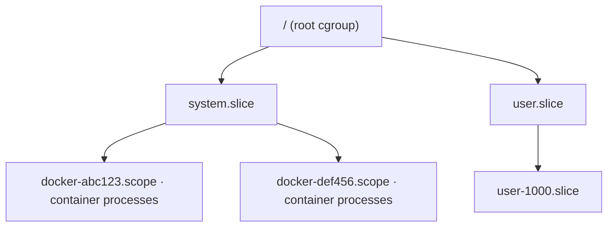
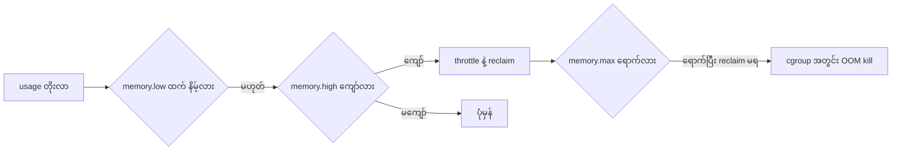

# Chapter 04 — Control Groups

> **Chapter status:** Working manuscript (v1)  
> **Research snapshot:** 18 November 2026  
> **Lab status:** Designed, not tested


Chapter 03 မှာ namespace ဟာ process တွေ **ဘာကို မြင်ရမလဲ** ကို ခွဲပေးတာဖြစ်ပြီး resource limit မပေးဘူးဆိုတာ လေ့လာခဲ့ပါတယ်။ ဒီအခန်းမှာ "**ဘယ်လောက် သုံးနိုင်မလဲ**" ကို ဖြေပေးတဲ့ **control groups (cgroups)** ကို လေ့လာပါမယ်။ အဓိကအချက် သုံးချက်ကို အရင်မှတ်ထားပါ။

1. cgroup က process တွေကို hierarchy အဖြစ် စုစည်းပြီး အဲဒီအုပ်စုရဲ့ CPU၊ memory၊ process အရေအတွက်၊ I/O အသုံးပြုမှုကို စောင့်ကြည့်ပြီး ကန့်သတ်နိုင်တဲ့ kernel mechanism ပါ။
2. Container ရဲ့ `--memory`၊ `--cpus`၊ `--pids-limit` လို limit တွေကို kernel က cgroup interface file တွေ (`memory.max`၊ `cpu.max`၊ `pids.max` စသည်) နဲ့ တကယ်ထိန်းပါတယ်။
3. Namespace က မြင်ရတာ၊ cgroups က သုံးနိုင်တာပါ။ ဒါပေမဲ့ cgroup limit တစ်ခုတည်းက security boundary အပြည့်အစုံ မဟုတ်ပါဘူး။

ဒီအခန်းကို ဖတ်ပြီးရင် အောက်ပါတို့ကို ကိုယ့်စကားနဲ့ ရှင်းပြနိုင်ရပါမယ်။

- cgroup ဆိုတာ ဘာလဲ၊ namespace နဲ့ `ulimit` (`setrlimit`) နဲ့ ဘာကွာသလဲ
- cgroup v1 နဲ့ v2 ရဲ့ ကွာခြားချက်၊ ဘာကြောင့် v2 ကို အဓိကထားရသလဲ
- cgroup v2 ရဲ့ filesystem interface (`cgroup.procs`၊ `cgroup.controllers`၊ `cgroup.subtree_control`) နဲ့ အခြေခံစည်းမျဉ်းများ
- memory၊ cpu၊ pids၊ io controller တွေရဲ့ အဓိက file တွေနဲ့ အပြုအမူ
- systemd က cgroup ကို ဘယ်လိုစီမံသလဲ၊ delegation ဆိုတာ ဘာလဲ
- Container runtime က OCI configuration ကနေ cgroup limit ကို ဘယ်လိုသတ်မှတ်သလဲ (preview)

**ကြိုသိထားရန်:** Chapter 01–03 (container၊ process၊ PID၊ namespace) ကို ဖတ်ထားရင် ပိုလွယ်ပါတယ်။ ဒီအခန်းထဲက Lab တွေက systemd နဲ့ cgroup v2 ကို အသုံးပြုတဲ့ Linux environment ကို လိုပါတယ်။ Lab မစခင် [Before You Begin](../before-you-begin.md) ကို ဖတ်ပါ။ Capabilities ကို Chapter 05၊ OCI `linux.resources` ကို Chapter 10၊ `runc`/`crun` ကို Chapter 11၊ rootless delegation ကို Chapter 15၊ OOM နဲ့ throttling troubleshooting ကို Chapter 16 မှာ ဆက်လေ့လာပါမယ်။

## 1. Namespace တစ်ခုတည်းနဲ့ မလုံလောက်တဲ့ ပြဿနာ

Server တစ်လုံးတည်းပေါ်မှာ container အများကြီး run နေတယ်ဆိုပါစို့။ Container တစ်ခုထဲက application တစ်ခုက memory ကို အကုန်လိုလို သုံးလိုက်ရင် တခြား container တွေနဲ့ host ကို ဘာဖြစ်စေမလဲ။ Process တစ်ခုက fork ကို ထပ်ခါထပ်ခါ လုပ်ပြီး (fork bomb) process အရေအတွက်ကို ကုန်စေရင်၊ တစ်ခုက CPU ကို အကုန်သုံးရင် ဘာဖြစ်မလဲ။

Chapter 03 မှာ ဆွေးနွေးခဲ့သလို PID namespace က process တွေကို မတူတဲ့ PID နဲ့ မြင်စေတာပဲ ရှိပါတယ်။ Memory သို့မဟုတ် CPU ကို ဘယ်လောက်သုံးနိုင်လဲဆိုတာ မကန့်သတ်ပါဘူး။ ဒီအလုပ်ကို cgroups ကို သုံးပြီး လုပ်ပါတယ်။

> "Container ထဲက application ကို memory 256 MB ပဲ သုံးခွင့်ပေးချင်ရင် Linux က ဘယ်လိုလုပ်သလဲ" — ဒီအခန်းက အဲဒီမေးခွန်းကို ဖြေပါမယ်။

## 2. cgroup ဆိုတာ ဘာလဲ

> **cgroup ဆိုတာ** process တွေကို hierarchy အဖြစ် စုစည်းပြီး အဲဒီအုပ်စုရဲ့ resource အသုံးပြုမှုကို စောင့်ကြည့်၊ ကန့်သတ်၊ ဦးစားပေးနိုင်တဲ့ kernel mechanism ပါ။

Kernel documentation မှာ "cgroup" ဆိုတာ "control group" ရဲ့ အတိုကောက်ဖြစ်ပြီး စာလုံးကြီးနဲ့ မရေးဘူးလို့ သတ်မှတ်ထားပါတယ် [1]။ ဒီစာအုပ်မှာလည်း အတူတူပါပဲ။ Feature တစ်ခုလုံးကို ဆိုလိုရင် "cgroup"၊ အုပ်စု တစ်ခုချင်းစီ အများကိုဆိုလိုရင် "cgroups" လို့ သုံးပါမယ်။

cgroup က အဓိကအလုပ် သုံးမျိုး လုပ်ပါတယ်။

- **စောင့်ကြည့်ခြင်း (accounting):** အုပ်စုတစ်ခုလုံးရဲ့ memory၊ CPU time စတာတွေကို တိုင်းတာတယ်။
- **ကန့်သတ်ခြင်း (limiting):** အသုံးပြုမှုကို ကန့်သတ်တယ်။ ဥပမာ memory ကို 256 MB ထက် မကျော်စေဘူး။
- **ဦးစားပေးခြင်း (prioritising):** အုပ်စုတွေကြား resource ကို အချိုးကျ မျှဝေတယ်။ ဥပမာ CPU ကို 2:1 အချိုး ခွဲပေးတယ်။

Process တစ်ခုက cgroup တစ်ခုမှာ ပါဝင်တယ်ဆိုတာကို membership လို့ ခေါ်ပါတယ်။ Process ကို တခြား cgroup ဆီ ရွှေ့နိုင်ပါတယ်။ ပြီးတော့ **process တစ်ခုက `fork()` လုပ်တဲ့အခါ child က fork လုပ်ချိန်မှာ parent ရှိနေတဲ့ cgroup ထဲမှာ မွေးပါတယ်** [1]။ Chapter 02 မှာ ပြောခဲ့တဲ့ process lifecycle နဲ့ ဆက်စပ်ပါတယ်။ ဒါကြောင့် container ရဲ့ cgroup ထဲက application က နောက်ထပ် process တွေ ဖန်တီးလည်း အဲဒီ child တွေက ဒီ cgroup ထဲမှာပဲ ဆက်ရှိနေပါတယ်။

### 2.1 cgroup၊ namespace နဲ့ `ulimit`

| | Namespace | cgroup | `ulimit` / `setrlimit` |
|---|---|---|---|
| ဘာကို ထိန်းသလဲ | Process တွေ **မြင်ရတာ** (view) | Process အုပ်စုတစ်ခုရဲ့ **resource အသုံးပြုမှု** | Process တစ်ခုချင်းစီရဲ့ resource limit |
| သက်ရောက်တဲ့ အတိုင်းအတာ | Namespace ထဲက process တွေ | cgroup တစ်ခုနဲ့ သူ့ descendant တွေ | Process တစ်ခု (သို့) သူ့ child တွေ |
| ဥပမာ | Container ထဲမှာ PID 1 လို့ မြင်ရတာ | Container တစ်ခုလုံး memory ကို 256 MB အထိပဲ သုံးခွင့်ရှိတာ | Process တစ်ခု ဖွင့်နိုင်တဲ့ file အရေအတွက် |

`ulimit` က process တစ်ခုချင်းစီကို ကန့်သတ်တာပါ။ Container တစ်ခုထဲမှာ process အများကြီးရှိရင် process တိုင်းက limit ကို သီးခြားစီ ရနိုင်ပါတယ်။ cgroup ကတော့ အုပ်စုတစ်ခုလုံးရဲ့ စုစုပေါင်းကို ကန့်သတ်ပါတယ်။



## 3. cgroup v1 နဲ့ v2

cgroup ကို Linux 2.6.24 မှာ ပထမဆုံး ထုတ်ခဲ့ပြီး (v1) အဲဒီ implementation ရဲ့ ပြဿနာတွေကြောင့် Linux 3.10 ကစပြီး v2 ကို ထပ်ဖန်တီးခဲ့တာပါ [2]။

| | cgroup v1 | cgroup v2 |
|---|---|---|
| Hierarchy | Controller (memory၊ cpu စသည်) တစ်ခုချင်းစီအတွက် hierarchy ခွဲနိုင်တယ် | Hierarchy တစ်ခုတည်း (unified) [1] |
| Process ရွှေ့ပုံ | Thread တစ်ခုချင်းစီကိုပါ ခွဲရွှေ့နိုင်တယ် | `cgroup.procs` ကို ရေးပြီး process တစ်ခုလုံးကို ရွှေ့တယ် [1] |
| `/proc/PID/cgroup` | Hierarchy တစ်ခုစီအတွက် စာကြောင်းတစ်ကြောင်း | v2 entry က `0::$PATH` ပုံစံ [1] |
| Memory limit file | `memory.limit_in_bytes` | `memory.max` |

v1 မှာ controller တစ်ခုစီကို သီးခြား hierarchy အဖြစ် mount လုပ်နိုင်လို့ controller နှစ်ခုကြား တူညီတဲ့ အုပ်စုဖွဲ့မှုကို စီမံဖို့ ရှုပ်ထွေးပါတယ်။ v2 က hierarchy တစ်ခုတည်းအောက်မှာ controller အားလုံးကို သုံးစေလို့ ပိုရိုးရှင်းပါတယ်။

### 3.1 ၂၀၂၆ မှာ v1 က ဘယ်လိုအခြေအနေလဲ

ဒီစာအုပ်က **cgroup v2 ကို အဓိကထားပါတယ်။** အကြောင်းရင်းက ecosystem က v2 ဆီ ရွှေ့နေလို့ပါ။

- **systemd:** v257 မှာ v1 ကို obsolete လို့ သတ်မှတ်ပြီး "v258 မှာ ဖယ်ရှားမယ်" လို့ ကြေညာခဲ့ပါတယ်။ systemd 258 ရဲ့ release notes မှာ v1 ('legacy' နဲ့ 'hybrid') support ကို ဖယ်ရှားပြီး v2 ကိုသာ mount တယ်လို့ ဖော်ပြထားပါတယ် [6]။
- **Kubernetes:** v1 ကို maintenance mode ထဲ ထည့်ပြီး deprecated လုပ်ဖို့ KEP-5573 က အဆိုပြုထားပါတယ်။ ဖယ်ရှားမှုက Kubernetes 1.38 မတိုင်ခင် မဖြစ်ဘူးလို့ ဖော်ပြထားပါတယ် [7]။ KEP မှာ RHEL 10 နဲ့ Fedora 43 ကိုလည်း v1 မဆက်ပံ့တဲ့ ဥပမာအဖြစ် ဖော်ပြထားပါတယ် [7]။ အခြေအနေက ပြောင်းနိုင်လို့ ဒီစာအုပ်ကို ဖတ်တဲ့အချိန်မှာ ကိုယ့် distribution ရဲ့ release notes ကို စစ်ပါ။

ဒါကြောင့် ဒီစာအုပ်မှာ v1 ကို နောက်ကြောင်းပြန်သမိုင်းအနေနဲ့ပဲ ရှင်းပြပြီး ပိုအသေးစိတ်တဲ့ v1 နာမည်ပြောင်း table ကို §14.1 (Going Deeper) မှာ ထားပါတယ်။ ကိုယ့်စက်က ဘာလဲဆိုတာ စစ်ချင်ရင် Lab 1 ကို သုံးပါ။

## 4. cgroup v2 ရဲ့ filesystem interface

cgroup v2 ကို `cgroup2` filesystem အဖြစ် mount လုပ်ထားပြီး ပုံမှန်အားဖြင့် `/sys/fs/cgroup` မှာ တွေ့ရပါတယ်။ Hierarchy ထဲက cgroup တစ်ခုချင်းစီက directory တစ်ခုဖြစ်ပါတယ်။ Cgroup ကို ဖန်တီးချင်ရင် sub-directory တစ်ခု ဖန်တီး (`mkdir`) ရပါတယ် [1]။ Process မရှိတော့တဲ့ cgroup ကို `rmdir` နဲ့ ဖျက်ပါတယ်။

အသုံးများတဲ့ core interface file တွေ -

| File | ဘာကို ပြ / လုပ်သလဲ |
|---|---|
| `cgroup.procs` | Cgroup ထဲက process တွေရဲ့ PID စာရင်း။ PID တစ်ခုကို ရေးရင် အဲဒီ process ကို cgroup ထဲ ရွှေ့တယ် [1] |
| `cgroup.controllers` | ဒီ cgroup မှာ ဖွင့်ခွင့်ရှိတဲ့ controller စာရင်း |
| `cgroup.subtree_control` | Child cgroup တွေအတွက် ဖွင့်ထားတဲ့ controller။ `+cpu +memory` လို ရေးပြီး ဖွင့်/ပိတ်တယ် |
| `cgroup.events` | `populated`၊ `frozen` လို အခြေအနေ |
| `cgroup.type` | Cgroup အမျိုးအစား (ပုံမှန်က domain) |

Process တစ်ခုရဲ့ cgroup ကို `/proc/PID/cgroup` မှာ ကြည့်နိုင်ပါတယ်။ v2 entry က `0::$PATH` ပုံစံဖြစ်ပါတယ် [1]။ ဥပမာ `0::/user.slice/user-1000.slice/...` ဆိုရင် `/sys/fs/cgroup` နောက်က အဲဒီ path မှာ အဲဒီ cgroup ရဲ့ file တွေ ရှိတယ်လို့ ဆိုလိုပါတယ်။

**Controller တွေကို မူလက မဖွင့်ထားပါဘူး။** Kernel documentation အရ controller အားလုံး မူလအတိုင်း ပိတ်ထားပြီး `cgroup.subtree_control` ထဲ ရေးမှ child cgroup တွေအတွက် ဖွင့်ပါတယ် [1]။ ဒီအခန်းမှာ cgroup တစ်ခုကို ကိုယ်တိုင်ဖန်တီးဖို့ မလိုပါဘူး။ systemd က လုပ်ပေးတာကို Lab မှာ သုံးပါမယ် (§6)။

### 4.1 အခြေခံစည်းမျဉ်းများ

- **Top-down constraint:** Controller တစ်ခုကို cgroup တစ်ခုမှာ ဖွင့်ရင် သူ့ parent မှာ အဲဒီ controller ကို အရင် ဖွင့်ထားရတယ်။ Resource ကို ဖြန့်ပေးတာက အပေါ်ကနေ အောက်ကို ဆင်းတယ် [1]။
- **No internal process constraint:** Root မဟုတ်တဲ့ cgroup တစ်ခုက child cgroup အတွက် controller တွေကို ဖွင့်ပြီး resource ကို ဖြန့်ပေးနေရင် အဲဒီ cgroup မှာ process တွေ တိုက်ရိုက် မပါရဘူး။ Process တွေက leaf cgroup မှာ ရှိရတာများတယ် [1][5]။ အသေးစိတ်ကို §14.2 မှာ ကြည့်ပါ။
- **Delegation:** Cgroup tree ရဲ့ sub-tree တစ်ခုကို တခြား manager (ဥပမာ container runtime) ကို လွှဲပေးနိုင်တယ် (§6)။



ဒီပုံက အယူအဆကို ပြတာပါ။ cgroup path ရဲ့ နာမည်တွေက systemd driver နဲ့ runtime ရွေးချယ်မှုအလိုက် ကွာနိုင်ပါတယ် (§6)။

## 5. Controller များ

> **အတိုချုပ်:** Controller တစ်ခုချင်းစီက resource တစ်မျိုးကို ထိန်းပါတယ်။ Container ကို ဆက်စပ်တဲ့ အဓိက controller လေးမျိုးက memory၊ cpu၊ pids နဲ့ io ပါ။

Controller တွေက kernel version အလိုက် ရောက်လာပုံ ကွာပါတယ်။ ဥပမာ v2 `cpu` controller က Linux 4.15၊ `cpuset` က Linux 5.0 မှ စပါတယ် [2]။

### 5.1 memory

Memory controller က cgroup တစ်ခုလုံးရဲ့ memory အသုံးပြုမှုကို တိုင်းတာပြီး ကန့်သတ်ပါတယ်။

| File | ဆိုလိုရင်း |
|---|---|
| `memory.current` | လက်ရှိ memory အသုံးပြုမှု စုစုပေါင်း |
| `memory.max` | **Hard limit။** Usage က ဒီတန်ဖိုးကို ရောက်ပြီး ပြန်လျှော့လို့ မရတော့ရင် cgroup အတွင်း OOM killer ကို ခေါ်တယ် |
| `memory.high` | **Throttle boundary။** ကျော်ရင် process တွေကို နှေးစေပြီး memory ပြန်ယူ (reclaim) မှု ပိုပြင်းထန်တယ်။ ဒီ boundary ကျော်တာနဲ့ OOM killer ကို မခေါ်ဘူး |
| `memory.low` / `memory.min` | Reclaim မှ ကာကွယ်ပေးတဲ့ အတိုင်းအတာ (`min` က ပိုတင်းကျပ်) |
| `memory.swap.max` | Swap အသုံးပြုမှု ကန့်သတ်ချက် |
| `memory.events` | `low`၊ `high`၊ `max`၊ `oom`၊ `oom_kill` ဆိုတဲ့ event အရေအတွက်များ |
| `memory.stat` | အသေးစိတ် စာရင်းအင်း |
| `memory.oom.group` | OOM ဖြစ်ရင် cgroup ထဲက process အားလုံးကို တစ်စုတည်း သတ်မလား |

Table ထဲက `memory.high` နဲ့ `memory.max` စာကြောင်းတွေက kernel documentation ရဲ့ wording ကို အကျဉ်းချုပ်ထားတာပါ [1]။ အသေးစိတ်ကို မူရင်းနဲ့ စစ်ပါ။ `memory.events` ရဲ့ field တွေကို Linux source ထဲက `memory_events_show` နဲ့လည်း တွေ့နိုင်ပါတယ် (`low`၊ `high`၊ `max`၊ `oom`၊ `oom_kill`)။



ဒီပုံက memory limit အဆင့်တွေကို အကြမ်းဖျင်း ပြတာပါ။ တကယ့်အပြုအမူက ပိုရှုပ်ထွေးပါတယ်။

**မှတ်ထားစရာ:**

- Memory usage ထဲမှာ application ရဲ့ heap တင်မကဘဲ file cache လို kernel memory ပါ ပါနိုင်ပါတယ်။ `memory.stat` မှာ အမျိုးအစားလိုက် ကြည့်နိုင်ပါတယ်။ ဒါကြောင့် application က မျှော်လင့်တာထက် `memory.current` က ပိုများနေတာ ပုံမှန်ပါ။
- Container ကို OOM killer က သတ်တဲ့အခါ process ကို `SIGKILL` ပို့တာမို့ exit status က `137` (128 + 9) ဖြစ်တတ်ပါတယ်။ Docker/Podman တို့မှာ container state ထဲက OOM-killed flag ကိုလည်း ကြည့်နိုင်ပါတယ် (tool version အလိုက် ကွာနိုင်ပါတယ်)။
- Cgroup OOM နဲ့ system-wide OOM ကို မရောပါနဲ့။ Cgroup limit ကို ရောက်လို့ OOM ဖြစ်တဲ့အခါ host မှာ RAM အများကြီး ကျန်နေနိုင်ပါတယ်။

### 5.2 cpu

CPU controller မှာ ကွာခြားတဲ့ ထိန်းနည်းနှစ်မျိုး ရှိပါတယ်။

| File | ဆိုလိုရင်း |
|---|---|
| `cpu.weight` | CPU အတွက် **ပြိုင်ဆိုင်မှု ရှိတဲ့အခါ** အချိုးကျ မျှဝေတဲ့ weight (default 100) |
| `cpu.max` | **Hard cap။** `$QUOTA $PERIOD` (microsecond) ပုံစံ။ ဥပမာ `50000 100000` က period တစ်ခု (100 ms) အတွင်း 50 ms ပဲ သုံးခွင့်ရှိတာ (CPU တစ်ခုရဲ့ ထက်ဝက်)။ `max` ဆိုရင် ကန့်သတ်ချက် မရှိ |
| `cpu.stat` | `usage_usec`၊ `nr_periods`၊ `nr_throttled`၊ `throttled_usec` စတဲ့ စာရင်းအင်း |
| `cpuset.cpus` / `cpuset.mems` | `cpuset` controller။ ဘယ် CPU/NUMA node တွေပေါ်မှာပဲ run ခွင့်ပြုမလဲ |

**`cpu.weight` နဲ့ `cpu.max` ကို မရောပါနဲ့။** `cpu.weight` က CPU ကို အပြိုင်သုံးနေတဲ့အခါမှ သက်ရောက်ပါတယ်။ တခြား process မရှိရင် CPU အကုန်သုံးနိုင်ပါတယ်။ `cpu.max` ကတော့ CPU လွတ်နေလည်း quota ကျော်ရင် process တွေကို ရပ်ထားပါတယ် (**throttling**)။ `cpu.stat` ရဲ့ `nr_throttled` က ဘယ်နှစ်ကြိမ် throttle ဖြစ်သလဲဆိုတာ ပြပါတယ်။ `cpuset` က CPU ကို သီးသန့်ပေးတာ၊ `cpu.max` က CPU အချိန်ကို ကန့်သတ်တာမို့ မတူပါဘူး။

`docker run --cpus 1.5` လို flag က `cpu.max` ကို သတ်မှတ်ပေးတာ ဖြစ်ပါတယ် (period ကို ပုံမှန် 100 ms အဖြစ် ထားရင် quota က 150000 ဖြစ်ပါမယ်)။ `--cpu-shares` ကတော့ `cpu.weight` ရဲ့ တန်ဖိုးအဖြစ် ပြောင်းလဲပေးပါတယ် (runtime က conversion လုပ်တယ်၊ Chapter 11 မှာ ကြည့်ပါမယ်)။

### 5.3 pids

PIDs controller က cgroup တစ်ခုထဲမှာ ဖန်တီးနိုင်တဲ့ process (task) အရေအတွက်ကို ကန့်သတ်ပါတယ်။

| File | ဆိုလိုရင်း |
|---|---|
| `pids.max` | ခွင့်ပြုတဲ့ အများဆုံး အရေအတွက် (default `max`) |
| `pids.current` | လက်ရှိ အရေအတွက် |
| `pids.events` | `max` count စတဲ့ event။ ကန့်သတ်ချက်ကြောင့် fork မအောင်မြင်တာကို ရေတွက်တယ် |

Limit ကို ရောက်ပြီးနောက် `fork()` ခေါ်ရင် `EAGAIN` (`Resource temporarily unavailable`) နဲ့ မအောင်မြင်ပါဘူး။ ဒီနည်းနဲ့ fork bomb ကို container တစ်ခုအတွင်းမှာပဲ ကန့်ထားနိုင်ပါတယ်။ `RLIMIT_NPROC` (`ulimit -u`) က user တစ်ယောက်ချင်းစီအတွက်၊ `pids.max` က cgroup တစ်ခုလုံးအတွက်ပါ။ Kernel doc အရ `pids.events` ရဲ့ `max` က subtree တစ်ခုလုံးကို ရေတွက်တာ ပုံမှန်ဖြစ်ပြီး `pids_localevents` mount option နဲ့ local ပဲ ရေတွက်စေနိုင်ပါတယ် [1]။

### 5.4 io

I/O controller က block device ကို ဖတ်/ရေး အမြန်နှုန်းနဲ့ အရေအတွက်ကို ကန့်သတ်တာ၊ weight နဲ့ မျှဝေတာ လုပ်ပါတယ်။

| File | ဆိုလိုရင်း |
|---|---|
| `io.max` | Device တစ်ခုချင်းစီအတွက် (`MAJOR:MINOR`) `rbps`၊ `wbps`၊ `riops`၊ `wiops` limit |
| `io.weight` | Device မျှဝေမှု weight |
| `io.stat` | Device အလိုက် စာရင်းအင်း |

I/O limit က block device ကို သတ်မှတ်ရတာ (major:minor နံပါတ်လိုတာ) နဲ့ buffered write (writeback) အပိုင်းမှာ ကန့်သတ်ချက်တွေ ရှိတာကြောင့် filesystem၊ device နဲ့ configuration အပေါ် မူတည်ပါတယ်။ ဒီအခန်းမှာ အကျဉ်းချုပ်ပဲ ပြပါတယ်။ အသေးစိတ်ကို kernel doc ရဲ့ IO အပိုင်း (writeback အပါအဝင်) မှာ ကြည့်ပါ [1]။

### 5.5 တခြား controller များ

| Controller | အဓိကအလုပ် | မှတ်ချက် |
|---|---|---|
| `cpuset` | CPU နဲ့ NUMA node ကို ကန့်သတ် | §5.2 |
| `hugetlb` | Huge page အသုံးပြုမှုကို ကန့်သတ် | Linux 5.6 မှ v2 [2] |
| `rdma` | RDMA resource ကို ကန့်သတ် | |
| `misc` | တခြား scalar resource | |
| Device access | Device file ကို ဖွင့်ခွင့် | v2 မှာ eBPF အခြေပြုတယ်လို့ မှတ်ထားပါ (Chapter 14 မှာ ဆက်ကြည့်ပါမယ်၊ kernel doc နဲ့ စစ်ရန်) |
| Freezer | Cgroup ထဲက process တွေကို ခဏရပ်/ပြန်စ | v2 မှာ `cgroup.freeze` (Linux 5.2 မှ) [2] |

### 5.6 Controller နဲ့ container flag ကို ချိတ်ဆက်ကြည့်ခြင်း

| Resource | cgroup v2 file | Docker flag (ဥပမာ) | OCI `linux.resources` | systemd property |
|---|---|---|---|---|
| Memory hard limit | `memory.max` | `--memory` | `memory.limit` | `MemoryMax` |
| Memory soft | `memory.low` | `--memory-reservation` | `memory.reservation` | `MemoryLow` |
| CPU hard cap | `cpu.max` | `--cpus` | `cpu.quota`/`cpu.period` | `CPUQuota` |
| CPU weight | `cpu.weight` | `--cpu-shares` | `cpu.shares` (ပြောင်းလဲပေး) | `CPUWeight` |
| Process အရေအတွက် | `pids.max` | `--pids-limit` | `pids.limit` | `TasksMax` |

runc ရဲ့ systemd driver documentation မှာ OCI resource ကို systemd property အဖြစ် ဘယ်လိုပြောင်းတာကို table နဲ့ ဖော်ပြထားပါတယ် (ဥပမာ `memory.limit` → `MemoryMax`၊ `memory.reservation` → `MemoryLow`၊ `pids.limit` → `TasksMax`၊ `cpu.shares` → `CPUWeight`) [9]။ Docker flag အကျဉ်းကို [13] မှာ ကြည့်နိုင်ပါတယ်။ `CPUQuota` row ကို runc docs နဲ့ ပြန်စစ်ပါ။ Table ထဲက တန်ဖိုးတွေက version နဲ့ runtime အလိုက် ကွာနိုင်ပါတယ်။

## 6. ဘယ်သူက cgroup ကို စီမံသလဲ — systemd နဲ့ delegation

Cgroup tree ကို အားလုံးက ကိုယ်သဘောနဲ့ ပြင်လို့ မရပါဘူး။ ပုံမှန် Linux distribution တွေမှာ **systemd** က host ရဲ့ cgroup tree ကို စီမံပါတယ်။ systemd ရဲ့ documentation မှာ **single-writer rule** ကို ဖော်ပြထားပါတယ်။ cgroup တစ်ခုချင်းစီကို process တစ်ခု (manager တစ်ခု) ကသာ စီမံသင့်ပြီး တခြားက တစ်ပြိုင်နက် မထိသင့်ဘူးလို့ ဆိုပါတယ်။ ဥပမာ container manager က system root cgroup ကို ကိုယ်တိုင်စီမံရင် ဒီစည်းမျဉ်းကို ချိုးဖောက်တာ ဖြစ်ပါတယ် [5]။

### 6.1 Slice၊ scope နဲ့ service

systemd က cgroup တွေကို unit အမျိုးအစားတွေနဲ့ ကိုင်ပါတယ် [5]။

- **Service:** systemd ကိုယ်တိုင် စတင်ပေးတဲ့ process တွေ။
- **Scope:** တခြားက စတင်ပြီးသား process တွေကို systemd ထိန်းချုပ်ခွင့်ယူထားတာ။ Container runtime တွေက container တစ်ခုချင်းစီအတွက် scope ကို သုံးလေ့ရှိပါတယ်။
- **Slice:** Unit တွေကို hierarchy အဖြစ် စုစည်းတဲ့ အုပ်စု။ `system.slice`၊ `user.slice` စသည်။

ကိုယ့်စက်ရဲ့ tree ကို `systemd-cgls`၊ resource အသုံးပြုမှုကို `systemd-cgtop` နဲ့ ကြည့်နိုင်ပါတယ်။ ဥပမာ Docker + systemd cgroup driver ကို သုံးတဲ့ host မှာ container ရဲ့ cgroup က `system.slice` အောက်က `docker-<id>.scope` ပုံစံ ဖြစ်တတ်ပါတယ်။ တိတိကျကျ path က driver၊ runtime နဲ့ cgroup version အလိုက် ကွာပါတယ်။

### 6.2 Cgroup driver နှစ်မျိုး

Container runtime က cgroup ကို ဖန်တီး/စီမံတဲ့ နည်းလမ်း နှစ်မျိုး ရှိပါတယ်။

- **systemd driver:** systemd ကို ပြောပြီး scope ဖန်တီးခိုင်းတယ်။ Resource limit ကို systemd property (`MemoryMax` စသည်) အဖြစ် ပြောင်းပေးတယ် [9]။
- **cgroupfs driver:** Runtime ကိုယ်တိုင် cgroup filesystem ကို တိုက်ရိုက်ရေးတယ်။

runc ရဲ့ systemd driver မှာ OCI `linux.cgroupsPath` ကို `[slice]:[prefix]:[name]` ပုံစံနဲ့ ဖော်ပြရပြီး `slice` ကို မပေးရင် ပုံမှန်အားဖြင့် `system.slice` ကို သုံးတယ် (ခြွင်းချက်အချို့ ရှိတယ်) လို့ runc documentation မှာ ဖော်ပြထားပါတယ် [9]။ Runtime တစ်ခုချင်းစီရဲ့ အသေးစိတ်ကို Chapter 11 မှာ လေ့လာပါမယ်။

### 6.3 Delegation

**Delegation** ဆိုတာ cgroup tree ရဲ့ sub-tree တစ်ခုကို တခြား manager (ဥပမာ container runtime (သို့) အသုံးပြုသူ) ကို စီမံခွင့် လွှဲပေးတာပါ။ systemd မှာ service/scope unit တစ်ခုမှာ `Delegate=` property ကို သတ်မှတ်ပြီး လုပ်ပါတယ်။ `Delegate=` ကိုဖွင့်ရင် systemd က အဲဒီ sub-tree ကို ထပ်မပြင်တော့ဘူးလို့ အာမခံပါတယ် [5]။ Delegate လုပ်ပေးထားတဲ့ sub-tree အတွင်းမှာ delegatee က ကိုယ့်ကိုယ်ကိုယ် cgroup တွေ ဖန်တီးစီမံနိုင်ပါတယ်။

Delegation က **ဘယ် controller တွေကို** ပေးသလဲဆိုတာလည်း အရေးကြီးပါတယ်။ ပုံမှန်အားဖြင့် non-root user ကို memory နဲ့ pids controller ပဲ delegate လုပ်ထားတာ များတယ်လို့ Docker ရဲ့ rootless documentation မှာ ဖော်ပြထားပါတယ်။ တခြား controller (`cpu`၊ `cpuset`၊ `io`) တွေကို systemd configuration ပြောင်းပြီး delegate လုပ်ပေးရပါတယ် (`cpuset` အတွက် systemd 244 နောက်ပိုင်း) [8]။ ဒါကြောင့် **rootless container မှာ `--cpus` ကို ပေးထားပေမဲ့ CPU controller ကို delegate မလုပ်ထားရင် မသက်ရောက်နိုင်ပါဘူး။** အဆိုးဆုံးက Docker rootless မှာ `docker info` ရဲ့ Cgroup Driver က `none` ဆိုရင် `--memory`/`--cpus`/`--pids-limit` flag တွေကို လျစ်လျူရှုတယ်လို့ documentation မှာ ရေးထားပါတယ် [8]။ Rootless container ရဲ့ အသေးစိတ်ကို Chapter 15 မှာ ပြန်ကြည့်ပါမယ်။

`systemd-run` (`--user --scope`) ကို သုံးပြီး command တစ်ခုကို resource limit နဲ့ run ပေးနိုင်ပါတယ် [12]။ `MemoryMax`၊ `TasksMax`၊ `CPUWeight` စတဲ့ property တွေကို `systemd.resource-control(5)` မှာ ဖော်ပြထားပါတယ် [11]။ ဒီနည်းကို Lab 2 မှာ သုံးပါမယ်။

## 7. cgroup namespace နဲ့ container ထဲက မြင်ကွင်း

Chapter 03 §9 မှာ cgroup namespace က cgroup path ကို ဘယ်လိုမြင်ရမလဲဆိုတဲ့ view ကို ခွဲပေးတာဖြစ်ပြီး limit ကို မသတ်မှတ်ဘူးဆိုတာ ပြောခဲ့ပါတယ်။ ဒီမှာ container နဲ့ ဆိုင်တာတွေကိုပဲ ထပ်ဖြည့်ပါမယ်။

Container ရဲ့ process က `/proc/self/cgroup` ကို ဖတ်ရင် cgroup namespace root ကို အခြေခံတဲ့ path ကို မြင်ရနိုင်ပါတယ် (ဥပမာ `0::/`)။ Host ဘက်ကကြည့်ရင်တော့ အဲဒီ process ရဲ့ cgroup က `system.slice/...scope` လို အပြည့်အစုံ path ဖြစ်ပါတယ်။ Cgroup v2 ရဲ့ namespace အပိုင်းမှာ "root and views"၊ "migration and `setns(2)`" စတာတွေကို kernel documentation မှာ ဖော်ပြထားပါတယ် [1][3]။ `nsdelegate` mount option က cgroup namespace ကို delegation boundary အဖြစ် သတ်မှတ်ပေးပါတယ်။ ဒီ option က init namespace ကနေပဲ သတ်မှတ်လို့ရပြီး non-init namespace mount မှာ လျစ်လျူရှုခံရတာမျိုးကို kernel doc မှာ ဖော်ပြထားပါတယ် [1]။ ဘယ်လိုလုပ်လို့ container ထဲက process က ကိုယ့်ရဲ့ limit ကို မြှင့်နိုင်ခွင့် မရှိတာလဲဆိုတာ delegation containment (kernel doc ရဲ့ Delegation အပိုင်း) နဲ့ ဆက်စပ်ပါတယ် [1]။ တိကျတဲ့ စည်းမျဉ်းကို မူရင်းမှာ ဖတ်ပြီးမှ စာမူကို အတည်ပြုပါ။

**ရိုးရှင်းတဲ့ မှတ်စု:** Limit ကို container ရဲ့ cgroup ကို ဖန်တီးတဲ့ runtime (parent ဘက်) က သတ်မှတ်တယ်။ Container ထဲက process က cgroup namespace ကြောင့် "ကိုယ့်နေရာကို root လို့ မြင်ရ" ပေမဲ့ အဲဒါက limit ကို ပြင်ခွင့်ရတယ်လို့ မဆိုလိုပါဘူး။

## 8. Container runtime က cgroup ကို ဘယ်လိုသုံးသလဲ (preview)

> **အတိုချုပ်:** ဒီအပိုင်းက Chapter 10–13 မှာ အသေးစိတ်လေ့လာမယ့် အကြောင်းအရာကို ကြိုကြည့်တာပါ။ အခုအဆင့်မှာ "ဘယ်သူက ဘာကို လုပ်လဲ" ကိုပဲ မှတ်ထားပါ။

OCI Runtime Specification ရဲ့ Linux configuration မှာ cgroup နဲ့ ဆိုင်တဲ့ field နှစ်ခု အဓိကပါပါတယ်။

- `linux.cgroupsPath` က cgroup ရဲ့ path ကို cgroup mount point နဲ့ relative အဖြစ် ဖော်ပြတယ်။ Spec မှာ cgroup တွေကို ဘယ်လိုနာမည်ပေးရမလဲဆိုတာ မသတ်မှတ်ထားဘူး၊ cgroup မရှိသေးရင် ဖန်တီးမယ်လို့ ဖော်ပြထားတယ် [10]။
- `linux.resources` က container ရဲ့ cgroup ကို ဘယ် resource limit တွေ ထားမလဲ ဖော်ပြတယ်။ ဥပမာ `memory.limit`၊ `cpu`၊ `pids.limit` [10]။

```json
{
  "linux": {
    "cgroupsPath": "/myRuntime/myContainer",
    "resources": {
      "memory": { "limit": 536870912 },
      "pids": { "limit": 100 }
    }
  }
}
```

ဒီ JSON က OCI spec ရဲ့ ဥပမာပုံစံကို အကျဉ်းချုပ်ထားတာပါ။ Runtime က ဒီ configuration ကိုဖတ်ပြီး cgroup ကို ဖန်တီး၊ resource limit တွေ သတ်မှတ်၊ container process ကို အဲဒီ cgroup ထဲ ထည့်ပြီးမှ `execve()` နဲ့ application ကို စတင်ပါတယ် (Chapter 02 မှာ `fork`/`exec` ကို ခွဲထားတာနဲ့ ဆက်စပ်တယ်)။ Process ကို cgroup ထဲ ထည့်ဖို့ `cgroup.procs` ကို ရေးတဲ့နည်း အပြင် `clone3()` ရဲ့ `cgroup` field (Linux 5.7 မှ) နဲ့ child ကို ဖန်တီးစဉ်ကတည်းက cgroup ထဲ ထည့်ပေးတဲ့ နည်းလည်း ရှိပါတယ် (`CLONE_INTO_CGROUP`) [4]။ Container ကို run နေစဉ် limit ပြောင်းချင်ရင် (`docker update` လို command) runtime ကို ပြန်ခေါ်ပြီး cgroup file ကို ပြင်ပါတယ်။

Runtime တစ်ခုချင်းစီ ဒီအစီအစဉ်ကို အတိအကျ ဘယ်လိုလုပ်သလဲက ကွာနိုင်ပါတယ်။ OCI spec အတွက် Chapter 10၊ `runc`/`crun` အတွက် Chapter 11၊ Docker အတွက် Chapter 13 ကို ကြည့်ပါ။

## 9. စောင့်ကြည့်ခြင်းနဲ့ ပြဿနာရှာခြင်း (အကျဉ်း)

Limit ကို သတ်မှတ်ပြီးနောက် အဲဒါတကယ်သက်ရောက်လား၊ ကျော်လွန်မှု ဖြစ်လား ဆိုတာကို cgroup file တွေနဲ့ ကြည့်နိုင်ပါတယ်။

| ကြည့်ချင်တာ | File |
|---|---|
| Memory ဘယ်လောက်သုံးနေသလဲ | `memory.current`၊ `memory.stat` |
| Limit ကို ကျော်တာ၊ OOM kill ဖြစ်တာ | `memory.events` (`max`၊ `oom`၊ `oom_kill`) |
| CPU throttle ဖြစ်သလား | `cpu.stat` (`nr_throttled`၊ `throttled_usec`) |
| Fork မအောင်မြင်တာ | `pids.events` (`max`) |
| ဖိအားနဲ့ စောင့်ရတာ | `cpu.pressure`၊ `memory.pressure`၊ `io.pressure` (PSI) |

| ပြဿနာ | ဖြစ်နိုင်တဲ့ အကြောင်းရင်း |
|---|---|
| Container က exit status 137 နဲ့ ရပ်သွားတယ် | `memory.max` ကိုရောက်လို့ OOM killer က `SIGKILL` ပို့တာ ဖြစ်နိုင်တယ်။ `memory.events` ရဲ့ `oom_kill` ကို စစ်ပါ |
| Application နှေးနေတယ်၊ CPU အပြည့်မသုံးတာ ကြည့်ရတယ် | `cpu.max` ကြောင့် throttle ဖြစ်နေတာ ဖြစ်နိုင်တယ်။ `cpu.stat` ရဲ့ `nr_throttled` ကို စစ်ပါ |
| `fork: Resource temporarily unavailable` | `pids.max` ကို ရောက်နေတာ ဖြစ်နိုင်တယ် |
| Limit ပေးထားပေမဲ့ မသက်ရောက်ဘူး | Controller ကို မဖွင့်ထားတာ၊ rootless မှာ delegate မလုပ်တာ၊ cgroup driver က `none` ဖြစ်တာ (§6.3) |
| Container ထဲက `free`/`top` က host ရဲ့ memory ကို ပြတယ် | `/proc/meminfo` လို interface တွေက cgroup limit ကို ပုံမှန်အားဖြင့် ထည့်မပြဘူး။ `memory.max` ကို တိုက်ရိုက် ဖတ်ပါ |

အပြည့်အစုံက Chapter 16 မှာ ဆက်လေ့လာပါမယ်။

## 10. လက်တွေ့စစ်ဆေးခြင်း (Labs)

> **Lab status — Designed, not tested.** ဒီ Lab တွေကို စာအုပ်အတွက် သီးခြား environment မှာ run ပြီး အတည်မပြုရသေးပါဘူး။ Expected output တွေက ဘယ်လိုဖတ်ရမလဲ ပြတဲ့ illustration သာ ဖြစ်ပြီး စမ်းသပ်ပြီးသား ရလဒ် မဟုတ်ပါဘူး။ Output ကွာနိုင်ပါတယ်။

### Lab တွေအားလုံးအတွက် တူညီတဲ့အချက်များ

**Risk level:** Chapter 03 §15 ရဲ့ စံနှုန်းအတိုင်း (Low = read-only၊ Medium = unprivileged အလုပ်၊ host ရဲ့ persistent state မပြောင်း၊ High = root privilege (သို့) host state ပြောင်းနိုင်တယ်)။ ဒီအခန်းထဲက Lab တွေမှာ **High Lab မရှိပါဘူး။** CPU limit ကို စမ်းတဲ့ Lab ကို delegation configuration ပြောင်းရနိုင်လို့ (§6.3) ဒီ revision မှာ မထည့်ပါဘူး။ Root နဲ့ cgroup filesystem ကို လက်နဲ့ တိုက်ရိုက်ရေးတဲ့ Lab လည်း မပါပါဘူး။

**Environment:** Disposable Linux VM (သို့) ခွင့်ပြုချက်ရှိတဲ့ non-production Linux environment၊ systemd နဲ့ cgroup v2 အသုံးပြုထားတာ၊ user session manager (`systemd --user`) run နေတာ လိုပါတယ်။ Host OS နဲ့ VM baseline ကို စာအုပ်က အတည်မပြုရသေးပါဘူး ([Before You Begin](../before-you-begin.md))။ WSL2 လို environment တချို့မှာ systemd (သို့) user manager မရှိနိုင်ပါတယ်။

**စည်းမျဉ်း:** `sudo` နဲ့ အတင်း run မလုပ်ပါနဲ့။ ခွင့်ပြုချက် error ပေါ်ရင် security setting မလျှော့ပါနဲ့၊ delegation ဆိုင်ရာ systemd configuration ကို ပြောင်းဖို့ မကြိုးစားပါနဲ့။ Lab ကို ရပ်ပါ။

### Lab 1 — ကိုယ့်စက်ရဲ့ cgroup ကို ကြည့်ခြင်း

**Risk:** Low။ **ရည်ရွယ်ချက်:** cgroup v2 ကို သုံးမသုံး၊ ကိုယ့် shell ရဲ့ cgroup path၊ ဖွင့်ထားတဲ့ controller တွေကို ဖတ်တတ်ဖို့။

```bash
stat -fc %T /sys/fs/cgroup
cat /proc/self/cgroup
cg=$(sed -n 's/^0:://p' /proc/self/cgroup)
echo "my cgroup: $cg"
cat /sys/fs/cgroup/cgroup.controllers
cat "/sys/fs/cgroup${cg}/cgroup.controllers"
systemd-cgls --no-pager | head -n 25
```

**ဘာကို မျှော်လင့်မလဲ (illustration):** cgroup v2 ဆိုရင် `stat` က `cgroup2fs` ပြပါတယ်။ `/proc/self/cgroup` က `0::/...` တစ်ကြောင်းပါတယ်။ `my cgroup:` မှာ `/user.slice/...` လို path ပေါ်ပါတယ်။ `cgroup.controllers` မှာ `memory`၊ `pids` (နဲ့ ကိုယ့်စက်ပေါ် မူတည်ပြီး `cpu`၊ `io` စတာတွေ) ပါနိုင်ပါတယ်။

**အဓိပ္ပာယ်:** ကိုယ့် shell က cgroup တစ်ခုထဲမှာ ရှိတာ၊ ကိုယ့်ရဲ့ cgroup မှာ ဘယ် controller တွေ သုံးခွင့်ရှိတာ (delegate လုပ်ထားတာ) ကို မြင်ရပါမယ်။ **`memory` နဲ့ `pids` မပါရင် Lab 2 ကို မလုပ်ပါနဲ့။**

**Troubleshooting:** `stat` က `tmpfs` (သို့) တခြား ပြရင် cgroup v1/hybrid ဖြစ်နိုင်ပါတယ်။ `my cgroup:` ဘာမှမပြရင် v2 entry (`0::`) မရှိတာဖြစ်ပါတယ်။ `systemd-cgls` မရှိရင် systemd မပါတဲ့ environment ဖြစ်နိုင်ပါတယ်။ **Cleanup:** မလိုပါဘူး။

### Lab 2 — `systemd-run` နဲ့ memory နဲ့ pids limit

**Risk:** Medium။ **ရည်ရွယ်ချက်:** Transient scope တစ်ခုကို limit နဲ့ run ပြီး `memory.max`/`pids.max` ကို ဖတ်၊ limit ကျော်တဲ့အခါ ဖြစ်တာကို မြင်ဖို့။

**အဆင့် ၁ — limit တန်ဖိုးတွေကို ဖတ်ခြင်း**

```bash
systemd-run --user --scope -p MemoryMax=64M -p TasksMax=20 sh -c '
    cg=$(sed -n "s/^0:://p" /proc/self/cgroup)
    echo "cgroup:     $cg"
    echo "memory.max: $(cat /sys/fs/cgroup${cg}/memory.max)"
    echo "pids.max:   $(cat /sys/fs/cgroup${cg}/pids.max)"
'
```

**ဘာကို မျှော်လင့်မလဲ (illustration):** `cgroup:` မှာ `run-....scope` ပါတဲ့ path၊ `memory.max` က `67108864` (64 MiB)၊ `pids.max` က `20` ပါ။

**အဆင့် ၂ — pids limit ကို ကျော်ခြင်း**

```bash
systemd-run --user --scope -p TasksMax=10 sh -c '
    cg=$(sed -n "s/^0:://p" /proc/self/cgroup)
    for i in 1 2 3 4 5 6 7 8 9 10 11 12; do
        sleep 5 &
    done
    sleep 1
    echo "pids.current: $(cat /sys/fs/cgroup${cg}/pids.current)"
    cat /sys/fs/cgroup${cg}/pids.events
    wait
'
```

**ဘာကို မျှော်လင့်မလဲ (illustration):** Loop ရဲ့ နောက်ပိုင်း fork တချို့ မအောင်မြင်ကြောင်း shell က error စာတမ်း (`Resource temporarily unavailable` လို) ပြနိုင်ပါတယ်။ `pids.current` က limit နဲ့ နီးပါး (10 ဝန်းကျင်) ဖြစ်ပြီး `pids.events` ရဲ့ `max` က 0 ထက်ကြီးပါတယ်။

**အဆင့် ၃ — memory limit ကို ကျော်ခြင်း**

```bash
systemd-run --user --scope -p MemoryMax=64M -p MemorySwapMax=0 sh -c '
    cg=$(sed -n "s/^0:://p" /proc/self/cgroup)
    python3 -c "x = b\"a\" * (200 * 1024 * 1024); print(len(x))"
    echo "exit status: $?"
    cat /sys/fs/cgroup${cg}/memory.events
'
```

**ဘာကို မျှော်လင့်မလဲ (illustration):** `python3` က 64 MiB limit ကြောင့် OOM killer ရဲ့ `SIGKILL` နဲ့ ရပ်သွားနိုင်ပါတယ်။ Exit status က `137` ဖြစ်နိုင်ပြီး `memory.events` ရဲ့ `oom_kill` က 1 လောက်ဖြစ်ပါမယ်။ `python3` မရှိရင် ဒီအဆင့်ကို ကျော်ပါ။

**အဓိပ္ပာယ်:** `memory.max` က hard limit၊ `pids.max` က process အရေအတွက် limit ဖြစ်ကြောင်း၊ limit ကျော်ရင် kernel က process ကို သတ်တာ (သို့) fork ကို ပယ်တာ လုပ်ကြောင်း မြင်ရပါတယ်။ ဒီ limit ကို `systemd-run` (systemd) ကနေ သတ်မှတ်ပြီး kernel က cgroup file တွေနဲ့ ထိန်းပါတယ် (§6)။

**Troubleshooting:** `Failed to start transient scope`၊ `Access denied` စတာတွေ ပေါ်ရင် user manager (`systemd --user`) မရှိတာ (သို့) controller ကို delegate မလုပ်ထားတာ ဖြစ်နိုင်ပါတယ်။ Lab 1 ရဲ့ `cgroup.controllers` ကို ပြန်စစ်ပါ။ Limit တန်ဖိုးတွေက မသက်ရောက်ရင် `memory` controller ကို ကိုယ့် user cgroup မှာ မပါလို့ ဖြစ်နိုင်ပါတယ်။ **အဆင့် ၃ ကို memory controller မပါတဲ့ environment မှာ မလုပ်ပါနဲ့။** Limit မသက်ရောက်ရင် `python3` က 200 MiB ကို အကန့်အသတ်မရှိ သုံးသွားမှာ ဖြစ်ပါတယ်။

**Cleanup:** Scope က command ပြီးတာနဲ့ အလိုအလျောက် ပျက်ပါတယ်။ `ps` နဲ့ `sleep 5` process မကျန်ဘူးဆိုတာ စစ်ပါ။

### Lab 3 — CPU အသုံးပြုမှုကို ကြည့်ခြင်း (read-only)

**Risk:** Low။ **ရည်ရွယ်ချက်:** CPU limit မပေးဘဲ `cpu.stat` ကို ဖတ်တတ်ဖို့။ CPU limit ကိုယ်တိုင် စမ်းတာကို delegation (§6.3) ပြောင်းဖို့ လိုနိုင်လို့ ဒီ revision မှာ မထည့်ပါဘူး။

```bash
cat /sys/fs/cgroup/cpu.stat
cg=$(sed -n 's/^0:://p' /proc/self/cgroup)
cat "/sys/fs/cgroup${cg}/cpu.stat" 2>/dev/null || echo "cpu controller is not enabled for this cgroup"
```

**ဘာကို မျှော်လင့်မလဲ (illustration):** `usage_usec` စတဲ့ field တွေပါတယ်။ `cpu` controller ကို ဒီ cgroup မှာ မဖွင့်ထားရင် ဒုတိယ command က နောက်ဆုံးစာကြောင်းကို ပြပါမယ်။

**အဓိပ္ပာယ်:** `cpu.stat` က CPU အသုံးပြုမှုကို တိုင်းတာတာပါ။ Quota (`cpu.max`) ကို သတ်မှတ်ထားရင် `nr_throttled` စတာတွေကိုလည်း ဒီမှာ တွေ့ရပါတယ်။ **Cleanup:** မလိုပါဘူး။

### Lab 4 (optional) — Container ရဲ့ cgroup ကို ကြည့်ခြင်း

**Risk:** Medium။ **ရည်ရွယ်ချက်:** `--memory`/`--pids-limit` flag တွေက container ရဲ့ cgroup file တွေ ဖြစ်လာတာကို မြင်ဖို့။ **ဒီ Lab ကို host baseline နဲ့ container runtime ကို အတည်ပြုပြီးမှ လုပ်ပါ။** Rootless Docker/Podman မှာ cgroup driver က `none` ဖြစ်နေရင် flag တွေကို လျစ်လျူရှုနိုင်ပါတယ် (§6.3)။

```bash
podman run -d --name cg-demo --memory 128m --pids-limit 50 docker.io/library/alpine:latest sleep 300
pid=$(podman inspect --format '{{.State.Pid}}' cg-demo)
cg=$(sed -n 's/^0:://p' /proc/"$pid"/cgroup)
echo "container cgroup: $cg"
cat "/sys/fs/cgroup${cg}/memory.max"
cat "/sys/fs/cgroup${cg}/pids.max"
podman rm -f cg-demo
```

**ဘာကို မျှော်လင့်မလဲ (illustration):** `memory.max` က `134217728` (128 MiB)၊ `pids.max` က `50` ပါ။ Rootless Podman နဲ့ controller delegate မလုပ်ထားရင် flag တွေ မသက်ရောက်ပါဘူး။ Image pull ကို network လိုပါတယ်။ **Cleanup:** `podman rm -f` နဲ့ container ကို ဖျက်ပါ။

## 11. အဖြစ်များတဲ့ အထင်လွဲမှုများ

| အထင်လွဲမှု | အမှန် | အပိုင်း |
|---|---|---|
| cgroup နဲ့ namespace က အတူတူပဲ | Namespace က မြင်ကွင်း၊ cgroup က resource အသုံးပြုမှု | §2.1 |
| `ulimit` က cgroup limit နဲ့ အတူတူပဲ | `ulimit` က process တစ်ခုချင်းစီ၊ cgroup က အုပ်စုတစ်ခုလုံး | §2.1 |
| cgroup v1 နဲ့ v2 က file နာမည် တူတယ် | Hierarchy ပုံစံနဲ့ file တွေ ကွာတယ် (`memory.limit_in_bytes` → `memory.max`) | §3 |
| Controller တိုင်းကို မူလက ဖွင့်ထားတယ် | `cgroup.subtree_control` ထဲ ရေးမှ child အတွက် ဖွင့်တယ် | §4 |
| Memory limit ထက် application memory မကျော်နိုင်ဘူး၊ heap ပဲ တွက်တယ် | File cache ပါ တွက်နိုင်တယ်၊ `memory.max` ရောက်ရင် cgroup OOM | §5.1 |
| Cgroup OOM ဖြစ်ရင် host တစ်ခုလုံး ပျက်မယ် | Cgroup အတွင်းပဲ သတ်တယ်၊ host မှာ RAM ကျန်နေနိုင်တယ် | §5.1 |
| `cpu.weight` က CPU limit | ပြိုင်ဆိုင်မှုရှိမှ သက်ရောက်တဲ့ အချိုးကျ မျှဝေမှု | §5.2 |
| CPU limit ဆိုတာ core ကို သီးသန့်ပေးတာ | `cpu.max` က အချိန် quota၊ `cpuset` က CPU ရွေးတာ | §5.2 |
| `--cpus`၊ `--memory` ကို rootless မှာ အမြဲသက်ရောက်တယ် | cgroup v2 + systemd နဲ့ controller delegation လိုတယ် | §6.3 |
| Cgroup ကို ဘယ်သူမဆို တိုက်ရိုက်ရေးလို့ရတယ် | systemd ရဲ့ single-writer rule ရှိတယ်၊ delegation နဲ့သာ လွှဲပေးတယ် | §6 |
| Cgroup namespace က limit ပေးတယ် | Path view ကိုပဲ ပြောင်းတယ် | §7 |
| Container ထဲက `free`/`top` က limit ကို ပြတယ် | Host တန်ဖိုးပြနိုင်တယ်၊ `memory.max` ကို တိုက်ရိုက်ဖတ်ပါ | §9 |
| Cgroup limit တစ်ခုတည်းက container လုံခြုံရေး အပြည့်အစုံ ဖြစ်တယ် | Resource ကို ကန့်သတ်တာပဲ၊ တခြား mechanism တွေ လိုတယ် (Chapter 03 §14 ကိုကြည့်ပါ) | §5 |

## 12. Review Questions

အလွတ်ကျက်ဖြေဖို့ မဟုတ်ဘဲ ကိုယ့်စကားနဲ့ ပြန်ရှင်းနိုင်ဖို့ ရည်ရွယ်ထားပါတယ်။ အရင်ကိုယ်တိုင်ဖြေကြည့်ပြီးမှ hint ကို ဖွင့်ပါ။

**1. cgroup ဆိုတာ ဘာလဲ။ ဘယ်အလုပ် သုံးမျိုး လုပ်သလဲ။**

<details markdown="1"><summary>Hint</summary>
Process တွေကို hierarchy နဲ့ စုပြီး resource ကို စောင့်ကြည့် (accounting)၊ ကန့်သတ် (limiting)၊ ဦးစားပေး (prioritising) တယ်။ (§2)
</details>

**2. cgroup၊ namespace၊ `ulimit` ကို နှိုင်းယှဉ်ပါ။**

<details markdown="1"><summary>Hint</summary>
Namespace = မြင်ကွင်း၊ cgroup = အုပ်စုတစ်ခုလုံးရဲ့ resource အသုံးပြုမှု၊ `ulimit` = process တစ်ခုချင်းစီရဲ့ limit။ (§2.1)
</details>

**3. Child process က ဘယ် cgroup ထဲမှာ မွေးသလဲ။**

<details markdown="1"><summary>Hint</summary>
Fork လုပ်ချိန်မှာ parent ရှိနေတဲ့ cgroup ထဲမှာ။ (§2)
</details>

**4. cgroup v1 နဲ့ v2 ရဲ့ အဓိကကွာခြားချက်ကို ပြောပါ။ ဒီစာအုပ်က ဘာကြောင့် v2 ကို အဓိကထားသလဲ။**

<details markdown="1"><summary>Hint</summary>
v1 က controller အလိုက် hierarchy ခွဲနိုင်၊ v2 က unified hierarchy တစ်ခု။ systemd 258 က v1 ကို ဖယ်ရှားပြီး Kubernetes ကလည်း v1 ကို deprecate လုပ်ဖို့ KEP ရှိတယ်။ (§3)
</details>

**5. `cgroup.procs`၊ `cgroup.controllers`၊ `cgroup.subtree_control` တစ်ခုချင်းစီ ဘာလုပ်သလဲ။**

<details markdown="1"><summary>Hint</summary>
Process စာရင်း/ရွှေ့၊ ဖွင့်ခွင့်ရှိတဲ့ controller စာရင်း၊ child အတွက် controller ဖွင့်/ပိတ်။ (§4)
</details>

**6. Controller ကို ဘာကြောင့် `cgroup.subtree_control` ထဲ ရေးရသလဲ။**

<details markdown="1"><summary>Hint</summary>
Controller တွေကို မူလက မဖွင့်ထားဘူး။ Top-down constraint အရ parent မှာ ဖွင့်ထားမှ child အတွက် ဖွင့်လို့ရတယ်။ (§4၊ §4.1)
</details>

**7. `memory.high` နဲ့ `memory.max` ဘာကွာသလဲ။**

<details markdown="1"><summary>Hint</summary>
`memory.high` က throttle/reclaim boundary (OOM killer ကို မခေါ်ဘူး)၊ `memory.max` က hard limit (ရောက်ပြီး reclaim မရရင် cgroup အတွင်း OOM)။ (§5.1)
</details>

**8. Container က exit status 137 နဲ့ ရပ်သွားရင် ဘာကို စစ်မလဲ။**

<details markdown="1"><summary>Hint</summary>
OOM kill (`SIGKILL`) ဖြစ်နိုင်တယ်။ `memory.events` ရဲ့ `oom_kill`၊ container state ထဲက OOM flag ကို စစ်ပါ။ (§5.1၊ §9)
</details>

**9. `cpu.weight` နဲ့ `cpu.max` ဘာကွာသလဲ။ throttling ဆိုတာ ဘာလဲ။**

<details markdown="1"><summary>Hint</summary>
`cpu.weight` က ပြိုင်ဆိုင်မှုရှိမှ အချိုးကျမျှဝေ၊ `cpu.max` က quota hard cap။ Quota ကျော်ရင် process တွေကို ရပ်ထားတာ throttling၊ `cpu.stat` ရဲ့ `nr_throttled` မှာ ကြည့်။ (§5.2)
</details>

**10. `pids.max` က ဘာကို ကာကွယ်ပေးသလဲ။ `RLIMIT_NPROC` နဲ့ ဘာကွာသလဲ။**

<details markdown="1"><summary>Hint</summary>
Fork bomb လို process အရေအတွက် ကုန်တာကို cgroup အတွင်း ကန့်သတ်တယ်။ `RLIMIT_NPROC` က user အလိုက်၊ `pids.max` က cgroup တစ်ခုလုံးအတွက်။ (§5.3)
</details>

**11. systemd ရဲ့ single-writer rule နဲ့ delegation ဆိုတာ ဘာလဲ။**

<details markdown="1"><summary>Hint</summary>
Cgroup တစ်ခုကို manager တစ်ခုပဲ စီမံသင့်တယ်၊ `Delegate=` နဲ့ sub-tree တစ်ခုကို တခြား manager ကို လွှဲပေးနိုင်တယ်။ (§6)
</details>

**12. Rootless container မှာ `--cpus` ကို ပေးထားပေမဲ့ မသက်ရောက်တာ ဘာကြောင့်ဖြစ်နိုင်သလဲ။**

<details markdown="1"><summary>Hint</summary>
Controller (ဥပမာ cpu) ကို user ကို delegate မလုပ်ထားတာ၊ cgroup driver က `none` ဖြစ်တာ။ (§6.3)
</details>

**13. cgroup namespace နဲ့ cgroup limit ကို ဘာကြောင့် မရောသင့်သလဲ။**

<details markdown="1"><summary>Hint</summary>
Namespace က path view ကိုပဲ ပြောင်းတယ်၊ limit ကို runtime က cgroup မှာ သတ်မှတ်တယ်။ (§7)
</details>

**14. OCI configuration ကနေ container ရဲ့ cgroup limit ကို ဘယ်လိုသတ်မှတ်သလဲ။**

<details markdown="1"><summary>Hint</summary>
`linux.cgroupsPath` နဲ့ `linux.resources`။ Runtime က cgroup ဖန်တီးပြီး limit သတ်မှတ်၊ process ထည့်ပြီးမှ `execve()` လုပ်တယ်။ (§8)
</details>

## 13. Chapter 04 အနှစ်ချုပ်

- cgroup က process တွေကို hierarchy အဖြစ် စုပြီး resource အသုံးပြုမှုကို စောင့်ကြည့်၊ ကန့်သတ်၊ ဦးစားပေးပါတယ်။ Namespace က မြင်ရတာ၊ cgroup က သုံးနိုင်တာကို ဖြေပါတယ်။
- ဒီစာအုပ်က cgroup v2 ကို အဓိကထားပါတယ်။ systemd 258 က v1 ကို ဖယ်ရှားပြီး Kubernetes ကလည်း v1 ကို deprecate လုပ်ဖို့ ဦးတည်နေပါတယ်။
- cgroup v2 က `/sys/fs/cgroup` မှာ hierarchy တစ်ခုတည်းနဲ့ file interface (`cgroup.procs`၊ `cgroup.controllers`၊ `cgroup.subtree_control`) ကို ပေးပါတယ်။ Controller တွေကို မူလက မဖွင့်ထားပါဘူး။
- memory (`memory.max`/`memory.high`)၊ cpu (`cpu.weight`/`cpu.max`)၊ pids (`pids.max`)၊ io (`io.max`) controller တွေက container ရဲ့ `--memory`၊ `--cpus`၊ `--pids-limit` လို flag တွေရဲ့ အောက်ခံပါ။
- systemd က host ရဲ့ cgroup tree ကို စီမံပြီး single-writer rule ရှိပါတယ်။ Delegation နဲ့ sub-tree ကို လွှဲပေးနိုင်ပါတယ်။ Rootless မှာ ဘယ် controller ကို delegate လုပ်ထားသလဲပေါ် limit သက်ရောက်မှု မူတည်ပါတယ်။
- Container runtime က OCI `linux.cgroupsPath` နဲ့ `linux.resources` ကို ဖတ်ပြီး cgroup ဖန်တီး၊ limit သတ်မှတ်၊ process ထည့်ပြီးမှ application ကို စတင်ပါတယ်။
- Limit တစ်ခုတည်းက security boundary အပြည့်အစုံ မဟုတ်ပါဘူး။

နောက်အခန်း (Chapter 05) မှာ Linux capabilities နဲ့ privilege model ကို လေ့လာပါမယ်။ Namespace က မြင်ရတာ၊ cgroups က သုံးနိုင်တာ၊ capabilities က **ဘာလုပ်ခွင့်ရှိလဲ** ကို ကန့်သတ်ပေးပါတယ်။

## 14. Going Deeper (optional)

ဒီအပိုင်းက container ကို နားလည်ဖို့ မဖြစ်မနေ မလိုပေမဲ့ လက်တွေ့မှာ ကြုံတတ်တဲ့ အသေးစိတ်တွေပါ။ အခန်းအဓိကကို ဖတ်ပြီးမှ လိုသလို ပြန်ဖတ်ပါ။

### 14.1 cgroup v1 နဲ့ v2 ရဲ့ file နာမည်ပြောင်း (§3)

| v1 | v2 | မှတ်ချက် |
|---|---|---|
| `memory.limit_in_bytes` | `memory.max` | |
| `memory.usage_in_bytes` | `memory.current` | |
| `memory.memsw.limit_in_bytes` | `memory.swap.max` | v1 က memory+swap ပေါင်း၊ v2 က swap သက်သက်ဖြစ်လို့ semantics မတူဘူး |
| `cpu.shares` | `cpu.weight` | Scale မတူဘူး (v1 default 1024၊ v2 default 100)၊ runtime က ပြောင်းပေးတယ် |
| `cpu.cfs_quota_us` + `cpu.cfs_period_us` | `cpu.max` | Quota နဲ့ period ကို file တစ်ခုထဲ ပေါင်းထားတယ် |
| `blkio.*` | `io.*` | |
| `pids.max` | `pids.max` | |

Table ကို [1] နဲ့ [2] နဲ့ ပြန်စစ်ပါ။ တချို့ တန်ဖိုး (ဥပမာ default) က kernel version နဲ့ distribution အလိုက် ကွာနိုင်ပါတယ်။

### 14.2 No internal process constraint အသေးစိတ် (§4.1)

Root မဟုတ်တဲ့ cgroup တစ်ခုမှာ process တွေ တိုက်ရိုက်ပါနေပြီး child cgroup အတွက် controller တွေကို `cgroup.subtree_control` ထဲ ဖွင့်ဖို့ ကြိုးစားရင် kernel က ငြင်းပါတယ် (အများအားဖြင့် "Device or resource busy" လို error)။ အဲဒီ cgroup က resource ကို child တွေကြား ဖြန့်ပေးမယ့် inner node ဖြစ်တဲ့အတွက် process တွေကိုယ်တိုင်က child cgroup တွေနဲ့ ပြိုင်ဆိုင်မှု မဖြစ်စေရန်ပါ [1]။ Root cgroup က ခြွင်းချက်ပါ။ systemd ရဲ့ documentation မှာလည်း "process ကို child cgroup ရှိတဲ့ cgroup ထဲ တိုက်ရိုက်ထည့်လို့ မရဘူး၊ ပြောင်းပြန်လည်း မရ" ဆိုတဲ့ စည်းမျဉ်းကို ရေးထားပါတယ် [5]။ ဒါကြောင့် container runtime တွေက container တစ်ခုချင်းစီကို leaf cgroup (scope) ထဲ ထားတာ များပါတယ်။

### 14.3 Threaded cgroup

Cgroup v2 က controller အချို့အတွက် thread အဆင့် granularity ကို ပံ့ပိုးပါတယ်။ Cgroup တစ်ခုကို `cgroup.type` ထဲ `threaded` လို့ ရေးပြီး threaded cgroup အဖြစ် ပြောင်းနိုင်ပါတယ်။ ဒီပြောင်းလဲမှုက တစ်လမ်းသွားပါ [1]။ Container ပုံမှန်အသုံးပြုမှုမှာ မလိုပါဘူး။

### 14.4 Memory protection နဲ့ ownership

`memory.low` နဲ့ `memory.min` က cgroup ကို memory reclaim ကနေ ကာကွယ်ပေးတဲ့ အတိုင်းအတာပါ။ `memory_recursiveprot` mount option က protection ကို subtree တစ်ခုလုံးကို recursive အသုံးချပေးပါတယ် [1]။ Memory page တစ်ခုကို ဘယ် cgroup ကို charge လုပ်သလဲ (ownership)၊ shared page တွေကို ဘယ်လိုတွက်သလဲဆိုတာကို kernel doc ရဲ့ Memory Ownership အပိုင်းမှာ ကြည့်ပါ [1]။

### 14.5 PSI နဲ့ `cgroup.freeze`/`cgroup.kill`

`cpu.pressure`၊ `memory.pressure`၊ `io.pressure` (Pressure Stall Information) က resource ဖိအားကြောင့် စောင့်ရတဲ့ အချိန်ကို ပြပါတယ်။ `cgroup.freeze` နဲ့ `cgroup.kill` ကတော့ cgroup တစ်ခုလုံးကို ရပ်/သတ်ဖို့ interface တွေ ဖြစ်ပါတယ်။ Kernel version နဲ့ အသေးစိတ်ကို [1][2] နဲ့ စစ်ပါ။

## 15. ကိုးကားရင်းမြစ်များ

စာထဲက `[နံပါတ်]` ကို ကြည့်ပြီး သက်ဆိုင်ရာရင်းမြစ်ကို ရှာနိုင်ပါတယ်။

### Linux kernel နဲ့ man page

1. [Control Group v2 — Linux kernel documentation](https://www.kernel.org/doc/html/latest/admin-guide/cgroup-v2.html) — cgroup v2 ရဲ့ design၊ interface file၊ controller၊ delegation၊ namespace။
2. [cgroups(7)](https://man7.org/linux/man-pages/man7/cgroups.7.html) — cgroups v1/v2 အကျဉ်းချုပ်၊ controller တွေရဲ့ kernel version။
3. [cgroup_namespaces(7)](https://man7.org/linux/man-pages/man7/cgroup_namespaces.7.html) — Cgroup namespace။
4. [clone(2)](https://man7.org/linux/man-pages/man2/clone.2.html) — `clone3()` ရဲ့ `cgroup` field နဲ့ `CLONE_INTO_CGROUP`။

### systemd

5. [Control Group APIs and Delegation — systemd](https://systemd.io/CGROUP_DELEGATION) — single-writer rule၊ delegation၊ slice/scope/service။
6. [systemd NEWS](https://github.com/systemd/systemd/blob/main/NEWS) — v256/v257 ရဲ့ cgroup v1 deprecation နဲ့ v258 ရဲ့ ဖယ်ရှားမှု ("CHANGES WITH 258" ကို ရှာပါ)။
7. [KEP-5573: Remove cgroup v1 support — Kubernetes](https://www.kubernetes.dev/resources/keps/5573/) — Kubernetes ရဲ့ cgroup v1 deprecation အဆိုပြုချက်နဲ့ distribution အခြေအနေများ။
8. [Rootless mode — Docker Documentation](https://docs.docker.com/engine/security/rootless/tips) — Rootless Docker မှာ resource limit နဲ့ controller delegation။

### Container runtime

9. [runc — systemd cgroup driver](https://github.com/opencontainers/runc/blob/main/docs/systemd.md) — `cgroupsPath` ပုံစံနဲ့ OCI resource → systemd property mapping။
10. [OCI Runtime Specification — config-linux](https://github.com/opencontainers/runtime-spec/blob/main/config-linux.md) — `linux.cgroupsPath` နဲ့ `linux.resources`။
11. [systemd.resource-control(5)](https://www.freedesktop.org/software/systemd/man/latest/systemd.resource-control.html) — `MemoryMax`၊ `TasksMax`၊ `CPUWeight` စတဲ့ property များ။
12. [systemd-run(1)](https://www.freedesktop.org/software/systemd/man/latest/systemd-run.html) — Transient scope/service ဖန်တီးခြင်း။
13. [Resource constraints — Docker Documentation](https://docs.docker.com/engine/containers/resource_constraints/) — `--memory`၊ `--cpus`၊ `--pids-limit` flag များ။
